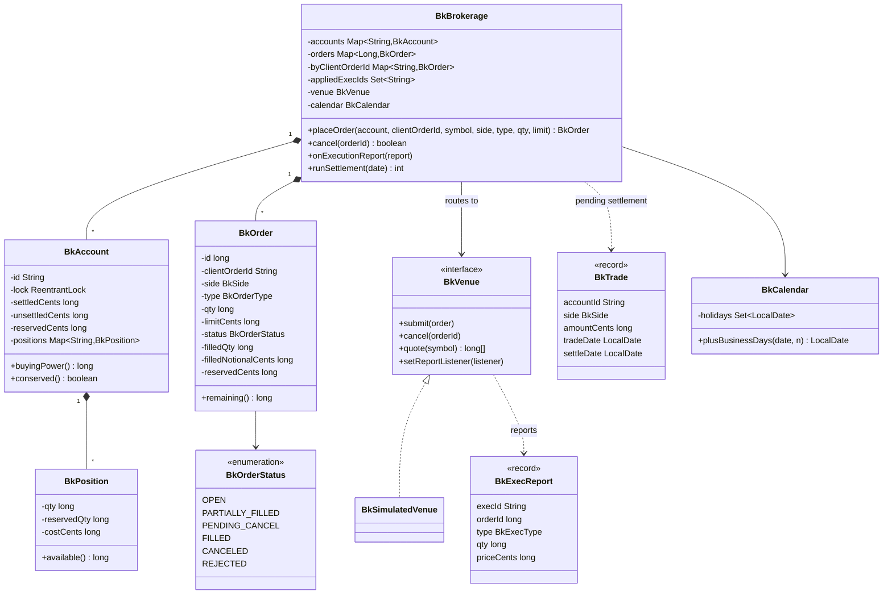
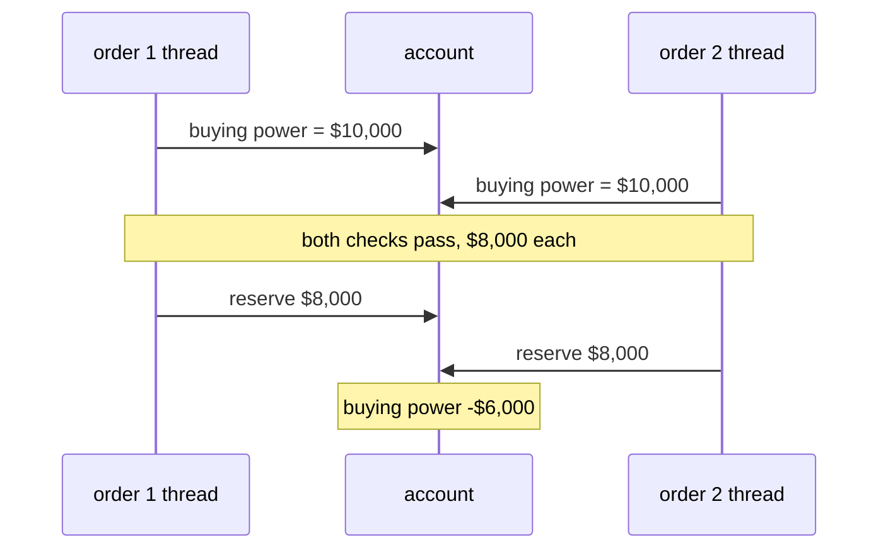
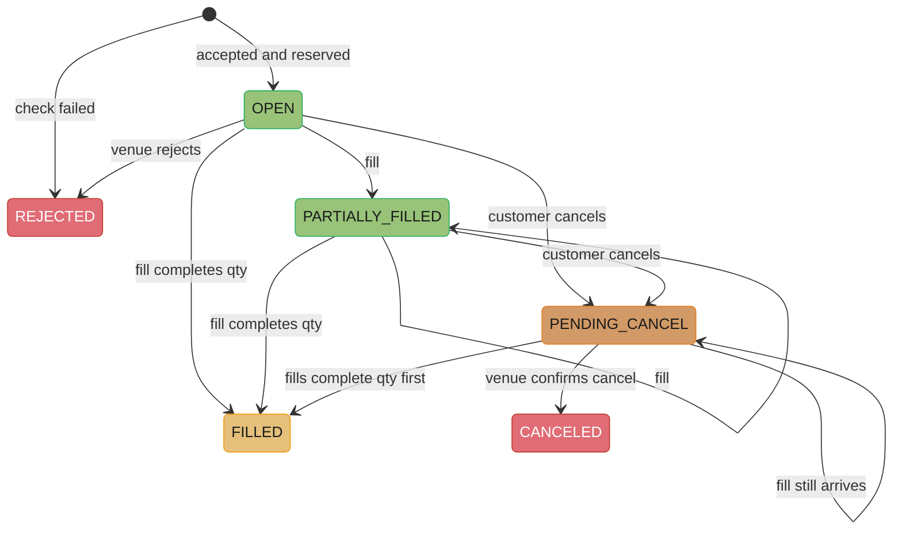
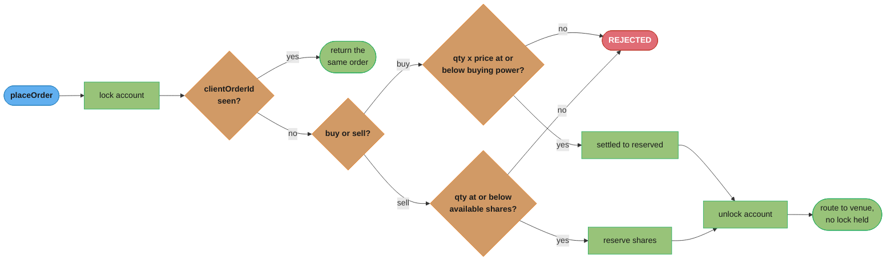

# Online Stock Brokerage — Low-Level Design

The broker side of a trading app: accounts, buying power, orders, execution reports, positions and settlement. The exchange's matching engine is someone else's class; this page designs the classes that decide whether a customer can afford an order, what they own after a fill, and when their cash is really theirs.

## Intuition

> **One-line analogy**: a broker is a travel agent for orders. It checks you can pay, books the trip with a venue it does not control, and then believes only the confirmations the venue sends back. Your ticket is "booked" when the confirmation arrives, not when you clicked the button.

**Mental model**: an order is a **promise with a reservation**. When the customer clicks Buy, the broker moves cash from "spendable" to "held for this order" and only then sends the order to a venue. Everything after that is evidence arriving from outside: fills, cancels, rejects. Each piece of evidence moves money from "held" to "spent" or back to "spendable", exactly once. Sale proceeds sit in a third bucket, "unsettled", until settlement day.

**Why it matters**: this problem (listed as a Hard LLD problem in the common question banks) combines three things that interviewers like to probe in one design: a **check-then-act race on money** (two orders spending the same buying power), an **order state machine driven by external, unreliable messages** (duplicates, a fill that arrives after you asked to cancel), and **time-based money rules** (T+1 settlement on business days). Candidates who model "place order, update balance" in one step miss all three.

**Key insight**: **reserve at accept, release on evidence, and key every effect on the venue's execution id.** The reservation and the buying-power check run under one lock per account, so two orders cannot both see the same cash. Every fill is applied once per `execId`, so a report the venue resends after a reconnect changes nothing. Cash and shares leave the "held" buckets only when a fill, cancel or reject says so.

**Full runnable implementation:** [`OnlineStockBrokerage.java`](OnlineStockBrokerage.java) — one file, `main()` in the `OnlineStockBrokerage` class. It demonstrates a `BkBrokerage` (the order management core) with per-account locks, cash in settled, unsettled and reserved buckets, share reservations for open sells, a `BkOrderStatus` state machine including `PENDING_CANCEL`, a `BkVenue` adapter with a simulated venue that fills against a quote and calls back after releasing its own lock, `execId` deduplication, client-order-id idempotency, a market-order collar, and a T+1 business-day settlement batch with a holiday calendar. Two bugs are run for real: the double spend without a lock, and a resent fill without deduplication. A final stress run sends 8,000 concurrent orders and checks that cash is conserved in every account. Every type carries a `Bk` prefix because all files in this package are compiled together.

**Where the rest lives:** the venue's price-time book is [Order Matching Engine](OrderMatchingEngine.md). The production-scale version of this page, with smart order routing to wholesalers, fractional shares, drop-copy reconciliation and clearing-firm settlement, is the fintech case study [Design a Broker Order Management System](../../fintech/case_studies/design_a_broker_order_management_system.md). This page is the class design that study assumes.

---

## Problem Statement

Design the core classes of an online stock brokerage:

- Customers have accounts with cash and positions (shares per symbol)
- Customers place **market** and **limit** orders to buy or sell, and can **cancel** open orders
- A buy is accepted only if the account has enough **buying power**; a sell only if the account has enough **available shares**
- Orders are sent to a trading venue, which reports back **fills** (possibly partial, possibly several), **cancels** and **rejects**
- Positions and cash update from those reports; the customer sees order status and an average fill price
- Sale proceeds **settle T+1** (one business day after the trade) and only then become spendable in a cash account
- The app may retry a request after a timeout, and the venue may resend a report after a reconnect; neither may double-count anything

---

## Requirements

### Functional
1. `placeOrder(account, clientOrderId, symbol, side, type, qty, limit)` validates, reserves and routes, or rejects with a reason
2. Buying power check for buys (settled cash in this cash-account model), available-shares check for sells (held minus shares reserved by open sells)
3. `onExecutionReport(report)` applies fills, cancels and rejects to the order, the position and the cash buckets
4. `cancel(orderId)` requests a cancel; fills that arrive before the venue confirms still count
5. Unused reservations are released when an order completes, is canceled or is rejected
6. `runSettlement(date)` moves sale proceeds whose settle date has arrived from unsettled to settled
7. Average fill price per order; cost basis per position

### Non-Functional
1. **No double spend**: concurrent orders on one account never reserve more than its buying power
2. **Exactly-once effect per execution**: a duplicate `execId` changes nothing
3. **Idempotent order entry**: a repeated `clientOrderId` returns the original order
4. **Conservation**: for every account, `settled + unsettled + reserved + bought - sold == deposits` at all times
5. **No account contention across accounts**: one lock per account, never a global lock
6. **Exact money**: cents and whole shares as `long`, with overflow-checked multiplication

---

## Class Diagram



`BkAccount` is the unit of locking and of money: every change to its cash buckets, its positions or one of its orders happens while holding its lock. `BkBrokerage` owns the cross-account indexes (orders by id, by client order id, applied execution ids) in concurrent maps. `BkVenue` is the boundary to a system the broker does not control; everything that crosses it is an immutable record (`BkVenueOrder` out, `BkExecReport` in).

---

## Patterns Used

### 1. State — `BkOrderStatus` with guarded transitions
**Where:** `OPEN -> PARTIALLY_FILLED -> FILLED`, `PENDING_CANCEL -> CANCELED`, and `REJECTED`. `isTerminal()` guards every report: a report for a terminal order is logged and ignored.

**Why an enum with guards:** the states differ in which reports they accept, not in large behaviour, so the guard is one check at the top of `onExecutionReport`. The important state is `PENDING_CANCEL`: the customer asked to cancel, but fills can still arrive until the venue confirms.

### 2. Adapter — `BkVenue`
**Where:** `submit`, `cancel`, `quote`, and a report listener. `BkSimulatedVenue` is one implementation; real ones speak FIX or a venue's binary protocol.

**Why:** the brokerage logic must not change when a venue changes protocol or when a second venue is added. The adapter also fixes the threading contract: the venue delivers reports after releasing its own lock, so the brokerage can take account locks in the callback without a lock-order cycle.

### 3. Observer — execution reports
**Where:** `venue.setReportListener(this::onExecutionReport)`.

**Why:** fills arrive when the market moves, not when the broker asks. Push delivery to a single entry point means every report, whether from a new order, a quote change or a resend, goes through the same deduplication and state checks.

### 4. Facade — `BkBrokerage`
**Where:** `placeOrder`, `cancel`, `onExecutionReport`, `runSettlement`.

**Why:** the app and the venue each see one object. The idempotency maps, the locks and the settlement queue stay internal, which is what makes it possible to move them to a database later without changing callers.

---

## Design Decisions & Tradeoffs

| Decision | Alternative | Why this choice |
|---|---|---|
| Reserve cash or shares when the order is accepted | Check buying power, debit on fill | Between accept and fill the same cash could back a second order. The reservation is what makes the check mean something |
| One lock per account for check and reserve | One global lock; no lock | A global lock serialises every customer. No lock lets two orders both pass the check, run for real in the demo |
| Cash in three buckets: settled, unsettled, reserved | One balance | One balance cannot say what is spendable now. The buckets also make conservation checkable: their sum plus bought minus sold must equal deposits |
| Deduplicate on the venue's `execId` | Trust the venue to send each report once | Venues resend after reconnects. The demo applies one fill twice without dedupe and ends with 120 shares for an order of 100 |
| Idempotent entry on `clientOrderId` | Trust the app not to retry | Mobile apps retry on timeout. A second order would reserve a second time and could fill twice |
| `PENDING_CANCEL` state | Mark canceled immediately on request | A fill can arrive between the request and the venue's confirmation. Marking canceled early either drops that fill or applies it to a closed order |
| Reserve market buys at ask + 5% (collar) | Reserve at the last price | The price can move before the fill. The collar bounds the risk; unused cash is released on the fill. 5% is an illustrative product choice, not a rule |
| Buying power = settled cash only | Count unsettled sale proceeds too | Conservative and simple. Real cash accounts may let customers buy with unsettled proceeds, with rules about selling before they settle (see the free-riding question) |
| Never hold a lock while calling the venue | Route under the account lock | A venue call is I/O. Holding the account lock would block every other action on that account for the venue's latency, and the venue's callback would need the same lock |

### Reserve at accept, release on evidence

```
event                          settled     reserved    bought     position
deposit                        $20,000.00  $0.00       $0.00      0
accept: BUY 100 LIMIT $100.50  $9,950.00   $10,050.00  $0.00      0     reserve 100 x $100.50
fill 60 @ $100.00              $9,950.00   $4,050.00   $6,000.00  60    reserved -> bought
fill 40 @ $99.90, FILLED       $10,004.00  $0.00       $9,996.00  100   $54.00 released
```

*Every row keeps `settled + reserved + bought` at $20,000.00. The $54.00 that returns to settled cash is the difference between the limit price the customer agreed to and the prices the venue actually filled at.*

### The double spend the lock prevents



*Each check was true when it ran and false by the time its write landed. Under the account lock, order 2 reads $2,000 of buying power and is rejected.*

### A cancel that races a fill



*`PENDING_CANCEL` exists because the customer's cancel and the venue's fill can cross. Every terminal state releases whatever the order still holds: unused cash for a buy, unsold shares for a sell.*

### T+1 settlement on business days

The SEC shortened the standard settlement cycle for most broker-dealer transactions from T+2 to T+1 (amendments to Exchange Act Rule 15c6-1(a), compliance date 28 May 2024). In the model here, sale proceeds stay in `unsettled` until the settlement batch runs on the settle date. The settle date skips weekends and a configurable holiday set:

```
trade date               T+1 settle date
Fri 2026-11-20           Mon 2026-11-23     weekend skipped
Wed 2026-11-25           Fri 2026-11-27     with Thu 2026-11-26 configured as a holiday
```

*The calendar is data, not code: a real system loads the market's holiday list each year. [CCP Clearing and Settlement](../../fintech/ccp_clearing_and_settlement/ccp_clearing_and_settlement.md) covers what happens between the broker, the clearing firm and the clearinghouse on that date.*

---

## State / Flow

**Order entry, in order:**



*Check and reserve happen under one lock; routing happens after it is released. A rejected order is still recorded under its client order id, so a retry gets the same rejection instead of a second attempt.*

---

## Implementation

The full listing is in [`OnlineStockBrokerage.java`](OnlineStockBrokerage.java). These are the parts that carry the decisions above.

**BROKEN, then FIX: the buying-power check:**

```java
// BROKEN -- check and debit are separate steps with nothing between them
boolean buy(long costCents) {
    if (costCents > buyingPowerCents) {
        return false;
    }
    buyingPowerCents -= costCents;     // two threads that both passed the check both subtract
    return true;
}
```

```java
// FIX -- check and reserve under the account lock, route after unlocking
acct.lock.lock();
try {
    BkOrder existing = byClientOrderId.get(accountId + "/" + clientOrderId);
    if (existing != null) return existing;                  // idempotent retry
    order = new BkOrder(...);
    String reason = reserve(acct, order);                   // settled -> reserved, or shares reserved
    if (reason != null) { order.status = BkOrderStatus.REJECTED; return order; }
} finally {
    acct.lock.unlock();
}
venue.submit(new BkVenueOrder(order.id, symbol, side, type, qty, limitCents));
```

**BROKEN, then FIX: applying execution reports:**

```java
// BROKEN -- a report the venue resends after a reconnect is applied a second time
void onExecutionReport(BkExecReport r) {
    applyFill(acct, order, r.qty(), r.priceCents());
}
```

```java
// FIX -- the execId is the idempotency key; a terminal order accepts nothing
void onExecutionReport(BkExecReport r) {
    acct.lock.lock();
    try {
        if (!appliedExecIds.add(r.execId())) return;        // duplicate
        if (order.status.isTerminal()) return;              // late report: log, never apply
        switch (r.type()) {
            case FILL -> applyFill(acct, order, r.qty(), r.priceCents());
            case CANCELED -> close(acct, order, BkOrderStatus.CANCELED);
            case REJECTED -> close(acct, order, BkOrderStatus.REJECTED);
        }
    } finally {
        acct.lock.unlock();
    }
}
```

**Releasing whatever the order still holds, in one place:**

```java
private void close(BkAccount acct, BkOrder order, BkOrderStatus terminal) {
    if (order.side == BkSide.BUY) {
        acct.reservedCents -= order.reservedCents;      // unused cash goes back
        acct.settledCents += order.reservedCents;
        order.reservedCents = 0;
    } else {
        acct.position(order.symbol).reservedQty -= order.remaining();   // unsold shares free again
    }
    order.status = terminal;
}
```

**The venue calls back after releasing its own lock:**

```java
public void submit(BkVenueOrder order) {
    List<BkExecReport> out = new ArrayList<>();
    synchronized (this) {
        long remaining = match(order, order.qty(), out);   // collect reports under the venue lock
        // ... rest or cancel the remainder
    }
    out.forEach(listener);                                  // deliver with no venue lock held
}
```

The brokerage only ever takes the account lock and then, briefly, the venue lock (to read a quote); the venue never takes an account lock while holding its own. With one lock order, there is no deadlock.

---

## Sample Output

Real output from `java OnlineStockBrokerage.java`, pasted verbatim:

```text
=== Online Stock Brokerage: reserve at accept, release on evidence, settle T+1 ===

--- Broken: two buy orders check buying power without a lock ---
buying power $10,000.00; two $8,000.00 orders both passed the check
orders accepted: 2, buying power now -$6,000.00   <- spent money the account never had
Fix (check and reserve under the account lock):
  #1001 BUY 80 ACME LIMIT @$100.00  status=OPEN  filled=0  avg=-
  #1002 BUY 80 ACME LIMIT @$100.00  status=REJECTED  filled=0  avg=-  (insufficient buying power: need $8,000.00, have $2,000.00)
  ACC-1: settled=$2,000.00 unsettled=$0.00 reserved=$8,000.00

--- Broken: the venue resends a fill after a reconnect ---
no dedupe:               filled=120/100  status=FILLED  position=120  paid=$12,000.00  (the venue filled 60)
Fix (dedupe on execId):  filled=60/100  status=PARTIALLY_FILLED  position=60  paid=$6,000.00  (the venue filled 60)

--- Step 1: limit buy, partial fill, price moves, full fill, unused cash released ---
reserved 100 x $100.50 = $10,050.00
after submit: #1001 BUY 100 ACME LIMIT @$100.50  status=PARTIALLY_FILLED  filled=60  avg=$100.00
  ACC-3: settled=$9,950.00 unsettled=$0.00 reserved=$4,050.00  ACME=60
ask drops to $99.90: #1001 BUY 100 ACME LIMIT @$100.50  status=FILLED  filled=100  avg=$99.96
  ACC-3: settled=$10,004.00 unsettled=$0.00 reserved=$0.00  ACME=100
cost 60 x $100.00 + 40 x $99.90 = $9,996.00; reservation released: $54.00
market buy 90: reserve 90 x ($99.90 ask + 5% collar = $104.89) = $9,440.10, then #1002 BUY 90 ACME MARKET  status=FILLED  filled=90  avg=$99.90
  ACC-3: settled=$1,013.00 unsettled=$0.00 reserved=$0.00  ACME=190
market buy 1,000: #1003 BUY 1000 ACME MARKET  status=REJECTED  filled=0  avg=-  (insufficient buying power: need $104,890.00, have $1,013.00)

--- Step 2: cancel while fills are still arriving ---
resting: #1001 BUY 100 ACME LIMIT @$100.00  status=OPEN  filled=0  avg=-
30 fill:  #1001 BUY 100 ACME LIMIT @$100.00  status=PARTIALLY_FILLED  filled=30  avg=$100.00
cancel:   #1001 BUY 100 ACME LIMIT @$100.00  status=CANCELED  filled=30  avg=$100.00
  ACC-4: settled=$17,000.00 unsettled=$0.00 reserved=$0.00  ACME=30   (30 x $100.00 spent, the other 70 x $100.00 released)
second cancel accepted? false

--- Step 3: sell on Friday, proceeds settle T+1 = Monday ---
bought 50, sold 50 on 2026-11-20 (FRIDAY): #1002 SELL 50 ACME LIMIT @$100.00  status=FILLED  filled=50  avg=$100.00
  ACC-5: settled=$4,995.00 unsettled=$5,000.00 reserved=$0.00
sell 1 more: #1003 SELL 1 ACME MARKET  status=REJECTED  filled=0  avg=-  (insufficient shares: want 1, available 0)
buy 60 @ $100.10 with unsettled proceeds: #1004 BUY 60 ACME LIMIT @$100.10  status=REJECTED  filled=0  avg=-  (insufficient buying power: need $6,006.00, have $4,995.00)
settlement run for 2026-11-21 (Sat): settled 0 trades
settlement run for 2026-11-23 (Mon): settled 2 trades
  ACC-5: settled=$9,995.00 unsettled=$0.00 reserved=$0.00
T+1 of Wed 2026-11-25 with Thu 2026-11-26 as a holiday: 2026-11-27

--- Step 4: the app retries an order after a timeout ---
first  -> order #1001, retry -> order #1001, same object? true
  ACC-6: settled=$9,000.00 unsettled=$0.00 reserved=$1,000.00   (reserved once, not twice)

--- Step 5: 8 threads x 1,000 random market orders across 4 accounts ---
orders: 8,000; rejected for buying power or shares: some
every account conserves cash (settled + unsettled + reserved + bought - sold == deposit)? true
no negative cash bucket or position? true
no cash or shares left held after all orders closed? true
duplicate or late reports ignored: 0
```

**What to read in it.** The two "Broken" blocks are the two ways a broker loses money in this design: spending the same buying power twice, and counting the same fill twice. In the second one the account looks consistent (the extra $6,000.00 came out of the reservation) and the order even says `FILLED`, which is why the bug survives a balance check and is caught only by comparing against the venue's own fill count. Step 2 shows the cancel race resolved correctly: 30 shares filled before the cancel took effect, so exactly 70 x $100.00 went back to settled cash. Step 3 shows the cost of the conservative buying-power rule: $5,000.00 of proceeds sits in `unsettled` over the weekend and cannot fund a $6,006.00 buy until Monday's settlement run.

---

## Cross-Perspective: HLD Connections

- **The full OMS.** [Design a Broker Order Management System](../../fintech/case_studies/design_a_broker_order_management_system.md) takes these classes to 5 million accounts and 20,000 orders per second at the open. Its §4.1 (the order state machine keyed on the execution-report id) and §4.2 (buying power: reserve at accept, release on evidence) are the scaled versions of this page's `onExecutionReport` and `reserve`; it also partitions by account for the same reason this page locks per account.
- **The venue side.** The venue that sends the execution reports runs a price-time order book, which is [Order Matching Engine](OrderMatchingEngine.md); pro-rata matching, auctions and self-trade prevention are in [Order Books and Matching Engines](../../fintech/order_books_and_matching_engines/order_books_and_matching_engines.md). An exchange end to end, with its own pre-trade risk gate and sequencer, is [Design a Stock Exchange](../../hld/case_studies/design_stock_exchange.md).
- **The wire.** `BkVenue` hides a FIX session in practice: new order, cancel request, and execution reports with an `ExecID`. [FIX Protocol and Order Entry](../../fintech/fix_protocol_and_order_entry/fix_protocol_and_order_entry.md) covers sequence numbers, resend requests (the reason duplicates arrive) and the `ClOrdID` chain behind this page's client order id.
- **Exactly-once effect.** Deduplicating on `execId` and `clientOrderId` is the money-movement version of the idempotency-key pattern; [Idempotency and Exactly-Once Money Movement](../../fintech/idempotency_and_exactly_once_money_movement/idempotency_and_exactly_once_money_movement.md) covers unknown outcomes and storage of the keys.
- **Order types.** Market, limit, stop and time-in-force semantics as the market defines them are in [Market Microstructure and Order Types](../../fintech/market_microstructure_and_order_types/market_microstructure_and_order_types.md).

---

## Follow-Up Extensions

### Extension drill: concurrency, multi-instance, persistence

| Follow-up | What changes in the design | What stays the same |
|---|---|---|
| **Concurrency**: many orders per account at the open | Keep one lock per account; keep venue I/O outside it; make the report handler the only writer of fills | Reserve-at-accept and the state machine |
| **Multi-instance**: OMS on many servers | Partition by account id so one instance owns each account (single writer); route execution reports to the owning partition by order id; or store buckets in a database and apply each change as a transaction with the reservation as a row | The per-account boundary; it becomes the partition key |
| **Persistence**: survive a crash mid-order | Write the order and its reservation before routing (so a crash cannot route an unreserved order); store applied `execId`s in the same transaction as the fill; on restart, ask the venue for the status of open orders and replay missed reports | `execId` dedupe makes replay safe |
| **Duplicate and missing reports at scale** | Compare the OMS's fills with the venue's drop copy and with the clearing firm's file, and alert on breaks | Applying a fill once per `execId` |
| **End-of-day** | Expire DAY orders with a cancel per open order at the close; run settlement for trades due that day | The terminal-state release in `close()` |

### Other extensions

1. **Margin accounts.** Buying power comes from a margin model (equity, maintenance requirement) owned by a risk service. `buyingPower()` becomes a call to that model; the reservation mechanics stay.
2. **Using unsettled proceeds.** Let cash accounts buy with unsettled sale proceeds, and track which positions were bought that way, so that selling them before the proceeds settle can be blocked or flagged.
3. **Stop orders.** Hold the order inside the broker until the market trades through the trigger price, then submit it as market or limit. It needs a quote observer per symbol and a reservation taken at trigger time or at entry (a product choice).
4. **Fractional shares.** The broker fills fractions from its own inventory account and trades whole shares at the venue. The fintech OMS case study §4.4 designs that inventory account.
5. **Watchlists and price alerts.** An observer on the quote stream per symbol, separate from the order path. It must never share the account lock, because alerts are read-only.

---

## Interview Questions with Answers

**Q: Two buy orders on the same account arrive at the same time. How do you stop them spending the same buying power?**
**Short:** check and reserve under one lock per account, so the second order sees the cash the first one already reserved.

Without a lock, both threads read $10,000 of buying power, both pass an $8,000 check, and both debit, leaving the account at -$6,000; the demo forces exactly this. The fix makes "read buying power, compare, move cash to reserved" one critical section per account. A lock per account (not a global one) keeps different customers from waiting on each other. Across servers the same rule becomes a single owner per account, or a database transaction that updates the balance with a condition such as `WHERE settled >= :need`.

**Q: Why reserve cash when the order is accepted, instead of debiting it when the order fills?**
**Short:** between accept and fill, the same cash could back a second order; the reservation makes the check binding.

An order can rest for hours. If cash left the account only on fill, a customer could place ten buy orders against the same balance, and all ten could fill. Reserving at accept moves the cash from settled to reserved immediately, so the next check sees less buying power. Fills then move money from reserved to bought, and the terminal state returns what is left. The fintech OMS case study calls this "reserve at accept, release on evidence".

**Q: The venue sends the same fill twice after a reconnect. What happens, and how do you prevent it?**
**Short:** without deduplication the fill is applied twice; keying every effect on the venue's execId makes the second one a no-op.

Venues resend execution reports when a session reconnects and resynchronises sequence numbers. If the handler applies every report it receives, the demo's order of 100 shares ends with 120 filled, 120 shares in the position and $12,000.00 paid, while the venue filled only 60. The account still balances, because the extra money came out of the reservation, so a balance check does not catch it. Store each applied `execId` in the same transaction as the fill and skip any report whose id is already there.

**Q: How do you make order entry idempotent?**
**Short:** the app sends a client order id; the broker stores it with the order and returns the existing order on a repeat.

The app generates a unique id per order (for example a UUID) and sends it with the request. The broker looks it up under the account lock before doing anything else; if it exists, it returns that order, even if it was rejected. A retry after a timeout therefore never reserves a second time or routes a second order. In FIX this is the `ClOrdID`; across servers the id needs a unique constraint scoped to the account.

**Q: The customer cancels while the order is partially filled. Why not mark it canceled immediately?**
**Short:** fills can still arrive until the venue confirms; PENDING_CANCEL accepts them and the confirmation releases only the rest.

The cancel request and a fill can cross on the wire. If the order became `CANCELED` at request time, a fill arriving a millisecond later would hit a terminal order and be ignored, and the customer would own shares the broker does not show. With `PENDING_CANCEL`, the fill is applied normally, and the venue's cancel confirmation releases only the remaining quantity. In the demo 30 shares fill before the cancel, and exactly 70 x $100.00 returns to settled cash.

**Q: Why keep settled, unsettled and reserved cash as separate buckets?**
**Short:** each answers a different question (spendable now, waiting for T+1, held by orders), and together they make conservation checkable.

A single balance cannot say how much the customer may spend right now. Settled cash is spendable, unsettled cash is sale proceeds waiting for settlement, and reserved cash is held by open buy orders. The buckets also give an invariant that a test or a monitor can check at any moment: `settled + unsettled + reserved + bought - sold == deposits`. The demo's 8,000-order stress run checks it on every account.

**Q: What does T+1 settlement mean for this design?**
**Short:** sale proceeds become settled cash one business day after the trade, so they sit in an unsettled bucket until a settlement run.

US equities settle T+1: the SEC moved most broker-dealer transactions from T+2 to T+1 with a compliance date of 28 May 2024. In the model, a sale credits `unsettled`, and a batch moves it to `settled` on the settle date, computed by adding one business day with a holiday calendar. A Friday sale settles on Monday; a Wednesday sale before a Thursday holiday settles on Friday. The calendar must be data loaded per year, not hard-coded weekdays.

**Q: Can a cash-account customer spend unsettled sale proceeds?**
**Short:** this model says no; real cash accounts often allow it but restrict selling the new position before the funds settle.

The demo uses the conservative rule: buying power is settled cash only, so a customer who sold on Friday cannot buy with those proceeds until Monday. Many brokers allow buying with unsettled proceeds, but then a customer who sells the new position before paying for it with settled funds is free-riding. Under Regulation T, if a security is sold before it was paid for in full, the account loses the privilege of delayed payment for 90 calendar days (12 CFR 220.8). Supporting this means tracking which positions were bought with unsettled money.

**Q: How do you reserve cash for a market order that has no price?**
**Short:** reserve the current ask plus a collar (5% here), and release the difference after the fill.

A market buy fills at whatever the venue offers, so the broker must reserve more than the current ask to cover a price move between accept and fill. The demo reserves `ask x 1.05`: 90 shares at a $99.90 ask reserve $9,440.10, fill at $99.90, and the unused part returns to settled cash. Without a quote, the order is rejected. The collar size is a risk decision; too small and a fast market overspends the reservation, too large and customers see orders rejected that they could afford.

**Q: How do you stop a customer selling the same shares twice with two open sell orders?**
**Short:** reserve shares on each sell order; available shares are the position minus shares held by open sells.

A sell order reserves its quantity in `reservedQty` at accept, just as a buy reserves cash. The next sell is checked against `qty - reservedQty`, so two orders cannot both sell the last 50 shares. A fill reduces both the position and the reservation; a cancel or reject releases the unfilled quantity. In the demo, after selling all 50 shares, a market sell for 1 more share is rejected with "available 0".

**Q: Why must no lock be held while calling the venue?**
**Short:** venue calls are I/O, and the venue calls back into the broker, so holding the lock adds latency and risks lock-order deadlocks.

Routing an order can take milliseconds or more. Holding the account lock during that call blocks every other action on the account for that time. Worse, the venue delivers fills through a callback that needs the account lock; if the venue held its own lock while calling back and the broker held the account lock while calling the venue, two threads could each wait for the other's lock. The design fixes one order: account lock, then a brief venue lock for quotes, and the venue releases its lock before calling back.

**Q: What happens to a report that arrives for an order that is already filled or canceled?**
**Short:** it is logged and ignored, because a terminal order has already released everything it held.

A terminal order has given back its unused reservation. Applying a late fill would spend cash that is no longer reserved, or reduce shares that are no longer held for the order. The handler checks `isTerminal()` before applying anything and counts the report as an anomaly. In production such a report is an operational event: it usually means the venue and the broker disagree, which reconciliation against the venue's drop copy must resolve.

**Q: How would you run this on many servers?**
**Short:** partition by account so each account has one writer, and route each execution report to the partition that owns its order.

All of an account's state (buckets, positions, orders) changes together, so the account is the natural unit of ownership. With one owner per account, the in-memory lock stays valid and the database stores the event log. Execution reports carry the order id, which maps to the account and therefore to the owning partition. The fintech OMS case study makes the same decision ("partition by account, not by symbol") for the same reason.

**Q: What would you persist, and in what order, to survive a crash?**
**Short:** persist the order and its reservation before routing, and each applied execId with its fill in one transaction.

If the broker routed first and crashed before saving, the venue would hold an order the broker does not know about, with no reservation behind it. Writing the order and reservation first means a crash leaves at worst an unrouted order that a recovery job can route or cancel. Writing the `execId` in the same transaction as the fill makes replay after a restart safe: the broker can ask the venue to resend everything for open orders, and duplicates are skipped.

**Q: How do you know the system is correct, beyond unit tests?**
**Short:** check invariants continuously: cash conservation per account, no negative buckets, and fills matching the venue's records.

The demo's stress run checks three invariants after 8,000 concurrent orders: conservation of cash per account, no negative bucket or position, and nothing left reserved once every order is closed. In production the same checks run as monitors, and an external comparison adds what internal invariants cannot see, such as the duplicated fill in the demo, which conserves cash perfectly. Comparing the broker's fills with the venue's drop copy and the clearing firm's trade file is how that class of bug is caught.
