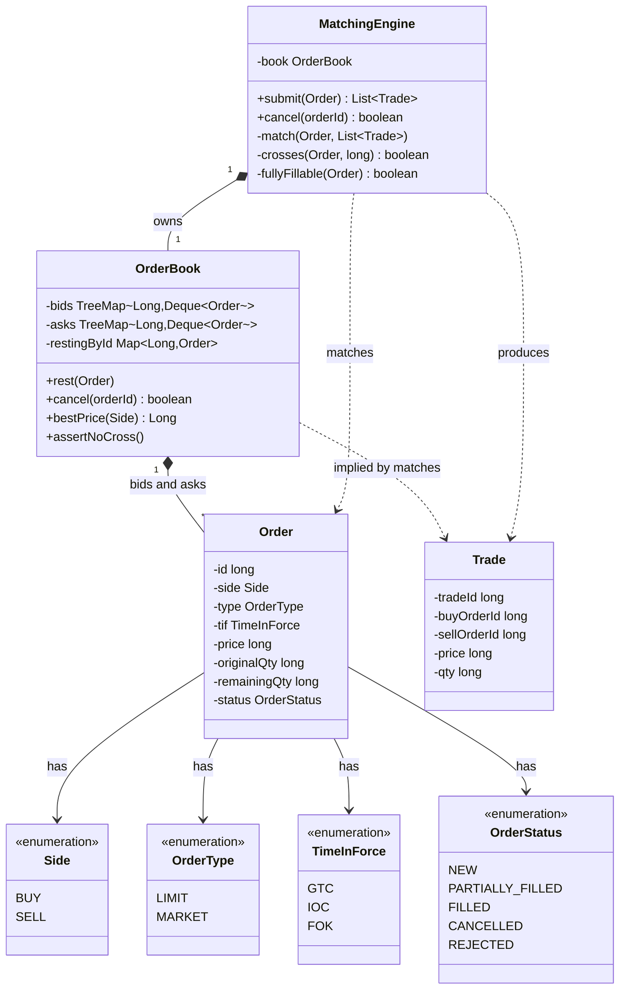
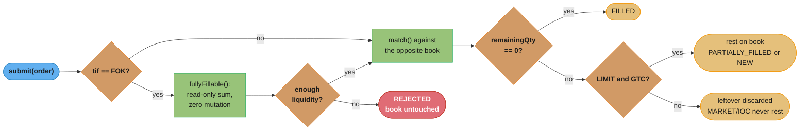

# Order Matching Engine — Low Level Design
A price-time priority limit order book — the fintech LLD problem, and the only one on this page's sibling list that forces a `TreeMap<Price, Deque<Order>>` as the answer, not a choice.

## Intuition

> **One-line analogy**: a limit order book is two sorted stacks of sticky notes — one for "I'll buy at this price or lower," one for "I'll sell at this price or higher" — and matching is just checking whether the top note on one stack beats the top note on the other.

**Mental model**: `BUY` orders (bids) sort **best-first as the highest price**; `SELL` orders (asks) sort **best-first as the lowest price**. The two stacks never overlap once matching settles — the moment a bid's price would reach as high as an ask's price, they trade instead of both resting. Within one price, first-in-first-out decides who trades first: price beats time, time beats everything else.

**Why it matters**: this is the problem interviewers reach for specifically because a wrong data-structure instinct (a heap, a sorted `List`, a plain `HashMap`) either can't cancel an arbitrary order without a linear scan of everything, or can't keep FIFO order within a price level, or both. Getting price ordering AND time ordering AND cancellable-by-id right simultaneously, in one structure, is the actual test.

**Key insight**: the crossed-book invariant — **best bid must be strictly less than best ask after every single operation** — is the one property that makes an order book an order book rather than an arbitrary pair of maps. Every design decision on this page (why `long` ticks, why a `Deque` per level, why single-threaded) exists to make that invariant trivially easy to keep, never something you have to reason hard about at 3am.

**Full runnable implementation:** [`OrderMatchingEngine.java`](OrderMatchingEngine.java) — one file, `main()` at the bottom. It demonstrates a `TreeMap<Long, Deque<Order>>` book on both sides (bids reverse-ordered, asks natural-ordered), the price-time-priority matching loop, `LIMIT`/`MARKET` order types crossed against `GTC`/`IOC`/`FOK` time-in-force, partial fills on both the resting and incoming side, cancellation by id, and — run for real, not asserted — the exact bug you get from pricing in `double` and the exact `ConcurrentModificationException` you get from mutating a `TreeMap` mid-iteration.

---

## Problem Statement

Design the core of a **limit order matching engine** for a single trading symbol: the in-memory data structure and algorithm a real exchange or crypto venue runs per symbol, not the distributed system around it. Support:

- Submitting a **LIMIT** order (buy/sell up to a specified price) or a **MARKET** order (buy/sell immediately at whatever price is available)
- Three time-in-force values: **GTC** (rests on the book until filled or cancelled), **IOC** (fills whatever it can immediately, kills the rest, never rests), **FOK** (fills the entire quantity immediately or does nothing at all)
- **Price-time priority** matching: better price wins first; among equal prices, the order that arrived first wins first
- **Partial fills** on either side of a trade — an incoming order can consume part of a resting order, and an incoming order that isn't fully satisfied either rests (GTC) or has its remainder discarded (IOC/MARKET)
- **Cancelling** a resting order by id
- Emitting a `Trade` for every match, and maintaining the **crossed-book invariant**: after every operation, the best bid is strictly below the best ask

This is deliberately the single-threaded, single-symbol, in-process view. [`../../hld/case_studies/design_stock_exchange.md`](../../hld/case_studies/design_stock_exchange.md) covers what happens once that has to run at exchange scale — see [Cross-Perspective](#cross-perspective-hld-connections).

---

## Requirements

### Functional
1. `submit(Order)` — accept a new `LIMIT` or `MARKET` order, match it against the resting book per price-time priority, return the list of `Trade`s produced
2. Honor `GTC` (rest any unfilled remainder), `IOC` (fill-then-kill, never rest), `FOK` (fill completely or reject outright with **zero** book mutation)
3. `cancel(orderId)` — remove a resting order; return whether it was actually resting (idempotent, not an error to cancel twice)
4. Every match must respect **price-time priority**: the best-priced resting order fills first; ties on price fill in arrival order
5. After every `submit()`, the book must satisfy `bestBid < bestAsk` (or one/both sides empty) — it must never end an operation crossed

### Non-Functional
1. **Submit and match**: O(log L) to find the best price level (L = number of distinct price levels), O(1) to pop/push within a level's FIFO queue
2. **Cancel**: O(1) to locate the order by id, O(k) to remove it from its price level's queue (k = orders resting at that price — see [Design Decisions](#design-decisions--tradeoffs) for why this is the honest cost, not O(1))
3. **Deterministic and replayable**: given the same sequence of orders, the engine must produce the exact same sequence of trades every time — this is what makes the single-threaded design in this page correct, not merely convenient
4. **Exact arithmetic**: no floating-point price or quantity anywhere — a matching engine that silently drifts a cent is a matching engine that silently steals or gives away money
5. No matching decision may ever leave the book crossed, even transiently within a single `submit()` call

---

## Class Diagram



`OrderBook` is pure storage plus ordering — it knows nothing about matching rules, only how to hold orders sorted by price with FIFO within a level, and how to check the crossed-book invariant. `MatchingEngine` owns the actual algorithm: crossing logic, the FOK dry-run, and the decision of whether a leftover rests or is discarded.

---

## Patterns Used

This problem is graded on **data-structure selection**, not GoF pattern application — see [Design Decisions](#design-decisions--tradeoffs) below for the actual argument. Two patterns are genuinely present; forcing a third onto this design would be the wrong instinct.

### 1. (Simplified) State — the `Order` lifecycle
**Where:** `OrderStatus` (`NEW` → `PARTIALLY_FILLED` → `FILLED` / `CANCELLED` / `REJECTED`).

**Why simplified, not full State-pattern polymorphism**: a textbook State pattern gives each state its own class with its own behavior, because different states *do* different things when the same event fires. Here, every state transition is the same operation — subtract a fill quantity, compare to zero, set an enum — with no state-specific behavior to justify five classes and a `StatusHandler` interface. An enum field mutated directly is the honest amount of structure; reach for full State only if a status gains real behavior (e.g., a `REJECTED` order that must fire a compliance callback `FILLED` never does).

### 2. Strategy — time-in-force, documented as the natural extension
**Where:** the `GTC`/`IOC`/`FOK` branch in `MatchingEngine.submit()` — currently a 3-way `if`, not an interface.

**Why not implemented as Strategy here**: three fixed variants with no runtime injection point is exactly the case where an `if`/`switch` beats an interface — a `TimeInForcePolicy` with `GtcPolicy`/`IocPolicy`/`FokPolicy` implementations adds three files and zero flexibility for three values that never change at runtime. **The natural trigger to actually build it**: adding a fourth variant like `GTD` (Good-Til-Date, expires at a wall-clock time if unfilled) or `MOO`/`MOC` (Market-On-Open/Close, only eligible during a specific session) — at that point the branching logic starts carrying real per-variant state (an expiry timestamp, a session gate) that wants its own class. Don't build the interface before that need exists.

---

## Design Decisions & Tradeoffs

### The core structure: `TreeMap<Long, Deque<Order>>`, not a heap, not a sorted array

| Structure | Best-price lookup | Insert | Cancel arbitrary order | FIFO within a price | Verdict |
|---|---|---|---|---|---|
| **`TreeMap<Price, Deque<Order>>`** (this page) | O(log L) | O(log L) | O(1) find level + O(k) remove from its `Deque` | Free — `Deque` insertion order *is* FIFO | The answer |
| `PriorityQueue<Order>` (single heap, price+time comparator) | O(log n) peek | O(log n) | **O(n) find, and no reliable index to fix it** | Only if the comparator ties correctly, and even then | Wrong — see below |
| Sorted `ArrayList<Order>` | O(log n) binary search | **O(n) shift** | O(n) find + O(n) shift | Preserves position, but every insert pays the shift | Wrong — insert cost dominates |
| Hashed price-level array (fixed tick grid, index = price) | O(1) | O(1) | O(1) find level + O(k) remove | Free, same as TreeMap | Wins **only** at extreme scale with a bounded, dense tick range (real HFT engines do this) — see [Follow-Up Extensions](#follow-up-extensions) |

**Why a single heap is the specific wrong answer, not just a slower one.** A `PriorityQueue<Order>` gets you O(log n) *peek-the-best* for free, which looks like it solves matching. It does not solve **cancel**. A heap only guarantees the *root* is the minimum (or maximum) — an arbitrary element's position is unconstrained, so finding "order #4821, currently resting somewhere in this heap" costs a full O(n) scan, and there is no cheap way to fix that: adding a `Map<orderId, heapIndex>` side-index means every sift-up/sift-down during every insert and poll must also update that index, which is real extra bookkeeping `PriorityQueue`'s own API gives you no hook to attach (this is the same "indexed priority queue" gap [`TaskScheduler.md`](TaskScheduler.md) names for its own cancel path). The `TreeMap<Price, Deque<Order>>` sidesteps the whole problem: cancelling doesn't need to know *where* in a global ordering an order sits, only *which price level's queue* it's in — an O(1) `HashMap<orderId, Order>` lookup answers that, and removing from a `Deque` by reference is O(k) against however many orders share that one price, never against the whole book.

**Why a `Deque` per level, not a `List` or another sorted structure.** Within one price, the *only* ordering rule is arrival order — first in, first matched. A `Deque` gives O(1) `addLast` (new order arrives) and O(1) `peekFirst`/`pollFirst` (oldest order matches next) with zero comparison logic needed; a `List` would work but invites someone to reach for `Collections.sort()` on it later, which is meaningless here — there is nothing to sort by within a level, sorting already happened by insertion order.

### Why the matching core is single-threaded

Two independent reasons, and only one of them is about speed:

1. **Determinism and replay** (the actual reason, per the Non-Functional requirements above). A trading system's audit trail is only as good as its ability to replay a sequence of orders and get the *exact same trades* back — for regulatory reconstruction, for disaster recovery, for debugging a disputed fill. The instant two threads can interleave differently on different runs, "replay this order log" stops being well-defined. A single thread processing one `submit()` fully before starting the next isn't a performance shortcut, it's what makes the output a *function* of the input at all.
2. **Throughput, secondarily.** A single core running a tight `TreeMap`/`Deque` loop is genuinely fast (real matching engines hit single-digit-microsecond processing per order), and lock contention across multiple threads fighting over the same book would very likely be *slower* than one thread with no locking at all — but this is a secondary benefit, not the design's justification. Scale comes from running one single-threaded engine **per symbol**, in parallel across symbols, never from parallelizing *within* one symbol's book. [`../../hld/case_studies/design_stock_exchange.md`](../../hld/case_studies/design_stock_exchange.md) §1 makes exactly this point at exchange scale.

### Why price is a `long` in ticks, never a `double`

This is not a rounding-tolerance nitpick — it is a correctness bug that silently splits liquidity. `OrderMatchingEngine.java`'s `demonstrateDoublePriceBug()` builds one price two different ways that both *mean* "$100.30" — one by literally writing `100.30`, one by walking three `0.10` ticks up from `100.00` (`100.00 + 0.10 + 0.10 + 0.10`) — and the two don't compare equal:

```
walked-up price (100.00 + 0.10 x3) = 100.29999999999998000
literal price      (100.30)         = 100.30000000000000000
walked == literal ? false  <- both mean $100.30, and are not equal
an incoming BUY at literal $100.30 finds that resting order? false
```

If price is a `TreeMap<Double, …>` key, that resting order and an incoming order at the "same" price land in **two different tree nodes** — the book now silently believes there are two distinct price levels where there is only one, an incoming marketable order fails to find liquidity that is genuinely there, and the split gets worse every time a price is *computed* (a midpoint, a tick walk, a percentage move) rather than typed as a literal. The fix used throughout this page: price is a `long` counted in minor-unit ticks (cents) — `10_000 + 10 * 3 == 10_030`, exactly, every time, because integer arithmetic has no rounding step to accumulate error in. `BigDecimal` with a fixed `scale()` is the other legitimate answer (Java has no native fixed-point type) and is what you'd reach for if quantities also need fractional precision beyond what a tick-scaled `long` comfortably represents — cryptocurrency venues routinely need 8 decimal places of quantity, at which point `BigDecimal`'s explicit scale beats inventing your own multi-unit `long` encoding. What's never acceptable is `double`/`float` for money, in either representation.

### Why the matching loop pulls `firstEntry()` in a `while`, never an enhanced-for over the map it mutates

The matching loop removes a price level from the `TreeMap` the instant that level's `Deque` empties out — and a `TreeMap`'s (or any `java.util` collection's) enhanced-for loop is fail-fast: structurally mutating the collection anywhere except through the iterator's own `remove()` trips a `ConcurrentModificationException` on the iterator's next step. `OrderMatchingEngine.java`'s `demonstrateConcurrentModificationBug()` proves it against a 3-level toy book:

```
threw java.util.ConcurrentModificationException after only 1 of 3 levels processed
remaining levels frozen mid-crash: [10100, 10200]
Fix: pull firstEntry()/remove(key) in a while loop -- no live iterator, nothing to trip.
```

The real matching loop never holds a live iterator across a mutation in the first place: it calls `opposite.firstEntry()` fresh each pass of a `while`, does its fill accounting, and only *then* calls `book.detachFilled(...)` (which removes the drained level via `map.remove(key)`, a plain keyed removal, not an iterator operation) — so there is no iterator state left dangling to invalidate. The one place this page *does* iterate a live `entrySet()` — `fullyFillable()`'s FOK dry-run — is safe for the opposite reason: it never mutates anything, it only reads and sums, so fail-fast has nothing to fire on.

### The trade price: the resting order's price, never the incoming order's

When an incoming `LIMIT BUY` at $100.10 crosses a resting `SELL` at $100.05, the trade executes at **$100.05** — the resting (better, standing) price — not $100.10. This is standard price-time-priority convention (sometimes called price improvement): the aggressor gets whatever price was already available, never worse than what they were willing to pay, and often better. A `MARKET` order has no price of its own at all, so this rule is also *why* a `MARKET` order can even execute — `fillPrice = resting.price` is well-defined regardless of what the incoming order specified, because the incoming order never specifies a price to begin with.

### FOK's dry run must be read-only, and must run before any mutation

An `FOK` order that can't be fully filled must reject with **zero trace** in the book — not "fill 30% then roll it back," a real revert-on-failure path that's easy to get wrong under a bug, but "check first, touch nothing if the check fails." `fullyFillable()` walks the same price levels the real `match()` would, in the same order, applying the same `crosses()` rule, summing available quantity — but it only ever reads `level.getValue()`, it never calls `pollFirst()` or removes a level. `submit()` calls it *before* calling `match()` at all, so a rejected FOK order never enters the matching loop in the first place; there is no undo because there was never a do.



The FOK check happens strictly before `match()` ever runs — the diagram's left branch never touches the book at all when it rejects.

---

## Implementation

The full listing lives in [`OrderMatchingEngine.java`](OrderMatchingEngine.java); the pieces below are the ones that carry the actual design decisions above.

**Ordering — two `TreeMap`s, opposite comparators:**

```java
final class OrderBook {
    // best bid = HIGHEST price = firstKey() -> reverse natural order
    private final NavigableMap<Long, Deque<Order>> bids = new TreeMap<>(Collections.reverseOrder());
    // best ask = LOWEST price = firstKey() -> natural order
    private final NavigableMap<Long, Deque<Order>> asks = new TreeMap<>();
    private final Map<Long, Order> restingById = new HashMap<>();

    void rest(Order order) {
        sideBook(order.side).computeIfAbsent(order.price, p -> new ArrayDeque<>()).addLast(order);
        restingById.put(order.id, order);
    }

    boolean cancel(long orderId) {
        Order order = restingById.get(orderId);
        if (order == null) return false;
        Deque<Order> level = sideBook(order.side).get(order.price);
        if (level == null || !level.remove(order)) return false; // identity remove, O(k)
        if (level.isEmpty()) sideBook(order.side).remove(order.price);
        order.status = OrderStatus.CANCELLED;
        restingById.remove(orderId);
        return true;
    }
}
```

**The matching loop — no live iterator, mutation happens between passes, never during one:**

```java
private void match(Order incoming, List<Trade> trades) {
    NavigableMap<Long, Deque<Order>> opposite = book.oppositeBook(incoming.side);

    while (incoming.remainingQty > 0) {
        Map.Entry<Long, Deque<Order>> best = opposite.firstEntry();
        if (best == null || !crosses(incoming, best.getKey())) break;

        Deque<Order> level = best.getValue();
        Order resting = level.peekFirst(); // FIFO -- oldest order at this price wins first

        long fillQty = Math.min(incoming.remainingQty, resting.remainingQty);
        long fillPrice = resting.price; // resting side always sets the trade price

        trades.add(new Trade(nextTradeId(), buyIdOf(incoming, resting), sellIdOf(incoming, resting), fillPrice, fillQty));

        incoming.remainingQty -= fillQty;
        resting.remainingQty -= fillQty;

        if (resting.remainingQty == 0) {
            resting.status = OrderStatus.FILLED;
            book.detachFilled(resting, level, best.getKey(), resting.side); // mutation HERE, between passes
        } else {
            resting.status = OrderStatus.PARTIALLY_FILLED;
        }
    }
}
```

**Broken, then fixed — the two bugs this page keeps coming back to:**

```java
// BROKEN -- price keyed by a computed double instead of a typed tick long
TreeMap<Double, String> brokenBook = new TreeMap<>();
double walkedUp = 100.00;
for (int i = 0; i < 3; i++) walkedUp += 0.10;   // "walk" to $100.30
brokenBook.put(walkedUp, "resting SELL 100 @ $100.30");
brokenBook.containsKey(100.30);                  // false -- same intended price, different key
```

```java
// FIX -- price is a long in ticks; there is no arithmetic step that can drift it
long walkedUp = 10_000L;
for (int i = 0; i < 3; i++) walkedUp += 10L;     // "walk" to 10_030 ticks == $100.30
book.get(walkedUp).equals(book.get(10_030L));    // trivially true -- it's the same key
```

```java
// BROKEN -- structural mutation through a live enhanced-for iterator
for (Map.Entry<Long, Deque<Order>> level : book.entrySet()) {
    level.getValue().pollFirst();
    if (level.getValue().isEmpty()) {
        book.remove(level.getKey());             // throws ConcurrentModificationException
    }
}
```

```java
// FIX -- no iterator held across the mutation
while (!book.isEmpty()) {
    Map.Entry<Long, Deque<Order>> level = book.firstEntry();
    level.getValue().pollFirst();
    if (level.getValue().isEmpty()) {
        book.remove(level.getKey());             // plain keyed removal, no iterator to invalidate
    }
}
```

---

## Sample Output

Real output from `java OrderMatchingEngine.java`, pasted verbatim:

```
--- Broken: a double price key silently splits one price level into two ---
walked-up price (100.00 + 0.10 x3) = 100.29999999999998000
literal price      (100.30)         = 100.30000000000000000
walked == literal ? false  <- both mean $100.30, and are not equal
an incoming BUY at literal $100.30 finds that resting order? false
Fix: price is a long in minor-unit ticks (cents) -- 10_000 + 10*3 == 10_030, always, exactly.

--- Broken: removing a drained price level while an enhanced-for iterates the book ---
threw java.util.ConcurrentModificationException after only 1 of 3 levels processed
remaining levels frozen mid-crash: [10100, 10200]
Fix: pull firstEntry()/remove(key) in a while loop -- no live iterator, nothing to trip.


=== Order Matching Engine: price-time priority over a live book ===

--- Step 1: initial book ---
book:
  SELL $100.05   x100   (1 order)
  SELL $100.10   x200   (1 order)
  SELL $100.15   x150   (1 order)
  -------
  BUY  $99.95    x120   (1 order)
  BUY  $99.90    x200   (1 order)
  BUY  $99.85    x100   (1 order)

--- Step 2: LIMIT BUY qty=150 @ $100.10 crosses two ask levels ---
  TRADE #1: buy#06 x sell#00 @ $100.05 x100
  TRADE #2: buy#06 x sell#01 @ $100.10 x50
incoming: #06 BUY  LIMIT  GTC qty=0/150 price=$100.10 status=FILLED
book:
  SELL $100.10   x150   (1 order)
  SELL $100.15   x150   (1 order)
  -------
  BUY  $99.95    x120   (1 order)
  BUY  $99.90    x200   (1 order)
  BUY  $99.85    x100   (1 order)

--- Step 3: LIMIT BUY qty=500 @ $100.10 -- fills what crosses, rests the remainder ---
  TRADE #3: buy#07 x sell#01 @ $100.10 x150
incoming: #07 BUY  LIMIT  GTC qty=350/500 price=$100.10 status=PARTIALLY_FILLED
book:
  SELL $100.15   x150   (1 order)
  -------
  BUY  $100.10   x350   (1 order)
  BUY  $99.95    x120   (1 order)
  BUY  $99.90    x200   (1 order)
  BUY  $99.85    x100   (1 order)

--- Step 4: MARKET SELL qty=400 sweeps two bid levels, no price given ---
  TRADE #4: buy#07 x sell#08 @ $100.10 x350
  TRADE #5: buy#03 x sell#08 @ $99.95 x50
incoming: #08 SELL MARKET IOC qty=0/400 price=MKT status=FILLED
book:
  SELL $100.15   x150   (1 order)
  -------
  BUY  $99.95    x70    (1 order)
  BUY  $99.90    x200   (1 order)
  BUY  $99.85    x100   (1 order)

--- Step 5: LIMIT BUY IOC qty=300 @ $100.15 -- fills 150, kills the other 150 ---
  TRADE #6: buy#09 x sell#02 @ $100.15 x150
incoming: #09 BUY  LIMIT  IOC qty=150/300 price=$100.15 status=PARTIALLY_FILLED  (never entered the book -- IOC never rests)
book:
  SELL <empty>
  -------
  BUY  $99.95    x70    (1 order)
  BUY  $99.90    x200   (1 order)
  BUY  $99.85    x100   (1 order)

--- Step 6: LIMIT SELL FOK qty=1000 @ $99.85 -- only 370 available, engine rejects ---
  (no trades)
incoming: #10 SELL LIMIT  FOK qty=1000/1000 price=$99.85 status=REJECTED
book unchanged by the rejected FOK? true
book:
  SELL <empty>
  -------
  BUY  $99.95    x70    (1 order)
  BUY  $99.90    x200   (1 order)
  BUY  $99.85    x100   (1 order)

--- Step 7: cancel a resting order, then try to cancel one that's gone ---
cancel(b2 #4) -> true  status=CANCELLED
cancel(a1 #0, already filled) -> false
book:
  SELL <empty>
  -------
  BUY  $99.95    x70    (1 order)
  BUY  $99.85    x100   (1 order)

--- Step 8: crossed-book invariant held across every submit() above ---
final bestBid=$99.95  bestAsk=none
```

**Reading Step 2 and Step 4 together is the point of this page.** Step 2's incoming `LIMIT BUY` sweeps *two* ask levels in one call (fully draining `$100.05`, partially draining `$100.10`) — that is price-time priority operating within a single `submit()`, not two separate calls. Step 4's `MARKET SELL` does the identical thing on the bid side (fully draining the resting `$100.10` bid created in Step 3, partially draining `$99.95`) — proving the same loop handles a book-sweeping order regardless of which side is aggressing. **Step 5 is the detail easy to miss**: order `#09`'s status prints `PARTIALLY_FILLED`, which correctly describes that it traded 150 of its 300 shares — but the annotation "never entered the book" is the load-bearing fact, not the status string. An `IOC` order's status can say `PARTIALLY_FILLED` and still have zero presence anywhere in `restingById` or either `TreeMap` — the status describes what happened to the *quantity*, not whether anything is *resting*.

---

## Cross-Perspective: HLD Connections

This page is the **single-instance, single-symbol, in-memory data structure**. [`../../hld/case_studies/design_stock_exchange.md`](../../hld/case_studies/design_stock_exchange.md) is the **distributed system built around many of these**, and the two views only make sense together:

- **The crossed-book invariant here → the single-writer-per-symbol requirement there.** This page keeps `bestBid < bestAsk` by running one thread against one `TreeMap` pair — trivial, because there's exactly one writer. The HLD case study's entire architecture (§1's "one auctioneer per symbol") exists because the instant a second writer touches the same symbol's book concurrently, this page's easy invariant becomes a hard distributed-consensus problem — which is why the HLD design shards by symbol and gives each shard exactly one logical writer, never more.
- **This page's in-memory `TreeMap` → the HLD sequencer's durable log.** Nothing here survives a process crash — restart the JVM, the book is gone. The HLD case study's write-ahead sequencer log is what makes "durable" and "single-threaded, in-memory, microsecond-fast" compatible at once: replay the log through an engine identical to this one, deterministically, to reconstruct exact book state — which is only possible *because* this page's matching is a pure, deterministic function of its input sequence (see [Design Decisions](#design-decisions--tradeoffs), "single-threaded" reason #1).
- **This page's `Trade` return value → the HLD market-data fan-out.** `submit()` here just returns a `List<Trade>` to its caller. At exchange scale, every trade additionally needs to reach thousands of downstream subscribers (data vendors, other trading firms) without adding latency to the matching hot path itself — the HLD case study's market-data pipeline is a separate, asynchronous, best-effort system for exactly that reason; nothing about it may sit between `match()` and its caller here.
- **This page's O(k) cancel → the HLD design's discussion of scale limits.** The `Deque.remove(Object)` cancel path here is honestly O(k) against one price level's order count, which is fine at LLD-interview scale (dozens to low thousands of resting orders per level) and is exactly the kind of simplification worth naming out loud, the same way [`TaskScheduler.md`](TaskScheduler.md) names its own O(n) cancel — see [Follow-Up Extensions](#follow-up-extensions) for what changes it.
- **This page's price-time book → the general matching-engine module.** Pro-rata and LMM priority, auction uncrossing, self-trade prevention modes and array price ladders are in [`../../fintech/order_books_and_matching_engines/order_books_and_matching_engines.md`](../../fintech/order_books_and_matching_engines/order_books_and_matching_engines.md) in `fintech/`.

---

## Follow-Up Extensions

1. **Stop and stop-limit orders.** A stop order becomes a live market/limit order only after the market trades through a trigger price. Requires tracking pending stop orders separately (not in the live book, since they're not yet marketable) and checking every trade's price against outstanding stop triggers — the natural home is an observer on `MatchingEngine`'s trade stream, not a change to the core matching loop.
2. **Order amend (modify price/qty in place).** The simplest correct implementation is cancel-then-resubmit, which is what this page implies by omission — and it has a real consequence worth stating explicitly: **a price change always loses time priority** (the order goes to the back of its new price level's queue), while many real venues let a **quantity-decrease-only** amend keep its original queue position, since shrinking a resting order doesn't let it cut in front of anyone. Implementing that distinction means `OrderBook` needs an in-place quantity mutation path that does *not* touch the `Deque`'s position, separate from the cancel-then-rest path a price change requires.
3. **Self-trade prevention.** A single participant's own buy and sell orders should not match against each other (regulatorily required on most venues). Requires tagging each `Order` with an owner/account id and adding a check in `crosses()` (or a pre-filter before it) that skips a resting order sharing the incoming order's owner — walking past it to the next order in the `Deque` rather than either matching or blocking the whole price level.
4. **Hashed price-level array instead of `TreeMap`.** Once tick size and price range are both bounded and dense enough (common on crypto venues with a fixed tick grid), price can become a direct array index instead of a tree key — O(1) best-price lookup via a scanning pointer instead of O(log L), at the cost of pre-allocating (or resizing) for the full addressable price range. This is the real-world analogue of `TaskScheduler.md`'s heap-vs-timer-wheel crossover: don't reach for it until profiling shows the `TreeMap`'s `log L` factor, not matching logic itself, is the measured bottleneck.
5. **Multi-symbol engine.** Wrap `Map<Symbol, MatchingEngine>`, one independent `OrderBook` per symbol, each still single-threaded internally — this is the LLD-side mirror of the HLD case study's symbol-sharding, and it's the natural next question once this page's single-symbol design is solid.

---

## Interview Questions with Answers

**Q: Why is a `PriorityQueue<Order>` the wrong core structure for a limit order book, when it gives O(log n) peek-the-best for free?**
**Short:** it makes cancelling an arbitrary resting order O(n), with no cheap index to fix that.

A heap only guarantees the root is the extreme element — an arbitrary element's position elsewhere in the array is unconstrained, so finding "cancel order #4821" costs a full linear scan with no shortcut, and there's no cheap way to add one: an id-to-heap-index side map would need updating on every single sift-up/sift-down during every insert and poll, bookkeeping the `PriorityQueue` API gives no hook to attach. `TreeMap<Price, Deque<Order>>` avoids the problem entirely — cancel only needs to know which price level's queue an order sits in (an O(1) `HashMap` lookup), then removes it from that level's `Deque` in O(k) against that level's size, never against the whole book.

**Q: Walk through exactly why keying a price book by `double` is a real bug, not a rounding nitpick.**
**Short:** two computed values that both mean the same price can land as different TreeMap keys, silently splitting one price level into two.

Running `100.00 + 0.10 + 0.10 + 0.10` produces `100.29999999999998`, not `100.3` — a different `double` bit pattern than the literal `100.30`, even though both are meant to represent the identical price. If price is a `TreeMap<Double, …>` key, a resting order built via one arithmetic path and an incoming order built via another land in two different tree nodes for what should be one price level — the book now believes there's liquidity split across two prices where there's genuinely only one, and a marketable order can fail to find resting liquidity that's actually sitting right there. The fix is a `long` in minor-unit ticks (cents): `10_000 + 10*3 == 10_030` exactly, every time, because integer addition has no rounding step to accumulate error in.

**Q: The matching loop removes a drained price level from the `TreeMap` mid-match — why doesn't that throw `ConcurrentModificationException`?**
**Short:** it never holds a live iterator across the mutation — it re-fetches `firstEntry()` fresh on every pass of a `while` loop instead.

`ConcurrentModificationException` is a fail-fast check tied specifically to an *active iterator* (an enhanced-for, or an explicit `Iterator`) detecting a structural change made through any path other than that same iterator's own `remove()`. This page's real matching loop never constructs such an iterator at all — `opposite.firstEntry()` is a single keyed lookup, not iteration, and `book.detachFilled()`'s `map.remove(key)` afterward is a plain keyed removal with no iterator watching it. The broken version this page demonstrates for real — an enhanced-for over `entrySet()` calling `book.remove(level.getKey())` inside the loop body — throws after processing exactly one level of a three-level toy book, proven by running it, not by assertion.

**Q: In a trade between an incoming `LIMIT BUY` at $100.10 and a resting `SELL` at $100.05, what price does the trade execute at, and why?**
**Short:** $100.05, the resting order's price — the aggressor always gets the better, already-standing price, never their own worse one.

Price-time priority's convention is that the resting order set the price when it joined the book, and the incoming (aggressing) order simply agreed to trade at whatever's available at or better than its own limit — so the trade always executes at the resting side's price, giving the aggressor price improvement whenever the market has moved in their favor since they set their limit. This is also precisely why a `MARKET` order — which has no price field of its own at all — can execute unambiguously: `fillPrice = resting.price` is well-defined no matter what the incoming order specified, because the incoming order never specifies a price to begin with.

**Q: What does `FOK` guarantee that `IOC` does not, and how must the implementation reflect that difference?**
**Short:** FOK guarantees all-or-nothing with zero partial trace; IOC allows a partial fill and discards only the leftover.

`IOC` will happily execute a partial fill and simply drop whatever quantity remains unmatched — some trades can and do happen even if the order isn't fully satisfied. `FOK` must never leave a partial trade behind: either the entire requested quantity fills immediately, or the order is rejected with the book completely untouched, no partial execution at all. The implementation consequence is a mandatory read-only dry run (`fullyFillable()`) that sums exactly what a real match would consume *before* any mutation happens — if the sum falls short, `submit()` rejects the order and returns before `match()` is ever called, so there's no partial state to roll back because none was ever created.

**Q: A resting order fully fills in the middle of the matching loop — what three things have to happen to it, in what order, and why does the order matter?**
**Short:** mark it FILLED, then remove it from its Deque, then remove the price level from the TreeMap if that Deque is now empty — in that order, because each step depends on the previous one's state.

The status must flip to `FILLED` first because that's a pure field write independent of the collections; then `level.pollFirst()` (or the equivalent removal) takes it out of its `Deque`, which is only safe to do knowing the fill accounting that emptied its `remainingQty` already happened; and only *after* that removal can you check whether the `Deque` is now empty, because checking emptiness before removing the just-filled order would always see it as non-empty (it's still sitting there with `remainingQty == 0`) and never clean up an exhausted price level, leaking empty `Deque`s into the `TreeMap` forever. Skipping the emptiness check entirely doesn't corrupt matching correctness immediately, but it does mean `bestPrice()` can return a price level whose `Deque` is empty — a `NullPointerException` waiting to happen the next time something calls `peekFirst()` on it.

**Q: Why does this design need `assertNoCross()` at all — doesn't the matching loop already guarantee `bestBid < bestAsk` by construction?**
**Short:** the loop's crossing condition guarantees it in a correct implementation, so the assertion is a cheap invariant check that turns a silent future bug into a loud immediate one.

`match()`'s `while` loop only stops consuming the opposite side once `crosses()` returns false, which by definition means the aggressor's price no longer reaches the opposite best price — so a *correct* implementation genuinely cannot exit `match()` leaving the book crossed. `assertNoCross()` isn't there because the algorithm is expected to fail; it's there so that if a future edit to `crosses()`, the tie-break logic, or the FOK dry-run introduces a subtle bug, the very next `submit()` call throws immediately at the point of corruption instead of the book silently drifting wrong for an unknown number of calls before something downstream notices garbled prices. This is the same "make the invariant loud, not silent" instinct as a database `CHECK` constraint — cheap insurance against a bug class, not evidence one exists today.

**Q: Two `SELL` orders rest at the exact same price. Why does the `Deque` alone guarantee correct time priority between them, with no comparator involved?**
**Short:** insertion order into the Deque IS arrival order — addLast/pollFirst gives FIFO for free, no comparison needed within one price.

Once an incoming order has selected a price level (via the `TreeMap`'s key ordering), everything left to decide is purely "who got here first" — and a `Deque`'s `addLast`/`pollFirst` pair encodes exactly that without comparing anything: whichever order called `addLast` earlier is structurally closer to the front, and `pollFirst` always returns the structurally-frontmost element. This is different from (and simpler than) `TaskScheduler.md`'s tie-break, which needs an explicit monotonic `id` compared inside `compareTo()` because a `PriorityQueue` gives no ordering guarantee between elements that compare equal — a `Deque` never has that ambiguity in the first place, because it was never comparing elements to begin with, only appending and popping from fixed ends.

**Q: How would self-trade prevention change the matching loop, and why can't it just refuse to match against the ENTIRE price level?**
**Short:** it must skip past the same-owner resting order to the next one in that Deque, not block the whole level for other participants.

If a price level contains resting orders from three different accounts and the incoming order happens to share an owner with just one of them, correctly matching still means trading against the *other two* — refusing the whole level because one order in it happens to share an owner would incorrectly deny a legitimate fill to unrelated participants who did nothing wrong. The matching loop would need to change from "always take `peekFirst()`" to "walk the `Deque` from the front, skipping any resting order whose owner matches the incoming order's owner, taking the first one that doesn't" — which also means an owner-matched order in the middle of a `Deque` can be legitimately skipped over while still very much resting there for anyone else, changing "take the front" into a genuine linear scan of that one level in the self-trade case (still bounded by that level's order count, same complexity class as cancel).

**Q: Why is `IOC` order #09 in this page's Sample Output printed with status `PARTIALLY_FILLED` even though it never rests on the book?**
**Short:** the status describes how much of the quantity traded, not whether anything is left resting — those are two separate facts.

`PARTIALLY_FILLED` is an honest description of what happened to order #09's *quantity* — 150 of its 300 shares traded — and that fact is true regardless of time-in-force. What `IOC` changes is a completely separate question: whether the *leftover* 150 shares get a chance to rest and wait for a future match (GTC) or are discarded immediately (IOC/MARKET). Conflating the two would mean either inventing a redundant status just for "partially filled AND discarded" or losing the fill information entirely for IOC/MARKET orders — the cleaner design keeps `OrderStatus` describing quantity outcome only, and lets "is this order present in `restingById`" (which it never is for IOC/MARKET) answer the resting question separately.

**Q: What's the actual cost of `cancel()`, and why is this an acceptable simplification rather than a bug?**
**Short:** O(1) to find the right price level by id, O(k) to remove from that level's Deque, where k is orders resting at that one price — fine at interview scale, not at HFT scale.

`restingById.get(orderId)` is a plain `HashMap` lookup, O(1); `Deque.remove(Object)` then does a linear scan of *that one price level's* queue for a reference match, O(k) where k is however many orders happen to be resting at that exact price — never against the whole book's order count. At the scale an LLD interview or most real trading systems actually operate at (price levels holding dozens to low thousands of resting orders, not millions), this is a perfectly acceptable cost and doesn't need fixing; the honest place to improve it is giving each `Order` a back-reference to its own position in the `Deque` (an intrusive linked-list node) so removal becomes truly O(1) — worth naming as the next step if asked "what if this needs to scale further," not worth building unprompted, mirroring exactly the crossover judgment [`TaskScheduler.md`](TaskScheduler.md) makes about its own O(n) cancel.

**Q: Why does the FOK check have to run strictly before `match()`, rather than letting `match()` run and rolling back if it comes up short?**
**Short:** running match first would require a real undo path for partial trades already executed — a rollback that's easy to get subtly wrong under a future bug.

Rolling back a partial match means undoing every `Trade` already emitted and every resting order's `remainingQty` already decremented — real state changes that, once made, other code (a market-data feed, a risk system) could theoretically have already observed before the rollback happens, which is exactly the class of bug a matching engine can least afford. Checking first with a read-only `fullyFillable()` dry run means a rejected FOK order never causes a single mutation anywhere — there's no window where partial state exists and needs undoing, because the decision to proceed or reject is made entirely before `match()` is ever invoked.

**Q: How does the single-threaded design here relate to the "one auctioneer per symbol" idea in the HLD stock exchange design?**
**Short:** this page's single thread against one book is the LOCAL mechanism; the HLD design scales it by running many such single-threaded engines in parallel, one per symbol, never by parallelizing inside one.

This page keeps `bestBid < bestAsk` trivially because there is exactly one thread ever touching one symbol's `TreeMap` pair — no locking, no interleaving, and therefore no way for two operations to race into a crossed or corrupted state. [`../../hld/case_studies/design_stock_exchange.md`](../../hld/case_studies/design_stock_exchange.md) takes that same guarantee and scales it horizontally rather than vertically: give AAPL's book its own single-threaded engine instance, give TSLA's book a completely separate one, and run thousands of these in parallel across a cluster — throughput comes from the number of symbols running concurrently, never from making one symbol's matching multi-threaded, because multi-threading one symbol's book is exactly what would reintroduce the race conditions this design's single-writer property exists to avoid.

**Q: What has to change for this in-memory engine to survive a process crash without losing accepted orders?**
**Short:** nothing changes in the matching logic itself — a durable write-ahead log of the order sequence, replayed through this same engine on restart, reconstructs the book.

Because `match()` is a pure, deterministic function of the sequence of orders it's fed (same input sequence always produces the same trades, in the same order, against the same resulting book state), durability doesn't require persisting the `TreeMap`s themselves — it requires persisting the *input* (every accepted order, in the exact order it was accepted) to a write-ahead log before acknowledging it, and replaying that log through a fresh instance of this exact engine on restart to deterministically reconstruct the identical book. This is precisely the sequencer log [`../../hld/case_studies/design_stock_exchange.md`](../../hld/case_studies/design_stock_exchange.md) §4.3 builds at exchange scale — the in-memory data structure on this page is what makes that replay strategy viable at all, because a non-deterministic matching algorithm couldn't be trusted to reconstruct the same state twice.

**Q: Why does an order amend that only changes quantity (never price) get to keep its place in the Deque, while a price change doesn't?**
**Short:** a quantity decrease can't unfairly cut ahead of anyone already waiting; a price change moves the order to a different level entirely, where its old position is meaningless.

Time priority exists to protect the guarantee that an order resting longer at a given price trades before one that arrived later at that same price — shrinking a resting order's quantity doesn't let it leapfrog anyone, it's strictly less claim on the same spot in the queue, so real venues let a quantity-decrease-only amend keep the order's original `Deque` position. A price change is a fundamentally different operation: the order no longer belongs in its current `Deque` at all, it belongs in a different price level's `Deque` (or a newly created one), where the concept of "keeping its old position" doesn't even apply — there's no position to keep, only a fresh `addLast` at the back of a different queue, which is exactly why cancel-then-resubmit is the honest, simplest correct implementation for any price-changing amend.
