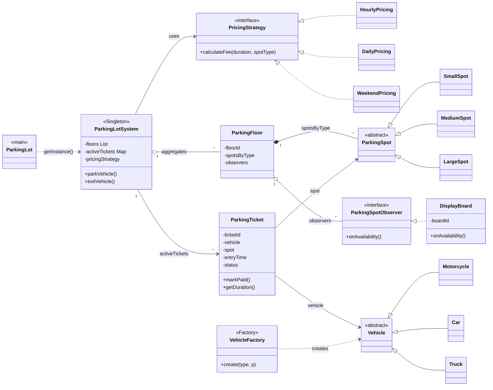
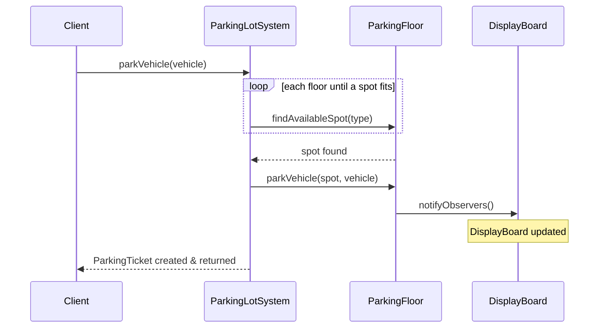
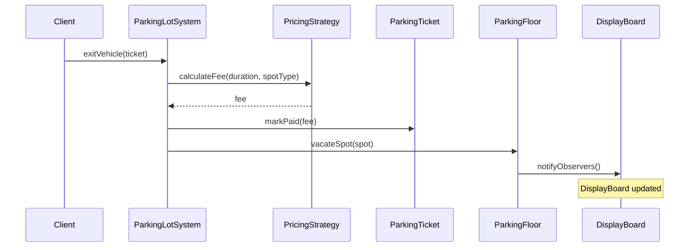

# Parking Lot — Low-Level Design
## Intuition

> **Design intuition**: Parking Lot is the classic LLD interview problem — it teaches entity modeling (Vehicle, Spot, Ticket), state machine (spot: Available → Occupied → Available), Strategy pattern (pricing: hourly vs. flat), Observer (display boards notified on changes), and Singleton (one lot instance).

**Key insight**: The hardest design decision is the "find nearest available spot" algorithm — do you store spots in a sorted structure (TreeMap by floor + spot number), or scan linearly? For interview purposes, the class structure matters more than the algorithm. Focus on getting entities, relationships, and pattern applications right.

**Full runnable implementation:** [`ParkingLot.java`](ParkingLot.java) — 471 lines, one file, `main()` at the bottom. It demonstrates `VehicleFactory` over Motorcycle/Car/Truck, an abstract `ParkingSpot` with Small/Medium/Large, three `PricingStrategy` implementations, `DisplayBoard` as a `ParkingSpotObserver`, and `ParkingLotSystem` as the singleton — all five patterns above wired together, with a `main()` that parks, exits and prints the fee.

---

## Problem Statement

Design a parking lot system that can:
- Support multiple vehicle types (Motorcycle, Car, Truck) with different space requirements
- Manage multiple floors, each with a mix of Small / Medium / Large spots
- Issue tickets on entry and calculate fees on exit
- Support pluggable pricing models (hourly, daily, weekend flat-rate)
- Notify display boards (and other observers) whenever spot availability changes
- Allow only one global lot instance (single entry point for operations)

---

## Requirements

### Functional
1. Park a vehicle — find the nearest available, correctly-sized spot
2. Exit a vehicle — calculate fee, free the spot, update displays
3. Query availability — how many spots of each type remain per floor
4. Pluggable pricing — swap pricing algorithms without touching core logic
5. Real-time display updates whenever a vehicle parks or exits

### Non-Functional
- Thread-safe singleton for the lot instance
- Spot lookup scoped to one type per floor: grouping by `ParkingSpotType` cuts the scan from every spot in the lot to O(n/k) — the correctly-sized spots on one floor. It is not O(1); `findAvailableSpot` still scans that sub-list for the first free spot
- Easy to add new vehicle types or pricing models without modifying existing classes

---

## ASCII Class Diagram



*`ParkingLotSystem` is the Singleton coordinator: it aggregates `ParkingFloor`s, delegates fee math to a swappable `PricingStrategy` (Strategy pattern), and each floor fans availability changes out to its `ParkingSpotObserver`s such as `DisplayBoard` (Observer pattern); `VehicleFactory` centralises which `Vehicle` subclass gets constructed (Factory pattern).*

---

## Patterns Used

### 1. Singleton — `ParkingLotSystem`
**Why**: There is exactly one physical parking lot. All entry/exit operations must go through a single coordinating instance to prevent race conditions and ensure consistent ticket counters.

**How**: Private constructor + `getInstance()` with `synchronized` keyword for thread safety.

---

### 2. Strategy — `PricingStrategy`
**Why**: Pricing rules change frequently (peak hours, weekends, monthly passes). Encoding them in if/else inside the lot would make the class brittle and hard to test.

**How**: `PricingStrategy` interface with `calculateFee(Duration, ParkingSpotType)`. The lot holds a reference that can be swapped at runtime via `setPricingStrategy()`.

| Implementation  | Algorithm                                              | Rates (SMALL / MEDIUM / LARGE) |
|-----------------|--------------------------------------------------------|--------------------------------|
| HourlyPricing   | `max(1, ceil(minutes/60))` × rate-per-spot-type        | $2.00 / $3.50 / $5.00 per hour |
| DailyPricing    | `max(1, ceil(hours/24))` × daily-rate-per-spot-type    | $15 / $25 / $40 per day        |
| WeekendPricing  | flat fee per entry, independent of duration            | $8 / $12 / $18 flat            |

The `max(1, ...)` floor is not decoration: it is why a vehicle that leaves after 40 seconds is still billed one full hour ($2.00 for a motorcycle in the sample output below), which is how real lots price. Drop it and every sub-hour stay is free.

---

### 3. Observer — `ParkingSpotObserver` / `DisplayBoard`
**Why**: Multiple external systems (physical boards, mobile apps, reservation engines) need to react when availability changes. Hard-coding these calls inside `ParkingFloor` would create tight coupling.

**How**: `ParkingFloor` maintains a list of `ParkingSpotObserver`s. After every `parkVehicle` or `vacateSpot`, it calls `onAvailabilityChanged(floorId, type, count)` on each observer.

---

### 4. Simple Factory — `VehicleFactory`
**Why**: Callers should not need to know which concrete Vehicle subclass to instantiate. The factory centralises the mapping from `VehicleType` enum to subclass, making it easy to add new types.

**Name it precisely**: `VehicleFactory.create(type, plate)` is a static method switching on an enum — a **Simple Factory**, which is not in the GoF catalogue. GoF **Factory Method** would make creation an overridable instance method on a subclass; **Abstract Factory** would produce families of related products. Simple Factory is the right tool here, but say which one you mean.

---

## Design Decisions & Tradeoffs

| Decision | Alternative | Reason chosen |
|----------|-------------|---------------|
| Spots grouped by type in a `Map<ParkingSpotType, List<ParkingSpot>>` | Single flat list | O(n/k) vs O(n) lookup; avoids scanning wrong-sized spots |
| Floor-level observer notifications | Lot-level notifications | Observers receive the specific floor and type — actionable info |
| Ticket stores a direct reference to `ParkingSpot` | Store only spotId | Simpler; spot reference valid for the lifetime of the ticket |
| `requiredSpotType()` on Vehicle | Mapping table in the lot | Encapsulation — vehicle knows its own requirements |
| Synchronized `getInstance` | Double-checked locking | Simpler; startup is not on the hot path |
| Two overloads: `getInstance(name, strategy)` initialises, no-arg `getInstance()` throws `IllegalStateException` until it has | One `getInstance(name, strategy)` for both roles | Keeps the accessor honest. Note the residual sharp edge: calling the two-arg form a *second* time silently ignores both arguments and returns the existing instance — first call wins. A cleaner API renames it `initialize(name, strategy)` and makes a second call throw. |

---

## State / Flow

**Park flow:**



*`parkVehicle` loops floors until `findAvailableSpot` succeeds, delegates the actual placement to `ParkingFloor`, and lets the floor fan the change out to its `DisplayBoard` observers (Observer pattern) before returning the new `ParkingTicket`.*

**Exit flow:**



*`exitVehicle` delegates fee math to the currently-configured `PricingStrategy` (Strategy pattern — swappable without touching this method), settles the `ParkingTicket`, then vacates the spot and re-notifies observers.*

---

## Sample Output

```
========================================
   Parking Lot System — LLD Demo
========================================

--- Parking vehicles ---
  [Board-ENTRY] Floor F1  | SMALL    available: 1
  [Board-APP] Floor F1  | SMALL    available: 1
[Lot] MOTORCYCLE(MBC-001) parked → spot S1-01 on F1 | TKT-1001
  [Board-ENTRY] Floor F1  | MEDIUM   available: 1
  [Board-APP] Floor F1  | MEDIUM   available: 1
[Lot] CAR(CAR-101) parked → spot M1-01 on F1 | TKT-1002
...

--- Availability snapshot ---
[Lot] Availability snapshot:
  Floor F1: {SMALL=1, MEDIUM=0, LARGE=0}
  Floor F2: {SMALL=1, MEDIUM=1, LARGE=1}

--- Exiting vehicles (Hourly pricing) ---
[Lot] MOTORCYCLE(MBC-001) exited | Duration: 0h 0m | Fee: $2.00
[Lot] CAR(CAR-101) exited | Duration: 0h 0m | Fee: $3.50

--- Switching to Weekend flat pricing ---
[Lot] CAR(CAR-202) exited | Duration: 0h 0m | Fee: $12.00
[Lot] TRUCK(TRK-999) exited | Duration: 0h 0m | Fee: $18.00

--- Double-exit attempt (expected error) ---
Caught: Ticket TKT-1001 is not active.
```

---

## Cross-Perspective: HLD Connections

**HLD View — Where Parking Lot Design Scales to Distributed Systems**

- **Slot allocation → resource reservation** — Parking spot assignment maps directly to distributed resource allocation: cloud VM slots, database connection slots, appointment booking systems. The core challenge (find available slot, reserve atomically, release on completion) is identical at both scales.
- **Observer → real-time dashboards** — Display boards notified via Observer map to WebSocket/SSE push for real-time availability dashboards in mobile apps. At HLD scale, the display board is a notification service publishing to subscribed clients.
- **Pricing Strategy → rate card service** — The pluggable pricing strategy becomes a dedicated pricing microservice at HLD scale. Dynamic pricing (demand-based, time-of-day, event-based) is served via API so pricing changes don't require redeploying the parking system.
- **Thread safety → distributed locking** — The `synchronized` block on spot assignment becomes a distributed lock (Redis SETNX with TTL) at HLD scale, preventing two users at different service instances from booking the same spot simultaneously.

---

## Follow-Up Extensions

1. **Reservations** — add a `Reservation` entity; reserve a spot for a time window before the vehicle arrives. Requires a scheduler to expire stale reservations.

2. **Online booking & payment** — integrate a `PaymentGateway` interface (Strategy) with implementations for credit card, UPI, wallet. Issue digital receipts.

3. **EV charging stations** — add a `ChargingSpot extends LargeSpot` with `chargerType` (Level 2 / DC Fast). Track charging sessions and billing separately.

4. **Dynamic pricing** — introduce a `DemandBasedPricingDecorator` that wraps any `PricingStrategy` and applies a multiplier based on current occupancy percentage.

5. **Multi-level concurrency** — use `ReentrantLock` per floor or `ConcurrentHashMap` for ticket storage to support high-throughput concurrent arrivals.

6. **Accessibility spots** — add `AccessibleSpot` subtype; enforce that only registered accessible vehicles can use them.

---

## Interview Questions with Answers

**Q: Is spot lookup actually O(1)? What does grouping by `ParkingSpotType` really buy you?**
**Short:** it's O(n/k), not O(1) — the scan is cut to one floor's correctly-sized spots, not eliminated entirely.

Grouping spots into `Map<ParkingSpotType, List<ParkingSpot>>` narrows the search from every spot in the entire lot to just the correctly-sized spots on one floor, which is a real and meaningful reduction, but `findAvailableSpot` still scans that narrowed sub-list linearly for the first free one. Calling this O(1) overstates it; the honest complexity is O(n/k) where k is the number of type/floor partitions, which is exactly what the Non-Functional Requirements section states outright. In an interview, naming the actual complexity rather than the appealing-sounding one is the stronger answer — and it opens the door to the follow-up about what would make it genuinely O(1) (e.g., maintaining a free-list per type instead of scanning a full list each time).

**Q: What's the sharp edge in calling `ParkingLotSystem.getInstance(name, strategy)` a second time?**
**Short:** the second call silently ignores both arguments and returns the already-initialized instance — first call wins.

The design uses two overloads — a two-arg `getInstance(name, strategy)` that initializes the Singleton, and a no-arg `getInstance()` that throws `IllegalStateException` until initialization has happened — specifically to keep the accessor honest about whether the lot exists yet. But the residual sharp edge is that calling the two-arg form a *second* time doesn't throw or update anything; it silently returns the existing instance and both new arguments are discarded without warning. The cleaner API the page itself proposes renames it to `initialize(name, strategy)` and makes a second call throw explicitly, converting a silent no-op into a loud, debuggable failure.

**Q: Why is `VehicleFactory` called a Simple Factory and not GoF Factory Method?**
**Short:** it's a static method switching on an enum — GoF Factory Method requires an overridable instance method on a subclass.

`VehicleFactory.create(type, plate)` is a static method that switches on a `VehicleType` enum and returns the matching subclass instance — that shape, a single centralized creation point selected by an enum, is a Simple Factory, which isn't even in the GoF catalogue. GoF's actual Factory Method pattern defers instantiation to an overridable method on a subclass (a different class decides *how* to create, not a switch statement deciding *which* to create), and Abstract Factory produces families of related products together, neither of which describes what's happening here. Naming the pattern precisely — "Simple Factory," not "Factory Method" — is a cheap, easy interview point that many candidates lose by reaching for the more famous name.

**Q: Why does `HourlyPricing` use `max(1, ceil(minutes/60))` instead of billing the exact fraction of an hour?**
**Short:** the floor of 1 full hour is why a 40-second stay still costs a full hour's rate, matching real-world lot pricing.

The `max(1, ...)` floor isn't decoration — it's exactly why the Sample Output shows a motorcycle that parked and exited within seconds still being billed the full $2.00 hourly rate: real parking lots price in whole-hour increments with a one-hour minimum, not by-the-second proration. Drop the `max(1, ...)` and every sub-hour stay would round down to zero cost, which is both wrong for the business model this class is meant to represent and an easy trap for a candidate who implements `ceil(minutes/60)` alone without the floor. `DailyPricing` applies the structurally identical rule at a coarser granularity — `max(1, ceil(hours/24))` — for exactly the same reason.

**Q: Why Singleton for `ParkingLotSystem` but not for `VendingMachine`?**
**Short:** every entry/exit in one lot must funnel through one coordinator; many independent vending machines can coexist in one process.

There is exactly one physical parking lot, and every entry and exit operation across that entire lot must go through a single coordinating instance to keep ticket counters and spot-availability state consistent — a second `ParkingLotSystem` instance would mean two independent views of the same physical spots, an immediate consistency bug. `VendingMachine.java` deliberately makes the opposite choice: its constructor is public, because "one machine per physical unit" is a fact about the hardware, not a reason to make the *software class* globally unique — a test or a bank of machines in one process legitimately needs several independent instances. The distinguishing question in an interview is never "is there one of these in real life," it's "does the *software* need global uniqueness," and these two files are a deliberate side-by-side answer to that question.

**Q: Why are display-board notifications sent at the floor level instead of the lot level?**
**Short:** floor-level notifications carry the specific floor and type, which is actionable; a lot-level blast isn't.

`ParkingFloor` maintains its own list of `ParkingSpotObserver`s and fires `onAvailabilityChanged(floorId, type, count)` after every park/vacate on that specific floor, so an observer (a physical display board mounted on that floor, a mobile app screen) receives exactly the information it needs to act on — which floor, which spot type, how many remain. A lot-level notification broadcasting "something changed somewhere" would force every observer to re-query the entire lot's state to figure out what actually changed and whether it's relevant to them, defeating the purpose of a push notification in the first place.

**Q: Why does `ParkingTicket` store a direct `ParkingSpot` reference instead of just a `spotId`?**
**Short:** simpler for the ticket's lifetime — the spot reference stays valid for as long as the ticket does.

Since a `ParkingTicket` is only ever live for the duration of one parking session (issued on entry, settled and discarded on exit), the spot object it references can't go stale within that window — there's no scenario where the referenced `ParkingSpot` is deleted or reassigned while its ticket is still active. Storing an ID instead would require a lookup back into `ParkingFloor`'s spot map on every ticket operation, adding an indirection with no corresponding benefit given the ticket's short, bounded lifetime. This tradeoff would flip if tickets needed to be persisted and reloaded across restarts (an ID survives serialization more cleanly than an object graph reference), which the Design Decisions table calls out as the reason to reconsider it.

**Q: Why is `requiredSpotType()` defined on `Vehicle` rather than looked up in a mapping table inside the lot?**
**Short:** encapsulation — the vehicle knows its own space requirements; the lot shouldn't hardcode a vehicle-to-type map.

Putting `requiredSpotType()` as a method on each `Vehicle` subclass means a `Motorcycle` knows it needs a `SMALL` spot and a `Truck` knows it needs `LARGE` without `ParkingLotSystem` maintaining a separate `Map<VehicleType, ParkingSpotType>` that has to be kept in sync with the vehicle hierarchy. Adding a new vehicle type (say, a `Van`) then means implementing one method on the new subclass, not editing a mapping table buried inside the lot's logic — the same Open/Closed argument the section makes repeatedly, here applied to "who knows the fact" rather than "who handles the behavior."

**Q: Why `synchronized getInstance()` instead of double-checked locking for the Singleton?**
**Short:** startup isn't on the hot path, so the simpler, always-correct synchronized form isn't worth optimizing away.

Double-checked locking (checking the instance is null, then locking, then checking again) exists to avoid paying lock overhead on every subsequent call once the Singleton is already initialized — but `getInstance()` is only ever called once per lot's lifetime to actually construct it, with every later call hitting the no-arg overload that just reads an already-set reference and throws if it isn't. Since the constructing call happens exactly once at startup and is never on a hot path, the simpler `synchronized` keyword is correct, easy to verify, and carries none of the subtle memory-visibility pitfalls double-checked locking is notorious for getting wrong without a `volatile` field.

**Q: Walk the park flow — what happens if no floor has a spot that fits the vehicle?**
**Short:** the loop over floors in `findAvailableSpot` exhausts without a match, and `parkVehicle` must surface a clear failure.

The park sequence loops across `ParkingFloor`s calling `findAvailableSpot(type)` until one succeeds; if every floor's sub-list for that vehicle's required type is empty, the loop exhausts with no spot found. The design needs `parkVehicle` to then fail explicitly — throwing a `NoAvailableSpotException` or returning an empty `Optional` — rather than silently doing nothing, since a caller (a customer at the gate) needs a definitive "lot full, do not enter" signal rather than an ambiguous null ticket. This is the same class of "explicit failure over silent boolean" concern `LibraryManagement.md`'s Key insight raises about `borrowBook`/`returnBook`.

**Q: How would thread safety break under high-throughput concurrent arrivals, and what's the fix beyond the top-level Singleton lock?**
**Short:** two threads racing `findAvailableSpot` then `parkVehicle` on the same spot can double-assign it; scope locks per floor.

Even with a thread-safe `getInstance()`, the actual park operation is a check-then-act sequence — find an available spot, then mark it occupied — and if that sequence itself isn't atomic, two concurrent `parkVehicle` calls can both find the same spot available and both assign a vehicle to it. The Follow-Up Extensions name the fix directly: `ReentrantLock` per floor (or a `ConcurrentHashMap` for ticket storage) scopes the synchronization to the smallest unit that actually needs it, rather than a single lock around the entire lot that would serialize every arrival across every floor regardless of which floor they're targeting. This mirrors `LibraryManagement`'s and `OnlineBookingSystem`'s identical check-then-act races on their own scarce resources.

**Q: How would you add EV charging stations without touching the existing spot classes?**
**Short:** `ChargingSpot extends LargeSpot`, adding a `chargerType` field and its own session tracking — existing spots untouched.

The Follow-Up Extensions describe `ChargingSpot extends LargeSpot` with a `chargerType` (Level 2 / DC Fast) field, tracking charging sessions and billing as a separate concern layered on top of the existing spot hierarchy. Because `SmallSpot`/`MediumSpot`/`LargeSpot` are all just concrete `ParkingSpot` subclasses with no shared logic that a new subtype would need to override incorrectly, adding `ChargingSpot` as a fourth leaf in the hierarchy is purely additive — `ParkingSpotType`, `VehicleFactory`, and every existing pricing strategy continue to operate exactly as before, since none of them need to know that this particular `LargeSpot` also happens to dispense electricity.

**Q: How would dynamic/demand pricing layer on top of the existing `PricingStrategy` implementations?**
**Short:** a `DemandBasedPricingDecorator` wraps any existing strategy and applies an occupancy-based multiplier on top.

Rather than writing a fourth `PricingStrategy` implementation that duplicates `HourlyPricing`'s or `DailyPricing`'s base calculation and then adds demand logic, the Follow-Up Extensions propose a `DemandBasedPricingDecorator` that wraps any existing `PricingStrategy`, calls through to it for the base fee, and then applies a multiplier based on current occupancy percentage before returning the result. This composes cleanly with all three existing strategies without modifying any of them — the same Decorator-around-an-interface approach `RateLimiter.java`'s `InstrumentedRateLimiter` uses to add metrics without touching any of the four rate-limiting algorithms it wraps.

**Q: Why is `DailyPricing`'s `max(1, ceil(hours/24))` structurally the same rule as `HourlyPricing`'s, just at a different granularity?**
**Short:** both floor partial usage up to one full billing unit — an hour for hourly, a day for daily.

Both formulas answer the identical question — "how many whole billing units did this stay span, rounding any partial unit up, with a minimum of one" — just measured in different units (60-minute hours vs. 24-hour days). Recognizing that these are the same rule applied at two granularities, rather than two unrelated formulas that happen to look similar, is what lets you generalize the pattern instantly to a hypothetical `WeeklyPricing` or `MonthlyPricing` without re-deriving the logic from scratch: `max(1, ceil(duration/unit))` is the whole shape, parameterized only by what "unit" means.

**Q: How does the `synchronized` spot-assignment block map to distributed locking at HLD scale?**
**Short:** a Redis SETNX-with-TTL lock replaces the in-process `synchronized` block once multiple service instances exist.

The `synchronized` keyword guarding spot assignment guarantees atomicity only within one JVM's monitor — exactly the same limitation `OnlineBookingSystem`'s `synchronized BookingService` has — so once the parking system runs behind a load balancer with multiple service instances, each instance's lock is independent and the original check-then-act race returns. At HLD scale, that local lock becomes a distributed lock (Redis `SETNX` with a TTL, or a database-level compare-and-set on the spot's status column), so that two users hitting two different service instances at the same physical moment still can't both claim the same spot — the atomicity guarantee has to live in shared state every instance actually contends over, not in a lock object private to one process.
