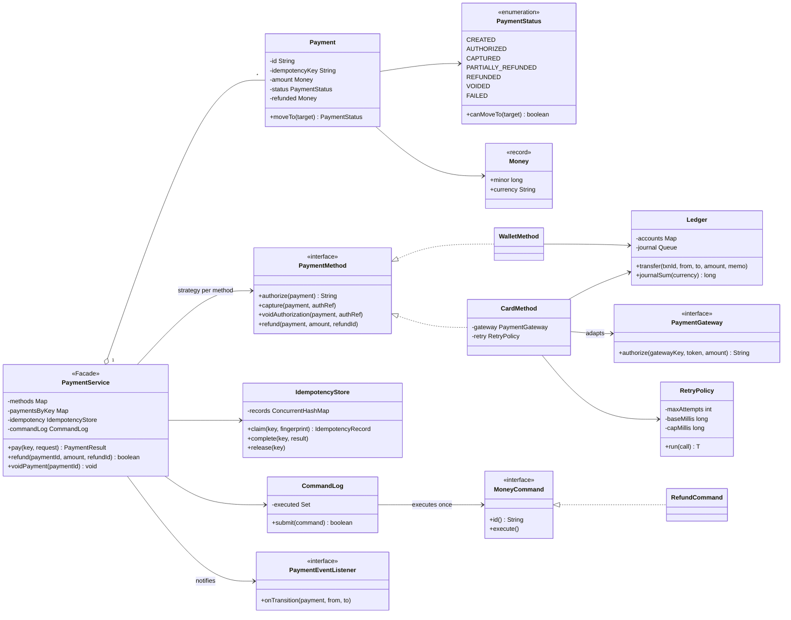
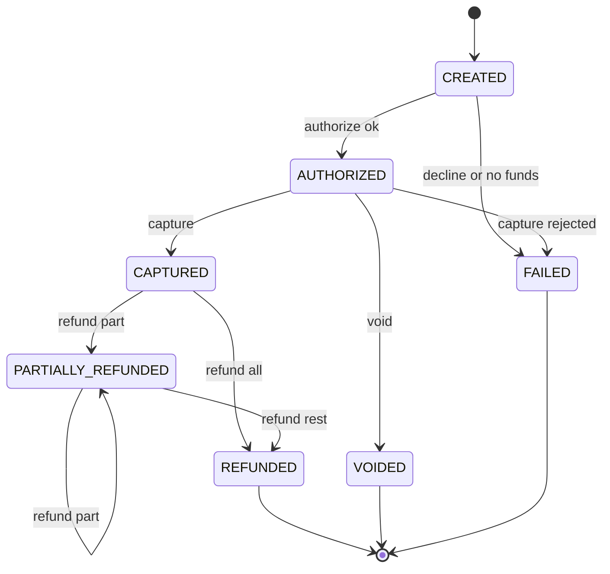
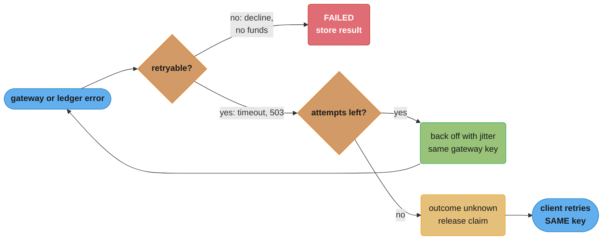
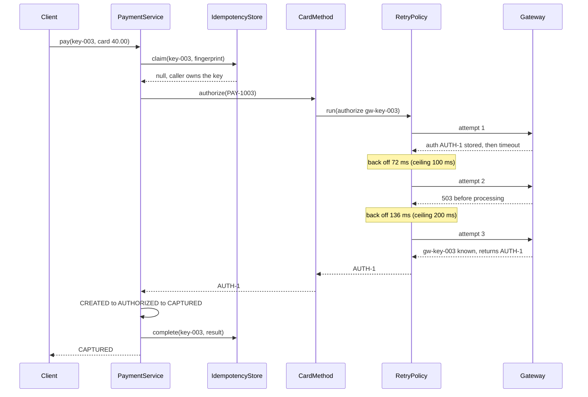

# Payment Processor / Digital Wallet — Low-Level Design
## Intuition

> **Design intuition**: A payment processor is the LLD problem where "it works on the happy path" is worth nothing. The interviewer gives you `pay(from, to, amount)` and then spends 40 minutes on the unhappy paths: the client retries after a timeout, the gateway times out after it already charged the card, two refunds arrive at once, a wallet goes negative under concurrent transfers. Every class in this design exists to make one of those paths safe.

**Key insight**: Four decisions carry the whole design, and none of them is a GoF pattern. (1) Money is a `long` count of minor units plus a currency, never a `double`. (2) Every money movement is a balanced pair of ledger postings, so "did money appear or vanish?" is one `SUM` that must equal zero. (3) A payment is a state machine whose enum owns its legal transitions, so `REFUNDED -> VOIDED` throws instead of silently corrupting state. (4) An idempotency key turns "the client retried" from a double charge into a replay of the first response, and the same key, passed down to the gateway, turns "the gateway timed out after charging" into a lookup instead of a second charge. The GoF patterns (State, Strategy, Command, Observer, Adapter) are the packaging around those four decisions.

**Full runnable implementation:** [`PaymentProcessor.java`](PaymentProcessor.java) — 916 lines, one file, all types nested in one public class, `main()` at the bottom. It demonstrates a wallet payment and its idempotent replay, a same-key-different-body conflict, an insufficient-funds failure, a card payment that survives a timeout-after-processing and a 503 through capped exponential backoff with full jitter, a non-retried decline, an "outcome unknown" that the client resolves by retrying the same key, partial refunds as deduplicated `RefundCommand`s, an illegal transition, 8 threads racing one idempotency key (one execution), 2,000 opposing transfers that finish without deadlock, and a final check that the journal sums to zero.

**Scope.** This page is the class design inside one process. The rail rules (authorization windows, decline-code retry limits, reversal deadlines), unknown-outcome resolution across rails and the accounting model belong to [`fintech/idempotency_and_exactly_once_money_movement`](../../fintech/idempotency_and_exactly_once_money_movement/idempotency_and_exactly_once_money_movement.md), [`fintech/double_entry_ledger_design`](../../fintech/double_entry_ledger_design/double_entry_ledger_design.md) and [`fintech/card_payments_lifecycle`](../../fintech/card_payments_lifecycle/card_payments_lifecycle.md). The service-level saga, outbox and PSP timeout handling belong to [`backend/case_studies/design_payment_processor`](../../backend/case_studies/design_payment_processor/design_payment_processor.md); the fleet view belongs to [`hld/case_studies/design_payment_system.md`](../../hld/case_studies/design_payment_system.md) and [`hld/case_studies/design_digital_wallet.md`](../../hld/case_studies/design_digital_wallet.md).

---

## Problem Statement

Design the core of a payment processor that also runs stored-value wallets:
- Users hold wallet balances; merchants receive payments
- A payment can be funded from a wallet or from a card through an external gateway
- A payment is authorized, then captured; it can be voided before capture and refunded (fully or partially) after capture
- Clients retry on timeouts, so every write must be safe to repeat
- The external gateway is unreliable: it times out, returns 503, and sometimes processes a request and then times out anyway
- Peer-to-peer transfers between wallets run concurrently and must never create or destroy money
- Every movement is auditable

---

## Requirements

### Functional
1. `pay(idempotencyKey, request)` — authorize and capture a payment from a wallet or a card
2. A retry with the same key and the same body returns the first result, marked as a replay
3. A retry with the same key and a different body is rejected (it is a client bug, not a retry)
4. `refund(paymentId, amount, refundId)` — partial or full, never more than the captured amount, safe to submit twice
5. `voidPayment(paymentId)` — only from `AUTHORIZED`
6. Wallet-to-wallet transfers
7. Observers see every status transition (audit log, webhooks, metrics)

### Non-Functional
1. No `double` anywhere money is stored or computed
2. Conservation: the sum of all ledger postings per currency is exactly 0 at every instant
3. A wallet balance never goes below 0 (external clearing accounts may)
4. At most one execution per idempotency key, even with 8 concurrent requests carrying it
5. Retryable gateway failures retry with capped exponential backoff and full jitter; non-retryable ones (a decline) never retry
6. Opposing concurrent transfers (A to B while B to A) cannot deadlock

---

## Class Diagram



*`PaymentService` is the facade. It claims the idempotency key, creates the `Payment`, and drives it through `PaymentStatus` transitions while a `PaymentMethod` strategy does the method-specific work. Every method writes to the same double-entry `Ledger`. Refunds go through the `CommandLog` as `RefundCommand` objects, and every transition is published to `PaymentEventListener`s.*

---

## Patterns Used

### 1. State — `PaymentStatus` owns its transition table
**Why**: Payment bugs are mostly illegal transitions that nobody rejected: a refund on a payment that was never captured, a void after capture, a second capture. Scattering `if (status == X)` checks across services guarantees one of them is missing.

**How**: Each enum constant holds an `EnumSet` of legal next states, filled in a `static` block. `Payment.moveTo(target)` is the only writer of `status`; it throws `IllegalStateException` for anything not in the set. The demo calls `voidPayment` on a refunded payment and gets `REFUNDED -> VOIDED is not allowed`. This is the enum-table variant of State, the right size when states carry no behavior of their own. When states do carry behavior (the ATM's card-inserted vs PIN-verified screens), use one class per state as in [`ATM.md`](ATM.md) and [`behavioral/state`](../behavioral/state/state.md).



*Three terminal states, and no edge ever leads back to `CREATED`. "Outcome unknown" is deliberately not a state: the payment stays `CREATED`, the idempotency claim is released, and the client retry resumes the same `Payment` object.*

---

### 2. Strategy — `PaymentMethod`
**Why**: A wallet payment and a card payment share a lifecycle (authorize, capture, void, refund) but nothing about how each step works. A wallet moves ledger balances; a card calls an external gateway and books money through a clearing account.

**How**: `WalletMethod.authorize` moves the amount from the payer into a `sys:wallet-holds` account, and `capture` moves it from holds to the payee. A hold is a real ledger transfer, so a held balance cannot be spent twice and the journal still sums to zero. `CardMethod.authorize` calls the gateway through `RetryPolicy`; `capture` books `ext:card-clearing -> payee`. Adding bank transfers or a buy-now-pay-later provider is a new class, not an edit to `PaymentService`.

---

### 3. Command — `RefundCommand` through an idempotent `CommandLog`
**Why**: A refund is the operation most likely to be submitted twice: a support agent double-clicks, a dispute tool and a human both act, a queue redelivers. It is also the operation that most needs an audit trail and a way to run later (approval queue, batch file).

**How**: `RefundCommand` captures everything needed to execute (refund id, payment, amount) in one object. `CommandLog.submit` executes a command only if its id has not run before, and records `describe()` in an append-only history. The demo submits `RF-1` twice and the second is logged as `duplicate RF-1 ignored`. Inside `execute()` the command locks the payment, re-checks the status and the refundable remainder, then books the reversal. Note what Command does **not** mean here: there is no `undo()`. A ledger is append-only, so the "undo" of a capture is a new refund posting, never a deleted row. See [`behavioral/command`](../behavioral/command/command.md) for the undo-stack variant and why it does not apply to money.

---

### 4. Adapter — `CardMethod` over `PaymentGateway`
**Why**: Gateways have their own vocabulary (auth codes, decline codes, their own idempotency headers). The domain should see `authorize -> authRef` and a `GatewayException` with a `retryable` flag, nothing else.

**How**: `CardMethod` translates. It also owns the single most important line in the file: the gateway key is derived from the **client's** idempotency key (`"gw-" + idempotencyKey`), not from the payment id. Section 6 of the demo shows why.

---

### 5. Observer — `PaymentEventListener`
**Why**: Audit logs, merchant webhooks, fraud signals and metrics all react to transitions. None of them belongs inside `PaymentService`.

**How**: `PaymentService.move()` calls `Payment.moveTo()` and then notifies each listener with `(payment, from, to)`. In production the listener writes an outbox row in the same database transaction as the status change, and a relay publishes it; an in-memory listener call that fails after the commit loses the event. See [`backend/case_studies/design_payment_processor`](../../backend/case_studies/design_payment_processor/design_payment_processor.md) for the outbox.

---

## Design Decisions & Tradeoffs

| Decision | Alternative | Reason chosen |
|----------|-------------|---------------|
| `Money(long minor, String currency)` | `double`, or `BigDecimal` without a scale rule | `0.1 + 0.2 != 0.3` in binary floating point; `long` minor units are exact and fast, and `Math.addExact` turns overflow into an exception. The demo assumes 2 decimals; the per-currency exponent (JPY 0, KWD 3) is in [`fintech/money_representation_and_currency`](../../fintech/money_representation_and_currency/money_representation_and_currency.md) |
| Double-entry `Ledger` with an append-only journal | A `balance` column updated in place | A mutable balance cannot answer "why is it 75.00?". Postings can, and their sum is a free invariant check (`sum of postings=0` in the demo) |
| Holds as a transfer into `sys:wallet-holds` | An `available` vs `ledger` balance pair on each wallet | One mechanism instead of two; a void is just the reverse transfer. A real wallet usually exposes both numbers; see [`hld/case_studies/design_digital_wallet.md`](../../hld/case_studies/design_digital_wallet.md) |
| Per-account `ReentrantLock`, acquired in account-id order | One global lock | A global lock serializes every transfer in the system. Ordered locks let unrelated transfers run in parallel and make deadlock impossible, because no two threads can hold the pair in opposite orders |
| Idempotency record stores a request fingerprint | Store only the key | Without the fingerprint, a client that reuses a key for a different amount gets the old response and believes the new payment succeeded |
| `IN_PROGRESS` duplicates get an error (HTTP 409) | Block the duplicate until the first finishes | Blocking ties a request thread to someone else's gateway call. A fast "in progress, retry later" keeps threads free; the retry then gets the stored result |
| Retryable gateway failure that exhausts the budget releases the claim and throws `OutcomeUnknownException` | Mark the payment `FAILED` | The money may have moved. Saying `FAILED` invites the client to pay again with a new key. "Unknown, retry the same key" is honest, and the gateway key makes that retry safe |
| Full jitter: `delay = random(0, min(cap, base * 2^(attempt-1)))` | Fixed delay, or exponential without jitter | Without jitter, every client that failed at the same instant retries at the same instant and re-creates the overload. Full jitter spreads them over the whole window |
| Refund as a `Command` with its own id | A plain `refund()` method | The command id is the refund's idempotency key and its audit record in one object |

**Which failure gets which treatment** — the classification `pay()` applies to every exception:



*Only a definite business failure becomes `FAILED`. A transport failure is either retried or surfaced as unknown, never guessed.*

---

## State / Flow

**Card payment with a timeout after processing** (demo section 4):



*Three authorize calls, one authorization. The third call does not create `AUTH-2` because the gateway deduplicates on `gw-key-003`. Without the gateway key, attempt 1's charge would be orphaned and the customer charged twice.*

**Wallet payment, ledger view** — what one `pay()` writes:

```
txnId               account             minor    memo
PAY-1001:auth       alice              -2500     hold
PAY-1001:auth       sys:wallet-holds   +2500     hold
PAY-1001:capture    sys:wallet-holds   -2500     capture
PAY-1001:capture    merchant           +2500     capture
                                       -----
                                           0
```

*Four postings, two transfers, net zero. The holds account returns to 0 after capture, which is a second invariant you can alert on: a non-zero holds balance with no open authorizations is a leak.*

---

## Sample Output

```text
========================================
   Payment Processor - LLD Demo
========================================

--- 1. Wallet payment alice -> merchant, then the client retries ---
    [audit] PAY-1001 CREATED -> AUTHORIZED
    [audit] PAY-1001 AUTHORIZED -> CAPTURED
  first  : PaymentResult[paymentId=PAY-1001, status=CAPTURED, detail=HOLD-PAY-1001, replayed=false]
  retry  : PaymentResult[paymentId=PAY-1001, status=CAPTURED, detail=HOLD-PAY-1001, replayed=true]
  alice=USD 75.00  merchant=USD 25.00

--- 2. Same key, different amount ---
  rejected: idempotency key key-001 was already used with different parameters

--- 3. Insufficient funds ---
    [audit] PAY-1002 CREATED -> FAILED
  PaymentResult[paymentId=PAY-1002, status=FAILED, detail=insufficient funds in bob for USD 500.00, replayed=false]

--- 4. Card payment: timeout after processing, then 503, then success ---
    [retry] attempt 1 failed (timeout after processing), backing off 72 ms (ceiling 100 ms)
    [retry] attempt 2 failed (503 before processing), backing off 136 ms (ceiling 200 ms)
    [audit] PAY-1003 CREATED -> AUTHORIZED
    [audit] PAY-1003 AUTHORIZED -> CAPTURED
  PaymentResult[paymentId=PAY-1003, status=CAPTURED, detail=AUTH-1, replayed=false]
  gateway calls=4, distinct authorizations=1

--- 5. Card decline is not retried ---
    [audit] PAY-1004 CREATED -> FAILED
  PaymentResult[paymentId=PAY-1004, status=FAILED, detail=card declined, replayed=false]
  gateway calls for this payment=1

--- 6. Gateway down past the retry budget, client retries the SAME key ---
    [retry] attempt 1 failed (503 before processing), backing off 30 ms (ceiling 100 ms)
    [retry] attempt 2 failed (503 before processing), backing off 55 ms (ceiling 200 ms)
  client sees: outcome unknown for PAY-1005, retry with the SAME key
    [audit] PAY-1005 CREATED -> AUTHORIZED
    [audit] PAY-1005 AUTHORIZED -> CAPTURED
  client retry: PaymentResult[paymentId=PAY-1005, status=CAPTURED, detail=AUTH-2, replayed=false]
  distinct authorizations=2

--- 7. Refunds as commands ---
    [audit] PAY-1001 CAPTURED -> PARTIALLY_REFUNDED
    [command] duplicate RF-1 ignored
  rejected: refund USD 20.00 exceeds refundable USD 15.00
    [audit] PAY-1001 PARTIALLY_REFUNDED -> REFUNDED
  command log: [RF-1 refund USD 10.00 on PAY-1001, RF-3 refund USD 15.00 on PAY-1001]
  alice=USD 100.00  merchant=USD 55.00

--- 8. Illegal transition ---
  rejected: PAY-1001: REFUNDED -> VOIDED is not allowed

--- 9. Concurrency: 8 threads, one idempotency key ---
  executions=1, deduplicated=7, alice debited USD 1.00

--- 10. Concurrency: 2,000 opposing transfers alice <-> bob ---
  finished without deadlock=true, alice+bob before=USD 119.00 after=USD 119.00

--- 11. Ledger invariants ---
  journal entries=4020, sum of postings=0, sum of balances=0

========================================
              Demo complete
========================================
```

The backoff values come from a `Random(42)` and a no-op sleeper, so the output is reproducible; production code injects a real sleeper and an unseeded source. "gateway calls=4" in section 4 is three authorize attempts plus one capture. In section 9 the split between replayed results and `RequestInProgressException` among the 7 duplicates depends on timing; the totals (1 execution, 7 deduplicated, exactly 1.00 debited) do not. The 4,020 journal entries are 2,010 transfers, each written as a debit and a credit.

---

## Cross-Perspective: HLD Connections

- **Idempotency store becomes a table with a unique key** — `ConcurrentHashMap.putIfAbsent` is the in-process form of `INSERT ... ON CONFLICT DO NOTHING` on `idempotency_keys(key)`. The `IN_PROGRESS` row, the stored response and the fingerprint check carry over unchanged. Stripe's API documents the same contract: keys up to 255 characters, the status code and body of the first request saved and returned on retries (including `500` errors), a parameter comparison that errors on mismatch, and keys that may be pruned once they are at least 24 hours old ([Stripe API: idempotent requests](https://docs.stripe.com/api/idempotent_requests), checked 2026-11-25). The IETF `Idempotency-Key` header is still an Internet-Draft (draft-ietf-httpapi-idempotency-key-header-08 as of 2026-11-06, per [`fintech/idempotency_and_exactly_once_money_movement`](../../fintech/idempotency_and_exactly_once_money_movement/idempotency_and_exactly_once_money_movement.md)), not an RFC.
- **Per-account locks become row locks or a ledger engine** — `SELECT ... FOR UPDATE` on both account rows in id order is the database form of the ordered `ReentrantLock` pair; see [`database/concurrency_control_and_locking`](../../database/concurrency_control_and_locking/concurrency_control_and_locking.md). A single hot account (the fee account, the holds account) then becomes the bottleneck; [`fintech/double_entry_ledger_design`](../../fintech/double_entry_ledger_design/double_entry_ledger_design.md) owns the hot-account fixes.
- **Observer becomes the transactional outbox** — the status change and the event row commit together; a relay publishes. [`spring/case_studies/design_idempotent_payment_api.md`](../../spring/case_studies/design_idempotent_payment_api.md) shows it in Spring with an advisory-lock idempotency guard.
- **Authorize-then-capture becomes a saga** — at service scale, authorize, ledger write and capture are separate services, and a failure between them needs a compensating step, which is exactly the void and refund paths this LLD already has. See [`backend/case_studies/design_payment_processor`](../../backend/case_studies/design_payment_processor/design_payment_processor.md).

---

## Follow-Up Extensions

1. **Multi-currency wallets** — one account per (wallet, currency); FX as two transfers through an FX position account at a locked quote. The `Money` currency check already rejects mixing.
2. **Authorization expiry** — an `AUTHORIZED` payment that is never captured must be voided before the network's window closes; a scheduler scans `AUTHORIZED` payments older than the window. The window is set by the card network; the dated Visa windows live in [`fintech/card_payments_lifecycle`](../../fintech/card_payments_lifecycle/card_payments_lifecycle.md).
3. **Webhooks to merchants** — a `PaymentEventListener` that writes an outbox row per transition; signing and retries are in [`backend/webhooks_and_event_delivery`](../../backend/webhooks_and_event_delivery/webhooks_and_event_delivery.md).
4. **Spending limits and KYC tiers** — a `Specification` per tier (daily limit, per-transaction limit) checked before authorize; see [`behavioral/specification`](../behavioral/specification/specification.md).
5. **Split payments** — one payment, several payees: one capture posts `n` credits whose sum equals the debit; the journal invariant still holds. [`Splitwise.md`](Splitwise.md) has the allocation-of-remainder problem in miniature.
6. **Reconciliation** — a nightly job compares the ledger with the gateway's settlement file and opens a break for every mismatch; this design makes it possible because every capture carries the gateway `authRef`.

---

## Extension Drills: Concurrency, Multi-Instance, Persistence

The graded step in an LLD round is the follow-up the interviewer adds after your design works. These are the three that come up for this problem, what breaks, and the change.

| Drill | What the interviewer adds | What breaks in a naive design | Change in this design |
|-------|---------------------------|-------------------------------|------------------------|
| Concurrency | "Two transfers A to B and B to A run at the same time" | Thread 1 locks A then waits for B; thread 2 locks B then waits for A: deadlock | Acquire both locks in a global order (account id); demo section 10 runs 2,000 opposing transfers |
| Concurrency | "The client sends the same request 8 times in 5 ms" | Check-then-insert on a `HashMap` lets several threads see "absent" and all charge | One atomic `putIfAbsent` claim; losers replay or get `IN_PROGRESS`; demo section 9 |
| Concurrency | "Two refunds for the same payment arrive together" | Both read `refunded = 0`, both pass the limit check, total refund exceeds the payment | `RefundCommand.execute` re-checks and updates under `synchronized (payment)` |
| Multi-instance | "Run 6 instances behind a load balancer" | In-memory idempotency map and locks are per JVM; a retry routed to another instance charges again | Move the claim to a shared store with an atomic insert (`INSERT ... ON CONFLICT` or Redis `SET key value NX PX ttl`); move account locks to row locks |
| Multi-instance | "An instance dies mid-payment" | The `IN_PROGRESS` claim never completes; the key is stuck forever | Give the claim a lease (`locked_until`); a retry after expiry re-runs, and the gateway key keeps the re-run safe |
| Persistence | "The process restarts; what survives?" | In-memory payments, journal and claims are gone; the gateway still holds the authorization | Payment row, ledger postings and idempotency record commit in ONE database transaction; the gateway key is stored before the call |
| Persistence | "Prove no money was lost after the incident" | A mutable balance column has no history | The append-only journal is replayable: recompute every balance from postings and compare |

**The race in the second row, as code.** The broken version is the shape most first drafts take:

```java
// BROKEN: check-then-act. Eight threads can all see "absent" before any of them writes.
PaymentResult pay(String key, PaymentRequest req) {
    if (results.containsKey(key)) {
        return results.get(key);
    }
    PaymentResult r = charge(req);      // eight charges
    results.put(key, r);
    return r;
}

// FIX: one atomic claim decides the single executor; everyone else replays or retries later.
PaymentResult pay(String key, PaymentRequest req) {
    IdempotencyRecord prior = records.putIfAbsent(key, new IdempotencyRecord(req.fingerprint()));
    if (prior != null) {
        if (!prior.fingerprint.equals(req.fingerprint())) throw new IdempotencyConflictException(key);
        if (prior.state == IdemState.IN_PROGRESS) throw new RequestInProgressException(key);
        return prior.result.asReplay();
    }
    PaymentResult r = charge(req);
    complete(key, r);                   // result written before state flips to COMPLETED
    return r;
}
```

**The multi-instance version of the same claim**, as the SQL a persistent store runs (PostgreSQL syntax):

```sql
INSERT INTO idempotency_keys (key, fingerprint, state, locked_until)
VALUES ($1, $2, 'IN_PROGRESS', now() + interval '30 seconds')
ON CONFLICT (key) DO NOTHING
RETURNING key;            -- one row back: this caller executes; zero rows: read the existing row
```

---

## Interview Questions with Answers

**Q: Why store money as a `long` of minor units instead of a `double`?**
**Short:** Binary floating point cannot represent most decimal fractions exactly, so sums drift; a long count of cents is exact.

`0.1 + 0.2` evaluates to `0.30000000000000004` in IEEE-754 double precision, and those errors accumulate across millions of postings until the ledger no longer balances to zero. A `long` count of minor units (cents for USD) is exact for every value it can hold, compares with `==`, and `Math.addExact` turns overflow into an exception instead of a silent wrap. `BigDecimal` is also correct if you fix the scale and the `RoundingMode` explicitly; a `BigDecimal` with no scale rule is just a slower way to be wrong. Use `long` minor units in the domain and convert to a decimal string only at the edges.

**Q: A client times out and retries. How does the design avoid charging twice?**
**Short:** The retry carries the same idempotency key; the store returns the saved first result instead of executing again.

The first request atomically claims the key with `putIfAbsent` and stores a fingerprint of the request body. When it finishes, it saves the result and flips the record to `COMPLETED`. The retry finds the record, checks that the fingerprint matches, and returns the stored result marked `replayed=true`, as demo section 1 shows with the same `PAY-1001`. The key must be generated by the client once per logical payment and reused on every retry; a key generated per HTTP attempt protects nothing.

**Q: Why does the idempotency record store a fingerprint of the request, not just the key?**
**Short:** So a reused key with a different body is rejected instead of silently returning the old payment's result.

Without the fingerprint, a client bug that reuses `key-001` for a 30.00 payment gets back the stored 25.00 result and believes the new payment succeeded, while no money moved. With the fingerprint the store raises `IdempotencyConflictException`, which demo section 2 prints. Stripe's API documents the same behavior: it compares incoming parameters to the original request and errors if they differ. Fingerprint the fields that define the operation (payer, payee, amount, currency, method), not volatile ones like a request timestamp.

**Q: The gateway timed out. Did the charge happen?**
**Short:** You cannot know from a timeout; the request may have been processed before the response was lost.

A timeout means only that no response arrived, not that nothing happened; demo section 4 scripts exactly that case, where the gateway creates `AUTH-1` and then times out. Treating it as a failure and retrying without a gateway-side key creates a second authorization; treating it as success without confirmation may ship goods for an unpaid order. The safe move is to retry with the same gateway idempotency key, so a processed request returns its original result, and if retries run out, surface "outcome unknown" rather than guess. The cross-rail version of this decision is owned by [`fintech/idempotency_and_exactly_once_money_movement`](../../fintech/idempotency_and_exactly_once_money_movement/idempotency_and_exactly_once_money_movement.md).

**Q: Why is the gateway key derived from the client's idempotency key and not from the payment id?**
**Short:** A client retry after "outcome unknown" may create a new payment object; only the client key is stable across that retry.

In demo section 6 the gateway stays down past the retry budget, so `pay()` releases the idempotency claim and throws `OutcomeUnknownException`. The client retries with the same key. If the gateway key were a fresh payment id, an authorization the gateway had actually processed would be orphaned and the retry would charge again. Because `CardMethod` sends `gw-` plus the client key, and `PaymentService` reuses the payment found in `paymentsByKey`, the retry maps to the same gateway record. The principle: the deduplication key must be minted once, before the first side effect, and carried through every layer.

**Q: Why does a retry-exhausted gateway error not mark the payment `FAILED`?**
**Short:** Because the money may have moved; `FAILED` invites the client to pay again with a new key and double charge.

`FAILED` is a definite statement that no money moved, and clients act on it by trying again, often with a new key. After transport failures you do not know that. The design keeps the payment in `CREATED`, releases the claim so the same key can re-run, and tells the client to retry the same key; a reconciliation job can also query the gateway by key. Only definite business answers (a decline, insufficient funds) become `FAILED`, and those are stored and replayed like successes.

**Q: How do you stop two opposing transfers from deadlocking?**
**Short:** Always lock the two accounts in the same global order, by account id, regardless of transfer direction.

Thread 1 moving A to B locks A then B; thread 2 moving B to A also locks A then B, because `Ledger.transfer` sorts by id before locking. A cycle in the wait graph would need one thread holding B while waiting for A, and the ordering makes that impossible. Demo section 10 runs 2,000 opposing 0.01 transfers on 4 threads; they finish, and alice plus bob still sum to 119.00. The database version is the same rule: `SELECT ... FOR UPDATE` on both rows in primary-key order.

**Q: How would you implement a hold on a wallet balance?**
**Short:** As a real ledger transfer from the wallet into a holds account; capture moves it on, void moves it back.

`WalletMethod.authorize` posts payer to `sys:wallet-holds`, so the held amount is no longer spendable and the journal still balances. `capture` posts holds to payee and `voidAuthorization` posts holds back to payer. The alternative, an `available` and a `ledger` balance on each wallet, is common in banking and gives users both numbers, but it is a second mechanism to keep consistent. The holds account also gives a cheap alarm: if it is non-zero while no payment is `AUTHORIZED`, a capture or void was lost.

**Q: Why model refunds as `Command` objects?**
**Short:** The command id is the refund's idempotency key, and the command object is its audit record and its queueable unit of work.

A refund can be requested by a human, a dispute workflow and a retrying queue consumer, sometimes for the same refund. Wrapping it in `RefundCommand` with a caller-supplied `refundId` lets `CommandLog.submit` execute it at most once and keep a history (`RF-1 refund USD 10.00 on PAY-1001`). The same object can be serialized into an approval queue or a batch file and executed later. There is no `undo()`: money is reversed by a new posting, never by deleting the old one.

**Q: Two partial refunds on one payment arrive concurrently. What prevents over-refunding?**
**Short:** The refund checks the refundable remainder and books the refund in one critical section locked on the payment.

Without the lock, both refunds read `refunded = 0`, both pass `amount <= remaining`, and the total exceeds the captured amount. `RefundCommand.execute` runs inside `synchronized (payment)`, re-reads the status and the remainder, books the reversal and updates `refunded` before releasing. Demo section 7 shows the limit working sequentially: after 10.00, a 20.00 refund is rejected with `exceeds refundable USD 15.00`. In a database, the same rule is a conditional update (`UPDATE ... SET refunded = refunded + $1 WHERE id = $2 AND refunded + $1 <= amount`) checked for one affected row.

**Q: What is full jitter and why use it in retries?**
**Short:** Each retry waits a random time between 0 and the exponential ceiling, so clients that failed together do not retry together.

`RetryPolicy` computes a ceiling of `min(cap, base * 2^(attempt-1))`, 100 ms then 200 ms in the demo, and sleeps a uniform random fraction of it (72 ms, then 136 ms). Without jitter, every client that failed in the same overload retries at the same instant and re-creates the spike. Full jitter spreads the retries across the whole window. Two more rules matter as much: retry only errors marked retryable (the decline in section 5 makes exactly 1 gateway call), and cap the total attempts so a dead dependency fails fast.

**Q: How do you prove the ledger never creates or destroys money?**
**Short:** Every transfer writes a debit and a credit of equal size, so the sum of all postings per currency must always be 0.

`Ledger.transfer` appends `-amount` to the source and `+amount` to the destination under both account locks. Demo section 11 sums all 4,020 postings and gets 0, and sums all account balances, including the negative external funding and clearing accounts, and also gets 0. This is a continuous check you can run in production. If it is ever non-zero, a posting was written without its partner, which is a bug you find in minutes instead of at month-end. The accounting model behind it is in [`fintech/double_entry_ledger_design`](../../fintech/double_entry_ledger_design/double_entry_ledger_design.md).

**Q: Why does `PaymentStatus` hold its own transition table instead of using one class per state?**
**Short:** The states here carry no behavior, only legality rules, so an enum with an `EnumSet` per constant is the smallest correct State.

Classic GoF State gives each state a class with its own methods, which pays off when behavior differs per state (an ATM screen). Payment states differ only in which transitions are legal; the work is done by the `PaymentMethod`. An enum with a `canMoveTo` table keeps every rule in one screen of code, makes `REFUNDED -> VOIDED` throw (demo section 8), and is trivially exhaustive in tests. Move to state classes only when per-state behavior appears.

**Q: The service now runs on 6 instances. What breaks first?**
**Short:** The in-memory idempotency map: a retry routed to another instance does not see the first claim and charges again.

Every in-process guard is per JVM: the `ConcurrentHashMap` of claims, the account `ReentrantLock`s and the `paymentsByKey` map. Move the claim to a shared store with an atomic insert, such as `INSERT ... ON CONFLICT DO NOTHING` on a unique key column or Redis `SET key value NX` with an expiry. Move account locking to row locks in the ledger database. Give each claim a lease, so a crashed instance's `IN_PROGRESS` key can be retried after expiry, and rely on the gateway key to keep that re-run safe.

**Q: Where should the idempotency record live relative to the payment and ledger writes?**
**Short:** In the same database transaction, so either the payment, its postings and the stored result all commit, or none do.

If the ledger commits and the process dies before the idempotency result is saved, the retry re-executes and double-books. If the result is saved but the ledger write rolls back, the retry replays a success that never happened. Committing the claim's completion, the payment status and the postings together closes both gaps. The one write that cannot join the transaction is the external gateway call, which is why it carries its own idempotency key that is stored before the call is made.

**Q: Why not let the gateway client retry internally and hide failures from the service?**
**Short:** Only the service knows whether an error is retryable for this operation, and only it can turn an unknown outcome into a safe response.

A transport-level retry that does not carry a gateway idempotency key turns one timeout into a second charge. A library that retries declines wastes calls; Visa's rules, for example, forbid reattempting some decline categories at all (see [`fintech/card_payments_lifecycle`](../../fintech/card_payments_lifecycle/card_payments_lifecycle.md)). Keeping the retry in `RetryPolicy`, owned by `CardMethod`, puts the classification (`retryable` flag), the budget and the key in one place, and lets `PaymentService` decide what to tell the client when the budget runs out.
