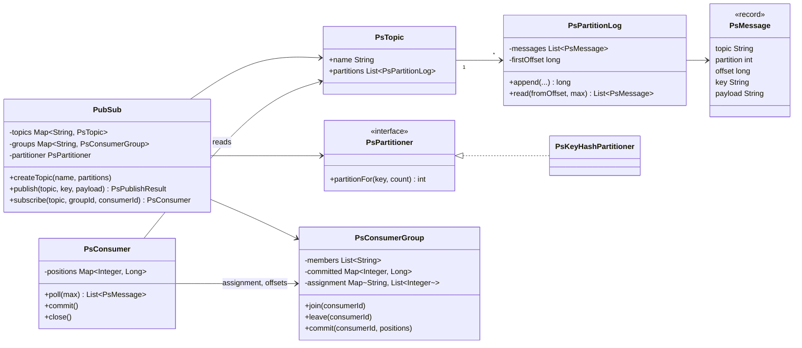
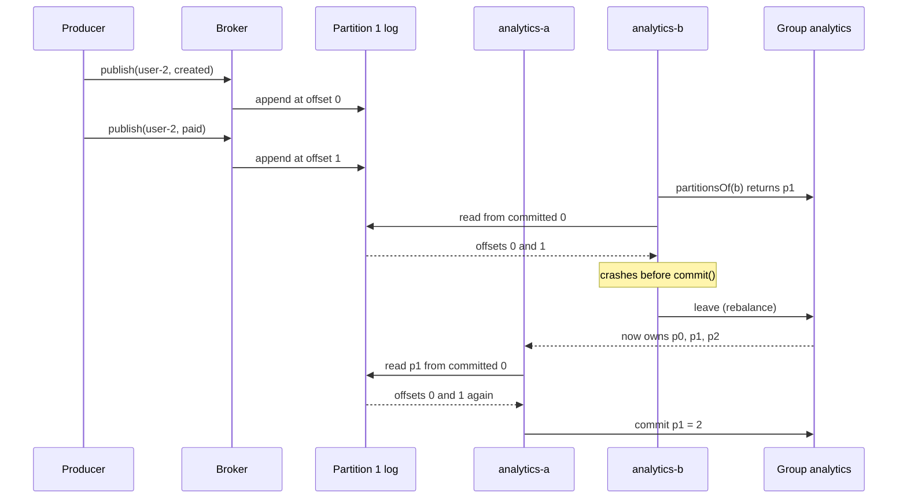

# Design an In-Memory Pub-Sub / Message Queue
A single-JVM broker with topics, partitions, keyed ordering, consumer groups, committed offsets, and at-least-once delivery.

## Intuition

> **Design intuition**: a message queue deletes a message once someone takes it; a log keeps every message and lets each reader remember how far it got. Build the broker as a log, and both shapes fall out: one consumer group reading a topic behaves like a queue (each message handled once by the group), and several groups reading the same topic behave like pub-sub (each group sees everything).

**Key insight**: ordering, parallelism and delivery guarantees are all decided by one number per partition, the offset. A key always hashes to the same partition, so a key's messages keep their order. A partition is read by one group member at a time, so the group parallelizes across partitions without reordering within one. A consumer commits its offset only after processing, so a crash causes a re-read from the last commit, never a gap.

**Full runnable implementation:** [`PubSub.java`](PubSub.java), one file, `main()` on `PubSub`. It demonstrates `PsKeyHashPartitioner` sending every `user-1` event to the same partition in publish order, two consumer groups each receiving all 6 messages, one group splitting 3 partitions between two members by round-robin rebalance, and at-least-once redelivery: a member that polls without committing and then leaves has its partition reassigned, and the survivor re-reads those messages from the last committed offset.

---

## Problem Statement

Design an in-process message broker:

```java
broker.createTopic("orders", 3);
PsPublishResult r = broker.publish("orders", "user-1", "user-1:paid");     // partition + offset
PsConsumer c = broker.subscribe("orders", "billing", "billing-1");
List<PsMessage> batch = c.poll(100);
process(batch);
c.commit();
```

Interviewers phrase it as "design a pub-sub system", "design a message queue like Kafka", or "design an event bus with multiple subscribers". The Observer pattern answers the smallest version (in-process callbacks); this page answers the version with durability of position, consumer groups and ordering, which is what the follow-up questions probe.

**Machine-coding time-box.** Build in order: one topic with one partition as an `ArrayList`, `publish` and a consumer with its own offset; then multiple partitions with a key partitioner; then consumer groups with round-robin assignment and committed offsets. Retention and rebalance on leave are the 70 to 80 minute additions.

---

## Requirements

### Functional
1. Create topics with a fixed number of partitions.
2. `publish(topic, key, payload)` returns the partition and offset; messages with the same key are delivered in publish order.
3. Consumer groups: within a group each message is processed by one member; each group independently receives every message (fan-out).
4. Consumers pull batches with `poll(max)` and `commit()` their progress.
5. When a member joins or leaves, partitions are reassigned and the new owner resumes from the last committed offset.
6. Retention: keep the last N messages per partition.

### Non-Functional
1. Publish O(1); poll O(batch size).
2. Thread-safe publish from many threads; each consumer used by one thread.
3. At-least-once delivery: no committed-then-lost messages; duplicates are possible after a failure.
4. A slow group must not slow down publishers or other groups.

---

## Class Diagram



The broker never pushes to consumers and never deletes a message because it was read. A consumer's state is two maps: its in-memory positions (what it has polled) and the group's committed offsets (what it has finished).

---

## Patterns Used

### 1. Observer, made pull-based
**Why**: pub-sub is Observer across a boundary: publishers do not know subscribers. A push design (the broker calls each subscriber) couples publisher throughput to the slowest subscriber and needs a buffer per subscriber anyway. Pulling from a shared log lets each group read at its own speed. See [Observer](../behavioral/observer/observer.md).

**Where it's the wrong fit**: for in-process UI or domain events with a handful of synchronous listeners, a plain Observer list is simpler; a log is for decoupled, possibly slow consumers.

### 2. Strategy: `PsPartitioner`
**Why**: the partition choice decides ordering and load balance. Key hashing keeps a key's order; round-robin spreads keyless traffic evenly; a custom partitioner can pin a tenant to a partition. See [Strategy](../behavioral/strategy/strategy.md).

### 3. Mediator: `PsConsumerGroup`
**Why**: members never coordinate with each other; the group object decides who owns which partition and records offsets. Adding a member is one `join` call. See [Mediator](../behavioral/mediator/mediator.md).

---

## Design Decisions & Tradeoffs

### Queue versus log

| Model | Fan-out to many groups | Replay | Ordering | Example |
|-------|------------------------|--------|----------|---------|
| Queue (delete on ack) | Copy per subscriber queue | No | Per queue, broken by parallel consumers and redelivery | RabbitMQ classic queues, SQS standard |
| **Log with offsets (chosen)** | Free: each group has its own offsets | Yes, reset the offset | Per partition | Kafka, Pulsar, Redis Streams |

### Delivery guarantee depends on when you commit

| Commit point | Guarantee | Failure mode |
|--------------|-----------|--------------|
| Before processing | At-most-once | Crash after commit, before processing: message lost |
| **After processing (chosen)** | At-least-once | Crash after processing, before commit: message processed twice |
| Atomically with the result | Effectively-once | Needs the output and the offset in one transaction (Kafka transactions, or offsets stored in the same database row as the result) |

At-least-once is the default because duplicates can be made harmless with an idempotent consumer (dedupe on a message ID or upsert by key), while lost messages cannot be recovered.

### Partition count is the parallelism ceiling

A group with more members than partitions leaves members idle: with 3 partitions, a fourth consumer gets nothing. Raising the partition count later changes `hash(key) mod n`, which moves keys to new partitions and breaks per-key order across the change. Choose partitions for the expected peak consumer count up front.

### Rebalance strategy

| Strategy | Moves on membership change | Notes |
|----------|----------------------------|-------|
| **Round-robin by index (chosen)** | Many partitions can move | Simple; enough for an interview |
| Range | Contiguous blocks per member | Kafka's original default per topic |
| Sticky / cooperative | Only the partitions that must move | Kafka's cooperative-sticky assignor; avoids stopping every member during a rebalance |

### Locking

Each `PsPartitionLog` synchronizes on itself, so publishes to different partitions run in parallel. Each group synchronizes on itself for assignment and commits. There is no global lock on the publish path.

---

## State / Flow



---

## Implementation

The key pieces of [`PubSub.java`](PubSub.java):

```java
final class PsKeyHashPartitioner implements PsPartitioner {
    private final AtomicLong roundRobin = new AtomicLong();
    public int partitionFor(String key, int partitionCount) {
        if (key == null) return (int) (roundRobin.getAndIncrement() % partitionCount);
        return Math.floorMod(key.hashCode(), partitionCount);   // floorMod: hashCode can be negative
    }
}

final class PsPartitionLog {
    private final List<PsMessage> messages = new ArrayList<>();
    private final int retainLast;
    private long firstOffset;

    synchronized long append(String topic, int partition, String key, String payload) {
        long offset = firstOffset + messages.size();
        messages.add(new PsMessage(topic, partition, offset, key, payload));
        if (messages.size() > retainLast) { messages.remove(0); firstOffset++; }
        return offset;
    }

    synchronized List<PsMessage> read(long fromOffset, int max) {
        long start = Math.max(fromOffset, firstOffset);          // position fell out of retention: skip ahead
        int from = (int) (start - firstOffset);
        int to = Math.min(messages.size(), from + max);
        return from >= to ? List.of() : List.copyOf(messages.subList(from, to));
    }
}
```

```java
public List<PsMessage> poll(int maxPerPartition) {
    List<PsMessage> out = new ArrayList<>();
    List<Integer> mine = group.partitionsOf(id);
    positions.keySet().retainAll(mine);                          // drop partitions lost in a rebalance
    for (int p : mine) {
        long from = positions.computeIfAbsent(p, group::committedOffset);
        List<PsMessage> batch = topic.partitions.get(p).read(from, maxPerPartition);
        if (!batch.isEmpty()) positions.put(p, batch.get(batch.size() - 1).offset() + 1);
        out.addAll(batch);
    }
    return out;
}
```

`messages.remove(0)` on an `ArrayList` is O(n); a real log uses segment files or a ring buffer so retention drops a whole segment in O(1). The `ArrayList` keeps the listing short and the offsets arithmetic visible.

---

## Sample Output

Output of `java PubSub` on JDK 25:

```
== publish: same key, same partition ==
  user-1:created -> p0@0
  user-2:created -> p1@0
  user-1:paid -> p0@1
  user-3:created -> p2@0
  user-1:shipped -> p0@2
  user-2:paid -> p1@1
== two groups: each sees every message ==
  [billing] rebalance -> {billing-1=[0, 1, 2]}
  [email] rebalance -> {email-1=[0, 1, 2]}
  billing-1 polled 6 messages
  email-1 polled 6 messages
== one group, two members: partitions are split ==
  [analytics] rebalance -> {analytics-a=[0, 1, 2]}
  [analytics] rebalance -> {analytics-a=[0, 2], analytics-b=[1]}
  analytics-a got p0@0 key=user-1 user-1:created
  analytics-a got p0@1 key=user-1 user-1:paid
  analytics-a got p0@2 key=user-1 user-1:shipped
  analytics-a got p2@0 key=user-3 user-3:created
  analytics-b got p1@0 key=user-2 user-2:created
  analytics-b got p1@1 key=user-2 user-2:paid
  analytics-b crashes before commit
  [analytics] rebalance -> {analytics-a=[0, 1, 2]}
== rebalance: survivor re-reads b's uncommitted messages ==
  analytics-a got p1@0 key=user-2 user-2:created
  analytics-a got p1@1 key=user-2 user-2:paid
```

All three `user-1` events land on partition 0 at offsets 0, 1, 2, so any consumer sees created, paid, shipped in order. The last block is at-least-once in action: `user-2`'s two messages are processed twice, once by the member that crashed and once by the survivor.

---

## Cross-Perspective: HLD Connections

- **Kafka** is this design with each partition log on disk as segment files, replicated to followers with an in-sync replica set, and group coordination in the broker. See [Message Queues](../../hld/message_queues/message_queues.md).
- **Event-driven architecture** uses topics like these as the integration point between services, and event sourcing keeps the log itself as the system of record; see [Event Sourcing and CQRS](../../hld/event_sourcing_cqrs/event_sourcing_cqrs.md).
- **Exactly-once processing** across services needs idempotent consumers or transactional outbox patterns, not a broker setting alone.

---

## Follow-Up Extensions

1. **Long polling**: block `poll` on a `Condition` per partition until a message arrives or a timeout passes, instead of returning empty and spinning.
2. **Dead-letter topic**: after N failed processing attempts, publish the message to `orders.DLT` and commit, so one poison message does not block its partition forever.
3. **Durability**: write each partition as append-only segment files with an index from offset to file position; recover positions by scanning the last segment.
4. **Consumer liveness**: members send heartbeats; a member silent for longer than a session timeout (Kafka's `session.timeout.ms` defaults to 45 s) is removed and its partitions reassigned.
5. **Back-pressure on publish**: bound total unconsumed bytes per topic and make `publish` block or fail when the slowest group falls too far behind, if retention by count is not acceptable.

---

## Interview Questions with Answers

**Q: How do you guarantee that all events for one order are processed in order?**
**Short:** Publish them with the order ID as the key so they hash to one partition, and let only one group member read a partition at a time.

Ordering exists only within a partition. A key hash sends every event of `order-42` to the same partition, where offsets fix their order, and the group assigns that partition to a single member. Ordering breaks if the producer retries out of order (Kafka uses idempotent producers with sequence numbers for this), if the partition count changes and the key moves, or if the consumer processes one partition's batch on several threads.

**Q: What is the difference between a consumer group and a subscription to a topic?**
**Short:** Members of one group share the topic's partitions so each message is handled once by the group, while separate groups each receive every message.

A consumer group is a queue over the topic: billing has three members, each owns some partitions, and the group processes each message once. A second group, email, keeps its own offsets and sees all messages again. That is how one log serves both work-sharing and fan-out without copying messages per subscriber.

**Q: Why does committing the offset after processing give at-least-once and not exactly-once?**
**Short:** If the consumer crashes after processing but before committing, the next owner resumes from the old offset and processes those messages again.

Commit-after-processing never loses a message, because a message is only marked done after its effect happened. The gap between effect and commit is where duplicates come from. Make consumers idempotent (dedupe by message ID, or upsert by business key), or store the offset in the same transaction as the result, which turns the effect and the commit into one atomic step.

**Q: Why can't a consumer group use more consumers than partitions?**
**Short:** Each partition is read by at most one member of a group to keep order, so members beyond the partition count get no partitions and sit idle.

With 3 partitions and 4 members, one member receives nothing. Parallelism is capped by partitions. Increasing partitions later changes `hash(key) mod n`, moving keys to different partitions, so per-key order is not guaranteed across that change. Plan the partition count for peak consumer parallelism, often 2 to 3 times the expected member count.

**Q: Why use `Math.floorMod(key.hashCode(), n)` and not `key.hashCode() % n`?**
**Short:** hashCode can be negative and Java's % keeps the sign, so % can return a negative partition index, while floorMod always returns 0 to n-1.

`"polygenelubricants".hashCode()` is `Integer.MIN_VALUE`, and `Math.abs` of that is still negative, so `Math.abs(h) % n` is also broken. `Math.floorMod` returns a result with the sign of the divisor. Kafka's default partitioner uses `Utils.toPositive(murmur2(keyBytes)) % numPartitions`, a stable hash that does not depend on Java's `String.hashCode`.

**Q: Pull or push: why do Kafka-style consumers pull?**
**Short:** Pulling lets each consumer read at its own pace and batch efficiently, while pushing must buffer for or slow down the slowest subscriber.

A push broker must track each subscriber's capacity, buffer when it falls behind, and decide whether to drop or block publishers. With pull, a slow consumer simply lags and its offset shows how far; the broker does nothing extra. Pull also allows large batched reads. The cost is latency when idle, solved with long polling: the broker holds the request until data arrives or a timeout passes.

**Q: What happens during a rebalance, and why is it disruptive?**
**Short:** Partition ownership moves between members; uncommitted work on moved partitions is redone, and with eager rebalancing every member stops consuming until the new assignment is set.

On join or leave, the group computes a new assignment. A member losing a partition must stop reading it, and its uncommitted messages will be re-read by the new owner. Eager protocols revoke all partitions from all members first, pausing the whole group. Kafka's cooperative-sticky assignor moves only the partitions that must move, so most members keep consuming. Commit before giving up a partition to cut redelivery.

**Q: How do you handle a message that always fails processing (a poison message)?**
**Short:** Retry a bounded number of times, then publish it to a dead-letter topic and commit past it, so the partition keeps moving.

Because offsets are sequential, a consumer that keeps retrying one message blocks every later message in that partition. After, say, 3 attempts with backoff, write the message plus the error to `orders.DLT`, commit, and alert. A separate process inspects and replays dead letters. Retries to a delayed retry topic avoid blocking during backoff.

**Q: How does retention interact with a slow consumer group?**
**Short:** If the group's offset falls behind the oldest retained message, those messages are gone, and the consumer must skip ahead to the earliest offset, losing data.

Retention is by time or size, not by whether groups have read a message. In this design `read` snaps a position below `firstOffset` forward, which mirrors Kafka's `auto.offset.reset=earliest` behavior after an out-of-range offset. Monitor consumer lag (latest offset minus committed offset) and alert well before lag approaches the retention window.

**Q: Observer pattern or message broker for in-process events?**
**Short:** Use a plain Observer for synchronous in-process listeners that must run in the same transaction; use a broker or log when consumers are slow, separate, or must survive restarts.

Spring's `ApplicationEventPublisher` calls listeners synchronously in the publisher's thread, which keeps them inside the same transaction and is simple. Once a listener is slow, can fail independently, or lives in another service, a broker decouples them: the publisher appends and returns, and the consumer catches up at its own speed. The transactional outbox pattern bridges both by writing the event in the same database transaction and relaying it to the broker.

**Q: How does a partition log assign offsets, and why must offsets never be reused?**
**Short:** Each append takes the next number after the last one, starting from the first retained offset plus the count; committed offsets refer to these numbers, so reuse would point consumers at the wrong message.

`offset = firstOffset + messages.size()` under the partition lock gives a strictly increasing sequence. Retention removes old messages but keeps counting from where it left off. If offsets restarted at 0 after retention, a committed offset of 500 would refer to a different, newer message, and consumers would skip or repeat data silently.

**Q: Where would you put locks in this broker, and why not one global lock?**
**Short:** One lock per partition log for appends and reads, and one per consumer group for assignment and commits, so publishes to different partitions and different groups never contend.

A global lock serializes every publish in the broker. Partition-level locking lets N partitions accept writes in parallel, which is also why partitions are the unit of throughput in Kafka. Group state changes rarely (commits, rebalances) and is per group. Consumers are single-threaded objects and need no locks.

**Q: How would you implement delayed or scheduled messages on top of this design?**
**Short:** Publish to a separate delay structure ordered by due time, and have a mover thread republish each message to the real topic when it comes due.

A log is ordered by append time, so it cannot hold a message back. Keep a priority queue (or per-delay-level topics, which is how RocketMQ implements fixed delay levels) and a thread that waits for the earliest due time, then publishes to the target topic. See [TaskScheduler](TaskScheduler.md) for the waiting and wakeup mechanics.

**Q: How do you measure whether consumers are keeping up?**
**Short:** Track consumer lag per partition, the latest offset minus the group's committed offset, and alert on both its size and its growth rate.

Lag of 10,000 that is stable is fine for a batch job and terrible for a real-time alerting pipeline, so alert on lag relative to the throughput and the retention window. Growth over time means consumers process slower than producers publish: add members (up to the partition count), speed up processing, or add partitions with the key-movement caveat.

**Q: What breaks if a consumer processes one poll batch on several threads?**
**Short:** Messages from the same partition may finish out of order, and committing the batch end offset can mark unfinished messages as done, losing them on a crash.

Parallel processing within a batch gives up per-partition ordering unless you split by key. Worse, committing `lastOffset + 1` while some threads are still working claims messages that have not been processed; a crash then loses them. Either process a partition sequentially, or track completion per offset and commit only up to the lowest unfinished one, which is what libraries like Confluent's parallel consumer do.

---
