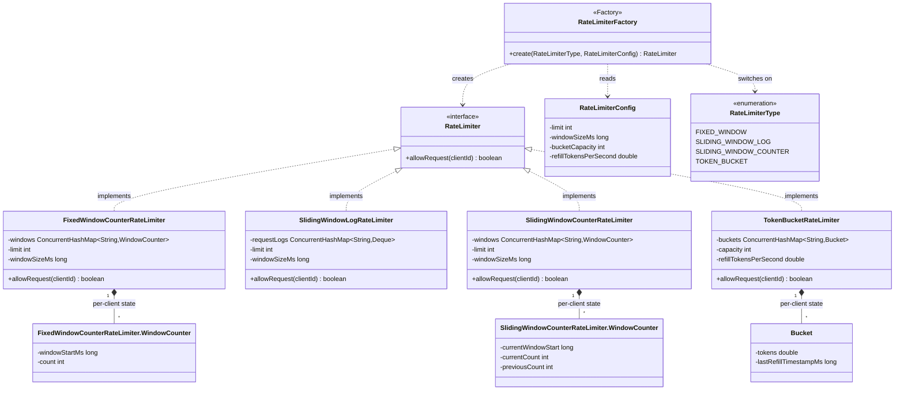
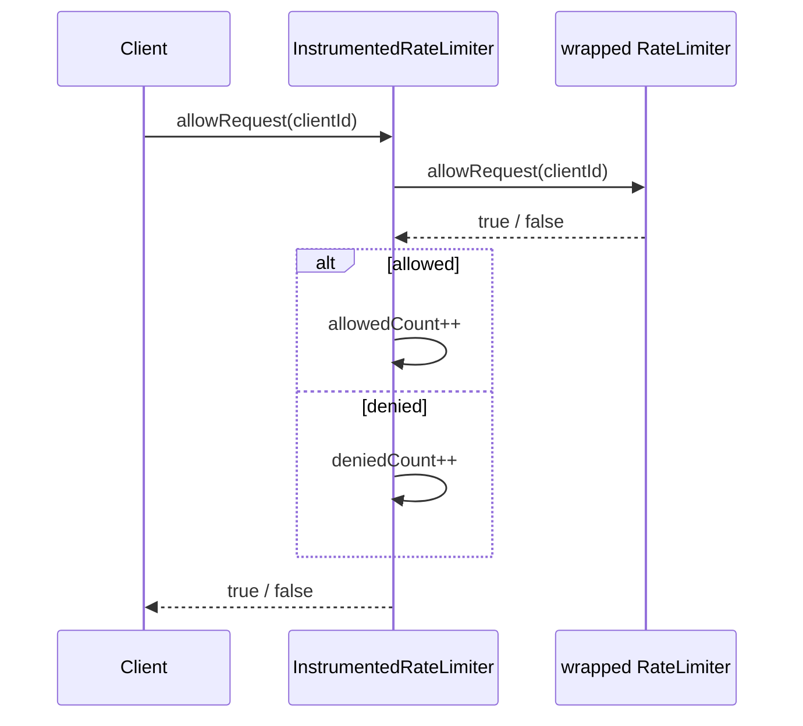
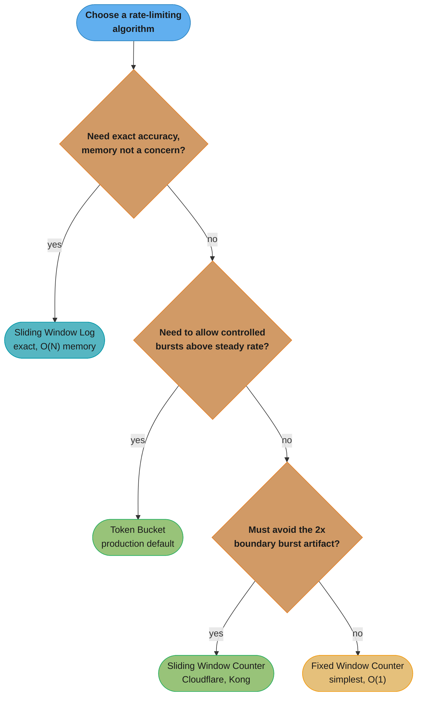
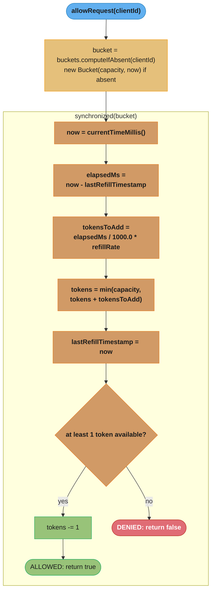

# Rate Limiter — Low-Level Design
## Intuition

> **Design intuition**: A rate limiter is a single decision: given a client identifier and the current time, return `true` (allow) or `false` (deny). The entire interview is about *how that decision is made and stored* — four classic algorithms (Fixed Window Counter, Sliding Window Log, Sliding Window Counter, Token Bucket / Leaky Bucket) answer the question differently, trading off accuracy, memory, and burst tolerance.

**Key insight**: Fixed Window Counter is the simplest but allows a **2x burst at window boundaries** (a client can send the full limit at 0:59 and again at 1:00, doubling the effective rate for a brief instant). Sliding Window Log is exact — it never over- or under-counts — but costs **O(N) memory per client** where N is the limit (e.g., 1000 timestamps per client for a 1000 req/min limit). Sliding Window Counter approximates the sliding window using two fixed-window counters and a weighted overlap, getting close to exact accuracy at O(1) memory. Token Bucket (and its cousin Leaky Bucket) decouples "rate" from "burst capacity" entirely — a bucket holds tokens that refill continuously, so clients can spend a saved-up burst instantly but are throttled to the refill rate over time. **The interview is really about articulating these tradeoffs out loud** — coding any single one of them correctly is necessary but not sufficient; explaining *why* you'd pick one over another for a given API is what separates a pass from a strong pass.

**Full runnable implementation:** [`RateLimiter.java`](RateLimiter.java) — 467 lines, one file, `main()` at the bottom. It demonstrates all four algorithms behind one `RateLimiter` interface — fixed window counter, sliding window log, sliding window counter, token bucket — selected by `RateLimiterFactory`, with a `main()` that drives each through a burst so the boundary behaviour is visible.

---

## Problem Statement

Design an in-process rate limiter that, given a `clientId` (e.g., an API key or user ID), decides whether to allow or reject the current request:

```java
boolean allowRequest(String clientId);
```

Requirements given in the prompt are typically:
- "Limit each user to 100 requests per minute."
- "Support different algorithms — interviewer may ask you to swap one in mid-interview."
- "Make it thread-safe — multiple requests from the same client can arrive concurrently."

**This is the LLD / single-JVM angle**: one process, in-memory state, a clean object-oriented interface with pluggable algorithms — exactly the kind of class you'd write in 30-45 minutes on a whiteboard or in a coding editor. For the **distributed-systems angle** — coordinating rate limits across many service instances using Redis, Lua scripts for atomicity, and the operational tradeoffs of centralized vs. local counters — see [`../../hld/rate_limiting/rate_limiting.md`](../../hld/rate_limiting/rate_limiting.md). The algorithms are conceptually the same; what changes is *where the state lives* (a `ConcurrentHashMap` here vs. a Redis key there) and *how atomicity is guaranteed* (a `synchronized` block here vs. a Lua script there).

---

## Requirements

### Functional
1. `allowRequest(clientId)` returns `true` if the request is within the configured limit, `false` otherwise
2. Each client is tracked independently — client A being throttled does not affect client B
3. The rate limit is configurable: a maximum request count and a time window (e.g., 5 requests / 10 seconds, or 100 requests / minute)
4. The algorithm is pluggable — the same caller code works regardless of which algorithm is selected at construction time
5. (Token Bucket variant) Support a configurable bucket capacity and refill rate, allowing controlled bursts above the steady-state rate

### Non-Functional
1. Thread-safe under concurrent calls from many clients and many threads per client
2. Bounded memory per client — O(1) for Fixed Window, Sliding Window Counter, and Token Bucket; O(limit) for Sliding Window Log (explicitly called out as a tradeoff, not a flaw)
3. Low latency per check — no I/O, no locks held longer than necessary; each `allowRequest()` call should be on the order of microseconds
4. New clients are created lazily on first request (no pre-registration step)

---

## ASCII Class Diagram



Strategy (`RateLimiter` realized by all four algorithms), Factory (`RateLimiterFactory` turns a `RateLimiterType` + `RateLimiterConfig` into the right concrete class), and the per-client state records that keep each implementation's memory footprint at O(1). The two window algorithms each declare their **own** private `WindowCounter` nested class — same name, different fields: Fixed Window needs only `(windowStartMs, count)`, while Sliding Window Counter also carries `previousCount` so it can weight the overlap. `SlidingWindowLogRateLimiter` is the odd one out, storing a `Deque<Long>` of raw timestamps per client instead, which is exactly the O(N) memory tradeoff called out below.

---

## Patterns Used

### 1. Strategy — `RateLimiter` interface
**Why**: The choice of algorithm (Fixed Window vs. Sliding Window Log vs. Sliding Window Counter vs. Token Bucket) is an implementation detail that should be swappable without touching the calling code — exactly the scenario Strategy is designed for. An interviewer commonly asks "now swap in a different algorithm" mid-interview; if `allowRequest(clientId)` is the only contract, the swap is a one-line change at construction time.

**How**: All four algorithms implement `boolean allowRequest(String clientId)`. A caller holds a `RateLimiter` reference and never needs to know (or care) which concrete class backs it. Each implementation owns its own per-client state map and its own locking/synchronization strategy appropriate to its data structure.

---

### 2. Simple Factory — `RateLimiterFactory`
**Name it precisely**: this is a **Simple Factory** — one static `create(...)` switching on an enum — not the GoF **Factory Method** (which defers instantiation to a subclass overriding a factory operation) and not **Abstract Factory** (families of related products). Simple Factory is not in the GoF catalogue at all; calling it "Factory Method" in an interview is a cheap point to lose.

**Why**: Centralizes the mapping from a `RateLimiterType` enum + `RateLimiterConfig` to the correct concrete class, so callers never instantiate `new TokenBucketRateLimiter(...)` directly. This keeps construction logic in one place and makes it trivial to add a fifth algorithm later without touching call sites.

**How**: `RateLimiterFactory.create(RateLimiterType type, RateLimiterConfig config)` switches on the enum and returns the matching `RateLimiter` implementation, passing through only the config fields that algorithm needs (e.g., Token Bucket ignores `windowSizeMs` and reads `bucketCapacity` / `refillTokensPerSecond` instead).

---

### 3. Decorator (optional extension) — `InstrumentedRateLimiter`
**Why**: Production rate limiters need observability — how often is each client being throttled? Wrapping any `RateLimiter` with a counting decorator adds metrics without modifying any of the four algorithm implementations or the `RateLimiter` contract.

**How**: `InstrumentedRateLimiter implements RateLimiter`, holds a delegate `RateLimiter`, and on each `allowRequest()` call increments an `allowedCount` or `deniedCount` (per-client or global) before/after delegating. This is a natural fit because it composes with the Strategy pattern above — any of the four algorithms can be wrapped identically. Not exercised in the demo `main()` below, but mentioned because it is a common interview follow-up ("how would you add metrics?").

The "before/after" question above resolves to *after*: the decorator waits for the delegate's answer, then increments whichever counter matches the outcome, so metrics never drift from what was actually decided.



`Inner` can be any of the four `RateLimiter` implementations interchangeably — the decorator only depends on the interface, so instrumentation composes with Strategy for free.

---

## Design Decisions & Tradeoffs

| Algorithm | Memory per client | Accuracy at window boundaries | Burst handling | Implementation complexity |
|-----------|-------------------|-------------------------------|-----------------|----------------------------|
| **Fixed Window Counter** | O(1) — one counter + one timestamp | Poor — allows up to **2x the limit** in a short window straddling two windows (e.g., limit=5, a client can send 5 requests at 0:59.9 and 5 more at 1:00.1 = 10 in 0.2s) | None beyond the 2x boundary artifact | Lowest — one map, one comparison, one reset |
| **Sliding Window Log** | O(N) where N = limit (e.g., 1000 timestamps stored per client for a 1000 req/min limit — roughly 8KB/client at 8 bytes/timestamp) | Exact — never over- or under-counts, by definition | None — strictly enforces the limit over any rolling window | Medium — deque eviction on every call, O(N) worst case per check |
| **Sliding Window Counter** | O(1) — two counters (current + previous window) | Good approximation — error bounded by the assumption that requests are evenly distributed within each window. Cloudflare measured 0.003% of requests wrongly allowed or limited over 400M requests, with a 6% average gap between the real and approximated rate; Kong's Rate Limiting Advanced plugin ships the same weighted-previous-window scheme as its default and recommended window type | Smooths the 2x boundary artifact down to a small, bounded overshoot | Medium — requires weighted-overlap arithmetic each call |
| **Token Bucket** | O(1) — two fields per client (`tokens`, `lastRefillTimestamp`) | N/A (not window-based) — enforces an average rate, not a per-window count | **Best** — explicitly designed to allow a controlled burst up to `bucketCapacity`, then throttle to `refillRate` | Medium — lazy refill calculation (elapsed time × rate) on every call |

**Why Token Bucket is the most commonly chosen default in production**: O(1) memory, allows legitimate bursty traffic (a user who was idle for 10 seconds and then clicks 5 things rapidly shouldn't be punished), and the two tunables (`capacity`, `refillRate`) map intuitively onto SLA language ("burst up to 10, sustained 1/sec").

**Why Sliding Window Log is still worth knowing**: it is the *reference implementation* for correctness — if an interviewer asks "what's the exact rate-limiting algorithm, with no approximation error?", this is the answer, with the explicit caveat that its O(N) memory makes it impractical for high limits (a 10,000 req/min limit = 10,000 timestamps per client = ~80KB/client, which multiplied across millions of clients becomes a real memory concern).

**What the formula is telling you.** Two numbers decide this table, and both are one-liners.
Fixed Window's flaw is `worst_rolling_count = 2 × limit` — "a counter that resets on a clock edge
can be drained twice on either side of that edge." Sliding Window Log's cost is
`bytes_per_client = limit × 8` — "exactness means storing one 8-byte timestamp for every request
you are willing to allow," so the memory bill scales with the *limit itself*, not with traffic.

| Symbol | What it is |
|--------|-----------|
| `limit` | Requests permitted per window — the configured quota |
| `window` | Fixed window duration that the counter resets on (60s here) |
| `2 × limit` | Worst count observable in any rolling `window`-length span under Fixed Window |
| `bytes_per_client` | Sliding Window Log footprint, `limit × 8` (one `long` per request) |
| `8` | Bytes in one Java `long` timestamp stored in the per-client `Deque<Long>` |

**Walk one example.** First the boundary artifact, using the table's own `limit = 5`, 60s window:

```
client sends 5 requests at t = 59.9 s   -> window [0,60)   count 5/5, all ALLOWED
counter resets at t = 60.0 s            -> window [60,120) count 0/5
client sends 5 requests at t = 60.1 s   ->                 count 5/5, all ALLOWED

what any rolling 60 s window actually saw:
        span [59.9, 119.9] contains 5 + 5      = 10 requests = 2 x limit
        elapsed between first and last          = 0.2 s
so the client got a 60-second quota's worth of traffic twice, 0.2 s apart.
```

Now the log's memory bill, for the two limits named in the text:

```
limit = 1,000 req/min   -> 1,000 x 8 bytes =  8,000 B =  7.8 KiB per client
limit = 10,000 req/min  -> 10,000 x 8 bytes = 80,000 B = 78.1 KiB per client

scaled to a real fleet, at the 1,000 req/min limit:
        1,000,000 clients x 8,000 B          = 8,000,000,000 B = 8.0 GB of timestamps
compare Token Bucket, 2 fields per client (a double + a long, 16 B):
        1,000,000 clients x 16 B             =    16,000,000 B = 16 MB
```

Result: the same fleet costs 8GB under Sliding Window Log and 16MB under Token Bucket — a 500x
gap, and the concrete reason the "exact" algorithm loses in production despite being correct.
Note that the log's bill grows when you make the limit *more generous*, which is the opposite of
the intuition that a looser limit is cheaper to enforce.

Every figure above uses 8 bytes = one primitive `long`, which is the **floor**. The implementation
stores boxed values in an `ArrayDeque<Long>`, so each entry really costs a 24-byte `Long` object
(12-byte header + 8-byte payload, padded to 24) plus the array slot holding the reference — about
28 bytes with compressed oops, 32 without. That is 3.5-4x the floor. A `long[]` ring buffer per
client is the standard fix; either way the 500x gap is a lower bound on how badly the log loses,
not an upper one.

Turning the tradeoffs above into a concrete decision procedure for the interview:



Default to Token Bucket unless a constraint rules it out: exactness pushes you to Sliding Window Log despite its O(N) cost, and tolerating the 2x boundary artifact is the only thing that gets you back down to Fixed Window Counter's simplicity.

---

## State / Flow

`allowRequest()` for **Token Bucket** — the most stateful of the four, since it must compute elapsed time and refill tokens on every call:



**In plain terms.** The two-line refill rule —
`tokensToAdd = elapsedMs / 1000.0 × refillRate`, then `tokens = min(capacity, tokens + tokensToAdd)`
— says "credit the client for every second it *didn't* spend, but never let unspent credit pile
up past the bucket's brim." The division converts wall-clock time into currency; the `min` is
what separates a burst allowance from an unlimited savings account.

| Symbol | What it is |
|--------|-----------|
| `elapsedMs` | `now - lastRefillTimestamp` — milliseconds since this bucket was last touched |
| `refillRate` | Sustained allowance in tokens per second — the long-run rate the client gets |
| `tokensToAdd` | Credit earned by idling, `elapsedMs / 1000.0 × refillRate` |
| `tokens` | Current balance; one is spent per allowed request |
| `capacity` | Bucket brim — the maximum burst that can ever be spent at once |
| `min(...)` | The cap that discards credit earned beyond `capacity` |

**Walk one example.** Use the demo's settings — `capacity = 5`, `refillRate = 1 token/sec` — and
follow one client through a drain, a short idle, and a long idle:

```
start   tokens = 5.00, capacity = 5, refillRate = 1 token/s

burst of 5 requests back-to-back (elapsed ~0 ms, so tokensToAdd ~ 0):
        tokens 5.00 -> 4.00 -> 3.00 -> 2.00 -> 1.00 -> 0.00      all 5 ALLOWED
        6th request: tokens = 0.00 -> below 1                        DENIED

client idles 3.5 s, then sends one request:
        elapsedMs   = 3500
        tokensToAdd = 3500 / 1000.0 x 1        = 3.50
        tokens      = min(5, 0.00 + 3.50)      = 3.50    (under the brim, all credit kept)
        spend 1     -> tokens                  = 2.50        ALLOWED

client idles 10 s instead, then sends one request:
        elapsedMs   = 10000
        tokensToAdd = 10000 / 1000.0 x 1       = 10.00
        tokens      = min(5, 0.00 + 10.00)     = 5.00    capped: 5 tokens forfeited
        spend 1     -> tokens                  = 4.00        ALLOWED
```

Result: idling 10 seconds earns exactly the same burst as idling 5 seconds — the `min` is what
stops a client from being quiet all day and then firing 86,400 requests in one instant. Drop the
`min` and `capacity` stops meaning anything; drop the `elapsedMs / 1000.0` division and you would
be adding one token per *millisecond*, inflating the client's rate 1000x.

The key subtlety: refill is **lazy** — there is no background thread ticking a timer. Tokens are only computed "as of now" when a request actually arrives, which is why `lastRefillTimestamp` must be updated on every call (even denied ones) to avoid double-counting elapsed time on the next call.

---

## Sample Output

```
========================================
   Rate Limiter — LLD Demo
========================================

--- Fixed Window Counter (limit=5, window=10s) ---
Request 1 from client-A -> ALLOWED (count=1/5)
Request 2 from client-A -> ALLOWED (count=2/5)
Request 3 from client-A -> ALLOWED (count=3/5)
Request 4 from client-A -> ALLOWED (count=4/5)
Request 5 from client-A -> ALLOWED (count=5/5)
Request 6 from client-A -> DENIED  (count=5/5)
Request 7 from client-A -> DENIED  (count=5/5)

--- Sliding Window Log (limit=5, window=10s) ---
Request 1 from client-B -> ALLOWED (log size=1/5)
Request 2 from client-B -> ALLOWED (log size=2/5)
Request 3 from client-B -> ALLOWED (log size=3/5)
Request 4 from client-B -> ALLOWED (log size=4/5)
Request 5 from client-B -> ALLOWED (log size=5/5)
Request 6 from client-B -> DENIED  (log size=5/5)
Request 7 from client-B -> DENIED  (log size=5/5)

--- Sliding Window Counter (limit=5, window=10s) ---
Request 1 from client-C -> ALLOWED (weighted count=1.00/5)
Request 2 from client-C -> ALLOWED (weighted count=2.00/5)
Request 3 from client-C -> ALLOWED (weighted count=3.00/5)
Request 4 from client-C -> ALLOWED (weighted count=4.00/5)
Request 5 from client-C -> ALLOWED (weighted count=5.00/5)
Request 6 from client-C -> DENIED  (weighted count=5.00/5)
Request 7 from client-C -> DENIED  (weighted count=5.00/5)

--- Token Bucket (capacity=5, refill=1 token/sec) ---
Request 1 from client-D -> ALLOWED (tokens left=4.00)
Request 2 from client-D -> ALLOWED (tokens left=3.00)
Request 3 from client-D -> ALLOWED (tokens left=2.00)
Request 4 from client-D -> ALLOWED (tokens left=1.00)
Request 5 from client-D -> ALLOWED (tokens left=0.00)
Request 6 from client-D -> DENIED  (tokens left=0.00)
  ... waiting 2000ms for refill ...
Request 7 from client-D -> ALLOWED (tokens left=1.00 after refill)
Request 8 from client-D -> ALLOWED (tokens left=0.00)

========================================
              Demo complete
========================================
```

Note: exact decimal values for Token Bucket vary slightly between runs because refill is computed from wall-clock elapsed time (`Thread.sleep` is not perfectly precise) — the values above are representative, not byte-exact.

---

## Cross-Perspective: HLD Connections

- **Single-JVM vs. distributed coordination** — the `TokenBucketRateLimiter` here keeps a `ConcurrentHashMap<String, Bucket>` in one process's heap; once you have multiple service instances behind a load balancer, each instance has its *own* map, and a client could get `N x instanceCount` requests through. [`../../hld/rate_limiting/rate_limiting.md`](../../hld/rate_limiting/rate_limiting.md) covers the fix: move the bucket state into Redis and make the refill-and-decrement sequence atomic with a Lua script (`EVAL`), so all instances share one logical bucket.

- **API gateway enforcement** — in practice, rate limiting is rarely hand-rolled inside business logic; it sits in a gateway or middleware layer in front of many services. See [`../../backend/rate_limiting_in_depth/rate_limiting_in_depth.md`](../../backend/rate_limiting_in_depth/rate_limiting_in_depth.md) for how the same four algorithms are deployed at the gateway tier, including header conventions (`X-RateLimit-Remaining`, `Retry-After`) and per-route configuration.

- **Per-tenant quota enforcement in SaaS systems** — the `clientId` in this LLD maps directly to a `tenantId` in a multi-tenant SaaS product. The same `RateLimiterFactory` pattern extends naturally to per-tenant *and* per-plan limits (e.g., free tier = Fixed Window 100/day, enterprise tier = Token Bucket capacity 10,000 / refill 50 per second) — see Follow-Up Extension 3 below.

- **Embedding in a web framework** — `TokenBucketRateLimiter` (or any `RateLimiter` implementation here) is a plain Java class with no framework dependencies, which means it can be wrapped directly inside a Spring `HandlerInterceptor.preHandle()` — call `allowRequest(apiKey)`, and if `false`, set HTTP 429 and short-circuit the chain. See [`../../spring/filters_and_interceptors/`](../../spring/filters_and_interceptors/filters_and_interceptors.md) for how interceptors fit into the Spring MVC request pipeline.

---

## Follow-Up Extensions

1. **Distributed rate limiting** — replace the `ConcurrentHashMap` per-client state with Redis keys (`INCR` + `EXPIRE` for Fixed Window, sorted sets for Sliding Window Log, a Lua script for Token Bucket's refill-and-decrement atomicity). See [`../../hld/rate_limiting/rate_limiting.md`](../../hld/rate_limiting/rate_limiting.md) for the full distributed design, including handling Redis as a single point of failure.

2. **Composite limits (per-endpoint + per-client)** — a real API needs `allowRequest(clientId, endpoint)`, where `/search` might allow 10 req/sec but `/export` allows 1 req/min. Implement by keying the per-client map on a composite key (`clientId + ":" + endpoint`) or by composing two `RateLimiter`s and requiring both to allow.

3. **Tiered limits (free / pro / enterprise)** — store a `tier` per client and look up `RateLimiterConfig` dynamically based on tier (e.g., free = 100/min via Fixed Window, pro = 1,000/min via Sliding Window Counter, enterprise = Token Bucket capacity 10,000 / refill 50/sec). The `RateLimiterFactory` already supports constructing different configs; the extension is a `Map<Tier, RateLimiterConfig>` lookup before calling it.

4. **Graceful degradation with `Retry-After`** — instead of a bare `boolean`, return a result object `{allowed: boolean, retryAfterMs: long}`. For Fixed Window, `retryAfterMs` = time until the window resets; for Token Bucket, `retryAfterMs` = time until `tokens >= 1` given the refill rate. The HTTP layer surfaces this as a `Retry-After` header on a 429 response.

5. **Leaky Bucket as a queueing variant** — Token Bucket rejects immediately when empty; Leaky Bucket instead enqueues the request and processes it at a fixed output rate (like a FIFO queue with a constant drain rate), smoothing bursts into a steady stream rather than dropping them. Useful when the downstream system can tolerate queued work but not a burst (e.g., writing to a slow database) — implement with a bounded `BlockingQueue` plus a single consumer thread draining at the configured rate.

---

## Interview Questions with Answers

**Q: Why does Fixed Window Counter allow up to 2x the configured limit?**
**Short:** a counter that resets on a clock edge can be drained fully on both sides of that edge.

A client can send the full limit right before a window resets and the full limit again right after, because the counter has no memory of the previous window at all — with limit=5 and a 60s window, 5 requests at 0:59.9 and 5 more at 1:00.1 puts 10 requests into a span of just 0.2 seconds, double the configured rate. This is a structural property of resetting on a fixed clock boundary, not a bug in the implementation — the worst-case rolling count is exactly `2 x limit` regardless of how carefully the counter itself is coded. It's the reason Sliding Window Counter and Token Bucket both exist: either smooth the boundary artifact (sliding window) or abandon window-based counting entirely (token bucket).

**Q: Why is Sliding Window Log's memory O(N) in the *limit*, rather than O(N) in actual traffic?**
**Short:** exactness requires storing one timestamp per request you're willing to allow, so the bill scales with the limit itself.

Sliding Window Log stores every request's timestamp in a per-client deque so it can compute the exact count in any rolling window — which means the deque's worst-case size is bounded by the limit (the maximum number of requests you'd ever allow to sit in the window at once), not by how much traffic the client actually sends. Counterintuitively, this means a *more generous* limit costs *more* memory per client, the opposite of what you'd expect from "loosening a restriction should be cheaper to enforce" — a 10,000 req/min limit stores 10,000 timestamps per client regardless of whether that client ever comes close to using it.

**Q: Walk the numbers — what's the actual memory gap between Sliding Window Log and Token Bucket at 1,000,000 clients?**
**Short:** roughly 8GB for the log versus 16MB for token bucket at a 1,000 req/min limit — a 500x gap.

At a 1,000 req/min limit, Sliding Window Log needs 1,000 timestamps × 8 bytes = 8,000 bytes per client; scaled to 1,000,000 clients that's 8,000,000,000 bytes, roughly 8GB, just for the timestamp deques. Token Bucket needs only two fields per client (a `double` and a `long`, 16 bytes total) regardless of the configured limit, so the same fleet costs 1,000,000 × 16 bytes = 16MB. That 500x gap is the concrete, quantified reason the "exact" algorithm loses in production despite being provably correct — and it's a lower bound, since the real `ArrayDeque<Long>` implementation costs more per entry than the 8-byte floor (see the next question).

**Q: Why is the real per-entry cost of `ArrayDeque<Long>` higher than the "8 bytes per timestamp" figure used in the memory table?**
**Short:** boxed `Long` objects cost ~24-32 bytes each with object-header overhead, not the 8-byte primitive `long` floor.

The 8-byte figure assumes a primitive `long[]`, but the implementation stores boxed values in an `ArrayDeque<Long>`, where each entry is a full `Long` object — a 12-byte header padded to a 24-byte object, plus the array slot holding a reference to it — landing around 28 bytes with compressed oops or 32 without, roughly 3.5-4x the primitive floor. This means the "500x gap" figure computed from the 8-byte floor is itself conservative — it's a lower bound on how badly Sliding Window Log loses, not an upper one. The practical fix is a `long[]` ring buffer per client instead of a boxed `ArrayDeque<Long>`, which recovers the primitive-array memory cost while keeping the same eviction logic.

**Q: Why is Token Bucket's refill computed lazily on each call instead of with a background thread ticking a timer?**
**Short:** lazy refill means zero cost when idle; a ticking thread would burn CPU on buckets nobody is touching.

Computing `tokensToAdd = elapsedMs / 1000.0 x refillRate` only when a request actually arrives means an idle client's bucket costs nothing between requests — no background thread is running, no CPU is spent updating buckets nobody is checking. A background ticking timer, by contrast, would need to periodically wake up and update every client's bucket regardless of whether that client has made a request recently, wasting cycles on inactive clients and adding a whole class of scheduling and thread-safety concerns the lazy approach avoids entirely. The tradeoff is that `lastRefillTimestamp` must be updated on *every* call — allowed or denied — or the next call would double-count the elapsed time.

**Q: Walk the token bucket math — why does idling 10 seconds earn the same maximum burst as idling only 5 seconds?**
**Short:** the `min(capacity, tokens + tokensToAdd)` cap discards any credit earned beyond the bucket's brim.

With `capacity = 5` and `refillRate = 1 token/sec`, idling 5 seconds computes `tokensToAdd = 5.0`, capped at `min(5, 0 + 5.0) = 5.0` tokens — the full bucket. Idling 10 seconds computes `tokensToAdd = 10.0`, but the same cap gives `min(5, 0 + 10.0) = 5.0` — identical, because 5 tokens are forfeited past the capacity brim. This is exactly what makes `capacity` mean anything at all: without the `min(...)`, a client that stayed quiet all day could fire an unbounded burst the instant it returned, turning "capacity" into an unenforced number rather than an actual ceiling.

**Q: Why must `lastRefillTimestamp` update even on a request that gets denied?**
**Short:** skipping the update on denial would let the next call double-count the time that already elapsed.

If a denied request left `lastRefillTimestamp` unchanged, the *next* call — allowed or denied — would compute `elapsedMs` from the older, stale timestamp, effectively crediting the client for time that was already accounted for once but never actually converted into tokens because the request that measured it was denied. Updating the timestamp on every call, regardless of outcome, ensures elapsed time is measured and consumed exactly once, matching the lazy-refill design's core invariant: every millisecond of idle time is counted toward exactly one future refill calculation, never zero and never twice.

**Q: Why is `RateLimiterFactory` called a Simple Factory and not GoF Factory Method?**
**Short:** it's one static method switching on an enum, not an overridable instance method deferred to a subclass.

`RateLimiterFactory.create(RateLimiterType, RateLimiterConfig)` centralizes construction by switching on an enum — the same shape as `ParkingLot`'s `VehicleFactory` and `RideSharing`'s `VehicleFactory` — which is a Simple Factory, a pattern not actually in the GoF catalogue. GoF's Factory Method instead defers the decision of *what* to instantiate to an overridable method on a subclass, and Abstract Factory produces families of related products together; neither describes a static switch statement. This page states outright that calling this "Factory Method" in an interview is "a cheap point to lose" — precision on pattern naming is graded.

**Q: Why does `InstrumentedRateLimiter` increment its counters after delegating to the wrapped limiter, not before?**
**Short:** it waits for the delegate's actual answer, so metrics can never drift from what was really decided.

`InstrumentedRateLimiter.allowRequest()` calls through to the wrapped `RateLimiter` first, receives the true `true`/`false` outcome, and only then increments `allowedCount` or `deniedCount` to match — incrementing beforehand (or optimistically assuming an outcome) risks the metric disagreeing with what actually happened if the delegate's logic is more complex than a simple pass-through. This after-the-fact accounting is what makes the decorator composable with any of the four algorithms interchangeably: it never needs to predict an algorithm's decision, only faithfully record whatever decision was actually made.

**Q: Why does Sliding Window Counter only approximate the sliding window rather than compute it exactly?**
**Short:** it weights the previous window's count by overlap fraction instead of tracking every individual timestamp.

Sliding Window Counter keeps just two counters — current window and previous window — and estimates the effective count in the current rolling window as a weighted blend of the two, assuming requests are evenly distributed within each fixed window. That assumption is what introduces the approximation error: real traffic isn't perfectly uniform within a window, so the weighted estimate can be slightly off from the true exact count a full timestamp log would give. The payoff is O(1) memory regardless of the limit, instead of Sliding Window Log's O(N) — a tradeoff of a small, bounded accuracy error for a massive reduction in memory cost.

**Q: What accuracy tradeoff did Cloudflare measure for its weighted sliding-window scheme in production?**
**Short:** 0.003% of requests wrongly allowed or limited over 400M requests, with a ~6% average gap from the true rate.

Cloudflare's measurement of its own weighted-previous-window sliding counter found that only 0.003% of requests were misclassified (wrongly allowed or wrongly limited) across a sample of 400 million requests, with roughly a 6% average gap between the approximated rate and the true rate. This is the concrete evidence behind the table's "good approximation" characterization for Sliding Window Counter — the error is small and bounded in practice, not a theoretical hand-wave, which is exactly why Kong's Rate Limiting Advanced plugin ships the identical scheme as its default and recommended window type rather than something more exact.

**Q: How would you implement composite limits — a different rate for `/search` than for `/export`, per client?**
**Short:** key the per-client state map on a composite `clientId + ":" + endpoint`, or compose two limiters requiring both to allow.

The simplest approach is keying whatever per-client map each algorithm already maintains (windows, buckets, logs) on a composite key like `clientId + ":" + endpoint` instead of just `clientId` — this needs no interface change, since `allowRequest` still takes one string key, it's just constructed differently by the caller. An alternative is composing two independent `RateLimiter` instances (a per-client one and a per-endpoint one) and requiring both to return `true` before allowing the request, which keeps the two limits conceptually separate at the cost of two lookups instead of one per check.

**Q: Leaky Bucket vs Token Bucket — what's the behavioral difference under a burst of traffic?**
**Short:** Token Bucket rejects immediately when empty; Leaky Bucket queues the excess and drains it at a fixed rate instead.

Token Bucket makes an instant allow/deny decision — once tokens run out, every further request is rejected outright until the bucket refills, which is appropriate when the caller can retry later. Leaky Bucket instead enqueues incoming requests into a bounded queue and processes them at a constant output rate regardless of how bursty the input was, smoothing a burst into a steady stream rather than dropping the excess — useful specifically when the downstream system can tolerate queued work but genuinely cannot tolerate a burst, such as writing to a slow database. The implementation shape differs correspondingly: Token Bucket is two fields and arithmetic, Leaky Bucket needs a bounded `BlockingQueue` plus a dedicated consumer thread draining it at the configured rate.

**Q: What changes when this design moves from a single JVM to a distributed rate limiter?**
**Short:** state moves from a `ConcurrentHashMap` to Redis, and atomicity moves from a `synchronized` block to a Lua script.

In this LLD, each algorithm's per-client state (windows, logs, buckets) lives in a `ConcurrentHashMap` inside one process's heap, and a `synchronized` block or the map's own atomic operations guarantee correctness under concurrent calls *within that process*. At distributed scale — multiple service instances behind a load balancer, each with its own independent map — a client could get `N x instanceCount` requests through, since no instance knows what any other instance has already allowed. The fix moves the state into Redis (an `INCR`+`EXPIRE` pair for Fixed Window, a sorted set for Sliding Window Log, a Lua script executed via `EVAL` for Token Bucket's refill-and-decrement, since it must happen atomically) so every instance shares one logical view of each client's state instead of maintaining N disconnected ones.

**Q: How would you add a `Retry-After` response instead of returning a bare boolean?**
**Short:** return `{allowed, retryAfterMs}`; compute it from the window reset time or the time until enough tokens refill.

Rather than `boolean allowRequest(clientId)`, a richer contract returns a small result object carrying both the allow/deny decision and a `retryAfterMs` field telling the caller exactly how long to wait before trying again. For Fixed Window, that's the time remaining until the current window resets; for Token Bucket, it's the time until `tokens >= 1` given the configured refill rate, computed directly from the same elapsed-time arithmetic the refill calculation already uses. The HTTP layer then surfaces this as a standard `Retry-After` header on a 429 response, giving the client actionable guidance instead of a bare rejection it has to guess how to handle.
