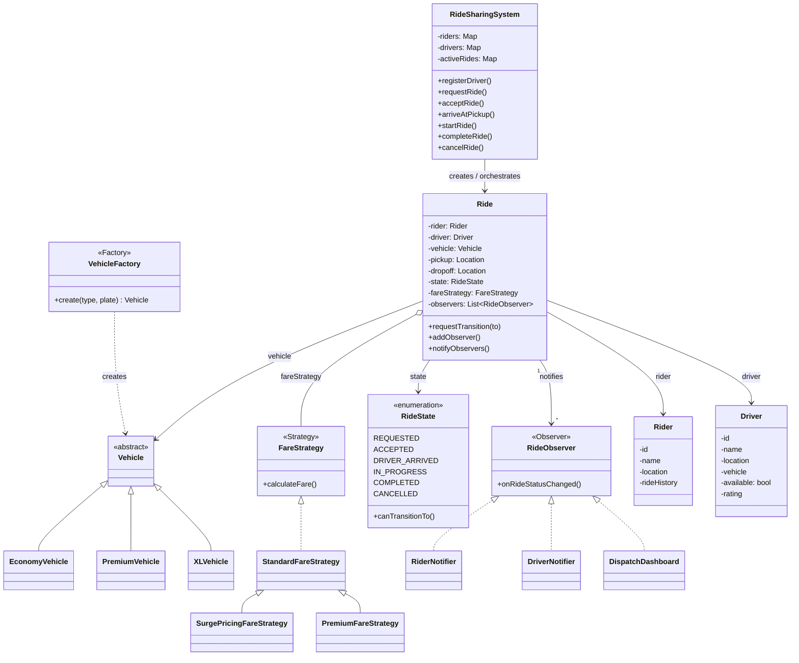
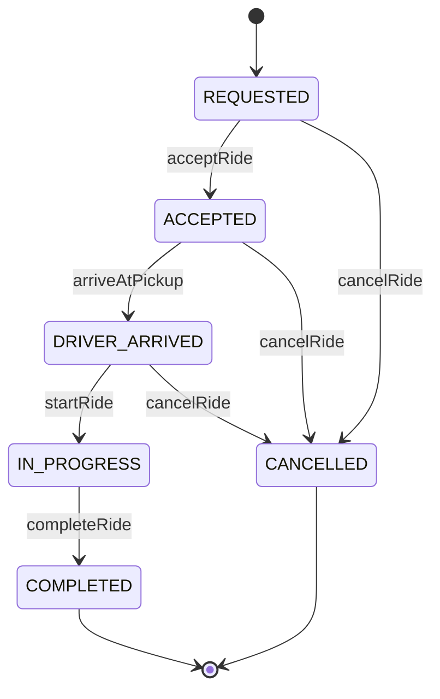
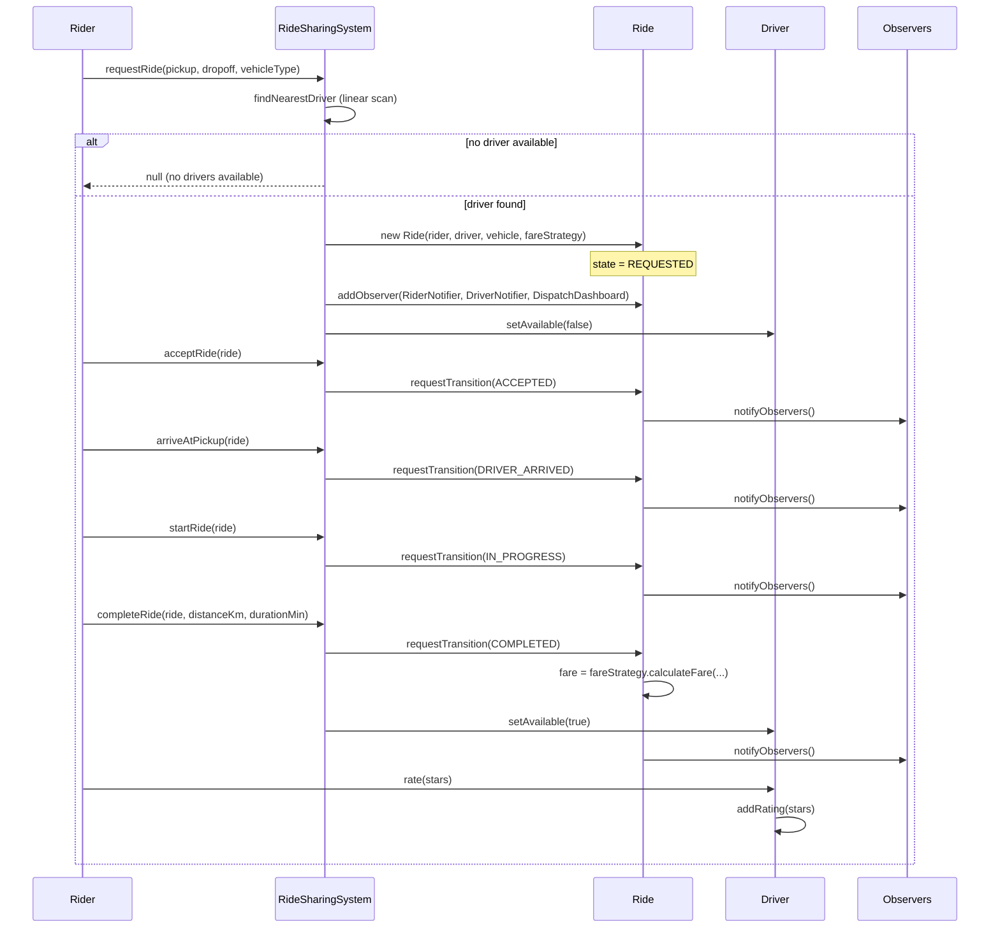

# Ride Sharing — Low-Level Design

## Intuition

> **Design intuition**: Ride Sharing looks like "another entity-modeling exercise" (Rider, Driver, Vehicle, Ride) but the interview signal is really about two things — **driver matching** (who serves this request, and how do you decide quickly) and the **ride lifecycle state machine** (a ride moves through a strict sequence of states, and the system must reject illegal jumps like going straight from REQUESTED to COMPLETED). Get those two right and the rest is bookkeeping.

**Key insight**: Resist the urge to hardcode fare math or notification logic inside `Ride` or `RideSharingSystem`. Fare calculation varies by vehicle tier and demand (Strategy), every status change has multiple independent listeners — the rider's app, the driver's app, an ops dashboard (Observer) — and vehicle creation should not leak `new EconomyVehicle(...)` calls throughout the codebase (Factory). The matching algorithm itself (nearest available driver via a linear scan) is intentionally simple for an interview — call out that production systems replace the scan with a geospatial index (quadtree / geohash / H3), but the class structure around it should not need to change.

**Full runnable implementation:** [`RideSharing.java`](RideSharing.java) — 589 lines, one file, `main()` at the bottom. It demonstrates `VehicleFactory` over Economy/Premium/XL, three `FareStrategy` implementations including surge, and three observers (`RiderNotifier`, `DriverNotifier`, `DispatchDashboard`) watching one ride's state machine.

---

## Problem Statement

Design a ride-sharing system (Uber/Lyft-style) that supports:
- Riders requesting a ride from a pickup location to a drop-off location
- Matching the request to the **nearest available driver**
- Multiple vehicle tiers — **Economy**, **Premium**, **XL** — each with different capacity and per-km rates
- Tracking a ride through its full lifecycle: requested, accepted, driver arrived, in progress, completed, or cancelled
- Calculating fare based on distance, duration, vehicle tier, and surge conditions
- Notifying the rider, the driver, and a dispatch dashboard whenever a ride's status changes
- Allowing riders to rate drivers (and vice versa) once a ride completes

---

## Requirements

### Functional
1. Register riders and drivers (with a current location and, for drivers, a vehicle)
2. `requestRide(rider, pickup, dropoff, vehicleType)` — find the nearest available driver of the requested tier and create a `Ride`
3. Walk a ride through its lifecycle: `acceptRide → arriveAtPickup → startRide → completeRide`
4. Support `cancelRide` from `REQUESTED`, `ACCEPTED` and `DRIVER_ARRIVED` — but **not** from `IN_PROGRESS`: once the rider is in the car the ride ends by completing it, not by cancelling
5. Calculate fare using a pluggable strategy (standard, surge, premium)
6. Notify all interested parties (rider, driver, dispatch dashboard) on every state transition
7. Record a rating for the driver once the ride completes

### Non-Functional
1. Enforce the ride state machine — reject invalid transitions (e.g., `COMPLETED → ACCEPTED`) with a clear error
2. Fare strategies must be swappable per-ride without modifying `Ride` or `RideSharingSystem`
3. New vehicle tiers should be addable without touching matching or fare logic (beyond registering a factory mapping)
4. Driver matching must be easy to swap for a geo-indexed implementation later (interface-level separation)

---

## ASCII Class Diagram

`RideSharingSystem` orchestrates `Ride` creation via `VehicleFactory`; each `Ride` aggregates one `FareStrategy` (Strategy), fans state changes out to every `RideObserver` (Observer), and guards its lifecycle through the `RideState` enum (State).



---

## Patterns Used

### 1. Strategy — `FareStrategy`
**Why**: Fare calculation depends on vehicle tier, demand, and promotions — and these rules change far more often than the rest of the ride lifecycle. Embedding fare math as a chain of `if (vehicleType == ...)` checks inside `Ride` would make every pricing change a risky edit to core lifecycle code.

**How**: `FareStrategy` is an interface with `calculateFare(distanceKm, durationMin, vehicleType)`. Each `Ride` holds a reference to a strategy chosen at request time, and the strategy can be swapped per-ride without touching `Ride` or `RideSharingSystem`.

| Implementation | Algorithm |
|-----------------|-----------|
| `StandardFareStrategy` | `baseFare + (perKmRate × distance) + (perMinRate × duration)`, rates scaled by vehicle tier |
| `SurgePricingFareStrategy` | `extends StandardFareStrategy`, calls `super.calculateFare(...)` and multiplies by a `surgeMultiplier` (validated `>= 1.0`; typically 1.5x–2.5x). Note this is inheritance, not a Decorator — it can only surge the one strategy it subclasses |
| `PremiumFareStrategy` | Higher base fare + a flat luxury surcharge, on top of the standard distance/time formula |

---

### 2. Observer — `RideObserver`
**Why**: A single status change (e.g., driver arrives) must reach the rider's app, the driver's app, and an internal dispatch dashboard — three independent systems with different responsibilities. Hardcoding three method calls inside every lifecycle method would tightly couple `Ride` to all three.

**How**: `Ride` maintains a `List<RideObserver>`. Every lifecycle transition (`acceptRide`, `arriveAtPickup`, `startRide`, `completeRide`, `cancelRide`) ends by calling `notifyObservers()`, which invokes `onRideStatusChanged(this)` on each registered observer.

| Observer | Reacts to |
|----------|-----------|
| `RiderNotifier` | Prints rider-facing status updates ("Your driver has arrived") |
| `DriverNotifier` | Prints the driver-facing assignment message on `REQUESTED` only, and ignores every later transition |
| `DispatchDashboard` | Logs every transition for operations monitoring |

---

### 3. Factory — `VehicleFactory`
**Why**: Callers (the matching engine, test setup, driver onboarding) should not need to know which concrete `Vehicle` subclass corresponds to a `VehicleType`. Centralising creation makes it trivial to add a new tier (e.g., `MOTO`) without touching matching code.

**How**: `VehicleFactory.create(VehicleType, plate)` maps `ECONOMY → EconomyVehicle`, `PREMIUM → PremiumVehicle`, `XL → XLVehicle`. Each subclass fixes its own `capacity` and `baseRatePerKm`.

---

### 4. State machine (transition table, not GoF State) — `Ride` / `RideState`
**Name it precisely**: `RideState.canTransitionTo()` is a `switch (this)` inside an enum — a **guarded transition table**, not the GoF **State** pattern, which would give each state its own class implementing a common handler interface (as `ElevatorSystem` and `ATM` do). The table is the better fit here: the states carry no behaviour of their own, only legality rules, so six handler classes would be five files of ceremony around one `switch`. Say which one you built and why.

**Why**: A ride must move through a strict sequence — you cannot start a ride that was never accepted, and you cannot re-accept a completed ride. Letting any caller set `ride.status = X` directly invites corrupted lifecycles (e.g., double-billing a completed ride).

**How**: `RideState` enum defines the six states and a `canTransitionTo(RideState)` method encoding the legal-transition table. `Ride.requestTransition(newState)` checks `canTransitionTo` before mutating state; an illegal request throws `IllegalStateException` with the current and attempted states named.

Legal transitions enforced by `RideState.canTransitionTo()` — both `COMPLETED` and `CANCELLED` are terminal, matching the illegal `CANCELLED -> ACCEPTED` jump rejected in the Sample Output below.



---

## Design Decisions & Tradeoffs

| Decision | Alternative | Reason chosen |
|----------|-------------|---------------|
| Linear scan over available drivers for matching | Geo-indexed lookup (quadtree / geohash / H3) | Linear scan is O(n) but n is small for a demo; interface is isolated in `RideSharingSystem.findNearestDriver()` so it can be swapped without touching `Ride` or callers |
| Surge multiplier passed into `SurgePricingFareStrategy` at construction | Global "surge mode" flag on `RideSharingSystem` | Per-ride multiplier supports zone-based surge (different multipliers in different areas) without a shared mutable global |
| `Ride.requestTransition()` validates via `RideState.canTransitionTo()` | Allow `Ride.setState()` directly, validate in `RideSharingSystem` | Keeps the invariant inside the entity that owns it — any caller, anywhere, gets the same guard |
| Observers registered per-`Ride` at creation time | Global observer registry on `RideSharingSystem` | Per-ride observers can include ride-specific objects (this rider's notifier) without filtering a global list on every event |
| Driver location stored as simple `(x, y)` coordinates | Lat/long with haversine distance | Simplifies the demo's distance math (Euclidean) while keeping the same method signatures — swapping to haversine is a one-method change |
| Rating recorded directly on `Driver` as a running average | Separate `Rating` entity with full history | Sufficient for LLD scope; a `Rating` entity with timestamps/comments is a natural follow-up extension |

---

## State / Flow

One full ride end to end: `RideSharingSystem` matches a driver, then every lifecycle call (`acceptRide`, `arriveAtPickup`, `startRide`, `completeRide`) transitions `Ride`'s state and fans the change out to all registered `RideObserver`s before the rider rates the driver.



---

## Sample Output

```
========================================
   Ride Sharing System — LLD Demo
========================================

--- Registering drivers ---
[System] Driver registered: Alex (ECONOMY) at (2, 3)
[System] Driver registered: Bianca (PREMIUM) at (10, 10)
[System] Driver registered: Carlos (XL) at (1, 1)
[System] Driver registered: Dina (ECONOMY) at (5, 5)

--- Registering riders ---
[System] Rider registered: Priya at (0, 0)
[System] Rider registered: Marco at (8, 9)

--- Requesting ride 1 (Priya, ECONOMY) ---
[Match] Nearest ECONOMY driver: Alex (distance 3.61 km)
[Dispatch] Ride RIDE-1001 created | Priya -> Alex | state=REQUESTED
  [Driver-Alex] New ride request assigned: RIDE-1001
  [Rider-Priya] Ride RIDE-1001 status: REQUESTED

--- Walking ride 1 through its lifecycle ---
  [Dispatch] RIDE-1001: REQUESTED -> ACCEPTED
  [Rider-Priya] Your driver Alex is on the way!
  [Dispatch] RIDE-1001: ACCEPTED -> DRIVER_ARRIVED
  [Rider-Priya] Alex has arrived at your pickup location.
  [Dispatch] RIDE-1001: DRIVER_ARRIVED -> IN_PROGRESS
  [Rider-Priya] Your ride has started. Enjoy!
  [Dispatch] RIDE-1001: IN_PROGRESS -> COMPLETED
  [Rider-Priya] Ride completed. Fare: $12.62
[System] Fare for RIDE-1001 (Standard): $12.62
[System] Priya rated Alex 5 stars (new average: 5.00)

--- Requesting ride 2 (Marco, PREMIUM, surge pricing) ---
[Match] Nearest PREMIUM driver: Bianca (distance 2.24 km)
[Dispatch] Ride RIDE-1002 created | Marco -> Bianca | state=REQUESTED
  [Driver-Bianca] New ride request assigned: RIDE-1002
  [Rider-Marco] Ride RIDE-1002 status: REQUESTED

--- Cancelling ride 2 ---
  [Dispatch] RIDE-1002: REQUESTED -> CANCELLED
  [Rider-Marco] Ride RIDE-1002 was cancelled.
[System] Bianca is available again.

--- Invalid transition attempt (expected error) ---
Caught: Cannot transition ride RIDE-1002 from CANCELLED to ACCEPTED (CANCELLED is terminal).

========================================
              Demo complete
========================================
```

---

## Cross-Perspective: HLD Connections

**HLD View — Where Ride Sharing Design Scales to Distributed Systems**

- **Driver matching at scale** — The linear scan over available drivers becomes a geospatial query against a quadtree, geohash grid, or Uber's H3 hexagonal index, served by a dedicated proximity/location service. See `../../hld/case_studies/design_uber.md` and `../../hld/case_studies/design_proximity_service.md` for how location updates fan in and matching queries fan out at city scale.
- **Observer -> push notification fan-out** — `RideObserver.onRideStatusChanged()` maps directly to a notification service that fans status events out over WebSocket/SSE to the rider's and driver's mobile apps, decoupling the ride-state core from delivery transport and retry semantics.
- **Surge pricing -> dynamic pricing microservice** — `SurgePricingFareStrategy`'s multiplier becomes a value fetched from a real-time pricing service that aggregates supply/demand signals per geo-cell and pushes multipliers that fare calculation simply reads at ride-completion time.
- **State machine -> distributed ride-state coordination** — `RideState.canTransitionTo()` enforced in-process becomes an event-sourced state machine at HLD scale: each transition is an immutable event appended to a log (Kafka), and the current ride state is a projection — enabling audit trails, replay, and multi-service consistency without a single shared mutable `Ride` object.

---

## Follow-Up Extensions

1. **Ride pooling / shared rides** — extend `Ride` to hold multiple riders with independent pickup/dropoff points and a `PoolFareStrategy` that splits cost proportionally to distance traveled per rider.

2. **Scheduled rides** — add a `scheduledTime` field and a background scheduler that triggers `requestRide()` automatically a few minutes before the scheduled pickup, reserving a driver in advance.

3. **Driver ratings affecting matching priority** — extend `findNearestDriver()` to weigh distance against `driver.getRating()`, so a slightly farther 4.9-star driver can be preferred over a very close 3.0-star driver.

4. **Multi-city support** — partition drivers and riders by `cityId`; matching only scans drivers within the same city/region, and surge multipliers are computed per-city.

5. **Cancellation fee policies** — add a `CancellationPolicy` (Strategy) that charges the rider a fee if cancellation happens after `DRIVER_ARRIVED`, with the fee waived if cancelled within a grace period of `REQUESTED`.

---

## Interview Questions with Answers

**Q: Why is `RideState.canTransitionTo()` called a "guarded transition table" and explicitly not the GoF State pattern?**
**Short:** the states carry no behavior of their own, only legality rules — six handler classes would be pure ceremony.

The GoF State pattern gives each state its own class implementing a common handler interface, the way `ElevatorSystem` and `ATM` do for their session phases — appropriate when each state has genuinely different *behavior*. Here, `RideState` is an enum whose only job is answering "is this transition legal," via a `switch (this)` inside `canTransitionTo()` — the states themselves don't do anything different, they just gate what's allowed next. Building six handler classes for that would be five files of ceremony around what's really one switch statement; naming precisely which one you built (a transition table, not GoF State) is the same discipline `ParkingLot.md` demands for "Simple Factory vs Factory Method."

**Q: `SurgePricingFareStrategy extends StandardFareStrategy` — what limitation does that inheritance choice create?**
**Short:** it can only ever surge the one strategy it subclasses; it can't be layered onto `PremiumFareStrategy`.

Because `SurgePricingFareStrategy` calls `super.calculateFare(...)` and multiplies the result, it's structurally locked to surging exactly `StandardFareStrategy`'s calculation — there's no way to apply the same surge multiplier on top of `PremiumFareStrategy` without either duplicating the surge logic into a second subclass or restructuring the hierarchy. A Decorator wrapping any `FareStrategy` (instead of inheriting from one specific one) would compose with all three strategies interchangeably, the way `LRUCache.java`'s `ThreadSafeLRUCache` wraps any cache implementation. This page names the tradeoff explicitly — inheritance here is a real, callable-out limitation, not an oversight to silently work around.

**Q: `DriverNotifier` only reacts to `REQUESTED` and ignores every later transition — is that a bug?**
**Short:** no — it's a deliberate, narrow responsibility; the driver's app needs the initial assignment, not every status echo.

`DriverNotifier` prints the driver-facing assignment message specifically on `REQUESTED` and does nothing on `ACCEPTED`, `DRIVER_ARRIVED`, `IN_PROGRESS`, or `COMPLETED` — which looks incomplete next to `RiderNotifier` (reacts to every transition) and `DispatchDashboard` (logs every transition) until you consider that the driver already knows their own actions caused those later transitions, since the driver's app is what triggers `acceptRide`/`arriveAtPickup`/`startRide` in the first place. Each observer reacting to only the events relevant to its own audience is exactly the point of Observer over a single shared broadcast — three independent listeners with three independent, and legitimately different, subsets of interest.

**Q: Why can't a ride be cancelled once it's `IN_PROGRESS`?**
**Short:** once the rider is physically in the car, the ride ends by completing, not by cancelling — the state diagram enforces this.

`cancelRide` is a legal transition only from `REQUESTED`, `ACCEPTED`, and `DRIVER_ARRIVED` — all pre-pickup states where nothing has physically happened yet that a cancellation needs to "undo." Once `IN_PROGRESS`, the rider is already in the vehicle en route, so the only sensible way to end the ride is `completeRide`, even if it's cut short — modeling a mid-trip stop as a "cancellation" would conflate a business event (no fare, nothing happened) with a physical one (a partial trip that still needs a partial fare and a driver payout). `RideState.canTransitionTo()` enforces this by simply not including `IN_PROGRESS -> CANCELLED` in its legal-transition table.

**Q: Why is driver matching a linear scan here, and what's the production fix?**
**Short:** a linear scan is fine at demo scale; production replaces it with a quadtree, geohash, or H3 hexagonal index.

`findNearestDriver()` scans every available driver of the requested tier and picks the closest by Euclidean distance — O(n) in the number of drivers, which is intentionally simple because at interview scale n is small and the point of the exercise is the class structure, not the geospatial algorithm. The Key insight names the fix explicitly: production systems replace the scan with a geospatial index (quadtree, geohash grid, or Uber's H3 hexagonal system) served by a dedicated proximity service, but the class structure around it — the `RideSharingSystem.findNearestDriver()` boundary — is deliberately isolated so swapping the algorithm doesn't touch `Ride` or any caller.

**Q: Why Strategy for fare calculation instead of `if/else` chains inside `Ride`?**
**Short:** fare rules (tier, demand, promotions) change far more often than the ride lifecycle they're embedded in.

Encoding `if (vehicleType == PREMIUM) ... else if (surge) ...` directly inside `Ride` would make every pricing policy change a risky edit to the class that also owns the ride's core lifecycle logic — a change meant only to adjust surge multipliers could accidentally break state-transition handling nearby. `FareStrategy` isolates that volatility: `Ride` holds a reference chosen at request time, and a new strategy (a promotional discount, a corporate account rate) is a new class implementing the interface, with zero changes to `Ride` or `RideSharingSystem`.

**Q: Why does `Ride.requestTransition()` validate through `RideState.canTransitionTo()` itself, rather than `RideSharingSystem` validating before calling into `Ride`?**
**Short:** the invariant lives inside the entity that owns it, so every caller anywhere gets the same guard automatically.

If `RideSharingSystem` were responsible for checking legality before calling `ride.setState(newState)` directly, every new caller of `Ride`'s state — a test, a future admin tool, a second orchestrating class — would have to remember to perform that same check itself, and any caller that forgot it could silently corrupt the ride's lifecycle (e.g., double-billing a completed ride). Putting the guard inside `Ride.requestTransition()` means the invariant is enforced no matter who calls it, which is the same reasoning `LibraryManagement.md` gives for keeping `RESERVED`-copy invariants inside the entity rather than scattered across callers.

**Q: Why is the surge multiplier passed into `SurgePricingFareStrategy` per-ride at construction, instead of a global "surge mode" flag on `RideSharingSystem`?**
**Short:** a per-ride multiplier supports zone-based surge without a single shared mutable global.

A global boolean or multiplier on `RideSharingSystem` would force the entire system into one surge state at a time, which doesn't match how real surge pricing works — different geographic zones surge independently based on local supply and demand, so downtown might be at 2x while the suburbs are at 1x simultaneously. Passing the multiplier into each `Ride`'s strategy at request time lets different rides carry different multipliers concurrently with no shared mutable state to coordinate or race on, and it naturally extends to a future zone-aware pricing service that computes the multiplier per pickup location.

**Q: Why Factory for `Vehicle` creation here, mirroring `ParkingLot`'s `VehicleFactory`?**
**Short:** callers shouldn't need to know which concrete subclass a `VehicleType` maps to; centralizing it makes new tiers additive.

`VehicleFactory.create(VehicleType, plate)` maps `ECONOMY -> EconomyVehicle`, `PREMIUM -> PremiumVehicle`, `XL -> XLVehicle` in one place, so the matching engine, driver onboarding, and test setup never call `new EconomyVehicle(...)` directly and never need to know the mapping themselves. Adding a fourth tier (`MOTO`) means one new subclass and one new case in the factory — no changes to matching code or anywhere else `Vehicle` objects are consumed — the identical structural justification `ParkingLot.md` gives for its own `VehicleFactory` over Motorcycle/Car/Truck.

**Q: Walk the illegal transition example from the Sample Output — why does `CANCELLED -> ACCEPTED` fail?**
**Short:** `CANCELLED` is a terminal state in `RideState.canTransitionTo()`, so no transition out of it is ever legal.

Both `COMPLETED` and `CANCELLED` are terminal states — once a ride reaches either, `canTransitionTo()` returns false for every possible target state, because a completed or cancelled ride represents a closed business event that should never be reopened (re-accepting a cancelled ride, or re-billing a completed one, would corrupt the ride's audit trail). The Sample Output demonstrates exactly this: after `RIDE-1002` is cancelled, attempting `acceptRide` throws `IllegalStateException` naming both the current state and the attempted target, which is `requestTransition()`'s guard doing precisely what it's there for — refusing the illegal jump loudly rather than silently corrupting state.

**Q: Why is driver location stored as simple `(x, y)` coordinates instead of lat/long with haversine distance?**
**Short:** it simplifies the demo's distance math to Euclidean while keeping the same method signatures for a later swap.

Using plain Cartesian coordinates lets the demo compute distance with straightforward Euclidean math (`sqrt(dx² + dy²)`) instead of the more involved haversine formula that accounts for Earth's curvature, which matters for real-world lat/long but adds complexity that isn't the point of an LLD exercise focused on matching and lifecycle logic. Because the distance calculation is isolated behind a single method, swapping to haversine later is a one-method change — the surrounding matching logic, the `Rider`/`Driver` classes, and every caller stay identical, since they only ever call "compute distance between two locations," not the formula itself.

**Q: How would ride pooling (shared rides) change the relationship between `Ride` and `FareStrategy`?**
**Short:** `Ride` needs multiple riders with independent pickup/dropoffs, and a `PoolFareStrategy` splitting cost proportionally.

Pooling means a single `Ride` can no longer assume exactly one rider with one pickup and one dropoff — it needs to hold multiple riders, each with their own pickup and dropoff point along a shared route. `FareStrategy` gains a new implementation, `PoolFareStrategy`, that splits the total trip cost proportionally to the distance each individual rider actually traveled, rather than charging each rider the full-trip fare `StandardFareStrategy` would compute. The Strategy boundary absorbs this cleanly — `RideSharingSystem` and the lifecycle state machine don't need to change, since a pooled ride still moves through the same `REQUESTED -> ... -> COMPLETED` sequence, just with more riders attached to one `Ride`.

**Q: How would you weigh driver rating into matching priority without changing the Strategy/Factory pattern?**
**Short:** extend `findNearestDriver()`'s scoring function to combine distance and rating; the pattern boundaries are unaffected.

The Follow-Up Extensions describe weighing distance against `driver.getRating()` so a slightly farther 4.9-star driver can be preferred over a very close 3.0-star driver — this changes only the scoring function inside `findNearestDriver()` (from "pick minimum distance" to "pick minimum weighted score combining distance and inverse rating"), which is entirely internal to the matching method. `VehicleFactory`, `FareStrategy`, and `RideObserver` are untouched, because rating-aware matching is purely a refinement of *which driver gets selected*, not a change to how vehicles are created, how fares are calculated, or how status changes are broadcast.

**Q: How does `RideState.canTransitionTo()` enforced in-process map to event-sourced ride-state coordination at HLD scale?**
**Short:** each transition becomes an immutable event appended to a log; current state becomes a derived projection.

In this LLD, `Ride`'s state is a single mutable field guarded by the transition table, living entirely in one process's memory. At HLD scale, that becomes event sourcing: every transition (`ACCEPTED`, `DRIVER_ARRIVED`, `COMPLETED`, ...) is appended as an immutable event to a durable log — typically Kafka — and the "current state" any service reads is a projection derived by replaying or caching those events, not a single shared mutable object multiple services could race to update directly. This enables audit trails, replay for dispute resolution, and multi-service consistency without any service needing exclusive write access to one shared `Ride` row — the same event-sourcing mapping `ChessGame.md`'s Command history draws for its own move log.

**Q: How does driver matching become a geospatial service at Uber scale?**
**Short:** the linear scan becomes a quadtree/geohash/H3 query against a dedicated proximity service that ingests live location updates.

`findNearestDriver()`'s O(n) scan over all available drivers works when n is small, but at city scale with thousands of concurrently available drivers, that scan needs to become a geospatial index query — a quadtree, a geohash grid, or Uber's own H3 hexagonal indexing system — served by a dedicated proximity/location service rather than computed inline inside the matching call. That service continuously ingests live GPS updates from every driver's app (a high-volume write path) and serves low-latency "nearest N drivers to this point" queries (a separate, optimized read path) — a genuinely different architecture from a single in-process method, but one the LLD's isolated `findNearestDriver()` interface boundary is specifically designed to be swapped in behind without touching `Ride` or the rest of `RideSharingSystem`.
