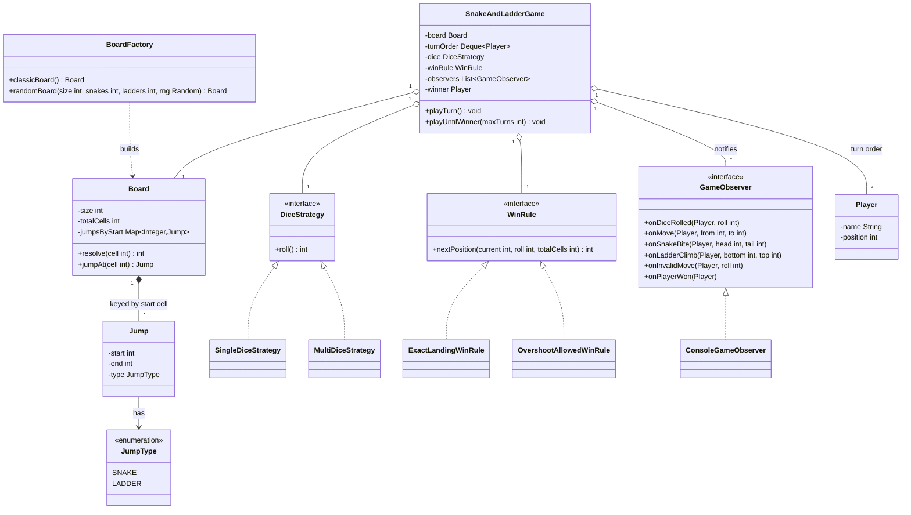

# Design Snake and Ladder
A configurable board, N players in a queue, and a dice roll that either lands, climbs, or bites — the classic clean-modeling warm-up.

## Intuition

> **Design intuition**: strip away the snakes and ladders and this is one turn loop asking a single question forever: *"where does this roll put the current player, and does that cell change the answer again?"* A dice roll gives a raw target cell; a jump table (snakes and ladders) may redirect it once more; a win rule decides whether an overshooting roll is even allowed to move at all. Three independent decisions, three independent objects — never one tangled `if/else` block.

**Key insight**: the entire correctness story lives in how a landed-on cell is resolved. It is tempting to write "keep following jumps until you land on a cell that isn't a jump start" — it reads as *more* correct, handling a ladder that happens to lead into a snake's mouth. It is actually a landmine: if the board data ever contains a two-jump cycle, that loop never terminates. The right fix is not a bigger safety cap, it's realizing chained resolution is the wrong feature — real Snake and Ladder boards resolve one jump per landing, and this page's `Board` enforces that at both ends: `resolve()` is physically incapable of looping, and the constructor rejects any board where a jump's destination is itself another jump's origin.

**Full runnable implementation:** [`SnakeAndLadder.java`](SnakeAndLadder.java) — one file, `main()` at the bottom. It demonstrates `Board`'s validated jump map, `DiceStrategy` (single die / N dice) and `WinRule` (exact-landing / overshoot-allowed) as Strategy, `GameObserver` reacting to rolls, climbs, bites and the win as Observer, `BoardFactory` building a validated classic or randomly-generated board as Factory, and — as teaching material only, never called from the engine — a `resolveChainedBroken()` method that reproduces the infinite-loop bug on a deliberately cyclic two-jump config, bounded to 1000 iterations so the demo can catch and print it instead of hanging.

---

## Problem Statement

Design the classic Snake and Ladder board game:
- A configurable N×N board (default 10×10 = 100 cells), numbered 1 to N²
- Snakes and ladders as jump entries: land on a snake's head and slide down to its tail; land on a ladder's bottom and climb to its top
- 2 or more players, taking turns in a fixed rotation
- A pluggable dice — one die, or the sum of several
- A pluggable win rule — must land exactly on the final cell, or a roll that would overshoot it just wins immediately
- Observers notified of every roll, move, snake bite, ladder climb and win, so a console UI, a replay log, and a test assertion can all watch the same game without the engine knowing any of them exist

Out of scope: board persistence, network play, and animating a token — this is the turn-resolution and board-validation logic, not a renderer.

---

## Requirements

### Functional
1. Build a board of configurable size with a set of non-conflicting snakes and ladders
2. Roll a die (or several) each turn and move the current player from their current cell by the roll
3. Resolve a landed-on cell through the jump table: a snake slides the player down, a ladder climbs the player up, any other cell is a no-op
4. Rotate turns through a queue of 2+ players until one reaches the final cell
5. Apply a configurable win rule: reject an overshooting roll (forfeit the turn) or cap the move at the final cell (instant win)
6. Notify registered observers of every dice roll, move, snake bite, ladder climb, invalid (overshooting) move, and win

### Non-Functional
1. **O(1)** jump lookup per landed cell — a shared mutable map, read by every turn, must not degrade with board size
2. **Board validity is enforced once, at construction** — no runtime code path should ever need to re-check "is this jump legal," because an illegal board should never exist
3. **The turn loop must never infinite-loop** on adversarial or malformed jump data — see the Intuition section above
4. Extensible to N players and to alternate dice/win-rule combinations without touching the turn-resolution logic itself

---

## Class Diagram



`BoardFactory` is the only place a `Board` is ever constructed, so it's also the only place jump-generation logic (fixed classic layout, or a random-placement retry loop) has to live — `SnakeAndLadderGame` never sees an unvalidated board.

---

## Patterns Used

### 1. Strategy — `DiceStrategy` and `WinRule`
**Why**: what the dice produces and what a roll is allowed to do with the board are two genuinely independent, swappable policies. `SingleDiceStrategy` vs `MultiDiceStrategy` never needs to know whether overshooting wins or forfeits; `ExactLandingWinRule` vs `OvershootAllowedWinRule` never needs to know how many dice produced the number it's given. Keeping them as two separate interfaces (rather than one "GameRules" grab-bag) means adding a "roll again on doubles" dice variant touches zero win-rule code, and vice versa.

**Where it's the wrong fit**: a rule that needs to see *both* the roll and the dice that produced it (say, "rolling snake eyes on two dice always forfeits the turn regardless of position") doesn't cleanly fit either interface as written — it would need a combined `TurnRule` that takes the raw dice results, not just the summed roll.

### 2. Observer — `GameObserver`
**Why**: a console UI, a replay/audit log, and a test harness asserting "player X was bitten by a snake on turn 12" all want to react to the same stream of events without `SnakeAndLadderGame` knowing any of them exist or how many there are. See [`../behavioral/observer/observer.md`](../behavioral/observer/observer.md) for the pattern in general.

**Where it's the wrong fit**: if observers needed to *veto* a move (a rules-variant where a player can be challenged), Observer's fire-and-forget notification isn't enough — that needs an interceptor/chain-of-responsibility shape instead, run *before* the state change rather than after it.

### 3. Factory — `BoardFactory`
**Why**: constructing a legal board is not just calling `new Board(...)` — it's choosing a layout (a fixed classic set, or randomly placed jumps with a collision-retry loop) and feeding it through validation. Centralizing that in `BoardFactory` means `Board`'s constructor stays a pure validator, and every caller gets a board that is guaranteed legal on the first try instead of hand-rolling a jump list at each call site.

**Where it's the wrong fit**: a board editor UI that lets a human place jumps interactively one at a time doesn't want a factory method that builds the whole board atomically — it wants to construct an in-progress, possibly-still-invalid draft and validate only when the human is done, which is a Builder shape instead.

---

## Design Decisions & Tradeoffs

### Single-hop resolution, not chained resolution

A jump table lookup happens exactly once per landed-on cell: `Board.resolve(cell)` returns `cell` unchanged if there's no jump there, or the jump's `end` if there is — full stop, even if that `end` cell is itself the start of another jump. This mirrors how the physical board game is actually played: you take one snake or ladder per landing, never a cascade. It also has a structural payoff that has nothing to do with realism: a function that cannot loop cannot infinite-loop, so an entire bug class simply doesn't exist for `resolve()`.

The tempting alternative — "keep following jumps until the cell stops being a jump start" — looks like a *more* thorough implementation, and for an acyclic chain it even produces a defensible answer. It becomes a liveness bug the moment two jumps point into each other: a ladder ending where a snake begins, whose tail is the ladder's own start. `Board`'s constructor closes this off entirely by rejecting any jump whose `end` coincides with another jump's `start` — the chain-adjacency check below — so the hazard is refused at board-build time, not merely worked around at resolve time.

```java
// BROKEN — teaching material only, never called by SnakeAndLadderGame
private static int resolveChainedBroken(Map<Integer, Jump> jumps, int cell, int maxIterations) {
    int current = cell;
    int iterations = 0;
    while (jumps.containsKey(current)) {
        current = jumps.get(current).end;
        iterations++;
        if (iterations >= maxIterations) {
            throw new IllegalStateException("cycle detected after " + maxIterations + " chained jumps");
            // in production, with no cap, this line is never reached — the loop just never returns
        }
    }
    return current;
}
```

```java
// FIX — Board.resolve(): single hop, cannot loop by construction
int resolve(int cell) {
    Jump j = jumpsByStart.get(cell);
    return j == null ? cell : j.end;
}
```

### The off-by-one trap: a ladder's top landing exactly on a snake's head

Two jumps, entered independently, can collide in a way that's invisible reading either one alone: `new Jump(10, 50)` (a ladder, since `end > start`) and `new Jump(50, 30)` (a snake, since `end < start`). Neither jump is malformed by itself — cell 50 is a perfectly legal ladder top, and a perfectly legal snake head. The bug only exists in the *pair*: land on 10, climb the ladder to 50, and 50 is simultaneously a snake's mouth. Under single-hop resolution this "just" produces a surprising double-move-in-one-turn if left unvalidated; under a chained resolver (see above) a symmetric version of the same collision is exactly what produces the infinite loop. `Board`'s constructor validates against this directly — after collecting every jump's `start`, it checks every jump's `end` against that same set, and rejects the board if any coincide:

```java
Set<Integer> starts = map.keySet();
for (Jump j : jumps) {
    if (starts.contains(j.end)) {
        throw new IllegalArgumentException(
            "cell " + j.end + " is both this jump's destination and another jump's origin");
    }
}
```

### Exact-landing vs overshoot-allowed as a `WinRule`, not a hardcoded flag

Both rules are real house variants of the game, and neither is "more correct" — exact-landing rewards precision near the end and can produce a tense final stretch where several players stall just short of 100; overshoot-allowed guarantees the game ends the moment someone gets close enough, favoring pace over precision. Modeling this as a `WinRule` interface rather than an `if (exactLandingEnabled)` scattered through the turn loop means a third house rule (say, "must land exactly, but a wasted overshoot roll of exactly 6 lets you re-roll") is a new class, not a new branch in existing code.

| Rule | Roll overshoots final cell | Player experience |
|------|------------------------------|--------------------|
| `ExactLandingWinRule` | Turn is forfeited, position unchanged | Tense endgame; a big lead can stall near 100 |
| `OvershootAllowedWinRule` | Position capped at the final cell, game ends | Faster games; no "stuck 3 away" frustration |

### Board validation happens once, never per-turn

Every rule a legal jump must satisfy — in range, no duplicate start, no chain-adjacency collision — is checked exactly once, inside `Board`'s constructor. `SnakeAndLadderGame.playTurn()` never re-validates anything about the jump table; it trusts the `Board` it was handed completely. This is the same "make illegal states unrepresentable" instinct behind `ATM.java`'s state machine: push every check as early as possible so the hot path (one turn, played potentially hundreds of times per game) does zero defensive work.

---

## Implementation

The full listing is [`SnakeAndLadder.java`](SnakeAndLadder.java); the pieces below are the ones with real decisions embedded in them.

`Jump` derives its type instead of accepting one — this is what makes a snake pointing the wrong way structurally impossible rather than merely "checked for":

```java
final class Jump {
    final int start;
    final int end;
    final JumpType type;

    Jump(int start, int end) {
        if (start == end) {
            throw new IllegalArgumentException("a jump cannot start and end on the same cell: " + start);
        }
        this.start = start;
        this.end = end;
        this.type = end > start ? JumpType.LADDER : JumpType.SNAKE;
    }
}
```

`SnakeAndLadderGame.playTurn()` is the whole turn loop — roll, ask the win rule where that roll lands, resolve any jump at that cell, notify observers, and check for a win:

```java
void playTurn() {
    if (isFinished()) {
        return;
    }
    Player current = turnOrder.poll();
    int roll = dice.roll();
    observers.forEach(o -> o.onDiceRolled(current, roll));

    int target = winRule.nextPosition(current.position, roll, board.totalCells);
    if (target == current.position) {
        observers.forEach(o -> o.onInvalidMove(current, roll));
        turnOrder.offer(current);
        return;
    }

    int resolved = board.resolve(target);
    observers.forEach(o -> o.onMove(current, current.position, target));
    Jump jump = board.jumpAt(target);
    if (jump != null) {
        if (jump.type == JumpType.SNAKE) {
            observers.forEach(o -> o.onSnakeBite(current, jump.start, jump.end));
        } else {
            observers.forEach(o -> o.onLadderClimb(current, jump.start, jump.end));
        }
    }
    current.position = resolved;

    if (current.position == board.totalCells) {
        winner = current;
        observers.forEach(o -> o.onPlayerWon(current));
        return;
    }
    turnOrder.offer(current);
}
```

The player who just moved is re-queued at the back with `turnOrder.offer(current)` — a plain `ArrayDeque` used strictly as a rotation, `poll()` from the front and `offer()` to the back, which is what keeps "N players taking turns forever until someone wins" from needing an explicit index or modulo arithmetic anywhere.

---

## Sample Output

Real output from `java SnakeAndLadder.java` (seeded `Random(42)` for the single die), trimmed to the turn-loop highlights — the full run is one line per turn plus a line per jump triggered:

```
=== 1. Classic board, single die, exact-landing rule ===
Alice      1 ->   4
Alice       climbs ladder 4 -> 25
Bob        1 ->   5
Charlie    1 ->   2
...
Alice     48 ->  54
Alice       bitten by snake 54 -> 34
...
Charlie   95 ->  98
Charlie     bitten by snake 98 -> 28
Alice     93 ->  96
Bob       61 ->  63
Bob         climbs ladder 63 -> 81
Charlie   28 ->  32
Alice     96 -> 100
Alice       reaches the final cell -- WINS!
Alice wins the game!

=== 2. Two-dice strategy, five sample rolls (seeded) ===
roll 1: 8
roll 2: 9
roll 3: 10
roll 4: 11
roll 5: 2

=== 3. Exact-landing vs overshoot-allowed at the edge of the board ===
player at 97 rolls 6 -> exact-landing:     97 (must roll exactly 3 to win)
player at 97 rolls 6 -> overshoot-allowed: 100 (wins immediately)

=== 4. Board validation rejects two jumps starting on the same cell ===
rejected: two jumps cannot start on the same cell: 20

=== 5. Board validation rejects a ladder whose top equals a snake's head ===
rejected: cell 50 is both this jump's destination and another jump's origin -- chaining is disallowed (a ladder's top cannot equal a snake's head, or vice versa)

=== 6. BROKEN: naive chain-resolution loops forever on that exact config ===
caught: cycle detected after 1000 chained jumps starting from cell 10 -- this loops forever in production; Board's chain-adjacency validation and single-hop resolve() are the fix, not a bigger iteration cap
Board.resolve() never has this problem -- it is single-hop by construction.
```

Alice wins on turn 30 (of the 3-player rotation), reaching cell 100 from 96 on an exact roll of 4 — the `ExactLandingWinRule` in effect the whole game. Section 3's contrived position (97, roll of 6) is exactly the scenario that rule forfeits and the overshoot rule wins outright, shown side by side rather than buried in the full game's random dice sequence. Section 6's cycle count is always exactly 1000 (the configured `maxIterations`) since `10 -> 50 -> 10 -> 50 -> ...` never terminates on its own — that fixed number *is* the demonstration, not an incidental detail.

---

## Cross-Perspective: HLD Connections

- **Turn rotation → distributed leader/token passing** — the `ArrayDeque` turn queue is a miniature of a token-ring or round-robin leader-election scheme: exactly one participant acts at a time, and control passes deterministically to the next. At HLD scale, a distributed job scheduler assigning exclusive ownership of a resource in round-robin fashion across worker nodes solves the identical "exactly one actor per round, deterministic handoff" problem.
- **Board validation at construction → schema/config validation at deploy time** — rejecting an illegal jump table once, at `Board` construction, rather than defending against it on every `resolve()` call is the same instinct as validating a service's configuration at startup (or in CI) rather than littering runtime code with `if (config.isValid())` checks. A config that could never have been legal should never reach the hot path.
- **The chain-adjacency cycle bug → cross-service saga/workflow cycles** — a snake head landing exactly on a ladder's top is a small, local version of a much larger distributed hazard: a workflow orchestrator (Temporal, Step Functions) whose compensating actions form a cycle across services can loop or deadlock exactly the way `resolveChainedBroken()` does, just with retries and timeouts standing in for a `while` loop. The fix at both scales is the same principle — detect and reject cyclic dependency graphs before they run, not after.
- **Observer notifications → event-driven architecture** — `GameObserver` fanning out to a console printer, a replay log, and (hypothetically) a live leaderboard is the same shape as a service publishing a domain event to multiple independent consumers over a message bus, just without the network, serialization, or at-least-once delivery concerns that show up once the observers live in different processes.

---

## Follow-Up Extensions

### Roll-again-on-doubles house rule
Wrap `MultiDiceStrategy` in a decorator that reports both the summed roll and whether it was a double, and let `SnakeAndLadderGame` grant an extra `playTurn()` for the same player when the flag is set — this only touches the turn-orchestration layer, not `DiceStrategy` or `WinRule`.

### Power cells / bonus tiles
Generalize `Jump` into a broader `CellEffect` interface (`apply(Player, Board) -> newPosition`) that `Jump` becomes one implementation of; a "skip next turn" or "swap positions with another player" tile becomes a second implementation without touching `Board.resolve()`'s call sites.

### Multiplayer over a network
Replace the in-process `GameObserver` fan-out with a message published to each connected client's session, and move `SnakeAndLadderGame` behind a per-game-room actor so concurrent games don't share mutable state — the natural extension covered generally in [`../../hld/case_studies/`](../../hld/case_studies/case_studies.md)'s real-time multiplayer patterns.

### Replay and undo
Since every state-changing event already flows through `GameObserver`, a `ReplayRecordingObserver` that appends `(player, roll, from, to)` tuples to a list gives replay for free; undo would additionally require `Player.position` to be restorable, which argues for wrapping each turn's mutation in a small Command object the way [`ATM.md`](ATM.md)'s `Transaction` does for rollback.

---

## Interview Questions with Answers

**Q: Why does naive chained jump-resolution risk an infinite loop, and what's the actual fix?**
**Short:** a two-jump cycle (A's end is B's start, B's end is A's start) makes the follow-the-chain loop never terminate.

A resolver that keeps following `jumps.get(cell).end` as long as the result is itself a jump start looks more thorough than a single hop — it "handles" a ladder that happens to lead into a snake's mouth. It becomes non-terminating the moment the jump data forms a cycle: land on 10, the ladder takes you to 50, 50 is a snake's head pointing back to 10, and the loop repeats forever with no exit condition. The actual fix isn't a bigger iteration cap (that just hangs later) — it's `Board.resolve()` doing exactly one hop by construction, plus `Board`'s constructor refusing to build a board where any jump's `end` coincides with another jump's `start` in the first place, so the cyclic data can never exist to be resolved.

**Q: What specifically does `Board`'s chain-adjacency validation reject, and why is that the right place to catch it?**
**Short:** it rejects any jump whose end cell is also another jump's start cell, checked once at construction.

After collecting every jump keyed by its `start`, the constructor checks every jump's `end` against that same key set — if a ladder's top (or a snake's head) equals another jump's start cell, construction throws before the board is ever handed to a game. Catching it here rather than in `resolve()` means the turn loop never has to think about the case at all; an illegal board simply cannot exist, which is cheaper and safer than defending against it on every one of potentially hundreds of turns per game.

**Q: Two jumps are each individually legal — a ladder from 10 to 50, a snake from 50 to 30. Why does building a `Board` with both reject them?**
**Short:** cell 50 is simultaneously the ladder's destination and the snake's origin, which is exactly the chain-adjacency hazard.

Neither jump is malformed in isolation: 50 is a perfectly ordinary ladder top, and a perfectly ordinary snake head. The problem only exists in the pair — a player climbing the ladder to 50 would immediately be sitting on a snake's mouth, which under single-hop resolution is at best a surprising double-move and under a chained resolver is precisely the shape that produces a cycle if the snake's tail ever pointed back toward 10. `Board` rejects the combination outright rather than trying to define "correct" behavior for it.

**Q: Why is `Jump`'s type (`SNAKE` vs `LADDER`) derived from `start` and `end` instead of passed in as a constructor argument?**
**Short:** deriving it from `end > start` makes a snake pointing the wrong direction structurally impossible, not just checked for.

If `JumpType` were a separate constructor parameter, nothing would stop a caller from passing `LADDER` with `end < start`, producing a "ladder" that actually moves a player backward — a bug that would only surface at runtime, on whichever turn happened to land on it. Computing `type = end > start ? LADDER : SNAKE` means the type and the direction can never disagree; there is no invalid combination to accidentally construct.

**Q: Why does `SnakeAndLadderGame` use an `ArrayDeque` for turn order instead of a `List` with an index that wraps via modulo?**
**Short:** `poll()`-from-front then `offer()`-to-back is turn rotation for free, with no index bookkeeping.

An indexed `List` needs `currentIndex = (currentIndex + 1) % players.size()` recomputed every turn, and that arithmetic has to be re-derived correctly if a player is ever removed mid-game (a disconnect, a forfeit). A `Deque` used purely as a rotation — `poll()` the current player, act, `offer()` them back to the tail unless they won — makes "whose turn is it" always just "the front of the queue," and removing a player permanently is a plain `remove()` with no index math to get wrong.

**Q: Why are `DiceStrategy` and `WinRule` two separate interfaces instead of one combined `GameRules` interface?**
**Short:** they vary independently — how many dice roll, and what an overshooting roll does, are unrelated axes of configuration.

A single combined interface would force every new dice variant (single die, two dice, three-dice-drop-lowest) to also decide what happens on overshoot, and every new win-rule variant to also decide how many dice to roll — coupling two concerns that a real player would happily mix and match (two dice with exact-landing is a completely reasonable house rule). Two narrow interfaces mean adding a third dice strategy touches zero win-rule code and vice versa, which is the entire point of Strategy: swap one axis without disturbing the other.

**Q: What's the difference between `ExactLandingWinRule` and `OvershootAllowedWinRule`, and when would a real product pick one over the other?**
**Short:** exact-landing forfeits an overshooting roll; overshoot-allowed caps the move at the final cell and wins immediately.

`ExactLandingWinRule.nextPosition()` returns the player's *current* position unchanged when `current + roll` exceeds `totalCells` — the turn is effectively wasted, and the player must roll the exact remaining distance on a later turn. `OvershootAllowedWinRule.nextPosition()` instead returns `Math.min(current + roll, totalCells)`, so any roll that reaches or passes the end wins outright. A casual mobile game favors overshoot-allowed because it guarantees the game actually ends and no player gets stuck one square from victory for many turns in a row; a rules-purist implementation of the traditional board game favors exact-landing because that's the historical rule.

**Q: A player rolls a number that would overshoot the board under `ExactLandingWinRule`. What actually happens to their turn?**
**Short:** the roll is wasted — their position doesn't change, and control passes to the next player.

`winRule.nextPosition()` returns the player's unchanged `current` position, which `playTurn()` detects via `target == current.position` and treats as an explicitly invalid move: it notifies `onInvalidMove()`, re-queues the player at the back of the turn order without touching `board.resolve()` or checking for a win, and returns. No jump lookup happens at all for a forfeited turn — there is no cell to resolve, since the player never actually moved.

**Q: Why does `Board`'s constructor reject a jump whose `end` lands on the final cell (`totalCells`)?**
**Short:** a jump directly delivering the win would let a player win off of someone else's jump table entry rather than a real dice roll.

Requirement 2's win condition is specifically about *rolling* onto the final cell (subject to whichever `WinRule` is active); a ladder whose top happened to be cell 100 would let a player win by climbing rather than by satisfying the configured win rule at all, silently bypassing whatever exact-landing/overshoot semantics the game was configured with. Disallowing `end == totalCells` (and, symmetrically, `start == totalCells` and either endpoint at cell 1) keeps "how you win" as a single, auditable code path — the `WinRule` — instead of two.

**Q: How would you generalize this design to support a "power cell" that isn't a plain teleport, like "skip your next turn"?**
**Short:** widen `Jump` into a `CellEffect` interface with an `apply()` method; `Jump` becomes one implementation among several.

Right now `Board.resolve()` assumes every effect is "move the player to a different cell," which is all a snake or ladder needs. A `CellEffect` interface with something like `apply(Player, Board) -> ...` (returning either a new position, or a side effect like a skipped-turn flag) lets a snake/ladder stay exactly as they are — trivial teleports — while a new effect type (skip-next-turn, swap-positions-with-another-player) is added as a new class implementing the same interface, with zero changes to `SnakeAndLadderGame.playTurn()`'s call sites beyond invoking the wider interface instead of reading `Jump` directly.

**Q: Why is board validation done entirely inside `Board`'s constructor rather than in `BoardFactory`?**
**Short:** so any caller building a `Board` directly — not just through the factory — gets the same guarantees.

If validation lived in `BoardFactory` instead, a `Board` constructed any other way (a test building a board by hand, a future board-editor UI calling `new Board(...)` directly) would silently skip every check — duplicate starts, out-of-range jumps, chain-adjacency collisions — and `SnakeAndLadderGame` would have no way to tell a validated board from an unvalidated one, since both are the same `Board` type. Putting every check in the constructor makes "a `Board` object exists" and "this board is legal" the same fact, unconditionally, regardless of how it was built. `BoardFactory` exists purely for convenience — a fixed classic layout, or a randomized-placement retry loop — not for correctness.

**Q: `BoardFactory.randomBoard()` retries on a placement collision instead of failing immediately — what's the tradeoff, and when does it actually fail?**
**Short:** it retries up to 10,000 attempts before giving up, trading a little wasted work for a much higher success rate on modest boards.

Randomly picking two cells and hoping they don't collide with an already-placed jump's start or end gets less likely to succeed as more jumps are already placed on a fixed-size board — a naive single-attempt-per-jump approach would fail far more often than necessary on, say, a 10×10 board with 10 total jumps, where collisions are common but far from unavoidable. Retrying inside the loop (bounded at 10,000 attempts total, not per-jump) absorbs that flakiness for free; it only throws `IllegalStateException` when the requested `snakeCount + ladderCount` is genuinely too large to fit the board at all, which is the caller's configuration error to fix, not a transient one retrying further would resolve.

**Q: Why does `SnakeAndLadderGame.playTurn()` notify observers about the move and the jump as two separate calls (`onMove` then `onSnakeBite`/`onLadderClimb`) instead of one combined event?**
**Short:** a move happens on every turn; a jump only sometimes does, and an observer may only care about one of the two.

Every successful turn produces a move (dice-roll-driven), but only some of those moves land on a cell with a jump. Splitting the notification means an observer that only cares about snake bites (say, a "close call" highlight reel) doesn't have to filter every plain move out of a combined event, and an observer that wants a complete positional trail doesn't miss anything by only listening to `onMove`. It also mirrors how the game is actually experienced: the dice roll and the resulting slide happen as two visually distinct beats, not one.

**Q: How does the classic board's jump layout in `BoardFactory.classicBoard()` satisfy the chain-adjacency rule, and how would you check a new layout does too before shipping it?**
**Short:** none of its ten jump endpoints coincide with any of its ten jump starting cells — verified by comparing the two sets directly.

The five ladder starts (4, 13, 33, 63, 71) and five snake starts (17, 54, 62, 89, 98) form one ten-element start set; the five ladder ends (25, 46, 49, 81, 91) and five snake ends (7, 34, 19, 68, 28) form a separate end set, and the two sets share no elements — which is exactly what `Board`'s constructor checks programmatically rather than by inspection. The general technique for validating any new hand-authored layout before shipping it is the same check the constructor already performs: compute the start set, then confirm no end value is a member of it; `Board`'s constructor doing this automatically means a bad hand-authored layout fails loudly at test time rather than shipping and surfacing as a runtime surprise.

**Q: What would break if `Player.position` were mutated directly by an observer instead of only by `SnakeAndLadderGame`?**
**Short:** the turn loop's own bookkeeping (win detection, re-queueing) would desynchronize from the player's actual board position.

`playTurn()` decides whether to declare a winner and whether to re-queue the current player based on `current.position` immediately after it sets that field — if an observer's `onMove()` callback (invoked in that same method, before those checks) mutated `position` again, the win check would evaluate against a position `playTurn()` never actually computed or validated through `board.resolve()`, silently bypassing the win rule and the jump table entirely. Observers are notified, not given write access, specifically so the engine's own state transitions stay the single source of truth — the same reasoning `TaskHandle` in [`TaskScheduler.md`](TaskScheduler.md) uses to avoid handing callers a mutable reference to scheduler-internal state.
