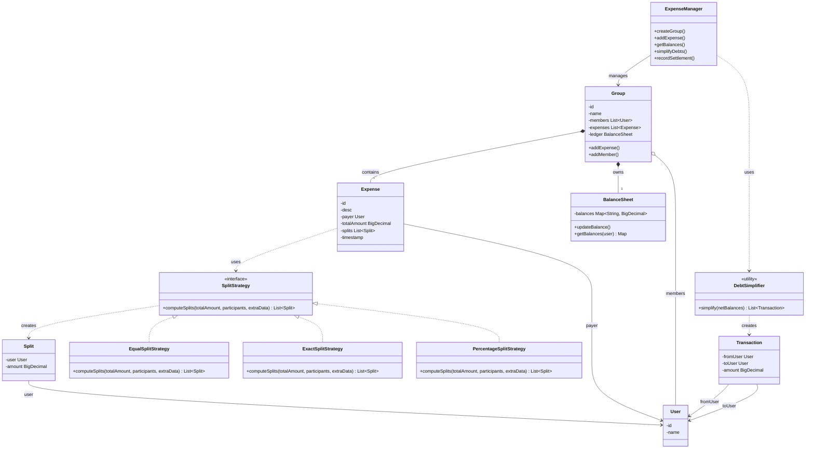
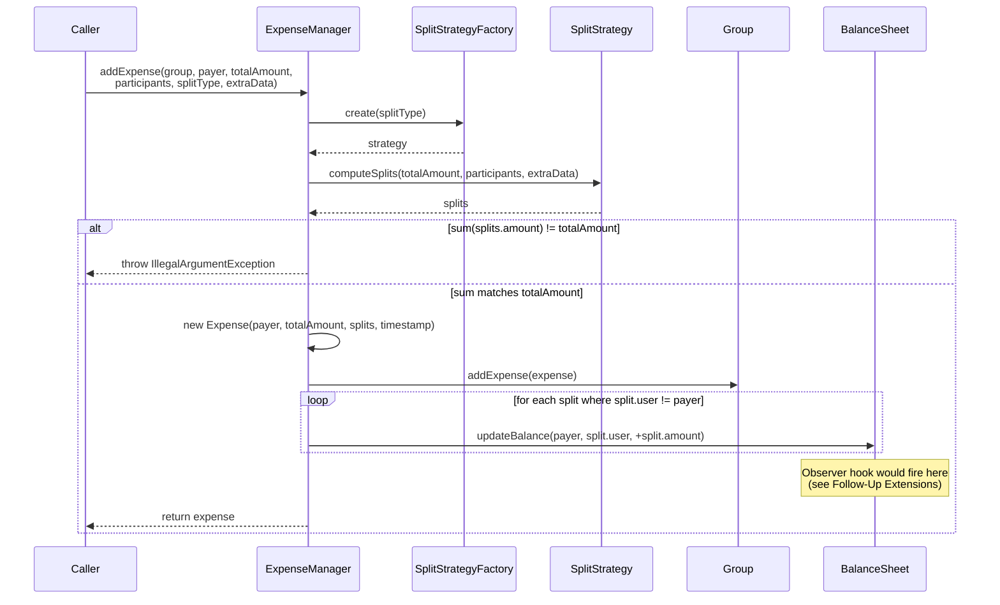
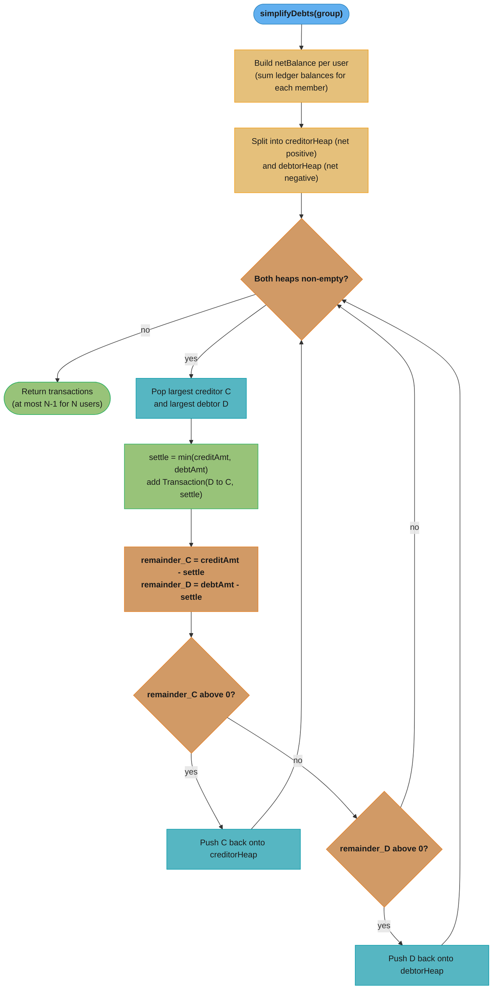

# Splitwise (Expense Sharing) — Low-Level Design

## Intuition

> **Design intuition**: Splitwise tests modeling a group/expense/balance graph and pluggable split strategies (equal, exact amounts, percentage, shares). The entity model itself — User, Group, Expense, Split — is the "easy 60%" of the interview.

**Key insight**: The hardest part isn't the data model — it's **debt simplification**, the greedy heuristic that collapses a tangle of pairwise debts (A owes B $10, B owes C $10, C owes A $5) into far fewer settling transactions (e.g., A pays C $5 directly). It is implemented with a max-heap of net creditors and a max-heap of net debtors, repeatedly matching the largest creditor against the largest debtor. **Say the word "heuristic", not "minimum"**: greedy matching guarantees only an upper bound of N-1 transactions for N users, not the true optimum. Computing the actual minimum — the debts-clearing / "optimal account balancing" problem (LeetCode 465) — is NP-hard **in the strong sense**: it is equivalent to carving the balances into as many disjoint zero-sum subsets as possible, a zero-sum set-packing problem that 3-Partition reduces to. Interviewers love this problem because it combines OOP modeling with a greedy-algorithm component, and naming that greedy-vs-optimal gap is what separates a good answer from a great one.

**Full runnable implementation:** [`Splitwise.java`](Splitwise.java) — 611 lines, one file, `main()` at the bottom. It demonstrates three `SplitStrategy` implementations behind `SplitStrategyFactory`, `BalanceSheet` netting pairwise debts, and `DebtSimplifier`'s max-heap greedy loop — with `BigDecimal` money throughout, which is the point.

---

## Problem Statement

Design a system where users can:
- Create groups (e.g., "Goa Trip", "Apartment 4B")
- Add an expense to a group, paid by one user and split among participants using a configurable strategy: **equal**, **exact amounts**, or **percentage**
- Track each user's net balance with every other user (who owes whom, and how much)
- Settle up — record a payment between two users that reduces their mutual balance
- View a **simplified debt summary** for a group — a greedily reduced set of transactions (at most N-1 for N users) that brings everyone's balance to zero, not necessarily the provably minimum set

---

## Requirements

### Functional
1. Create groups with a set of member users
2. Add an expense: payer, total amount, list of participants, and a `SplitType` (EQUAL / EXACT / PERCENTAGE) plus any extra data the strategy needs (exact amounts, percentages)
3. Compute and persist per-user-pair net balances after every expense
4. Simplify a group's debts into a reduced number of settling transactions (greedy; at most N-1 for N users, not guaranteed minimal)
5. Record a settlement (payment) between two users and update balances accordingly
6. Support multiple groups per user, each with an independent balance sheet

### Non-Functional
- **Split amounts must sum exactly to the total** — no off-by-a-cent errors. Use `BigDecimal` and a deterministic remainder-allocation policy (leftover cents go to the first N payers in iteration order)
- Balance lookups must be efficient (O(1) amortized) — don't recompute from full expense history on every query
- Extensible to new split types (e.g., SHARES — "Alice gets 2 shares, Bob gets 1 share") without modifying existing strategy code
- Debt simplification must run on a bounded number of users (tens, not millions) — O(N log N) is acceptable; this is a per-group, not a global, operation

---

## ASCII Class Diagram



`ExpenseManager` is the coordinator: it manages `Group`, whose `BalanceSheet` acts as the ledger. The three `SplitStrategy` implementations (Strategy pattern) plug in interchangeably to produce `Split`s, while the stateless-utility `DebtSimplifier` turns net balances into settling `Transaction`s (each one a settlement between two users).

---

## Patterns Used

### 1. Strategy — `SplitStrategy`
**Why**: The way an expense's total amount is divided among participants varies per-expense — equal split for a dinner, exact amounts for an itemized grocery bill, percentage splits for rent (e.g., based on room size). Encoding this as if/else chains inside `Expense` or `ExpenseManager` would make adding a new split type (e.g., SHARES) require touching existing code.

**How**: `SplitStrategy` interface declares `List<Split> computeSplits(BigDecimal totalAmount, List<User> participants, Map<User, BigDecimal> extraData)`. Each concrete strategy (`EqualSplitStrategy`, `ExactSplitStrategy`, `PercentageSplitStrategy`) implements its own division logic and is selected per-expense at creation time based on the `SplitType` the caller passes in.

| Implementation            | Algorithm                                                                 |
|----------------------------|----------------------------------------------------------------------------|
| `EqualSplitStrategy`        | `totalAmount / N`, rounded down to cents; leftover cents distributed one-each to the first *k* participants so the sum equals `totalAmount` exactly |
| `ExactSplitStrategy`        | Uses caller-provided per-user amounts from `extraData`; validates they sum to `totalAmount` (throws if not, within a 1-cent tolerance) |
| `PercentageSplitStrategy`   | Uses caller-provided percentages from `extraData`; validates they sum to 100; computes `totalAmount * pct / 100` per user, then fixes the rounding remainder against the largest share |

---

### 2. Factory — `SplitStrategyFactory`
**Why**: `ExpenseManager.addExpense()` receives a `SplitType` enum from the caller, not a strategy object. Something needs to map `SplitType -> SplitStrategy` so callers don't construct strategy objects themselves and so a new enum value is wired up in exactly one place.

**How**: `SplitStrategyFactory.create(SplitType type)` returns a fresh (stateless, so reusable) strategy instance via a `switch` expression. Adding `SplitType.SHARES` later means adding one enum constant, one strategy class, and one `case` — nothing else in `ExpenseManager` changes.

---

### 3. Observer — considered, but deliberately omitted
A natural extension would be a `BalanceChangeObserver` notified whenever an expense changes a user's balance (e.g., to push "Bob added an expense in Goa Trip" to mobile clients). This repo's `RideSharing` and `ParkingLot` problems already demonstrate Observer in depth, and forcing it into every entity here (every `Split`, every balance update) would add ceremony without adding to what this problem specifically teaches. The **Follow-Up Extensions** section below describes exactly where it would plug in if a production system needed it — `BalanceSheet.updateBalance()` is the single choke point where a notification hook would be added.

---

## Design Decisions & Tradeoffs

| Decision | Alternative | Reason chosen |
|----------|-------------|----------------|
| Store pairwise net balances directly in `BalanceSheet` (`Map<String, Map<String, BigDecimal>>`), updated incrementally on each expense | Recompute every user's balance from the full expense history on each query | O(1) update per (payer, participant) pair and O(1) balance lookup vs. O(E) replay of every expense on every query. With thousands of expenses per group, incremental updates are essential |
| `BigDecimal` for all money fields | `double` | `double` accumulates binary floating-point error — splitting $100.00 three ways as `33.333333...` repeatedly added/subtracted across hundreds of expenses drifts by cents. `BigDecimal` with `RoundingMode.HALF_UP` and a fixed scale (2) gives exact, auditable cent-level arithmetic — required for anything involving money |
| Debt simplification via greedy max-heap matching (largest creditor vs. largest debtor) — **O(N log N)** | Exact minimum-transaction-count solution | Finding the *true* minimum number of transactions to zero out a set of balances (the debts-clearing problem) is **NP-hard in the strong sense**. The problem is posed and analysed in Tom Verhoeff, "Settling Multiple Debts Efficiently: An Invitation to Computing Science", *Informatics in Education* 3(1):105–126, 2004 ([doi:10.15388/infedu.2004.08](https://doi.org/10.15388/infedu.2004.08)); the hardness comes from **3-Partition**, not subset-sum. Getting that distinction right matters: subset-sum is only *weakly* NP-hard and has a pseudo-polynomial DP, so it cannot establish strong NP-hardness — 3-Partition, which is strongly NP-hard, can. The exact answer needs exponential subset enumeration (bitmask DP, O(2^N)); the greedy heap approach is a **heuristic** that produces at most N-1 transactions for N users in O(N log N). It frequently hits the optimum on small groups but is not guaranteed to, and it is the standard, practical interview answer |
| Rounding remainder allocated to the **first N participants in iteration order** (one extra cent each until the remainder is exhausted) | Allocate all remainder to the payer, or randomly | Deterministic — same inputs always produce the same split, which matters for testing and for users comparing repeated runs of the same expense. Any fixed, documented tie-break rule works; what must not happen is a nondeterministic or drifting one |
| `BalanceSheet` keyed by `String` user IDs rather than `User` object references | Use `User` objects as map keys directly | Avoids needing to implement `equals()`/`hashCode()` correctly on a mutable `User`; IDs are stable, comparable, and serialize cleanly if persisted |

---

## State / Flow

### `addExpense()` flow



Traces the runtime collaboration behind `addExpense()`: the `SplitStrategyFactory` hands back a strategy, the strategy computes the `Split`s, and — once the sum-to-total invariant holds — the ledger is updated once per non-payer participant before the new `Expense` is returned.

### `simplifyDebts(group)` flow



Traces the greedy debt-simplification loop: each iteration matches the largest creditor against the largest debtor, settles the smaller of the two amounts, and requeues whichever side still has a remainder — producing at most N-1 transactions for N users.

**Stated plainly.** The greedy rule `settle = min(creditAmt, debtAmt)` says "always pay off the
larger of the two parties completely, so at least one person leaves the table each round." That is
the whole proof of the `N-1` bound: every iteration zeroes out at least one participant, and once
`N-1` people are settled the last one must be at zero too, because net balances always sum to
zero — money is only ever moved, never created.

| Symbol | What it is |
|--------|-----------|
| `N` | Number of users in the group |
| `netBalance(u)` | One signed number per user: total paid-for-others minus total owed |
| `creditAmt` | `netBalance` of the largest creditor, popped off the max-heap (positive) |
| `debtAmt` | Absolute `netBalance` of the largest debtor, popped off its max-heap |
| `settle` | `min(creditAmt, debtAmt)` — the amount transferred this round |
| `N-1` | Upper bound on settling transactions, since each round retires a user |

**Walk one example.** The three-way tangle from the intuition above — A owes B $10, B owes C $10,
C owes A $5:

```
step 1  collapse pairwise debts into one net number per user
        net(A) = -10 (owes B)  + 5 (C owes A)   = -5.00     debtor
        net(B) = +10 (A owes B) - 10 (owes C)   =  0.00     already settled
        net(C) = +10 (B owes C) -  5 (owes A)   = +5.00     creditor
        check   -5.00 + 0.00 + 5.00             =  0.00     invariant holds

step 2  heaps
        creditorHeap = [C: 5.00]        debtorHeap = [A: 5.00]

step 3  one greedy round
        settle       = min(5.00, 5.00)          = 5.00
        transaction  = A pays C $5.00
        remainder_C  = 5.00 - 5.00              = 0.00   -> not pushed back
        remainder_D  = 5.00 - 5.00              = 0.00   -> not pushed back
        both heaps now empty -> done

result  3 pairwise debts  ->  1 transaction
        bound for N = 3 users: at most N-1 = 2; achieved 1 (B dropped out at step 1)
```

Result: B never appears in the settlement at all, despite being party to two of the three original
debts — netting made B's $10 in and $10 out cancel before the greedy loop ever ran. This is why
step 1 matters as much as the heap: the netting pass alone removes every user whose books already
balance, and the `min(...)` rule then guarantees the remainder is cleared in at most `N-1` moves.

**Where greedy is not optimal.** `N-1` is an *upper bound*, not the minimum. Take five users with
nets `[+4, +3, +2, -4, -5]`:

```
greedy   +4 vs -5 -> settle 4, debtor -1 left        txn 1
         +3 vs -4 -> settle 3, debtor -1 left        txn 2
         +2 vs -1 -> settle 1, creditor +1 left      txn 3
         +1 vs -1 -> settle 1, both cleared          txn 4      total: 4 transactions

optimal  carve out the zero-sum subsets first:
         {+4, -4}      -> 1 transaction
         {+3, +2, -5}  -> 2 transactions                        total: 3 transactions
```

The lever greedy never pulls: **every disjoint zero-sum subset you can carve out settles internally
and saves one transaction**, so the true optimum is `N - k`, where `N` counts users with a nonzero
net and `k` is the maximum number of disjoint zero-sum subsets you can partition them into.
Maximising `k` is exactly where the hardness enters. Finding *one* zero-sum subset is subset-sum,
which is only weakly NP-hard; packing the balances into the *maximum number of disjoint* zero-sum
subsets is the strongly NP-hard part, by reduction from 3-Partition. That is why no
pseudo-polynomial shortcut exists and the exact answer is computed in practice by O(2^N) bitmask DP
over the handful of users a friend group actually has. Greedy pairs by size,
never by zero-sum structure, so it never goes looking for `{+4, -4}` at all. Say this out loud in an
interview — claiming greedy returns "the minimum" is the single most common wrong answer here.

---

## Sample Output

```
========================================
   Splitwise (Expense Sharing) — LLD Demo
========================================

--- Creating group "Goa Trip" ---
Members: Alice, Bob, Carol, Dave

--- Expense 1: Alice pays $120.00 for "Hotel" (EQUAL split among 4) ---
Splits: [Alice=$30.00, Bob=$30.00, Carol=$30.00, Dave=$30.00]
Balance sheet:
  Alice: Bob owes Alice $30.00, Carol owes Alice $30.00, Dave owes Alice $30.00
  Bob: Alice is owed $30.00 by Bob
  Carol: Alice is owed $30.00 by Carol
  Dave: Alice is owed $30.00 by Dave

--- Expense 2: Bob pays $60.00 for "Taxi" (EXACT split: Alice=$25.00, Carol=$20.00, Dave=$15.00) ---
Splits: [Alice=$25.00, Carol=$20.00, Dave=$15.00]
Balance sheet:
  Alice: Bob owes Alice $5.00, Carol owes Alice $30.00, Dave owes Alice $30.00
  Bob: Alice is owed $5.00 by Bob, Carol owes Bob $20.00, Dave owes Bob $15.00
  Carol: Alice is owed $30.00 by Carol, Bob is owed $20.00 by Carol
  Dave: Alice is owed $30.00 by Dave, Bob is owed $15.00 by Dave

--- Expense 3: Carol pays $100.00 for "Groceries" (PERCENTAGE split: Alice=50%, Bob=30%, Dave=20%) ---
Splits: [Alice=$50.00, Bob=$30.00, Dave=$20.00]
Balance sheet:
  Alice: Bob owes Alice $5.00, Carol is owed $20.00 by Alice, Dave owes Alice $30.00
  Bob: Alice is owed $5.00 by Bob, Carol is owed $10.00 by Bob, Dave owes Bob $15.00
  Carol: Alice owes Carol $20.00, Bob owes Carol $10.00, Dave owes Carol $20.00
  Dave: Alice is owed $30.00 by Dave, Bob is owed $15.00 by Dave, Carol is owed $20.00 by Dave

--- Net balance per user (positive = is owed overall) ---
  Alice : +$15.00
  Bob   : +$0.00
  Carol : +$50.00
  Dave  : -$65.00

--- Simplified debt summary (greedy; at most N-1 transactions) ---
  Dave   pays Carol  $50.00
  Dave   pays Alice  $15.00

--- Recording settlement: Dave pays Carol $50.00 ---
Updated net balances after settlement:
  Alice : +$15.00
  Bob   : +$0.00
  Carol : +$0.00
  Dave  : -$15.00

========================================
              Demo complete
========================================
```

---

## Cross-Perspective: HLD Connections

**HLD View — Where Splitwise Design Scales to Distributed Systems**

- **Pairwise balance ledger -> double-entry ledger** — `BalanceSheet`'s `Map<userId, Map<otherId, BigDecimal>>` is a simplified double-entry ledger: every expense posts a credit to the payer and a matching debit to each participant. At production scale this becomes an append-only ledger table with optimistic-locking on balance updates — see `../../hld/case_studies/design_digital_wallet.md` for the full double-entry ledger and optimistic-concurrency pattern.
- **Debt simplification as a batch job** — Running `simplifyDebts()` synchronously on every balance query is fine for a group of 10 friends, but at HLD scale (millions of groups) it becomes a periodic batch job — e.g., nightly, or triggered when a group's "settle up" screen is opened — that recomputes and caches the simplified transaction list rather than computing it inline on every request.
- **Observer -> push notification fan-out** — The `BalanceChangeObserver` hook described in Patterns Used maps directly to a notification service: every balance-changing event (`updateBalance`) publishes to a message queue, fanned out to push-notification, email, and in-app feed consumers — see `../../hld/case_studies/design_notification_system.md`.
- **BigDecimal precision -> minor-units convention** — The `BigDecimal`-with-scale-2 approach mirrors the real-world "never put money in a float" convention that every payment API enforces on the wire, in one of two shapes. Stripe uses **integer minor units**: its `amount` field is "a positive integer representing how much to charge in the smallest currency unit", so `$30.00` is the integer `3000`. PayPal's Orders v2 API instead uses a **decimal string** with explicit currency-driven precision (`"value": "30.00"`). Neither ever sends a binary float. Integer minor units are the wire-format equivalent of a fixed-scale `BigDecimal`; a decimal string is its literal serialization.

---

## Follow-Up Extensions

1. **Multi-currency support** — each `Expense` carries a `Currency`; before updating `BalanceSheet`, convert to a group's base currency via an `ExchangeRateProvider` (Strategy) so balances remain comparable.

2. **Recurring expenses** — add a `RecurringExpense` that wraps an `Expense` template plus a schedule (weekly rent); a scheduler creates concrete `Expense` instances and posts them automatically.

3. **Expense categories + analytics** — tag each `Expense` with a `Category` enum (Food, Travel, Utilities); aggregate spend per category per user for a "spending insights" view.

4. **Partial settlements** — allow `recordSettlement()` for less than the full owed amount, reducing but not zeroing the pairwise balance; `simplifyDebts()` must then operate on the remaining balances.

5. **Group-level vs. friend-level expenses** — support expenses between two users outside any group (a global "friends" ledger per user pair), unifying group and non-group balances into one `BalanceSheet` keyed by user pair regardless of group.

6. **Audit log / expense edit history** — store an immutable list of `ExpenseRevision`s whenever an `Expense` is edited or deleted, and reverse the original `BalanceSheet` updates before applying the new ones — critical for trust in a shared-money app.

---

## Interview Questions with Answers

**Q: Why is "heuristic" the right word for `DebtSimplifier`, and why does calling it "minimum" cost points in an interview?**
**Short:** greedy guarantees at most N-1 transactions, but the true minimum requires solving an NP-hard packing problem.

`DebtSimplifier` greedily matches the largest creditor against the largest debtor each round, which guarantees an upper bound of N-1 settling transactions for N users and runs in O(N log N) — but it is not guaranteed to find the *provably fewest* transactions possible, because it never looks for disjoint zero-sum subsets that could settle internally and save a transaction. Calling this "the minimum" claims a stronger property than the algorithm actually has; the honest description is a fast, practical heuristic that frequently hits the optimum on small friend groups but isn't guaranteed to. Naming this distinction unprompted is exactly what the page says "separates a good answer from a great one."

**Q: Walk the example where greedy produces 4 transactions but the true optimum is 3 — what does greedy fail to see?**
**Short:** greedy pairs by size each round; it never looks for a disjoint zero-sum subset like `{+4, -4}` that settles internally.

With nets `[+4, +3, +2, -4, -5]`, greedy matches largest-vs-largest each round (`+4` vs `-5`, then `+3` vs `-4`, then `+2` vs `-1`, then `+1` vs `-1`) for a total of 4 transactions. The optimal answer instead carves the balances into disjoint zero-sum subsets first — `{+4, -4}` settles in 1 transaction and `{+3, +2, -5}` settles in 2 — for a total of 3. The lever greedy never pulls is recognizing that `+4` and `-4` net to exactly zero on their own and could be settled as an isolated pair, because greedy's rule is "match the two largest magnitudes," not "look for subsets that sum to zero."

**Q: Why is the debts-clearing minimum-transactions problem NP-hard, and specifically what is it a reduction from?**
**Short:** it's strongly NP-hard via reduction from 3-Partition, not from subset-sum, which is only weakly NP-hard.

Finding the true minimum number of transactions is equivalent to partitioning the set of net balances into the *maximum number* of disjoint zero-sum subsets — maximizing that count is what makes the problem hard. The hardness comes specifically from 3-Partition, which is strongly NP-hard; subset-sum (finding just *one* zero-sum subset) is only weakly NP-hard and has a pseudo-polynomial DP solution, so subset-sum alone cannot establish the strong hardness this problem actually has. Getting that distinction precise — 3-Partition, not subset-sum — is the specific detail this page calls out as mattering, citing Verhoeff's 2004 paper on the problem by name.

**Q: Why `BigDecimal` instead of `double` for every money field in this design?**
**Short:** `double` accumulates binary floating-point error across hundreds of expenses; `BigDecimal` gives exact cent-level arithmetic.

Splitting $100.00 three ways as `33.333333...` and repeatedly adding and subtracting that value across hundreds of expenses drifts by cents under `double`'s binary floating-point representation, which cannot exactly represent most decimal fractions. `BigDecimal` with `RoundingMode.HALF_UP` and a fixed scale of 2 gives exact, auditable, cent-precise arithmetic instead — required for anything involving money, and the same fix `ATM.java`, `VendingMachine.java`, and `OnlineBookingSystem.java` all need for the identical shortcut they deliberately keep for demo brevity. `Splitwise.java` is the one file in this section that actually uses `BigDecimal` throughout, which the page states is "the point."

**Q: How does `EqualSplitStrategy` guarantee splits sum exactly to the total, given that division can leave a remainder?**
**Short:** it rounds down to cents, then distributes leftover cents one-each to the first *k* participants in order.

`totalAmount / N` rounded down to cents will almost never divide evenly — splitting $100.00 four ways gives $25.00 exactly, but $100.00 three ways gives $33.33 with one cent left over. `EqualSplitStrategy` computes the rounded-down per-person amount, then distributes the leftover cents one at a time to the first *k* participants in iteration order (where *k* is however many cents remain), so the sum of all splits equals the original total to the cent — never more, never less. This is exactly the non-functional requirement stated up front: "split amounts must sum exactly to the total — no off-by-a-cent errors."

**Q: Why is the rounding remainder allocated to the first N participants in iteration order rather than to the payer?**
**Short:** deterministic, documented tie-breaking matters more than which specific rule is chosen — same inputs must give same outputs.

Allocating leftover cents to the payer, or randomly, would both technically satisfy "sums to the total," but a nondeterministic or drifting rule makes testing unreliable and makes it impossible for users comparing repeated runs of the same expense to get consistent results. First-N-in-iteration-order is simple to implement and, critically, always produces the same split for the same inputs — the Design Decisions table is explicit that "any fixed, documented tie-break rule works; what must not happen is a nondeterministic or drifting one," which is the actual principle being tested here, not the specific rule chosen.

**Q: Why is Observer deliberately omitted from this design?**
**Short:** The hard part of Splitwise is debt simplification, and a notification hook adds no domain logic; `BalanceSheet.updateBalance()` is the one place to add it later.

A `BalanceChangeObserver` notified on every balance update (to push "Bob added an expense" to mobile clients) is a natural extension, but it does not change how balances are computed, netted, or settled, which is what this problem tests. Adding observers to every `Split` and every balance update now would add interfaces and registration code with no effect on correctness. The Follow-Up Extensions describe where the hook would go if a production system needed it: `BalanceSheet.updateBalance()` is the single choke point every balance change already passes through, so one notification call there covers every path. In an interview, name the extension point and move on to the netting algorithm.

**Q: Walk the debt-netting step — why does user B never appear in the final settlement despite being party to two of the three original debts?**
**Short:** B's net balance is exactly zero after netting, since B's $10 owed and $10 owing cancel before the greedy loop even starts.

Given A owes B $10, B owes C $10, and C owes A $5, netting each user's total (owed minus owing) gives `net(A) = -10 + 5 = -5`, `net(B) = +10 - 10 = 0`, `net(C) = +10 - 5 = +5`. Because B's net is exactly zero, B never enters either the creditor heap or the debtor heap at all — there's nothing for the greedy loop to settle on B's behalf, even though B was a party to two of the three original pairwise debts. This shows why the netting pass matters as much as the heap itself: it removes every user whose books already balance *before* the greedy matching ever runs, which is why the 3-debt tangle collapses to a single `A pays C $5` transaction instead of anything involving B.

**Q: Why does `DebtSimplifier` use two max-heaps instead of sorting the net balances once?**
**Short:** a heap gives O(log N) access to the current largest after each round's amounts change; a one-time sort would go stale.

Each round of the greedy loop pops the current largest creditor and debtor, settles the smaller of the two amounts, and pushes back whatever remainder is left on the side that wasn't fully settled — meaning the "largest" value on each side can change after every single round, since a partially-settled creditor's remaining amount might no longer be the largest. A one-time sort would only be valid for the very first round; after that, the ordering could be wrong and would need re-sorting on every iteration, which is O(N log N) per round instead of O(log N). A max-heap maintains the "give me the current largest" property incrementally across all N-1 rounds at O(log N) per pop/push, which is what gets the whole algorithm to O(N log N) total rather than O(N² log N).

**Q: Why is `BalanceSheet` keyed by `String` user IDs rather than `User` object references?**
**Short:** avoids needing correct `equals()`/`hashCode()` on a mutable `User`, and IDs serialize and compare cleanly.

Using mutable `User` objects directly as `Map` keys requires those objects to have correct, stable `equals()`/`hashCode()` implementations — and if any field used in that comparison ever changes after the object is used as a key, the map's internal bucket placement can silently become wrong, corrupting lookups. String IDs sidestep this entirely: they're immutable, naturally comparable, and stable for the lifetime of the user, and they serialize cleanly if the balance sheet is ever persisted to a database or sent over the wire — a `User` object graph reference wouldn't survive that serialization boundary nearly as cleanly.

**Q: What's the one-sentence proof behind the N-1 upper bound on greedy settling transactions?**
**Short:** every round fully retires at least one participant, so after N-1 rounds the last person must already be at zero.

The greedy rule `settle = min(creditAmt, debtAmt)` always fully pays off whichever of the two matched parties has the smaller magnitude, meaning at least one of the two — the creditor or the debtor — leaves the table completely settled every single round. Since net balances always sum to exactly zero (money is only ever moved between users, never created or destroyed), once N-1 of N participants have been fully retired, the one remaining participant's balance must already be zero too, requiring no further transaction — which is exactly why the bound is N-1, not N.

**Q: Why is debt simplification run as a per-group operation rather than attempted globally across all users on the platform?**
**Short:** the O(N log N) bound assumes N is small (tens of users in a friend group), not millions across the whole system.

The Non-Functional Requirements state explicitly that debt simplification must run on a bounded number of users — tens, not millions — because it's scoped to one group's balance sheet, not the entire platform's user base. Attempting to simplify debts globally across every user pair on the system would both misrepresent the problem (most users have no financial relationship with most other users, so a "global" simplification is a meaningless operation) and blow past the algorithm's intended scale, since even O(N log N) becomes expensive at platform-wide N. This is also why the HLD Connections section describes `simplifyDebts()` becoming a periodic batch job at scale — per-group, on-demand, not a single continuously-recomputed global structure.

**Q: How would partial settlements change `simplifyDebts()`?**
**Short:** `recordSettlement()` for less than the full amount reduces but doesn't zero the balance, so simplification must run against the remainder.

Allowing `recordSettlement()` to accept an amount less than the full owed balance means a pairwise debt can be partially paid down rather than fully cleared in one transaction — the `BalanceSheet` entry reduces but doesn't reach zero, so that user pair still has a nonzero balance the next time `simplifyDebts()` runs. The algorithm itself doesn't need to change — it already operates on whatever the current net balances are — but the caller needs to understand that `simplifyDebts()` always reflects balances *as of now*, so a partial settlement made between two simplification runs changes what the next run's suggested transactions will look like.

**Q: How does `BalanceSheet`'s pairwise balance ledger map to a production double-entry ledger at HLD scale?**
**Short:** every expense posts a credit to the payer and a matching debit to each participant — the same shape as double-entry bookkeeping.

`BalanceSheet`'s `Map<userId, Map<otherId, BigDecimal>>` is a simplified double-entry ledger in miniature: each expense credits the payer's side and debits every participant's side by the corresponding split amount, which is exactly the credit/debit pairing a real accounting ledger enforces. At production scale, this becomes an append-only ledger table (every entry immutable, never updated in place) with optimistic-locking on balance reads/updates to handle concurrent expense postings safely, rather than a mutable in-memory map — the full pattern is covered in this repo's `design_digital_wallet` case study for exactly this reason.

**Q: Stripe's integer minor units vs PayPal's decimal string — what do both approaches have in common, and how do they relate to this design's `BigDecimal` choice?**
**Short:** neither ever sends a binary float on the wire — both are fixed-precision encodings of the same "never use double for money" rule.

Stripe represents an amount as a positive integer in the smallest currency unit (`$30.00` is the integer `3000`), while PayPal's Orders API instead sends a decimal string (`"value": "30.00"`) with currency-driven precision — two different wire formats, but neither is ever a binary floating-point number. This design's fixed-scale `BigDecimal` is the in-process equivalent of Stripe's approach: an exact, non-floating representation just expressed as a decimal type instead of a scaled integer, while a decimal string like PayPal's is essentially `BigDecimal.toString()`'s literal serialization. The universal rule underneath both is the same one `BigDecimal` enforces here — money is never represented as a type that can silently lose precision.
