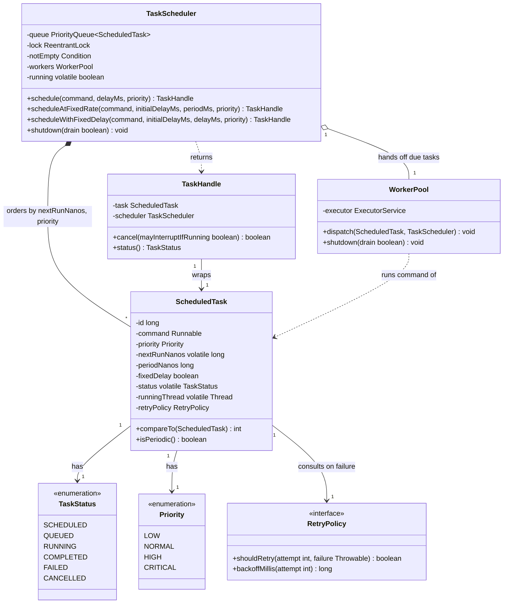
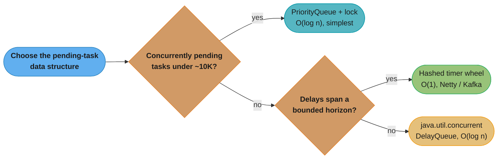
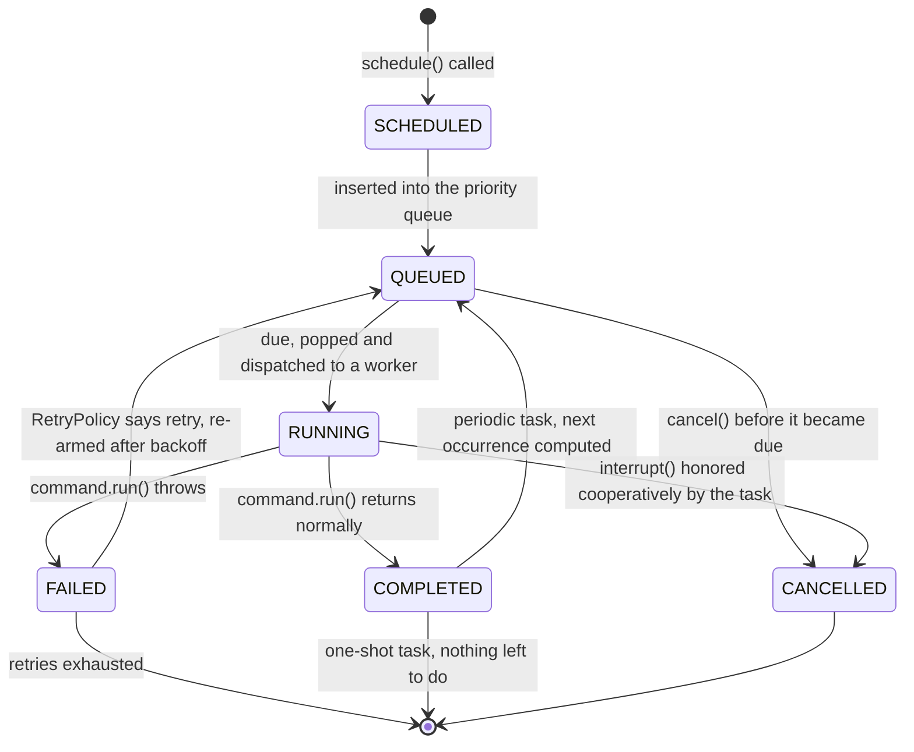
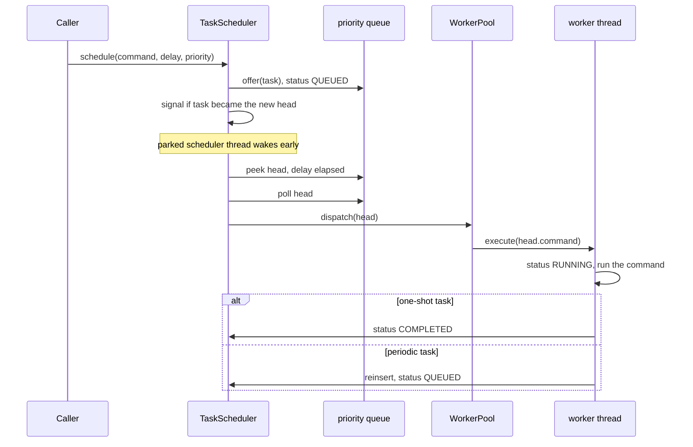

# Design an In-Process Task Scheduler
A priority-ordered, delay-aware, cancellable scheduler backed by a bounded worker pool — the concurrency LLD problem.

## Intuition

> **Design intuition**: strip away the priorities, the periods and the cancellation, and a task scheduler is one loop asking a single question forever: *"what's due next, and how long until then?"* Everything else in this problem — the comparator, the wait/signal dance, the worker handoff — exists to answer that question correctly under concurrent submission and cancellation, without the loop ever busy-spinning or missing a wakeup.

**Key insight**: the entire correctness story lives in one place — the condition variable that the scheduler thread sleeps on. `wait(exact delay until next task)` sounds trivial until a *nearer* task is submitted while the scheduler is asleep waiting on an older, farther-away head. If the insert path doesn't wake the scheduler in that specific case, you have written a **lost wakeup**: a real bug, not a theoretical one, and the one this page spends the most time on.

**Full runnable implementation:** [`TaskScheduler.java`](TaskScheduler.java) — 387 lines, one file, `main()` at the bottom. It demonstrates `ScheduledTask` as both Command and sort key (deadline, then priority, then FIFO sequence — never `0`), the single scheduler thread parking on `awaitNanos()` for the exact delay to the head, the fixed half of the lost-wakeup pair (`insert()` signals whenever the new task becomes the head), `WorkerPool` handling retry and fixed-rate/fixed-delay reschedule, and cooperative cancellation of both a queued and a running task. Its `main()` runs `schedule()` and `scheduleAtInstant()` side by side to show why nanosecond deadlines essentially never tie. The same listing is reproduced in the [Implementation](#implementation) section below — every class from the diagram, plus the documented broken/fixed pair whose BROKEN half is teaching material and is not carried into the `.java`. Read [`../concurrency_patterns/ThreadPool.md`](../concurrency_patterns/ThreadPool.md) and [`../concurrency_patterns/ProducerConsumer.md`](../concurrency_patterns/ProducerConsumer.md) first if `ReentrantLock`/`Condition`/`awaitNanos` aren't already comfortable — this page uses those primitives without re-explaining them.

---

## Problem Statement

Design an in-process task scheduler: a Java library, not a service, that lets a caller submit a task to run once after a delay, or repeatedly at a fixed rate or fixed delay, with a priority among tasks that come due at the same instant, the ability to cancel a task that hasn't run yet or is running right now, and a bounded worker pool that actually executes the work.

```java
TaskHandle schedule(Runnable command, long delayMs, Priority priority);
TaskHandle scheduleAtFixedRate(Runnable command, long initialDelayMs, long periodMs, Priority priority);
TaskHandle scheduleWithFixedDelay(Runnable command, long initialDelayMs, long delayMs, Priority priority);
```

Single JVM. No database, no framework, no distributed coordination — that jump is deliberately deferred to [Cross-Perspective: HLD Connections](#cross-perspective-hld-connections). This is the shape interviewers reach for specifically to probe concurrency, not object modeling — there's no rich domain (no `Vehicle`, no `Board`) to hide behind, just a shared mutable priority queue that two kinds of threads touch at once.

**Machine-coding time-box.** Per [`system_design_problems.md` §3b](system_design_problems.md), in the first 40 minutes build: the enums, `ScheduledTask` with its comparator, a single-threaded scheduler loop that only supports one-shot `schedule()`, and a trivial worker that just runs the command inline. Get *that* end-to-end and demonstrable before touching periodic scheduling, retry policies, or cancellation — those are exactly the pieces to name out loud as "cut for time" if the clock runs out, because the primary flow (submit, wait, fire) is what a reviewer checks first. `scheduleAtFixedRate`/`scheduleWithFixedDelay` and cancellation are the natural 70–80 minute additions; a `RetryPolicy` abstraction is the first thing to cut.

---

## Requirements

### Functional
1. `schedule(command, delay)` — run once, after `delay`
2. `scheduleAtFixedRate(command, initialDelay, period)` and `scheduleWithFixedDelay(command, initialDelay, delay)` — run repeatedly. **These are not interchangeable, and the difference matters most exactly when a run overruns its period**: fixed-rate measures the next start from the *previous scheduled start* (so a slow run causes the next one to start late, or even fire immediately back-to-back to catch up, but never skips a scheduled instant and never runs two copies concurrently); fixed-delay measures the next start from the *previous run's actual completion* (so a slow run simply pushes everything after it later, forever — there is no catching up because there is nothing to catch up to). Pick fixed-rate for "roughly N times a minute regardless of jitter" (a metrics flush); pick fixed-delay for "always leave a gap after the last one finished" (a poll-then-sleep health check, where back-to-back catch-up bursts would be actively harmful).
3. Priority ordering among tasks due at the same instant (`CRITICAL` > `HIGH` > `NORMAL` > `LOW`)
4. Cancel a scheduled-but-not-yet-run task, or a currently-running one (best-effort — see Design Decisions)
5. Query a task's current status
6. Graceful shutdown: stop accepting new work, and either drain in-flight tasks to completion or interrupt them immediately

### Non-Functional
1. **Thread-safe** under concurrent `schedule()` and `cancel()` calls from many caller threads, with a scheduler thread and a worker pool touching the same state
2. **O(log n)** submit and poll on the shared structure, where `n` is the number of pending (not-yet-due) tasks
3. The scheduler thread must **never busy-wait** — it parks until either the next task is due or a nearer task arrives
4. A long-running task must **never delay unrelated due tasks** — the scheduler hands off to a worker pool and immediately goes back to waiting, it never runs a command itself
5. **Bounded** worker pool and (optionally) bounded pending-task count, so a submission storm degrades predictably instead of exhausting memory

---

## Class Diagram



`TaskHandle` is deliberately a thin wrapper, not `ScheduledTask` itself — callers get `cancel()` and `status()` and nothing else, so the comparator, the retry bookkeeping and the `runningThread` reference (all internal machinery the scheduler needs) never leak into caller code. `WorkerPool` owns exactly one thing — an `ExecutorService` — and knows nothing about priorities or delays; it only runs whatever `Runnable` it's handed and reports the outcome back.

---

## Patterns Used

### 1. Command — the task itself
**Why**: `Runnable` (or a richer `Callable`) is the classic Command pattern — the request to "run this later" is reified as an object that can be queued, reordered, retried and cancelled independently of who submitted it or when. Without reifying the request, there is nothing to put a priority or a delay *on*.

**Where it's the wrong fit**: if the caller needs the *result* of the work (not just a fire-and-forget side effect), `Runnable` is too thin — `Callable<V>` plus a `CompletableFuture<V>` is the honest shape, and this page uses `Runnable` only because none of the demo tasks return a value.

### 2. Strategy — `RetryPolicy`
**Why**: what happens when a task throws is a genuinely swappable policy — no retry, fixed backoff, exponential backoff with a cap — and none of that logic belongs inside `WorkerPool`, which should stay ignorant of retry math entirely. See [`../behavioral/strategy/strategy.md`](../behavioral/strategy/strategy.md) for the pattern in general.

**Where it's the wrong fit**: a policy needing cross-task state (a circuit breaker that trips after N failures *across all tasks*, not per task) doesn't fit a per-`ScheduledTask` `RetryPolicy` instance — that needs a shared, injected collaborator instead.

### 3. Producer-Consumer — the delay queue feeding the worker pool
**Why**: `schedule()` callers are producers, the scheduler thread is the single consumer of the priority queue, and it in turn *produces* work for the worker pool's own internal queue. See [`../concurrency_patterns/ProducerConsumer.md`](../concurrency_patterns/ProducerConsumer.md) for the primitive; this problem's twist is that the consumer doesn't just wait for "not empty" — it waits for "not empty AND the head's specific delay has elapsed," which is `Condition.awaitNanos()` rather than a plain `await()`.

### 4. Observer — completion callbacks
**Why**: a caller often wants to know when a task finishes (for chaining, logging, or a UI update) without polling `status()` in a loop. Not built into the reference implementation below to keep it focused, but the natural extension is a `TaskHandle.onComplete(Consumer<TaskStatus>)` that `WorkerPool.run()` invokes after the terminal status is set.

**Where it's the wrong fit**: high-frequency, low-latency completions (thousands per second) would make per-task observer lists an allocation and dispatch cost worth measuring before committing to it — a metrics counter is often what's actually needed, not a callback.

### 5. Factory — building the right `TaskScheduler`
**Why**: constructing a scheduler correctly means choosing a worker-pool size and, at larger scale, a queue implementation (heap vs. timer wheel — see Design Decisions). A small static factory (`TaskSchedulers.fixed(int workers)`, `TaskSchedulers.forHighVolume(...)`) keeps that choice in one place instead of every call site hand-rolling `new TaskScheduler(new WorkerPool(...))`.

---

## Design Decisions & Tradeoffs

### The core data structure

| Structure | Submit | Poll head | Cancel arbitrary task | When it wins |
|-----------|--------|-----------|------------------------|---------------|
| `PriorityQueue` + `ReentrantLock`/`Condition` (this page) | O(log n) | O(log n) | O(n) — linear scan, no index | Simple, correct, fine for hundreds to low tens-of-thousands of pending tasks |
| `java.util.concurrent.DelayQueue` | O(log n) | O(log n) | O(n) | Same asymptotics — it *is* a locked `PriorityQueue` internally, plus a battle-tested "leader-follower" optimization that avoids waking every waiter when only one can win |
| Hashed timer wheel (Netty `HashedWheelTimer`, Kafka's request purgatory) | O(1) | O(1) amortized (one bucket sweep per tick) | O(1) with a per-entry cancelled flag | Very high timer counts (hundreds of thousands to millions) with a bounded delay horizon, where the heap's `log n` factor is a measured bottleneck |

**Crossover point**: for the scale an LLD interview actually asks about — tens to low thousands of concurrently pending tasks — a heap is simpler, correct, and fast enough; reaching for a timer wheel unprompted reads as over-engineering. The honest interview answer is "start with a heap; move to a timer wheel only after profiling shows queue operations, not task execution, are the bottleneck" — which is roughly the scale at which Kafka's brokers (millions of pending delayed requests) and Netty's I/O timeout tracking actually made that trade.

**Why hand-roll the lock/condition instead of just using `DelayQueue`?** Production code should reach for `DelayQueue<ScheduledTask>` (making `ScheduledTask implements Delayed`) or, more likely, `ScheduledThreadPoolExecutor` directly — both already contain the exact wakeup-correctness logic this page derives by hand. It's derived here because *that derivation is the interview* — an interviewer who already knows you can call `Executors.newScheduledThreadPool()` is testing whether you understand what's inside it.

### One scheduler thread handing off to a worker pool, vs. workers polling the queue directly

Handing off wins. If N worker threads all directly `poll()` a shared priority queue, every one of them needs to independently compute "how long until the head is due" and park on a shared condition — and now N threads contend on the same lock just to *discover* there's nothing to do yet, with no benefit, since only one can win the head each time it becomes due. A single dedicated scheduler thread computes "what's next, wait exactly that long" once, and workers only ever see a task that is *already known to be due* — they never touch the delay logic or the priority ordering at all, which also means a worker touching a task can't reorder or mis-time anything even by accident.

### Breaking ties among tasks due at the same instant

Two things break a tie, in order: priority weight, then insertion order (a monotonic `id`, assigned on construction). **Skip the second one and you get starvation**: if two `LOW`-priority tasks tie exactly on `(nextRunNanos, priority)`, a `PriorityQueue` gives no ordering guarantee between them — one of them could theoretically keep losing comparisons forever under adversarial insert patterns. Tie-breaking on a strictly increasing `id` guarantees a deterministic total order, which is what turns "the comparator never needs to return 0" (a documented `PriorityQueue` correctness property `Comparable` implementations should uphold when order matters) into an actual FIFO guarantee among equals.

### What cancellation actually means for a task that's already running

**`Thread.interrupt()` is cooperative — say so plainly, out loud, in the interview.** Calling `TaskHandle.cancel(true)` on a `RUNNING` task sets an interrupt flag on the worker thread; it does not stop the thread, does not unwind its stack, and does nothing at all if the running code never checks `Thread.interrupted()` or calls a blocking method that itself checks it (`Thread.sleep`, `Object.wait`, most `java.nio` channel operations). A tight CPU loop with no interruption check will run to completion regardless of `cancel(true)`'s return value — which is exactly why `Future.cancel()`'s own Javadoc warns that its return value doesn't guarantee the task actually stopped; the caller must still check `isCancelled()`, and even that only confirms the *flag* was set, not that the work halted.

### Why the scheduler waits on `awaitNanos(head's exact delay)`, not a fixed poll interval

A fixed poll interval (say, waking every 50ms to re-check the head) is a busy-wait in slow motion: on a system with thousands of idle scheduler instances, that's thousands of pointless wakeups a second doing nothing most of the time, and it still adds up to 50ms of slop on every deadline. `awaitNanos(delayNanos)` parks the thread until *exactly* the computed delay elapses (subject to normal OS scheduling jitter, typically sub-millisecond) or until something signals the condition early — zero wasted wakeups when idle, and zero polling lag when a task comes due.

### Clock choice — `System.nanoTime()`, never `System.currentTimeMillis()`

`nanoTime()` is guaranteed monotonic on a given JVM run and immune to wall-clock adjustment; `currentTimeMillis()` tracks wall-clock time, which NTP sync, a manual clock change, or a DST transition can step backward or forward without warning. A scheduler computing `delay = nextRunMillis - System.currentTimeMillis()` after a clock is stepped back 5 minutes would compute a *negative-going-more-negative* delay and fire every pending task immediately in a storm; after a clock is stepped forward, every task's real firing time silently drifts. `nanoTime()` values are only meaningful as *differences between two calls on the same JVM*, never as absolute timestamps (and never across JVM restarts or between machines) — which is exactly the property this scheduler needs and nothing more.



Default to a heap-backed queue unless a measured bottleneck at real scale rules it out — the same "don't reach for the exotic structure first" instinct as the Rate Limiter's algorithm choice in [`RateLimiter.md`](RateLimiter.md).

---

## State / Flow



**The wake-up path when a nearer task arrives.** The scheduler thread parks in `awaitNanos(delay-to-current-head)`. A caller thread calls `schedule()` with a shorter delay than the current head's. The insert path checks whether the just-inserted task became the *new* head (`queue.peek() == justInserted`) and, if so, signals the condition — which wakes the scheduler out of its `awaitNanos` early, lets it re-read the (now different) head, and re-compute a shorter wait. Skip that check — signal only "if the queue was empty" instead of "if the head changed" — and this exact path is the lost-wakeup bug worked through in [Implementation](#implementation) below.



---

## Implementation

The full design, as illustrative fences — several top-level types per fence, shown together so the whole picture reads at once, following this section's house style. Identifiers match the class diagram and prose exactly, and the fences assemble into the companion [`TaskScheduler.java`](TaskScheduler.java) (which carries the FIXED `insert()` only, and hosts `main()` on `TaskScheduler` itself).

```java
// shared imports across every fence below
import java.util.PriorityQueue;
import java.util.concurrent.*;
import java.util.concurrent.atomic.AtomicLong;
import java.util.concurrent.locks.Condition;
import java.util.concurrent.locks.ReentrantLock;

public enum Priority {
    LOW(0), NORMAL(1), HIGH(2), CRITICAL(3);

    final int weight;

    Priority(int weight) {
        this.weight = weight;
    }
}

public enum TaskStatus {
    SCHEDULED, QUEUED, RUNNING, COMPLETED, FAILED, CANCELLED
}

public interface RetryPolicy {
    boolean shouldRetry(int attemptNumber, Throwable lastFailure);
    long backoffMillis(int attemptNumber);
}

public final class NoRetryPolicy implements RetryPolicy {
    @Override public boolean shouldRetry(int attemptNumber, Throwable lastFailure) {
        return false;
    }
    @Override public long backoffMillis(int attemptNumber) {
        return 0L;
    }
}

public final class ExponentialBackoffRetryPolicy implements RetryPolicy {
    private final int maxAttempts;
    private final long baseMillis;

    public ExponentialBackoffRetryPolicy(int maxAttempts, long baseMillis) {
        this.maxAttempts = maxAttempts;
        this.baseMillis = baseMillis;
    }

    @Override public boolean shouldRetry(int attemptNumber, Throwable lastFailure) {
        return attemptNumber < maxAttempts;
    }

    @Override public long backoffMillis(int attemptNumber) {
        return baseMillis * (1L << Math.min(attemptNumber, 10)); // capped shift, avoids overflow
    }
}
```

`ScheduledTask` is the Command and the sort key at once — its `compareTo` is the entire priority-plus-tie-break rule from Design Decisions, expressed as three comparisons in strict fallback order:

```java
public final class ScheduledTask implements Comparable<ScheduledTask> {
    private static final AtomicLong SEQUENCE = new AtomicLong();

    final long id = SEQUENCE.getAndIncrement();
    final Runnable command;
    final Priority priority;
    final long periodNanos;    // 0 = one-shot
    final boolean fixedDelay;  // true = scheduleWithFixedDelay semantics
    final RetryPolicy retryPolicy;

    volatile long nextRunNanos;
    volatile TaskStatus status = TaskStatus.SCHEDULED;
    volatile Thread runningThread;
    volatile int attempt = 0;

    ScheduledTask(Runnable command, Priority priority, long nextRunNanos,
                  long periodNanos, boolean fixedDelay, RetryPolicy retryPolicy) {
        this.command = command;
        this.priority = priority;
        this.nextRunNanos = nextRunNanos;
        this.periodNanos = periodNanos;
        this.fixedDelay = fixedDelay;
        this.retryPolicy = retryPolicy;
    }

    boolean isPeriodic() {
        return periodNanos > 0;
    }

    @Override
    public int compareTo(ScheduledTask other) {
        int byTime = Long.compare(nextRunNanos, other.nextRunNanos);
        if (byTime != 0) {
            return byTime;
        }
        int byPriority = Integer.compare(other.priority.weight, priority.weight); // higher first
        if (byPriority != 0) {
            return byPriority;
        }
        return Long.compare(id, other.id); // FIFO among true ties — never return 0
    }
}

public final class TaskHandle {
    private final ScheduledTask task;
    private final TaskScheduler scheduler;

    TaskHandle(ScheduledTask task, TaskScheduler scheduler) {
        this.task = task;
        this.scheduler = scheduler;
    }

    public boolean cancel(boolean mayInterruptIfRunning) {
        return scheduler.cancel(task, mayInterruptIfRunning);
    }

    public TaskStatus status() {
        return task.status;
    }
}
```

`WorkerPool` is deliberately thin — a fixed `ExecutorService` plus the status transitions and the retry/reschedule handoff back to the scheduler. It checks for a cancellation that landed *between* the scheduler's `poll()` and this method actually running — see the Q&A on that race below:

```java
public final class WorkerPool {
    private final ExecutorService executor;

    public WorkerPool(int size) {
        this.executor = Executors.newFixedThreadPool(size);
    }

    void dispatch(ScheduledTask task, TaskScheduler scheduler) {
        executor.execute(() -> run(task, scheduler));
    }

    private void run(ScheduledTask task, TaskScheduler scheduler) {
        if (task.status == TaskStatus.CANCELLED) {
            return; // cancelled after poll() removed it from the queue, before this ran
        }
        task.status = TaskStatus.RUNNING;
        task.runningThread = Thread.currentThread();
        try {
            task.command.run();
            task.status = TaskStatus.COMPLETED;
            task.attempt = 0;
        } catch (Throwable failure) {
            task.attempt++;
            if (task.retryPolicy.shouldRetry(task.attempt, failure)) {
                long backoffNanos = TimeUnit.MILLISECONDS.toNanos(task.retryPolicy.backoffMillis(task.attempt));
                task.nextRunNanos = System.nanoTime() + backoffNanos;
                task.status = TaskStatus.QUEUED;
                scheduler.reinsert(task);
                return;
            }
            task.status = TaskStatus.FAILED;
        } finally {
            task.runningThread = null;
        }
        if (task.status == TaskStatus.COMPLETED && task.isPeriodic() && !scheduler.isShutdown()) {
            // fixed-rate: next start is measured from the PREVIOUS scheduled start, so a slow
            // run causes the next one to fire immediately if it's already overdue (catch-up,
            // never concurrent, never skipped). fixed-delay: next start is measured from NOW,
            // so a slow run just pushes everything after it later, permanently.
            long base = task.fixedDelay ? System.nanoTime() : task.nextRunNanos;
            task.nextRunNanos = base + task.periodNanos;
            task.status = TaskStatus.QUEUED;
            scheduler.reinsert(task);
        }
    }

    void shutdown(boolean drain) {
        if (drain) {
            executor.shutdown();       // let queued/running work finish, refuse new work
        } else {
            executor.shutdownNow();    // interrupt running work, discard what hasn't started
        }
    }
}
```

### The lost-wakeup bug — broken, then fixed

This is the bug the whole page is built around. The scheduler thread is parked in `notEmpty.awaitNanos(delayToCurrentHead)` because the current head is due in, say, 10 seconds. A caller submits a new `CRITICAL` task due in 1 second. If the insert path only signals "when the queue transitions from empty to non-empty," this insert — the queue already had one element — signals nothing. The scheduler sleeps the full 10 seconds and the 1-second task fires **9 seconds late**, silently, with no exception and no log line to point at.

```java
// BROKEN — signals only on the empty-to-nonempty transition
void insertBroken(ScheduledTask task) {
    lock.lock();
    try {
        boolean wasEmpty = queue.isEmpty();
        queue.offer(task);
        task.status = TaskStatus.QUEUED;
        if (wasEmpty) {
            notEmpty.signal();
        }
        // BUG: the scheduler may be parked in awaitNanos() on an EXISTING head
        // that's due later than this new task. wasEmpty is false here, so no
        // signal fires, and the scheduler doesn't notice until its stale
        // awaitNanos() naturally elapses against the WRONG deadline.
    } finally {
        lock.unlock();
    }
}
```

```java
// FIX — signal whenever the inserted task becomes the new head
void insert(ScheduledTask task) {
    lock.lock();
    try {
        queue.offer(task);
        task.status = TaskStatus.QUEUED;
        if (queue.peek() == task) {
            // covers BOTH cases the broken version conflated: the queue was
            // empty (any insert is trivially the new head), AND a nearer
            // task displaced whatever the scheduler was actually sleeping on.
            notEmpty.signalAll();
        }
    } finally {
        lock.unlock();
    }
}
```

`queue.peek() == task` after `offer()` is reference identity, not `equals()` — `PriorityQueue` doesn't guarantee the newly-offered element sorts to a stable position relative to ties, so this is the only check that reliably answers "did *this specific* insert change what the scheduler should be waiting for." `signalAll()` rather than `signal()` is deliberate cheap safety: with a single scheduler thread there's only one waiter anyway, so the two are equivalent here, but `signalAll()` costs nothing extra and doesn't silently break if a second scheduler thread is ever added.

### The scheduler loop

```java
public final class TaskScheduler {
    private final PriorityQueue<ScheduledTask> queue = new PriorityQueue<>();
    private final ReentrantLock lock = new ReentrantLock();
    private final Condition notEmpty = lock.newCondition();
    private final WorkerPool workers;
    private volatile boolean running = true;

    public TaskScheduler(int workerCount) {
        this.workers = new WorkerPool(workerCount);
        Thread schedulerThread = new Thread(this::loop, "task-scheduler");
        schedulerThread.start();
    }

    public TaskHandle schedule(Runnable command, long delayMs, Priority priority) {
        return schedule(command, delayMs, priority, 0, false, new NoRetryPolicy());
    }

    /**
     * Same as schedule(), but rounds the deadline DOWN to a whole millisecond so that
     * tasks asked for at the same millisecond compare equal on time -- which is the only
     * way compareTo()'s priority tie-break is ever reached. Without this, three calls with
     * the same delay produce three deadlines nanoseconds apart and run FIFO.
     */
    public TaskHandle scheduleAtInstant(Runnable command, long delayMs, Priority priority) {
        long deadline = System.nanoTime() + TimeUnit.MILLISECONDS.toNanos(delayMs);
        long quantized = deadline - Math.floorMod(deadline, 1_000_000L);   // floor to the ms
        ScheduledTask task =
            new ScheduledTask(command, priority, quantized, 0, false, new NoRetryPolicy());
        insert(task);
        return new TaskHandle(task, this);
    }

    public TaskHandle scheduleAtFixedRate(Runnable command, long initialDelayMs, long periodMs, Priority priority) {
        return schedule(command, initialDelayMs, priority, TimeUnit.MILLISECONDS.toNanos(periodMs), false, new NoRetryPolicy());
    }

    public TaskHandle scheduleWithFixedDelay(Runnable command, long initialDelayMs, long delayMs, Priority priority) {
        return schedule(command, initialDelayMs, priority, TimeUnit.MILLISECONDS.toNanos(delayMs), true, new NoRetryPolicy());
    }

    private TaskHandle schedule(Runnable command, long delayMs, Priority priority,
                                 long periodNanos, boolean fixedDelay, RetryPolicy retryPolicy) {
        long nextRunNanos = System.nanoTime() + TimeUnit.MILLISECONDS.toNanos(delayMs);
        ScheduledTask task = new ScheduledTask(command, priority, nextRunNanos, periodNanos, fixedDelay, retryPolicy);
        insert(task);
        return new TaskHandle(task, this);
    }

    void reinsert(ScheduledTask task) {
        insert(task); // the same "signal if new head" rule applies to reschedules and retries
    }

    private void loop() {
        lock.lock();
        try {
            while (running) {
                while (queue.isEmpty() && running) {
                    notEmpty.await();
                }
                if (!running) {
                    break;
                }
                ScheduledTask head = queue.peek();
                long delayNanos = head.nextRunNanos - System.nanoTime();
                if (delayNanos <= 0) {
                    queue.poll();
                    workers.dispatch(head, this); // hand off immediately — never run the command here
                } else {
                    notEmpty.awaitNanos(delayNanos); // exact wait, wakes early if a nearer task arrives
                }
            }
        } catch (InterruptedException e) {
            Thread.currentThread().interrupt();
        } finally {
            lock.unlock();
        }
    }

    boolean cancel(ScheduledTask task, boolean mayInterruptIfRunning) {
        lock.lock();
        try {
            if (task.status == TaskStatus.QUEUED) {
                queue.remove(task); // O(n): no index tracks a task's heap position
                task.status = TaskStatus.CANCELLED;
                return true;
            }
        } finally {
            lock.unlock();
        }
        if (task.status == TaskStatus.RUNNING) {
            task.status = TaskStatus.CANCELLED;
            Thread runner = task.runningThread;
            if (mayInterruptIfRunning && runner != null) {
                runner.interrupt(); // cooperative — see Design Decisions
            }
            return true;
        }
        return false; // already COMPLETED, FAILED, or CANCELLED
    }

    boolean isShutdown() {
        return !running;
    }

    public void shutdown(boolean drain) {
        lock.lock();
        try {
            running = false;
            notEmpty.signalAll();
        } finally {
            lock.unlock();
        }
        workers.shutdown(drain);
    }
}
```

The scheduler's own pending-task queue is simply abandoned on `shutdown()` — only in-flight worker executions are drained or interrupted, per Requirement 6. Persisting or re-queuing not-yet-due tasks across a shutdown is Follow-Up Extension 1.

```java
public final class TaskSchedulerDemo {
    public static void main(String[] args) throws InterruptedException {
        TaskScheduler scheduler = new TaskScheduler(3);

        // Three tasks with the SAME delay argument still get three different deadlines:
        // each schedule() call computes System.nanoTime() + delay at call time, and the
        // calls are nanoseconds apart. compareTo() breaks ties on priority ONLY when
        // nextRunNanos is exactly equal, so this runs in submission order, not priority
        // order. That is the lesson: a nanosecond deadline essentially never ties.
        System.out.println("--- Same delay, three deadlines: FIFO, not priority ---");
        scheduler.schedule(() -> log("LOW      task ran"), 200, Priority.LOW);
        scheduler.schedule(() -> log("CRITICAL task ran"), 200, Priority.CRITICAL);
        scheduler.schedule(() -> log("NORMAL   task ran"), 200, Priority.NORMAL);
        Thread.sleep(400);

        // To make priority decide within a window, QUANTIZE the deadline so ties are
        // possible -- bucket to the millisecond, then equal-millisecond tasks tie and
        // compareTo()'s priority branch is reached.
        System.out.println("--- Quantized deadlines: priority now decides ---");
        scheduler.scheduleAtInstant(() -> log("LOW      task ran"), 200, Priority.LOW);
        scheduler.scheduleAtInstant(() -> log("CRITICAL task ran"), 200, Priority.CRITICAL);
        scheduler.scheduleAtInstant(() -> log("NORMAL   task ran"), 200, Priority.NORMAL);
        Thread.sleep(400);

        System.out.println("--- scheduleAtFixedRate under a run that overruns its period ---");
        scheduler.scheduleAtFixedRate(() -> {
            log("fixedRate run starting");
            sleepQuietly(150); // longer than the 100ms period below
        }, 0, 100, Priority.NORMAL);
        Thread.sleep(500);

        System.out.println("--- Cancel a queued task before it becomes due ---");
        TaskHandle queued = scheduler.schedule(() -> log("should never print"), 300, Priority.NORMAL);
        boolean cancelled = queued.cancel(false);
        log("cancel(false) returned " + cancelled + ", status=" + queued.status());
        Thread.sleep(400);

        System.out.println("--- Cancel a running task: cooperative interrupt ---");
        TaskHandle running = scheduler.schedule(() -> {
            try {
                for (int i = 0; i < 5; i++) {
                    Thread.sleep(100);
                    log("still working, step " + i);
                }
            } catch (InterruptedException e) {
                log("interrupted, stopping early");
                Thread.currentThread().interrupt();
            }
        }, 0, Priority.NORMAL);
        Thread.sleep(150);
        running.cancel(true);
        Thread.sleep(200);

        System.out.println("--- Graceful shutdown, draining in-flight work ---");
        scheduler.shutdown(true);
        log("shutdown requested, in-flight work allowed to finish");
    }

    private static void log(String message) {
        System.out.printf("[+%4dms] %s%n", System.nanoTime() / 1_000_000 % 100000, message);
    }

    private static void sleepQuietly(long ms) {
        try {
            Thread.sleep(ms);
        } catch (InterruptedException e) {
            Thread.currentThread().interrupt();
        }
    }
}
```

---

## Sample Output

```
--- Same delay, three deadlines: FIFO, not priority ---
[+89249ms] LOW      task ran
[+89249ms] CRITICAL task ran
[+89249ms] NORMAL   task ran
--- Quantized deadlines: priority now decides ---
[+89657ms] LOW      task ran
[+89657ms] CRITICAL task ran
[+89657ms] NORMAL   task ran
--- scheduleAtFixedRate under a run that overruns its period ---
[+89860ms] fixedRate run starting
[+90015ms] fixedRate run starting
[+90171ms] fixedRate run starting
[+90326ms] fixedRate run starting
--- Cancel a queued task before it becomes due ---
[+90374ms] cancel(false) returned true, status=CANCELLED
[+90478ms] fixedRate run starting
[+90634ms] fixedRate run starting
--- Cancel a running task: cooperative interrupt ---
[+90789ms] fixedRate run starting
[+90885ms] still working, step 0
[+90932ms] interrupted, stopping early
[+90945ms] fixedRate run starting
[+91099ms] fixedRate run starting
--- Graceful shutdown, draining in-flight work ---
[+91137ms] shutdown requested, in-flight work allowed to finish
```

That is a real run of [`TaskScheduler.java`](TaskScheduler.java), and three things in it are worth reading carefully because none of them is what the section headings promise.

**The timestamp is a free-running counter, not an elapsed time.** `log()` prints `System.nanoTime() / 1_000_000 % 100000`, so the absolute value is meaningless and differs on every run — only the *deltas* between consecutive lines carry information. Reading `[+89249ms]` as "89 seconds in" is wrong; the demo finishes in under two seconds.

**"Priority now decides" decides the DEQUEUE order, not the print order.** `scheduleAtInstant()` does exactly what it claims — quantizing to the millisecond makes the three deadlines tie, so `compareTo()` falls through to the priority branch and the scheduler thread polls `CRITICAL`, then `NORMAL`, then `LOW`. But `WorkerPool` has three threads, so all three tasks are handed off within microseconds of each other and then race to `System.out`. The printed order is a coin flip: across three runs it came out `CRITICAL/LOW/NORMAL`, `LOW/CRITICAL/NORMAL`, and `LOW/CRITICAL/NORMAL`. **Priority ordering in a scheduler is a statement about when work is dispatched, never about when it completes** — with more workers than tied tasks, a priority queue's output ordering is invisible downstream. Construct the scheduler with `new TaskScheduler(1)` to see the dequeue order directly, or have the tasks record a timestamp instead of printing.

**The fixed-rate task is never cancelled, so it bleeds through every later section.** Its `fixedRate run starting` lines interleave with the cancellation and shutdown blocks — that is the periodic task still running, not stray output. Within its own block the point still lands: each run takes 150ms against a 100ms period, so runs start back-to-back at ~155ms intervals (89860, 90015, 90171, 90326) with no idle gap, rather than catching up to a 100ms cadence — exactly the "late but never concurrent, never skipped" behavior `ScheduledThreadPoolExecutor`'s own Javadoc documents.

Exact millisecond values vary run to run since they depend on real wall-clock scheduling — the patterns (FIFO among untied nanosecond deadlines, back-to-back fixed-rate catch-up, cooperative interrupt landing between sleep steps) are what to expect, not the byte-exact numbers.

---

## Cross-Perspective: HLD Connections

- **Single-JVM vs. distributed coordination** — this scheduler keeps its entire priority queue in one process's heap; the moment there's more than one instance of the service, two instances both believe they own firing every task, and a periodic job runs `N × instanceCount` times instead of once. [`../../hld/case_studies/design_distributed_job_scheduler.md`](../../hld/case_studies/design_distributed_job_scheduler.md) covers the fix at the distributed-systems layer: leader election so only one node fires a given job, leases with a fencing token so a stalled leader can't fire a job it no longer owns, and idempotent task handlers so an at-least-once retry after a coordination hiccup doesn't double-execute work.
- **The delay queue is a message queue with a `visibleAfter` field** — conceptually, "hold this message until its delay elapses, then deliver it to exactly one consumer" is what a distributed delayed/scheduled queue does at a much larger scale (SQS delay queues, RabbitMQ's delayed-message plugin, a Kafka topic paired with a purgatory). See [`../../hld/message_queues/message_queues.md`](../../hld/message_queues/message_queues.md) for how ordering, at-least-once delivery, and consumer-group semantics change the same "wait, then deliver" idea once it crosses process boundaries.
- **Worker pool as infrastructure-scale thread pool** — the same `corePoolSize`/`maximumPoolSize`/bounded-queue reasoning in [`../concurrency_patterns/ThreadPool.md`](../concurrency_patterns/ThreadPool.md) applies one level up when the "workers" become a fleet of service instances consuming from a shared distributed queue instead of threads consuming from an in-process one.

---

## Follow-Up Extensions

1. **Persistence across restart** — write each `ScheduledTask`'s metadata (command reference, delay, priority) to a WAL or a database row on `schedule()`, and reload+re-insert not-yet-fired tasks on startup. Requires the command itself to be serializable as data (a job type + payload, not an arbitrary closure) and idempotent execution, since a crash between "fired" and "marked complete" means at-least-once, not exactly-once.
2. **Cron expressions** — accept a cron string instead of a fixed delay; parse it into "compute the next fire time from now," feed that as the `delay` to `schedule()`, and re-derive the following occurrence each time the task completes rather than trying to encode a whole cron schedule as one `periodNanos`.
3. **Task dependencies / DAG** — task B should only start after task A completes. Give each `TaskHandle` a `CompletableFuture<Void>` completed on the task's terminal status, and let a dependent task's `schedule()` call chain off `taskA.future().thenRun(...)` instead of a bare delay; cancelling A must then cascade to every task chained off it.
4. **Distributed coordination** — the full jump described in Cross-Perspective above: leader election, leases, fencing tokens, and idempotent handlers, so exactly one node in a fleet fires each scheduled job exactly once (or safely at-least-once with a dedupe key).

---

## Interview Questions with Answers

**Q: Walk through the lost-wakeup bug in the broken `insert()` — why does signalling only on "queue was empty" fail?**
**Short:** it misses the case where a nearer task displaces an existing, farther-away head the scheduler is already sleeping on.

The scheduler thread parks in `awaitNanos(delayToCurrentHead)` while a task is due 10 seconds out. A caller submits a `CRITICAL` task due in 1 second. Because the queue wasn't empty before this insert, `insertBroken()`'s `if (wasEmpty)` check is false, so it never signals — the scheduler has no way to know a nearer deadline just arrived, and it sleeps out the full stale 10-second wait before the 1-second task fires, 9 seconds late. The fix checks `queue.peek() == task` after the offer instead: that's true whenever the just-inserted task is now the new head, which covers the empty-queue case (any insert becomes the head trivially) and the nearer-task case the broken version missed entirely.

**Q: Why does `scheduleAtFixedRate` behave differently from `scheduleWithFixedDelay` when a run takes longer than the configured period?**
**Short:** fixed-rate measures the next start from the last scheduled start; fixed-delay measures it from the actual finish.

`ScheduledThreadPoolExecutor`'s own documentation states it precisely: "if any execution of this task takes longer than its period, then subsequent executions may start late, but will not concurrently execute." Fixed-rate computes `nextRun = previousScheduledStart + period`, so an overrun makes the next run start late — and if it's already overdue by the time it's recomputed, it fires immediately with no idle gap, catching up without ever running two copies at once or skipping a scheduled instant. Fixed-delay instead computes `nextRun = actualCompletionTime + delay`, so an overrun just pushes every subsequent run later by the same amount, permanently — there's no concept of "catching up" because the next deadline is defined relative to whenever the previous one actually finished, not to a fixed clock grid.

**Q: `TaskHandle.cancel(true)` is called on a task that's currently running — what actually happens?**
**Short:** the worker thread gets its interrupt flag set; the task only stops if its code checks for that or calls something that does.

`cancel(true)` calls `Thread.interrupt()` on the thread recorded as `runningThread`, which sets a boolean flag on that thread and does nothing else — it does not forcibly stop execution, unwind the stack, or throw anything into arbitrary running code. A task built around `Thread.sleep()`, `Object.wait()`, or a blocking NIO call will throw `InterruptedException` and can react to it; a tight CPU loop that never checks `Thread.interrupted()` runs to completion regardless of how many times `cancel(true)` is called. This mirrors `Future.cancel()`'s own documented behavior — the return value doesn't guarantee the task stopped, only that the flag was set — and it is the single most important thing to say out loud unprompted in this interview, because assuming `interrupt()` is forcible is the most common wrong claim about it.

**Q: Why is cancelling a `QUEUED` task O(n) instead of O(log n)?**
**Short:** `PriorityQueue.remove(Object)` does a linear scan because nothing tracks where an arbitrary element sits in the heap array.

A binary heap supports O(log n) removal of its *head* because the head is always at a known index (0), but removing an arbitrary element requires first finding it, and `java.util.PriorityQueue` keeps no index or back-reference from element to array position — so `remove(Object)` walks the backing array linearly until it finds a reference-equal match, then re-heapifies. Fixing this to O(log n) means each `ScheduledTask` would need to track its own current heap index and the heap implementation would need to update that index on every sift-up/sift-down, which is exactly the "indexed priority queue" structure interview candidates sometimes reach for unprompted — worth naming as a known optimization, not worth implementing unless asked, since O(n) cancellation against a few thousand pending tasks is genuinely fine.

**Q: The comparator ties on `(nextRunNanos, priority)` for two tasks — what breaks if there's no third tie-break?**
**Short:** `PriorityQueue` gives no ordering guarantee between equal elements, which can starve one of them indefinitely under adversarial inserts.

`Comparable.compareTo()` returning 0 tells `PriorityQueue` the two elements are interchangeable for ordering purposes, but "interchangeable" doesn't mean "FIFO" — the heap is free to keep either one at a shallower or deeper position across repeated sift operations as more elements are inserted and removed around them, with no guarantee the older of the two ever surfaces first. Adding a monotonically increasing `id` as the final tie-break turns "no guarantee" into a strict total order, guaranteeing FIFO among true ties without changing anything about how time or priority are compared first.

**Q: `System.nanoTime()` or `System.currentTimeMillis()` for computing when a task is due — and why does it matter?**
**Short:** `nanoTime()`, because it's monotonic and immune to wall-clock adjustment; `currentTimeMillis()` can jump.

`currentTimeMillis()` tracks wall-clock time, which NTP synchronization, a manual clock change, or a DST transition can step backward or forward without warning — a scheduler computing delays from it after a 5-minute backward step would see every pending task's remaining delay go deeply negative and fire a storm of "overdue" tasks at once. `nanoTime()` is guaranteed monotonically non-decreasing within a single JVM run specifically so that *differences* between two calls are trustworthy elapsed-time measurements; it has no defined relationship to wall-clock time at all and is meaningless as an absolute timestamp or across JVM restarts, which is precisely the narrower guarantee a scheduler actually needs.

**Q: A run of a periodic task takes far longer than its period, repeatedly — does the scheduler skip firings to catch back up to real time?**
**Short:** no — it never skips a scheduled firing, but it also never catches up; it just runs back-to-back with no idle gap until it gets ahead again.

Under fixed-rate semantics, each completion computes `nextRun = previousScheduledStart + period`; if that's already in the past by the time it's recomputed, the task is immediately due again and fires with zero idle time, but each firing still corresponds to exactly one scheduled instant — none are silently dropped, and (per the "will not concurrently execute" guarantee) none overlap either. This is a real production trap: a task whose body chronically takes longer than its period never actually stabilizes at the configured rate, it just runs continuously back-to-back forever, consuming a worker thread the whole time — which is a signal to either shorten the work, lengthen the period, or switch to fixed-delay if a guaranteed gap between runs matters more than hitting the nominal rate.

**Q: A task is popped off the queue by the scheduler thread and handed to the worker pool; `cancel()` is called in the exact window before the worker actually starts running it. What stops the command from executing anyway?**
**Short:** the worker checks `status == CANCELLED` as the very first thing it does, before touching `command.run()`.

Once `TaskScheduler.loop()` calls `queue.poll()`, the task is out of the queue, so `cancel()`'s `status == QUEUED` branch no longer matches it — but the worker hasn't started running it yet either, so `status == RUNNING` doesn't match yet. `cancel()` in that exact window falls through both branches and returns `false`... except `WorkerPool.run()` re-checks `task.status == TaskStatus.CANCELLED` as its very first line, specifically to catch the case where cancellation raced ahead and set the status directly. This is the reason status is checked *inside* the worker rather than trusted from whatever it was when `dispatch()` was called — a status read at dispatch time could already be stale by the time the worker thread actually gets scheduled to run.

**Q: Why does `awaitNanos()` on the exact remaining delay beat a fixed short poll interval?**
**Short:** zero wasted wakeups while idle, and zero polling lag when a task actually comes due.

A fixed poll interval (waking every, say, 50ms to re-check the head) means a scheduler with nothing due yet still wakes, re-acquires the lock, and re-checks 20 times a second for no reason — multiplied across many idle scheduler instances, that's pure wasted CPU. It also adds up to the full poll interval of slop on every firing, since a task due at t+3ms still waits until the next 50ms tick. `awaitNanos(delayToHead)` parks for exactly the needed duration and returns either when that time elapses or when `insert()` signals early because a nearer task arrived — no polling loop, no fixed floor on firing precision beyond ordinary OS scheduling jitter.

**Q: `PriorityQueue` + lock, `DelayQueue`, or a hashed timer wheel — how do you actually decide, and where's the crossover?**
**Short:** default to a heap; a timer wheel only pays off once pending-timer count reaches the hundreds of thousands with a bounded delay horizon.

`PriorityQueue` and `DelayQueue` share the same O(log n) submit/poll asymptotics — `DelayQueue` genuinely is a locked `PriorityQueue` internally, plus a "leader-follower" optimization that avoids waking every parked thread when only one can usefully proceed. A hashed timer wheel trades that O(log n) for O(1) submit and amortized O(1) expiry by bucketing deadlines into fixed time slots swept on a tick, at the cost of needing a bounded delay horizon (or a hierarchical wheel for unbounded ones) and more implementation complexity for cancellation bookkeeping. The crossover is scale, not elegance: Netty's `HashedWheelTimer` and Kafka's request purgatories reach for it because they track hundreds of thousands to millions of concurrent timers where the heap's logarithmic factor is a measured cost — an LLD interview's implicit scale (tens to low thousands of tasks) never gets there, so defaulting to a heap and naming the timer wheel as the answer to "what if this needed to scale 1000x" is the stronger interview move than building it unprompted.

**Q: Why hand off to a worker pool instead of just running the command on the scheduler thread directly?**
**Short:** a slow task would block the scheduler thread from ever checking what else is due, delaying every unrelated task behind it.

If `loop()` ran `head.command.run()` inline instead of dispatching to `WorkerPool`, a single task that takes 30 seconds would leave the scheduler thread unavailable to check the queue for those entire 30 seconds — every other task due during that window, regardless of priority, would fire late by however long the blocking task took, violating the non-functional requirement that a long task must never delay unrelated ones. Dispatching to a separate pool means the scheduler thread's only job is ever "what's due, wait exactly that long" — it hands off and immediately goes back to waiting, so its own loop latency is bounded by queue operations alone, never by task execution time.

**Q: Do virtual threads (Project Loom) change how the worker pool here should be built?**
**Short:** they help I/O-bound tasks scale past a fixed pool size, but the scheduler's own lock-and-condition logic is unaffected either way.

Since JEP 491 (delivered in JDK 24), a `synchronized` block no longer pins a virtual thread to its carrier — only genuinely native blocking (JNI, an FFM upcall, or class initialization) still pins — so replacing `WorkerPool`'s fixed `ExecutorService` with `Executors.newVirtualThreadPerTaskExecutor()` is a legitimate option when tasks are I/O-bound and numerous, since virtual threads are cheap enough that "one per task" no longer needs a bounded pool size to protect memory. It changes nothing about `TaskScheduler` itself: the `ReentrantLock`/`Condition` wait-and-signal logic, the comparator, and the cancellation race all operate purely on the scheduler thread and the shared queue, entirely independent of what kind of thread eventually executes a dispatched command. CPU-bound work still needs a bounded pool sized near the core count regardless of thread flavor — virtual threads solve the cost of *blocking*, not the cost of *computing*.

**Q: Why is `TaskHandle` a separate class instead of just returning the `ScheduledTask` itself from `schedule()`?**
**Short:** it exposes only `cancel()` and `status()`, keeping the comparator, retry bookkeeping, and running-thread reference internal.

Returning `ScheduledTask` directly would hand every caller a mutable reference to the exact object the scheduler thread and worker pool are concurrently reading and writing — its `compareTo()`, its `retryPolicy`, its `runningThread` field — all internal machinery that has no business being touched by calling code and that a caller could otherwise corrupt (intentionally or by mistake) with, for instance, a broken `compareTo()` override in a subclass. `TaskHandle` narrows the public surface to exactly the two operations a caller legitimately needs, delegating both back into the scheduler's synchronized methods rather than letting the caller manipulate scheduler-internal state directly.

**Q: What happens to a periodic task's future occurrences if the scheduler is shut down mid-series?**
**Short:** in-flight executions are drained or interrupted per the shutdown mode, but no future occurrence is ever reinserted once `running` is false.

`WorkerPool.run()` checks `!scheduler.isShutdown()` before reinserting a periodic task's next occurrence — so a task that's actively executing when `shutdown()` is called still gets to finish (or is interrupted, depending on `drain`), but the reinsertion that would normally schedule its *next* occurrence is skipped once shutdown has begun. This is a deliberate simplification: it means a periodic task simply stops after whatever run was in flight at shutdown time, with no attempt to persist "what would have run next" — Follow-Up Extension 1 (persistence across restart) is exactly what's needed if that gap matters for a given use case.

**Q: How would a bounded pending-task count change this design, and what should happen when it's full?**
**Short:** reject new `schedule()` calls once the queue hits a configured cap, mirroring a thread pool's own rejection policies.

Requirement 5 calls for an optionally bounded pending-task count so a submission storm degrades predictably instead of growing the heap unboundedly; the natural fit is checking `queue.size() >= maxPending` inside `insert()` while still holding the lock, and applying one of the same rejection strategies `ThreadPoolExecutor` already uses for a full work queue — throw immediately (`AbortPolicy`-style), run the submission inline on the caller's thread as backpressure (`CallerRunsPolicy`-style), or evict the lowest-priority pending task to make room for a higher-priority one. Which strategy is right depends entirely on whether losing a task silently is acceptable for the use case — the same judgment call [`../concurrency_patterns/ThreadPool.md`](../concurrency_patterns/ThreadPool.md) walks through for a full work queue.

**Q: A `RetryPolicy` decides to retry a failed task — walk through exactly how it gets back into the queue.**
**Short:** the worker computes a new `nextRunNanos` from the backoff, sets status back to `QUEUED`, and calls the same `reinsert()` the scheduler uses for periodic tasks.

When `command.run()` throws, `WorkerPool.run()` increments `task.attempt`, asks `task.retryPolicy.shouldRetry(attempt, failure)`, and if true, converts `retryPolicy.backoffMillis(attempt)` into nanoseconds, adds it to `System.nanoTime()` to get a fresh `nextRunNanos`, sets `status = QUEUED`, and calls `scheduler.reinsert(task)` — which is the exact same `insert()` path (and the exact same "signal if new head" correctness rule) used for a first-time `schedule()` call or a periodic task's next occurrence. Retry, first scheduling, and periodic rescheduling are all the same operation — "compute a future `nextRunNanos`, put the task back in the queue" — which is why `TaskScheduler` only needs one insertion code path to get all three right.
