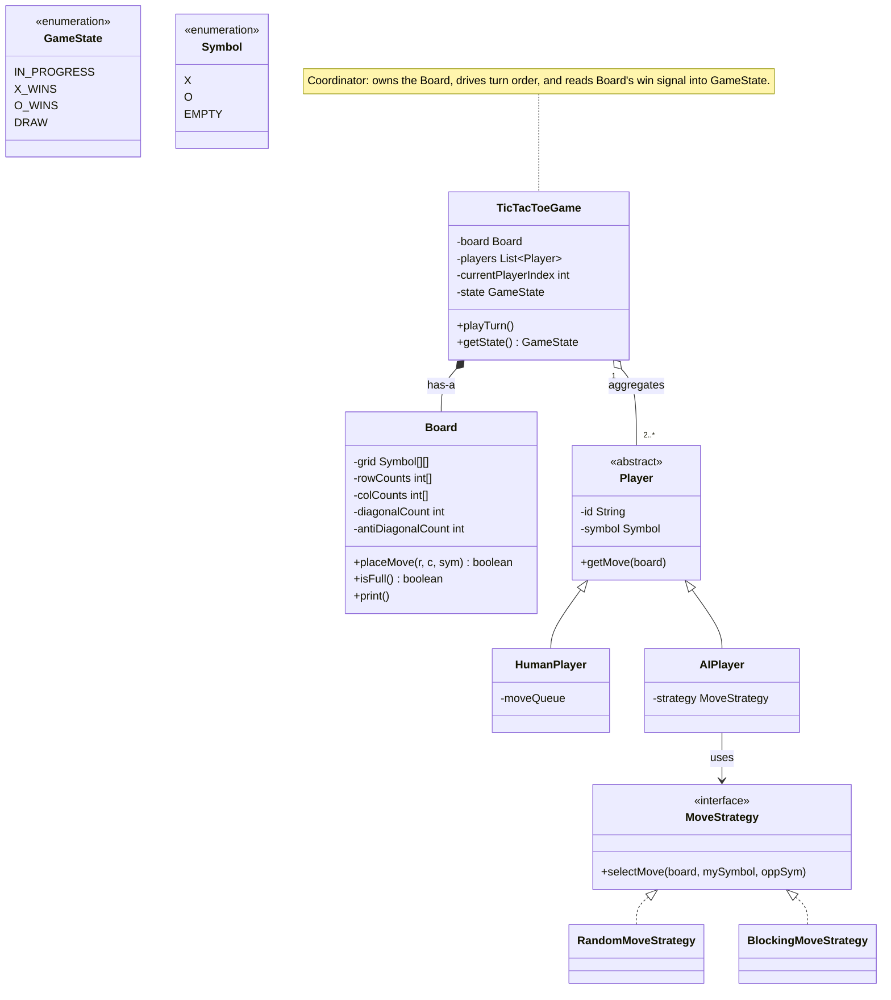
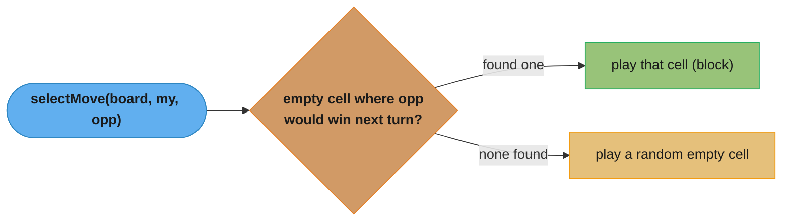
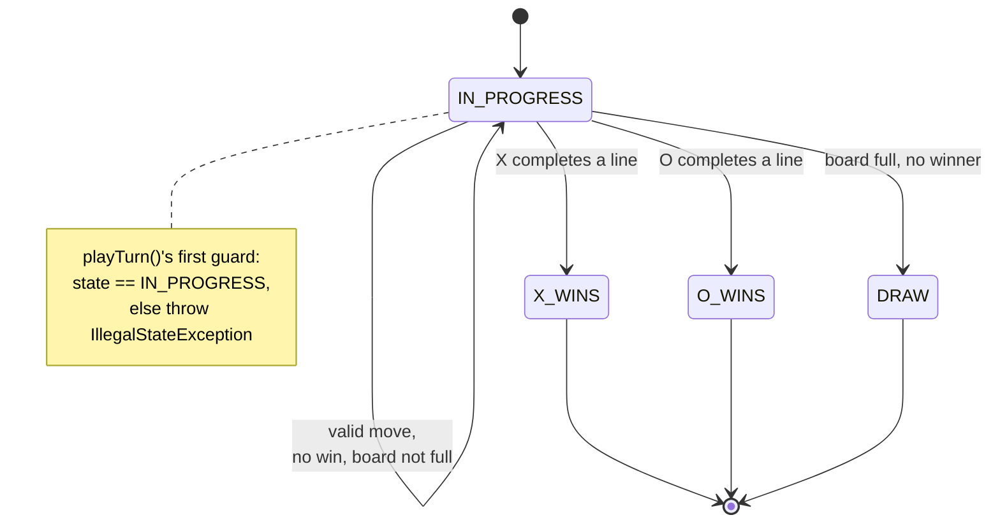
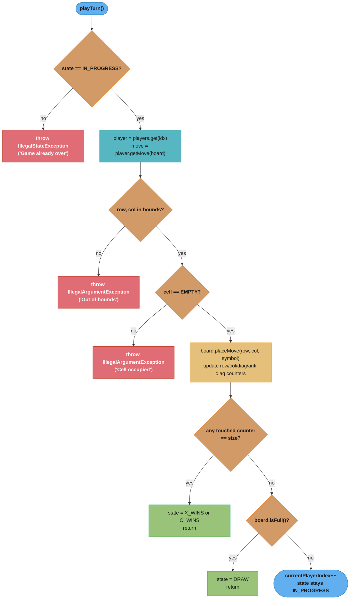

# Tic-Tac-Toe — Low-Level Design

## Intuition

> **Design intuition**: Tic-Tac-Toe looks trivial at 3x3, which is exactly why interviewers use it to probe generalization skill — can you design a board that works for any NxN size, and can you reason about the *cost* of checking for a win after every move? It also gives you a clean, low-stakes surface to demonstrate Player abstraction (human vs. AI) and a State-driven game lifecycle.

**Key insight**: A naive win-check rescans the entire board after every move — O(N^2) cell reads for an NxN board. A senior solution instead maintains incremental counters for every row, column, and the two diagonals, and updates only the four counters touched by the *last* move: four increments and four comparisons, so the whole win-check is **O(1) per move, independent of N**. (The counter *arrays* are O(N) space; the per-move work is not.) For N=1000, that's the difference between 1,000,000 cell checks per move versus 4 integer updates. This single optimization is the detail that separates junior from senior solutions on this problem.

**Full runnable implementation:** [`TicTacToe.java`](TicTacToe.java) — 398 lines, one file, `main()` at the bottom. It demonstrates `Board` with `GameState` win detection, `RandomMoveStrategy` and `BlockingMoveStrategy` behind a `MoveStrategy` interface, and Human/AI players over one abstract `Player` — the smallest complete example of strategy-per-player in the set.

---

## Problem Statement

Design an NxN Tic-Tac-Toe game that supports:
- A configurable board size (default 3x3, but the design must generalize to larger N)
- Two or more players, each assigned a distinct symbol
- Both human players (moves supplied externally) and AI players (computed via a pluggable strategy)
- Move validation — reject out-of-bounds coordinates and moves on occupied cells
- Win detection (3-in-a-row on a 3x3 board for the default configuration) and draw detection
- Querying the current game state (in progress, a player has won, or the board is a draw) at any time

---

## Requirements

### Functional
1. `makeMove(player, row, col)` — places the player's symbol if the move is legal
2. Validate every move: coordinates in bounds, target cell empty, correct player's turn
3. Detect a win immediately after the move that causes it
4. Detect a draw when the board fills up with no winner
5. Support different board sizes via a constructor parameter, not hardcoded constants
6. Support pluggable player types (`HumanPlayer`, `AIPlayer`) behind a common `Player` abstraction

### Non-Functional
- The win-check must be **O(1) per move**, not O(N^2), so the design scales to large boards (this is the primary thing the interviewer is grading); the counters cost O(N) *space*, which is the trade being made
- `Board` encapsulates its grid and counters — no external class mutates cells directly
- The design must be extensible to new player types (e.g., remote/networked players) without modifying `TicTacToeGame`
- `GameState` must gate which operations are valid — no moves once the game is `WIN` or `DRAW`

---

## ASCII Class Diagram



`TicTacToeGame` composes exactly one `Board` and aggregates 2+ `Player`s; `HumanPlayer`/`AIPlayer` both extend the abstract `Player`, and only `AIPlayer` holds a swappable `MoveStrategy` (realized by `RandomMoveStrategy`/`BlockingMoveStrategy`) — the Strategy seam covered next.

---

## Patterns Used

### 1. Strategy — `MoveStrategy`
**Why**: AI move selection is the part of the design most likely to change — a take-home assignment might start with "pick any empty cell" and evolve into "block the opponent's win" or later "minimax." Hardcoding the algorithm inside `AIPlayer` would force a rewrite every time the difficulty changes.

**How**: `MoveStrategy` declares `selectMove(Board, Symbol mySymbol, Symbol opponentSymbol)`. `RandomMoveStrategy` picks any empty cell uniformly at random. `BlockingMoveStrategy` first checks whether placing the opponent's symbol in any empty cell would let *them* win on their next turn — if so, it plays there to block; otherwise it falls back to a random empty cell. `AIPlayer` holds a `MoveStrategy` reference and delegates, so swapping difficulty is a one-line constructor change.



`BlockingMoveStrategy` scans every empty cell for one where the opponent would complete a line next turn; a match always wins priority over the random fallback — exactly the "block first, randomize otherwise" rule above.

---

### 2. State — `GameState`
**Why**: The set of legal operations changes as the game progresses. While `IN_PROGRESS`, moves are accepted; once the state becomes `X_WINS`, `O_WINS`, or `DRAW`, `playTurn()` must refuse further moves. Scattering `if (gameOver)` checks throughout the code is error-prone.

**How**: `GameState` is implemented as a simple enum-based state holder on `TicTacToeGame`. After every move, `Board.placeMove()` reports whether it created a win, and `TicTacToeGame` transitions `state` accordingly (`IN_PROGRESS -> X_WINS/O_WINS` or `IN_PROGRESS -> DRAW`). `playTurn()` checks `state == IN_PROGRESS` as its first guard. This is a lightweight, enum-driven variant of the State pattern rather than a full class-per-state hierarchy — appropriate here because the *transition logic* is simple even though the *gating* behavior is exactly what State formalizes.



`IN_PROGRESS` is the only re-entrant state — every other transition is terminal, which is exactly the invariant `playTurn()`'s first guard enforces.

---

### 3. Template Method — honest assessment: not used

An abstract `Player.makeMove(Board)` with `HumanPlayer`/`AIPlayer` filling in different "steps" was considered, but the two subclasses don't share a multi-step algorithm skeleton — `HumanPlayer` simply dequeues a pre-set move and `AIPlayer` delegates entirely to its `MoveStrategy`. Forcing a Template Method here would just be an abstract method with no shared structure, i.e., plain polymorphism. We use a single abstract method `getMove(Board)` on `Player` (basic inheritance + polymorphism, not a named GoF pattern) rather than overstate the pattern catalogue.

---

### 4. Factory — not used

A `PlayerFactory` was considered for creating `HumanPlayer`/`AIPlayer` instances by enum type, but with only two player types and constructors that take meaningfully different arguments (a move queue vs. a strategy object), a factory would add an indirection layer without simplifying any call site. Direct construction (`new AIPlayer(...)`, `new HumanPlayer(...)`) is clearer here. (Compare to `VehicleFactory` in the Parking Lot design, where many call sites construct vehicles from a single `VehicleType` enum — that asymmetry is what justifies a factory there but not here.)

---

## Design Decisions & Tradeoffs

| Decision | Alternative | Reason chosen |
|----------|-------------|---------------|
| O(1)-per-move incremental row/col/diagonal counters (O(N) space) | O(N^2) full-board rescan after each move | At N=3 the difference is negligible (9 vs. 4 checks), but at N=1000 it's 1,000,000 cell reads vs. 4 counter updates per move — incremental counters are the only approach that scales |
| Generalized NxN `Board` (size passed to constructor) | Hardcoded 3x3 arrays/constants | Interviewers explicitly probe generalization; a `final int size` field and loops parameterized on it cost nothing extra in the 3x3 case |
| Per-symbol counter encoding via separate `+1`/`-1` contributions summed into a single `int[]` per axis | Separate counter arrays per symbol (`xRowCounts[]`, `oRowCounts[]`) | A signed running sum (X contributes +1, O contributes -1) lets a single comparison (`== size` or `== -size`) detect a win for either symbol, halving the state to maintain; documented inline since the encoding is non-obvious |
| 2D `Symbol[][]` grid | Flat 1D array with `row * size + col` indexing | 2D array reads as `grid[row][col]`, matching the problem's natural mental model; the flat array's minor cache-locality benefit isn't worth the indexing-bug risk in an interview setting |
| AI strategies limited to random / blocking | Minimax with alpha-beta pruning | Minimax explores the full game tree — O(b^d) where b is branching factor (~N^2) and d is remaining empty cells; for N=3 (9 cells) this is ~362,880 leaf nodes, tractable, but for N>4 it becomes computationally impractical without heavy pruning. Noted as a follow-up extension rather than baseline scope |

---

## State / Flow



Four guard clauses run before any state mutation — game-over, out-of-bounds, and cell-occupied all short-circuit to an exception; only after `board.placeMove` do the win/draw checks run, and those are the O(N) counter comparisons from the intuition above, never a board rescan.

---

## Sample Output

```
========================================
   Tic-Tac-Toe -- LLD Demo (3x3)
========================================

Players: Human(X) vs AI-Blocker(O)

Turn 1: Human(X) moves
 X | . | .
-----------
 . | . | .
-----------
 . | . | .

Turn 2: AI-Blocker(O) moves
 X | . | .
-----------
 . | . | .
-----------
 O | . | .

Turn 3: Human(X) moves
 X | X | .
-----------
 . | . | .
-----------
 O | . | .

Turn 4: AI-Blocker(O) moves
 X | X | O
-----------
 . | . | .
-----------
 O | . | .

Turn 5: Human(X) moves
 X | X | O
-----------
 . | X | .
-----------
 O | . | .

Turn 6: AI-Blocker(O) moves
 X | X | O
-----------
 . | X | .
-----------
 O | O | .

Turn 7: Human(X) moves
 X | X | O
-----------
 . | X | .
-----------
 O | O | X

>>> Game Over: X_WINS

--- Invalid move demo ---
Attempting to play on occupied cell (1,1)...
Caught: Cell (1,1) is already occupied.

Attempting to play out-of-bounds cell (3,3)...
Caught: Move (3,3) is out of bounds for a 3x3 board.

========================================
              Demo complete
========================================
```

X wins on the main diagonal `(0,0)-(1,1)-(2,2)`. This run shows a "fork": X's move on turn 3 threatens the top row `(0,0)-(0,1)-(0,2)`, so O blocks at `(0,2)` on turn 4. X's move on turn 5 (center) simultaneously threatens column 1 `(0,1)-(1,1)-(2,1)` and the main diagonal `(0,0)-(1,1)-(2,2)`. O can only block one (column 1, turn 6); X completes the main diagonal on turn 7 and wins. Each of these checks is a single counter comparison, not a board rescan.

---

## Cross-Perspective: HLD Connections

- **Move log as event stream** — Each `makeMove` call is naturally an immutable event (`{player, row, col, timestamp}`); the current board is a *projection* derived by replaying all moves from an empty board. This is a textbook fit for event sourcing, where the move log is the source of truth and the board is rebuilt/cached state — see `../../hld/event_sourcing_cqrs/event_sourcing_cqrs.md`.
- **Real-time multiplayer** — A networked version needs every player's client to receive the opponent's move as it happens. At HLD scale this is WebSocket-based push (or Server-Sent Events) — the same Observer-style "notify on change" idea as `ParkingLot`'s `DisplayBoard`, just over the network instead of in-process.
- **AI strategy swapping → feature-flagged rollout** — Swapping `RandomMoveStrategy` for `BlockingMoveStrategy` at construction time mirrors how production ML systems swap model versions or ranking algorithms behind a feature flag — ship the new strategy to a subset of games/users, compare outcomes, then roll out fully.
- **Game-state persistence/resume** — Allowing a player to close the app mid-game and resume later requires externalizing `Board` + `GameState` + `currentPlayerIndex` to a session store (Redis, DB row) keyed by game ID — the same session-state-externalization pattern used to make any stateful service horizontally scalable.

---

## Follow-Up Extensions

1. **Generalize to K-in-a-row on NxN** (Connect Four style) — instead of requiring a full row/column/diagonal of length N, win when any K consecutive cells in a line match. Requires sliding-window counters instead of single full-axis counters.

2. **Minimax with alpha-beta pruning** — replace `BlockingMoveStrategy` with a `MinimaxMoveStrategy` for an unbeatable AI on small boards (practical up to roughly 4x4-5x5 with pruning; beyond that, depth-limit the search and add a heuristic evaluation function).

3. **Undo/redo via Memento** — capture `Board` snapshots (or replay-from-move-log) before each move to support undo; see `../../lld/behavioral/memento/`.

4. **Multiplayer (>2 players) with turn rotation** — generalize `Symbol` to an arbitrary set of markers and `currentPlayerIndex` cycling already supports N players; the win-check needs a configurable target-count-per-symbol.

5. **Persistent move history / replay** — append each validated move to a log (file or DB table); replaying the log from an empty board reconstructs any historical game state, enabling spectator mode and post-game analysis.

---

## Interview Questions with Answers

**Q: Why is a full-board rescan after every move the wrong approach, and what replaces it?**
**Short:** it's O(N²) per move; incremental row/column/diagonal counters make win-check O(1) per move instead.

Rescanning the entire board after every move to check for a win costs O(N²) cell reads on an NxN board — for N=3 that's 9 reads, harmless, but for N=1000 that's 1,000,000 cell reads on *every single move*. The senior solution instead maintains incremental counters for every row, column, and the two diagonals, updating only the four counters touched by the move just made — four increments and four comparisons, regardless of N. This is the single optimization the Key insight names as "the detail that separates junior from senior solutions on this problem."

**Q: How does the signed `+1`/`-1` running-sum encoding let one comparison detect a win for either symbol?**
**Short:** X contributes +1 and O contributes -1 to the same counter, so `== size` or `== -size` catches either win.

Instead of maintaining separate counter arrays per symbol (`xRowCounts[]` and `oRowCounts[]`), each axis has a single signed `int[]` where X's move adds `+1` and O's move adds `-1` to the relevant row, column, and diagonal counters. A row fully occupied by X sums to exactly `size`; a row fully occupied by O sums to exactly `-size` — so one comparison (`counter == size` or `counter == -size`) after the touched counters update detects a win for either player, halving the state that needs to be maintained compared to per-symbol arrays. The Design Decisions table flags this encoding as non-obvious and worth documenting inline for exactly that reason.

**Q: Why wasn't Template Method used for `Player`, despite `HumanPlayer`/`AIPlayer` looking like a natural fit?**
**Short:** the two subclasses don't share a multi-step algorithm skeleton — there's no shared structure to template.

Template Method requires a shared multi-step algorithm where subclasses override specific steps while a base class controls the overall sequence — but `HumanPlayer.getMove()` simply dequeues a pre-set move, and `AIPlayer.getMove()` delegates entirely to its `MoveStrategy`, with no common sequence of steps between the two beyond "return a move somehow." Forcing Template Method here would just be an abstract method with no shared structure underneath it — plain polymorphism dressed up with an extra pattern name it doesn't actually earn. The page's own "honest assessment" section calls this out directly rather than overstating the pattern catalogue for a design that doesn't need it.

**Q: Why wasn't a `PlayerFactory` used, unlike `VehicleFactory` in `ParkingLot`?**
**Short:** only two player types with meaningfully different constructor arguments — a factory would add indirection without simplifying anything.

`VehicleFactory` earns its place in `ParkingLot` because many call sites construct vehicles from a single `VehicleType` enum with uniform arguments — centralizing that mapping genuinely simplifies every caller. Here, there are only two player types, and their constructors take meaningfully different arguments (a move queue for `HumanPlayer`, a strategy object for `AIPlayer`), so direct construction (`new AIPlayer(...)`, `new HumanPlayer(...)`) is already clear and a factory would add an indirection layer without reducing complexity anywhere. This is a deliberate comparison the page draws to show *when* a Factory is and isn't justified, not a gap in this design.

**Q: Why is `GameState` described as a "lightweight enum-driven variant" of State rather than full GoF State?**
**Short:** the transition logic is simple even though the gating behavior is exactly what State formalizes — a full class hierarchy isn't earned.

`GameState` is a plain enum on `TicTacToeGame`, with transitions decided by a simple `if`-based check after each move (win detected, board full, else continue) rather than each state being its own class with its own handler methods. The *gating* behavior — moves accepted only while `IN_PROGRESS`, refused once the game is over — is precisely what the State pattern formalizes, but the *transition logic* itself is simple enough (three conditions, checked once per move) that a full class-per-state hierarchy would be unwarranted ceremony, the same judgment call `RideSharing.md` makes for its transition-table `RideState`.

**Q: Why must the win-check touch only the four counters affected by the last move, rather than re-checking every counter?**
**Short:** any cell not on the last move's row, column, or diagonal is provably unchanged, so its counters can't have newly become a win.

A move at `(row, col)` can only possibly complete a win on that specific row, that specific column, the main diagonal (if `row == col`), and the anti-diagonal (if `row + col == size - 1`) — no other row's or column's counter changed as a result of this move, so checking them again would be redundant work that can never discover a new win. Restricting the check to exactly the four counters the move actually touched is what keeps the win-check O(1) per move independent of N — checking all 2N+2 counters every time would still be an improvement over a full rescan, but it throws away the "touched counters only" insight that gets you to true constant time.

**Q: Why is the board a 2D `Symbol[][]` grid instead of a flat 1D array with `row * size + col` indexing?**
**Short:** `grid[row][col]` matches the natural mental model; the flat array's cache-locality edge isn't worth the indexing-bug risk here.

A flat 1D array with manual `row * size + col` index arithmetic has a minor cache-locality advantage in some languages, but it also introduces an entire class of off-by-one and index-arithmetic bugs that a 2D array's `grid[row][col]` syntax sidesteps entirely by matching the problem's natural row/column mental model directly. In an interview setting, where the design is being read and reasoned about live rather than benchmarked for cache performance, the readability and correctness win of the 2D array outweighs the flat array's marginal, largely irrelevant-at-this-scale performance edge.

**Q: `BlockingMoveStrategy` — what's the priority rule between blocking and random play?**
**Short:** blocking a threatened opponent win always takes priority; random play is only the fallback when no threat exists.

`selectMove()` first scans every empty cell to check whether placing the *opponent's* symbol there would let them complete a line on their next turn — if such a cell exists, `BlockingMoveStrategy` plays there to block it, unconditionally. Only when no such threatening cell is found does it fall back to picking a random empty cell. This is a strict priority order, not a weighted choice — the strategy never "sometimes" ignores an available block in favor of a random move, which is exactly the flowchart's two-branch shape: found a block, take it; otherwise randomize.

**Q: Walk the four guard clauses in `playTurn()` — what order do they run in, and why does the order matter?**
**Short:** game-over, then out-of-bounds, then cell-occupied — each short-circuits before any state mutation happens.

`playTurn()` checks `state == IN_PROGRESS` first (refusing any move once the game has already ended), then validates the move's coordinates are in bounds, then checks the target cell is empty — each check throwing its own specific exception and returning before any board mutation occurs. The order matters because each guard assumes the previous ones already passed: checking cell-occupancy on out-of-bounds coordinates would itself throw an array-index exception rather than the intended, more informative `IllegalArgumentException`, so bounds must be validated strictly before the cell's contents are ever read.

**Q: Why is the win-check counter array O(N) *space* even though the per-move check is O(1) *time*?**
**Short:** the counters themselves — `rowCounts`, `colCounts`, plus two diagonals — need O(N) memory to track every row and column.

The per-move *time* complexity is O(1) because only four specific counters are touched and compared on any given move, but those counters have to exist for *every* row and column in the first place — `rowCounts[N]` and `colCounts[N]` are both O(N)-sized arrays, plus two scalar diagonal counters. This is the tradeoff being made explicitly: O(N) space is spent once, up front, to buy O(1) time on every subsequent move — for N=1000, that's 2000 integers of memory (roughly 8KB) traded for avoiding 1,000,000 cell reads per move that a full rescan would otherwise require.

**Q: Extension — generalizing to K-in-a-row on an NxN board (Connect Four style), what data-structure change is required?**
**Short:** single full-axis counters must become sliding-window counters, since a win no longer requires the entire row/column.

The current design's counters work because a win requires *every* cell in an entire row, column, or diagonal to match — a single running sum per axis suffices. K-in-a-row, where a win is any K *consecutive* cells matching (not the whole axis), breaks that assumption: a row of length N could contain a winning K-length run without the whole row matching, so a single scalar counter per axis can no longer represent "is there a win here." The fix is a sliding-window counter per axis — tracking the longest current consecutive run — updated incrementally as each move extends or breaks a run, rather than a single running total for the entire line.

**Q: Why is Minimax noted as a follow-up extension rather than baseline scope for this problem?**
**Short:** minimax explores O(b^d) nodes — tractable at N=3, impractical beyond roughly N=4-5 without heavy pruning.

For a 3x3 board (9 cells), minimax's full game-tree exploration is roughly 362,880 leaf nodes — computationally trivial, and genuinely implementable within an interview's time budget. But minimax's cost is O(b^d), where b (branching factor) scales roughly with N² and d (remaining empty cells) scales with N² as well, so for N > 4 the tree becomes computationally impractical without alpha-beta pruning and a depth-limited heuristic evaluation function — a meaningfully larger scope than what `RandomMoveStrategy`/`BlockingMoveStrategy` require. The Design Decisions table names this tradeoff directly and scopes minimax as a follow-up rather than baseline precisely because the generalized-NxN requirement makes an unbounded minimax implementation a much bigger undertaking than the rest of the problem.

**Q: How would undo/redo via Memento integrate with the counter-based `Board`?**
**Short:** a Memento snapshot must capture the counters alongside the grid, not just the grid — both must roll back together.

Because `Board`'s win-detection correctness depends on `rowCounts`, `colCounts`, and the two diagonal counters staying perfectly in sync with the actual grid contents, an undo implementation can't just revert the `Symbol[][]` grid and leave the counters as they were — that would desynchronize the two and produce incorrect future win-checks. A `Memento` capturing a full snapshot (grid plus all counter arrays) before each move, or equivalently replaying the validated move log from an empty board up to the desired point, both correctly keep the counters and grid consistent — the replay approach the Follow-Up Extensions also suggest for persistent move history has the advantage of not needing to snapshot the counter state explicitly at all, since replaying moves naturally rebuilds them.

**Q: How does the move log map to event sourcing at HLD scale, and what is the "projection" in that mapping?**
**Short:** each `makeMove` call is an immutable event; the current board is a cached projection rebuilt by replaying the event log.

Every `makeMove(player, row, col)` call is naturally an immutable event — `{player, row, col, timestamp}` — that never changes once recorded, and the board's current state at any point is fully determined by replaying every event from an empty board in order. This is the textbook event-sourcing shape: the move log is the durable source of truth, and the "current board" the game actually reads and displays is a *projection* — a derived, cached view rebuilt (or incrementally updated) from that log rather than being the authoritative state itself. This is the same mapping `ChessGame.md` draws for its own `MoveHistory` Command stack, generalized to the distributed-systems pattern it's a local analogue of.

**Q: How does swapping `RandomMoveStrategy` for `BlockingMoveStrategy` at construction time mirror feature-flagged ML model rollout in production?**
**Short:** both let a system serve a new algorithm to a subset of traffic, compare outcomes, and roll out fully — without touching callers.

`AIPlayer` holds a `MoveStrategy` reference chosen at construction, so switching from `RandomMoveStrategy` to `BlockingMoveStrategy` (or a future `MinimaxMoveStrategy`) requires no changes to `TicTacToeGame`, `Player`, or any caller — exactly the same shape as a production ML system swapping model versions or ranking algorithms behind a feature flag. In both cases, the swap-ability comes from the caller depending only on an interface (`MoveStrategy` here, a model-serving API there), which is what lets a new algorithm be shipped to a subset of games or users, compared against the baseline's outcomes, and then rolled out fully — all without the surrounding system needing to know or care which specific algorithm is currently active.
