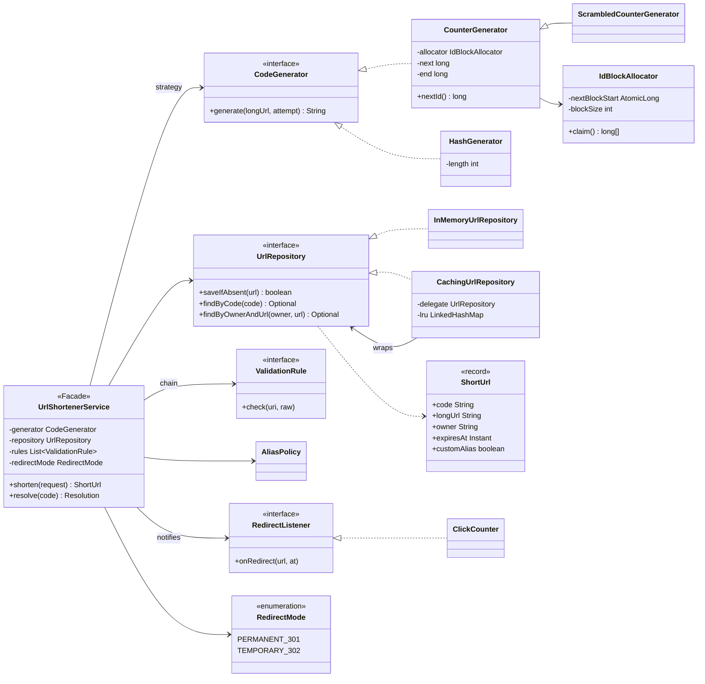
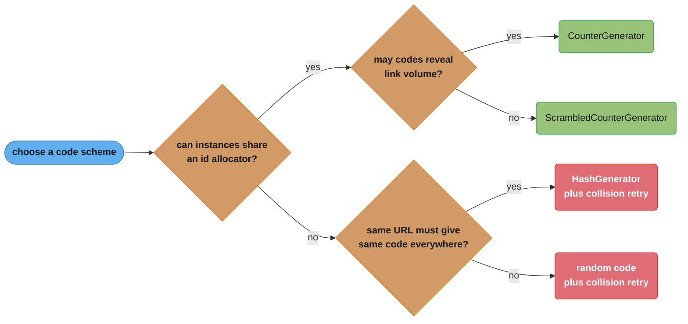
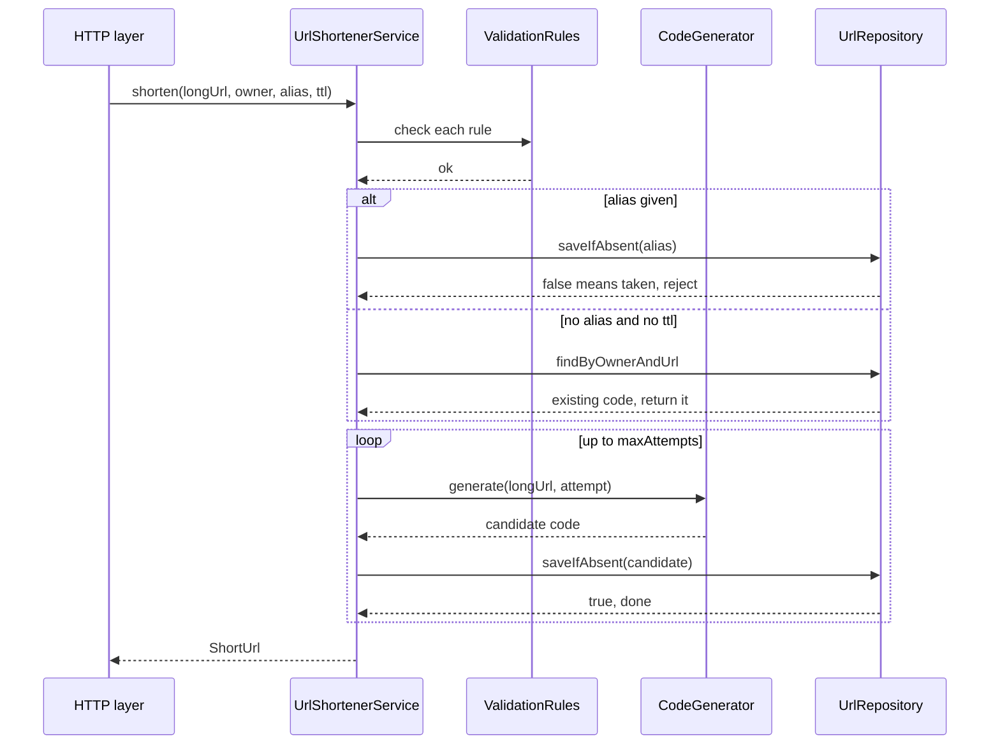
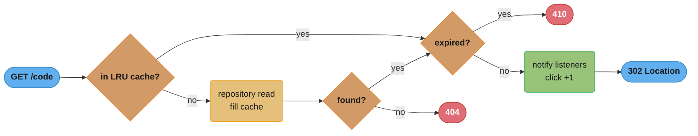

# URL Shortener — Low-Level Design
## Intuition

> **Design intuition**: The HLD version of this problem ([`hld/case_studies/design_url_shortener.md`](../../hld/case_studies/design_url_shortener.md)) is about the fleet: read-to-write ratio, storage per year, a counter service, a CDN in front of redirects. The LLD version asks a different question: inside one service instance, what are the classes, and where exactly does uniqueness come from? The answer decides whether the design survives the follow-ups "now run it on 10 instances" and "now let users pick their own alias".

**Key insight**: A short code is unique for one of exactly two reasons. Either the **generator** cannot produce the same code twice (a counter, possibly scrambled by a bijection), or the **repository** refuses a duplicate (an atomic insert-if-absent, which is a unique constraint in a database) and the service retries. Custom aliases always need the second mechanism, because users choose them. So the repository's `saveIfAbsent` is the real correctness boundary in every variant, and the generator is a Strategy that only decides how often that boundary is hit. Everything else (Base62, validation, caching, 301 vs 302, expiry) sits on top of that one decision.

**Full runnable implementation:** [`UrlShortener.java`](UrlShortener.java) — 635 lines, one file, all types nested, `main()` at the bottom. It demonstrates Base62 encoding at the edges of the 7-character space, a plain counter producing `0000001, 0000002, 0000003`, the same ids scrambled into `015FTGn, 02blNmK, 03h1H37` by a bijection, per-owner deduplication, a validation chain rejecting `javascript:`, self-redirect and blocked hosts, an alias policy, a 2-character hash space where 200 URLs cause 4 retried collisions, 1,000 redirects served with 1 repository read, a link expiring to `410`, two service instances on 8 threads writing 80,000 links with 0 collisions through block allocation, and 8 users racing for one alias with exactly 1 winner.

---

## Problem Statement

Design the core of a URL shortening service:
- `shorten(longUrl)` returns a short code; `resolve(code)` returns where to redirect
- Users may request a custom alias instead of a generated code
- Links may expire
- The same owner shortening the same URL twice should get the same code
- Clicks are counted
- Malicious and malformed URLs are rejected
- The service runs as several instances that must never hand out the same code

---

## Requirements

### Functional
1. `shorten(request)` with optional alias and optional TTL; returns a `ShortUrl`
2. `resolve(code)` returns `302` (or `301`) with a location, `404` for unknown codes, `410` for expired ones
3. Generated codes are exactly 7 Base62 characters
4. Aliases match `[A-Za-z0-9_-]{4,30}` and cannot be reserved words (`api`, `admin`, `login`, `health`, `static`)
5. URLs must be `http` or `https`, at most 2,048 characters, have a host, not point back at the shortener's own host, and not use a blocked host
6. Every successful redirect notifies listeners (click counting, analytics)

### Non-Functional
1. No two links ever share a code, across instances and threads
2. Redirect path: one cache lookup on a hit, no database read
3. Codes should not reveal how many links exist (configurable)
4. Generator, repository and redirect mode are swappable without editing the service

---

## Class Diagram



*The service validates, picks a code from the `CodeGenerator` strategy, and relies on `UrlRepository.saveIfAbsent` for uniqueness. `CachingUrlRepository` is a Decorator, so the service never knows a cache exists. `IdBlockAllocator` is the in-process stand-in for whatever shared counter the fleet uses.*

---

## Patterns Used

### 1. Strategy — `CodeGenerator`
**Why**: The code scheme is the most debated choice in this problem, and teams change it (sequential codes leak volume; hashes collide; random codes need a lookup). The service should not care.

**How**: `generate(longUrl, attempt)` returns a candidate. `attempt` starts at 0 and grows on each collision, which matters only for deterministic schemes: `HashGenerator` hashes `longUrl + "#" + attempt`, so a collision produces a different candidate on the retry. Counter generators ignore it, because they never repeat.

| Generator | Code for id 1 | Collisions | Reveals volume | Needs coordination |
|-----------|---------------|------------|----------------|--------------------|
| `CounterGenerator` | `0000001` | never | yes, codes are sequential | a shared counter or id blocks |
| `ScrambledCounterGenerator` | `015FTGn` | never (bijection) | not to a casual reader | same as counter |
| `HashGenerator` (7 chars) | depends on URL | birthday-bound, retried | no | none |
| Random 7 chars | random | birthday-bound, retried | no | none |

### 2. Decorator — `CachingUrlRepository`
**Why**: Redirects outnumber creations by orders of magnitude, so the read path needs a cache, but the service and the database repository should not each grow caching code.

**How**: `CachingUrlRepository` implements `UrlRepository`, wraps any other implementation, and serves `findByCode` from an access-ordered `LinkedHashMap` with `removeEldestEntry` as a bounded LRU. Writes pass through. Demo section 7 resolves one code 1,001 times: 1 miss, 1,000 hits. The same decorator would wrap a JDBC repository unchanged. For a cache with TTL and pluggable eviction, see [`CacheManager.md`](CacheManager.md).

### 3. Chain of Responsibility — `ValidationRule`
**Why**: Validation rules grow over time (length, scheme, host present, no self-redirect, blocklist, then a malware lookup service) and are owned by different teams.

**How**: A `List<ValidationRule>` where each rule throws `InvalidUrlException` or returns. Order matters only for cost: cheap checks (length, scheme) run before expensive ones (a remote reputation lookup). This is the "every handler checks" variant of the chain; see [`behavioral/chain_of_responsibility`](../behavioral/chain_of_responsibility/chain_of_responsibility.md).

### 4. Observer — `RedirectListener`
**Why**: Click counting, analytics and abuse detection all want every redirect, and none may slow the redirect down.

**How**: `resolve` notifies listeners after deciding the response. `ClickCounter` increments a `LongAdder` per code, which costs nanoseconds. A real analytics listener puts an event on a queue and returns; it never writes to a database on the redirect thread.

### 5. Repository + Facade
`UrlRepository` hides storage behind three methods, and its only write, `saveIfAbsent`, is atomic. `UrlShortenerService` is the facade the HTTP layer calls.

---

## Design Decisions & Tradeoffs

| Decision | Alternative | Reason chosen |
|----------|-------------|---------------|
| 7 Base62 characters | 6 characters, or Base64 | 62^7 = 3,521,614,606,208 codes; 62^6 = 56,800,235,584. Base64's `+` and `/` need URL escaping, and `-`/`_` variants look like typos when read aloud |
| Uniqueness enforced by `saveIfAbsent` | `exists(code)` then `save` | Check-then-insert races: two threads both see "free" and both insert. An atomic insert-if-absent (a unique index) cannot |
| Counter ids in blocks of 1,000 per instance | One shared counter call per link | One coordination round-trip per 1,000 links instead of per link. A crash wastes at most 999 ids, which is nothing against 3.5 trillion |
| Scramble by `(id * P) mod 62^7`, P prime and coprime to 62 | Random codes with a uniqueness lookup | Multiplication by a number coprime to the modulus is a bijection: no collisions, no lookup, and codes no longer count upward. It is obfuscation, not security (see the Q&A) |
| Dedup by (owner, URL) for links without TTL | Global dedup by URL | Two owners need separate click counts and separate deletion rights. A link with a TTL is never deduplicated, so an expiring campaign link cannot hand back a permanent one |
| `302` by default | `301` | A `301` is heuristically cacheable by browsers (RFC 9110), so repeat clicks may never reach the service and are never counted. `302` keeps every click visible at the cost of more traffic |
| Expired link returns `410 Gone` | `404 Not Found` | `410` tells the client the link existed and ended, which support teams and crawlers treat differently from a typo |
| Aliases share the code namespace | Separate alias table | One lookup on the redirect path. The cost: a user alias can collide with a future generated code, which the service's retry loop absorbs |

**Picking a generator** — the question each branch answers:



*Green schemes never collide; red schemes collide at the birthday bound and depend on the repository's atomic insert plus a retry.*

---

## State / Flow

### `shorten(request)`



*The repository is consulted for uniqueness on every path. The loop exits on the first successful insert; with a counter it never iterates twice unless an alias already took that exact code.*

### `resolve(code)`



*Expiry is checked on every resolve, after the cache, so a cached link still stops working at its deadline without any cache invalidation.*

**How a scrambled code is built** (id 1, P = 1,000,000,007):

```
id                 1
x P                1,000,000,007
mod 62^7           1,000,000,007        (smaller than 3,521,614,606,208)
base62, 7 chars    0  1  5  F  T  G  n
                   |  |
                   |  1 x 62^5 = 916,132,832
                   0 x 62^6
```

*The multiply spreads consecutive ids across the space; the modulus keeps every code at 7 characters; coprimality guarantees no two ids land on the same code.*

---

## Sample Output

```text
========================================
   URL Shortener - LLD Demo
========================================

--- 1. Base62 ---
  62^7 = 3,521,614,606,208 codes of length 7
  encode(125)   = 0000021   decode -> 125
  encode(62^7-1)= ZZZZZZZ

--- 2. Plain counter: short, unique, and guessable ---
  0000001
  0000002
  0000003

--- 3. Scrambled counter: same ids, no visible sequence ---
  id 1 -> 015FTGn
  id 2 -> 02blNmK
  id 3 -> 03h1H37

--- 4. Same owner, same URL -> same code ---
  u1 first=0000004 u1 again=0000004 u2=0000005

--- 5. Validation chain and alias policy ---
  rejected: scheme must be http or https: javascript:alert(1)
  rejected: redirect loop to sho.rt
  rejected: blocked host malware.example
  alias ok: launch-2026
  rejected: alias already taken: launch-2026
  rejected: alias is reserved: admin
  rejected: alias must match [A-Za-z0-9_-]{4,30}: a b

--- 6. Hash generator with a tiny 2-char space: collisions are retried ---
  200 URLs into 62^2 = 3,844 codes: collisions retried = 4 (birthday estimate ~ 200^2 / (2 x 3,844) = 5.2)

--- 7. Redirects, cache, clicks, expiry ---
  resolve x1000 -> Resolution[status=302, location=https://example.com/promo]
  cache hits=1000, misses=1, clicks=1001
  after 2 days -> Resolution[status=410, location=null]
  unknown code -> Resolution[status=404, location=null]

--- 8. Two instances, 4 threads each, 10,000 links per thread ---
  links stored=80000, collisions=0, id blocks claimed=80

--- 9. Eight users race for one alias ---
  winners=1, rejected=7

========================================
              Demo complete
========================================
```

Section 3's codes still start `01`, `02`, `03` because `P` is only about 2.8 x 10^-4 of the space, so small ids move in large but regular steps; a larger multiplier near the size of the space spreads them further. Section 6 is the birthday problem in miniature: with n = 200 inserts into N = 3,844 codes, the expected number of collisions is about n^2 / 2N = 5.2, and SHA-256 produced 4. Section 8 claims exactly 80 blocks because each instance uses 40,000 ids, exactly 40 full blocks; the 41st block is never requested.

---

## Cross-Perspective: HLD Connections

- **Id blocks become a counter service** — `IdBlockAllocator.claim()` is one `UPDATE counters SET next = next + 1000 RETURNING next` or one ZooKeeper sequential node per block; the HLD case study picks ranges handed out by a coordinator. Snowflake-style ids remove even that coordination by embedding a worker id and a timestamp; see [`hld/case_studies/design_distributed_unique_id.md`](../../hld/case_studies/design_distributed_unique_id.md) and [`java/case_studies/design_snowflake_id_generator_java.md`](../../java/case_studies/design_snowflake_id_generator_java.md). A Snowflake id is 64 bits, which is 11 Base62 characters, not 7.
- **`saveIfAbsent` becomes a unique index** — `INSERT ... ON CONFLICT (code) DO NOTHING` returns zero rows on a duplicate; in DynamoDB it is a conditional put with `attribute_not_exists(code)`. The service loop is unchanged.
- **The LRU decorator becomes a CDN plus Redis** — the redirect is a tiny, read-heavy response; the HLD design caches it at the edge. The 301 vs 302 decision is what controls whether the edge and the browser may cache it: see [`hld/cdn`](../../hld/cdn/cdn.md).
- **Click counting becomes a stream** — the `RedirectListener` publishes to a log and an aggregator rolls up counts per minute; the redirect never waits for analytics.

---

## Follow-Up Extensions

1. **Link deletion and takedown** — a `DELETE` must also evict the code from every cache tier; with a CDN, purge the path. Until purged, a cached copy keeps redirecting.
2. **Per-user rate limits on `shorten`** — a decorator around the service, or a filter in front of it; see [`RateLimiter.md`](RateLimiter.md).
3. **Malware scanning** — an asynchronous `ValidationRule` that marks a link `PENDING` and resolves to an interstitial page until the scan completes.
4. **Custom domains** — the repository key becomes `(domain, code)`; the validation loop check compares against every owned domain.
5. **Analytics dimensions** — the listener receives the request (referrer, country, device) and emits an event; counting by dimension happens downstream.
6. **Vanity alias reservation** — a short-TTL hold on an alias while a user completes a purchase, released by a sweeper, the same shape as a seat hold in [`OnlineBookingSystem.md`](OnlineBookingSystem.md).

---

## Extension Drills: Concurrency, Multi-Instance, Persistence

| Drill | What the interviewer adds | What breaks in a naive design | Change in this design |
|-------|---------------------------|-------------------------------|------------------------|
| Concurrency | "Two users request alias `black-friday` in the same millisecond" | `if (!exists(alias)) save(alias)` lets both pass | `saveIfAbsent` is one atomic `putIfAbsent`; demo section 9 has 1 winner of 8 |
| Concurrency | "8 threads share one generator" | `next++` on a plain `long` loses increments and repeats ids | `nextId()` is `synchronized` around the block refill and increment; an `AtomicLong` works for a single unbounded counter |
| Multi-instance | "Run 10 instances" | Each instance's in-memory counter starts at 1: every instance issues `0000001` | All instances draw blocks from one shared allocator; demo section 8 writes 80,000 links from 2 instances with 0 collisions |
| Multi-instance | "An instance crashes holding a block" | Nothing breaks; ids in its unused block are skipped | Accept the gap (at most 999 ids per crash); never try to return ids, which would need coordination |
| Persistence | "Store links in a database" | Retry loop assumes `saveIfAbsent` is atomic; a read-then-write DAO is not | Back it with a unique index on `code` and `INSERT ... ON CONFLICT DO NOTHING` |
| Persistence | "Restart: does the counter restart at 1?" | An in-memory counter resets and re-issues every code | The allocator's `next` lives in durable storage, advanced before a block is handed out |
| Persistence | "Owner dedup under concurrency" | Two concurrent `shorten` calls for the same owner and URL can create two codes | Accept it (both redirect correctly), or add a unique index on `(owner, url_hash)` and return the existing row on conflict |

**The generator race, as code:**

```java
// BROKEN: two threads read the same `next`, both return it, two links get one code
// (saveIfAbsent then rejects one, and the counter has already moved past it).
long nextId() {
    if (next == end) { long[] b = allocator.claim(); next = b[0]; end = b[1]; }
    return next++;          // read, add, write: not atomic
}

// FIX: the refill and the increment are one critical section.
synchronized long nextId() {
    if (next == end) { long[] b = allocator.claim(); next = b[0]; end = b[1]; }
    return next++;
}
```

The broken form is not caught by uniqueness, because `saveIfAbsent` rejects the duplicate and the retry loop asks for a fresh id. It shows up as a `collisions` counter that is non-zero for a scheme that should never collide, which is why the demo prints it.

---

## Interview Questions with Answers

**Q: Counter plus Base62 or hash of the URL: which do you pick and why?**
**Short:** Counter plus Base62 when instances can share an id allocator: it never collides and needs no lookup before insert.

A counter produces each id once, so with a shared allocator the code is unique by construction and every insert succeeds on the first try (0 collisions for 80,000 links in demo section 8). A hash needs no coordination and gives the same code for the same URL everywhere, but truncated to 7 characters it collides at the birthday bound, so every insert needs a uniqueness check and a retry. Choose the hash only when instances cannot coordinate at all. Either way, keep the repository's atomic insert, because aliases can still collide.

**Q: How many characters should a code have?**
**Short:** Seven Base62 characters give 3.52 trillion codes; six give 56.8 billion. Size it from links per year times retention.

62^7 = 3,521,614,606,208 and 62^6 = 56,800,235,584. At 100 million new links a month, 1.2 billion a year, six characters last about 47 years with a counter and seven last about 2,900 years. With a hash or random scheme the useful limit is lower: collisions become likely long before the space is full, since a 50% chance of at least one collision arrives at about 1.18 x sqrt(N), roughly 2.2 million links for 7 characters. Seven characters with a counter is the standard answer.

**Q: Why does uniqueness live in `saveIfAbsent` and not in an `exists()` check?**
**Short:** Check-then-insert is a race: two threads can both see "free" and both insert; an atomic insert-if-absent cannot.

`if (!repo.exists(code)) repo.save(link)` has a gap between the check and the write. Under load two requests for the alias `black-friday` both pass the check, and whichever writes second silently overwrites the first owner's link. `saveIfAbsent` is `putIfAbsent` in memory and a unique index with `INSERT ... ON CONFLICT DO NOTHING` in a database, so exactly one insert wins (demo section 9: 1 winner, 7 rejected). Any uniqueness rule must be enforced by the store, not by the caller.

**Q: A plain counter makes codes `0000001`, `0000002`. What is wrong with that, and how do you fix it?**
**Short:** Sequential codes reveal link volume and let anyone enumerate links; scramble the id with a bijection before encoding.

Anyone can shorten two links an hour apart and subtract to learn your creation rate, and anyone can iterate codes to scrape every link, including ones meant to be unlisted. `ScrambledCounterGenerator` computes `(id * P) mod 62^7` with P coprime to 62^7, which is a bijection on the space: still collision-free, no lookup, and consecutive ids no longer produce consecutive codes. Unlisted content still needs real access control, because scrambling only stops casual enumeration.

**Q: Is the scrambled code secure against enumeration?**
**Short:** No. Two consecutive codes reveal P, after which every code can be predicted; it is obfuscation, not cryptography.

Decode two codes created one after the other and subtract: the difference is P mod 62^7. With P known, all ids map to codes. A format-preserving encryption scheme or a keyed pseudorandom permutation over the id space closes that, at the cost of more code and a secret to manage. If links can point at private content, the answer is not a stronger code; it is an authorization check on the target or a long random token instead of a 7-character code.

**Q: How do several instances generate codes without colliding and without calling a counter service per link?**
**Short:** Each instance claims a block of ids (1,000 here) from a shared allocator and hands them out locally until the block is used.

`IdBlockAllocator.claim()` is the only shared operation; in a database it is one `UPDATE ... RETURNING` that advances a counter row by 1,000. Between claims, `CounterGenerator.nextId()` is a local increment. Demo section 8 runs two instances on 8 threads, 80,000 links, 80 claims and 0 collisions. If an instance crashes, its unused ids are skipped; at most 999 per crash, which is irrelevant against 3.5 trillion codes.

**Q: How do you handle hash collisions?**
**Short:** On a failed insert, retry with a salted input (URL plus attempt number) until an insert succeeds or the attempt budget runs out.

`HashGenerator` hashes `longUrl + "#" + attempt`, so attempt 1 yields a different candidate than attempt 0, and `shorten` loops until `saveIfAbsent` returns true. Demo section 6 squeezes 200 URLs into a 2-character space of 3,844 codes and retries 4 collisions, close to the birthday estimate of n^2 / 2N = 5.2. In a real 7-character space collisions are rare, but the loop still has to exist, with a cap and an alarm on its rate.

**Q: The same user shortens the same URL twice. Same code or a new one?**
**Short:** The same code for the same owner and no TTL; different owners and expiring links get their own codes.

Returning the existing code saves storage and keeps one click count for one link. Deduplicating across owners would merge two people's analytics and give one user deletion power over the other's link, so the key is `(owner, url)`. Links with a TTL are never deduplicated, so asking for a 1-day link can never return a permanent one. Under concurrency two simultaneous requests can still create two codes; both redirect correctly, so most designs accept that, or add a unique index on `(owner, url_hash)`.

**Q: Why might a custom alias collide with a generated code, and what do you do about it?**
**Short:** Aliases and generated codes share one namespace, so a 7-character alias can equal a future counter code; the retry loop absorbs it.

If a user claims `0000123` as an alias, the counter later produces `0000123` and `saveIfAbsent` fails; the service retries with the next id. That costs one wasted id, not an error. Alternatives are a separate namespace (aliases on a different path prefix) or forbidding aliases that look like generated codes (exactly 7 Base62 characters). Reserved words (`api`, `admin`, `login`) are rejected separately so a user cannot shadow a real route.

**Q: 301 or 302 for the redirect?**
**Short:** 302 by default: a 301 is heuristically cacheable by browsers, so repeat clicks bypass the service and go uncounted.

RFC 9110 defines 301 and 308 as permanent and 302 and 307 as temporary, and 307 and 308 forbid the client from changing the request method. A 301 may be cached by the browser and intermediaries without explicit cache headers, which reduces load but makes clicks invisible and makes changing the target hard. A 302 sends every click through the service. Choose 301 only when you do not count clicks and the target will never change; the design makes it a `RedirectMode` value.

**Q: Why return 410 for an expired link instead of 404?**
**Short:** 410 Gone says the link existed and was retired; 404 says it never existed. Clients, crawlers and support treat them differently.

A client, a link checker or a support agent seeing `410` knows the link expired or was retired, not mistyped, and can say so to the user. The expiry check runs on every resolve after the cache lookup, so a cached `ShortUrl` still stops redirecting at its deadline without invalidating anything. Demo section 7 shows `302` before expiry, `410` two days later and `404` for an unknown code.

**Q: The cache decorator never invalidates entries. Is that safe?**
**Short:** For the code-to-URL mapping yes, because it never changes; deletion and takedown are the exception and must evict.

A code's target is fixed at creation, and expiry is checked on every resolve, so a cached entry cannot serve a wrong destination for those cases. Deleting a link, or taking down a malicious one, changes the answer from "redirect" to "gone", so it must evict the code from this cache, any shared cache and the CDN. Without that, the abusive link keeps working until the entry ages out, which is exactly when you least want a delay.

**Q: Attackers request millions of random codes. What happens to the database?**
**Short:** Every unknown code misses the cache and reads the database; negative caching and rate limiting stop the amplification.

`CachingUrlRepository` caches only found links, so `zzzzzzz` misses every time. Cache "not found" with a short TTL (for example 60 seconds), keyed separately so a newly created code is not hidden for long, and rate-limit `resolve` per client IP. A Bloom filter of existing codes answers "definitely absent" without a database read, at the cost of keeping it updated on every insert.

**Q: What does the validation chain protect against?**
**Short:** Script URLs, redirect loops, blocked hosts and oversized input; a shortener is an open redirector unless it validates targets.

`javascript:` and `data:` URLs turn a trusted short link into script execution, so only `http` and `https` pass. A link to the shortener's own host can chain into a loop. A blocklist stops known malware hosts, and the 2,048-character cap bounds storage and log size. The chain makes each check a small class, so adding a remote reputation lookup is one more rule placed last, because it is the slowest.

**Q: Why count clicks with a listener instead of updating a counter in `resolve`?**
**Short:** The redirect must stay fast; a listener lets counting, analytics and abuse detection attach without touching the redirect code.

`resolve` notifies `RedirectListener`s; `ClickCounter` does a `LongAdder.increment()`, which avoids contention between threads on the same hot code. A database `UPDATE links SET clicks = clicks + 1` on every redirect turns the hottest link into the hottest row lock in the system. In production the listener publishes an event and returns; aggregation happens downstream, and the redirect latency does not depend on analytics health.

**Q: Why not use a UUID as the code?**
**Short:** A UUID is 128 bits, which is 22 Base62 characters; the point of the service is a short code, and 7 characters already give 3.5 trillion.

RFC 9562 (May 2024, which obsoletes RFC 4122) defines UUIDs as 128-bit values; version 4 is random. A UUID removes all coordination and collisions, but at 22 characters it is not short. Truncating it to 7 characters gives the same birthday-bound collisions as a hash. UUIDs are the right choice for internal ids, such as the row's primary key, and the wrong one for the public code.
