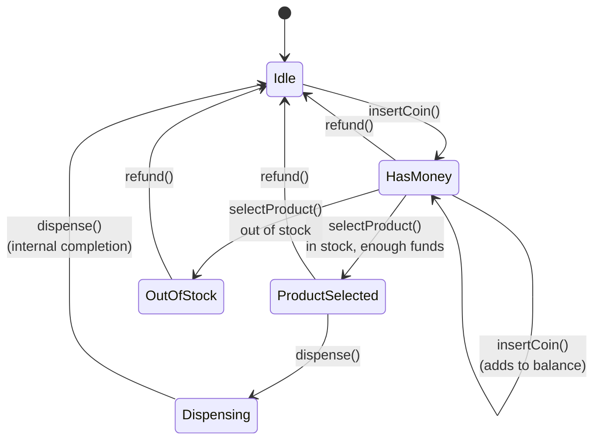
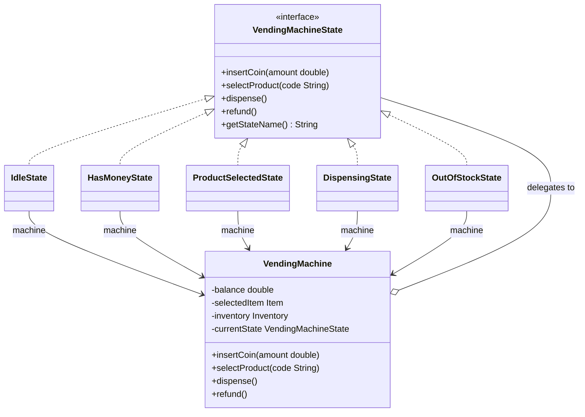
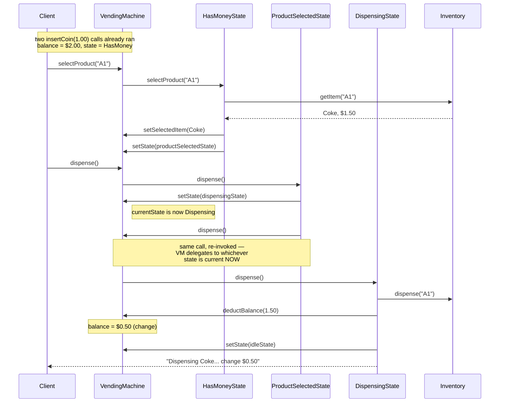

# Vending Machine — State Pattern Deep Dive
## Intuition

> **One-line analogy**: Vending Machine design is the canonical State pattern demonstration — the same physical button does completely different things depending on whether you've inserted money yet.

**Mental model**: A vending machine has a small, well-defined set of states (Idle → HasMoney → ProductSelected → Dispensing → OutOfStock) and every user action (insertCoin, selectProduct, dispense, refund) has a different meaning in each state. Without State pattern, you get a tangled mass of `if/else` and `switch` inside each method. With it, each state object handles events independently — and the machine's behavior is immediately clear from the state transition diagram.

**Why it matters**: Vending Machine is often the first State pattern example in interviews because the states are intuitive and the transitions are crisp. Mastering it builds the mental model for applying State pattern to less obvious domains (network connections, order workflows, game entities).

**Key insight**: The `VendingMachine` class itself should be thin — just a `currentState` field and delegating every action to `currentState.handleAction()`. All logic lives in the state objects. If you find yourself adding `if (state == X)` inside the machine class, you've missed the pattern.

**Full runnable implementation:** [`VendingMachine.java`](VendingMachine.java) — 420 lines, one file, `main()` at the bottom. It demonstrates five state classes behind `VendingMachineState` with `Inventory` holding stock and change — including the `OUT_OF_STOCK` dead end and the uncalled restock path this page names as its own gap.

---

## Problem Statement

Design a Vending Machine system that:
- Accepts coins/money from users
- Allows product selection from a menu
- Dispenses the selected product and returns change
- Handles out-of-stock scenarios gracefully
- Supports refund at any stage

This problem is the **canonical State pattern example** — the same button press (e.g., "dispense") behaves completely differently depending on the machine's current state.

---

## State Transition Diagram



Five states, one thin context: every action's meaning depends entirely on `currentState` — `insertCoin()` only advances `Idle`, `refund()` fires from `HasMoney`, `ProductSelected`, or `OutOfStock` and always lands back on `Idle`, and `Dispensing` rejects every external action until its own internal `dispense()` completes — the full action matrix is in the Valid and Invalid Transitions table below.

---

## Class Diagram



All five concrete states realize `VendingMachineState` and hold a back-reference to their `VendingMachine` context; the context itself holds only a single `currentState` pointer, so reassigning that one field — not a growing `if/else` — is the entire transition. The five state instances are created once in the constructor and reused for the life of the machine (Flyweight; see the Patterns Used table below).

One field in that diagram is a deliberate demo shortcut, and you should be the one to point it out: `balance` is a `double`. Binary floating point cannot represent 0.10 or 0.25 exactly, so a run of coin insertions accumulates drift and an `==` comparison against a price eventually fails. Real money is `BigDecimal` or a `long` count of cents. The same shortcut is in `ATM.java` and `OnlineBookingSystem.java` — it keeps the listings short, and naming it is a cheap point in an interview.

---

## Why State Pattern?

### Without State Pattern (anti-pattern):
```java
public void selectProduct(String code) {
    if (currentState == IDLE) {
        System.out.println("Insert coins first");
    } else if (currentState == HAS_MONEY) {
        if (!inventory.isAvailable(code)) {
            currentState = OUT_OF_STOCK;
        } else if (balance >= items.get(code).getPrice()) {
            selectedItem = items.get(code);
            currentState = PRODUCT_SELECTED;
        } else {
            // insufficient balance
        }
    } else if (currentState == PRODUCT_SELECTED) {
        System.out.println("Already selected");
    } else if (currentState == DISPENSING) {
        System.out.println("Please wait");
    } // ... and so on for refund(), insertCoin(), dispense()
}
```
Each method becomes an explosion of if-else. Adding a new state (e.g., `MAINTENANCE`) requires touching every method.

### With State Pattern:
Each state class handles its own behavior. Adding `MaintenanceState` means creating one new class — no existing classes change (Open/Closed Principle).

---

## Patterns Used

| Pattern | Where | Why |
|---------|-------|-----|
| **State** | All 5 states | Each state encapsulates behavior for that state |
| **Flyweight** | State objects | The five state instances are created once in the `VendingMachine` constructor and reused for the life of the machine — no allocation per transition |

Singleton is **not** used here, and deliberately: `VendingMachine` has an ordinary public constructor taking an `Inventory`, so a test (or a bank of machines in one process) can hold several independent machines. "One machine per physical unit" is a fact about the hardware, not a reason to make the class globally unique. Compare `ParkingLot`, where the Singleton earns its place because every entry and exit must funnel through one coordinator.

---

## Valid and Invalid Transitions

| Current State | Action | Result |
|---------------|--------|--------|
| IDLE | insertCoin | → HAS_MONEY |
| IDLE | selectProduct | Error: "Insert coins first" |
| IDLE | dispense | Error: "No product selected" |
| IDLE | refund | Error: "No money to refund" |
| HAS_MONEY | insertCoin | Adds to balance, stays HAS_MONEY |
| HAS_MONEY | selectProduct (in stock, enough) | → PRODUCT_SELECTED |
| HAS_MONEY | selectProduct (out of stock) | → OUT_OF_STOCK |
| HAS_MONEY | selectProduct (insufficient funds) | Error, stays HAS_MONEY |
| HAS_MONEY | refund | Returns balance, → IDLE |
| PRODUCT_SELECTED | insertCoin | Error: "Already selected" |
| PRODUCT_SELECTED | dispense | → DISPENSING → IDLE |
| PRODUCT_SELECTED | refund | Returns balance, → IDLE |
| DISPENSING | any | Error: "Please wait" |
| DISPENSING | (internal dispense()) | Dispenses, → IDLE |
| OUT_OF_STOCK | refund | Returns balance, → IDLE |

---

## Runtime Collaboration: A Normal Purchase Walkthrough

The class diagram above shows structure; this sequence shows the one behavior that trips people up in the Sample Output demo below — `ProductSelectedState.dispense()` does not dispense anything itself, it re-invokes `machine.dispense()` after switching the state, so the freshly-installed `DispensingState` ends up doing the real work.



This double-dispatch is the entire point of `VendingMachine.dispense()` always reading `currentState` fresh: the second `dispense()` call is textually identical to the first, but because `setState(dispensingState)` already ran, it now resolves to `DispensingState.dispense()` instead of looping back into `ProductSelectedState` — exactly the thin-context, no-`if/else` design the Key insight in the Intuition section promises.

---

## Interview Questions with Answers

**Q: Why store state objects as fields on VendingMachine?**
**Short:** the five state instances are stateless, so sharing them (Flyweight) avoids per-transition allocation.

State objects are stateless — they only have a reference back to the machine context. Sharing them (Flyweight) avoids creating new objects on every transition.

**Q: Why not use an enum for states?**
**Short:** enums can't hold behavior, which forces giant switch statements back into the machine class.

Enums can't hold behavior elegantly. Each state would need giant switch statements in the machine class. State objects cleanly encapsulate state-specific logic.

**Q: Where is the balance validation?**
**Short:** inside `HasMoneyState.selectProduct()`, the one state that actually has balance context.

In `HasMoneyState.selectProduct()` — the state that has context about balance. This is "Tell Don't Ask" — the state knows what it can do.

**Q: `Inventory.restock()` exists but nothing calls it — what's missing to actually return a machine to service?**
**Short:** a `VendingMachine.restock(code, qty)` entry point that also transitions OUT_OF_STOCK back to IDLE.

`Inventory.restock(code, quantity)` is fully implemented at the inventory layer, but `OutOfStockState` exposes no method that reaches it, so today the machine has no way to recover once it enters `OUT_OF_STOCK` other than a technician bypassing the state machine entirely. The fix named in Follow-Up Extensions is a `VendingMachine.restock(code, qty)` method that both calls `inventory.restock()` and explicitly transitions `OUT_OF_STOCK -> IDLE` — mirroring `ATMContext.refillCash()`, which is deliberately kept off the customer-facing `ATMStateHandler` interface for the same reason: restocking is a technician action, not a state-internal one. Until that method exists, an out-of-stock machine is a dead end reachable only by refunding and physically restocking outside the code path.

**Q: `ProductSelectedState.dispense()` doesn't dispense anything itself — what's actually happening in that call?**
**Short:** it switches the state to Dispensing, then re-invokes `machine.dispense()`, which now resolves differently.

`ProductSelectedState.dispense()` calls `machine.setState(dispensingState)` and then calls `machine.dispense()` again — the exact same method name, called a second time in the same logical operation. Because `VendingMachine.dispense()` always delegates to whichever `currentState` is installed *right now*, and the state was just swapped to `DispensingState` a line earlier, the second call resolves to `DispensingState.dispense()` instead of looping back into `ProductSelectedState`. This double-dispatch is exactly what keeps `VendingMachine` free of `if/else` — the context never asks "which state am I in," it just always calls the current handler and trusts that a state transition already happened before the call that needs the new behavior.

**Q: `VendingMachine.balance` is a `double` — what breaks, and what's the fix?**
**Short:** binary floating point can't represent values like 0.10 exactly, so repeated coin inserts drift.

Binary floating point cannot represent decimal fractions like 0.10 or 0.25 exactly, so a sequence of coin insertions (`balance += 0.25` repeated many times) accumulates rounding error, and an `==` comparison of `balance` against a product's price can eventually fail even when the "real" amounts match. The fix is `BigDecimal` for all monetary fields, or representing balance as a `long` count of cents and avoiding floating point entirely. This is a deliberate demo shortcut the page names explicitly — the same shortcut appears in `ATM.java` and `OnlineBookingSystem.java`, and naming it unprompted is a cheap, easy point to score in an interview.

**Q: Why is `VendingMachine` NOT a Singleton, unlike `ParkingLot`?**
**Short:** many independent physical machines can coexist in one process; "one lot" doesn't hold for vending.

`VendingMachine` has an ordinary public constructor taking an `Inventory`, so a test — or a bank of machines running in one process — can hold several independent instances simultaneously. "One machine per physical unit" is a fact about the hardware, not a reason to make the class itself globally unique in software; a vending operator's back-office system plausibly manages dozens of machine objects at once. `ParkingLot`'s Singleton earns its place for the opposite reason: every entry and exit in one physical lot must funnel through one coordinating instance to keep ticket counters and spot state consistent, and there's exactly one lot per `ParkingLotSystem` instance by definition. Reaching for Singleton by pattern-matching on "there's one of these in real life" without checking whether the *software* needs global uniqueness is the trap this comparison is meant to catch.

**Q: What happens if `insertCoin()` is called while the machine is in `DISPENSING`?**
**Short:** `DispensingState` rejects every external action with "Please wait" until dispensing finishes internally.

Per the Valid and Invalid Transitions table, `DISPENSING` rejects any external action — `insertCoin`, `selectProduct`, `refund` all print "Please wait" and do nothing, because the only legitimate call during this state is the internal, self-triggered `dispense()` that completes the transaction and transitions to `IDLE`. This matters because a real vending machine is physically dispensing a product during this window — accepting more coins or a refund request mid-mechanism would corrupt either the balance or the physical dispensing sequence. The State pattern makes this trivial to enforce: `DispensingState` simply doesn't implement any behavior for those calls beyond a rejection message, with zero risk of a stray `if` statement in `HasMoneyState` accidentally allowing it.

**Q: Why is Flyweight applied to the state objects specifically, and not to something else in this design?**
**Short:** the five states are stateless singletons reused across every transition and every machine instance's lifetime.

Flyweight applies when many logical "occurrences" of an object can share one physical instance because they carry no per-occurrence data — exactly the case here, since a `HasMoneyState` object holds no fields of its own, only a reference back to its owning `VendingMachine` context. All five state instances are created once in the constructor and reused for the entire life of the machine, so transitioning states is a pointer reassignment (`currentState = productSelectedState`), never an allocation. This is distinct from `Inventory` or `Item`, which genuinely hold per-machine, per-product data (stock counts, prices) and therefore cannot be shared — Flyweight only pays off for the state objects because, unlike inventory, their behavior depends entirely on the machine passed into each method call, not on any field of their own.

**Q: How would you add a `MaintenanceState` without changing any of the five existing state classes?**
**Short:** create one new class implementing `VendingMachineState`; existing states and the context stay untouched.

Because every state implements the same `VendingMachineState` interface and `VendingMachine` only ever calls `currentState.someAction(...)`, adding a sixth state means writing one new `MaintenanceState` class that implements the interface — rejecting `insertCoin`/`selectProduct`/`dispense` and defining whatever exit condition returns the machine to `IdleState`. No existing class needs a new `if (state == MAINTENANCE)` branch, because none of them know or care how many other states exist; they only know their own transition rules. This is the Open/Closed Principle the "Why State Pattern?" section demonstrates directly — the anti-pattern version (a giant `if/else` in `selectProduct()`) would require editing every single method to add the same state, which is exactly the maintenance cost State pattern eliminates.

**Q: How would you add a `CreditCardState` for card-based payment, and what must it satisfy?**
**Short:** it must implement `VendingMachineState` fully, including how "balance" behaves for a card instead of cash.

A `CreditCardState` needs to implement all five `VendingMachineState` methods, but its semantics for `insertCoin` don't map cleanly — a card doesn't "insert coins," so either the interface needs an `insertCard(cardInfo)` method added (which then means every existing state also needs a no-op or rejection implementation of it), or card entry is modeled as a separate flow that transitions directly into a card-specific analogue of `HasMoneyState` once authorization succeeds. The cleaner path is usually the latter: authorize the card externally, then represent "authorized card, awaiting product selection" as its own state that mirrors `HasMoneyState`'s balance-check logic but against an authorized limit instead of a coin-accumulated balance. Either way, the interface-based contract means the *existing* five states never need to change — only the interface itself grows, or a new state slots in beside the existing ones.

**Q: Why does `refund()` work from three different states (`HAS_MONEY`, `PRODUCT_SELECTED`, `OUT_OF_STOCK`) but `insertCoin()` only works from two?**
**Short:** refund is legal wherever money is held and no purchase is committed; insertCoin only makes sense pre-selection.

Refund's precondition is simply "there's a nonzero balance to return," which is true in `HAS_MONEY` (money inserted, nothing selected yet), `PRODUCT_SELECTED` (money inserted and a product chosen, but not yet dispensed), and `OUT_OF_STOCK` (money inserted, but the choice turned out to be unavailable) — in all three, the transaction hasn't been committed, so unwinding it is safe. `insertCoin()`, by contrast, only makes sense in `IDLE` (starting a fresh transaction) and `HAS_MONEY` (adding to an existing balance); once a product is `PRODUCT_SELECTED`, accepting more coins mid-selection would need to re-validate the balance against the chosen item's price, which the design deliberately avoids by rejecting it outright ("Already selected"). The asymmetry isn't arbitrary — it follows directly from which states represent an uncommitted transaction versus one already narrowing toward a specific purchase.

**Q: How does this state machine map to distributed order-processing workflows at HLD scale?**
**Short:** IDLE→HAS_MONEY→PRODUCT_SELECTED→DISPENSING mirrors CART→CHECKOUT→PAYMENT_PENDING→FULFILLING.

The vending machine's linear progression through well-defined states, where each state permits a different set of operations and rejects everything else, is structurally identical to an e-commerce order lifecycle: `CART` accepts item changes the way `IDLE`/`HAS_MONEY` accepts coins, `CHECKOUT`/`PAYMENT_PENDING` locks in a specific purchase the way `PRODUCT_SELECTED` locks in an item choice, and `FULFILLING`/`COMPLETED` is the distributed analogue of `DISPENSING`/back-to-`IDLE`. The key structural property that carries over is that invalid transitions must be rejected explicitly rather than silently allowed — you can't ship an order that's still in `CART`, just as you can't `dispense()` from `IDLE`. What changes at scale is where that state lives: a single JVM's `currentState` field becomes a persisted row in a shared store so any service instance can pick up an in-flight order after a crash, which is exactly the "State persistence" HLD connection this page draws out.

**Q: How does the "select product, check stock, dispense" sequence map to distributed locking at HLD scale?**
**Short:** the sequence must be atomic; at scale that needs a distributed lock (Redis SETNX) or optimistic locking to prevent overselling.

Within one machine and one process, `HasMoneyState.selectProduct()` checking stock and committing to a product is safe because nothing else touches that machine's `Inventory` concurrently. In a distributed vending network — or any distributed workflow selling from a shared, finite inventory pool — the same "check stock, then reserve" sequence becomes a check-then-act race the moment two requests can run concurrently against the same inventory record, exactly the double-booking race `OnlineBookingSystem.md` walks through for concurrent seat selection. The fix at scale is the same family of solutions: a distributed lock (Redis `SETNX` with a TTL) that serializes access to one inventory slot, or optimistic locking with a version column that lets both requests proceed and rejects whichever commits second.

**Q: Why does the demo's log print "act, then transition" (e.g., `[IDLE] Coin inserted` before `[STATE] IDLE -> HAS_MONEY`), and why does that ordering matter?**
**Short:** each state performs its action and prints its own line, and only afterward reassigns `currentState`.

`IdleState.insertCoin()` runs its own logic first — updating the balance and printing its confirmation line — and only as its last step calls `machine.setState(hasMoneyState)`, so the log line for the action always appears before the log line for the transition that follows it. This ordering isn't cosmetic: it reflects that the *current* state is still the one executing the method body right up until it explicitly hands off, so any side effect the old state performs (its own print statement, its own validation) genuinely happens under the old state's authority, not the new one's. Getting this backwards — transitioning first, then trying to act — would mean the action either runs under the wrong state's rules or requires the new state to somehow know what the previous caller intended, which defeats the point of each state owning its own behavior.

---

## Cross-Perspective: HLD Connections

**HLD View — Where Vending Machine Design Scales to Distributed Systems**

- **State machine → distributed workflow** — The vending machine state machine (IDLE → HAS_MONEY → PRODUCT_SELECTED → DISPENSING) maps to distributed order processing workflows: CART → CHECKOUT → PAYMENT_PENDING → FULFILLING → COMPLETED. Each state allows different operations; invalid transitions are rejected.
- **State persistence → distributed state store** — In a single JVM, state is in memory. In a distributed vending machine network (or any distributed workflow), state must be persisted in a shared store (Redis, DynamoDB) so any node can pick up where another left off after a crash.
- **Saga pattern for state transitions** — Multi-step vending transactions (reserve inventory → charge payment → dispense product) require compensating transactions if any step fails. The Saga pattern applies the same state machine logic across distributed service boundaries.
- **Inventory consistency → distributed locking** — The "select product → check stock → reserve → dispense" sequence must be atomic. At HLD scale, this requires a distributed lock (Redis SETNX) or an optimistic locking pattern to prevent overselling.

---

## Follow-Up Extensions

1. **Payment methods**: Add `CreditCardState` — card inserted triggers a different payment flow
2. **Multiple product slots**: Inventory supports multiple slots per item
3. **Restocking interface**: Admin can trigger restock from `OutOfStockState`. Half of this already exists — `Inventory.restock(code, quantity)` is implemented but nothing calls it, and `OutOfStockState` exposes no entry point, so today the machine cannot return to service on its own. The missing piece is a `VendingMachine.restock(code, qty)` that also transitions `OUT_OF_STOCK -> IDLE`, mirroring `ATMContext.refillCash()`
4. **Product expiry**: Items with expiry date; machine won't dispense expired items
5. **Receipt printing**: Decorator on `DispensingState` to print receipt
6. **Network-connected machine**: Remote monitoring of stock levels via Observer
7. **Discount codes**: Strategy pattern for pricing (regular, discount, loyalty)

---

## Sample Output

```
═══════════════════════════════════════
  VENDING MACHINE DEMO
═══════════════════════════════════════
  ┌─────────────────────────────────┐
  │         AVAILABLE ITEMS         │
  ├─────────────────────────────────┤
  │ [A1] Coke         $1.50 (qty=2) │
  │ [B1] Chips        $1.00 (qty=1) │
  │ [C1] Water        $0.75 (qty=3) │
  │ [D1] Candy        $0.50 (OUT)   │
  └─────────────────────────────────┘

--- Scenario 1: Normal Purchase ---
  [IDLE] Coin inserted: $1.00. Total balance: $1.00
  [STATE] IDLE → HAS_MONEY
  [HAS_MONEY] Added $1.00. Total balance: $2.00
  [HAS_MONEY] Selected: Coke
  [STATE] HAS_MONEY → PRODUCT_SELECTED
  [STATE] PRODUCT_SELECTED → DISPENSING
  [DISPENSING] >>> Dispensing: Coke <<<
  [DISPENSING] Returning change: $0.50
  [STATE] DISPENSING → IDLE
  [DISPENSING] Thank you! Enjoy your Coke!
  [Machine] State: IDLE                 Balance: $0.00

--- Scenario 4: Out of Stock ---
  [IDLE] Coin inserted: $1.00. Total balance: $1.00
  [STATE] IDLE → HAS_MONEY
  [HAS_MONEY] Item 'D1' is out of stock.
  [STATE] HAS_MONEY → OUT_OF_STOCK
  [OUT_OF_STOCK] Refunded $1.00
  [STATE] OUT_OF_STOCK → IDLE
```

Note the ordering in Scenario 1: the *first* coin is handled by `IdleState.insertCoin()`, which prints its own line and only then flips the state, so `[IDLE] Coin inserted` precedes `[STATE] IDLE → HAS_MONEY`. The second coin is handled by `HasMoneyState`, which prints `Added`. The same "act, then transition" order explains why `[HAS_MONEY] Selected: Coke` appears before `[STATE] HAS_MONEY → PRODUCT_SELECTED`.
