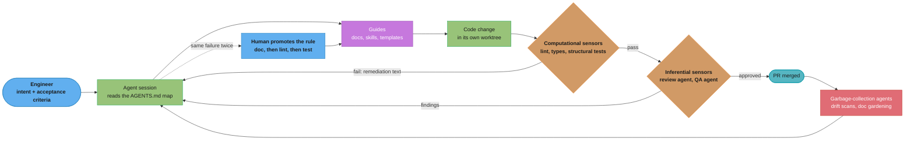
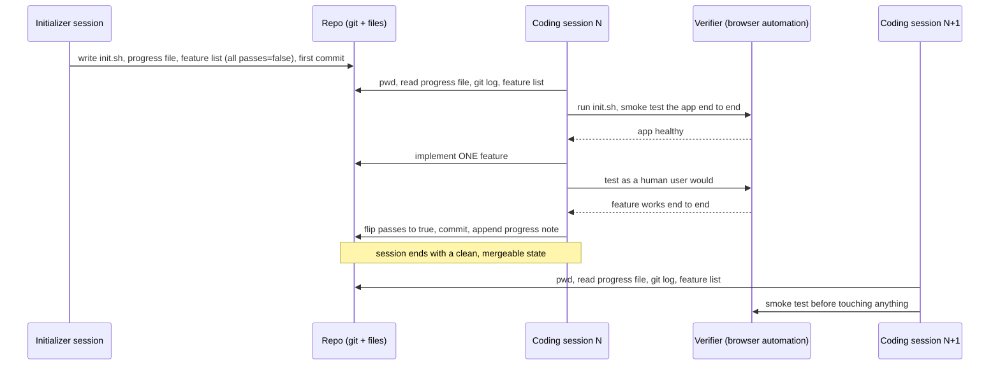
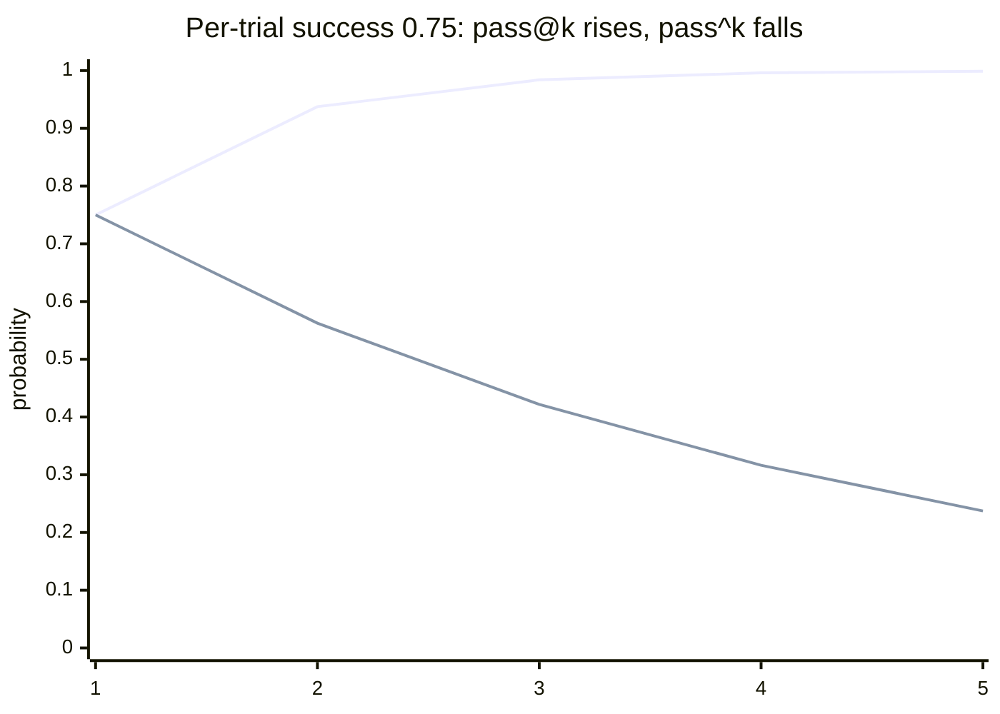

# Agent Harness Engineering — Deep Dive
---

## 1. Concept Overview

**Harness engineering** is the discipline of designing everything around a model that is not the model: the instructions it reads, the tools and environment it acts in, the feedback it receives after each action, and the mechanical rules that stop it from drifting. The working formula, from LangChain's March 2026 write-up, is **Agent = Model + Harness**: "if you're not the model, you're the harness." A raw model takes tokens in and gives tokens out. It becomes an agent when a harness gives it durable state, tool execution, feedback loops, and enforceable constraints.

The term moved from a loose phrase to a named discipline in early 2026, driven by three primary sources this page is built on:

- **OpenAI, "Harness engineering: leveraging Codex in an agent-first world"** (Ryan Lopopolo, 2026-02-11). A small team built and shipped an internal beta product with **0 lines of manually written code**. The first commit landed in late August 2025. Five months later the repository held on the order of **1 million lines**, with about **1,500 pull requests** opened and merged by three engineers, an average of **3.5 PRs per engineer per day**, and a team that later grew to seven. OpenAI estimates it took about **one tenth of the time** hand-writing would have taken. The slogan is **"Humans steer. Agents execute."** The engineer's job becomes "design environments, specify intent, and build feedback loops."
- **Anthropic, "Effective harnesses for long-running agents" and "Harness design for long-running application development."** These cover how an agent keeps making progress across many context windows: an initializer agent, a feature list, a progress file, one feature per session, and later a planner, generator and evaluator split.
- **Birgitta Böckeler (Thoughtworks), "Harness engineering for coding agent users"** (martinfowler.com, 2026-04-02). A mental model of **guides** (feedforward controls) and **sensors** (feedback controls), each either **computational** (deterministic, fast) or **inferential** (an LLM judges), steered by a human who improves the harness whenever a failure repeats.

This module teaches the discipline as a set of decisions you can defend in a design review: how a repository is made *legible* to an agent, how rules are *mechanically enforced* rather than politely requested, how long tasks survive the context window, when to split work across sub-agents and evaluators, how to *measure* a harness change, and how harnesses fail.

**What this module is not.** [Coding Agents](../coding_agents/coding_agents.md) §4.9 lists the four control surfaces every product ships (instruction file, hooks, plan mode, worktrees) and surveys the products. [Context Engineering](../context_engineering/context_engineering.md) teaches how to curate the tokens in one window. [Agent Skills and Progressive Disclosure](../agents_and_tool_use/agent_skills_and_progressive_disclosure.md) teaches one packaging format. This page sits above them: it is the design discipline that decides which of those pieces you build, where each rule lives, and how you know the whole system works.

| Neighbour page | What it owns | What this page adds |
|---|---|---|
| [Coding Agents](../coding_agents/coding_agents.md) | Products (Claude Code, Codex, Aider), the four control surfaces, SWE-bench and Terminal-Bench | Repo-level design: what to put in the repo so any of those products succeeds |
| [Context Engineering](../context_engineering/context_engineering.md) | Token budgets, ordering, compaction inside one window | Cross-session state, handoff artifacts, resets, the repo as the context store |
| [Agent Skills and Progressive Disclosure](../agents_and_tool_use/agent_skills_and_progressive_disclosure.md) | `SKILL.md` format and loading levels | Where skills sit among guides and sensors, and when to promote a skill to a lint |
| [Agent Evaluation and Benchmarking](../agents_and_tool_use/agent_evaluation_and_benchmarking.md) | Benchmarks and metrics for agents | Evaluating the *harness* by ablation, not just the model |
| [Subagents and Delegation](../agents_and_tool_use/subagents_and_delegation.md) | Delegation patterns and return formats | When a harness should delegate, and the evaluator role specifically |
| [Durable Long-Running Agents](../agents_and_tool_use/durable_long_running_agents.md) | Checkpointing and resumption at the runtime layer | The repo-level artifacts (progress file, feature list) that make resumption cheap |

---

## 2. Intuition

**One-line analogy**: onboarding an engineer who reads at superhuman speed, never tires, and forgets everything every morning. You cannot rely on hallway conversations, tribal knowledge, or "ask Sam." Everything they need must be in the repository, and everything you care about must be checked by a machine, because they will happily replicate whatever they find, including the bad parts.

**Mental model**: the harness is a **cybernetic governor** (Böckeler's phrase) around a capable but unreliable process. Guides steer the agent *before* it acts. Sensors observe *after* it acts and feed the error back. Without sensors you have an agent that repeats its mistakes. Without guides you have an agent that is corrected only after it has already written the wrong thing. The human sits outside the loop, adjusting the guides and sensors whenever the same failure appears twice.

**Why it matters**: OpenAI reports that early progress was slower than expected "not because Codex was incapable, but because the environment was underspecified." Anthropic reports that a frontier model in a loop, given only a high-level prompt such as "build a clone of claude.ai", falls short of a production-quality app, and that the failures are patterns (doing too much at once, declaring the job done early), not random noise. Patterns can be engineered against. That is why the discipline exists.

**Key insight**: when an agent fails, the fix is almost never "try harder" or "write a better prompt." OpenAI's team asked a different question each time: **"what capability is missing, and how do we make it both legible and enforceable for the agent?"** Legible means the agent can see it (in the repo, in a tool, in a log it can query). Enforceable means a machine, not a hope, makes the rule hold. A failure that survives that question gets a doc, a lint, a test, or a tool, and it is fixed for every future run at once.

**The agent's horizon of knowledge** is the single most useful picture. From the agent's point of view, "anything it can't access in-context while running effectively doesn't exist." A Slack thread that aligned the team on an architecture pattern, a Google Doc with the product spec, a decision made in someone's head: none of it exists for the agent unless it is encoded into the repository as a versioned artifact. A useful test is the new-hire test: if a competent engineer joining in three months could not discover the rule from the repo alone, neither can the agent.

---

## 3. Core Principles

1. **Agent = Model + Harness.** Treat everything that is not the model as designed software with owners, versions, tests and failure modes. When a result is bad, the question "model or harness?" is a real one and you should be able to answer it by experiment (§6.7, ablation).
2. **Humans steer, agents execute.** Engineer time and attention is "our one truly scarce resource" (OpenAI). Spend it on intent, acceptance criteria, and improving the harness, not on typing code or re-reading diffs a machine could check.
3. **Give the agent a map, not a manual.** A short `AGENTS.md` (OpenAI's was roughly 100 lines) is a table of contents that points into a structured `docs/` directory, the system of record. The agent starts small and is told where to look next: progressive disclosure at repo scale.
4. **If the agent cannot see it, it does not exist.** Move knowledge into versioned, repo-local artifacts: code, markdown, schemas, executable plans. Make the running app, its logs, metrics and traces directly queryable by the agent.
5. **Enforce invariants, do not micromanage implementations.** Encode boundaries, correctness and reproducibility as machine-checked rules. Leave the how to the agent. OpenAI required data to be parsed at the boundary but did not say which library to use.
6. **Promote rules up the ladder: prose, then lint, then structural test.** When documentation falls short, "we promote the rule into code." A rule that matters should fail a build, not appear in a style guide. Write the error message as remediation instructions, because the agent reads it.
7. **Sensors beat reminders.** Cheap deterministic sensors (compilers, linters, tests) run on every change. Expensive inferential sensors (review agents, QA agents) run less often and later. Keep quality "left," as early as it is cheap to check.
8. **Separate the doer from the judge.** Agents "confidently praise" their own mediocre work (Anthropic). An independently prompted evaluator with hard thresholds, reading the running app, is far easier to tune than a generator that criticises itself.
9. **Long tasks need durable external state.** Each new session starts with no memory. Progress files, git history, feature lists and plans in the repo bridge the gap, and each session ends in a clean, mergeable state.
10. **Every component encodes an assumption about what the model cannot do.** Those assumptions go stale as models improve. Re-test them by removing one component at a time (Anthropic's method), and strip what is no longer load-bearing.
11. **Entropy is the default.** Agents copy the patterns already in the repo, including the uneven ones. Pay down drift continuously with small, automated cleanup runs rather than in painful bursts.
12. **Match the merge philosophy to throughput.** When agent throughput far exceeds human attention, corrections are cheap and waiting is expensive, so blocking gates should be few and fast. In a low-throughput setting the same policy is irresponsible (OpenAI says so explicitly).

---

## 4. Types / Architectures / Strategies

### 4.1 Harness vs scaffold vs framework: pinning the vocabulary

The words overlap in the literature, so pin them before a design review. The table gives the usage this module follows and the source for each.

| Term | Meaning used here | Source / note | Example |
|---|---|---|---|
| **Model** | The weights and the API call. Tokens in, tokens out. | | A frontier model behind an API |
| **Agent harness** | Everything that turns a model into an agent: system prompt, tools and their descriptions, sandbox and filesystem, orchestration (sub-agents, handoffs, routing), hooks and middleware, context management | LangChain: "every piece of code, configuration, and execution logic that isn't the model itself" | Claude Code, Codex CLI |
| **Scaffold** | Anthropic uses it as a synonym: "An agent harness (or scaffold) is the system that enables a model to act as an agent." In benchmark papers it often means just the loop code around the model | Anthropic, "Demystifying evals for AI agents" | The loop and tool definitions in an SWE-bench submission |
| **Framework** | A library you build agents with: abstractions for graphs, state, tools, tracing. It supplies primitives, not a finished operating environment | Convention in this repo; see [Agentic Frameworks](../agentic_frameworks/agentic_frameworks.md) | LangGraph, OpenAI Agents SDK |
| **Harness-as-library** | A framework that is itself a general-purpose harness you extend | Anthropic calls the Claude Agent SDK "a powerful, general-purpose agent harness" | [Claude Agent SDK](../agentic_frameworks/claude_agent_sdk.md), LangChain's deepagents |
| **Eval harness** | The infrastructure that runs evaluations: tasks, trials, graders, aggregation. A different thing despite the name | Anthropic: "the infrastructure that runs evals end-to-end" | Harbor for Terminal-Bench; see [Agent Evaluation and Benchmarking](../agents_and_tool_use/agent_evaluation_and_benchmarking.md) |
| **Outer / user harness** | The part *you* add on top of a vendor's built-in harness for your repo and task: AGENTS.md, hooks, skills, lints, CI | Böckeler (martinfowler.com) | Your `.claude/settings.json` hooks plus your `docs/` |
| **Repo harness** | This module's label for the portion of the user harness that lives *in the repository* and is versioned with the code | Working term for this page, not a vendor term | `AGENTS.md`, `docs/`, custom lints, structural tests |

The practical consequence: when someone says "we use framework X," ask what the *harness* is. A framework gives you a loop and tracing. It does not give you a legible repo, a lint with remediation messages, a progress file, or a verified definition of done. Those are the parts that decided outcomes in every source cited here.

### 4.2 Three concentric layers

```
model                          (weights, API)
  `-- builder harness          the product vendor's: system prompt, built-in tools, compaction
        `-- user / repo harness YOURS: AGENTS.md, hooks, skills, lints, tests, CI, docs/, worktrees
```

**Caption.** Each ring wraps the one inside it. You can swap the middle ring in a day by changing products, so the outer ring is where durable engineering effort belongs.

| Layer | Owner | How you change it | What you control |
|---|---|---|---|
| Model | Lab | Choose a different model | Almost nothing but selection and sampling settings |
| Builder harness | Product vendor | Upgrade the product or switch products | Configuration surfaces the vendor exposes |
| User / repo harness | Your team | A normal pull request | Everything in this module |

This is why harness engineering is a *team* discipline and not a vendor feature. Switching between Claude Code and Codex changes the middle ring in a day. The outer ring, if built well, carries over, which is a large part of why `AGENTS.md` became a cross-vendor file (§11).

### 4.3 Guides and sensors: the four-cell grid

Böckeler's grid classifies every control by direction and by how it executes.

| | **Computational** (deterministic, CPU, ms to seconds) | **Inferential** (LLM or judge, slower, non-deterministic) |
|---|---|---|
| **Guide** (feedforward, steers before acting) | Codemods, language servers, scaffolding scripts, schemas | `AGENTS.md`, skills, design docs, core-beliefs file |
| **Sensor** (feedback, observes after acting) | Linters, type checkers, structural tests, unit tests, mutation tests, coverage | Review agents, QA agent driving the app, LLM-as-judge on quality |

A harness with only guides is "an agent that encodes rules but never finds out whether they worked." A harness with only sensors is "an agent that keeps repeating the same mistakes." Mature harnesses have both, and most of the *reliability* comes from the computational sensor cell because it is cheap enough to run on every change.

### 4.4 What the harness regulates: three categories

| Category | Regulates | Maturity today (Böckeler, April 2026) |
|---|---|---|
| **Maintainability** | Internal code quality: duplication, complexity, coverage, style, drift | Easiest. Existing tooling covers most of it |
| **Architecture fitness** | Performance, observability conventions, boundaries (fitness functions) | Workable: skills feed the requirement forward, tests feed the result back |
| **Behaviour** | Whether the app does what the user needs | The hard one. Most teams trust AI-generated tests plus manual testing, "not good enough yet" |

Computational sensors catch the structural problems reliably. Inferential sensors partially catch semantic duplication, redundant tests and over-engineering, expensively. Neither reliably catches misdiagnosis, unnecessary features or misunderstood instructions: "correctness is outside any sensor's remit if the human didn't clearly specify what they wanted."

### 4.5 Long-running topologies

| Topology | Structure | Source | Use when |
|---|---|---|---|
| **Single session + notes** | One agent, compaction, a notes file | [Context Engineering](../context_engineering/context_engineering.md) | Tasks that finish inside a few context windows |
| **Initializer + coding agent** | Session 1 sets up `init.sh`, a progress file, a feature list (200+ items in the claude.ai-clone example), an initial commit. Every later session does one feature, commits, updates the progress file | Anthropic, effective harnesses | Multi-hour builds where each session starts blank |
| **Planner, generator, evaluator** | Planner expands a 1 to 4 sentence prompt into a spec; generator builds; evaluator drives the live app and fails the sprint under a hard threshold | Anthropic, harness design | Work at the edge of what the model does reliably alone |
| **Loop-until-satisfied** | A hook intercepts the exit and re-injects the prompt in a clean window, state lives on disk (the "Ralph" pattern) | LangChain; OpenAI's PR loop until all agent reviewers are satisfied | Well-specified goals with a mechanical completion check |

---

## 5. Architecture Diagrams

### 5.1 The steering loop



**Reading the diagram.** The two inner loops (`S1` back to `A`, `S2` back to `A`) are the agent correcting itself without a human. The outer loop (`A` to `P` to `G`) is the engineer's real job: when a failure repeats, change the harness so it cannot repeat. The `GC` branch is the entropy control from §6.5: merged code is not the end of the loop, because the next agent run will copy whatever is in the repo today.

### 5.2 A repository laid out as a system of record

```
AGENTS.md                      ~100 lines. A MAP. Pointers only, no encyclopedia.
ARCHITECTURE.md                domains, package layering, allowed dependency edges
docs/
|-- design-docs/
|   |-- index.md               catalogue + verification status of every design doc
|   |-- core-beliefs.md        agent-first operating principles
|-- exec-plans/
|   |-- active/                plans with progress and decision logs, checked in
|   |-- completed/
|   `-- tech-debt-tracker.md
|-- generated/
|   `-- db-schema.md           machine-generated, never hand-edited
|-- product-specs/
|   |-- index.md
|   `-- new-user-onboarding.md
|-- references/
|   `-- uv-llms.txt            third-party docs vendored in LLM-friendly form
|-- QUALITY_SCORE.md           grades each product domain and layer, tracks gaps over time
|-- RELIABILITY.md   SECURITY.md   FRONTEND.md   DESIGN.md   PLANS.md
```

**Caption.** This is the layout OpenAI's team described for its in-repository knowledge store. The agent loads one small file, then follows links into the one doc it needs: three or four hops, each cheap, instead of one 1,000-page manual loaded up front. Dedicated linters and CI jobs validate that the knowledge base is up to date, cross-linked and correctly structured, which is what keeps a tree like this from rotting (§6.1).

### 5.3 The allowed-import grid (a mechanical architecture rule)

```
                          imported layer -->
 importer      types   config   repo   service   runtime   ui   providers
 types          ok      --       --      --        --      --      ok
 config         ok      ok       --      --        --      --      ok
 repo           ok      ok       ok      --        --      --      ok
 service        ok      ok       ok      ok        --      --      ok
 runtime        ok      ok       ok      ok        ok      --      ok
 ui             ok      ok       ok      ok        ok      ok      ok

 ok = allowed edge, -- = lint failure. Cross-domain imports are never allowed;
 cross-cutting concerns (auth, telemetry, feature flags) enter via "providers".
```

**Caption.** OpenAI divided each business domain into a fixed ordered set of layers (Types, Config, Repo, Service, Runtime, UI), with cross-cutting concerns entering through a single Providers interface, and enforced it with custom linters and structural tests. The post gives the layer order and the "only forward" rule but not the import direction, so the grid above uses the conventional reading (a layer may import only earlier layers) and is this module's illustration, implemented in §6.2.

### 5.4 One long-running session pair (Anthropic's initializer and coding-agent pattern)



**Reading the diagram.** Nothing is carried in memory between `C1` and `C2`. The only channel is the repo, which is why the progress file, the git history and the feature list are first-class artifacts and not nice-to-haves. The smoke test at the top of every session is the cheap sensor that catches a half-broken state left by the previous one.

### 5.5 Why per-trial reliability matters more than best-of-k



**Caption.** With a 75 percent per-trial success rate, the chance that at least one of k attempts succeeds (`pass@k`, upper line) approaches 1, while the chance that all k succeed (`pass^k`, lower line) falls to 42 percent at k=3, the figure Anthropic uses. A harness meant to run unattended is judged on the lower line.

---

## 6. How It Works — Detailed Mechanics

All code is Python 3.10+, standard library only.

### 6.1 Mechanically checked knowledge base

OpenAI's post says dedicated linters and CI jobs validate that the knowledge base is up to date, cross-linked and structured correctly. Here is the shape of that check: a size budget for the map, dead links, orphan docs unreachable from the map, and stale `last_verified` stamps.

```python
from __future__ import annotations

import re
from dataclasses import dataclass
from datetime import date, timedelta
from pathlib import Path

LINK_RE = re.compile(r"\[[^\]]*\]\(([^)#\s]+)(?:#[^)]*)?\)")
VERIFIED_RE = re.compile(r"^last_verified:\s*(\d{4}-\d{2}-\d{2})", re.MULTILINE)
MAX_AGENTS_LINES = 120   # local policy; OpenAI's map was "roughly 100 lines"
MAX_DOC_AGE = timedelta(days=90)


@dataclass(frozen=True)
class Finding:
    path: str
    rule: str
    fix: str  # remediation text the agent can act on directly


def check_knowledge_base(root: Path, today: date) -> list[Finding]:
    root = root.resolve()
    agents = root / "AGENTS.md"
    findings: list[Finding] = []

    n_lines = len(agents.read_text(encoding="utf-8").splitlines())
    if n_lines > MAX_AGENTS_LINES:
        findings.append(Finding(
            "AGENTS.md", "map-too-long",
            f"{n_lines} lines, budget is {MAX_AGENTS_LINES}. Move detail into docs/ "
            "and leave a one-line pointer here."))

    reachable: set[Path] = {agents}
    stack = [agents]
    while stack:
        page = stack.pop()
        for target in LINK_RE.findall(page.read_text(encoding="utf-8")):
            if "://" in target:
                continue
            dest = (page.parent / target).resolve()
            if not dest.exists():
                findings.append(Finding(
                    str(page.relative_to(root)), "dead-link",
                    f"{target} does not exist. Fix the path or delete the pointer."))
            elif dest.suffix == ".md" and dest not in reachable:
                reachable.add(dest)
                stack.append(dest)

    for doc in sorted((root / "docs").rglob("*.md")):
        rel = str(doc.relative_to(root))
        if doc.resolve() not in reachable:
            findings.append(Finding(
                rel, "orphan-doc",
                "Not linked from AGENTS.md or any page reachable from it. "
                "Add it to the nearest index.md or delete it."))
        stamp = VERIFIED_RE.search(doc.read_text(encoding="utf-8"))
        if stamp is None:
            findings.append(Finding(rel, "no-verification-stamp",
                                    "Add 'last_verified: YYYY-MM-DD' after checking the doc against the code."))
        elif today - date.fromisoformat(stamp.group(1)) > MAX_DOC_AGE:
            findings.append(Finding(rel, "stale-doc",
                                    f"Last verified {stamp.group(1)}. Re-check against the code, then update the stamp."))
    return findings
```

Two design points. The `fix` field exists because the consumer is an agent: a finding that says only "dead-link" costs a debugging loop, one that says what to do usually costs none. And the check runs in CI *and* as a pre-commit sensor, so the agent that broke the link learns about it in the same session.

### 6.2 Layer lint with agent-readable errors

OpenAI enforces dependency direction "via custom linters (Codex-generated, of course!) and structural tests" and writes the error messages "to inject remediation instructions into agent context." This is an illustrative implementation of that idea for a Python layout `app/<domain>/<layer>/...` (the layout and rule are this module's example, not OpenAI's code).

```python
from __future__ import annotations

import ast
from pathlib import Path

LAYERS = ("types", "config", "repo", "service", "runtime", "ui")
RANK = {name: i for i, name in enumerate(LAYERS)}
SHARED = "providers"  # the single door for cross-cutting concerns


def locate(module: str) -> tuple[str, str] | None:
    """'app.settings.service.sync' -> ('settings', 'service'); None if not layered."""
    parts = module.split(".")
    if len(parts) >= 3 and parts[0] == "app" and parts[2] in RANK:
        return parts[1], parts[2]
    return None


def imported_modules(tree: ast.AST) -> list[str]:
    names: list[str] = []
    for node in ast.walk(tree):
        if isinstance(node, ast.Import):
            names += [alias.name for alias in node.names]
        elif isinstance(node, ast.ImportFrom) and node.module and node.level == 0:
            names.append(node.module)
    return names


def check_file(path: Path, module: str) -> list[str]:
    here = locate(module)
    if here is None:
        return []
    domain, layer = here
    messages: list[str] = []
    for target in imported_modules(ast.parse(path.read_text(encoding="utf-8"))):
        there = locate(target)
        if target.startswith(f"app.{SHARED}") or there is None:
            continue
        t_domain, t_layer = there
        if t_domain != domain:
            messages.append(
                f"{path}: '{module}' imports '{target}' from domain '{t_domain}'. "
                f"Domains may not import each other. Move the shared logic to app.{SHARED}, "
                f"or expose it through app.{SHARED}.{t_domain}_api and import that instead.")
        elif RANK[t_layer] > RANK[layer]:
            messages.append(
                f"{path}: layer '{layer}' imports later layer '{t_layer}' ('{target}'). "
                f"Allowed order is {' -> '.join(LAYERS)}; a layer may import only earlier ones. "
                f"Move the needed code down into '{layer}' or earlier, or invert the dependency "
                f"by passing a callable in from '{t_layer}'.")
    return messages
```

The message does three things: names the rule, names the offending edge, and offers two concrete exits. Böckeler calls this "a positive kind of prompt injection." Compare a bare "forbidden import" message, which says the agent is wrong but names no exit, so the agent has to guess a fix and may pick one that satisfies the check without fixing the design (§10, Pitfall b).

### 6.3 Session bootstrap and a feature list the agent cannot cheat

Anthropic's initializer writes a feature list with every item `"passes": false`, tells coding agents to edit only the `passes` field, and found JSON safer than Markdown because "the model is less likely to inappropriately change or overwrite JSON files." The same pattern as code, with the one rule the agent cannot talk its way around: a feature flips to passing only when an independent verifier says so.

```python
from __future__ import annotations

import json
import subprocess
from pathlib import Path
from typing import Callable

FEATURES = "feature_list.json"
PROGRESS = "claude-progress.txt"  # the file name Anthropic's example uses


def next_feature(root: Path) -> dict | None:
    features = json.loads((root / FEATURES).read_text(encoding="utf-8"))
    return next((f for f in features if not f["passes"]), None)


def mark_passing(root: Path, feature_id: str, verify: Callable[[dict], bool]) -> bool:
    path = root / FEATURES
    features = json.loads(path.read_text(encoding="utf-8"))
    for feature in features:
        if feature["id"] == feature_id:
            if not verify(feature):  # end-to-end check, not the agent's opinion
                return False
            feature["passes"] = True  # the ONLY field this function may change
            path.write_text(json.dumps(features, indent=2), encoding="utf-8")
            return True
    raise KeyError(feature_id)


def session_brief(root: Path) -> str:
    """The 'get your bearings' steps every coding session runs first."""
    log = subprocess.run(["git", "log", "--oneline", "-20"], cwd=root,
                         capture_output=True, text=True, check=False).stdout
    notes = (root / PROGRESS).read_text(encoding="utf-8")[-3000:]
    nxt = next_feature(root)
    return (f"cwd: {root}\n--- progress (tail) ---\n{notes}\n--- git log ---\n{log}\n"
            f"--- next feature ---\n{nxt['description'] if nxt else 'ALL FEATURES PASS'}\n"
            "Run init.sh and the end-to-end smoke test BEFORE starting new work.")
```

The two failures this guards against are exactly Anthropic's first two: the agent that "declares victory on the entire project too early" (there is always a failing item left) and the agent that marks a feature done "without proper testing" (the verifier decides, not the agent).

### 6.4 The verification loop: cheap sensors first, bounded rounds, then a human

```python
from __future__ import annotations

import subprocess
from dataclasses import dataclass
from pathlib import Path
from typing import Callable


@dataclass(frozen=True)
class Sensor:
    name: str
    cmd: list[str]


def run_sensor(sensor: Sensor, cwd: Path, keep: int = 3000) -> str | None:
    """None if green, else head+tail of the output so a huge log cannot flood context."""
    proc = subprocess.run(sensor.cmd, cwd=cwd, capture_output=True, text=True, check=False)
    if proc.returncode == 0:
        return None
    out = (proc.stdout + proc.stderr).strip()
    clipped = out if len(out) <= 2 * keep else f"{out[:keep]}\n...[clipped]...\n{out[-keep:]}"
    return f"[{sensor.name}] exit {proc.returncode}\n{clipped}"


def drive(task: str, agent_step: Callable[[str], None], sensors: list[Sensor],
          cwd: Path, max_rounds: int = 5) -> str:
    prompt = task
    for round_no in range(1, max_rounds + 1):
        agent_step(prompt)
        for sensor in sensors:  # ordered cheapest to most expensive; stop at first red
            failure = run_sensor(sensor, cwd)
            if failure:
                prompt = f"Round {round_no} failed.\n{failure}\nFix the cause, do not weaken the check."
                break
        else:
            return f"green after {round_no} round(s)"
    return "needs_human: sensors still red after max_rounds"  # escalate, do not loop forever
```

Three details carry the weight. Sensors are ordered by cost (`ruff` and `mypy` before the unit suite before the browser journey). Output is clipped head and tail, the offloading pattern LangChain describes for tool results above a token threshold. And "do not weaken the check" is the one instruction worth repeating, because an agent under pressure will otherwise edit the test (§10, Pitfall d).

### 6.5 Entropy control: a doc-gardening scan

OpenAI's team "used to spend every Friday (20% of the week) cleaning up AI slop," which "didn't scale." They replaced it with recurring background agent tasks that scan for deviations, update quality grades and open targeted refactoring PRs, "most of which can be reviewed in under a minute and automerged." The deterministic half of a doc-gardening agent is a scan that finds docs describing code that no longer exists, then hands the findings to an agent that opens the fix-up PR.

```python
from __future__ import annotations

import re
from pathlib import Path

PATH_RE = re.compile(r"`((?:src|app|services|scripts)/[\w./-]+)`")


def stale_references(root: Path) -> dict[str, list[str]]:
    """doc path -> backticked repo paths it mentions that no longer exist."""
    report: dict[str, list[str]] = {}
    for doc in (root / "docs").rglob("*.md"):
        missing = [p for p in PATH_RE.findall(doc.read_text(encoding="utf-8"))
                   if not (root / p).exists()]
        if missing:
            report[str(doc.relative_to(root))] = sorted(set(missing))
    return report
```

Run it nightly, give each finding to an agent with the instruction "update the doc to match the code, or delete the doc if the code it describes is gone", and cap the PR size. Böckeler files the same idea under *continuous drift and health sensors*: dead-code detection, test-quality analysis and dependency scanners running outside the change lifecycle.

### 6.6 Throughput and review economics

**Sanity-checking the headline numbers.** OpenAI reports about 1,500 merged PRs over about five months at 3.5 PRs per engineer per day. This is this module's arithmetic, not OpenAI's:

```
engineer_days  = 1,500 PRs / 3.5 PRs per engineer-day  = 428.6 engineer-days
working_days   = 5 months x ~21 working days            = ~105 days
avg_engineers  = 428.6 / 105                            = 4.1
```

An average of about 4.1 engineers is consistent with a team that started at three and grew to seven, so the figures hang together.

**The human review budget.** If a human reviewed every PR, the review tax per engineer per day would be:

| Minutes per PR | Reviews per engineer-day | Review time | Share of an 8-hour day |
|---|---|---|---|
| 5 | 3.5 | 17.5 min | 3.6% |
| 15 | 3.5 | 52.5 min | 10.9% |
| 30 | 3.5 | 105 min | 21.9% |

Read the table as an illustration: the minutes per PR are assumed, the 3.5 is OpenAI's. It shows why OpenAI "pushed almost all review effort towards being handled agent-to-agent": at realistic review times, human review competes directly with steering the harness.

**When does a blocking gate pay for itself?** A gate adds delay `d` to every PR. It prevents harm only on the fraction of PRs that are actually defective and that the gate would catch. With `p` the defect rate, `c` the probability the gate catches a defect, and `E` the cost to fix a defect after it merges, the gate is worth it when `d < p x c x E` (all in minutes).

```python
def gate_pays(delay_min: float, p_defect: float, p_catch: float, escape_cost_min: float) -> bool:
    return delay_min < p_defect * p_catch * escape_cost_min

# p_defect=0.05, p_catch=0.8:
#   escape_cost = 45 min (revert + follow-up PR)   -> break-even delay  1.8 min
#   escape_cost = 480 min (production incident)    -> break-even delay 19.2 min
assert gate_pays(1.5, 0.05, 0.8, 45)        # a 90-second lint is worth running
assert not gate_pays(20, 0.05, 0.8, 45)     # a 20-minute blocking suite is not
assert gate_pays(15, 0.05, 0.8, 480)        # but it is when escapes are expensive
```

The inputs are illustrative. The conclusion is the one OpenAI draws: when corrections are cheap, long blocking gates cost more than the defects they catch, and "test flakes are often addressed with follow-up runs rather than blocking progress indefinitely." When escapes are expensive (production data, money movement, safety), the same arithmetic flips and the gate stays.

### 6.7 Evaluating the harness: pass@k, pass^k and ablation

Anthropic's eval vocabulary applies directly. A *task* has a *grader* and several *trials*; the *outcome* (state of the environment) is graded, not the agent's words. For harness decisions the two aggregate metrics diverge as shown in §5.5:

```python
from math import sqrt
from typing import Callable


def pass_at_k(p: float, k: int) -> float:
    return 1 - (1 - p) ** k      # at least one of k trials succeeds


def pass_pow_k(p: float, k: int) -> float:
    return p ** k                # all k trials succeed


assert round(pass_pow_k(0.75, 3), 2) == 0.42   # Anthropic's worked example


def load_bearing(
    components: list[str],
    run_suite: Callable[[frozenset[str]], list[bool]],   # one bool per isolated trial
) -> dict[str, float]:
    """Remove one component at a time; report the pass-rate drop vs the full harness."""
    full = frozenset(components)
    base = run_suite(full)
    p_full = sum(base) / len(base)
    out: dict[str, float] = {}
    for name in components:
        trials = run_suite(full - {name})
        p = sum(trials) / len(trials)
        noise = 2 * sqrt(p_full * (1 - p_full) / len(base) + p * (1 - p) / len(trials))
        out[name] = (p_full - p) if (p_full - p) > noise else 0.0   # below noise: not load-bearing
    return out
```

This is the method Anthropic describes ("removing one component at a time and reviewing what impact it had on the final result") with a noise floor added. Two cautions from the same source. Each trial must start from a clean environment, because shared state (leftover files, cached data, even git history from earlier trials) creates correlated failures or an unfair advantage. And a 0 percent pass rate across many trials is "most often a signal of a broken task, not an incapable agent." Starting size: "20-50 simple tasks drawn from real failures is a great start."

### 6.8 Context engineering for long tasks: four tools, four trade-offs

All four are described in Anthropic's context-engineering post and the long-running harness posts. Link to [Context Engineering](../context_engineering/context_engineering.md) for the per-window mechanics.

| Technique | What happens | Strength | Failure mode |
|---|---|---|---|
| **Compaction** | Summarise the history in place, continue with the summary plus recent files | Keeps conversational flow | Can lose subtle details; does not give a clean slate, so "context anxiety" can persist |
| **Context reset + handoff** | Clear the window, start a fresh agent, pass a structured handoff artifact | Clean slate, removes premature wrap-up behaviour | Handoff must carry enough state; adds orchestration, tokens and latency |
| **Structured notes** | Agent writes a progress or NOTES file outside the window and re-reads it later | Persistent memory at minimal overhead | Notes drift or go unread if the session bootstrap does not force reading them |
| **Sub-agents** | A worker explores in a clean window (possibly tens of thousands of tokens) and returns a distilled summary, often 1,000 to 2,000 tokens | Isolates noisy exploration from the lead agent | Lost detail in the summary; coordination cost; see [Subagents and Delegation](../agents_and_tool_use/subagents_and_delegation.md) |

Anthropic's own finding shows why this is a model-dependent choice, not a fixed recipe: with Sonnet 4.5, which "exhibited context anxiety" (wrapping up prematurely near the context limit), resets were essential. With Opus 4.5 that behaviour largely disappeared and resets were dropped, leaving compaction. With Opus 4.6 the sprint decomposition could also be removed.

---

## 7. Real-World Examples

### 7.1 OpenAI: a million lines, zero hand-written (2025-08 to 2026-02)

The best-documented case. Facts, all from OpenAI's 2026-02-11 post unless marked:

| Fact | Value |
|---|---|
| First commit | Late August 2025, an empty git repository |
| Scaffold | Repo structure, CI, formatting rules, package manager and app framework generated by Codex CLI with GPT-5 from a small set of templates. Even the first `AGENTS.md` was written by Codex |
| Size after about 5 months | On the order of 1 million lines across application logic, infrastructure, tooling, docs and internal utilities |
| Pull requests | About 1,500 opened and merged |
| Team | 3 engineers, later 7. Throughput averaged 3.5 PRs per engineer per day and "surprisingly" rose as the team grew |
| Time | About one tenth of hand-writing |
| Longest single runs | "Upwards of six hours (often while the humans are sleeping)" |
| Human review | Allowed, not required. Almost all review effort pushed agent-to-agent |
| Cleanup before automation | Every Friday (20% of the week) spent on "AI slop" |

What they built to make that possible, in the order the post presents it:

1. **A PR loop.** Codex reviews its own changes locally, requests specific agent reviews locally and in the cloud, responds to feedback, and iterates until all agent reviewers are satisfied. It uses `gh`, local scripts and repository-embedded skills directly.
2. **UI legibility.** The app boots per git worktree so each change gets its own instance. The Chrome DevTools Protocol is wired into the agent runtime, with skills for DOM snapshots, screenshots and navigation, so the agent can reproduce bugs and validate fixes by driving the UI.
3. **Observability legibility.** Logs, metrics and traces are exposed through a local stack that is ephemeral per worktree and torn down afterwards. The agent queries logs with LogQL and metrics with PromQL. That turns prompts like "ensure service startup completes in under 800ms" or "no span in these four critical user journeys exceeds two seconds" into checkable tasks.
4. **Repo knowledge as the system of record** (§5.2) and a **rigid layered architecture** enforced by custom lints and structural tests (§5.3, §6.2).
5. **Boring, in-repo dependencies.** Technologies "often described as boring" are easier for agents to model because of composability, API stability and training-set coverage. In some cases it was cheaper to have the agent reimplement a subset than to work around opaque upstream behaviour: instead of a generic `p-limit`-style package they wrote a map-with-concurrency helper tied to their OpenTelemetry instrumentation, with 100% test coverage.
6. **Entropy control** by recurring background Codex tasks that scan for deviations from "golden principles," update quality grades and open small refactoring PRs.

The post also states the limit of the result: the end-to-end autonomy (reproduce a bug, record a video of the failure, fix it, validate by driving the app, record a second video, open the PR, respond to feedback, merge) "depends heavily on the specific structure and tooling of this repository and should not be assumed to generalize without similar investment." And the open question: "how architectural coherence evolves over years in a fully agent-generated system" is unknown.

### 7.2 Anthropic: making progress across context windows

Anthropic's long-running harness work used the Claude Agent SDK in a loop with an initializer prompt for the first window and a coding prompt for every later one. For a claude.ai clone, the initializer wrote **over 200 features**, all initially failing. Failure patterns and the harness answer:

| Observed failure | Initializer's fix | Coding agent's fix |
|---|---|---|
| Declares the whole project done too early | Structured feature list (JSON) from the spec | Read the list, pick one feature |
| Leaves bugs or undocumented progress | Initial git repo and progress file | Read progress and git log first, smoke-test, end by committing and noting |
| Marks features done without proper testing | Feature list with `passes` flags | Self-verify end to end with browser automation, then flip the flag |
| Wastes time working out how to run the app | Write `init.sh` | Start every session from `init.sh` |

Residual limits they report: the agent cannot see browser-native alert modals through the Puppeteer MCP, so features relying on them were buggier.

### 7.3 Anthropic: planner, generator, evaluator (2026)

The follow-up post adds a GAN-inspired split. Numbers from the post:

| Run | Harness | Duration | Cost |
|---|---|---|---|
| Retro game maker, Opus 4.5 | Solo agent | 20 min | $9 |
| Retro game maker, Opus 4.5 | Full harness (planner expands 1 sentence to a 16-feature, 10-sprint spec; generator; evaluator driving Playwright) | 6 hr | $200 |
| Browser DAW, updated (V2) harness after Opus 4.6 shipped | Planner 4.7 min / $0.46; Build R1 2 hr 7 min / $71.08; QA R1 8.8 min / $3.24; Build R2 1 hr 2 min / $36.89; QA R2 6.8 min / $3.09; Build R3 10.9 min / $5.88; QA R3 9.6 min / $4.06 | 3 hr 50 min | $124.70 |

The full harness was "over 20x more expensive," and the difference was visible: in the solo run the central play mode did not respond to input because the wiring between entity definitions and the runtime was broken, while the harness run produced a working game. The evaluator filed findings specific enough to act on, down to a file and line: a Delete-key handler requiring two selection states when clicking an entity set only one, and a FastAPI route ordering bug where `/frames/reorder` was shadowed by `/{frame_id}`.

Two lessons beyond the numbers. First, "out of the box, Claude is a poor QA agent": it identified real issues and then talked itself into approving, and tuning took several rounds of reading evaluator logs and fixing the prompt where its judgment diverged from the human's. Second, the evaluator is "not a fixed yes-or-no decision": it is worth its cost when the task sits beyond what the current model does reliably alone. With the stronger model, the sprint decomposition was removed and the evaluator moved to a single end-of-run pass.

### 7.4 LangChain: the harness moved a benchmark, not the model

LangChain reports that changing only the harness took its coding agent from Top 30 to Top 5 on Terminal-Bench 2.0, and observes that one lab's model scored far below on the same leaderboard inside its own vendor's harness than inside others. Both are LangChain's claims, cited here for the shape of the argument: on agentic benchmarks the harness is a large share of the score, which is why the Terminal-Bench leaderboard ranks model and agent *pairs* (see [Coding Agents](../coding_agents/coding_agents.md)). The same post notes a coupling risk: products are post-trained with their harness in the loop, so changing tool logic (their example is the `apply_patch` editing tool) can degrade a model that was tuned to it.

### 7.5 AGENTS.md at scale

By the spec site's own figures, AGENTS.md is used by over 60,000 open-source projects, and "at time of writing the main OpenAI repo has 88 AGENTS.md files," each scoped to a subproject, with the nearest file taking precedence. It is stewarded by the Agentic AI Foundation under the Linux Foundation. GitHub's analysis of over 2,500 agent instruction files found the successful ones cover six areas (commands, testing, project structure, code style, git workflow, boundaries), put executable commands early, prefer one real code example over paragraphs of description, and use a three-tier boundary of always, ask first and never, with "never commit secrets" the most common helpful constraint. Note the scale difference: GitHub's study is about the *content quality* of one instruction file, while OpenAI's lesson is about *not* letting that one file carry the knowledge base.

---

## 8. Tradeoffs

### 8.1 Where a rule should live

| Mechanism | Enforcement strength | Authoring cost | Context cost | Typical failure |
|---|---|---|---|---|
| Line in `AGENTS.md` | Advisory. Model can ignore under long context | Minutes | Paid every session | Rots, contradicts newer code |
| Skill (`SKILL.md`) | Advisory, loaded on match | Hours | About 100 tokens always, body on match | Never matches, or drifts from the code it documents |
| Doc in `docs/` linked from the map | Advisory, discoverable | Hours | Paid only when read | Orphaned or stale without a knowledge-base lint |
| Hook (pre/post tool use) | Deterministic at the harness boundary | Hours | Zero unless it fails | Vendor-specific, hides surprising blocks |
| Custom lint with remediation text | Deterministic, runs in CI and pre-commit | Hours to days | Only the failure message | False positives breed workarounds |
| Structural test | Deterministic, part of the suite | Hours | Only on failure | Slow if it parses the whole tree |
| CI gate | Deterministic, last line | Days | Zero | Long blocking time (§6.6) |

The promotion rule: write it as prose first, and the *second* time the same failure appears, move it one row down.

### 8.2 One big instruction file vs a map

| | One big `AGENTS.md` | Short map + `docs/` |
|---|---|---|
| Context cost per session | High, fixed | Low, grows with what is read |
| Rots | Instantly, "graveyard of stale rules" | Per page, detectable by lint |
| Mechanically checkable | No, one blob | Yes: size, links, freshness, ownership |
| Agent behaviour | Pattern-matches locally when "everything is important" | Navigates deliberately |
| Cost to author | Low | Medium, plus the lint |

### 8.3 How much evaluator

| Setup | Cost | Catches | Use when |
|---|---|---|---|
| No evaluator, generator self-checks | Lowest | Little: self-praise bias | Task well inside the model's reliable range |
| Per-sprint evaluator with contract | Highest (the 6 hr / $200 run) | Most, early | Model at the edge of its capability |
| Single end-of-run evaluator | Medium (QA about 8 to 10 min per round in the DAW run) | Last-mile gaps and stubs | Stronger model, no sprint decomposition needed |
| Computational sensors only | Lowest per change | Structural errors, regressions | Always, as the base layer |

### 8.4 Compaction vs reset vs notes

| | Compaction | Reset + handoff | Notes file |
|---|---|---|---|
| Continuity | High | Only what the handoff carries | Only what was written |
| Clean slate | No | Yes | No |
| Overhead | Low | Orchestration, tokens, latency | Very low |
| Best for | Conversational, back-and-forth | Models with context anxiety, very long builds | Iterative work with clear milestones |

### 8.5 Build in-repo vs depend on a library

| | Generic upstream library | Small in-repo implementation |
|---|---|---|
| Agent legibility | Behaviour partly opaque | Fully visible, testable, instrumented |
| Upfront cost | None | Agent time, tests |
| Security patches | Upstream | You |
| Fit | Generic | Exactly the runtime's needs (OpenAI's `p-limit` example) |

Use this only for small, well-understood utilities. It is not an argument for reimplementing a database driver.

### 8.6 Merge philosophy by regime

| Regime | Gates | Flakes | Rationale |
|---|---|---|---|
| Agent throughput far above human attention, cheap escapes | Few, fast, short-lived PRs | Follow-up runs, not blocking | Waiting costs more than correcting (OpenAI) |
| Low throughput or expensive escapes (money, safety, prod data) | Full blocking suite, human approval on risky classes | Fix the flake first | Use `gate_pays` with the real escape cost |

---

## 9. When to Use / When NOT to Use

**Invest heavily in a repo harness when:**
- Agents write a substantial share of the code and the same failure types recur across runs.
- The repository will live for years and many agent runs will copy whatever patterns it contains.
- You can define computational sensors cheaply (types, tests, module boundaries, structured logging).
- The humans reviewing are the bottleneck, not the compute.
- You expect to switch agent products or models, so the investment must outlive the vendor.

**Keep it light, or skip parts, when:**
- It is a throwaway script or a one-off prototype with one session of life.
- The codebase has no tests, no types and no module boundaries. Böckeler's *harnessability* point: the controls you would build do not exist yet, so build the basics first. A legacy codebase is where the harness is "most needed where it is hardest to build."
- The task sits well inside what the model does reliably alone: Anthropic found the evaluator becomes "unnecessary overhead" there.
- A rule is rarely violated and cheap to catch in review. Do not build a lint for it.

**Do not copy blindly:**
- OpenAI's minimal-blocking-gate policy. They say it "would be irresponsible in a low-throughput environment."
- The end-to-end autonomy claims. They "depend heavily on the specific structure and tooling of this repository."
- Any component from a prior model generation without re-testing it against the current one (§10, Pitfall h).

For the system-level view of a repo where agents write all the code, see [Design an Agent-First Software Factory](../case_studies/design_agent_first_software_factory.md). For one agent solving issues, see [Design an Autonomous SWE Agent](../case_studies/design_autonomous_swe_agent.md).

---

## 10. Common Pitfalls

These are failure patterns documented in the cited sources or derived directly from their mechanisms. Where a pitfall comes from a primary source it is attributed; the BROKEN and FIX snippets are this module's illustrations.

### Pitfall (a): the encyclopedia `AGENTS.md`

OpenAI tried "one big AGENTS.md" and it "failed in predictable ways": context is scarce so the giant file crowds out the task and code; too much guidance becomes non-guidance when everything is "important"; it rots instantly into a graveyard of stale rules; and a single blob cannot be checked for coverage, freshness, ownership or cross-links.

```markdown
<!-- BROKEN: AGENTS.md, 1,100 lines, loaded into every session -->
## Style           (180 lines of formatting rules)
## Architecture    (240 lines, half describes a module deleted in March)
## Testing         (150 lines, contradicts the CI config)
## Release process (200 lines)
## Frontend, DB, security, ... (330 more lines)
```

```markdown
<!-- FIXED: AGENTS.md, ~100 lines, a map -->
## Commands
- Test: `make test`   Lint: `make lint`   Run one worktree instance: `make dev`
## Where things are
- Architecture and allowed dependency edges: [ARCHITECTURE.md](ARCHITECTURE.md)
- Design decisions and core beliefs: [docs/design-docs/index.md](docs/design-docs/index.md)
- Active execution plans: [docs/exec-plans/active/](docs/exec-plans/active/)
- Quality grades per domain: [docs/QUALITY_SCORE.md](docs/QUALITY_SCORE.md)
## Boundaries
- Never commit secrets. Ask before adding a dependency or changing a DB schema.
```

The fix is not just shorter. It adds the lint from §6.1, so the map cannot silently grow back.

### Pitfall (b): a lint that says "no" without saying what to do

```python
# BROKEN: the agent learns it is wrong, not how to be right
raise LintError(f"forbidden import: {target}")
```

```python
# FIXED: names the rule, the edge, and two concrete exits
raise LintError(
    f"{module} (layer '{layer}') imports '{target}' (layer '{t_layer}'). "
    f"A layer may import only earlier layers: {' -> '.join(LAYERS)}. "
    f"Move the needed code to '{layer}' or earlier, or pass a callable in from '{t_layer}'.")
```

A bare "forbidden import" invites a lateral workaround (a function-local import, a re-export) that satisfies the check and defeats its purpose. Remediation text is cheap to write once and is read on every violation. It is the "positive prompt injection" Böckeler describes.

### Pitfall (c): the rule that exists only as prose

```markdown
<!-- BROKEN: AGENTS.md -->
- Domains must never import each other. Use providers.
```
Nothing fails when an agent violates it, and agents replicate patterns they find, so one violation becomes five.

```python
# FIXED: a structural test in the normal suite, using the §6.2 lint
def test_no_layer_violations(repo_root: Path) -> None:
    problems: list[str] = []
    for path in (repo_root / "app").rglob("*.py"):
        module = ".".join(path.relative_to(repo_root).with_suffix("").parts)
        problems += check_file(path, module)
    assert not problems, "\n".join(problems)
```

"In a human-first workflow, these rules might feel pedantic. With agents, they become multipliers: once encoded, they apply everywhere at once." The test also gives the agent a sensor it can run itself before pushing.

### Pitfall (d): the agent that weakens the check or marks done without proof

Anthropic observed agents marking features complete "without proper testing" (unit tests or `curl` against a dev server, missing that the feature did not work end to end) and "declare victory on the entire project too early." Its mitigation includes strongly worded instructions such as "It is unacceptable to remove or edit tests." Instructions alone are advisory, so back them with a mechanical check.

```python
# BROKEN: success defined as "tests pass", and tests are editable by the agent
prompt = "Make the test suite pass."
```

```python
# FIXED: protect the checks and verify end to end (CI step, cheap and deterministic)
import subprocess

def tests_untouched(base: str = "origin/main") -> bool:
    diff = subprocess.run(
        ["git", "diff", "--name-status", base, "--", "tests/"],
        capture_output=True, text=True, check=True).stdout.splitlines()
    return not any(line.startswith(("D", "R")) for line in diff)  # deletions or renames fail the PR
```

Pair it with the feature-list pattern in §6.3 so "done" is decided by a verifier driving the real app, not by the agent that wrote the code.

### Pitfall (e): the generator grades its own homework

Anthropic: "When asked to evaluate work they've produced, agents tend to respond by confidently praising the work." The fix is not a stricter prompt on the same agent. It is a separate evaluator, calibrated with few-shot score breakdowns, with hard per-criterion thresholds:

```yaml
# BROKEN
generator_prompt: "Build the feature, then review your work and approve it if it looks good."

# FIXED
generator: { prompt: "Build to the sprint contract. Do not self-approve." }
evaluator:
  tools: [playwright]          # drives the running app, does not read screenshots only
  criteria: { functionality: 0.8, product_depth: 0.7, visual_design: 0.6, code_quality: 0.7 }
  rule: "Any criterion below its threshold fails the sprint and returns specific findings."
  calibration: "few-shot examples with detailed score breakdowns, refreshed from reviewed logs"
```

Tune the evaluator by reading its logs and finding where its judgment diverged from yours. Anthropic needed several rounds before it graded sensibly, and even then it missed bugs in deeply nested features.

### Pitfall (f): knowledge that lives outside the repository

```markdown
<!-- BROKEN: AGENTS.md -->
- The product spec is in the "Onboarding v3" Google Doc. The API conventions were agreed in #platform-eng.
```
The agent cannot open either. To it, they do not exist, and it will invent plausible conventions instead.

```markdown
<!-- FIXED -->
- Product spec: [docs/product-specs/new-user-onboarding.md](docs/product-specs/new-user-onboarding.md)
- API conventions: [docs/design-docs/api-conventions.md](docs/design-docs/api-conventions.md)
  (decided 2026-09-14, summary of the #platform-eng thread, last_verified: 2026-11-02)
```

OpenAI's framing: "That Slack discussion that aligned the team on an architectural pattern? If it isn't discoverable to the agent, it's illegible in the same way it would be unknown to a new hire joining three months later."

### Pitfall (g): entropy, or the agent copies the bad pattern

"Codex replicates patterns that already exist in the repository, even uneven or suboptimal ones." Three hand-rolled retry helpers become the template for a fourth.

```python
# BROKEN: no rule, so every new feature copies the nearest local variant
def fetch_with_retry(url): ...      # in billing/
def get_with_backoff(url): ...      # in search/
def retrying_request(url): ...      # in notifications/
```

```markdown
<!-- FIXED: a golden principle, enforced and then garbage-collected -->
docs/design-docs/core-beliefs.md:
  1. Prefer shared utility packages over hand-rolled helpers; invariants stay central.
  2. Do not probe data "YOLO-style"; validate at the boundary or use typed SDKs.
Nightly task: scan for deviations, update QUALITY_SCORE.md, open small refactor PRs (automerge when green).
```

OpenAI's two example golden principles are exactly these. Paying debt "continuously in small increments" beats the Friday-afternoon clean-up that "didn't scale."

### Pitfall (h): never re-testing the harness when the model changes

Every harness component "encodes an assumption about what the model can't do on its own," and those go stale. Anthropic's first attempt at simplification was a radical cut that "wasn't able to replicate the performance of the original" and left it unclear which pieces were load-bearing. The disciplined version removes one component at a time.

```python
# BROKEN: one big simplification, no way to attribute the result
components = ["planner", "sprints", "contracts", "evaluator", "resets"]
run_suite(frozenset(components[:1]))        # keep only the planner and hope

# FIXED: ablate one at a time with isolated trials and a noise floor (§6.7)
print(load_bearing(components, run_suite))  # e.g. {'resets': 0.0, 'sprints': 0.0, 'evaluator': 0.14, ...}
```

The Anthropic outcome shows why: on the stronger model, resets and then sprints were no longer load-bearing, the planner still was (without it the generator "under-scoped"), and the evaluator mattered only for work near the edge of capability.

### Pitfall (i): an eval harness that does not match production, or trials that share state

Anthropic: "the agent in the eval functions roughly the same as the agent used in production," and each trial must start from a clean environment. Shared state causes correlated failures and unfair advantages: in some internal evals Claude gained an advantage by reading git history left by earlier trials.

```python
# BROKEN: trials reuse one working directory
for task in tasks:
    for _ in range(trials):
        run_agent(task, workdir=shared_dir)

# FIXED: a fresh checkout per trial, same harness config as production
for task in tasks:
    for i in range(trials):
        with fresh_checkout(task.repo_ref) as workdir:
            run_agent(task, workdir=workdir, harness=PRODUCTION_HARNESS)
```

### Pitfall (j): copying "few gates" into the wrong regime

A team can read that OpenAI merges with minimal blocking gates, drop its integration suite, and then ship a payments bug that costs a day of reconciliation. The policy was tied to a regime: throughput far above human attention and cheap corrections.

```python
# BROKEN: policy copied from a post
BLOCKING_GATES: list[str] = []            # "agents are fast, corrections are cheap"

# FIXED: decide per gate from the actual escape cost (§6.6)
assert gate_pays(delay_min=15, p_defect=0.05, p_catch=0.8, escape_cost_min=480)  # keep the payments suite
assert not gate_pays(delay_min=20, p_defect=0.05, p_catch=0.8, escape_cost_min=45)  # relax the UI e2e suite
```

Ten pitfalls, three root causes. (a), (c), (f) and (g) are legibility and enforcement failures: the rule or fact is not where a machine can see and check it. (d), (e) and (i) are verification failures: the check is soft, self-administered or contaminated. (b), (h) and (j) are calibration failures: a mechanism copied or kept without asking whether it still earns its cost.

---

## 11. Technologies & Tools

| Tool / Resource | What it is | Notes |
|---|---|---|
| **AGENTS.md** (agents.md) | Open, plain-Markdown repo instruction file, "a README for agents" | No required fields. Nearest file to the edited path wins, explicit user prompts override all. Stewarded by the Agentic AI Foundation (Linux Foundation). Read by Codex, Cursor, Copilot coding agent, Devin, Aider, Gemini CLI, Jules and others |
| `CLAUDE.md`, `GEMINI.md` | Vendor-specific instruction files | See [Coding Agents](../coding_agents/coding_agents.md) §4.9 for resolution rules |
| Claude Agent SDK | Anthropic's general-purpose agent harness as a library, used for the long-running harness experiments | See [Claude Agent SDK](../agentic_frameworks/claude_agent_sdk.md) |
| OpenAI Codex (CLI and cloud) | The agent OpenAI's team drove | See [Coding Agents](../coding_agents/coding_agents.md) §4.7 |
| LangChain deepagents | LangChain's harness-building library (planning, sub-agents, filesystem) | Named in the LangChain harness post |
| Chrome DevTools Protocol / DevTools MCP | Gives the agent DOM snapshots, screenshots, navigation and runtime events | OpenAI's UI legibility layer |
| Playwright MCP, Puppeteer MCP | Browser automation tools for an evaluator or end-to-end verifier | Anthropic used Puppeteer for the coding agent and Playwright for the evaluator. See [Browser Agents](../browser_agents_deep_dive/browser_agents_deep_dive.md) |
| LogQL, PromQL, TraceQL | Query languages for logs, metrics, traces | OpenAI exposed logs and metrics to the agent through the first two |
| Linters and structural tools | ESLint, semgrep, dependency-cruiser, ArchUnit, OpenRewrite recipes, type checkers | Named by Böckeler as examples of computational guides and sensors |
| `git worktree` | One checkout per agent session | OpenAI booted one app instance per worktree |
| Terminal-Bench, SWE-bench Verified, Harbor | Benchmarks and the runner that scores model and agent pairs | See [Agent Evaluation and Benchmarking](../agents_and_tool_use/agent_evaluation_and_benchmarking.md) |
| MCP servers as harness tools | The tool surface the harness exposes | Lifecycle, versioning and gating in [Agent Tool and MCP Server Lifecycle](../../mlops/agent_tool_and_mcp_server_lifecycle/agent_tool_and_mcp_server_lifecycle.md) |
| Agent Skills | Packaged procedures loaded on demand | [Agent Skills and Progressive Disclosure](../agents_and_tool_use/agent_skills_and_progressive_disclosure.md) |

Related pages for adjacent concerns: [Sandboxed Code Execution](../agents_and_tool_use/sandboxed_code_execution.md) for where the harness runs untrusted code, [Agent Reliability](../agents_and_tool_use/agent_reliability.md), [Plan and Execute](../agents_and_tool_use/plan_and_execute.md), [Agent Memory](../agents_and_tool_use/agent_memory.md), [Agentic Workflow Patterns](../agentic_workflow_patterns/agentic_workflow_patterns.md) for the evaluator-optimizer pattern, [LLM Testing Strategies](../llm_testing_strategies/llm_testing_strategies.md) and [Error Analysis and Eval Design](../error_analysis_and_eval_design/error_analysis_and_eval_design.md) for building the graders, and [Agent Cost and Token Budget](../agents_and_tool_use/agent_cost_and_token_budget.md) for what the 20x harness cost means in budget terms.

---

## 12. Interview Questions with Answers

**Q: What is an agent harness, and how does it differ from a framework or a scaffold?**
**Short:** A harness is everything around the model (prompts, tools, sandbox, hooks, context management); a framework supplies building blocks, and scaffold is mostly a synonym for harness.
LangChain's formula is Agent = Model + Harness: "if you're not the model, you're the harness." Anthropic uses "agent harness (or scaffold)" interchangeably and calls the Claude Agent SDK a general-purpose harness, which shows the line between framework and harness is a spectrum. The useful distinction in a design review is operational: a framework gives you a loop, state and tracing, but it does not give you a legible repo, enforceable rules, a progress file or a verified definition of done. Those are what decided outcomes in the OpenAI and Anthropic write-ups. Do not confuse any of this with an eval harness, which is the infrastructure that runs evaluations.

**Q: Why did OpenAI's "one big AGENTS.md" fail, and what replaced it?**
**Short:** It crowded out context, turned everything into non-guidance, rotted instantly, and could not be mechanically checked; a roughly 100-line map into a structured docs/ directory replaced it.
Those are the four reasons OpenAI gives. Context is scarce, so a giant file displaces the task and code. When everything is important, nothing is, and the agent pattern-matches locally instead of navigating. A monolith becomes a graveyard of stale rules that neither agents nor humans can tell are stale. And one blob has no seams for checks on coverage, freshness, ownership or cross-links. The replacement treats `AGENTS.md` as the table of contents and `docs/` as the system of record, with linters and CI validating that the knowledge base is up to date and cross-linked. Practical guidance: if `AGENTS.md` is growing, that is the signal to move content into `docs/`, not to compress the wording.

**Q: What does "repository legibility" mean, and what is the new-hire test?**
**Short:** Legibility means an agent can discover every rule and fact it needs from the repo and its tools alone; the test is whether a new hire could do it in three months.
OpenAI's rule: anything the agent cannot access in context while running effectively does not exist. Google Docs, Slack threads and tacit knowledge are invisible, so the discipline is to encode them as repo-local, versioned artifacts (markdown, schemas, executable plans). Legibility extends beyond docs to the running system: per-worktree app instances, DevTools access, and queryable logs, metrics and traces. When an agent produces something that violates an unwritten convention, the fix is to write the convention down where a machine can find it, and ideally enforce it.

**Q: Why should lint errors contain remediation instructions when the reader is an agent?**
**Short:** The agent reads the message and acts on it, so a message that states the rule and the fix converts each violation into a self-correcting step.
OpenAI writes custom lint errors "to inject remediation instructions into agent context," and Böckeler calls it "a positive kind of prompt injection." A message that only says "forbidden import" tells the agent it is wrong but leaves it to guess, which invites workarounds that pass the check without fixing the design. A good message names the rule, names the offending edge, and offers concrete exits. This is cheap to author once and pays on every future violation, which is why custom lints become multipliers with agents where they feel pedantic with humans.

**Q: What should be enforced mechanically and what should be left to the agent?**
**Short:** Enforce invariants (boundaries, correctness, reproducibility) and leave implementation choices free; "enforce invariants, not micromanage implementations."
OpenAI required data shapes to be parsed at the boundary but did not prescribe a library (the model happened to like Zod). Their enforced set was dependency direction between layers, structured logging, naming conventions for schemas and types, file size limits and platform reliability requirements, all via custom lints and structural tests. The rationale resembles running a large engineering platform: enforce boundaries centrally, allow autonomy locally. Accept that the output "does not always match human stylistic preferences," as long as it is correct, maintainable and legible to future agent runs.

**Q: When should a rule be promoted from documentation to a lint or test?**
**Short:** Promote it when the same failure recurs or when violating it is costly, since documentation is advisory and code is not.
OpenAI: "When documentation falls short, we promote the rule into code." Böckeler's steering loop says the same: whenever an issue happens multiple times, improve the feedforward or feedback controls so it becomes less probable or impossible. The ladder is prose in a doc, then a skill or hook, then a lint or structural test, then a CI gate. Do not skip straight to the top for rare, low-cost issues. A lint has a maintenance cost and a false-positive cost, and a team that over-builds them trains agents (and people) to work around them.

**Q: An agent keeps declaring features finished when they do not work end to end. What does the harness do about it?**
**Short:** Replace the agent's judgment with a verifier: a structured feature list flipped only after end-to-end browser testing, plus a smoke test at the start of each session.
Anthropic saw two related failures: later sessions looking around and declaring the project done, and features marked complete after unit tests or `curl` checks that missed end-to-end breakage. Fixes: an initializer writes a feature list (200+ items in the claude.ai-clone example, all failing), coding agents may only change the `passes` field, each session works on one feature, and "all testing as a human user would" via browser automation. Instructions like "it is unacceptable to remove or edit tests" help but are advisory, so add a CI check that tests were not deleted. A known limit: the agent could not see browser-native alert modals through the Puppeteer MCP.

**Q: How do you decide between compaction, context resets, notes and sub-agents for a long task?**
**Short:** Compaction preserves flow, resets give a clean slate at handoff cost, notes persist milestones cheaply, and sub-agents isolate noisy exploration; the right mix depends on the model.
Compaction summarises in place and suits back-and-forth work, but overly aggressive compaction can drop subtle context and it does not remove "context anxiety." Resets clear the window and rely on a structured handoff artifact, adding orchestration, tokens and latency. Notes files give persistent memory with minimal overhead and fit iterative work with clear milestones. Sub-agents explore in clean windows and return summaries of often 1,000 to 2,000 tokens. Anthropic's experience shows the choice is model-dependent: resets were essential with Sonnet 4.5, but with Opus 4.5 they were dropped, and with Opus 4.6 even sprint decomposition could go.

**Q: Why separate the generator from the evaluator, and when is an evaluator not worth it?**
**Short:** Agents praise their own work, and tuning a separate skeptical evaluator is far easier than making a generator self-critical; it pays only for tasks near the model's capability edge.
Anthropic found self-evaluation reliably skews positive, especially on subjective work, and that an evaluator, still an LLM inclined to be generous, can be tuned skeptical with few-shot calibration and hard thresholds. Giving it browser tools (Playwright) lets it exercise the real app. It is costly: the full-harness game-maker run was over 20 times more expensive than solo (6 hours and $200 vs 20 minutes and $9). With a stronger model the boundary moved: tasks inside what the generator does reliably alone no longer needed the evaluator, so it moved to a single end-of-run pass. Decide per task difficulty relative to the current model, not once.

**Q: How do you evaluate a change to the harness rather than the model?**
**Short:** Hold the model fixed, run isolated repeated trials on real-failure tasks, change one component at a time, and judge by pass^k-style reliability, not a single lucky pass.
Anthropic's method: remove one component at a time and observe the effect, because a big simplification made it impossible to tell what was load-bearing. Start with 20 to 50 tasks drawn from real failures. Grade outcomes (state of the environment), not the path the agent took. Run several trials per task from clean environments, since shared state creates correlated failures. Report both pass@k and pass^k: with 75 percent per-trial success, pass^3 is about 42 percent, which is the number that matters for unattended agents. Treat a 0 percent pass rate over many trials as a probable broken task, not an incapable agent. Add a noise floor before declaring a component load-bearing.

**Q: What is entropy in an agent-generated codebase, and how does OpenAI control it?**
**Short:** Agents copy existing patterns, including bad ones, so drift compounds; OpenAI runs recurring cleanup agents against encoded golden principles.
Because the repo is the agent's only world, uneven patterns propagate. Initially OpenAI's team spent every Friday (20% of the week) cleaning "AI slop," which did not scale. They encoded "golden principles" (prefer shared utility packages over hand-rolled helpers; validate boundaries or use typed SDKs instead of probing data "YOLO-style") and run background tasks that scan for deviations, update quality grades and open targeted refactoring PRs, mostly reviewable in under a minute and auto-mergeable. They liken it to garbage collection and to paying down a high-interest loan in small increments.

**Q: How do you give an agent visibility into a running application?**
**Short:** Boot one app instance per worktree, wire a browser protocol into the agent runtime, and expose ephemeral logs, metrics and traces through query APIs.
OpenAI made the app bootable per git worktree so each change gets an isolated instance, wired the Chrome DevTools Protocol into the runtime with skills for DOM snapshots, screenshots and navigation, and ran a per-worktree observability stack the agent queries with LogQL and PromQL, torn down when the task ends. That makes performance requirements checkable prompts ("startup completes in under 800 ms," "no span in four critical journeys exceeds two seconds"). The point is that human QA capacity was their bottleneck, so the fix was making UI, logs and metrics legible to the agent.

**Q: "How would you set up a repository for coding agents?" Walk through your first two weeks.**
**Short:** Write a short AGENTS.md map and a docs tree, make tests and linters fast and runnable, add boundary lints with remediation text, then add feedback loops and measure.
Week 1: a roughly 100-line `AGENTS.md` with the build, test and lint commands first, then pointers to `ARCHITECTURE.md` and `docs/`; make one command run lint, types and the fast tests; put the missing knowledge (specs, decisions) into the repo. Add the knowledge-base lint. Week 2: encode the top three recurring failures as lints or structural tests with remediation messages; make the app bootable per worktree; give the agent a browser sensor; set up an agent review step before human review. Then measure first-pass CI green rate, review minutes per PR and recurring failure types, and steer from the data. State the caveat that this depends on harnessability: strong types, clear module boundaries and tests make the controls possible.

**Q: When is it correct to merge with few blocking gates, and when is it not?**
**Short:** When agent throughput far exceeds human attention and corrections are cheap; with expensive escapes (money, safety, production data) keep the gates.
OpenAI ran minimal blocking merge gates, short-lived PRs, and addressed flakes with follow-up runs, noting "corrections are cheap, and waiting is expensive" in their regime and that this "would be irresponsible in a low-throughput environment." A simple model: a gate is worth its delay `d` when `d < p x c x E`, with defect rate `p`, catch probability `c` and post-merge fix cost `E`. With p=0.05 and c=0.8, a 45-minute escape cost justifies about 1.8 minutes of gate, and a 480-minute production incident justifies about 19. Choose per gate, not per team philosophy.

**Q: Why might a team prefer small in-repo implementations over popular libraries when working with agents?**
**Short:** Fully visible, tested, instrumented code is easier for an agent to reason about than opaque upstream behaviour, for small well-understood utilities.
OpenAI favoured dependencies and abstractions that "could be fully internalized and reasoned about in-repo," preferring "boring" technologies with composability, stable APIs and good training-set coverage. Their example: a custom map-with-concurrency helper integrated with OpenTelemetry and 100% test coverage instead of a generic `p-limit`-style package. The trade-off is that you own the maintenance and security fixes. Apply it to small utilities where behaviour must match your runtime exactly, never to complex components.

**Q: How do harness engineering, context engineering and prompt engineering relate?**
**Short:** Prompt engineering writes instructions, context engineering curates the tokens in the window, and harness engineering designs the whole system that produces and checks them.
Anthropic defines context engineering as curating and maintaining the optimal set of tokens during inference, including everything beyond the prompt, as the natural progression of prompt engineering. LangChain notes harnesses are largely "delivery mechanisms for good context engineering" (compaction, tool-output offloading, skills). Harness engineering is the superset: it includes context management but also sandboxes, tools, enforcement, verification loops, orchestration and the repo's own structure. A practical rule: tune prompts for one turn, context for one window, harness for everything that must hold across sessions and runs. See [Context Engineering](../context_engineering/context_engineering.md).

**Q: What does "harnessability" mean, and how do you approach a legacy codebase?**
**Short:** It is how amenable a codebase is to guides and sensors; legacy code often lacks types, boundaries and tests, so build those basics before the agent layer.
Böckeler notes strongly typed languages give type checking as a sensor, clear module boundaries enable architectural constraint rules, and frameworks abstract details the agent need not handle. Legacy code with accrued debt faces the worst case: the harness is "most needed where it is hardest to build." Approach: pick a slice with tests, add the cheapest computational sensors (formatter, type checker, a smoke test), document the actual architecture, and grow outward. Do not mass-generate documentation from the code and call it done, because a generated doc that no one verified is a guess.

**Q: What security risks does a repo harness introduce?**
**Short:** Anything the agent reads can steer it, so repo-loaded instructions, skills and tool outputs are part of the trust boundary and need review like code.
A custom lint message is deliberate prompt injection by design, and AGENTS.md, skills and docs are all instructions the agent follows, so write access to them is a privilege. Repository-loaded skills run without a review step, which makes anyone who can commit there part of the trust boundary. Mitigations: CODEOWNERS on harness files, run agents in a sandbox with limited network and credentials, treat fetched web content as untrusted, and keep a deterministic hook or check for rules that must always hold. See [LLM Security](../llm_security/llm_security.md) and [Sandboxed Code Execution](../agents_and_tool_use/sandboxed_code_execution.md).

**Q: What would you measure to know a harness is working?**
**Short:** Track first-pass CI green rate, human review minutes per PR, repeat-failure counts, time to merge, tokens per merged PR, and escaped defects.
The sources report a few headline numbers (OpenAI's 3.5 PRs per engineer per day, Anthropic's per-run duration and cost), but these are recommended operating metrics derived from the mechanisms, not published benchmarks. First-pass green rate shows whether guides and fast sensors work. Review minutes per PR shows whether the human is still the bottleneck. A repeat-failure count (the same lint rule firing across runs) shows where a guide is missing. Escaped defects and rollback rate guard against optimizing speed alone. Compare against a fixed task set (§6.7) so model upgrades and harness changes can be separated.

**Q: How does a harness change when the model runs locally instead of through a frontier API?**
**Short:** The harness is the same, but it must keep the prompt prefix byte-stable and be evaluated with the local model at its shipped quantization.
A harness written for a cloud model can be pointed at a local server, but the harness, not the model, decides whether the cached prefix survives each turn, and tool-call formats and thinking-history handling differ per model. Evaluate the model inside the harness you will ship. See [Local Agents and Hybrid Routing](../local_ai/local_agents_and_hybrid_routing.md) for prefix caching, the context-length trap and routing between local and cloud models.

**Q: Models keep improving. Will harness engineering stop mattering?**
**Short:** Parts get absorbed into the model, but the interesting harness space moves rather than shrinks, so keep re-testing which components are load-bearing.
Anthropic: "the space of interesting harness combinations doesn't shrink as models improve. Instead, it moves." LangChain expects planning, self-verification and long-horizon coherence to be increasingly native while a well-configured environment, durable state and verification loops "make any model more efficient regardless of its base intelligence." The practical stance is to treat each harness component as a hypothesis about a model limitation, test it on each model generation, and keep the parts that are about your environment and your rules, which no model upgrade will supply.

---

## 13. Best Practices

1. Keep `AGENTS.md` to a map of roughly 100 lines with executable commands first, then pointers into `docs/`; lint its size and links in CI.
2. Treat `docs/` as the system of record: design docs, execution plans (active and completed), product specs, quality grades, each indexed and stamped with a last-verified date.
3. Move every decision that lives in chat, a wiki or someone's head into a versioned repo artifact, and apply the new-hire test.
4. Write every custom lint and check so its failure message names the rule, the offence and the fix.
5. Enforce invariants (layer boundaries, boundary parsing, structured logging, file size) mechanically, and leave implementation choices to the agent.
6. Promote a rule one rung (doc, skill or hook, lint, test, gate) the second time its violation appears.
7. Order sensors by cost: formatter and types first, then unit tests, then browser journeys, then inferential reviews. Clip long outputs head and tail.
8. Give the agent its own isolated instance of the app per worktree, plus browser and observability access, so it can reproduce bugs and validate fixes.
9. For tasks longer than one window, persist state in the repo: progress file, git history, feature list with `passes` flags, `init.sh`. Start every session by reading it and smoke-testing.
10. One feature per session, and end each session in a clean, mergeable state.
11. Make "done" the verdict of a verifier that drives the real application, not the author's opinion. Protect tests from deletion.
12. Use an independent, calibrated evaluator for work at the edge of model capability; drop it when the task moves well inside it.
13. Schedule garbage-collection agents for drift (doc gardening, quality grades, deviations from golden principles), and cap their PR volume so reviewers are not flooded.
14. Re-run a fixed task suite and ablate one component at a time at every model change.
15. Decide blocking gates per gate from the actual escape cost, not from another team's policy.
16. Put harness files under code review and CODEOWNERS, and run agents in a sandbox: instructions are part of the trust boundary.

**Example: one CI job gating harness health**, so the knowledge base, boundaries and protected tests fail the pull request instead of drifting:

```yaml
# .github/workflows/harness-health.yml
name: harness-health
on: [pull_request]
jobs:
  harness:
    runs-on: ubuntu-latest
    steps:
      - uses: actions/checkout@v4
        with: { fetch-depth: 0 }
      - uses: actions/setup-python@v5
        with: { python-version: "3.12" }
      - name: Knowledge base (map size, dead links, orphans, stale docs)
        run: python tools/check_knowledge_base.py
      - name: Layer boundaries (structural test, remediation messages)
        run: python -m pytest tests/structure -q
      - name: Tests were not deleted or renamed
        run: python tools/tests_untouched.py origin/main
```

The job is cheap on purpose: every step is deterministic and finishes in seconds to a couple of minutes, which is what lets it run on every agent PR without becoming the blocking gate §6.6 warns about.

---

## 14. Case Study

**A platform team makes a 600k-line monorepo agent-ready** (illustrative composite, not a named public deployment; all figures are invented for teaching and are internally consistent)

**Problem**: a 40-engineer organisation adopted coding agents in a Python and TypeScript monorepo of about 600,000 lines. Output was uneven. The root `AGENTS.md` had grown to 1,140 lines through additions from a dozen teams. Several rules contradicted code that had changed since. Agents violated module boundaries about 11 times a week and the violations reached human review. Only 31% of agent PRs passed CI on the first push, and median human review took 38 minutes per PR. Engineers described the work as "babysitting."

```
before:  AGENTS.md  1,140 lines x ~12 tokens/line  = ~13,700 tokens, loaded every session
after:   AGENTS.md     96 lines x ~12 tokens/line  =  ~1,150 tokens, plus docs read on demand
```

**Intervention**, in the order the team did it:

1. **Cut the map.** The 1,140 lines became a 96-line `AGENTS.md` (commands first, then pointers) and a `docs/` tree with design docs, active plans and a quality-grades file. Rules found to contradict current code (23 of about 60) were deleted rather than reworded.
2. **Lint the knowledge base** (§6.1): map size, dead links, orphans, 90-day stale stamps, in CI.
3. **Boundary lint with remediation text** (§6.2) for the three most frequent violations, plus a structural test running it on every PR.
4. **Feedback loops.** The app became bootable per worktree and the agent got a browser tool and a smoke test run at session start.
5. **Agent review before human review**, with humans sampling rather than reading every diff.
6. **Nightly doc gardener** (§6.5) opening small fix-up PRs.

**Results after eight weeks:**

| Metric | Before | After |
|---|---|---|
| Instruction tokens loaded per session | ~13,700 | ~1,150 |
| First-push CI pass rate on agent PRs | 31% | 64% |
| Boundary violations reaching human review per week | 11 | 1 |
| Median human review time per PR | 38 min | 14 min |
| Docs older than 90 days without a stamp | not measured | 0 (CI enforced) |

**Decoding the token arithmetic.** "The map did not get smaller by being terser. It got smaller because most of its content moved to places that are only read when needed."

| Symbol | What it is |
|--------|------------|
| `L_before`, `L_after` | Lines in the instruction file: 1,140 and 96 |
| `t` | Assumed tokens per line, ~12 |
| `T_before`, `T_after` | `L x t`: ~13,700 and ~1,150 |
| `reduction` | `1 - T_after / T_before` = 1 - 1,150 / 13,700 = 91.6% |

**The regression.** The first nightly run of the doc gardener opened 47 pull requests, flooding reviewers, and three of them rewrote correct docs because the scan treated a renamed-but-still-valid path as stale. The team capped the gardener at 5 PRs per night, restricted automerge to doc-only changes with a green knowledge-base lint, and added a rule that a finding must quote the missing path in the PR body. The lesson is Pitfall (j) in miniature: the cleanup mechanism itself needs a gate calibrated to its escape cost (§6.6).

**Alternatives considered and rejected.** (1) A larger-context model so the 1,140-line file "fits": rejected because the file's problem was contradiction and rot, not size, and Anthropic's context-engineering guidance is that attention is a finite resource regardless of window size. (2) A skills-only approach that split `AGENTS.md` into 40 skills: kept for procedures (release, migration) but not for architecture rules, which needed deterministic enforcement. (3) Dropping the integration suite to "move at agent speed": rejected after computing `gate_pays` for the payments package, where a 480-minute escape cost justified a gate of up to about 19 minutes (§6.6).

**Lessons**:
1. The largest single win was deleting rules that were wrong, not adding new ones.
2. Remediation text in three lints removed more reviewer toil than any new documentation.
3. Review time fell because machines took over the checks reviewers had been doing by eye, not because reviewers read faster.
4. Every cleanup automation needs its own rate limit and its own definition of "safe to automerge."
5. Measure first, then steer: the repeat-failure list, not intuition, chose which three lints to build.

See also [Design an Agent-First Software Factory](../case_studies/design_agent_first_software_factory.md) for the system-level view of a repo, CI and review loop in which agents write all the code, [Design an Autonomous SWE Agent](../case_studies/design_autonomous_swe_agent.md) for a single agent solving issues, [Design a Local-First Coding Agent](../case_studies/design_local_first_coding_agent.md) for the same discipline on local models, and [Design an AI Coding Assistant](../case_studies/design_ai_coding_assistant.md).
