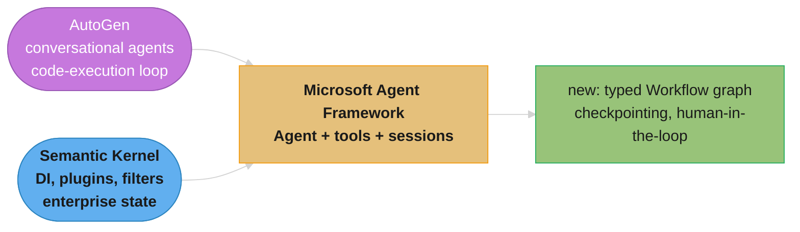
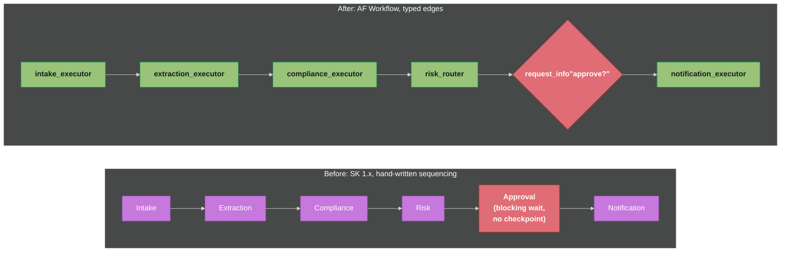

# Microsoft Agent Framework — Deep Dive

---

## 1. Concept Overview

Microsoft Agent Framework (AF) is Microsoft's unified SDK for building AI agents and multi-agent systems in Python and .NET. It is not a new framework competing with [AutoGen](autogen.md) and [Semantic Kernel](semantic_kernel.md) — it is their formal merger. Microsoft's own words: "Semantic Kernel and AutoGen pioneered the concepts of AI agents and multi-agent orchestration. The Agent Framework is the direct successor, created by the same teams... In short, Agent Framework is the next generation of both Semantic Kernel and AutoGen." One codebase now carries AutoGen's simple conversational-agent ergonomics, Semantic Kernel's enterprise plumbing (typed state, filters, telemetry, DI-friendly composition), and a new graph-based `Workflow` engine for explicit multi-agent orchestration.

Public preview shipped 2025-10-01 (first PyPI beta `1.0.0b251001`, announced the same day at Microsoft's Foundry devblog). The framework reached **1.0 general availability on 2026-04-03**. Between preview and GA the Python surface went through one framework-defining break: in February 2026 the core agent classes were renamed wholesale, with **no backward-compatibility aliases** — `ChatAgent` became `Agent`, `AgentThread` became `AgentSession`, and several other names changed alongside them (full table in §6 and §10). Any code, tutorial, or blog post predating that rename imports names that no longer exist. This file uses only the post-rename, current API.

For the two source lineages this file replaces, read [AutoGen](autogen.md) §1-2 and [Semantic Kernel](semantic_kernel.md) §1-2 — both now document their frameworks as lineage with a successor pointer here, and this file does not restate their history. See also [LangGraph](langgraph.md) for the closest cross-vendor analog to AF's `Workflow` engine, and [Framework Observability](framework_observability.md) for the OpenTelemetry patterns AF implements natively.

**Current version**: `agent-framework` 1.17.0 on PyPI (2026-09-03); `Microsoft.Agents.AI` and `Microsoft.Agents.AI.Workflows` 1.19.0 on NuGet (2026-08-22)
**Production adoption signal**: The SDK underlying Microsoft Foundry Agent Service; AutoGen's own README now calls Agent Framework "the enterprise-ready successor to AutoGen." Microsoft states Semantic Kernel 1.x support continues at least one year past GA (into roughly April 2027), while AutoGen is explicitly in community-managed maintenance mode — the two predecessor frameworks are not being deprecated on the same timeline, which shapes migration urgency differently for each.

---

## 2. Intuition

**One-line analogy**: Agent Framework is Semantic Kernel's enterprise chassis with AutoGen's conversational engine swapped in, and a LangGraph-style typed workflow graph bolted on top for anything more than one agent talking to itself.

**Mental model**: Picture two teams that spent three years building overlapping tools — one team's tool was great at "make an LLM call a function and retry until it works" (AutoGen), the other's was great at "run this safely in a bank's production stack with audit logs and dependency injection" (Semantic Kernel). Agent Framework is what happens when both teams merge their tools into one, then add a graph editor (`Workflow`) so multi-agent coordination stops being an implicit conversation and becomes an explicit, typed, checkpointed pipeline.

**Why it matters**: Two frameworks from the same vendor, with overlapping but not identical capabilities and two different support postures, created a real "which one do I start with" problem for any team building on Microsoft's stack. AF resolves it by being the single forward path — but it also means every existing AutoGen or SK investment now sits on a framework Microsoft has explicitly told you to leave, at two different urgencies.

**Key insight**: The two-lineage merger is not cosmetic branding. The rename with no aliases, the different SK/AutoGen support postures, and the shift from AutoGen's event-driven actor runtime to AF's typed data-flow `Workflow` are the concrete costs of that merger — and each is independently interview-relevant because each is a place teams get burned.

---

## 3. Core Principles

**Agents wrap a chat client, not a model.** An `Agent` (Python) or `AIAgent`/`ChatClientAgent` (.NET) is constructed around a client object — `OpenAIChatClient`, `FoundryChatClient`, an Azure OpenAI client — so swapping providers means swapping the client, not rewriting agent logic. This is the same client-abstraction principle Semantic Kernel used, carried forward.

**Sessions, not threads.** Conversation state lives in an `AgentSession`, created via `agent.create_session()`. The old `AgentThread` name and `get_new_thread()` method are gone; "session" was chosen because "thread" collided with unrelated meanings (OS threads, forum threads) across a unified two-language SDK.

**Tools are decorated functions with inferred schemas.** `@tool` wraps a plain Python function; the framework introspects its signature and docstring to build the JSON schema the model sees — no manual `FunctionTool` wrapper, no hand-written parameter schema.

**Middleware is the cross-cutting seam.** Filters/interceptors (Semantic Kernel's contribution) let you inject logging, PII redaction, cost tracking, or approval gates around any agent or tool call without touching the agent's own logic.

**Workflows are typed data-flow graphs, not broadcast conversations.** A `Workflow` built with `WorkflowBuilder` connects `@executor`-decorated nodes with typed edges and a `target_id` for routing. This directly replaces AutoGen's `GraphFlow` (also data-flow) and reframes `GroupChat`'s broadcast-to-all-agents model (control-flow) as an explicit graph instead.

**Telemetry on, sensitive data off, by default.** AF emits OpenTelemetry spans, logs, and metrics against the GenAI semantic conventions automatically (`ENABLE_INSTRUMENTATION` defaults `true`). Prompt/completion/tool-argument content is NOT captured unless you explicitly opt in (`ENABLE_SENSITIVE_DATA` defaults `false`) — safe-by-default instrumentation, unlike frameworks that log everything until you turn it off.

**Python/.NET parity is a stated goal, not yet a fact.** The rename that hit Python (`ChatAgent` -> `Agent`, etc.) did not touch .NET's `AIAgent`/`ChatClientAgent` surface. The two language SDKs are converging, not identical today — check which language a code sample targets before copying it.

**Checkpointing is a `Workflow`-level concern, not an `Agent`-level one.** A single `Agent` has an `AgentSession` for conversation history, but no built-in persistence of its own; durable, resumable execution — the kind that survives a process restart mid-approval — is something you opt into by building a `Workflow` with `checkpoint_storage=`, not a flag you set on a bare `Agent`. This is why the case study in §14 needed a `Workflow`, not just an `Agent`, to fix its dropped-approval problem.

---

## 4. Types / Architectures / Strategies

### The Five Orchestration Builders

| Builder | Purpose | AutoGen equivalent it replaces |
|---|---|---|
| `SequentialBuilder` | Run agents one after another, each seeing prior output | `RoundRobinGroupChat` / a `Team` with fixed order |
| `ConcurrentBuilder` | Fan out the same input to multiple agents in parallel, then collect | Manual `asyncio.gather` over independent chats |
| `GroupChatBuilder` | Multiple agents share a conversation with a selection policy | `GroupChat` + `GroupChatManager` (`speaker_selection_method`) |
| `HandoffBuilder` | An agent transfers control of the conversation to another agent | `Swarm`-style handoff (shipped; earlier migration docs called it "planned" — it has since landed) |
| `MagenticBuilder` | Open-ended orchestrator-led task decomposition across specialist agents | `MagenticOneGroupChat` |

### `Agent` (single) vs. `Workflow` (graph) vs. an Orchestration Builder

| Dimension | `Agent` | Orchestration builder (`SequentialBuilder`, etc.) | `Workflow` |
|---|---|---|---|
| Shape | One agent, one client, tools | A fixed multi-agent pattern, prebuilt | An arbitrary graph of typed executors |
| Control flow | Model decides tool calls | Builder-defined pattern (sequence/fan-out/handoff/magentic) | You define nodes and edges explicitly |
| State | `AgentSession` | Shared conversation across the pattern | Per-executor state plus workflow-level checkpoints |
| Human-in-the-loop | Manual (outside the loop) | Pattern-dependent | Native, via `ctx.request_info()` / `@response_handler` |
| Best for | A single capable agent with tools | A named, common multi-agent shape | Custom pipelines, approval gates, resumable long-running work |

### Python vs. .NET Surface

| Concept | Python | .NET |
|---|---|---|
| Core agent type | `Agent` (post-Feb-2026 rename; was `ChatAgent`) | `AIAgent` (abstract), backed by `ChatClientAgent` |
| Message type | `Message` (was `ChatMessage`) | `ChatMessage` — unchanged, no rename pressure on this side |
| Conversation state | `AgentSession`, via `agent.create_session()` | Session/thread abstraction under `AIAgent`, naming not affected by the Python rename |
| Tool registration | `@tool` / `FunctionTool` (was `@ai_function` / `AIFunction`) | Attribute-based or explicit tool registration on the chat client |
| Response types | `AgentResponse` / `AgentResponseUpdate` (was `AgentRunResponse[Update]`) | Framework-native response types, not subject to the same rename |
| Streaming | `agent.run(..., stream=True)` (was `run_stream()`) | Streaming overloads on `AIAgent.RunAsync` |

Because the rename is Python-only, a code sample's naming alone tells you which language and which side of February 2026 it comes from — `ChatAgent` in a .NET-labeled sample is a different (and correct) thing than `ChatAgent` in a Python sample, which is simply stale.

### Where AF Sits Relative to a Hosted Platform

AF is the SDK; **Microsoft Foundry Agent Service** is where AF-built agents run as a managed, hosted platform (comparable in role to LangSmith Deployment for LangGraph). AF also ships MCP client/server support and A2A integration (an `A2AAgent` type, plus Foundry Agent Service connecting to external A2A endpoints) as first-class, not bolted-on, integration points.

### Deployment and Integration Surfaces

| Surface | Role | Maturity |
|---|---|---|
| Microsoft Foundry Agent Service | Managed hosting for AF-built agents | Production target |
| `agent-framework-foundry` | Client library for the Foundry integration | Tracks `agent-framework`'s release cadence |
| `agent-framework-azure-ai` | Alternative Azure AI integration | Release candidate (`1.0.0rc6`); canonical status vs. `-foundry` unsettled |
| `agent-framework-copilotstudio` | Low-code Copilot Studio front end paired with AF back end | Preview, `--pre` install required |
| Self-hosted | Run the `Workflow`/`Agent` runtime in your own infrastructure | Fully supported; no managed checkpointer unless you bring one |
| MCP servers/clients | Tool interoperability, consume or expose tools | First-class, GA |
| A2A (`A2AAgent`, Foundry endpoints) | Cross-organization agent delegation | First-class, protocol versions 1.0 / 0.3 |

This is a wider surface than either predecessor shipped individually — AutoGen never had a managed hosting story, and Semantic Kernel's Azure integration predated both MCP and A2A as protocols.

---

## 5. Architecture Diagrams

### Typed Workflow Graph — Fan-Out, Checkpoint, and Human-in-the-Loop Pause/Resume

```mermaid
%%{init: {'flowchart': {'curve': 'basis'}, 'theme': 'dark'}}%%
flowchart LR
    classDef io      fill:#61afef,stroke:#2e86c1,color:#1a1a1a,font-weight:bold
    classDef exec    fill:#e5c07b,stroke:#f39c12,color:#1a1a1a,font-weight:bold
    classDef parallel fill:#98c379,stroke:#27ae60,color:#1a1a1a
    classDef gate    fill:#56b6c2,stroke:#0097a7,color:#1a1a1a
    classDef ckpt    fill:#c678dd,stroke:#9b59b6,color:#fff
    classDef human   fill:#e06c75,stroke:#c0392b,color:#fff,font-weight:bold

    S(["start_executor"]) --> Plan["plan_executor<br/>(typed edge: PlanResult)"]
    Plan --> ScanA["scan_executor_a<br/>(parallel)"]
    Plan --> ScanB["scan_executor_b<br/>(parallel)"]
    ScanA --> Join["join_executor<br/>(fan-in)"]
    ScanB --> Join
    Join --> CK[("checkpoint_storage<br/>superstep saved")]
    CK --> Risk{"risky_action?"}
    Risk -- "yes" --> Req["ctx.request_info#quot;approve?#quot;"]
    Req --> Human(["human reviewer"])
    Human --> Resp["@response_handler<br/>resumes workflow"]
    Resp --> Done(["end_executor"])
    Risk -- "no" --> Done

    class S,Done io
    class Plan,ScanA,ScanB,Join,Resp exec
    class ScanA,ScanB parallel
    class Risk gate
    class CK ckpt
    class Req,Human human
```



Typed edges (`PlanResult`, not a raw dict) mean a node can only be wired to an edge whose type it declares it accepts; the checkpoint after the fan-in means a crash or a long human-review wait does not force `plan_executor` and both scans to re-run. Read the `Risk` gate as a routing decision, not an executor — it decides which edge fires, the same role a LangGraph conditional edge plays, but here the branch targets and their payload types are fixed when the graph is built rather than resolved by a routing function at run time.

### Two Lineages, One Framework



AF is not a rewrite of either predecessor in isolation — the agent/tool surface descends from AutoGen's simplicity, the session/filter/telemetry plumbing descends from Semantic Kernel's enterprise concerns, and `Workflow` is genuinely new, closer in spirit to LangGraph than to anything either predecessor shipped.

---

## 6. How It Works — Detailed Mechanics

### The Rename Reference Table

Before any code sample below, the single fact that determines whether a piece of Python Agent Framework code still works: every name on the left was renamed to the name on the right in a beta around `1.0.0b260210`, and Microsoft provides no alias for the left-hand column.

| Old (dead, pre-Feb-2026) | Current | Notes |
|---|---|---|
| `ChatAgent` | `Agent` | The core agent class |
| `ChatMessage` | `Message` | AF's own message type |
| `AgentThread` | `AgentSession` | Conversation-state container |
| `agent.get_new_thread()` | `agent.create_session()` | Session constructor method |
| `AIFunction` / `@ai_function` | `FunctionTool` / `@tool` | Tool wrapper and decorator |
| `AgentRunResponse` / `AgentRunResponseUpdate` | `AgentResponse` / `AgentResponseUpdate` | Return types from `run()` |
| `AgentProtocol` | `SupportsAgentRun` | Structural typing protocol |
| `ChatClientProtocol` | `SupportsChatGetResponse` | Structural typing protocol |
| `run_stream()` | `run(..., stream=True)` | Streaming now a keyword, not a method |

Every code sample from here on uses only the right-hand column.

### Minimal Agent (Current API)

```python
from agent_framework import Agent
from agent_framework.foundry import FoundryChatClient
from azure.identity import AzureCliCredential

agent = Agent(
    client=FoundryChatClient(
        project_endpoint="https://your-foundry-service.services.ai.azure.com/api/projects/your-foundry-project",
        model="gpt-5.4-mini",
        credential=AzureCliCredential(),
    ),
    name="HelloAgent",
    instructions="You are a friendly assistant. Keep your answers brief.",
)

result = await agent.run("What is the largest city in France?")
print(result.text)
```

`Agent` is constructed around a `client` — swap `FoundryChatClient` for `OpenAIChatClient` or another provider client without touching the rest of the code.

### Tool Registration with `@tool`

```python
from agent_framework import Agent, tool
from agent_framework.openai import OpenAIChatClient

@tool
def get_weather(location: str) -> str:
    """Get weather for a location."""
    return f"Weather in {location}: sunny"

client = OpenAIChatClient(model="gpt-5")
agent = Agent(name="assistant", client=client, tools=[get_weather])

result = await agent.run("What's the weather?")
print(result.text)
```

`@tool` inspects `get_weather`'s signature (`location: str`) and docstring to build the schema the model sees — no separate `FunctionTool(get_weather, description=...)` wrapper, which is what AutoGen 0.4 required.

### Sessions and Multi-Turn Conversation

```python
session = agent.create_session()  # was agent.get_new_thread()

first = await agent.run("My name is Priya.", session=session)
second = await agent.run("What's my name?", session=session)
print(second.text)  # "Your name is Priya."
```

`create_session()` replaces `get_new_thread()`; the returned `AgentSession` (not `AgentThread`) is what you pass on every subsequent `run()` call to keep history attached.

### Streaming

```python
async for chunk in agent.run("Summarize the attached report.", tools=tools, stream=True):
    print(chunk.text, end="", flush=True)
```

`stream=True` on `run()` replaces the separate `run_stream()` method — one entry point for both modes now, selected by a keyword argument.

### Building a Typed `Workflow`

```python
from agent_framework import WorkflowBuilder, executor, WorkflowContext
from dataclasses import dataclass

@dataclass
class ScanRequest:
    target: str

@dataclass
class ScanResult:
    target: str
    findings: list[str]

@executor
async def start(ctx: WorkflowContext[ScanRequest]) -> None:
    await ctx.send_message(ScanRequest(target="repo://main"))

@executor
async def scan(ctx: WorkflowContext[ScanRequest], request: ScanRequest) -> None:
    findings = run_static_analysis(request.target)  # your own scanner
    await ctx.send_message(ScanResult(target=request.target, findings=findings))

workflow = (
    WorkflowBuilder(start_executor=start)
    .add_edge(start, scan)
    .build()
)

async for event in workflow.run_stream(ScanRequest(target="repo://main")):
    print(event)
```

Edges are typed (`ScanRequest` -> `ScanResult`); wiring `scan`'s output to an executor expecting a different type fails at build time rather than at run time, unlike AutoGen's untyped message-passing runtime.

### Checkpointing

```python
from agent_framework import WorkflowBuilder
from agent_framework.checkpoint import FileCheckpointStorage

workflow = (
    WorkflowBuilder(start_executor=start, checkpoint_storage=FileCheckpointStorage("./checkpoints"))
    .add_edge(start, scan)
    .build()
)
```

`checkpoint_storage=` is a constructor parameter on the builder; the workflow persists state at each superstep boundary so a crash or a long-running `request_info()` pause can resume without re-running completed executors.

### Human-in-the-Loop with `request_info()`

```python
@executor
async def risky_action(ctx: WorkflowContext[ScanResult], result: ScanResult) -> None:
    if result.findings:
        approval = await ctx.request_info(
            prompt=f"{len(result.findings)} findings on {result.target}. Proceed with remediation?",
            response_type=bool,
        )
        # execution pauses here; the workflow persists state and returns control
        if not approval:
            return

@executor
async def response_handler(ctx: WorkflowContext[bool], approved: bool) -> None:
    # resumes the paused executor once a human supplies `approved`
    if approved:
        await apply_remediation()
```

`ctx.request_info()` pauses the executor and surfaces a typed request to the caller; a matching `@response_handler` resumes execution once a human (or another system) supplies the response — the same request/response shape LangGraph's `interrupt()` provides, but tied to the workflow's typed edges rather than a compile-time `interrupt_before` list.

### OpenTelemetry Instrumentation (Environment-Variable Enablement)

```bash
export ENABLE_INSTRUMENTATION=true    # default; emits GenAI-semantic-convention spans/logs/metrics
export ENABLE_SENSITIVE_DATA=false    # default; keeps prompts/completions/tool args out of traces
```

```python
# No code change needed — spans appear automatically once an OTel exporter is configured
# in the host application. Flip ENABLE_SENSITIVE_DATA only against a trusted, access-controlled
# backend, since it starts logging prompt/completion/tool-argument content.
```

Zero-code instrumentation is opt-out for the shape of a span, opt-in for its sensitive content — deliberately the reverse default from frameworks that ship "trace everything" and expect you to redact it later.

### Orchestration Builders in Practice — Sequential and Handoff

```python
from agent_framework import Agent, SequentialBuilder, HandoffBuilder

# SequentialBuilder: replaces a fixed-order RoundRobinGroupChat/Team.
drafter = Agent(name="drafter", client=client, instructions="Draft a reply to the ticket.")
editor = Agent(name="editor", client=client, instructions="Tighten the draft; keep the facts.")
sender = Agent(name="sender", client=client, tools=[send_email], instructions="Send the final reply.")

pipeline = SequentialBuilder(agents=[drafter, editor, sender]).build()
result = await pipeline.run("Customer asked for a refund on order #4471.")

# HandoffBuilder: one agent transfers control to a specialist mid-conversation,
# replacing AutoGen's Swarm-style handoff pattern.
triage = Agent(name="triage", client=client, instructions="Classify the request, then hand off.")
billing = Agent(name="billing", client=client, tools=[lookup_invoice, issue_refund])
technical = Agent(name="technical", client=client, tools=[lookup_error_logs])

router = (
    HandoffBuilder(start_agent=triage)
    .add_handoff(triage, billing, condition="billing or refund question")
    .add_handoff(triage, technical, condition="error or outage report")
    .build()
)
result = await router.run("My last invoice charged me twice.")
```

`SequentialBuilder` fixes the order up front — no runtime decision about who goes next, unlike `GroupChatBuilder`'s selection policy. `HandoffBuilder` is the one place AF keeps a conversational, AutoGen-`Swarm`-shaped feel even though the rest of the multi-agent surface moved to typed `Workflow` graphs; the handoff condition is evaluated by the model, not a build-time type check, which is the tradeoff for its flexibility.

### Testing an Agent Without Live Model Calls

```python
from unittest.mock import AsyncMock
from agent_framework import Agent, AgentResponse

# Because Agent is constructed around a client object (§3), the standard way to
# unit-test agent logic without a network call is to mock the client itself,
# not to search for a framework-specific test double.
mock_client = AsyncMock()
mock_client.get_response.return_value = AgentResponse(text="The weather in NYC is sunny, 72F.")

agent = Agent(name="assistant", client=mock_client, tools=[get_weather])
result = await agent.run("What's the weather in NYC?")

assert "sunny" in result.text
```

```python
# Integration test: real client, cheap/fast model, structural assertions only.
import pytest

@pytest.mark.integration
async def test_weather_agent_real_client():
    agent = Agent(name="assistant", client=OpenAIChatClient(model="gpt-5-mini"), tools=[get_weather])
    result = await agent.run("What's the weather in NYC?")
    assert result.text  # non-empty; do not assert exact wording against a live model
```

Because `Agent` is built around a swappable `client=` object (§3), the same seam that lets you switch providers also lets you substitute a deterministic mock for unit tests — no framework-specific test-double API is required. Integration tests use a cheap real model and assert on structure (non-empty, contains an expected fact) rather than exact text, since a live model's phrasing is not stable across runs.

---

## 7. Real-World Examples

**Microsoft Foundry Agent Service.** The primary hosted target for AF-built agents — Foundry runs the SDK's agents as a managed service the same way LangSmith Deployment hosts LangGraph graphs, giving teams horizontal scaling and managed execution without self-hosting the runtime.

**MCP-integrated agents.** AF lists MCP servers and clients as first-class citizens, so an AF agent can both consume external MCP tool servers and expose its own capabilities as one, without a bespoke adapter layer — the same protocol covered in depth at [MCP](../mcp_model_context_protocol/mcp_model_context_protocol.md).

**Cross-organization agent-to-agent workflows.** AF ships an `A2AAgent` type for consuming external A2A endpoints directly, and Foundry Agent Service separately supports connecting to external A2A endpoints (protocol versions 1.0 and 0.3, over JSON-RPC) — relevant whenever an AF-built agent needs to delegate to, or be called by, an agent hosted on a different vendor's stack. See [A2A protocols](../multi_agent_systems/agent_to_agent_protocols.md).

**Copilot Studio integration (preview).** `agent-framework-copilotstudio` (installed with `--pre`, since it is still a preview package) lets AF agents integrate with Microsoft Copilot Studio's low-code agent authoring surface — a path for teams that want AF's SDK power behind a Copilot Studio-authored front end.

**Teams migrating off AutoGen or Semantic Kernel.** The two migration guides (`from-autogen`, `from-semantic-kernel`) exist because Microsoft is actively steering both predecessor communities here — an AutoGen team gets a near-mechanical single-agent port and a genuine multi-agent rewrite (§10); an SK team gets Kernel/plugin/planner/filter concepts carried forward as agents/tools/workflows/middleware, at a support timeline that gives them roughly a year of runway rather than AutoGen's immediate bug-fix-only posture.

**AutoGen's own README pointing at its successor.** The clearest signal of where Microsoft wants the ecosystem to move is that AutoGen's maintenance-mode banner does not just announce the status change — it names Agent Framework directly as "the enterprise-ready successor to AutoGen," which is a vendor telling its own existing user base, in the repository they already have open, exactly where new work should go next.

---

## 8. Tradeoffs

### AF vs. Other Agent Frameworks (versions as of 2026-08-26)

| Dimension | Microsoft Agent Framework 1.17.0 | [LangGraph](langgraph.md) 1.2.11 | [OpenAI Agents SDK](openai_agents_sdk.md) `openai-agents` 0.22.0 | [Google ADK](google_adk.md) `google-adk` 2.7.1 | CrewAI `crewai` 1.15.17 |
|---|---|---|---|---|---|
| Language surfaces | Python + .NET (not yet fully symmetric) | Python (+ JS) | Python (+ TS) | Python (+ Java) | Python |
| Orchestration model | Typed data-flow `Workflow` + 5 named builders | Cyclic `StateGraph`, explicit edges | Handoffs between agents-as-tools | `AgentTool` delegation, A2A-native | Role/task delegation (Crew) |
| State / checkpointing | `AgentSession` + workflow `checkpoint_storage` at superstep boundaries | Checkpointer (SQLite/Postgres/Redis) per node | Session objects, no built-in graph checkpointing | Session service, no graph checkpointing | Implicit, framework-managed |
| Telemetry | OTel GenAI conventions, on by default, sensitive data opt-in | LangSmith-native tracing (also OTel-compatible) | OTel-compatible via provider integrations | OTel-compatible | Limited built-in |
| Hosting story | Microsoft Foundry Agent Service | LangSmith Deployment | OpenAI-hosted or self-hosted | Vertex AI Agent Engine or self-hosted | Self-hosted / CrewAI AMP |
| Lock-in | Microsoft ecosystem (Foundry, Azure identity) | LangChain ecosystem | OpenAI ecosystem | Google Cloud ecosystem | Low — thin abstraction |

`dspy` 3.3.1 and `haystack-ai` 3.1.1 solve adjacent problems (prompt optimization, RAG pipelines respectively) rather than general multi-agent orchestration, so they are not directly comparable rows here.

### `Workflow` vs. AutoGen `GraphFlow`

| Aspect | AF `Workflow` | AutoGen `GraphFlow` |
|---|---|---|
| Model | Data-flow: typed edges, explicit `target_id` routing | Control-flow: an extension over AutoGen's broadcast/event-driven runtime |
| Message typing | Strongly typed per edge (build-time mismatch errors) | Loosely typed messages over `autogen-core`'s actor bus |
| Checkpointing | Native, `checkpoint_storage=` at superstep boundaries | Manual — no built-in equivalent |
| Human-in-the-loop | Native `ctx.request_info()` / `@response_handler` | Not native to `GraphFlow`; built via `UserProxyAgent` human_input_mode at the conversation level |
| Migration path | — | Teams already on `GraphFlow` find this the smallest conceptual jump of any AutoGen migration, since it is the same idea formalized |

Read the two tables together, not separately: the first table's "Lock-in" row and the second table's "Checkpointing" row are the two axes that most often decide the choice in practice. A team unwilling to accept Microsoft-ecosystem lock-in weighs the first table more heavily; a team whose current AutoGen `GraphFlow` pipeline has been silently losing state on crashes weighs the second table's "Native" row for checkpointing more heavily — and for the latter team, that single row can outweigh every lock-in concern in the first table.

---

## 9. When to Use / When NOT to Use

**Use Microsoft Agent Framework when:**
- Building on Azure/.NET, or the team already ships C#/.NET services alongside Python
- Already on AutoGen or Semantic Kernel and need a supported forward path — this is the only one Microsoft is investing new capability into
- The workload needs typed, checkpointed multi-step workflows with human-in-the-loop gates, not just a single conversational agent
- First-class OpenTelemetry (GenAI semantic conventions) matters without wiring your own instrumentation
- Deploying to Microsoft Foundry Agent Service, or needing native MCP/A2A support out of the box

**Do NOT use Microsoft Agent Framework when:**
- Starting greenfield, Python-only, with no Azure dependency — [LangGraph](langgraph.md) is a thinner, more battle-tested equivalent with a larger community and no recent framework-wide rename
- The team needs API stability today as a hard requirement — the February 2026 no-alias rename is a real precedent, and a framework at 1.15.0 minor-version cadence eight months past 1.0 GA is still moving fast
- The only need is a single tool-calling agent with no multi-agent or workflow requirement — a lighter SDK avoids carrying `Workflow`'s conceptual weight for no benefit
- The team is not on Microsoft's cloud and has no reason to accept Foundry/Azure-identity-shaped lock-in

**A quick decision checklist for an existing AutoGen or Semantic Kernel team specifically:**

| Question | If yes |
|---|---|
| Is the multi-agent logic mostly conversational, single-agent, or lightly coordinated? | Migration is close to mechanical (renames, client swap) — low risk to start now |
| Does it lean on `GraphFlow`, custom actor-runtime coordination, or SK planners making runtime routing decisions? | Budget real redesign time for the `Workflow` rewrite and the static-typing constraint (see §10 Pitfall 6, §14) |
| Is it on AutoGen? | Treat migration as the higher-priority of the two — community maintenance mode has a harder ceiling than SK's supported window |
| Is it on Semantic Kernel? | Plan the move, but there is no fire drill — SK support runs to roughly April 2027 |
| Does the team need a stable API today more than the newest capability? | Wait a few more minor releases past 1.17.0, or stay on the current predecessor a while longer |

None of these rows are exclusive-or decisions — a team can, for instance, be on Semantic Kernel with genuinely `GraphFlow`-shaped coordination needs and land in both the "no fire drill" row and the "budget real redesign time" row simultaneously; read the checklist as independent axes to weigh, not a single branch to follow to one conclusion.

---

## 10. Common Pitfalls

**Pitfall 1: Porting pre-February-2026 Python code without checking for the rename — no aliases exist**

```python
# BROKEN — every one of these names is dead in agent-framework >= 1.0.0b260210.
# This is copy-pasted from a blog post or tutorial written before Feb 2026.
from agent_framework import ChatAgent, AgentThread
from agent_framework.openai import OpenAIChatClient

client = OpenAIChatClient(model="gpt-4o")
agent = ChatAgent(chat_client=client, instructions="You are helpful.")
thread = agent.get_new_thread()
result = agent.run_stream("Hello", thread=thread)
# ImportError: cannot import name 'ChatAgent' from 'agent_framework'
```

```python
# FIXED — current names, no aliasing shim to fall back on.
from agent_framework import Agent
from agent_framework.openai import OpenAIChatClient

client = OpenAIChatClient(model="gpt-5")
agent = Agent(client=client, instructions="You are helpful.")
session = agent.create_session()
async for chunk in agent.run("Hello", session=session, stream=True):
    print(chunk.text, end="")
```

Microsoft states plainly that no backward-compatibility aliases are provided for this rename — `pip install --upgrade agent-framework` on old code fails immediately at import, not at some later runtime surprise, which is the one mercy here.

**Pitfall 2: Trusting Microsoft's own API reference over its conceptual docs**

The `agent_framework.chatagent` API-reference page was, as of this writing, still live and stamped with a December 2025 update date — before the rename. A developer who lands there via search copies `ChatAgent` construction code that no longer works, while the conceptual "Agents" docs page (updated in July and again in August 2026) already documents `Agent`. When two of a vendor's own doc surfaces disagree, prefer the more recently updated one and cross-check against the "significant changes" upgrade guide rather than assuming either is authoritative by default.

**Pitfall 3: Assuming Semantic Kernel is as dead as AutoGen**

AutoGen's README genuinely says "maintenance mode" — no new features, bug fixes and security patches only, community-managed going forward. Semantic Kernel's support statement is different in kind: Microsoft commits to continued support "for the foreseeable future," explicitly including critical bugs and security issues, for at least one year past AF's GA (into roughly April 2027), and never uses the phrase "maintenance mode" for SK. Treating both predecessors as equally urgent to leave gets the prioritization backwards — an AutoGen codebase has a harder ceiling on how long it can safely sit still than an SK one does.

**Pitfall 4: Expecting Python and .NET code samples to be interchangeable**

The February 2026 rename touched only the Python surface. A .NET sample using `ChatClientAgent` and a stale Python sample using `ChatAgent` can look like the same pattern in two languages, but only one of them is current — checking the rename table (§4, §6) before assuming a cross-language port is a drop-in translation avoids importing a dead Python name because a .NET doc page used a similar-looking one.

**Pitfall 5: Shipping with `ENABLE_SENSITIVE_DATA=true` against a shared trace backend**

```bash
# BROKEN — every prompt, completion, and tool argument now lands in a trace backend
# every engineer with observability access can query, including customer PII in tool args.
export ENABLE_SENSITIVE_DATA=true
```

```bash
# FIXED — leave the safe default, and only flip it for a debugging session against
# a backend scoped to the engineers who need to see raw content.
export ENABLE_SENSITIVE_DATA=false
# ...and if content-level debugging is genuinely needed, route to a dedicated,
# access-controlled OTel backend rather than the shared production one.
```

The instrumentation shape (spans, durations, model names) is safe to leave on by default; the content inside those spans is not, and the default correctly treats them as two separate decisions.

**Pitfall 6: Looking for `RoundRobinGroupChat` by name during an AutoGen port**

A team migrating `autogen-agentchat`'s `RoundRobinGroupChat` searches AF's docs for a class of the same name and finds nothing, concluding the feature is missing. It maps to `SequentialBuilder` (or a hand-built `Workflow`) — a rename, not a removal — and the same applies across the migration table in §4: `AssistantAgent` -> `Agent`, `MagenticOneGroupChat` -> `MagenticBuilder`, `GraphFlow` -> `Workflow`. Search the migration guide's mapping table before concluding a capability was dropped.

**Pitfall 7: Picking `agent-framework-azure-ai` as if it were the settled Azure integration package**

Two Azure-facing PyPI packages currently coexist: `agent-framework-foundry` (the package this file's quickstart uses, via `FoundryChatClient`) and `agent-framework-azure-ai` (last published as `1.0.0rc6` on 2026-03-30, still a release candidate). A team that pins to `agent-framework-azure-ai` because it sounds like the general-purpose Azure package may find themselves on the one Microsoft's own documentation does not clearly designate as canonical going forward. Until Microsoft disambiguates the two in primary docs, prefer `agent-framework-foundry` for new Foundry-targeted work — it is the one the current quickstart and this file's examples exercise — and treat `agent-framework-azure-ai` as unsettled rather than assuming either name implies seniority.

---

## 11. Technologies & Tools

| Package | Registry | Version (2026-08-26) | Purpose |
|---|---|---|---|
| `agent-framework` | PyPI | 1.17.0 (2026-09-03) | Bundles `agent-framework-core`; the main Python entry point |
| `agent-framework-foundry` | PyPI | tracks `agent-framework` | Microsoft Foundry integration (`FoundryChatClient`, etc.) |
| `agent-framework-azure-ai` | PyPI | 1.0.0rc6 (2026-03-30) | Azure AI integration; coexists with `agent-framework-foundry` — which is canonical going forward is not yet disambiguated in Microsoft's own docs |
| `agent-framework-copilotstudio` | PyPI | preview, install with `--pre` | Microsoft Copilot Studio integration |
| `Microsoft.Agents.AI` | NuGet | 1.19.0 (2026-08-22) | .NET core agent abstractions (`AIAgent`, `ChatClientAgent`) |
| `Microsoft.Agents.AI.Workflows` | NuGet | 1.19.0 (2026-08-22) | .NET typed `Workflow` engine |
| Microsoft Foundry Agent Service | Hosted platform | — | Managed hosting target for AF-built agents; MCP and A2A endpoint support |
| OpenTelemetry | Instrumentation | GenAI semantic conventions | Native spans/logs/metrics; `ENABLE_INSTRUMENTATION` / `ENABLE_SENSITIVE_DATA` env vars |
| MCP | Protocol | — | First-class server/client support for tool interoperability |
| A2A | Protocol | 1.0 / 0.3 (JSON-RPC) | `A2AAgent` client type; Foundry Agent Service connects to external A2A endpoints |

**Release timeline:**

| Date | Milestone |
|---|---|
| 2025-10-01 | Public preview; first PyPI beta `1.0.0b251001` |
| ~2026-02 | Python API rename (`ChatAgent` -> `Agent`, etc.); no backward-compatibility aliases |
| 2026-04-03 | 1.0 general availability, stated as direct successor to AutoGen and Semantic Kernel |
| 2026-09-03 | Current releases: `agent-framework` 1.17.0 (PyPI); `Microsoft.Agents.AI[.Workflows]` 1.19.0 (NuGet) |

The gap between GA and the current minor version (1.0 to 1.15 in under five months) is itself a signal worth reading alongside §9's "API stability today" caveat — this is still a framework shipping meaningful minor-version changes at a fast cadence, not one that has settled into a slow maintenance rhythm.

---

## 12. Interview Questions with Answers

**Q: What is Microsoft Agent Framework, and what is it a successor to?**
**Short:** It is the single direct successor to both AutoGen and Semantic Kernel, built by the same Microsoft teams.
Microsoft Agent Framework (AF) is Microsoft's unified SDK for building agents and multi-agent systems, reaching 1.0 general availability on 2026-04-03. Microsoft's own overview page states it plainly: AF is "the direct successor" to both AutoGen and Semantic Kernel, "created by the same teams," combining AutoGen's simple agent abstractions with Semantic Kernel's enterprise-grade plumbing, plus a new graph-based `Workflow` engine neither predecessor had. It is not a third competing framework — it is where both lineages now converge, and it is the framework Microsoft recommends for new work on its stack. Public preview came first, on 2025-10-01, giving the ecosystem roughly six months to try the SDK before Microsoft committed to it as GA — the February 2026 rename happened inside that preview window, which is also why it shipped without an alias: preview APIs carry no stability guarantee, even though plenty of tutorials treated them as if they did.

**Q: AutoGen and Semantic Kernel are both being succeeded by Agent Framework — are they in the same support state?**
**Short:** No — AutoGen is community-managed maintenance mode, while Semantic Kernel keeps active Microsoft support for roughly a year past AF's GA.
They are explicitly different. AutoGen's own README says it "will not receive new features or enhancements and is community managed going forward," with contributions limited to "bug fixes, security patches, and documentation improvements" — genuine maintenance mode. Semantic Kernel's stated posture is that Microsoft will "continue to support Semantic Kernel v1.x for the foreseeable future," explicitly including critical bugs and security issues, committed for at least one year past AF's 2026-04-03 GA (so into roughly April 2027) — and Microsoft never applies the phrase "maintenance mode" to SK. Treating the two as equally urgent to migrate gets the sequencing wrong; an AutoGen codebase has less runway.

**Q: What is the single most important thing to know about Agent Framework's Python API before writing any code?**
**Short:** Its core classes were renamed in February 2026 with no backward-compatibility aliases, so pre-2026 code fails at import.
In a beta release around `1.0.0b260210`, Microsoft renamed the core Python surface wholesale: `ChatAgent` to `Agent`, `ChatMessage` to `Message`, `AgentThread` to `AgentSession`, `AIFunction`/`@ai_function` to `FunctionTool`/`@tool`, `AgentRunResponse[Update]` to `AgentResponse[Update]`, and `run_stream()` folded into `run(..., stream=True)`. Microsoft states explicitly that no backward-compatibility aliases are provided, so any tutorial, blog post, or internal code predating February 2026 imports names that simply do not exist any more — it fails immediately with an `ImportError` rather than silently misbehaving, but it fails.

**Q: What replaced `AgentThread`, and why the rename?**
**Short:** `AgentSession`, created via `agent.create_session()`, replacing the old `AgentThread`/`get_new_thread()` pair.
`AgentThread` became `AgentSession`, and the constructor method `agent.get_new_thread()` became `agent.create_session()`. "Session" was chosen for a unified two-language (Python/.NET) SDK where "thread" already has unrelated meanings — an OS thread, a forum/chat thread — that created ambiguity the old name didn't need to carry. Functionally the object still does what `AgentThread` did: it accumulates conversation history and gets passed into subsequent `run()` calls to keep multi-turn context attached.

**Q: How does tool registration work in Agent Framework, and how did it change from earlier names?**
**Short:** The `@tool` decorator wraps a function and infers its JSON schema from the signature and docstring automatically.
A plain Python function decorated with `@tool` (previously `@ai_function`, wrapping `AIFunction`, now `FunctionTool`) is passed directly into an `Agent`'s `tools=[...]` list. The framework introspects the function's type-hinted signature and docstring to build the schema the model calls against — no separate schema object to hand-author or keep in sync, which is the same ergonomic win AutoGen 0.4's `FunctionTool` wrapper offered, just with the wrapping now implicit.

**Q: What are the five orchestration builders, and what AutoGen concept does each replace?**
**Short:** `SequentialBuilder`, `ConcurrentBuilder`, `GroupChatBuilder`, `HandoffBuilder`, and `MagenticBuilder`, each replacing a named AutoGen pattern.
`SequentialBuilder` replaces a fixed-order `RoundRobinGroupChat`/`Team`; `ConcurrentBuilder` replaces manually fanning out with `asyncio.gather` over independent chats; `GroupChatBuilder` replaces `GroupChat` plus `GroupChatManager`'s speaker-selection logic; `HandoffBuilder` replaces AutoGen's `Swarm`-style handoff pattern (this has shipped — earlier from-AutoGen migration docs called it "planned," which is now stale); and `MagenticBuilder` replaces `MagenticOneGroupChat`. Each builder is a named, prebuilt multi-agent shape; a custom `Workflow` is what you reach for when none of the five fits. Of the five, `HandoffBuilder` is the outlier worth calling out explicitly: it keeps a conversational, model-decided routing style even though the rest of AF's multi-agent surface moved to statically typed graphs, so it is the one builder where the target of a transition is not fixed at build time.

**Q: How does an AF `Workflow` differ from AutoGen's `GraphFlow`, conceptually?**
**Short:** `Workflow` is data-flow with typed edges and `target_id` routing; `GraphFlow` is control-flow layered over AutoGen's broadcast runtime.
`GraphFlow` was an extension over AutoGen's underlying event-driven actor model — agents as mailboxes exchanging loosely typed messages over `autogen-core`'s message bus, with graph structure imposed as control-flow constraints on top of that broadcast substrate. AF's `Workflow`, built with `WorkflowBuilder` and `@executor`-decorated nodes, is data-flow-native: edges carry a specific declared type, and a mismatch between what one executor emits and what the next expects is a build-time error, not a runtime surprise. Teams already using `GraphFlow` describe the smallest AutoGen-to-AF conceptual jump of any migration path, since AF formalizes an idea `GraphFlow` was already reaching for.

**Q: How does checkpointing work in an AF `Workflow`, and what problem does it solve?**
**Short:** A `checkpoint_storage=` parameter on `WorkflowBuilder` persists state at each superstep boundary for crash and pause recovery.
Passing `checkpoint_storage=FileCheckpointStorage(...)` (or another backend) to `WorkflowBuilder` makes the workflow persist its state after each superstep — the same problem LangGraph's per-node checkpointer solves, applied to AF's graph model. This matters for two cases: recovering after a crash mid-workflow without re-running already-completed executors, and pausing indefinitely at a `ctx.request_info()` human-in-the-loop gate without holding a process open while waiting for a response that might take hours or days.

**Q: How does human-in-the-loop work in an AF `Workflow`?**
**Short:** `ctx.request_info()` pauses an executor and surfaces a typed request; a matching `@response_handler` resumes it with the human's answer.
An executor calls `await ctx.request_info(prompt=..., response_type=bool)` (or another response type); this pauses the workflow, persists its state via `checkpoint_storage`, and surfaces the request to whatever is driving the workflow. A separately decorated `@response_handler` executor receives the human's (or external system's) response and resumes execution from that point. This is the same request/response shape as LangGraph's `interrupt()`, but tied into AF's typed-edge model — the response type the handler expects is declared, not inferred at runtime.

**Q: What telemetry does Agent Framework emit by default, and what is explicitly opt-in?**
**Short:** OpenTelemetry GenAI-convention spans/logs/metrics emit by default; prompt and tool-argument content requires an explicit opt-in.
`ENABLE_INSTRUMENTATION` defaults to `true`, so spans, logs, and metrics following the OpenTelemetry GenAI semantic conventions are emitted automatically with zero code changes, once a host application configures an OTel exporter. `ENABLE_SENSITIVE_DATA` defaults to `false`, so the actual content of prompts, completions, and tool arguments is excluded from those spans until explicitly enabled. This is a deliberately safer default than "trace everything, redact later" — the shape of what happened is observable immediately; the content that could carry PII or secrets is not, until someone decides it should be.

**Q: What is Agent Framework's relationship to MCP and A2A?**
**Short:** Both are first-class integration points — an `A2AAgent` client type for A2A, and MCP servers/clients supported natively.
AF's overview documentation lists MCP servers and clients as first-class citizens of the framework, so an AF agent can consume external MCP tool servers or expose its own capabilities via MCP without a custom adapter. For A2A, AF ships an `A2AAgent` type for consuming external A2A endpoints as a client, and separately, Microsoft Foundry Agent Service supports connecting to external A2A endpoints (protocol versions 1.0 and 0.3, over JSON-RPC) when AF agents are deployed there. Both protocols are treated as native integration surfaces rather than bolted-on extensions.

**Q: What is Microsoft Foundry Agent Service's relationship to Agent Framework?**
**Short:** Foundry Agent Service is the managed hosting platform that runs AF-built agents, analogous to LangSmith Deployment for LangGraph.
Agent Framework is the SDK you write agent code in; Microsoft Foundry Agent Service is where those agents can run as a managed, hosted service, with the SDK-to-platform relationship structurally similar to how LangGraph relates to LangSmith Deployment. Building with AF does not require deploying to Foundry — self-hosting is possible — but Foundry is the path Microsoft is investing in for teams that want managed scaling, and it is also where AF's A2A endpoint-connection story is documented.

**Q: When should a team NOT choose Agent Framework?**
**Short:** For a greenfield Python-only project with no Azure need, where a thinner, longer-stable framework like LangGraph fits better.
Two situations argue against AF: a greenfield, Python-only project with no Azure or .NET dependency, where LangGraph offers a comparably capable, more battle-tested alternative without AF's cross-language design overhead; and any team for whom API stability today is a hard requirement — the February 2026 no-alias rename is a real, recent precedent, and a framework still moving through minor versions at the pace AF has shown (1.15.0 roughly eight months past 1.0 GA) has not yet demonstrated the multi-year stability some teams need to plan around.

**Q: How do you migrate an AutoGen `GraphFlow` to Agent Framework?**
**Short:** Rebuild it as a `Workflow` — map its control-flow graph to typed `WorkflowBuilder` executors and edges, since names alone will not port.
`GraphFlow` maps conceptually to `Workflow`, but the underlying model shifts from control-flow (broadcast over AutoGen's actor runtime, loosely typed messages) to data-flow (explicit, typed edges and `target_id` routing via `WorkflowBuilder`/`@executor`). The individual agents inside the graph migrate closer to mechanically (`AssistantAgent` -> `Agent`), but the graph's wiring itself needs to be rebuilt against `Workflow`'s typed model rather than renamed in place — teams with `GraphFlow` experience report this as the smallest jump among AutoGen migrations, precisely because they were already thinking in graph terms.

**Q: What is the .NET equivalent of Python's `Agent`, and did it change in the February 2026 rename?**
**Short:** `AIAgent`, typically backed by `ChatClientAgent` — untouched by the Python-only rename.
On the .NET side, `AIAgent` is the core abstraction, with `ChatClientAgent` as the concrete implementation wrapping a chat client: `AIAgent agent = new ChatClientAgent(chatClient, instructions: "You are a helpful assistant.");`. The February 2026 rename (`ChatAgent` -> `Agent`, etc.) was Python-only; `AIAgent`/`ChatClientAgent` were never named `ChatAgent` and were not affected. This is the concrete example of why Python/.NET naming is not symmetric today — a .NET sample and a current Python sample use genuinely different vocabulary for the same concept, and neither is stale.

**Q: A team is currently on `semantic-kernel` 1.x. What should they actually do, and by when?**
**Short:** Plan a migration to Agent Framework, but there is no fire drill — Microsoft's committed SK support runs to roughly April 2027.
Given Microsoft's explicit continued-support commitment ("for the foreseeable future," at least a year past AF's 2026-04-03 GA), an SK team is not on a burning platform the way an AutoGen team is. The right move is to treat AF as the target for new capability and to schedule a migration using Microsoft's from-semantic-kernel migration guide, rather than reacting urgently — SK's plugins, planners, filters, and Kernel-based DI patterns carry forward conceptually into AF's tools, workflows, and middleware, so the migration is evolutionary, not a rewrite from scratch. The deadline pressure that does exist is soft: new Microsoft-stack capability is landing in AF, not SK, so staying on SK indefinitely means falling further behind on features, not an imminent support cliff.

**Q: How can you tell whether a piece of Agent Framework documentation or example code predates the February 2026 rename?**
**Short:** Check for the old class names — `ChatAgent`, `AgentThread`, `get_new_thread()`, `@ai_function`, or `run_stream()` — any one is a giveaway.
Any of the pre-rename Python names — `ChatAgent`, `ChatMessage` (as an AF-specific type, not to be confused with other frameworks' identically named classes), `AgentThread`, `get_new_thread()`, `AIFunction`/`@ai_function`, `AgentRunResponse`/`AgentRunResponseUpdate`, or a standalone `run_stream()` method — is a reliable signal the content predates February 2026 and will fail to import against current `agent-framework`. Microsoft's own API-reference page for `agent_framework.chatagent` is a documented example of this trap living inside Microsoft's own docs, stamped with a pre-rename update date while the conceptual "Agents" page next to it is current — so the fix is to prefer whichever doc surface has the more recent update timestamp, and to cross-check against the "significant changes" upgrade guide when in doubt, not to assume either surface is automatically authoritative.

**Q: What does Microsoft Copilot Studio have to do with Agent Framework?**
**Short:** `agent-framework-copilotstudio`, a preview package installed with `--pre`, lets AF agents integrate with Copilot Studio's low-code authoring surface.
Copilot Studio is Microsoft's low-code agent-authoring product; `agent-framework-copilotstudio` is a preview-only PyPI package (requiring `pip install --pre` since it has no stable release yet) that bridges the two, so a team can pair Copilot Studio's low-code front end with AF's SDK-level power on the back end rather than treating them as separate, disconnected tools. Because it is preview, treat its API surface as more likely to change than the core `agent-framework` package, and expect it to be affected by the same kind of pre-GA naming churn the core SDK went through in February 2026.

---

## 13. Best Practices

1. **Pin the package version and read the "significant changes" upgrade guide before bumping** — `agent-framework` is still moving through frequent minor releases (1.15.0 as of 2026-08-21), and the February 2026 rename shows breaking changes can ship with no compatibility shim.
2. **Prefer the conceptual docs over the API reference until the reference catches up** — the rename exposed a real gap between Microsoft's conceptual and reference documentation; when they disagree, trust the one with the more recent update date.
3. **Keep `ENABLE_SENSITIVE_DATA` off outside a trusted, access-controlled backend** — the safe default exists for a reason; only flip it against infrastructure scoped to the people who need to see raw prompt/tool-argument content.
4. **Migrate a low-risk workload first, and prioritize by predecessor support posture** — an AutoGen codebase (community maintenance mode) has less runway than a Semantic Kernel one (supported to roughly April 2027), so sequence accordingly rather than treating both as equally urgent.
5. **Use typed workflow edges rather than reaching for a broadcast pattern out of AutoGen habit** — a build-time type mismatch on a `Workflow` edge is strictly better than a `GraphFlow`-style runtime message-shape surprise; design the executor's input/output types deliberately instead of passing loosely shaped dicts.
6. **Checkpoint anything with a human-in-the-loop gate** — `ctx.request_info()` pauses can last from seconds to days; without `checkpoint_storage=`, a process restart during that wait loses the workflow's progress.
7. **Treat the Python/.NET naming difference as a first-class fact, not a documentation nuisance** — verify which language a sample targets before copying an identifier, since the same concept can currently have two different names.
8. **Reach for a named orchestration builder before hand-building a `Workflow`** — `SequentialBuilder`, `ConcurrentBuilder`, `GroupChatBuilder`, `HandoffBuilder`, and `MagenticBuilder` cover the common multi-agent shapes; a custom `Workflow` graph is for the shape none of the five fit, not the default starting point.
9. **Favor `agent-framework-foundry` over `agent-framework-azure-ai` until Microsoft disambiguates the two** — the current quickstart and this file's examples exercise the former; the latter is still a release candidate with no clearly stated canonical status.
10. **Budget migration time by coordination complexity, not by line count** — a single-agent AutoGen or Semantic Kernel codebase migrates close to mechanically; a codebase leaning on `GraphFlow`, custom actor coordination, or planner-driven dynamic routing needs a genuine redesign pass, as the case study in §14 shows.

---

## 14. Case Study: Porting a Six-Agent Semantic Kernel Pipeline

**Scenario.** A financial-services team built a six-agent document-processing pipeline on `semantic-kernel` 1.x in 2025: an `IntakeAgent` (plugin-based document classification), a `ExtractionAgent` (structured-data extraction via SK planners), a `ComplianceAgent` (filter-gated PII redaction using SK's filter pipeline), a `RiskAgent` (scoring against internal models), an `ApprovalAgent` (routes high-risk cases to a human via a custom SK middleware hook), and a `NotificationAgent` (sends results downstream). The pipeline processed roughly 4,000 documents/day, orchestrated by hand-written Kernel-level sequencing code, not a formal graph — SK 1.x had no `Workflow`-equivalent primitive.

### Before and After



The shape of the pipeline barely changed — six stages, one human gate — but the `Approval` stage went from a blocking in-process wait with no recovery story to a checkpointed `request_info()`/`@response_handler` pair that survives a restart.

**What mapped mechanically.** Five of the six agents ported close to one-to-one: each `KernelFunction`-backed agent became an `Agent` wrapping the same underlying LLM client, and each SK **plugin** (a set of `KernelFunction`s) became a set of `@tool`-decorated functions attached to that agent — schema inference replaced SK's more manual function-metadata annotations. SK's **filter pipeline** (used by `ComplianceAgent` for pre/post-call PII redaction) mapped directly onto AF's middleware concept, which was carried forward from SK specifically for this reason. This mechanical layer took 3 engineer-weeks for the team of 2.

**What did not map mechanically.** The hand-written sequencing code that had glued the six agents together — SK 1.x had no first-class multi-agent graph, so the team had built ad hoc Python control flow calling each Kernel function in order, with manual state passed between calls — had no direct SK-side equivalent to port at all. This piece was rewritten from scratch as an AF `Workflow`: six `@executor` nodes, typed edges between each stage (`ExtractedDocument` -> `ComplianceResult` -> `RiskScore` -> ...), and the `ApprovalAgent`'s custom human-in-the-loop hook replaced by a native `ctx.request_info()` call feeding a `@response_handler`. This rewrite, not the agent ports, took the remaining 5 of the total 8 engineer-weeks.

**The checkpointing win.** The original pipeline's `ApprovalAgent` step — roughly 9% of documents required human sign-off — had been implemented as a blocking wait inside a long-running process; a deployment restart during a pending approval silently dropped that document's progress, requiring manual reprocessing. Production logs before migration showed an average of 6 dropped documents/week from this cause. With `checkpoint_storage=` on the `Workflow`, an in-flight approval now survives a restart: the workflow resumes from the persisted superstep once `@response_handler` receives the human's decision, whenever that arrives.

**The telemetry win.** SK's pipeline had partial tracing — spans existed for LLM calls but not for the plugin-level control flow between them, so root-causing a slow pipeline run meant manually correlating logs across all six agents. With `ENABLE_INSTRUMENTATION=true` (the AF default) and `ENABLE_SENSITIVE_DATA` kept `false` per the team's compliance requirement (the whole reason `ComplianceAgent` existed), every executor transition now emits a span automatically — mean time to diagnose a slow pipeline run dropped from roughly 40 minutes of manual log correlation to under 5 minutes of trace inspection, without ever exposing the extracted document content the spans deliberately excluded.

**The one regression.** `RiskAgent`'s SK implementation had used a planner to dynamically decide, per document, whether a secondary scoring pass was needed — a runtime decision the AF `Workflow`'s statically typed edges do not support directly, since an edge's target is fixed at build time. The team's fix was a `risk_router` executor with a typed enum output feeding a conditional edge, functionally equivalent but requiring the dynamic branch to be enumerated up front rather than decided freely at runtime — a deliberate constraint of AF's typed model that cost roughly 2 extra engineer-days to work around, and the team judged the build-time safety net worth that cost given how often the original planner-based branch had silently misfired in production.

**Numbers.** 8 engineer-weeks total migration (3 mechanical agent/tool ports, 5 workflow rewrite); ~6 dropped documents/week eliminated by checkpointing; mean diagnosis time for a slow pipeline run down from ~40 minutes to under 5; 1 dynamic-routing regression resolved at ~2 engineer-days of extra cost.

---

## Related

- [Agentic Frameworks README](agentic_frameworks.md) — parent module: framework landscape and comparison table
- [AutoGen](autogen.md) — predecessor lineage: conversational agents, code-execution loop, `GroupChat`/`GraphFlow`
- [Semantic Kernel](semantic_kernel.md) — predecessor lineage: DI, plugins, planners, filters, enterprise state
- [LangGraph](langgraph.md) — closest cross-vendor analog to AF's typed `Workflow` engine and checkpointing model
- [OpenAI Agents SDK](openai_agents_sdk.md) — handoff-pattern comparison to AF's `HandoffBuilder`
- [Google ADK](google_adk.md) — comparable cloud-provider-native agent SDK with its own A2A-native orchestration story
- [MCP (Model Context Protocol)](../mcp_model_context_protocol/mcp_model_context_protocol.md) — the tool-server protocol AF supports as a first-class server/client
- [A2A protocols](../multi_agent_systems/agent_to_agent_protocols.md) — the cross-agent protocol behind AF's `A2AAgent` and Foundry Agent Service's external endpoint support
- [Magentic-One and AutoGen v0.4](../multi_agent_systems/magentic_one_and_autogen_v04.md) — the orchestrator-led multi-agent research this section's `MagenticBuilder` formalizes
- [Framework Observability](framework_observability.md) — the OpenTelemetry patterns AF implements natively via `ENABLE_INSTRUMENTATION`/`ENABLE_SENSITIVE_DATA`
