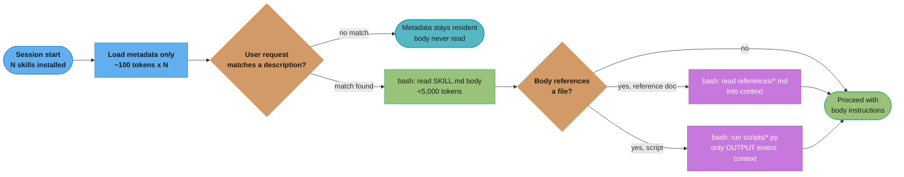

# Agent Skills and Progressive Disclosure — Deep Dive
---

## 1. Concept Overview

Agent Skills are a way to package a reusable procedure — the sequence, the conventions, the judgment calls a team has already worked out — as a directory an agent can discover, load, and act on without that procedure being pasted into every system prompt. A Skill is not a tool: it does not grant the agent a new capability to call an API or read a database. It teaches the agent, in the agent's own working environment, *how* to use the capabilities it already has to get a specific job done well — which internal wiki to check first, which flags to pass, which edge case to never skip.

The problem this solves is distinct from what [MCP](../mcp_model_context_protocol/mcp_model_context_protocol.md) solves. MCP standardizes *access* — a stable, discoverable way for an agent to reach a tool or a data source across process and vendor boundaries. It says nothing about how to use that access well. A team that stands up an MCP server for its deploy pipeline still has to teach the agent the fifteen-step runbook for a safe rollback, the naming convention for feature flags, the one Slack channel that must be notified before touching production. Before Skills, that knowledge lived in one of two bad places: hand-typed into every prompt (expensive, easy to drift out of date) or nowhere at all (the agent guesses, and guesses wrong at 3am). A Skill gives that knowledge a home: a directory, versioned like any other artifact in the repo, loaded only when relevant.

As of this writing Agent Skills is an **open specification**, not a Claude-only feature. Anthropic published the specification and an SDK at agentskills.io on 2025-12-18, and reported launch adopters spanning Microsoft, OpenAI, Atlassian, Figma, Cursor, and GitHub, with partner-built skills from Canva, Stripe, Notion, and Zapier. That matters for how you read the rest of this file: the directory-plus-`SKILL.md` shape and the three-level loading model below are the *spec*, and any conforming client — Claude Code, the Claude API, claude.ai, or a third-party agent — implements them the same way, even though the concrete details of upload flows and sandboxing differ per surface (see §4 and §7).

Take a support-ticket-routing team as the smallest concrete illustration. Before Skills, "how we route a billing dispute versus a bug report versus a legal request" lived as either eight paragraphs pasted into the routing agent's system prompt (paid on every single ticket, whether it was billing, a bug, or spam) or as a wiki page nobody's agent ever actually read. Packaged as a `ticket-routing` Skill, the same eight paragraphs cost ~100 tokens of always-resident metadata on every ticket and load their full ~2,000-token body only on the tickets where routing judgment is actually ambiguous enough to need it — the same knowledge, radically cheaper to keep current, because there is exactly one file to edit when the legal-escalation address changes.

---

## 2. Intuition

**One-line analogy**: [MCP](../mcp_model_context_protocol/mcp_model_context_protocol.md) is the driver — it puts the agent behind the wheel of a real car with real controls; a Skill is the runbook taped to the dashboard telling the driver which route to take, which turns are dangerous, and where the toll booth expects exact change.

**Mental model**: think of every installed Skill as a card in a card catalog. At startup the agent reads only the card's title and one-line summary — that is nearly free. When a request looks like a match for a card, the agent pulls the whole card and reads it — still cheap, and only for that one card. If the card says "for details on X, see the folder in the back," the agent walks over and reads that folder — but only if the request actually needs X. Nothing is loaded until something requests it, and nothing stays loaded once it is not needed. That staged loading is the mechanism this file is named for: **progressive disclosure**.

**Why it matters**: an agent with fifty tools and fifty procedures cannot afford to hold all fifty procedures in context on every turn — the token cost alone would crowd out the actual conversation (worked out with real numbers in §6), and burying the model's attention in forty-nine irrelevant procedures degrades its ability to use the one that matters, the same selection-pressure problem covered for tools in [Tool Selection at Scale](tool_selection_at_scale.md). Progressive disclosure is what lets the size of the catalog grow without the per-turn cost growing with it — cost tracks what gets *used*, not what gets *installed*.

**Key insight**: the description field is the entire routing surface. The model never sees a Skill's body, its scripts, or its reference files until it has already decided — from the `name` and `description` alone — that this Skill is worth loading. A Skill with excellent internal content and a vague description will simply never be picked; this is the exact same lesson [Function Calling & Tool Design](function_calling_and_tool_design.md) teaches about tool descriptions, applied one layer up, to whole procedures instead of single calls.

Note the naming overlap worth being precise about: [Tool Selection at Scale](tool_selection_at_scale.md) solves the equivalent problem one layer down — narrowing a catalog of individual function-calling tools before the model reasons over the survivors. Skill selection and tool selection are the same *shape* of problem, a large catalog with a cheap first pass and an expensive second pass reserved for the winners, applied at two different granularities. They compose in practice: an activated Skill's own body can go on to instruct the agent to choose among many tools, using exactly the retrieval strategy that file describes.

---

## 3. Core Principles

- **Metadata always resident, body loaded on match, resources loaded on demand.** Three levels, three different costs, and the level a piece of content sits at is a design decision the Skill author makes deliberately (§6).
- **The description is the router.** Selection happens on `name` + `description` alone — nothing else in the Skill is visible to the model at decision time. A vague description is functionally an uninstalled Skill.
- **Code beats prose for anything deterministic.** A bundled script's *output* enters context; its *source* never does. A ten-step deterministic procedure written as a script costs the same few hundred tokens of output whether it is step 3 or step 300; written as prose it costs tokens on every single activation, and it can still be misread.
- **A Skill is untrusted code until proven otherwise.** It can direct the agent to invoke tools or run commands in ways that do not match its stated purpose — see Anthropic's own guidance in §10. Installing a Skill is installing software, and it should get the same scrutiny.
- **A Skill is a directory, and it should be versioned like a dependency.** It has a name, it can drift out of date with the system it documents, and it can be pinned, reviewed, and rolled back the same way a library dependency is.
- **The spec is thin on purpose.** One required file (`SKILL.md`), five defined frontmatter fields, three optional conventional subdirectories. The thinness is what makes it portable across Claude Code, the API, claude.ai, and any third-party client that adopts the open spec — see §4.
- **Directory conventions are advisory, not enforced.** `scripts/`, `references/`, and `assets/` are the names the spec's own examples use, and following them is what keeps a skill's file references one level deep, but nothing in the spec mechanically requires those exact names — the requirement is `SKILL.md` at the root.
- **Progressive disclosure changes what "context budget" means for a catalog.** Without it, budgeting a tool or procedure catalog means budgeting for its *total size*. With it, budgeting means budgeting for the *largest plausible number of simultaneous activations* — a much smaller and much more stable number, which is why §6 works the arithmetic both ways.

---

## 4. Types / Architectures / Strategies

### 4.1 Five ways to give an agent capability or knowledge

The same job — "the agent should behave well in situation X" — can be solved five different ways, and they are not interchangeable. This is the decision a team actually has to make before writing a `SKILL.md`.

| Approach | Where the knowledge lives | Per-turn cost when unused | Per-turn cost when used | Update cost | Wrong choice when |
|---|---|---|---|---|---|
| Agent Skill | A directory, loaded on demand | ~100 tokens (metadata only) | <5,000 tokens (body) + resource reads | Edit the directory; no redeploy | The need is live external data, not a procedure |
| MCP tool | An external server, called on demand | 0 (tool schema cost is separate, see [Tool Selection at Scale](tool_selection_at_scale.md)) | Cost of the call + result payload | Server-side; independent of the agent | The need is "how", not "what" — a tool has no judgment to teach |
| System prompt / long instructions | Pasted into every request | Full text, every single turn | Same — already paid | Redeploy the prompt | The procedure is one of many and most turns do not need it |
| Subagent / delegation | A separate agent invocation with its own context | 0 until delegated | A full nested agent run — much more than a Skill body | Edit the subagent's own prompt | The task does not need isolated context or a separate tool budget — see [Subagents and Delegation](subagents_and_delegation.md) |
| Fine-tuning | Model weights | 0 marginal tokens | 0 marginal tokens | Retraining — days, not a text edit | The gap is a *procedure* the model could follow if told, not a capability it structurally lacks |

Read the middle two columns together: a Skill and a long system-prompt instruction can encode the *exact same procedure*, but the Skill only spends tokens on the turns that need it, while the system-prompt version spends them on every turn, forever. That is the entire economic case for Skills, and §6 puts real numbers on it.

Working through four concrete requests against the table clarifies the boundaries better than the table alone:

- *"Summarize this PDF for me"* (asked once, no reuse expected) — a plain prompt. Building a Skill for a request that will not recur does not amortize the authoring cost.
- *"What's our current AWS spend?"* (needs a live number) — an MCP tool call to a billing API. No procedure to teach; the entire value is the live data itself.
- *"Triage this on-call page the way our team always does"* (a stable, reused, describable procedure) — a Skill. This is the incident-triage example built out fully in §6.
- *"Draft a reply in the tone of our brand voice"* (the model does not reliably do this even when told, across hundreds of attempts) — a candidate for fine-tuning, if a written style guide genuinely cannot close the gap.

### 4.2 Where a Skill runs — three surfaces, three different environments

The spec is one shape; the runtime around it is not. A Skill written against one surface's assumptions can silently misbehave on another.

| Surface | Distribution | Sandbox | Network access | Pre-built skills available |
|---|---|---|---|---|
| Claude API | Upload via the `/v1/skills` endpoints; requires the code execution tool | Sandboxed container | None; no runtime package installation | Yes — `skill_id` values `pptx`, `xlsx`, `docx`, `pdf` |
| Claude Code | Filesystem — a directory under a skills path, no upload step | The user's own machine | Full — same as any program the user runs | No — the document skills are API-only |
| claude.ai | Upload as a zip in Settings > Features | Code-execution sandbox, same family as the API's | Varies by user/admin setting | Depends on plan; individual per user, not org-managed |

The consequence worth remembering: **a custom Skill does not sync across these three surfaces.** One uploaded to claude.ai is not available to the API, and a Claude Code skill on a laptop is separate from both — see Pitfall (f) in §10. Anthropic also documents Agent Skills as available on Claude Platform on AWS and on Microsoft Foundry, where the Foundry path requires a Hosted-on-Anthropic deployment.

A practical way to choose among the three when a skill could plausibly live on more than one: pick Claude Code when the procedure genuinely needs the user's own network and filesystem (an internal deploy script that only resolves inside the corporate VPN); pick the Claude API when the procedure should run the same way for every user of a product regardless of what machine they're on, and does not need live network access; pick claude.ai when the audience is an individual user working interactively rather than an integrated product. Getting this wrong does not fail loudly — it fails as Pitfall (f), the skill simply not being there on the surface someone else expected it on.

---

## 5. Architecture Diagrams



**Reading the diagram.** Every box left of the decision diamond at `C` runs for every skill on every turn, and it is cheap by design — `~100 tokens x N`. Everything right of it runs only for the one skill that matched, and the script branch at `H` is the cheapest of all: the code that produced the output never touched context, only its result did. That asymmetry — pay a flat, tiny tax always, pay real tokens only on a match, pay nothing at all for code that ran — is progressive disclosure in one picture, and it is what §6 turns into arithmetic.

### Decoding the always-resident tax

```
metadata_tokens  = N x m          N = skills installed, m = tokens per skill's Level 1 metadata
share_of_reserve = (N x m) / R    R = tokens reserved for skill metadata + system prompt
```

**What the diagram's left half is buying.** "Every skill you install pays a small, fixed rent whether or not it is ever used this session — the diagram's decision diamond is the only place that rent stops accruing per skill."

The flat `~100 tokens x N` box in the diagram above is not an approximation glossed over for the picture; it is the literal cost model. Nothing about it changes whether a skill activates ten times a day or never once.

| Symbol | What it is |
|--------|------------|
| `N` | Skills installed in this session. `10`, `50`, `200` in the worked table below |
| `m` | Tokens per skill's Level 1 metadata. `~100`, per the platform docs |
| `N x m` | Always-resident cost, paid regardless of activation |
| `R` | Tokens reserved for metadata + system prompt in a realistic budget. `20,000` here |
| `share_of_reserve` | Fraction of that reserve consumed by metadata alone |

**Walk one example.** Three catalog sizes against the same 20,000-token reserve:

```
  N (skills)   N x 100 tokens   share of 20,000-token reserve
  ----------   ---------------  --------------------------------
       10           1,000               5.0%
       50           5,000              25.0%
      200          20,000             100.0%   <- the reserve itself, exactly

  At 200 skills the metadata tax alone consumes the entire reserve slice
  planned for it -- nothing is left over for the system prompt sharing
  that budget. This is the arithmetic argument for pruning (Pitfall c).
```

```
skill-name/
├── SKILL.md              <- required. YAML frontmatter + body. Level 1 + Level 2.
├── scripts/               <- optional. Executable code; OUTPUT enters context, source never does.
│   └── validate.py
├── references/             <- optional. Docs read into context only when the body points to them.
│   └── api_conventions.md
└── assets/                 <- optional. Templates, images, data files the scripts consume or emit.
    └── report_template.xlsx
```

**Reading the layout.** Only `SKILL.md` is required; the three subdirectories are convention, not enforced structure, and the spec asks that references stay one level deep from `SKILL.md` rather than nesting reference-inside-reference — the flatter the tree, the fewer bash round-trips it takes the agent to reach the content it needs.

---

## 6. How It Works — Detailed Mechanics

### A complete, valid `SKILL.md`

```markdown
---
name: incident-triage
description: Triages a production incident from an on-call page — classifies severity, pulls the relevant runbook section, and drafts the initial Slack update. Use when the user pastes a PagerDuty alert, mentions an on-call page, or asks to triage/investigate a production incident.
license: See LICENSE in this directory
compatibility: Requires network access to the internal status-page API; not usable in an offline sandbox.
metadata:
  owner: platform-team
  last-reviewed: 2026-08-01
allowed-tools: Bash(curl:*) Bash(jq:*) Read
---

# Incident Triage

1. Read the alert payload. Extract service name, error rate, and page time.
2. Classify severity using `references/severity_matrix.md` — do not guess; the
   matrix is the source of truth and changes independently of this file.
3. Run `scripts/pull_recent_deploys.py <service>` to check for a correlated
   deploy in the last 2 hours. Its output, not its source, is what you reason over.
4. Draft the initial Slack update using the template in `assets/incident_update.md`.
5. Do not page a second on-call engineer without human confirmation.
```

Every constraint the spec places on this file is visible above: `name` (`incident-triage`) is lowercase alphanumeric-and-hyphens, no leading/trailing hyphen, no `--`, and it matches the parent directory name exactly — a mismatch here is invalid. `description` states both *what* (triages an incident) and *when* (pasted alert, on-call page, asked to investigate) in under 1,024 characters — on the Claude API and claude.ai it additionally may not contain XML tags or the literal words "anthropic" or "claude". `allowed-tools` is explicitly called out by the spec as **experimental — support varies between implementations**, so treat it as a hint some clients honor, not a guarantee.

### Frontmatter field cheat-sheet

| Field | Required | Constraint |
|---|---|---|
| `name` | Yes | 1-64 chars; lowercase alphanumeric + hyphens; no leading/trailing hyphen; no `--`; must equal the parent directory name |
| `description` | Yes | 1-1,024 chars, non-empty; must state what the skill does AND when to use it |
| `license` | No | A license name, or a reference to a bundled license file |
| `compatibility` | No | 1-500 chars; environment requirements — intended product, system packages, network access |
| `metadata` | No | A map of string keys to string values; client-defined, so keep keys unique to avoid collisions |
| `allowed-tools` | No | Space-separated pre-approved tool patterns, e.g. `Bash(git:*) Read`; **experimental** |

Two fields carry extra restrictions on the Claude API specifically, layered on top of the open spec: `name` may not contain XML tags or the reserved words "anthropic"/"claude", and `description` may not contain XML tags either.

### The token-budget arithmetic

Level 1 metadata costs ~100 tokens per skill, always resident, for every installed skill regardless of use:

```
  installed skills (N)     always-resident cost (N x 100 tokens)
  ---------------------    --------------------------------------
  10                        1,000 tokens
  50                        5,000 tokens
  200                       20,000 tokens
```

Set that against a realistic budget: a 200,000-token context window with, say, 20,000 tokens reserved for the always-on system prompt and tool schemas leaves roughly 180,000 for conversation and skill activity. Even 200 installed skills' metadata (20,000 tokens) is about 11% of that reserve — noticeable at the high end, but nowhere near prohibitive, and it is the *only* cost that scales with catalog size.

Contrast that with the alternative most teams reach for first: pasting every procedure directly into the system prompt instead of packaging it as a Skill. At a representative ~4,000 tokens per fully-written procedure — comparable to the incident-triage body above plus its severity matrix inline — 50 procedures would cost:

```
  50 procedures x 4,000 tokens/procedure = 200,000 tokens

  That is the entire context window, spent on instructions the current
  turn probably does not need, before the user has said anything.
```

That number is not a rounding exaggeration — it is why "just put it in the system prompt" stops working somewhere between a handful of procedures and a few dozen. A Skill's Level 2 cost is the same ~4,000-token body, but it is paid **once, only when that one skill activates** — <5,000 tokens against 200,000 committed unconditionally. Fifty skills sitting installed cost ~5,000 tokens of metadata plus whatever subset actually activates on a given turn; fifty procedures pasted into the prompt cost 200,000 tokens on every single turn, activated or not. That gap is the entire argument for progressive disclosure over prompt-stuffing.

**What this actually says.** "The number of procedures a catalog can hold is bounded only by how many exist; the number a single turn pays for is bounded by how many actually match — those are different numbers, and prompt-stuffing is the mistake of pretending they are the same one."

| Symbol | What it is |
|--------|------------|
| `P` | Procedures / skills in the catalog. `50` in the worked figure above |
| `c_prompt` | Tokens per procedure written directly into the system prompt. `~4,000` |
| `c_meta` | Tokens per skill's Level 1 metadata. `~100` |
| `c_body` | Tokens for one activated skill's Level 2 body. `<5,000` |
| `k` | Skills that actually activate on a given turn — typically `1`, occasionally `2-3` |

**Walk a second example.** Hold `P = 50` fixed and vary how many skills a single turn actually needs, `k`:

```
  prompt-stuffing cost (every turn) = P x c_prompt = 50 x 4,000 = 200,000 tokens, flat

  skill cost this turn = (P x c_meta) + (k x c_body)
     k = 1  ->  5,000 + (1 x 5,000)  =  10,000 tokens   (95.0% cheaper than prompt-stuffing)
     k = 2  ->  5,000 + (2 x 5,000)  =  15,000 tokens   (92.5% cheaper)
     k = 3  ->  5,000 + (3 x 5,000)  =  20,000 tokens   (90.0% cheaper)

  Even a turn needing THREE simultaneous skills -- an unusually busy one --
  still costs 90% less than paying for all fifty procedures unconditionally.
```

The crossover point is not close: prompt-stuffing loses even in its opponent's worst realistic case. That is why §9 treats "the catalog is large enough that pasting it all in is not viable" as the practical trigger for reaching for Skills at all.

### The matching mechanic

Selection happens once, at the boundary between Level 1 and Level 2: the model is shown every installed skill's `name` and `description`, nothing else, and decides which (if any) to activate based on that alone. This is why §3's "description is the router" principle is not a style preference — it is a description of the actual decision procedure. A skill whose description says "Helps with PDFs" and a skill whose description says "Extracts tables and form fields from PDF documents; use when the user uploads a PDF, asks to parse a form, or needs data pulled from a scanned document" are, from the matcher's point of view, not competing on quality of implementation at all — the second one simply exists to the matcher and the first barely does. See Pitfall (a) in §10 for what this looks like in production.

### Bundled-script execution and why output-only is the point

The mechanism, stated by Anthropic directly: when a skill triggers, the agent uses bash to read `SKILL.md`; if the body points at further files, the agent reads those with additional bash calls; and if the body directs it to *run* a script, the script executes through bash and **only its output enters context — the script's source code never does.** This is not an optimization detail, it is what makes bundling deterministic logic free at any script length. A 500-line Python script that validates a deploy manifest costs the same handful of tokens in context as a 5-line one, provided its output is equally short — the interpreter, not the model, is what "reads" 500 lines of code.

### Level 3 cost in practice — a reference read versus a script run

The incident-triage example in §6 has both kinds of Level 3 access side by side, and they cost differently:

```
  references/severity_matrix.md   -- a lookup table, ~1,200 tokens of prose/table markup
                                      read in FULL into context (step 2 of the body)

  scripts/pull_recent_deploys.py  -- maybe 80 lines of Python, but the agent never
                                      sees the source; it sees the OUTPUT (step 3)
                                      e.g. "no deploy in the last 2h for `checkout-svc`"
                                      ~15 tokens
```

A reference file costs what it *contains*, because the whole thing lands in context — a 1,200-token matrix costs 1,200 tokens whether the agent uses two rows of it or all twenty. A script costs what it *prints*, regardless of how much logic produced that print. This is the practical version of §3's "code beats prose for anything deterministic" principle: the severity classification genuinely needs the full matrix in context because the *model* has to reason over which row applies, but the deploy-correlation check is a yes/no fact a script can compute and hand over in one line — no reason to spend 1,200 tokens making the model re-derive something a `git log` one-liner already knows.

### The precedence rules (Claude Code specifically)

When two installed skills share a name, Claude Code resolves in this order: **enterprise overrides personal, and personal overrides project** — the counter-intuitive part, since most engineers expect a project-local skill to win over a personal one, and it does not. Plugin skills are namespaced `plugin-name:skill-name` and so structurally cannot collide with anything. A skill and a `.claude/commands/` entry sharing a name: the skill wins. Nested `.claude/skills/` directories below the working directory load **lazily** — only the first time the agent reads or edits a file in that subdirectory — so they are absent from autocomplete at session start and, on a name clash with a top-level skill, must be addressed by path (`/apps/web:deploy`). See Pitfall (g) in §10.

Every subsection above resolves to the same underlying picture: a request comes in, a cheap matcher looks only at metadata, at most one round of bash calls loads a body, and any further round of bash calls loads exactly the resources that body names — nothing loads speculatively at any stage. The token-budget numbers, the matching mechanic, the script-output rule, and the precedence order are four separate facts, but they are all consequences of that one design: load nothing until something concrete asks for it.

---

## 7. Real-World Examples

**Anthropic's pre-built document skills.** On the Claude API, four skills ship as `skill_id` values usable alongside the code execution tool: `pptx`, `xlsx`, `docx`, `pdf`. They are not available in Claude Code, which has no upload step and no code-execution-sandbox surface to host them in.

**The open-source skills repository.** Anthropic published the specification and reference material at agentskills.io alongside `github.com/anthropics/skills`, which bundles a Claude API skill and validation tooling (`skills-ref`) that any implementer can run against a candidate `SKILL.md`.

**Cross-vendor adoption.** Reported launch adopters of the open spec include Microsoft, OpenAI, Atlassian, Figma, Cursor, and GitHub, with partner-built skills contributed by Canva, Stripe, Notion, and Zapier — evidence the shape (directory + `SKILL.md` + progressive disclosure) is being treated as a genuine interoperability layer, not a single-vendor convention.

**Enterprise content scanning.** Claude Enterprise organizations can turn on Skill content scanning for custom skills uploaded through claude.ai and Claude Cowork. The scanning explicitly **does not cover** skills uploaded through the Skills API or the Claude Console — an admin who assumes "we scan skills" covers every upload path is wrong, and that gap is worth stating out loud to a security team rather than discovering during an incident.

**Claude Code plugins as a distribution mechanism.** A plugin can bundle one or more skills under `skills/<name>/SKILL.md`, and because a plugin's skills are namespaced `plugin-name:skill-name`, an organization can ship a library of vetted skills through its plugin registry with a structural guarantee against name collisions with anything a user or another plugin has installed — a stronger guarantee than "please name your project skills distinctively" (Pitfall (g)) provides on its own.

**`skills-ref` as a CI checkpoint.** Because the spec's frontmatter constraints are mechanical — character ranges, character classes, a directory-name match — they are exactly the kind of thing worth checking in CI rather than in code review. Running `skills-ref validate ./my-skill` (§11) against every skill directory before merge catches a malformed `name` or an over-length `description` the same way a linter catches a syntax error, before it ever reaches a matcher that would simply fail to activate the skill with no error message at all.

**The MCP/Skills pairing in practice.** Anthropic frames the two as complementary rather than competing: skills "complement Model Context Protocol (MCP) servers by teaching agents more complex workflows that involve external tools and software." A team that already has an MCP server for, say, its ticketing system gets the *access* from MCP; the Skill is where the "always attach the customer's account tier and never auto-close a ticket tagged legal-hold" judgment lives. See [MCP](../mcp_model_context_protocol/mcp_model_context_protocol.md) for the access-layer side of that pairing.

**The broader interoperability moment.** The Agent Skills publication did not happen in isolation — MCP itself was donated to the Linux Foundation on 2025-12-09, days before the Skills specification and SDK went live at agentskills.io. Read together, the two events describe the same shift: the *access* layer (MCP) and the *procedure* layer (Skills) both moved from single-vendor conventions toward open, jointly-governed specifications within the same two-week window, which is part of why the reported launch-adopter list for Skills spans direct competitors (Microsoft, OpenAI) rather than staying inside Anthropic's own product surface.

| Example | What it demonstrates |
|---|---|
| Pre-built document skills (`pptx`/`xlsx`/`docx`/`pdf`) | A single vendor's own use of the spec for a common, reusable capability |
| `github.com/anthropics/skills` + `skills-ref` | The spec is checkable, not just descriptive — tooling exists to enforce it |
| Cross-vendor launch adopters | The shape is treated as an interoperability layer, not a proprietary convention |
| Enterprise content scanning gap | Even a vendor's own security tooling has surface-specific coverage, not universal |
| MCP's Linux Foundation donation, same window | Access and procedure standardized together, not as competing efforts |

---

## 8. Tradeoffs

The four approaches below all can, in principle, deliver the same end behavior — an agent that follows a specific procedure correctly. What differs is where the cost lands (up front in tokens per turn, or once in an update) and how much confidence you can have that the procedure being followed today is the one that was written.

| Dimension | Agent Skill | Long system prompt | RAG over docs | Fine-tuning |
|---|---|---|---|---|
| Where knowledge lives | A versioned directory | The prompt text itself | An external index | Model weights |
| Per-turn cost, unused | ~100 tokens | Full text, always | Retrieval call cost | None |
| Per-turn cost, used | <5,000 tokens (+ resources on demand) | Same as unused — already paid | Retrieved chunk tokens | None |
| Determinism | High for bundled scripts; procedural for prose | Prose only | Depends on retrieval quality | Baked in, hard to audit |
| Portability | Open spec — works across compliant clients | Copy-paste, brittle | Index-specific | Not portable at all |
| Auditability | Diff the directory | Diff the prompt | Diff the corpus, harder | Diff the training run |
| Update cost | Edit a file | Redeploy the prompt | Re-index | Retrain |

| Bundling as a script | Writing the procedure in prose |
|---|---|
| Cost scales with output length, not code length | Cost scales with prose length, paid every activation |
| Deterministic — same input, same result | Subject to model interpretation, can drift per run |
| Needs an execution environment (bash, a sandboxed container) | Works anywhere the body is read |
| Best for validation, transforms, anything with a right answer | Best for judgment calls a script cannot encode |

| Dimension | Claude API | Claude Code | claude.ai |
|---|---|---|---|
| Who registers a custom skill | Uploaded via `/v1/skills` | Placed on the filesystem | Uploaded as a zip in Settings |
| Blast radius of a bad skill | One workspace, sandboxed, no network | The user's own machine, full network access | One user's account, sandboxed |
| Content scanning available | No — Skills API and Console are excluded from Enterprise scanning | Not applicable — no upload/scan step exists | Yes, opt-in for Enterprise orgs |
| Typical failure if ported without changes | `curl`/`pip install` in a script silently fails (no network) | Works, since network access is unrestricted | Depends on the admin's network setting for that user |

Reading the last row against §4.2: the same Skill can be fully functional on one surface and silently broken on another, purely because of what the *environment* allows rather than anything wrong with the Skill's own logic — which is exactly the gap the `compatibility` frontmatter field exists to document.

The auditability and portability rows in the first table are the two that most often get underweighted when a team is picking an approach under time pressure. A long system prompt is easy to write quickly and painful to audit later, because "why did the agent do that" has to be traced through an undifferentiated block of instructions; a Skill's directory-and-file structure means the same question has an actual file to point at, and a diff to review when it changes.

---

## 9. When to Use / When NOT to Use

**Use a Skill when:**
- The procedure is stable enough to write down and reused across many sessions, not a one-off.
- The knowledge is genuinely describable — "do X, then Y, check Z first" — not a capability the base model structurally lacks.
- Part of the procedure is deterministic (validation, formatting, a fixed transform) and can be pushed into a script.
- The catalog of such procedures is large enough that pasting all of them into the system prompt is not viable (§6's arithmetic is the test).

**Do NOT use a Skill when:**
- The need is live data or a live action — that is a tool/[MCP](../mcp_model_context_protocol/mcp_model_context_protocol.md) server's job; a Skill has no mechanism to reach outside its own files except through tools the agent already has.
- The need is genuinely one-shot — a single prompt for a single request does not amortize the metadata tax across future turns the way a reused Skill does.
- The gap is really a missing base capability — no amount of written procedure teaches a model to do something it structurally cannot do; that is a fine-tuning problem.
- The target surface is the Claude API sandbox and the procedure needs live network access — the API's code-execution container has none, so a Skill written assuming it can `curl` an internal service will fail there even though it works fine in Claude Code (§4.2).
- The procedure has consequential, hard-to-reverse side effects and no human should be out of the loop — pair the Skill with `disable-model-invocation: true` (§12) rather than leaving activation fully autonomous, or reconsider whether it belongs as a Skill at all versus a manually-triggered command.
- The knowledge changes faster than anyone will remember to update the Skill directory — a fast-moving internal API with no owner assigned to keep the Skill current is a Pitfall (d) waiting to happen (§10).

A useful shorthand for the whole decision: if you can finish the sentence "the agent should already know how to do X, it just needs telling," X is a Skill candidate. If the sentence is "the agent needs to reach Y," X is a tool. If the sentence is "the agent cannot do X at all no matter how it's told," X is a fine-tuning candidate.

None of these boundaries are absolute, and most real systems end up using several at once for the same feature: an MCP server for live access, a Skill wrapping that server's tools with the team's own conventions, and a subagent delegated to the whole sub-task when it would otherwise pollute the parent's context. Treat §4.1's table as a set of defaults to override with evidence, not a rule to apply mechanically — a procedure that looks Skill-shaped on paper but turns out to need live, constantly-changing data is a tool in disguise, and the fastest way to find that out is to try writing the Skill and notice the body keeps needing a "check the current value of X" step that no static text can satisfy.

| Signal you notice while writing the Skill | What it actually is |
|---|---|
| The body keeps saying "check the current value of X" | A tool/MCP need in Skill's clothing — X is live data, not a procedure |
| The body is 90% "if this, then that" with no real judgment | Fine, but consider whether a script can just encode the branching instead of prose |
| You keep wanting to say "unless it's a special case, then ask a human" | A `disable-model-invocation` candidate, or a step that should pause for approval |
| The description is getting long trying to rule out a sibling skill | A sign the two skills should be one, or need genuinely disjoint trigger conditions |

---

## 10. Common Pitfalls

### Pitfall (a): a description written for a human, not for the matcher

```yaml
# BROKEN
---
name: pdf-helper
description: Helps with PDFs.
---
```

This skill sat installed for weeks and was invoked exactly zero times, because "Helps with PDFs" carries almost no signal to a matcher deciding among dozens of installed skills on a single ambiguous user request — it does not say what the help *is* or *when* to reach for it, so nothing in a normal request surfaces it above the noise floor.

```yaml
# FIXED
---
name: pdf-helper
description: Extracts tables, form fields, and page text from PDF documents. Use when the user uploads a PDF, asks to pull data from a form, or needs a scanned document turned into structured text.
---
```

Same underlying implementation, same body, same scripts — the only change is the description now names the concrete nouns a real request would contain ("PDF", "form fields", "scanned document") and states the trigger conditions explicitly. That is the entire fix, and it is why §3 treats the description as the highest-leverage surface in the whole file.

### Pitfall (b): two skills' descriptions collide

Two skills — one for "deploy the staging environment," one for "deploy the production environment" — both described simply as "handles deployments." On an ambiguous request ("deploy it"), the matcher has no signal to prefer one over the other, and whichever wins is not a decision anyone made on purpose. The fix is the same as (a): each description must name what makes it distinct, not just what category it belongs to.

```yaml
# BROKEN: identical framing, only the name differs
- name: deploy-staging
  description: Handles deployments.
- name: deploy-production
  description: Handles deployments.

# FIXED: each description names its own environment explicitly
- name: deploy-staging
  description: Deploys to the staging environment. Use for staging, preview, or QA deploys, never production.
- name: deploy-production
  description: Deploys to the production environment. Use only when the user explicitly says production or prod.
```

This is exactly the collision §14's case study hit at larger scale — see the merged-then-split `deploy` skill in the platform-team consolidation.

### Pitfall (b'): the same trap, one level up — two whole SKILL.md files nobody reconciled

A variant worth naming separately: two teams independently write a skill for "how we file a security incident," neither aware the other exists, and both descriptions are reasonable in isolation. Nothing in the spec detects this — there is no registry-wide uniqueness check beyond the `name`-equals-directory rule, so two differently-named skills with overlapping descriptions coexist silently until an ambiguous request picks one arbitrarily. The practical mitigation is organizational, not technical: a shared skills index (even a one-page list of installed skill names and descriptions) reviewed before a new skill is added.

### Pitfall (c): skill sprawl and the metadata tax

At 200 installed skills, §6 puts the always-resident metadata cost at ~20,000 tokens — not ruinous on its own, but it compounds with every other always-on cost (system prompt, tool schemas) competing for the same reserved slice of the window. The fix is not "never add skills," it is periodic pruning: a skill nobody has activated in months is pure tax with no offsetting benefit, and it should be retired or merged the same way a team retires unused feature flags.

```
  activation log, 90-day window, 200 installed skills

  skills activated 10+ times      :  61   (30.5%)  -- clearly earning their metadata tax
  skills activated 1-9 times      :  84   (42.0%)  -- borderline, review before pruning
  skills activated 0 times        :  55   (27.5%)  -- pure tax, candidates for retirement

  pruning the 55 zero-activation skills recovers 55 x ~100 = 5,500 tokens
  of always-resident cost, roughly a quarter of the total metadata tax,
  for zero loss of anything anyone actually used.
```

A skill that has never activated is not automatically wrong to keep — it might be seasonal (a year-end tax-filing runbook) or newly added and simply not yet needed — but it should be a deliberate keep, not an accidental one.

### Pitfall (d): a skill drifts from the codebase it documents

Nothing in the spec pins a Skill to a version of the system it describes. A deploy-runbook skill written against last quarter's CI pipeline keeps matching and keeps activating after the pipeline changes underneath it — the description still fires correctly, the *content* is simply wrong, and nothing about the matching mechanism can detect that. Treat a Skill exactly like a dependency: review it on a cadence, and tie updates to the same PR that changes the system it documents, not a separate, easily-forgotten task.

```
# BROKEN: the skill's body still names a flag the pipeline dropped two months ago
3. Run `deploy.sh --canary-pct=10` and wait for the canary window to close.
# The pipeline was migrated off percentage-based canaries to a fixed
# 3-replica canary set; --canary-pct is silently ignored by the new script,
# so every deploy this skill drives skips canarying entirely.

# FIXED: updated in the same commit that migrated the pipeline
3. Run `deploy.sh --canary-replicas=3` and wait for the canary window to close.
```

The dangerous part is that nothing about this failure is loud — `deploy.sh` does not error on an unrecognized flag, it just ignores it, so the skill "worked" on every run while quietly skipping the safety step it was written to enforce.

| Warning sign a skill has drifted | Why it is easy to miss |
|---|---|
| The skill's `metadata.last-reviewed` date predates the last change to the system it documents | Nothing enforces this comparison automatically; it takes a human to notice the two dates disagree |
| A flag or command the body names no longer exists, or now means something else | The body still activates correctly — the description hasn't changed, only the world underneath it has |
| A `references/` file was updated but `SKILL.md`'s summary of it was not | The reference is technically current; the shortcut the body took to avoid re-reading it every time is not |

The fix in Best Practice 4 and 9 — treating a Skill like a dependency, reviewed on a cadence and updated in the same PR as the system it documents — is what closes all three rows at once, because all three are really the same problem: nothing *forces* a Skill to stay synchronized with reality, so something has to.

### Pitfall (e): the untrusted-skill supply chain

A skill whose procedure includes fetching data from an external URL is a live injection vector — content pulled from that URL can carry instructions the agent then follows, and this risk exists even for a skill that was trustworthy when it was written, because its *external dependency* can change without the skill itself changing at all. Anthropic's own guidance is blunt: audit every bundled file — `SKILL.md`, scripts, images, resources — for unexpected network calls or file access, and treat installing a skill like installing software from a source you may not fully trust.

```
# What an audit is actually looking for in a bundled scripts/ directory
# before installing a third-party skill:

grep -rn "requests\.\|urllib\|fetch(\|curl \|subprocess\." scripts/
# -> any hit is not automatically malicious, but every hit is something
#    that reaches outside the skill's own files and deserves a read,
#    especially in a script the SKILL.md body never mentions calling out.
```

The subtler version of this pitfall is not a skill that is malicious on day one — it is a legitimate skill whose `references/pricing_api_docs.md` instructs the agent to fetch a status page that, months later, gets compromised upstream. Nothing about the skill's own content changed; the audit that mattered was of the *dependency*, not the file.

### Pitfall (f): the cross-surface sync trap

A skill uploaded to claude.ai and working there is simply **absent** on the Claude API — custom skills do not sync across surfaces (§4.2). A team that validates a skill in one surface and assumes it is "live everywhere" ships a broken integration on whichever surface they didn't personally test, and the failure mode is not an error message, it is the skill silently never being offered as an option.

```
  registered on claude.ai (Settings > Features)     : yes
  registered via Claude API (/v1/skills)             : NO  <- separate registration
  present on the engineer's Claude Code checkout     : NO  <- separate registration again

  "It works when I test it" (on claude.ai) said nothing about
  whether the API-backed product integration could see it at all.
```

The fix is procedural: whichever surfaces a skill needs to run on, register and smoke-test it on each one as a release step, the same way a multi-region deploy is verified per region rather than assumed from one.

### Pitfall (g): personal overrides project, and nobody expected that

A team ships a project skill named `deploy` in `.claude/skills/deploy/` expecting every contributor to get the team's version. A contributor who happens to have their own `~/.claude/skills/deploy/` from a previous project gets **their personal skill instead**, silently — Claude Code's precedence is enterprise, then personal, then project, which is the opposite of what most engineers assume. The practical fix is naming project skills distinctively enough (`teamname-deploy`) that a personal-namespace collision is unlikely, since precedence itself cannot be overridden per-project.

```
~/.claude/skills/deploy/SKILL.md              <- contributor's old personal skill, WINS
<repo>/.claude/skills/deploy/SKILL.md         <- the team's intended skill, silently shadowed

# What the contributor sees when they type a deploy request:
# their old personal deploy.sh from a different project entirely,
# with no error, no warning, and no indication the team's version
# was ever in the running.
```

The collision is invisible in code review, too — the project skill file is committed and looks correct; the shadowing only exists on the one contributor's machine, in a directory the repo cannot see.

Seven pitfalls, but one root cause runs through four of them: (a), (b), (b'), and the merged-`deploy` regression in §14 are all the same failure — a description or a name that does not carry enough distinguishing information for the matcher, or for a teammate, to tell two things apart. Two more — (f) cross-surface sync and (g) precedence — are registration-and-resolution problems, not matching problems. The remainder — (c) sprawl, (d) drift, (e) supply chain — are lifecycle problems that have nothing to do with matching at all and everything to do with a Skill being a living artifact nobody assigned an owner to maintain.

---

## 11. Technologies & Tools

| Tool / Resource | What it is |
|---|---|
| agentskills.io/specification | The canonical open Agent Skills specification — frontmatter fields, the three-level loading model, directory conventions |
| github.com/anthropics/skills | Reference implementation repo — a bundled Claude API skill plus the `skills-ref` validation library |
| `skills-ref validate ./my-skill` | CLI validator — checks frontmatter validity and naming conventions against the spec |
| Claude Code `/skills` | Filesystem-based skill discovery and invocation — personal, project, and plugin skill locations, no upload step |
| Claude API `/v1/skills` endpoints | Upload and manage custom skills for use with the code execution tool; also exposes the pre-built `pptx`/`xlsx`/`docx`/`pdf` skill ids |
| Claude API code execution tool | The sandboxed container a Skill's scripts actually run in on the API surface — no network, no runtime package installs |
| Claude Code plugins | A distribution channel for skills — a plugin can bundle `skills/<name>/SKILL.md`, namespaced `plugin-name:skill-name` so it cannot collide |
| Claude Enterprise Skill content scanning | Opt-in scanning for custom skills uploaded via claude.ai and Claude Cowork; does not cover Skills API or Console uploads |
| agentskills.io SDK | The open-standard SDK any conforming client can build against, published alongside the specification |
| Claude Platform on AWS / Microsoft Foundry | Additional hosted surfaces where Agent Skills is documented as available; the Foundry path requires a Hosted-on-Anthropic deployment |

Two of these are worth distinguishing by *role*: the specification and `skills-ref` are what make a skill portable and checkable before it ever reaches a runtime; the four runtime rows (Claude Code, the API, plugins, content scanning) are what actually load, execute, or audit one once installed.

---

## 12. Interview Questions with Answers

**Q: What is the difference between an MCP server and an Agent Skill?**
**Short:** MCP provides stable access to tools and data; a Skill provides the procedure for using that access well.
MCP standardizes how an agent reaches external tools and data sources — the driver. A Skill is a packaged procedure — conventions, sequencing, judgment — for how to use that access to get a specific job done, independent of any single tool call. Anthropic frames it directly: skills complement MCP servers by teaching agents more complex workflows involving external tools and software. A team typically needs both — MCP for the connection, a Skill for the runbook.

**Q: Why does a vague Skill description cause the skill to never fire, rather than just fire poorly?**
**Short:** Selection happens on name and description alone, so a vague description gives the matcher no signal to activate on.
The model is shown only every installed skill's `name` and `description` when deciding what to activate — nothing else in the skill, including its excellent body content, is visible at that decision point. "Helps with PDFs" gives a matcher choosing among dozens of skills almost no distinguishing signal against an ambiguous request, so it simply loses to more specific competitors, or never crosses the activation threshold at all. The fix is always the description, never the body — see Pitfall (a) in §10.

**Q: What are the three levels of progressive disclosure and what does each cost?**
**Short:** Level 1 metadata is ~100 tokens always loaded; Level 2 body is under 5,000 tokens on activation; Level 3 resources load only when read.
Level 1 is `name` + `description`, ~100 tokens, loaded for every installed skill at startup regardless of use. Level 2 is the full `SKILL.md` body, recommended under 5,000 tokens, loaded only once that skill is activated. Level 3 is anything in `scripts/`, `references/`, or `assets/` — zero cost until the body's instructions cause the agent to read or run one of those files.

**Q: Why does a bundled script's source code never enter the model's context?**
**Short:** Scripts run through bash and only their output is returned to the model, never the script's source.
When a skill's instructions direct the agent to run a script, execution happens through bash in the surrounding environment, and only the resulting output — stdout, a return value, a file diff — is what the model reads back. This is why a 500-line validation script costs the same few tokens in context as a 5-line one: the interpreter reads the code, not the model. It is also why deterministic logic belongs in scripts rather than prose — prose is re-read and re-interpreted by the model every time, code is simply executed.

**Q: In Claude Code, which wins when a personal skill and a project skill share a name?**
**Short:** The personal skill wins — precedence is enterprise, then personal, then project, which surprises most engineers.
Most engineers assume a project-local skill overrides a personal one, since that is the usual convention for local config beating global config. Claude Code does the opposite: enterprise policy overrides personal skills, and personal skills override project skills. A team shipping a project skill should give it a distinctive name to avoid an unnoticed personal-namespace collision — see Pitfall (g) in §10.

**Q: What naming constraints does the spec place on a Skill's `name` field, and does the API add more?**
**Short:** The name must be 1-64 lowercase alphanumeric-and-hyphen characters matching the parent directory, and the API bans "claude"/"anthropic".
The open spec requires 1-64 characters, unicode lowercase alphanumeric and hyphens only, no leading or trailing hyphen, no consecutive `--`, and critically, the `name` must exactly match the parent directory's name. The Claude API layers on two more constraints beyond the open spec: `name` cannot contain XML tags and cannot contain the reserved words "anthropic" or "claude" — `description` shares the XML-tag restriction.

**Q: What are the length limits on a Skill's `description`, and why does that matter more than the length limits on the body?**
**Short:** Description must be 1-1024 non-empty characters and is the only field the matcher reads before deciding to activate.
The description must be non-empty and no more than 1,024 characters, and per the spec it must state both what the skill does and when to use it, ideally with keywords a matcher can key on. It matters more than the body's length limit because the body is never read unless the description already won the activation decision — an over-long or under-specified description can keep a perfectly good body from ever being seen.

**Q: Why does the Claude API's code execution sandbox reject a Skill that assumes network access?**
**Short:** The API's sandboxed container has no network access and cannot install packages at runtime, unlike Claude Code's full access.
On the Claude API, a Skill's scripts run inside a sandboxed container with no network access and no runtime package installation — a script that tries to `curl` an internal service or `pip install` a dependency on the fly will fail there. Claude Code, by contrast, runs on the user's own machine with the same network access any local program has. A Skill authored and tested only in Claude Code can silently break the moment it is ported to the API surface; the `compatibility` frontmatter field exists precisely to document assumptions like this.

**Q: Does uploading a custom Skill to claude.ai make it available through the Claude API?**
**Short:** No — custom skills do not sync across claude.ai, the Claude API, and Claude Code; each surface has its own separate registration.
Custom skills are registered per surface: an upload through claude.ai's Settings > Features is not visible to the API, a skill uploaded via the API's `/v1/skills` endpoints is not visible in claude.ai, and Claude Code's filesystem-based skills are separate from both. A team that validates a skill on one surface and assumes it is "live everywhere" will find it silently missing wherever they didn't separately register it — see Pitfall (f) in §10.

**Q: How mature is the `allowed-tools` frontmatter field, and what should you assume about it?**
**Short:** allowed-tools is explicitly marked experimental in the spec, with support varying between implementations, so it is a hint, not a guarantee.
It is a space-separated string of pre-approved tools such as `Bash(git:*) Bash(jq:*) Read`, intended to pre-authorize specific tool invocations for a skill. The spec itself flags it as experimental with support varying between implementations, so a skill that depends on it for security should not assume every conforming client enforces it identically — verify the behavior on the specific surface you deploy to rather than trusting the field universally.

**Q: What is Anthropic's stated security posture on installing third-party Skills?**
**Short:** Use only trusted sources and audit every bundled file, treating a Skill install exactly like installing untrusted software.
A malicious skill can direct the agent to invoke tools or execute code in ways that do not match its stated purpose, so every bundled file — `SKILL.md`, scripts, images, and other resources — should be audited for unexpected network calls or file access before use. The risk is not limited to obviously malicious skills either: a skill that fetches data from external URLs is risky because the fetched content can carry injected instructions, and even a trustworthy skill can be compromised later if an external dependency it relies on changes. Agent Skills is also not covered by zero-data-retention arrangements, which is a separate consideration for regulated data.

**Q: Why is a 3,000-line `SKILL.md` an anti-pattern even though nothing technically prevents writing one?**
**Short:** The spec recommends under 500 lines because everything in the body loads on every activation, unlike resources which load selectively.
The entire body is Level 2 content — it loads in full the moment the skill activates, with no internal progressive disclosure of its own. A 3,000-line body defeats the purpose of the three-level model: content the current request does not need still gets paid for in full on every activation. The spec's guidance is to keep `SKILL.md` under 500 lines and push anything not needed on every activation into `references/`, where it only loads if the body explicitly points the agent at it.

**Q: When would you build a subagent instead of a Skill for the same piece of functionality?**
**Short:** Use a subagent when the task needs isolated context or its own tool budget; use a Skill when it only needs a known procedure.
A Skill supplies knowledge and procedure to the *current* agent's context — it does not isolate context or grant a separate budget of tool calls. A subagent, covered in [Subagents and Delegation](subagents_and_delegation.md), spins up a genuinely separate agent invocation with its own context window and its own tool-call budget, appropriate when a sub-task would otherwise pollute the parent's context with intermediate noise. If the need is purely "follow these steps correctly," a Skill is far cheaper; if the need is "do a large chunk of independent work and hand back a summary," a subagent is the right shape.

**Q: Why is fine-tuning the wrong tool for encoding a team's deploy runbook, even though it would technically work?**
**Short:** Fine-tuning bakes knowledge into weights at retraining cost and zero auditability, when a text procedure needs neither.
A deploy runbook is a describable procedure the base model can already follow once told — that is squarely a Skill's job, updatable by editing a file with no retraining cycle, and auditable by diffing the directory in a PR. Fine-tuning would bake the same knowledge into model weights, which costs a training run to update, is much harder to audit ("why did the model do that?" has no diff to point to), and is the right tool only when the gap is a capability the model structurally lacks, not a procedure it could follow if told (§9).

**Q: How do you debug a Skill that installed correctly but never fires?**
**Short:** Rewrite the description with the exact nouns a real request would contain, since that is the entire matching surface.
Start from §3's core principle: the description is the only thing the matcher sees before activating a skill. Check first whether the description states both the *what* and the *when* with concrete, request-shaped keywords, not category labels — "Helps with PDFs" versus naming "tables," "form fields," "scanned document" explicitly. Second, check for a competing skill whose description covers the same ground more specifically, which can win the ambiguous cases even when your skill is technically also a match (Pitfall (b)). Only after ruling out the description should you suspect the body or a missing `allowed-tools` entry.

**Q: What is the arithmetic case for Skills over pasting every procedure into the system prompt?**
**Short:** Fifty always-on procedures cost roughly 200,000 tokens per turn versus roughly 5,000 for one activated Skill.
At ~100 tokens of metadata per skill, even 200 installed skills cost only ~20,000 tokens always-resident — a small, catalog-size-scaling tax. Pasting the same fifty procedures directly into the system prompt at a representative ~4,000 tokens each costs roughly 200,000 tokens on every single turn regardless of relevance, which is an entire typical context window spent before the user has said anything. A Skill's Level 2 cost — under 5,000 tokens — is paid once, only on the turn it actually activates, which is the entire economic argument worked out in §6.

**Q: What does `disable-model-invocation: true` do, and when would you set it?**
**Short:** It keeps a skill invocable by explicit user command while preventing the model from selecting it autonomously.
Set in a skill's frontmatter, it removes that skill from the pool the model can choose to activate on its own initiative, while still allowing a user to invoke it directly by name. This is the right setting for a skill with consequential or irreversible side effects — a production deploy or a destructive cleanup — where you want a human decision gating every invocation rather than the model's judgment about relevance.

**Q: What goes wrong when two installed skills' descriptions both plausibly match the same request?**
**Short:** The matcher has no reliable signal to prefer one, so an ambiguous request can silently activate the wrong skill.
Two skills described generically — "handles deployments" for both a staging-deploy and a production-deploy skill — give the matcher nothing to disambiguate an underspecified request like "deploy it." Which one wins is then an accident of implementation rather than a decision anyone made, and in a production-adjacent case that accident can be expensive. The fix mirrors Pitfall (a): each description must state what makes it distinct from its siblings, not just the category both belong to — see Pitfall (b) in §10 and the merged-runbook regression in §14.

---

## 13. Best Practices

1. Write the description for the matcher, not for a human skimming a catalog — use the concrete nouns a real request would contain, and state both what the skill does and when to reach for it.
2. Keep `SKILL.md` under the spec's recommended 500 lines; push anything not needed on every activation into `references/`.
3. Push deterministic steps into `scripts/` rather than prose — a script's output costs the same tokens regardless of the code behind it; prose costs tokens proportional to its own length, every time.
4. Treat every third-party skill like a new software dependency: read `SKILL.md`, every script, and every referenced file before installing, and re-review after upstream updates.
5. Name the directory and the frontmatter `name` identically — a mismatch is invalid per spec and Claude Code will not resolve it.
6. Validate with `skills-ref validate ./my-skill` (or the equivalent CI step) before merging any skill change, the same way a linter gates a code change.
7. Give each skill's description a genuinely distinguishing trigger, not a category label, so it does not collide with a sibling skill on an ambiguous request.
8. Prune skills nobody has activated in months — installed-but-unused skills are pure metadata tax with no offsetting benefit (§10c).
9. Pin a skill's assumptions explicitly in `compatibility` when it depends on network access or a specific surface — a skill authored in Claude Code and silently ported to the API sandbox can fail on an assumption nobody wrote down.
10. Never assume a skill uploaded to one surface (claude.ai, the API, Claude Code) is available on another — register and test it separately per surface (§10f).
11. Document network and package assumptions in `compatibility` rather than leaving them implicit — the difference between "works in Claude Code" and "works on the API" is invisible until a script fails silently in the sandbox (§9).
12. Distribute vetted, organization-wide skills as a Claude Code plugin rather than a loose project directory — plugin namespacing (`plugin-name:skill-name`) removes the collision risk that plain project skills carry (§10g, §7).

**Example: gating a skill change on `skills-ref` in CI**, so a malformed frontmatter field fails the pull request instead of silently shipping a skill that never activates:

```yaml
# .github/workflows/validate-skills.yml
name: validate-skills
on: [pull_request]
jobs:
  skills-ref:
    runs-on: ubuntu-latest
    steps:
      - uses: actions/checkout@v4
      - name: Install skills-ref
        run: pip install skills-ref
      - name: Validate every changed skill directory
        run: |
          for dir in $(git diff --name-only origin/main... | \
                       grep 'SKILL\.md$' | xargs -n1 dirname | sort -u); do
            skills-ref validate "$dir"
          done
```

The loop validates only the skill directories touched by the pull request, so the check stays fast as the catalog grows — the same principle as progressive disclosure itself, applied to CI: check what changed, not everything installed.

---

## 14. Case Study

**Platform team consolidates 40 team runbooks into 12 Skills** (illustrative composite, not a named public deployment)

**Problem**: a mid-size engineering org had accumulated 40 separate "how we do X" runbooks — deploy procedures, on-call triage steps, database migration checklists, incident postmortem templates — each pasted, in full, into whichever team's agent system prompt needed it. Several teams carried near-duplicate copies of the same procedure, hand-edited independently, and already drifting apart; two teams discovered mid-project that their "how to roll back a bad deploy" instructions disagreed on which command actually reverted traffic, because one copy had been updated after an incident and the other never was. The platform team measured the aggregate system-prompt cost across their most agent-heavy teams: roughly 40 procedures at an average 3,800 tokens each, injected into every agent session regardless of whether that session ever touched deploys, on-call, or migrations.

```
before:  40 procedures x 3,800 tokens = 152,000 tokens, paid on every session
after:   12 skills   x  ~100 tokens   =   1,200 tokens, always-resident metadata
                                        + <5,000 tokens on whichever skill(s) actually activate
```

**Migration**: the team grouped the 40 runbooks by actual procedure overlap rather than by owning team, consolidating them into 12 Skills. Deterministic steps (severity classification against a lookup table, running the pre-migration schema diff) moved into `scripts/`; the parts that stayed genuinely judgment-based (when to page a second on-call engineer, how to word a customer-facing incident update) stayed as prose in the body. Each skill's `references/` directory absorbed what used to be a separate, hand-maintained wiki page, so the wiki page and the agent's instructions became the same file instead of two copies that could disagree.

| Consolidated skill | Runbooks it replaced | Notes |
|---|---|---|
| `incident-triage` | 6 near-duplicate on-call playbooks, one per team | Severity matrix centralized into one `references/` file |
| `db-migration-checklist` | 4 migration checklists | Schema-diff step moved to `scripts/` |
| `deploy-staging` | 3 staging deploy guides (initially merged with production, see below) | Split back out after the description-collision regression |
| `deploy-production` | 3 production deploy guides | Split back out after the description-collision regression |
| Remaining 8 skills | 24 more runbooks across postmortems, access requests, and rollback procedures | Grouped by procedure shape, not by team |

**Rollout**: rather than cutting every team over at once, the platform team ran the 12 skills in shadow mode against one volunteer team for two weeks first — the team's agent had both the old system-prompt procedures and the new skills available, and every session was logged to compare which one actually fired and whether the outputs diverged. That trial run is what surfaced the `deploy` collision below before it reached the other nine teams; catching it against one team's traffic instead of all ten's was the entire value of not going straight to a full cutover. Wider rollout followed at two teams per week, each getting a short walkthrough of how to add a thirteenth skill later rather than reverting to pasting a new procedure into their prompt.

**Results**: the always-resident metadata cost across all 12 skills came to ~1,200 tokens, against 152,000 tokens the old approach paid unconditionally on every session. Runbook drift across teams dropped to near zero, since there was now exactly one file per procedure instead of three or four independently-edited copies.

**Decoding the consolidation math.** "A 99% reduction in the always-on tax does not mean the new approach is free — it means the remaining cost only shows up on the sessions that actually need it, instead of on every session whether they need it or not."

| Symbol | What it is |
|--------|------------|
| `T_before` | Old steady-state tax. `152,000` tokens, every session |
| `T_after_idle` | New steady-state tax when no skill activates. `1,200` tokens (metadata only) |
| `T_after_active` | New cost on a session that triggers one skill. `1,200 + <5,000` |
| `reduction_idle` | `1 - (T_after_idle / T_before)` |
| `reduction_active` | `1 - (T_after_active / T_before)` |

```
  reduction_idle   = 1 - (1,200 / 152,000)          = 99.2%
  reduction_active = 1 - ((1,200 + 5,000) / 152,000) = 95.9%

  Even the WORST case the new architecture ever pays -- a session that
  triggers a skill and pays its full Level 2 body -- still beats the old
  flat tax by 96%. The 99.2% figure is the common case, not the ceiling.
```

**The regression**: two of the merged skills — `deploy-staging` and `deploy-production`, which had started as one combined `deploy` skill during the first merge pass — had to be split back apart within the first month. The combined skill's description, written broadly enough to cover both environments ("handles deploying the application"), started matching requests that were about neither: a request to "deploy the docs site" activated it, and once, an ambiguous "can you deploy this" during a staging-only conversation triggered guidance written for production, including a production Slack-notification step that had no reason to fire against staging. The fix was exactly Pitfall (b): split the skill back into two, each with a description naming its specific environment, rather than trying to write a broad description precise enough to disambiguate — a lesson the team then applied retroactively to two other merges that had made the same mistake at smaller scale.

**Alternatives considered and rejected**: the team briefly evaluated leaving the 40 runbooks as-is but moving them behind a retrieval step (embed each runbook, retrieve the top match per request) rather than adopting Skills. It was rejected for two reasons that map directly onto §8's tradeoff table: retrieval quality on short, jargon-heavy runbooks was inconsistent enough that the wrong runbook surfaced on roughly 1 in 8 test queries during a two-week trial, and — unlike a Skill's script boundary — nothing about a retrieved document lets deterministic steps (the schema diff, the severity lookup) execute instead of being re-described in prose each time.

**Lessons**:
1. The token-cost win from consolidation was real and large, but it was not the risk — over-broad descriptions on the merged skills were.
2. Grouping by actual procedure overlap, not by owning team, is what made the 40-to-12 consolidation coherent rather than just a renaming exercise.
3. Moving deterministic checks into scripts paid off independently of the token savings — the migration checklist's schema-diff step went from "the agent describes what it would check" to "the agent runs the actual diff and reports real output," closing a class of procedural error that no amount of clearer prose had fixed.
4. A skill born from merging two things should be reviewed for description precision *before* it ships, not after the first collision — the fix was cheap, but it was still a production-adjacent incident that a five-minute description review would have caught.
5. Retrieval-over-documents was a reasonable-sounding alternative that lost on measurement, not intuition — the team's early instinct favored it for being "simpler than a new spec to learn," and only the two-week trial's 1-in-8 miss rate settled the question.
