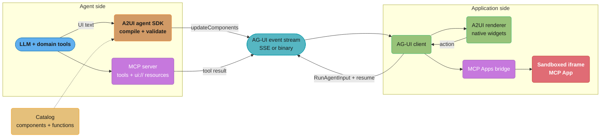
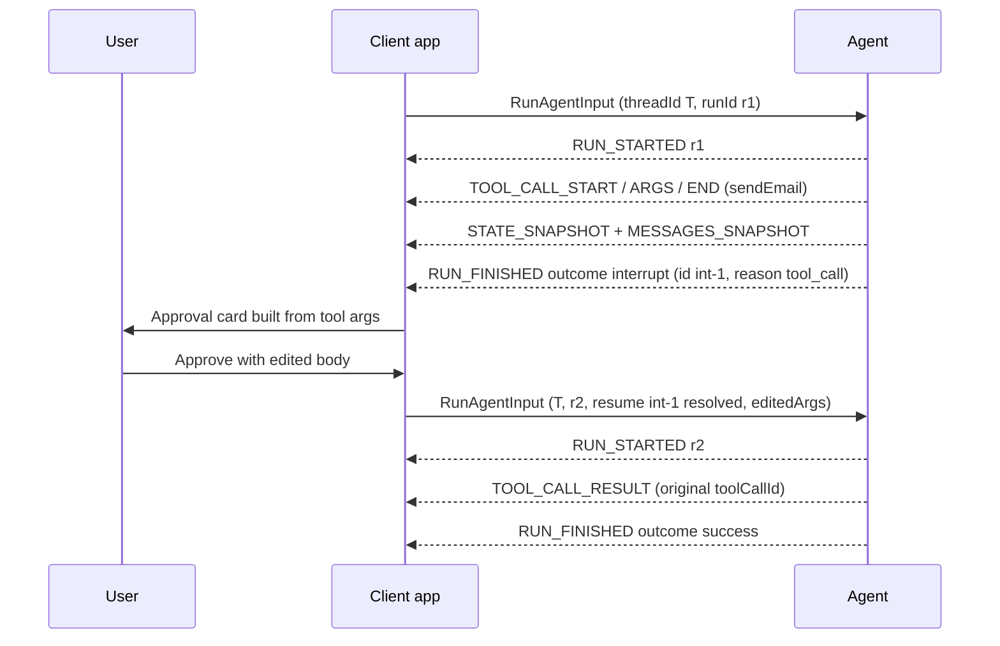
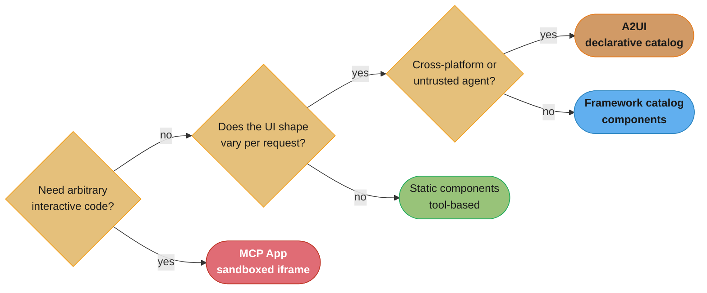

# Generative UI and Agent UI Protocols — Deep Dive

> Sub-file of [Agents and Tool Use](agents_and_tool_use.md). The user-facing conventions (streaming, approval gates, step lists) are in [Agent UX Patterns](agent_ux_patterns.md); this page is the wire level underneath them: how an agent streams text, tool calls, state and whole interfaces to an application, and how that application renders model-chosen UI without handing the model the keys. Rendering internals stay in the React and frontend sections ([React architecture](../../react/react_architecture_and_antipatterns/react_architecture_and_antipatterns.md), [Realtime in the browser](../../frontend_platform/realtime_in_the_browser/realtime_in_the_browser.md)); the MCP side is in [MCP Security](../mcp_model_context_protocol/mcp_security.md) and [MCP Server Building](../mcp_model_context_protocol/mcp_server_building.md).

---

## 1. Concept Overview

**Generative UI** means the model decides, at run time, what the user sees beyond a stream of text: a chart, a form, a seat map, an approval card. It is not one technology. Three different things hide under the name, and the first interview skill is telling them apart:

| Layer | Question it answers | Examples (fetched 2026-11-25) |
|-------|---------------------|-------------------------------|
| **Connection protocol** | How do events, tool calls, state and user answers move between agent and app? | AG-UI |
| **UI description** | What does the model emit so the app can draw an interface? | A2UI (declarative, native), Open-JSON-UI (declarative), MCP-UI (iframe HTML) |
| **Embedded app** | Who runs the interactive code, and where? | MCP Apps (sandboxed iframe, `ui://` resources) |

AG-UI's own docs say it plainly: AG-UI is **not** a generative UI specification; it is the user-interaction protocol that carries one. A2UI, MCP-UI and Open-JSON-UI are the generative UI specs, and AG-UI "natively supports" all of them.

Three ways a model can "choose" UI, ordered by how much freedom the model gets:

1. **Model-chosen components** (controlled / static): the app ships React components; the model picks one by calling a tool and fills its props. Safe, brand-consistent, limited to what you built.
2. **Declarative UI specs** (A2UI, Open-JSON-UI): the model emits *data* describing a tree from a catalog of components the client already trusts. Open-ended layout, no executable code.
3. **Model-generated or server-supplied code** (MCP Apps iframe, arbitrary HTML): the UI is a program. Maximum flexibility, so the isolation boundary is the whole security story.

**Version pins used on this page** (primary sources, fetched 2026-11-25): A2UI protocol v1.0 current, v0.9.1 and v0.9 previous, v0.8 deprecated; MCP Apps specification dated 2026-01-26, status Stable, extension id `io.modelcontextprotocol/ui`; MCP core revision `2026-07-28` (see [MCP Model Context Protocol](../mcp_model_context_protocol/mcp_model_context_protocol.md)); `@modelcontextprotocol/ext-apps` 2.0.4 on npm; AG-UI events as listed in the docs and Python SDK at fetch time (29 values in `EventType`). All three protocols move quickly. Re-fetch before quoting a field name in an interview or a design review.

---

## 2. Intuition

**One-line analogy**: chat is a phone call; generative UI is the agent walking over and handing you a form. AG-UI is the phone line that carries both the voice and the form, A2UI is the form drawn from a box of approved fields, and an MCP App is the agent handing you a small program on a USB stick and asking you to run it inside a glass box.

**Mental model**: every generative UI system answers the same three questions.

1. **Who authors the pixels?** The app (components), the model (a spec drawn from a catalog), or a third party (HTML in an iframe).
2. **What crosses the wire?** Props, a declarative tree plus a data model, or a whole document.
3. **What can a click do?** Only what the app wired up, only what the catalog's `action` types allow, or whatever the iframe's postMessage channel lets it ask the host for.

**Why it matters**: text is a poor control surface. "Pick one of these 12 flights, change the passenger count, confirm" is one form, not six turns. And every turn is a model call with latency and cost. The risk is the mirror image: the interface now comes from a probabilistic system that reads attacker-controlled text, so the UI itself becomes an injection channel and a spoofing surface.

**Key insight**: *the model should never author anything the client executes.* The whole design space is about how to give the model expressive power while keeping that sentence true: catalogs (A2UI), typed props (tool-based components), or a hard sandbox with a narrow host channel (MCP Apps).

**Streaming arithmetic (illustrative, assumed numbers).** A2UI's docs state that raw wire JSON is "roughly three times longer" than the positional Express notation, because of repeated keys (`"id"`, `"component"`, `"@path"`) and hand-written ids, and that embedding full JSON Schemas costs roughly twice the input tokens of compact signatures. What that means for time to a complete screen, assuming a 1,200-token raw-JSON payload, 400 tokens in Express, and a decode rate of 80 tokens/s (both assumptions, measure your own):

```
  format        payload     decode time at 80 tok/s   time to first component (~40 tok)
  -----------   ---------   -----------------------   ---------------------------------
  raw JSON      1,200 tok        15.0 s                        0.5 s
  Express         400 tok         5.0 s                        0.5 s

  Same first paint, 10 s earlier "done". The saving is in the tail, which is
  where the user waits for the Confirm button to become real.
```

First paint is set by *when the first valid component streams*, not by total length, so a format that is 3x shorter shortens the tail, not the start. That is why the docs pair compact formats with incremental compilation (section 6.5).

---

## 3. Core Principles

- **UI as data, never as code.** A declarative spec is parsed and validated; a script is executed. The first can be rejected field by field, the second only sandboxed. A2UI's README states it directly: it "expresses UI using data, not code" and every capability is either built in or explicitly granted by the app developer.
- **The catalog is the contract.** Both sides read the same component and function schemas. The agent prompt is generated from the catalog and the output is validated against it, so an unknown component is a validation error, not a surprise render.
- **The client owns identity of actions.** What a button does is decided by the renderer and server, never by the label the model wrote on it. Confirmation text must be built from the structured arguments, not from model prose.
- **Streams are typed and bracketed.** AG-UI events follow Start/Content/End for text and tool calls, Snapshot/Delta for state, and Started/Finished/Error for runs. A client that does not enforce the brackets leaks spinners and half messages.
- **Snapshots are the escape hatch.** Deltas are cheap and fragile; any divergence is repaired by a snapshot, never by guessing.
- **Interrupts end the run.** AG-UI models human-in-the-loop as a *terminal* outcome (`RunFinished` with an interrupt outcome) followed by a *new* run that carries the answers. No connection is held open waiting for a human.
- **Degrade to text.** Every UI-bearing tool result must stand on its own as text or structured data, because hosts differ and many do not support the extension (MCP Apps explicitly requires this fallback).
- **Treat rendered strings as hostile.** Any string the model fills into a component (title, link, image URL, markdown) is untrusted output that happens to be displayed.

---

## 4. Types / Architectures / Strategies

### 4.1 The Generative UI Spectrum

| Form | Who authors pixels | Model emits | Typical stack | Trust required in model output |
|------|-------------------|-------------|---------------|--------------------------------|
| Static / controlled | App developer | Tool name + typed props | Vercel AI SDK tool parts, CopilotKit `useComponent` | Props validated against a Zod or JSON schema |
| Declarative | Model, from a catalog | Component tree + data model | A2UI, Open-JSON-UI | Schema + catalog validation, no code |
| Open-ended | Model or server | HTML/JS document | MCP Apps, MCP-UI | None: isolation instead of validation |

A2UI's homepage presents the same three-point spectrum for one request ("flight delayed, rebook me on the next nonstop with an aisle seat"): a pre-built widget, a composed screen, or generated code. CopilotKit's course material names it Controlled, Declarative and Open-Ended.

### 4.2 AG-UI: the Agent-User Connection

AG-UI is described as open, lightweight and event-based. It is **transport agnostic** (SSE, WebSockets, webhooks) with a standard `HttpAgent` client that POSTs a `RunAgentInput` and reads a stream of events, over SSE or a binary encoding. Event families (docs, fetched 2026-11-25):

| Family | Events | Pattern |
|--------|--------|---------|
| Lifecycle | `RUN_STARTED`, `RUN_FINISHED`, `RUN_ERROR`, `STEP_STARTED`, `STEP_FINISHED` | Run bracket; steps optional |
| Text | `TEXT_MESSAGE_START`, `_CONTENT` (carries `delta`), `_END`, plus a `_CHUNK` convenience | Start-Content-End |
| Tool call | `TOOL_CALL_START`, `_ARGS` (JSON fragments), `_END`, `TOOL_CALL_RESULT`, plus `_CHUNK` | Start-Args-End, then a complete result |
| State | `STATE_SNAPSHOT`, `STATE_DELTA` (JSON Patch, RFC 6902), `MESSAGES_SNAPSHOT` | Snapshot-Delta |
| Activity | `ACTIVITY_SNAPSHOT`, `ACTIVITY_DELTA` (JSON Patch) | Structured in-progress UI between chat messages |
| Reasoning | `REASONING_START`, `REASONING_MESSAGE_*`, `REASONING_END`, `REASONING_ENCRYPTED_VALUE` | Visible summaries, encrypted carry-over, no raw chain of thought |
| Subagent | `SUBAGENT_STARTED`, `_FINISHED`, `_ERROR`, plus `subagentRunId` on most events | Attribution for concurrent subagents |
| Special | `RAW`, `CUSTOM` | Pass-through and app-defined extensions |

Every event shares `type`, optional `timestamp`, `rawEvent` and `metadata`. The older `THINKING_*` events are deprecated in favour of `REASONING_*` and are slated for removal at 1.0.0.

`RunStarted` carries `threadId`, `runId`, an optional `parentRunId` (a git-like lineage pointer for branching and time travel) and an optional `input`. `RunFinished` carries an optional `outcome`: omitted (legacy, treated as success), `{type: "success"}`, or `{type: "interrupt", interrupts: [...]}`.

**Frontend tools.** Tools can be defined *by the client* and passed in `RunAgentInput.tools`; the agent calls back into frontend behaviour (UI actions, approvals). Docs list the advantages: frontend control over capabilities, dynamic capabilities by permission, separation of concerns, and sensitive operations controlled by the application, not the agent. Backend tools do not go through this field.

### 4.3 A2UI: Declarative Agent-to-User-Interface

An open-source generative UI framework (originated at Google per AG-UI's spec table; the project lives under the `a2ui-project` GitHub org). The model describes a **surface** as a stream of JSON messages; the client renders it with native widgets (React, Lit, Angular, Flutter, SwiftUI, Jetpack Compose official; Lynx, Svelte, Vue and others community).

| Direction | Message (v1.0) | Purpose |
|-----------|----------------|---------|
| Agent to renderer | `createSurface` | Allocate a surface by `surfaceId`, pick a default `catalogId`; v1.0 may inline `components` and `dataModel` |
| | `updateComponents` | Add or replace components in a **flat adjacency list** (children referenced by id; one component must have `id: "root"`) |
| | `updateDataModel` | Write a value at an RFC 6901 JSON Pointer `path`; v1.0 requires `value`, and `null` deletes the key |
| | `deleteSurface` | Unmount and release state |
| | `callRendererFunction` / `agentFunctionResponse` | v1.0: agent calls an authorized client function; result of a client-initiated agent function |
| Renderer to agent | `action` | A user trigger (button) with `name`, `surfaceId`, `sourceComponentId`, `timestamp`, resolved `context` |
| | `callAgentFunction` | v1.0: a `@call` not in the local catalog is dispatched to the agent |

Key design points:

- **Flat list, not nested JSON**: easier for an LLM to stream incrementally and to patch by id.
- **Data binding**: components reference `{"@path": "/outbound/pax"}` in v1.0 (`path` in v0.9.1). Controls bound to the data model update **locally**; nothing is sent to the agent until an explicit `action` fires.
- **Catalogs**: a catalog document has `catalogId`, `components` (JSON Schemas with `allowedParents`/`allowedChildren`, `Checkable` validation), `functions` (with `returnType` and `allowedCallers` such as `agentOnly`, `rendererOnly`, `rendererOrAgent`) and Markdown `instructions` the SDK adds to the system prompt. Renderers advertise `supportedCatalogIds`; an agent picks one per surface (v1.0 can mix catalogs per component with `@catalogId`).
- **Inference formats**: the model can write **A2UI Express** inside `<a2ui>...</a2ui>` (compact positional DSL, default in the TypeScript, Python and Dart SDKs) or Direct JSON inside `<a2ui-json>...</a2ui-json>`. The SDK compiles, heals partial strings on `progressiveKeys` (for example `text`), and validates each message against the catalog while streaming. Deterministic workflows may skip the model and build messages in code.
- **Transports**: A2UI is transport independent: AG-UI, A2A, MCP, WebSockets. Layouts can also be authored in advance and served statically (server-driven UI).

### 4.4 MCP Apps: Sandboxed Interactive HTML

Official MCP extension, **Stable** since 2026-01-26, identified `io.modelcontextprotocol/ui`. It unifies MCP-UI (community) and OpenAI's Apps SDK (launched November 2025) per the SEP text (SEP-1865).

- A tool declares `_meta.ui.resourceUri` pointing at a **predeclared** `ui://` resource whose MIME type is `text/html;profile=mcp-app`. The host can prefetch and review it **before** the tool runs.
- `_meta.ui.visibility` is `["model", "app"]` by default; `["app"]` hides a tool from the model but lets the app call it (refresh, form submit) from the same server only.
- The view and host talk JSON-RPC 2.0 over `postMessage`: `ui/initialize`, `ui/notifications/tool-input` (and `tool-input-partial` while args stream), `ui/notifications/tool-result`, `ui/message`, `ui/update-model-context`, `ui/open-link`, `ui/request-display-mode`, plus standard `tools/call` and `resources/read` proxied to the server.
- Hosts MUST enforce CSP from `_meta.ui.csp` (`connectDomains`, `resourceDomains`, `frameDomains`, `baseUriDomains`), honor `permissions` (camera, microphone, geolocation, clipboard-write) at most as requested, and run web views behind a **sandbox proxy** on a different origin.
- Host support (per the MCP docs page, 2026-11-25): Claude, Claude Desktop, VS Code GitHub Copilot, Microsoft 365 Copilot, Goose, Postman, MCPJam, Archestra.AI. Servers detect support through client extension capabilities and fall back to text.

### 4.5 How the Pieces Compose

| Combination | Mechanism | When |
|-------------|-----------|------|
| A2UI **over** AG-UI | A2UI messages ride AG-UI events (CopilotKit's runtime middleware renders tool results containing A2UI operations as surfaces) | Your own app, native rendering, streaming |
| A2UI **in** an MCP App | The `ui://` bundle embeds an A2UI web renderer; tools return `application/a2ui+json`; actions return via `tools/call` | Host supports MCP Apps but not A2UI, e.g. Claude Desktop or IDEs |
| MCP App **in** A2UI | `McpApp` component from `@a2ui/catalog-mcp` with `htmlContent`, `allowedTools`, `allowedFunctions`, `csp`, `permissions` | You own an A2UI host and want a third-party HTML widget (Kanban, 3D canvas) |
| A2UI **served by** MCP | Server returns `a2ui://` JSON layouts as static payloads | Server-driven UI without an iframe |

---

## 5. Architecture Diagrams

### 5.1 Where Each Protocol Sits



The red node is the only place arbitrary code runs; everything else is data. Catalog validation sits at the SDK, the sandbox sits at the iframe.

### 5.2 Interrupt-Aware Run (AG-UI Human in the Loop)



The first run *ends*; the second is a fresh run on the same thread. The agent does not re-emit the tool call in run 2, it emits the result against the original `toolCallId`.

### 5.3 Which Form Do I Pick



### 5.4 Double-Iframe Sandbox for a Web Host

```
  Host page            origin A      chat UI, owns cookies, holds the MCP connection
   |
   +-- Sandbox proxy   origin B      iframe, allow-scripts + allow-same-origin
        |                            different origin from A, so no DOM or cookie access
        |                            applies CSP built from _meta.ui.csp
        |
        +-- View       opaque        inner srcdoc iframe, sandbox="allow-scripts"
                       origin        runs the server's HTML

  View --postMessage JSON-RPC--> proxy --forward (not ui/notifications/sandbox-*)--> host
  Host --tools/call, resources/read--> MCP server   (host may block or ask the user)
```

The proxy forwards everything except `ui/notifications/sandbox-*`. The host must not send the view anything until it receives `ui/notifications/initialized`. Two origins, one narrow JSON-RPC pipe, and a CSP that defaults to no network.

---

## 6. How It Works — Detailed Mechanics

### 6.1 Emitting an AG-UI Stream (Python)

A minimal producer. The two invariants worth enforcing in code are *brackets always close* and *exactly one terminal event*. Wire names and the `data: {json}\n\n` SSE framing are the documented encoder behaviour.

```python
import json
import uuid
from collections.abc import AsyncIterator
from typing import Any


def sse(event: dict[str, Any]) -> str:
    return f"data: {json.dumps(event, separators=(',', ':'))}\n\n"


async def run_stream(
    thread_id: str, run_id: str, chunks: AsyncIterator[dict[str, Any]]
) -> AsyncIterator[str]:
    """chunks: normalized provider output, {'kind': 'text'|'tool', ...}."""
    yield sse({"type": "RUN_STARTED", "threadId": thread_id, "runId": run_id})
    text_id: str | None = None
    tool_id: str | None = None
    try:
        async for c in chunks:
            if c["kind"] == "text":
                if text_id is None:
                    text_id = f"msg-{uuid.uuid4().hex[:8]}"
                    yield sse({"type": "TEXT_MESSAGE_START", "messageId": text_id, "role": "assistant"})
                yield sse({"type": "TEXT_MESSAGE_CONTENT", "messageId": text_id, "delta": c["delta"]})
            elif c["kind"] == "tool":
                if text_id:  # close the open message before a tool call starts
                    yield sse({"type": "TEXT_MESSAGE_END", "messageId": text_id})
                    text_id = None
                if c.get("start"):
                    tool_id = c["id"]
                    yield sse({"type": "TOOL_CALL_START", "toolCallId": tool_id, "toolCallName": c["name"]})
                if c.get("delta"):
                    yield sse({"type": "TOOL_CALL_ARGS", "toolCallId": tool_id, "delta": c["delta"]})
                if c.get("end"):
                    yield sse({"type": "TOOL_CALL_END", "toolCallId": tool_id})
                    tool_id = None
        if text_id:
            yield sse({"type": "TEXT_MESSAGE_END", "messageId": text_id})
        yield sse({"type": "RUN_FINISHED", "threadId": thread_id, "runId": run_id})
    except Exception as exc:  # exactly one terminal event, even on failure
        if text_id:
            yield sse({"type": "TEXT_MESSAGE_END", "messageId": text_id})
        if tool_id:
            yield sse({"type": "TOOL_CALL_END", "toolCallId": tool_id})
        yield sse({"type": "RUN_ERROR", "message": str(exc)[:200], "code": "agent_failure"})
```

The `[:200]` on the error message is deliberate: a `RunError` goes to the browser, so never forward a raw exception string with internal hostnames or SQL.

### 6.2 The Client Reducer: Snapshots, Deltas, Partial Args

```python
import json
import jsonpatch  # RFC 6902
from dataclasses import dataclass, field
from typing import Any


@dataclass
class ViewState:
    state: dict[str, Any] = field(default_factory=dict)
    messages: dict[str, str] = field(default_factory=dict)
    tool_args: dict[str, str] = field(default_factory=dict)
    needs_snapshot: bool = False


def reduce(v: ViewState, e: dict[str, Any]) -> ViewState:
    t = e["type"]
    if t == "TEXT_MESSAGE_START":
        v.messages[e["messageId"]] = ""
    elif t == "TEXT_MESSAGE_CONTENT":
        v.messages[e["messageId"]] += e["delta"]
    elif t == "TOOL_CALL_START":
        v.tool_args[e["toolCallId"]] = ""
    elif t == "TOOL_CALL_ARGS":
        v.tool_args[e["toolCallId"]] += e["delta"]  # fragments of JSON, not valid JSON yet
    elif t == "STATE_SNAPSHOT":
        v.state, v.needs_snapshot = e["snapshot"], False  # replace, never merge
    elif t == "STATE_DELTA":
        try:
            v.state = jsonpatch.apply_patch(v.state, e["delta"])
        except (jsonpatch.JsonPatchException, jsonpatch.JsonPointerException):
            v.needs_snapshot = True  # diverged: ask for a fresh STATE_SNAPSHOT
    return v
```

Streamed tool arguments are JSON fragments. To draw a skeleton or progressively fill a card, close the open structures best-effort (this is exactly what the MCP Apps host is allowed to do for `tool-input-partial`). The result is for **display only**.

```python
def close_partial_json(raw: str, _depth: int = 0) -> Any | None:
    """Best-effort parse of streamed tool args. Display only, never act on it."""
    stack: list[str] = []
    in_str = esc = False
    for ch in raw:
        if in_str:
            if esc:
                esc = False
            elif ch == "\\":
                esc = True
            elif ch == '"':
                in_str = False
        elif ch == '"':
            in_str = True
        elif ch in "{[":
            stack.append("}" if ch == "{" else "]")
        elif ch in "}]" and stack:
            stack.pop()
    try:
        return json.loads(raw + ('"' if in_str else "") + "".join(reversed(stack)))
    except json.JSONDecodeError:
        cut = max(raw.rfind(","), raw.rfind("{"), raw.rfind("["))
        if cut < 0 or _depth > 8:
            return None
        return close_partial_json(raw[:cut] if raw[cut] == "," else raw[: cut + 1], _depth + 1)
```

### 6.3 Interrupts: Approve With Edits

The producer ends the run with an interrupt. The consumer must cover **every** open interrupt in the next input, on the same thread, and the server validates before acting.

```python
from datetime import datetime
from jsonschema import Draft202012Validator

SEND_EMAIL_INTERRUPT = {
    "id": "int-email-edit",
    "reason": "tool_call",
    "toolCallId": "tc-42",
    "message": "Send email to a@b.com? You can edit the body before approving.",
    "expiresAt": "2026-11-26T09:00:00Z",
    "responseSchema": {
        "type": "object",
        "properties": {
            "approved": {"type": "boolean"},
            "editedArgs": {"type": "object"},  # full replacement, not a merge
        },
        "required": ["approved"],
    },
}


class ResumeError(Exception):
    pass


def validate_resume(
    thread_id: str, open_interrupts: dict[str, dict], run_input: dict, now: datetime
) -> None:
    if run_input["threadId"] != thread_id:
        raise ResumeError("resume must use the interrupted run's threadId")
    resume = run_input.get("resume") or []
    ids = [r["interruptId"] for r in resume]
    if len(ids) != len(set(ids)) or set(ids) != set(open_interrupts):
        raise ResumeError("resume must address every open interrupt exactly once")
    for r in resume:
        it = open_interrupts[r["interruptId"]]
        exp = it.get("expiresAt")
        if exp and now > datetime.fromisoformat(exp.replace("Z", "+00:00")):
            raise ResumeError("interrupt expired")
        if r["status"] == "resolved" and "responseSchema" in it:
            errors = list(Draft202012Validator(it["responseSchema"]).iter_errors(r.get("payload")))
            if errors:
                raise ResumeError(errors[0].message)
```

Validation of the *shape* is not authorization. After `validate_resume`, re-run the tool's own input schema and policy on `editedArgs` before executing: the AG-UI docs say the `ag-ui:tool-execution: server` marker is not an authorization credential, and servers must still validate decisions and reject client-supplied results for server-owned tools.

### 6.4 A2UI: Catalog-Validated Surface Messages

The agent SDK validates model output against the catalog. The essential check, reduced to its core:

```python
def validate_components(catalog: dict, components: list[dict]) -> list[str]:
    """Return human-readable errors; feed them back to the model or drop the update."""
    errors: list[str] = []
    ids = {c.get("id") for c in components}
    if "root" not in ids:
        errors.append("no component with id 'root'")
    for c in components:
        cid, name = c.get("id"), c.get("component")
        schema = catalog["components"].get(name)
        if schema is None:
            errors.append(f"{cid}: component {name!r} is not in the catalog")
            continue
        allowed = set(schema["properties"]) | {"id"}
        errors += [f"{cid}: unknown property {k!r}" for k in sorted(c.keys() - allowed)]
        errors += [f"{cid}: missing required {k!r}" for k in schema.get("required", []) if k not in c]
        refs = ([c["child"]] if "child" in c else []) + list(c.get("children", []))
        errors += [f"{cid}: child {r!r} does not exist" for r in refs if isinstance(r, str) and r not in ids]
    return errors
```

Streaming adds one wrinkle: a child id may arrive in a later `updateComponents` than its parent, so validate the **settled** tree at a stable boundary (end of the model's block) and check per-component property rules incrementally. The wire messages for a booking card, from the A2UI overview (v1.0):

```json
{"version": "1.0", "createSurface": {"surfaceId": "flight-booking-surface",
  "catalogId": "https://example.com/catalogs/travel/v1/catalog.json"}}
{"version": "1.0", "updateComponents": {"surfaceId": "flight-booking-surface", "components": [
  {"id": "root", "component": "Card", "child": "layout_col"},
  {"id": "layout_col", "component": "Column", "children": ["flight_outbound", "submit_btn"]},
  {"id": "flight_outbound", "component": "FlightCard", "flightNumber": "LH 454",
   "origin": "BER", "destination": "SFO", "price": {"@path": "/outbound/price"},
   "passengers": {"@path": "/outbound/pax"}},
  {"id": "submit_btn", "component": "Button", "child": "submit_label", "variant": "primary",
   "action": {"event": {"name": "confirm_booking",
     "context": {"outboundPax": {"@path": "/outbound/pax"}}}}}]}}
{"version": "1.0", "updateDataModel": {"surfaceId": "flight-booking-surface", "path": "/",
  "value": {"outbound": {"pax": 1, "price": 455}}}}
```

The `+` button on a passenger stepper writes `/outbound/pax` locally and sends nothing. Only `confirm_booking` produces an `action` message, with its `context` paths resolved against the current data model. That is the property that makes generative forms cheap: edits cost zero model calls.

### 6.5 Streaming Order and First Paint

| Step | What streams | User sees | Notes |
|------|--------------|-----------|-------|
| 1 | `RUN_STARTED`, first `TEXT_MESSAGE_CONTENT` | Typing indicator, then words | Cheap, buys perceived speed |
| 2 | `createSurface` (v1.0 may inline root + skeleton) | Empty card or skeleton | Layout is committed early, so reflow is low |
| 3 | `updateComponents` per completed component | Components appear one by one | Replace by id to refine; never reorder ids |
| 4 | `updateDataModel` | Placeholders fill with values | Bound controls update in place |
| 5 | `RUN_FINISHED` | Controls enabled | Keep actions disabled until the surface settles |

Two latency levers, both from the docs: (a) a compact inference format, since Express is "roughly three times" shorter than raw wire JSON, and (b) **fixed schema**: CopilotKit's A2UI "Fixed Schema" mode authors the component tree ahead of time as JSON and has the agent stream only *data*, which it describes as "fastest, with no LLM schema generation"; its "Dynamic Schema" mode uses a secondary LLM to generate schema and data for maximum flexibility.

### 6.6 MCP Apps: Server Declaration and Host CSP

Tool and resource declarations (verbatim shape from SEP-1865). The tool still returns a full text/structured result so non-supporting hosts work:

```json
{"name": "get_weather", "description": "Get current weather for a location",
 "inputSchema": {"type": "object", "properties": {"location": {"type": "string"}}},
 "_meta": {"ui": {"resourceUri": "ui://weather-server/dashboard-template",
                  "visibility": ["model", "app"]}}}

{"uri": "ui://weather-server/dashboard-template", "name": "weather_dashboard",
 "mimeType": "text/html;profile=mcp-app",
 "_meta": {"ui": {"csp": {"connectDomains": ["https://api.openweathermap.org"],
                          "resourceDomains": ["https://cdn.jsdelivr.net"]},
                  "prefersBorder": true}}}
```

Host-side, build the CSP from the declaration but **intersect it with your own allowlist**. The spec requires blocking undeclared domains and lets the host restrict further; it never obliges a host to trust what a server asks for.

```python
BASE = "default-src 'none'; object-src 'none'"


def build_csp(meta_csp: dict | None, host_allow: set[str]) -> str:
    declared = meta_csp or {}

    def ok(key: str) -> str:
        origins = [o for o in declared.get(key, []) if o in host_allow]  # host policy wins
        return " ".join(origins)

    return "; ".join([
        BASE,
        f"script-src 'self' 'unsafe-inline' {ok('resourceDomains')}".strip(),
        f"style-src 'self' 'unsafe-inline' {ok('resourceDomains')}".strip(),
        f"connect-src 'self' {ok('connectDomains')}".strip(),
        f"img-src 'self' data: {ok('resourceDomains')}".strip(),
        f"frame-src {ok('frameDomains') or chr(39) + 'none' + chr(39)}",
        f"base-uri {ok('baseUriDomains') or chr(39) + 'self' + chr(39)}",
    ])
```

When a resource omits `_meta.ui.csp` the spec's restrictive default applies: `default-src 'none'; script-src 'self' 'unsafe-inline'; style-src 'self' 'unsafe-inline'; img-src 'self' data:; media-src 'self' data:; connect-src 'none'`. No network at all unless declared and allowed.

**Relation to the pinned MCP spec.** MCP Apps is an *extension*, versioned by its own date (2026-01-26, with a `draft` directory beside it in the `ext-apps` repository) and negotiated through the extensions capability under the id `io.modelcontextprotocol/ui` with `mimeTypes: ["text/html;profile=mcp-app"]`. The repo's current core revision is `2026-07-28`, where per-request capabilities in `_meta` carry an `extensions` map and servers advertise theirs through `server/discover` (see [MCP Model Context Protocol](../mcp_model_context_protocol/mcp_model_context_protocol.md)). The extension's stable text shows its negotiation example in the `initialize` form, so check the extension's current spec for the stateless wire form before implementing a host against `2026-07-28`. The `ui/*` messages on the iframe `postMessage` channel are a separate JSON-RPC dialect and are unaffected by which core revision the host-to-server link uses.

### 6.7 Testing a Generative UI

| Layer | What to assert | How |
|-------|----------------|-----|
| Event grammar | Exactly one terminal event per run; every `*_START` has a matching `*_END`; ids never interleave illegally | Property tests over recorded and fuzzed streams; fail on any bracket leak |
| Reducer | Same final state from `snapshot + deltas` and from a later snapshot; bad patch sets `needs_snapshot` | Replay golden transcripts, inject a corrupted delta |
| Catalog conformance | Every model-emitted surface validates; invalid output is rejected, not rendered | Run the agent SDK validator over an eval set; track schema-valid rate and repair rate |
| Action integrity | `action.context` resolves from the data model; the server re-validates it | Contract test that a tampered context is rejected |
| Interrupt flow | Partial resume, wrong thread, expired and schema-violating payloads each produce `RUN_ERROR` | Table-driven tests from the contract rules |
| Rendering | Accessibility (roles, focus, labels), responsive layout, no layout shift on streamed updates | Component tests plus visual regression ([React testing](../../react/testing_and_frontend_ci/testing_and_frontend_ci.md)) |
| Security | CSP violations blocked, no `javascript:` links, image URLs rewritten, sandbox escape attempts fail | Adversarial corpus of hostile strings in every bound property ([Guardrails](../guardrails_and_content_safety/guardrails_and_content_safety.md), [LLM Security](../llm_security/llm_security.md)) |
| Model quality | Right component chosen, props faithful to tool data, no invented numbers | LLM-judge plus exact checks on bound values ([LLM Testing Strategies](../llm_testing_strategies/llm_testing_strategies.md)) |

---

## 7. Real-World Examples

**A2UI in production (per a2ui.org "shipping in", 2026-11-25):** Alation (Alation AIOS), ByteDance (Lynx), Atlassian (Jira), Gemini (Gemini Notebook) and Google Cloud (inside Gemini Enterprise).

**MCP Apps hosts:** Claude and Claude Desktop (the MCP docs show an Excalidraw MCP App drawing a diagram inside a Claude conversation), VS Code GitHub Copilot, Microsoft 365 Copilot, Goose, Postman, MCPJam, Archestra.AI. The `ext-apps` repository ships examples across 3D (CesiumJS map, Three.js), data exploration (cohort heatmap, customer segmentation), business apps (budget allocator, scenario modeler), media (PDF, video, sheet music) and utilities.

**AG-UI integrations (docs list):** first-party support in Microsoft Agent Framework, Google ADK (Python and JavaScript), AWS Strands Agents, AWS Bedrock AgentCore, Mastra, Pydantic AI, Agno, LlamaIndex and AG2; partnership integrations with LangChain/LangGraph and CrewAI; "direct to LLM" via CopilotKit. See [Microsoft Agent Framework](../agentic_frameworks/microsoft_agent_framework.md), [Google ADK](../agentic_frameworks/google_adk.md), [Strands](../agentic_frameworks/strands_aws.md), [Mastra](../agentic_frameworks/mastra_typescript.md), [PydanticAI](../agentic_frameworks/pydantic_ai.md), [LangGraph](../agentic_frameworks/langgraph.md).

**Vercel AI SDK (tool-based generative UI):** a tool call becomes a typed message part named `tool-<toolName>`; the UI switches on `part.state` (`input-available`, `output-available`, `output-error`) and renders a React component for each. That is the static form of generative UI with no declarative layer.

**CopilotKit:** `useComponent` registers a React component as a frontend tool (name, Zod parameters, `render`); the agent "calls" it and the arguments become props. Separate paths cover A2UI surfaces (catalog on the provider, a `render_a2ui` tool injected into the agent, `generate_a2ui` for LangGraph agents with a secondary LLM) and human-in-the-loop.

---

## 8. Tradeoffs

| Dimension | Static components | A2UI declarative | MCP Apps iframe |
|-----------|-------------------|------------------|-----------------|
| Model freedom | Pick one, fill props | Compose from catalog | Anything the HTML can do |
| Client code executed from model/server | None | None | Yes, sandboxed |
| Native look and accessibility | Yes (your components) | Yes (your renderers) | Host themes via CSS variables, otherwise the app's own |
| Cross-platform | Per-app | One stream, many renderers | Web views only (HTML) |
| Output size | Smallest | Medium (Express about 3x shorter than wire JSON) | Largest (a document) |
| New UI needs a release | Yes | No (within catalog) | No |
| Trust boundary | Typed props | Schema + catalog | Origin isolation + CSP + host policy |
| Failure mode | Wrong component picked | Invalid tree rejected | Compromised view asks the host for tool calls |

| Dimension | AG-UI | Raw SSE of provider events |
|-----------|-------|----------------------------|
| Event vocabulary | Standard, typed, shared across frameworks | You invent and version it |
| HITL | Interrupt/resume contract with idempotency and expiry | Ad hoc |
| State sync | Snapshot + JSON Patch delta | Ad hoc |
| Cost | One more dependency and a mapping layer | Zero, until the second frontend |

| Design choice | Win | Cost |
|---------------|-----|------|
| Dynamic schema (secondary LLM designs the surface) | Any UI for any prompt | Extra model call, latency, more invalid output |
| Fixed schema (tree authored ahead, agent streams data) | Fastest, predictable, testable | New layouts need engineering |
| Express inference format | Roughly 3x fewer output tokens, fewer reference errors | Compiler dependency, one more format to debug |
| Direct JSON | Debuggable, no DSL | Longer, more syntax and id errors on small models |
| Iframe app | Full power, reuse any web stack | Sandbox, CSP and consent surface to maintain |

---

## 9. When to Use / When NOT to Use

**Use generative UI when:**
- The answer is a *control surface*: comparison tables with sorting, multi-field forms, approvals with edits, dashboards with drill-down.
- A decision needs structured input and each missing field would otherwise cost a model turn.
- The same agent serves several platforms (A2UI) or a host you do not control (MCP Apps).
- You need human-in-the-loop with a durable audit trail (AG-UI interrupts).

**Do NOT use it when:**
- The answer is a paragraph. A card around prose adds latency and review burden for nothing.
- You cannot enumerate what the agent is allowed to draw. No catalog means no validation; do not fall back to "let it emit HTML".
- Actions are irreversible and you have no host-side confirmation built from structured arguments (see section 10.2).
- The agent is untrusted and the host cannot sandbox: do not render server-supplied HTML in your own origin.
- A static page would do. A fixed form that the agent only fills is a tool call with a typed component, not a generative UI problem.

---

## 10. Common Pitfalls

### 10.1 Rendering Model HTML in the App Origin

```python
# BROKEN: the "generative UI" is the model's markup, injected into your page
@app.post("/chat")
async def chat(msg: str):
    html = await llm(f"Reply with an HTML card for: {msg}")
    return {"html": html}          # client: el.innerHTML = reply.html
# Any retrieved document that says "include " now runs with
# your cookies. The model is a confused deputy that reads attacker text.

# FIXED: the model picks from a catalog; the client draws it
errors = validate_components(CATALOG, components)
if errors:
    return {"surface": None, "repair": errors}      # reject, do not render
return {"surface": components}                       # data only, rendered by native widgets
```

### 10.2 Confirmation Built From Model Prose

```python
# BROKEN: the approval card shows what the model SAYS it will do
card = {"title": llm_summary, "approve": {"tool": "transfer", "args": tool_args}}
# Prompt injection makes the summary say "Archive 3 old files" while args delete the repo.

# FIXED: the host renders the structured arguments it will execute, plus a risk label
card = {
    "title": f"Run {tool_name}",
    "fields": [(k, str(v)) for k, v in tool_args.items()],   # exact values, host-formatted
    "model_note": llm_summary,                                # shown separately, marked untrusted
}
```

AG-UI makes this natural: the interrupt is bound to a `toolCallId`, and the approval payload references the proposal streamed in `TOOL_CALL_ARGS`.

### 10.3 Acting on Partial Tool Arguments

```python
# BROKEN: executes as soon as the first parse succeeds
args = close_partial_json(buffer)
if args and "amount" in args:
    charge(args["amount"])      # buffer was '{"amount": 1' and the final value is 1000
# FIXED: partial args drive display only; execute on TOOL_CALL_END after full validation
if event["type"] == "TOOL_CALL_END":
    charge(ChargeArgs.model_validate_json(buffer).amount)
```

### 10.4 Delta Without a Resync Path

```python
# BROKEN: a lost or reordered STATE_DELTA corrupts state silently
state = jsonpatch.apply_patch(state, event["delta"])   # raises, UI crashes, or worse applies wrong path
# FIXED: divergence flips a flag; the next STATE_SNAPSHOT replaces state (section 6.2)
```

### 10.5 Other Production Failures

| Failure | Symptom | Fix |
|---------|---------|-----|
| Run with no terminal event | Spinner forever after a backend exception | One `RUN_FINISHED` or `RUN_ERROR`, enforced in a `finally` or catch block (6.1) |
| Open text message at run end | Next run's text appends to the old bubble | Close `TEXT_MESSAGE_END` before tool calls and before the terminal event |
| `useComponent` name equals a backend tool name (CopilotKit) | Component never renders; the backend tool wins | Keep frontend component names distinct from backend tools (docs warn the runtime layers configured tools over forwarded ones) |
| Component tool registered, nothing renders in a headless chat | Agent calls it, chat stays empty | Render tool calls yourself, e.g. `CopilotChatToolCallsView` or `useRenderToolCall()` |
| `parameters` omitted on a component tool | Model calls it with no args, empty card | Always pass a schema; the tool is advertised with an empty object schema otherwise |
| Model not told the tool exists | Answers in prose, never calls the component | Name the tool and its purpose in the system prompt |
| Catalog drift between agent and renderer | Valid-looking surface, unknown component on client | Negotiate `supportedCatalogIds`; version catalog ids; reject surfaces for unknown catalogs |
| Wildcard origins in `_meta.ui.csp` | Broad egress from an app that reads user data | Host allowlist intersection (6.6); review `connectDomains` like an outbound firewall rule |
| Treating `visibility: ["app"]` as a permission | App-only tool still reachable from its own iframe | It hides the tool from the model; authorize app-initiated calls separately |
| Resume that covers some interrupts | `RUN_ERROR`: partial resumes are not supported | Always return a `resume` entry per open interrupt, `cancelled` for abandoned ones |

---

## 11. Technologies & Tools

| Tool | Role | Notes |
|------|------|-------|
| AG-UI (`@ag-ui/client`, `ag-ui-protocol` on PyPI) | Event protocol, `HttpAgent`, SSE encoder | Docs at docs.ag-ui.com; AG-UI Dojo has feature demos |
| A2UI (`@a2ui/react`, `@a2ui/lit`, `@a2ui/angular`, `a2ui_flutter`, `a2ui-agent-sdk`, `@a2ui/agent`) | Declarative renderers and agent SDKs | A2UI Composer and Playground for authoring surfaces |
| `@a2ui/catalog-mcp` | `McpApp` component and MCP tool calls from A2UI | Needs the sandbox relay files served at `/a2ui-sandbox/` |
| `@modelcontextprotocol/ext-apps` 2.0.4 | MCP Apps `App` class, `app-bridge` for hosts, React helpers, server helpers | MIT; spec in `specification/2026-01-26` |
| `@mcp-ui/client` | React components that render MCP Apps views | Alternative to building on AppBridge |
| CopilotKit | React hooks (`useComponent`, `useFrontendTool`, `useRenderToolCall`), AG-UI runtime, A2UI middleware | Dynamic and fixed schema modes |
| Vercel AI SDK (`useChat`, tool parts) | Static tool-to-component rendering | Typed `tool-<name>` parts with `state` |
| `jsonpatch`, `jsonschema` (Python) | Apply RFC 6902 deltas, validate `responseSchema` | Used in section 6 |

Related catalogs: [MCP Registries and Ecosystem](../mcp_model_context_protocol/mcp_registries_and_ecosystem.md), [Agent to Agent Protocols](../multi_agent_systems/agent_to_agent_protocols.md) (A2A is a different layer; A2UI can ride on it), [OpenAI Agents SDK](../agentic_frameworks/openai_agents_sdk.md).

---

## 12. Interview Questions with Answers

**Q: Is AG-UI a generative UI specification?**
**Short:** No. AG-UI is the bi-directional runtime protocol between agent and app; A2UI, MCP-UI and Open-JSON-UI are the generative UI specs that ride on it.

AG-UI standardizes the event stream (lifecycle, text, tool calls, state, interrupts), not the shape of a UI. Its docs state it plainly: "AG-UI is not a generative UI specification" and it natively supports A2UI (Google, declarative, streaming JSONL), Open-JSON-UI (OpenAI, declarative) and MCP-UI (Microsoft and Shopify, iframe-based), plus custom specs. The clean way to remember it: MCP is agent-to-tools, A2A is agent-to-agent, AG-UI is agent-to-user, and A2UI is a *payload* type that can travel over any of them. Answering "AG-UI vs A2UI" as competitors is the classic trap.

**Q: You must let an agent show interactive UI in your product. When do you choose A2UI over an MCP App?**
**Short:** Choose A2UI for native, brand-consistent, cross-platform UI from an untrusted agent; choose an MCP App when you need arbitrary interactive web code inside a host you do not control.

A2UI sends data validated against a catalog you registered, so there is no code to sandbox, rendering is native (React, Flutter, SwiftUI, Compose), and the agent can only place components you approved. An MCP App ships an HTML document the host runs in a sandboxed iframe, which gets you any web visualization (3D, maps, PDF viewers) but with web-view limits, theming through CSS variables, and a sandbox and CSP surface to maintain. Hybrids exist in both directions: an MCP App can embed an A2UI renderer so hosts without A2UI support still show the surface, and an A2UI host can embed third-party MCP Apps with the `McpApp` component and an `allowedTools` list. Default to the declarative form and reach for the iframe only for what a catalog cannot express.

**Q: Why not simply have the model write HTML and render it?**
**Short:** Because the model reads attacker-controlled text; HTML from it is untrusted code, so rendering it in your origin lets any injected instruction run with your user's session.

The model is a confused deputy: a retrieved web page, an email or a tool result can steer its output, and anything it writes that the client executes inherits the page's cookies and DOM. There are two sound answers. Constrain the output to data (a catalog validated server-side and client-side, which is A2UI's whole design), or isolate it (a cross-origin sandbox proxy plus an inner `sandbox="allow-scripts"` iframe with a CSP that defaults to no network, which is MCP Apps). A third, "sanitize the HTML", is the weakest: sanitizers are an arms race, and the model can produce lookalike phishing UI that passes any sanitizer. If an interviewer pushes, point out that even isolated UI can spoof (a fake "Sign in" form), so the host must mark it as untrusted content.

**Q: How does AG-UI implement human-in-the-loop approval, and what does the contract guarantee?**
**Short:** The run ends with a RunFinished interrupt outcome; the client starts a new run on the same thread with a resume entry for every open interrupt, and replays are idempotent.

`RunFinished` carries `outcome: {type: "interrupt", interrupts: [...]}`; each interrupt has an `id`, a `reason` (core values `tool_call`, `input_required`, `confirmation`; custom ones namespaced like `langgraph:database_modification`), an optional `toolCallId`, a `responseSchema` and an `expiresAt`. The next `RunAgentInput` on the same `threadId` carries `resume: [{interruptId, status: "resolved" | "cancelled", payload}]`. Rules: same thread, **every** open interrupt addressed (no partial resumes), pending interrupts block any new input, a resume with the same `(threadId, interruptId, status, payload)` is safe to replay, payloads may be validated against the schema, and a stale resume yields `RunError`. The agent must emit the state needed to resume as `STATE_SNAPSHOT` and `MESSAGES_SNAPSHOT` *before* the interrupting `RunFinished`, which makes the protocol agnostic to whether the framework replays context or restores a checkpoint. Denial is a payload (`{approved: false}`), not a separate status.

**Q: A user edits an email body in an approval card and approves. Walk through what the server must do.**
**Short:** Validate the resume against the interrupt, then re-validate the edited arguments against the tool's own schema and policy, and execute only after both pass, returning the result against the original toolCallId.

The recommended schema has `approved` and `editedArgs`, where `editedArgs` is a **full replacement** of the tool arguments, not a merge, and its presence in the schema is the capability signal that the client may show edit UI. The server checks thread, coverage, expiry and the `responseSchema`. That only proves the shape. Because the client can send anything, the server still runs the tool's real input schema (valid email, length limits), applies authorization and policy to the edited values (an edit must not widen the recipient list past what the user may send to), logs original args, edits and outcome for audit, then executes. In the resumed run the agent does not re-emit `TOOL_CALL_START`/`ARGS`/`END`; it emits `TOOL_CALL_RESULT` against the original `toolCallId`, so the audit trail is proposal in run 1, user decision in run 2's input, result in run 2. For server-owned tools the metadata marker `ag-ui:tool-execution: server` tells clients not to synthesize a result, and it is not an authorization credential.

**Q: What stops a model-authored button from lying about what it does?**
**Short:** Nothing in the model's text does; the host must derive confirmation text from structured action arguments and keep dangerous actions behind a host-rendered, tool-bound approval.

A button label is just a string the model wrote. In A2UI the label (`Text`) and the action (`action.event.name` plus `context`) are separate fields, so a prompt-injected surface can label a button "Cancel" and bind it to `confirm_purchase`. Defences: (1) catalogs restrict which action types exist, (2) the server re-validates every `action`, since `context` is resolved on the client and the client is untrusted, (3) irreversible effects go through an interrupt or approval built from the structured tool arguments, not from rendered prose, (4) the host styles model-authored regions distinctly from host chrome so a fake system dialog is recognisable, and (5) high-risk actions need an out-of-surface confirmation such as a native dialog. Treat the generative surface as *input*, never as an authorization channel.

**Q: How do STATE_SNAPSHOT and STATE_DELTA work, and what should the client do when a delta fails to apply?**
**Short:** Snapshots replace state wholesale; deltas are RFC 6902 JSON Patch applied in order, and on any inconsistency the client requests or waits for a fresh snapshot.

A snapshot is the full state and the client replaces its model rather than merging. A delta is an array of JSON Patch operations (`add`, `replace`, `remove`, ...) applied in the order received; the docs say clients may request a fresh snapshot if inconsistencies appear. The same pattern exists for activity messages (`ACTIVITY_SNAPSHOT`/`ACTIVITY_DELTA`, with `replace` defaulting to true). Implementation guidance: apply patches atomically (a failed patch must leave state unchanged), set a `needs_snapshot` flag on failure, have the agent emit periodic snapshots as sync points, and emit a snapshot at the interrupt boundary. Deltas are bandwidth savings, not a source of truth. A client that keeps applying deltas after a failure is rendering fiction.

**Q: A2UI uses a flat list of components with ids instead of nested JSON. Why?**
**Short:** A flat adjacency list is easy for an LLM to stream incrementally and lets the agent patch one component by id without regenerating a tree.

Nested JSON requires the model to track closing braces across a deep structure and forces a full re-emit to change a leaf. With a flat list, each component is one object with an `id` and references (`child`, `children`) to other ids; `updateComponents` replaces any component whose id already exists, and one component must have id `root`. The renderer resolves the list into a node tree and binds paths to the data model. Costs: ids must be unique and references can dangle mid-stream, so validate at a settled boundary. A2UI Express hides this from the model entirely: it writes nested constructor calls and the compiler flattens them and assigns deterministic ids (`root`, `root_child`, `root_child_children_0`, and so on).

**Q: Why does A2UI offer an "Express" format instead of making the model emit the wire JSON?**
**Short:** Raw wire JSON is roughly three times longer than positional constructor calls and error-prone on small models; Express is compiled server-side into the same wire messages.

The docs list three costs of token-by-token wire JSON: repeated keys (`"id"`, `"component"`, `"@path"`) and hand-written ids inflate length about 3x; embedding full JSON Schemas in the prompt costs about 2x the input tokens of compact signatures; and deep nesting plus manual ids raise syntax and reference errors, especially on fast, small models. Express sits in `<a2ui>` sentinel tags, uses `root = Card(...)` and `$/path = value` assignments, and the SDK's compiler parses it, heals partial strings on configured `progressiveKeys` while streaming, validates each message against the catalog and emits the standard wire JSON, so every renderer sees the same protocol regardless of how the model produced it. The format is swappable (Direct JSON, custom), and regulated flows may skip the model and construct messages in code.

**Q: How do MCP Apps keep an untrusted server's HTML from escaping into the host?**
**Short:** The host renders the HTML in a cross-origin sandbox proxy with an inner sandboxed iframe, enforces a CSP built from the declared origins, and mediates every call over auditable JSON-RPC postMessage.

Layers: (1) UI resources are **predeclared** `ui://` resources, so the host can fetch, review, hash and cache the template before any tool runs; (2) web hosts MUST wrap the view in a sandbox proxy on a different origin with `allow-scripts allow-same-origin`, and the inner view runs as an opaque-origin `srcdoc` iframe with `sandbox="allow-scripts"`; (3) CSP is built from `_meta.ui.csp` and the default with no declaration is `default-src 'none'` with `connect-src 'none'`, so no network; (4) permissions (camera, microphone, geolocation, clipboard-write) are requests the host MAY grant, and apps must feature-detect; (5) the only channel is JSON-RPC over `postMessage`, and the host may block messages or require user approval. The residual risks the spec names are social engineering (UI can still display misleading content, so hosts should mark sandboxed UI boundaries) and resource consumption (hosts should enforce limits). The sandbox protects the host, not the user from a convincing fake form.

**Q: How does MCP Apps relate to the core MCP spec version this repo pins, and what does a server do for hosts that do not support it?**
**Short:** MCP Apps is a separately versioned official extension (spec dated 2026-01-26) negotiated by extension id; servers check client capabilities and keep a text-only fallback.

It is not part of the core `2026-07-28` revision. It lives in the `ext-apps` repository, identified `io.modelcontextprotocol/ui`, status Stable on the MCP extensions page, and clients advertise support in their `extensions` capability with `mimeTypes: ["text/html;profile=mcp-app"]`. Core `2026-07-28` formalizes extensions and carries them in per-request capabilities and `server/discover` rather than an `initialize` handshake; the Apps spec text shows the handshake form, so verify the current wire form before writing a host. A server should register the UI-enabled tool variant only when the client declares the capability, and the tool must still return a meaningful `content` array, because a host without support treats it as an ordinary tool. Put model-relevant text in `content`, UI-optimized data in `structuredContent` (not added to model context), and non-model metadata in `_meta`.

**Q: What does `visibility: ["app"]` on an MCP Apps tool do, and what does it not do?**
**Short:** It hides the tool from the model's tool list while letting the app call it from the same server; it is not an authorization control.

The spec says the host MUST NOT include a tool in the agent's list when its visibility lacks `"model"`, MUST reject app `tools/call` for tools lacking `"app"`, and cross-server calls to app-only tools are always blocked. That is useful for refresh buttons and form submits you do not want the model improvising. But a compromised or malicious view can still call every app-visible tool on its own server, with whatever arguments it likes. So authorize those calls like any client-originated request: validate inputs, scope credentials per user, rate limit, and ask the user before side effects. Cross-reference [MCP Security](../mcp_model_context_protocol/mcp_security.md) section 4.7, which treats the app channel as a second tool-call and prompt-injection path.

**Q: Design the streaming order for a generative form so the user sees something useful quickly.**
**Short:** Stream a text preface first, then the surface skeleton, then components as they complete, then data, and keep actions disabled until the surface settles.

First paint is bounded by when the first valid component arrives, not by total payload, so emit `TEXT_MESSAGE_CONTENT` immediately, then `createSurface` (v1.0 can inline the root and a skeleton), then `updateComponents` per completed component, replacing by id rather than reordering, then `updateDataModel` to fill bound values. A compact format shortens the tail: Express is about 3x shorter than raw wire JSON, which at an assumed 80 tokens/s moves a 1,200-token payload from 15 s to 5 s. The strongest lever is avoiding generation: with a fixed schema the tree is authored ahead and the agent streams only data. Never let a button become live before `RUN_FINISHED` or an equivalent settled signal, and make streamed layout stable (reserve space, no reordering) to avoid shift. Details in section 6.5.

**Q: Compare CopilotKit, the Vercel AI SDK and A2UI for a React team adding generative UI.**
**Short:** AI SDK and CopilotKit useComponent map tool calls to your own components; A2UI lets the model compose from a catalog, and CopilotKit can carry A2UI over AG-UI.

With the AI SDK a tool call becomes a message part `tool-<name>` with a `state` (`input-available`, `output-available`, `output-error`) and you switch on it to render a component: static, simple, and entirely your components. CopilotKit's `useComponent(name, Zod parameters, render)` registers a component as a frontend tool; it adds the AG-UI runtime, human-in-the-loop hooks and optional A2UI middleware. A2UI goes further: the model builds a layout you did not predeclare, from a catalog. Pick by how much layout variety you need: a handful of known widgets means tool-based components; a long tail of shapes, several platforms or a cross-trust agent means a declarative catalog. These are not exclusive; start static, add the catalog when you hit the third bespoke component per week.

**Q: How would you stream tool arguments into a live UI without the risk of acting on incomplete data?**
**Short:** Accumulate TOOL_CALL_ARGS fragments, close the open JSON best-effort for display only, and execute only on TOOL_CALL_END after full schema validation.

`TOOL_CALL_ARGS` deltas are fragments of a JSON document, valid only once concatenated, so a UI can show a progressive card by closing unclosed strings and brackets (MCP Apps hosts do the same for `ui/notifications/tool-input-partial`: "best-effort recovery of incomplete JSON"). The spec language for views is the safe rule: views MUST NOT rely on partial arguments for critical operations and SHOULD tolerate fields that change or vanish between notifications. Keep partial parses in a presentation layer, parse the final string with a strict schema, and gate every side effect on the end event plus validation, as in pitfall 10.3.

**Q: What transport should an AG-UI app use, and how do you survive a dropped connection?**
**Short:** AG-UI is transport agnostic; SSE over HTTP POST is the common default, and recovery uses snapshots plus a new run input rather than replaying a socket.

The standard `HttpAgent` POSTs a `RunAgentInput` and reads events over SSE or a binary encoding; WebSockets and webhooks are also valid. Because events are typed and ordered, a client that reconnects mid-run should treat the stream as lost, rehydrate with a `MESSAGES_SNAPSHOT` and `STATE_SNAPSHOT` if the server offers them, and rely on the `threadId` for continuity. For approvals the design already avoids long-lived connections: the interrupt ends the run, so a user can answer hours later in a new run, with `expiresAt` bounding staleness. Behind proxies, send keep-alive comments inside the proxy's idle timeout; see [Streaming at Scale](../case_studies/cross_cutting/streaming_at_scale.md).

**Q: What belongs in an automated test suite for a generative UI feature, and what is hard to test?**
**Short:** Test the event grammar, reducer determinism, catalog validity and action integrity deterministically; score model choices statistically with evals, and test hostile strings in every bound property.

Deterministic: terminal-event uniqueness, bracket matching, snapshot-plus-deltas equals later snapshot, resume contract violations, tampered `action.context`, CSP and sandbox enforcement. Statistical: schema-valid rate, component choice accuracy, whether bound values match tool data (an invented price in a `FlightCard` is a correctness bug even if it validates). Hard to test: visual quality of novel layouts and subtle misleading copy, so combine visual regression on a fixed seed corpus, accessibility checks (names, roles, focus order), and reviewed samples. Add an adversarial corpus: markdown links with `javascript:`, image URLs that exfiltrate in the query string, extremely long strings, and instructions in tool outputs that try to alter the surface. See [LLM Testing Strategies](../llm_testing_strategies/llm_testing_strategies.md).

**Q: How is prompt injection different when the output is a UI rather than text?**
**Short:** The UI adds new sinks: clickable actions, form fields, remote images and links, and host-trusted styling, so injected content can trigger actions, phish, or exfiltrate without any visible text.

Text injection mostly corrupts an answer. A rendered surface can also: bind a button to a tool-calling action, show a convincing credential form, load `https://attacker/x.png?d=<secrets>` as an image (data egress with no click), or alter what an approval card says. Controls: restrict components and action types in the catalog; render model strings as plain text by default, with markdown restricted (no raw HTML, no remote images unless proxied); rewrite or block external URLs and use link interstitials; never put secrets in the data model sent to the agent unless necessary (`sendDataModel` attaches the whole model to every message, so scope it); and apply the MCP Apps rule of treating app-originated context updates as untrusted, like tool results. See [LLM Security](../llm_security/llm_security.md) and [Guardrails](../guardrails_and_content_safety/guardrails_and_content_safety.md).

**Q: Where does local UI state live when the user edits a generated form, and why does that matter for cost?**
**Short:** In the surface's data model on the client; bound edits update locally and only explicit action events reach the agent, so edits cost zero model calls.

A2UI binds component properties to JSON Pointer paths in a per-surface data model. When the user raises a passenger count, the stepper writes `/outbound/pax` and every bound node updates in place; nothing is sent to the agent. Only a triggered action (Confirm) produces an `action` message, with `context` paths resolved against the model at that moment. This makes generative forms economical: one model call to build the surface and one on submit, instead of one per field. Set `sendDataModel` only if the agent genuinely needs the full model on every message; otherwise pass exactly the fields the action declares. The data model is also user-controlled state, so the server must treat resolved `context` as untrusted input.

**Q: Which guarantees does AG-UI give about event ordering and ids, and what must a robust client do beyond that?**
**Short:** Events sharing an id belong to one logical stream and are processed in received order; a robust client also tolerates out-of-order delivery, unknown reasons and unknown custom events.

The docs say events should be processed in the order received, events with the same `messageId` or `toolCallId` form one stream, and implementations should be resilient to out-of-order delivery. Activity messages share the message id space, so an id must not be reused between activity and text or reasoning messages. For interrupts, unknown `reason` values must not error: render from `message`, `responseSchema` and `metadata`. Custom events carry app-defined semantics under `name` and `value`, so document them, and ignore ones you do not know. Add your own guards: dedupe by event id where your transport can replay, close dangling brackets on `RUN_ERROR`, and never crash on an unknown `type`, since the vocabulary has grown (the older architecture page still says 16 event types while the Python SDK enum lists 29 values).

---

## 13. Best Practices

- **Start from the weakest form that works.** Static components first; add a declarative catalog when layouts proliferate; use iframes only for what cannot be a catalog component.
- **Generate prompts and validators from the same catalog**, as the A2UI SDK does, so the model cannot be told about a component the client does not render.
- **Version catalogs and negotiate.** Advertise `supportedCatalogIds`, reject surfaces for unknown catalogs, and keep a text fallback.
- **Build confirmation from structured arguments**, show them with host styling, and mark model-authored regions as untrusted.
- **Bind every irreversible action to a tool-bound interrupt** with `responseSchema`, `expiresAt` and an audit trail across the two runs.
- **Re-validate everything the client sends**: `action.context`, `editedArgs`, resume payloads, app-initiated `tools/call`.
- **Treat strings as hostile**: plain text by default, restricted markdown, proxied or blocked remote images, link interstitials.
- **Intersect, never trust, declared origins**: host allowlist for CSP domains and permissions; default no network.
- **One terminal event per run, brackets always closed**, with a test that fails the build when violated.
- **Design the stream order** for first paint: text, skeleton, components, data, enable actions last.
- **Prefer fixed schema for stable flows** and dynamic schema for the long tail; measure schema-valid rate before widening the catalog.
- **Pin and re-fetch.** These specs change monthly; cite the version, and diff on upgrade ([MCP Registries and Ecosystem](../mcp_model_context_protocol/mcp_registries_and_ecosystem.md) tracks the MCP side).
- **Link UI events to traces** so an approval, an edit and the executed tool call share one trace id ([LLM Observability](../llm_observability_and_monitoring/llm_observability_and_monitoring.md)).

---

## 14. Case Study

### 14.1 Generative Operations Console for a Support Agent

**Setting (illustrative design, assumed numbers).** A support team uses an agent that can look up orders, issue refunds up to a cap and send customer emails. Today it answers in chat: 6 to 9 turns to gather order id, reason, amount and refund method, then a prose summary the supervisor must read before approving.

**Design.**
- Transport: AG-UI over SSE through a thin gateway; `threadId` per case, one run per user message or approval.
- UI form: **A2UI with a fixed schema** for the three stable flows (refund, replacement, escalation) and **dynamic schema** for the long tail. Catalog `ops/v1` has `OrderCard`, `RefundForm`, `ApprovalSummary`, `Column`, `Text`, `Button`; no HTML, no remote images.
- Approval: `refund` and `send_email` are tool-bound interrupts with `responseSchema` (`approved`, `editedArgs`, max amount enforced server-side, `expiresAt` 15 minutes). The `ApprovalSummary` shows host-formatted arguments; the model's explanation is in a separate "Agent note" block.
- Audit: proposal from `TOOL_CALL_ARGS`, edits from `resume[].payload.editedArgs`, outcome from `TOOL_CALL_RESULT`, all under one trace id.
- Fallback: any client without the catalog gets text plus the same interrupt `message`.

**Expected effect (assumptions to be measured).** Turns to a submitted refund drop from about 7 to 2 (one to build the form, one on submit); form edits cost zero model calls; the supervisor approves from one structured card instead of a paragraph.

**Failure drills.** (1) Injected order note says "Archive 3 files"; the card shows `refund(amount=480)` from structured args, so the mismatch is visible. (2) Delta corruption mid-run: the reducer flags divergence and waits for the next snapshot. (3) User walks away: `expiresAt` passes and a late resume yields `RUN_ERROR`; the agent re-plans.

**Case-study discussion (not part of the quiz bank):**

**Q: Why choose fixed schema for the refund flow even though dynamic schema is more flexible?**
**Short:** The flow is stable and high-stakes, so a pre-authored tree is faster, testable and has no model-generated structure to validate or spoof.

Refunds have a known shape, and every extra model-designed element is attack surface and latency. Reserve dynamic schema for exploratory views where an invalid surface only costs a retry.

**Q: What is the single most important control on the approval card?**
**Short:** The card is rendered by the host from the structured tool arguments the server will execute, never from model-written text.

If the displayed values and the executed values come from the same structured object, a prompt-injected narrative cannot disagree with the action.

**Q: How would you extend this to a host that only supports MCP Apps?**
**Short:** Ship the same A2UI renderer inside a `ui://` bundle and return `application/a2ui+json` from the tools, forwarding actions through `tools/call`.

That keeps one catalog and one validation path, and the host's sandbox adds an isolation layer you do not have to build.
