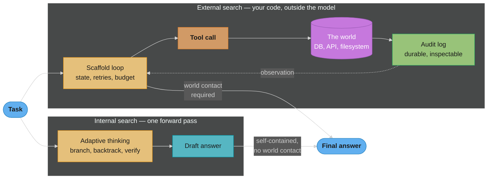
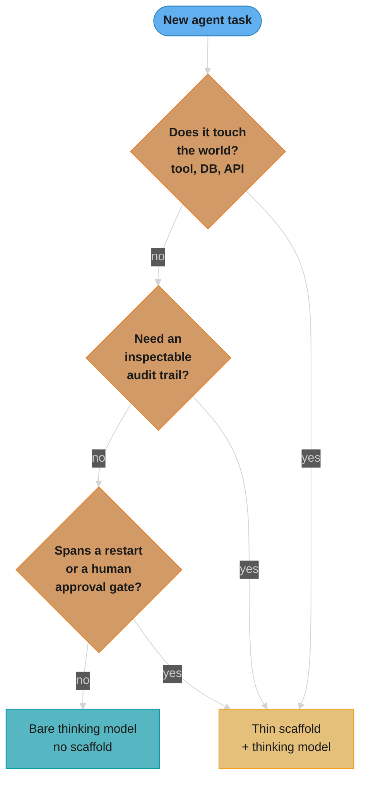

# Reasoning Models vs. Scaffolds — Deep Dive

---

## 1. Concept Overview

A native extended-thinking model and a hand-rolled agent scaffold both spend extra
compute to get a better answer, and it is tempting to treat them as competing
implementations of the same idea. They are not. A reasoning model performs its
search **inside one forward pass** — trained by RL to branch, backtrack and verify
before it commits to output, invisible to you and uneditable by you. A scaffold
performs its search **outside the model, in your code** — explicit state you can
log, inspect, checkpoint, retry, and resume. The question this file exists to
answer is not "which is better" but **where the boundary between them now sits**:
which parts of a Thought/Action/Observation loop a thinking model has absorbed,
and which parts cannot be absorbed by any model no matter how much it thinks,
because they require touching the world.

[ReAct & Reasoning Patterns](react_and_reasoning_patterns.md) already frames the
"where the reasoning lives" spectrum (prompted / native once-per-turn / native
interleaved) — this file starts where that table ends and answers the decision
question it raises but does not resolve: given a specific task, do you still need
the outer loop, and if so, what should be left in it.

---

## 2. Intuition

> **One-line analogy**: A thinking model is a chess grandmaster calculating twelve
> moves ahead in their head before touching a piece. A scaffold is the tournament
> arbiter who writes down every move on the scoresheet, enforces the clock, and
> is the only one allowed to actually move a piece on the board. The grandmaster's
> calculation got dramatically better; the arbiter's job did not get smaller by
> the same amount, because the arbiter is the only one with hands.

**Mental model**: before extended thinking, a ReAct scaffold had to do two jobs at
once — elicit good reasoning from the model (the `Thought:` field, prompted CoT)
and manage everything the reasoning could not do itself (call tools, hold state,
retry, log, cap cost). RL training gave frontier models the first job as a native
capability. What is left for the scaffold is exactly the second job, and only the
second job — which is smaller than the old scaffold, not zero.

**Why it matters**: teams that keep the old ReAct choreography around a thinking
model pay twice for the same reasoning and sometimes get a worse answer than
either half alone (see Section 10, Pitfall 1). Teams that delete the *entire*
scaffold on the theory that "the model thinks now" lose their tool loop, their
audit trail, and their ability to survive a process restart — the model cannot
call your database from inside its own forward pass, no matter how long it
thinks about calling it.

**Key insight**: internal search and external search are not two strengths of the
same muscle. Internal search buys *reasoning quality on a self-contained problem*.
External search buys *the ability to act on and be accountable to the world*. A
system needs the first when the problem is hard to think through; it needs the
second the instant it needs to touch anything outside the forward pass. Most
production agents need both, which is why the answer that actually shipped in
2026 is a *thin* scaffold, not no scaffold — see Section 4.

---

## 3. Core Principles

- **Search happens inside the forward pass or outside it — never as the same
  mechanism twice.** A reasoning model's thinking block is a single, opaque,
  RL-optimized search process. A scaffold's loop is a sequence of separately
  observable API calls. Prompting a thinking model to *also* narrate a
  Thought/Action loop asks it to run a second, prompt-level search process
  layered on top of the one it was trained to run natively — and the two are
  not guaranteed to agree (Section 10, Pitfall 1).
- **A forward pass has no side effects.** Nothing a model does *inside* its
  thinking can write to a database, call an API, or move a robot arm. Any task
  whose definition of success includes an effect on the outside world requires
  a mechanism outside the forward pass to produce that effect — this is not an
  engineering limitation to be optimized away, it is what "inside a forward
  pass" means.
- **Durability and auditability are properties of code state, not model
  state.** Anthropic's thinking blocks are summarized or encrypted rather than
  plain text you can grep, and on some models are dropped entirely once the
  turn ends (see [Reasoning Models §6](../reasoning_models/reasoning_models.md)).
  A record that must survive a process restart, satisfy a compliance review, or
  be diffed against a prior decision has to live in your scaffold's log, never
  in the model's own account of its reasoning.
- **Reasoning bought by thinking is billed as output tokens; reasoning bought
  by scaffolding is billed as steps.** These are structurally different cost
  shapes — see Section 6 of
  [Agent Cost & Token Budget](agent_cost_and_token_budget.md) for the scaffold
  side (`O(N^2)` re-sent context) and Section 8 below for the thinking side
  (unbounded per-call output). A production budget has to cap both, separately.
- **The 2026 convergence is subtraction, not addition.** The winning
  architecture is not "ReAct plus thinking" — it is ReAct's prompted reasoning
  choreography *deleted*, with tool dispatch, state, retries, budgets and an
  audit trail kept. See Section 4's "thin scaffold" row and Section 10 for what
  that deletion looks like as a diff.

---

## 4. Types / Architectures / Strategies

Five points on the same spectrum, from no scaffold to a scaffold that duplicates
what the model already does natively:

| # | Architecture | Where search happens | What the scaffold still owns | When it is the right call |
|---|---|---|---|---|
| 1 | Bare thinking model, no tools | Entirely internal | Nothing — one API call | Self-contained problems: proofs, single-file debugging, a closed-form calculation |
| 2 | Classic ReAct scaffold + non-reasoning model | Entirely external, prompt-elicited | Tool dispatch, state, retries, budget, **and** the reasoning elicitation itself (`Thought:` field) | Models without native thinking, or when you need the reasoning as plain loggable text and are willing to pay the prompting tax |
| 3 | Classic ReAct scaffold + thinking model (the anti-pattern) | Both — redundantly | Everything scaffold-2 owns, now fighting the model's own internal search | Never by design; this is what Section 10 Pitfall 1 shows going wrong |
| 4 | **Thin scaffold + thinking model** | Internal for reasoning, external only for what touches the world | Tool dispatch, state, retries, budget/step ceilings, audit log — nothing else | The default for 2026 tool-using agents; see Section 6 |
| 5 | Heavy external search (ToT/beam/MCTS) + thinking model | External search *and* internal search, deliberately layered | Everything scaffold-4 owns, plus generator/evaluator/pruning machinery | Large combinatorial spaces with a cheap, reliable external verifier the model cannot check for itself in one pass — see [Tree of Thoughts for Agents](tree_of_thoughts_for_agents.md) |

Row 3 is the one worth naming explicitly because it is the most common mistake,
not a strawman: it is what you get by upgrading an existing ReAct agent's model
to a thinking-capable one and changing nothing else. Row 5 is not obsolete —
`tree_of_thoughts_for_agents.md` §7 cites SWE-bench patch generation and code
debugging as live cases where an external verifier (test execution) is cheap,
deterministic and *better than the model's own judgment of its own reasoning*,
which is exactly the condition under which external search still earns its cost
even with a thinking model doing the generation at each node.

### What a thinking model genuinely subsumes

- **Prompt-level CoT elicitation** — "think step by step," scratchpad tags. RL
  training on verifiable tasks already produces this behavior; asking again in
  the prompt is redundant at best.
- **Most single-turn self-critique** — the three-prompt generate-critique-refine
  loop [Self-Refine](reflexion_and_self_correction.md#42-self-refine-madaan-et-al-2023)
  describes is close to what interleaved thinking now does in one call, where
  the model's own judgment is a reliable critic and no external grounding is
  needed (that file's §4.4 sycophancy caveat still applies).
- **Shallow ToT-style branching on a self-contained problem** — the beam search
  [Tree of Thoughts for Agents §4.5](tree_of_thoughts_for_agents.md#45-original-tot-paper-tasks)
  documents over AIME/crossword reasoning paths is now closer to what one
  high-effort thinking call attempts internally, when the problem needs no
  outside information.

### What no amount of thinking subsumes

- **Tool invocation and its result.** A `tool_use` block is a *request*; only
  the scaffold executes it and returns a `tool_result` — see [Reasoning Models §6](../reasoning_models/reasoning_models.md).
- **State that must survive a process restart.** The model has no memory
  across calls except what you re-send; durable state is a scaffold job by
  definition — see [Durable Long-Running Agents](durable_long_running_agents.md).
- **Human approval gates.** A model cannot pause itself and wait for a Slack
  approval; the scaffold stops the loop, persists where it stopped, and
  resumes on external signal.
- **An audit trail of what was decided and why.** The reasoning trace is the
  wrong artifact for this even when it is readable (Section 10, Pitfall 3).
- **Deterministic retries against a flaky API.** Thinking longer about
  *whether* to retry a 5xx does not make the HTTP call succeed.
- **Cost and step ceilings.** A model paces thinking against problem
  difficulty, not your budget — see Section 8 and Pitfall 2.
- **Multi-turn work spanning hours.** A `thinking` block ends with its turn; a
  six-hour research task needs a scaffold to hold the trajectory together.

---

## 5. Architecture Diagrams

### Internal search vs. external search over the same task



Both paths can run on the *same* model in the *same* system — the diagram is not
two products, it is two modes a single request either needs or does not. The
`WORLD` node is the whole argument: everything left of it can, in principle,
happen inside a thinking block; nothing right of it can.

### Does this task need a scaffold at all?



Any single "yes" routes to the thin scaffold — three independent triggers, one
outcome. A task earns the "no scaffold" leaf only by clearing all three: it
never touches the world, nobody needs to audit how it got its answer, and it
completes inside one turn with no approval step. That is a narrower category
than most agent work, which is why Section 9 treats the bare-model case as the
exception rather than the default.

---

## 6. How It Works — Detailed Mechanics

Before writing any code in this section, the `claude-api` skill was loaded for
current model IDs and parameter shapes — `thinking: {"type": "adaptive"}` plus
`output_config.effort` is the current adaptive-thinking surface on Claude Opus 5
and Claude Sonnet 5; `budget_tokens` is removed on both. The two functions below
implement the **identical task** — resolve a refund request by looking up an
order and deciding approve/deny — twice. `react_refund_agent()` is a classic
hand-rolled ReAct loop with a prompted `Thought:` field. `thin_refund_agent()`
strips the elicitation and keeps only what has to touch the world. The diff
between them *is* the argument from Sections 3 and 4.

```python
import json
import time
import uuid
from dataclasses import dataclass, field

import anthropic

client = anthropic.Anthropic()

GET_ORDER_TOOL = {
    "name": "get_order",
    "description": "Look up an order by id. Returns amount_usd and status.",
    "input_schema": {
        "type": "object",
        "properties": {"order_id": {"type": "string"}},
        "required": ["order_id"],
    },
}


def get_order(order_id: str) -> dict:
    # ponytail: fake order store — swap for a real DB lookup
    return {"order_id": order_id, "amount_usd": 42.50, "status": "delivered"}


# ---------------------------------------------------------------------------
# (a) Hand-rolled ReAct: the scaffold prompts the model to narrate reasoning
# ---------------------------------------------------------------------------

REACT_SYSTEM = """You resolve refund requests. Use this exact format:
Thought: <reason about what to check next>
Action: <tool call, or FINISH if you have decided>
Observation: <tool result, filled in by the system>
... repeat ...
Thought: I have enough information to decide.
FINISH: approve <order_id> | deny <order_id> <reason>

Refunds under $50 are auto-approved if the order was delivered."""


def react_refund_agent(order_id: str, model: str = "claude-sonnet-5") -> str:
    messages = [{"role": "user", "content": f"Refund request for order {order_id}."}]
    for _ in range(6):
        resp = client.messages.create(
            model=model, max_tokens=1024, system=REACT_SYSTEM,
            tools=[GET_ORDER_TOOL], messages=messages,
        )
        messages.append({"role": "assistant", "content": resp.content})
        if resp.stop_reason != "tool_use":
            return next(b.text for b in resp.content if b.type == "text")
        tool_use = next(b for b in resp.content if b.type == "tool_use")
        result = get_order(**tool_use.input)
        messages.append({"role": "user", "content": [
            {"type": "tool_result", "tool_use_id": tool_use.id,
             "content": json.dumps(result)},
        ]})
    return "escalate: step limit reached"


# ---------------------------------------------------------------------------
# (b) Thin scaffold: adaptive thinking replaces the prompted Thought field;
#     the scaffold keeps only what has to touch the world.
# ---------------------------------------------------------------------------

@dataclass
class RefundAuditLog:
    """The durable, inspectable record — never the model's thinking text,
    which is summarized/encrypted and is not a record you can replay."""
    entries: list[dict] = field(default_factory=list)

    def record(self, **kv) -> None:
        self.entries.append({"ts": time.time(), "id": str(uuid.uuid4()), **kv})


THIN_SYSTEM = """You resolve refund requests. Refunds under $50 are
auto-approved if the order was delivered. Call get_order, then answer with
exactly: approve <order_id> | deny <order_id> <reason>."""


def _price_usd(usage, model: str) -> float:
    # List pricing: Sonnet 5 $3.00 / $15.00 per 1M in/out; thinking tokens
    # bill at the OUTPUT rate. See Agent Cost & Token Budget §4.1 for the
    # full pricing table this is drawn from.
    rates = {"claude-sonnet-5": (3.00e-6, 15.00e-6),
             "claude-opus-5": (5.00e-6, 25.00e-6)}
    rate_in, rate_out = rates[model]
    return usage.input_tokens * rate_in + usage.output_tokens * rate_out


def thin_refund_agent(
    order_id: str,
    model: str = "claude-sonnet-5",
    max_steps: int = 6,
    max_cost_usd: float = 0.05,
) -> str:
    audit = RefundAuditLog()
    messages = [{"role": "user", "content": f"Refund request for order {order_id}."}]
    cost = 0.0

    for step in range(max_steps):
        # Budget ceiling: the model paces ITS OWN thinking against problem
        # difficulty, never against your dollar target (Section 8). Only the
        # scaffold can enforce a hard stop.
        if cost >= max_cost_usd:
            audit.record(event="budget_exceeded", cost_usd=cost)
            return f"escalate: budget exceeded (${cost:.4f})"

        resp = client.messages.create(
            model=model, max_tokens=2048, system=THIN_SYSTEM,
            thinking={"type": "adaptive"},        # interleaves after each tool result
            output_config={"effort": "low"},      # routine step — keep it cheap
            tools=[GET_ORDER_TOOL], messages=messages,
        )
        cost += _price_usd(resp.usage, model)

        # Echo content back VERBATIM. Thinking blocks carry a signature the
        # API verifies; rebuilding this list from just text + tool_use drops
        # it and the next call returns 400. See react_and_reasoning_patterns.md
        # "Interleaved Thinking Inside the Tool Loop" for the full rule.
        messages.append({"role": "assistant", "content": resp.content})

        if resp.stop_reason != "tool_use":
            decision = next(b.text for b in resp.content if b.type == "text")
            audit.record(event="decision", text=decision, cost_usd=cost, step=step)
            return decision

        tool_use = next(b for b in resp.content if b.type == "tool_use")
        result = get_order(**tool_use.input)      # the part that touches the world
        audit.record(event="tool_call", tool=tool_use.name,
                     args=tool_use.input, result=result)
        messages.append({"role": "user", "content": [
            {"type": "tool_result", "tool_use_id": tool_use.id,
             "content": json.dumps(result)},
        ]})

    audit.record(event="step_limit_reached")
    return "escalate: step limit reached"
```

**Reading the diff.** `react_refund_agent()` spends system-prompt real estate
teaching the model a `Thought:`/`Action:`/`Observation:` grammar it no longer
needs to be taught — Section 3's "what a thinking model subsumes." Both
functions still carry a step limit, a tool executor, message-history
management, and a scaffold-owned decision point about when to stop — Section
3's "what no amount of thinking subsumes." `thin_refund_agent()` adds two
things `react_refund_agent()` lacks entirely: a real cost ceiling and a
durable audit log distinct from the model's own account of its reasoning.
Neither addition is optional once the task can spend real money or needs to
answer "why was this refund denied" six months later.

---

## 7. Real-World Examples

**Claude Code** runs the thin-scaffold pattern in production: the harness owns
tool dispatch, file state, and the conversation loop; the model's adaptive
thinking does the step-by-step reasoning about what to read or edit next with
no prompted `Thought:` field in the system prompt. [Agent Cost & Token
Budget §7](agent_cost_and_token_budget.md) documents the caching half of the
same architecture (a long-lived `CLAUDE.md` prefix).

**Anthropic's published multi-agent research system** pairs an orchestrator
that spawns 3-5 parallel subagents with each subagent running its own
tool-use loop; the orchestrator's published gain over single-agent Claude Opus
4 (90.2% on Anthropic's internal research eval, per [ReAct & Reasoning
Patterns §7](react_and_reasoning_patterns.md#reflexion-in-research-agents))
comes from the scaffold's fan-out and context-isolation structure, not from
asking a stronger model to think longer in one call — the two are additive,
not substitutes.

**OpenAI's Responses API** is the clearest cross-vendor evidence that
reasoning state is scaffold-owned infrastructure, not a model output you can
discard between turns: [Reasoning Models §6](../reasoning_models/reasoning_models.md#reasoning-state-across-turns-and-tool-calls)
documents that carrying reasoning items forward (versus discarding them, as
Chat Completions does) measurably changed both task accuracy and cache
utilization on the *same* prompts — the scaffold's choice of what to persist
between calls is doing real work that no amount of in-call thinking can do
retroactively.

**Illustrative composite — a coding-agent team's 2025 architecture, dated by
its own admission**: a team building an autonomous PR-review bot in early
2025, before adaptive thinking shipped, built a hand-rolled Tree-of-Thoughts
layer (see [Tree of Thoughts for Agents](tree_of_thoughts_for_agents.md)) to
get multi-path reasoning about which of several plausible root causes was
correct. By mid-2026 the beam-search evaluator/generator machinery was
removed for the root-cause step — a single high-effort thinking call now does
that reasoning in one shot — while the tool-dispatch loop, the git-diff audit
log, and the human-approval gate before merging were untouched. This is not a
published case study; it is included because it is the shape Section 14 works
through in detail.

---

## 8. Tradeoffs

| Dimension | Hand-rolled ReAct scaffold (non-reasoning model) | Bare thinking model, no scaffold | Thin scaffold + thinking model | Heavy external search (ToT/MCTS) + thinking model |
|---|---|---|---|---|
| Reasoning quality on self-contained problems | Bounded by prompted CoT | High — RL-trained search | High — same as bare | Highest, at N x the calls |
| Can call tools / touch the world | Yes | No | Yes | Yes |
| Cost shape | Linear in scaffold steps | Unbounded per call (Section 9) | Both — capped by scaffold on top of per-call thinking | Multiplies scaffold steps by branching factor |
| Latency | N round-trips, each fast | One call, but thinking length is model-chosen | N round-trips, each variable-length | N x B round-trips |
| Controllability (hard step/cost ceiling) | Full — scaffold enforces | None — model self-paces | Full — scaffold enforces on top of `effort`/`task_budget` | Full, plus prune/beam controls |
| Observability / audit trail | Full — every Thought is plain text | None — thinking is opaque, may be discarded | Full — scaffold logs decisions and tool calls, not thinking text | Full, plus per-branch scores |
| Durability across restarts | Scaffold-owned, straightforward | Not possible — no state outside one call | Scaffold-owned, straightforward | Scaffold-owned, straightforward |
| Failure recovery | Repetition detection, retries in scaffold | None — a wrong internal path is invisible until the final answer | Retries + budget ceiling in scaffold | Backtracking is structural (Section 4, row 5) |
| Engineering cost | Prompt-tuning heavy | Lowest | Lowest scaffold, tuned `effort`/budget | Highest — generator, evaluator, pruning |

The bare-thinking-model column has no row where it wins outright once a task
touches the world even once — that column is included to make explicit what
Section 9 argues from the other direction: it is the right choice only for the
narrow band of tasks the Section 5 decision flowchart routes to `BARE`.

---

## 9. When to Use / When NOT to Use

### Use a bare thinking model, no scaffold, when:
- The task is fully specified in the prompt and needs no external information —
  a proof, a self-contained debugging question, a closed-form calculation.
- Nothing about the answer needs to be logged, approved, or replayed later.
- The task completes inside one turn with no multi-hour horizon.

### Use a thin scaffold + thinking model when:
- The task calls tools, queries a database, or otherwise touches the world —
  the default condition for almost all production agents.
- You need a cost ceiling more precise than "hope `effort: low` is enough."
- You need an audit trail distinct from the model's own account of its
  reasoning — compliance review, incident postmortems, "why did the agent do
  X."
- The task spans a process restart, a human approval gate, or multiple
  sessions.

### Keep (or add) heavy external search (ToT/beam/MCTS) when:
- The task has a large combinatorial space **and** a cheap, deterministic
  external verifier the model cannot reliably apply to its own output in one
  pass — unit test execution against generated patches is the canonical case
  in [Tree of Thoughts for Agents §9](tree_of_thoughts_for_agents.md#9-when-to-use--when-not-to-use).
- Backtracking across genuinely independent candidate solutions is valuable,
  not just deeper reasoning about one.

### Do NOT keep a prompted `Thought:`/ReAct choreography around a thinking
model:
- If the model already has native adaptive thinking, a prompted reasoning
  template is redundant at best and actively conflicting at worst — see
  Section 10, Pitfall 1. This is the single most common "should we delete
  this" question this file exists to answer, and the honest answer is usually
  yes.

---

## 10. Common Pitfalls

### Pitfall 1 (BROKEN -> FIX): a ReAct prompt fighting a thinking model's own reasoning

**Broken.** The scaffold's own `Thought:` prompting duplicates work the model
was already trained to do internally, and the two representations of "the
model's reasoning" — the hidden thinking block and the visible narrated text —
are not guaranteed to agree.

```python
# BROKEN: classic ReAct template wrapped around an adaptive-thinking model.
BROKEN_SYSTEM = """Use this exact format for every step:
Thought: <reason step by step about what to do next>
Action: <tool call>
Observation: <filled in by the system>
... repeat until you can answer ...
Thought: I now have enough information.
Final Answer: <answer>
"""

response = client.messages.create(
    model="claude-opus-5",
    max_tokens=4096,
    thinking={"type": "adaptive"},      # native search is ALREADY on
    system=BROKEN_SYSTEM,               # ...and now prompted to redo it in text
    tools=tools,
    messages=messages,
)
# Symptom A: the visible "Thought:" text restates the (hidden) thinking
# block's conclusion after the fact -- decorative, wasted output tokens.
# Symptom B: the model writes the Thought before its internal deliberation
# has actually settled, and the visible text and the eventual tool call
# disagree -- the exact "Thought-Action mismatch" failure mode
# react_and_reasoning_patterns.md §10 describes, now caused by the prompt
# fighting the model's own trained behavior instead of by a weak model.
```

**Fixed.** Drop the elicitation. State the outcome contract; let adaptive
thinking do the reasoning it was trained to do, and tune depth with `effort`
instead of with prose.

```python
# FIXED: no Thought field. Adaptive thinking does the reasoning; the system
# prompt states only the outcome contract and the tools available.
FIXED_SYSTEM = """Resolve the request. Call tools as needed, then answer
with exactly: approve <id> | deny <id> <reason>."""

response = client.messages.create(
    model="claude-opus-5",
    max_tokens=4096,
    thinking={"type": "adaptive"},
    output_config={"effort": "high"},   # tune depth here, not with prose
    system=FIXED_SYSTEM,
    tools=tools,
    messages=messages,
)
```

The general rule: if you are about to write a system-prompt instruction whose
entire job is to make the model articulate its reasoning before acting, check
whether the model already has native thinking first. On a thinking model that
instruction is not neutral — it is asking for a second, prompt-level search
process layered on top of the trained one.

### Pitfall 2: an unbounded thinking budget, so one hard task costs 50x the median

**Broken.** Every step gets the same "figure it out" instruction regardless of
difficulty. The model paces its own thinking against the problem, not against
your cost target — a routine lookup and a genuinely ambiguous edge case both
run at `effort: max`, so the hard case's thinking tokens (billed at the output
rate) can run the call all the way to `max_tokens` on their own.

```python
# BROKEN: no ceiling on how much a single step may think, and no routing
# by step difficulty.
resp = client.messages.create(
    model="claude-opus-5", max_tokens=32000,
    thinking={"type": "adaptive"},
    output_config={"effort": "max"},      # every step, regardless of difficulty
    tools=tools, messages=messages,
)
# Median task: ~$0.02. One ambiguous edge case: thinking runs long enough to
# approach max_tokens on its own -- north of $1.00, 50x+ the median, with no
# ceiling that would have caught it earlier.
```

**Fixed.** Route `effort` by step type — most steps are routine and do not
need `max` — and cap total spend with a task budget so a single run cannot
blow through the median by orders of magnitude regardless of how the model
paces itself. Full budget mechanics (per-task caps, model cascading,
compaction) are in [Agent Cost & Token Budget](agent_cost_and_token_budget.md);
this shows only the thinking-specific half.

```python
# FIXED: route effort by step type, and cap total spend with a task budget.
EFFORT_BY_STEP = {"classify": "low", "tool_call": "medium", "final_decision": "high"}

with client.beta.messages.stream(
    model="claude-opus-5", max_tokens=32000,
    thinking={"type": "adaptive"},
    output_config={
        "effort": EFFORT_BY_STEP[step_type],
        "task_budget": {"type": "tokens", "total": 20000},
    },
    betas=["task-budgets-2026-03-13"],
    tools=tools, messages=messages,
) as stream:
    resp = stream.get_final_message()
```

### Pitfall 3: mistaking the thinking trace for an audit trail

A summarized or encrypted thinking block is not a durable, replayable record —
it can be dropped between turns on some models, is not guaranteed
human-readable, and was never designed to be diffed against a prior decision.
Teams that skip `RefundAuditLog`-style logging on the theory that "the
reasoning is right there in the thinking block" discover the gap the first
time a reviewer asks why an agent approved something six weeks ago and the
answer is a `display: "omitted"` empty string. Log the scaffold's own decision
inputs and outputs — the tool calls made, the arguments passed, the final
branch taken — never the model's account of its own reasoning as the system
of record.

---

## 11. Technologies & Tools

| Tool | Role here | Notes |
|---|---|---|
| **Claude adaptive thinking** (`thinking: {"type": "adaptive"}`) | Internal search | `output_config.effort` (`low`-`max`) controls depth; interleaves after each tool result on current models |
| **Anthropic task budgets** (beta `task-budgets-2026-03-13`) | Scaffold-side cost ceiling on top of per-call thinking | Advisory, token-denominated; Section 10 Pitfall 2 |
| **[LangGraph](../agentic_frameworks/langgraph.md)** | Thin-scaffold state machine | `StateGraph` for the loop, retries, and checkpointing a thin scaffold needs |
| **OpenAI Responses API** | Reasoning-item persistence across turns | The cross-vendor case for scaffold-owned reasoning state, Section 7 |
| **[Sandboxed Code Execution](sandboxed_code_execution.md)** | The verifier for row-5 heavy external search | Test execution as a cheap external check the model cannot substitute for |
| **LangSmith / Langfuse** | Scaffold-side audit logging | Log decisions and tool calls, not the model's opaque thinking blocks (Pitfall 3) |
| **[Durable Long-Running Agents](durable_long_running_agents.md)** | State that must survive a restart | Temporal/Inngest/Restate-style checkpointing — never a model responsibility |

---

## 12. Interview Questions with Answers

**Q: What breaks when you wrap a classic ReAct Thought/Action prompt around a model that already has native adaptive thinking?**
**Short:** The prompted reasoning duplicates the model's trained internal search, and the two can visibly disagree.
The scaffold asks the model to narrate a second, prompt-level reasoning process on top of the RL-trained internal one it already runs. Two symptoms follow: the visible `Thought:` text either restates the hidden thinking block's conclusion after the fact — wasted output tokens with no new information — or is written before the internal deliberation has settled and contradicts the eventual tool call, reproducing the classic Thought-Action mismatch failure mode for a new reason. The fix is to delete the elicitation and control depth with `output_config.effort` instead of prose (Section 10, Pitfall 1).

**Q: Why can't you delete your tool-dispatch loop just because the model now has native thinking?**
**Short:** A forward pass has no side effects, so nothing inside thinking can call a tool or write to a database.
A `tool_use` block coming out of a thinking model is still only a request; something outside the model has to execute it and return a `tool_result`. No amount of internal reasoning changes this, because "inside a forward pass" and "has a side effect on the world" are mutually exclusive by construction. This is why every architecture in Section 4 past row 1 still owns a tool-dispatch loop regardless of how good the model's internal reasoning is.

**Q: What happens if you leave a reasoning model's thinking budget unbounded in production?**
**Short:** The model paces itself against the problem, not your budget, so one hard task can cost 50x the median.
A model self-paces its thinking against how hard it judges the problem to be, not against your cost target. A routine step and a genuinely ambiguous edge case running at the same `effort: max` setting produce wildly different thinking-token counts, and since thinking bills at the output rate, one hard task's cost can run tens of times the median with no ceiling catching it early. The fix is routing `effort` by step difficulty and capping total spend with a scaffold-owned task budget (Section 10, Pitfall 2).

**Q: Why is a thinking model's internal reasoning the wrong artifact for a compliance audit trail?**
**Short:** Thinking blocks are summarized or encrypted and can be dropped between turns, unlike scaffold-owned logs.
Anthropic's thinking blocks are returned summarized or encrypted rather than as plain, greppable text, and on several models are not retained once a turn ends. None of that makes them a durable record: a compliance review or an incident postmortem needs something you can diff against a prior decision months later, which only a scaffold-owned log of decision inputs and outputs — not the model's account of its own reasoning — can guarantee (Section 10, Pitfall 3).

**Q: Does interleaved thinking mean the scaffold no longer needs a Thought field at all?**
**Short:** Yes for the elicitation text, but the scaffold still owns dispatch, state, retries, budget, and logging.
Interleaved thinking moves the "reason again after seeing a tool result" step from a prompted, visible `Thought:` field into the model's own trained behavior — that specific elicitation job is genuinely gone. It does not move anything that requires touching the world: the scaffold still decides whether and how to execute the tool call the model requested, persists state across calls, retries on failure, enforces a step or cost ceiling, and writes the audit log. Deleting the Thought field is correct; deleting the loop around it is not.

**Q: What is the core distinction between internal search and external search in an agent?**
**Short:** Internal search runs inside one forward pass, RL-trained and opaque; external search runs in your code, inspectable.
Internal search is what a reasoning model does before committing to output within a single API call — branching, backtracking, and verifying, trained by RL, invisible to the caller and uneditable. External search is anything the scaffold does across multiple calls or actions — retries, tool dispatch, beam search over candidate plans — expressed as explicit, loggable state you can checkpoint and resume. They are not competing implementations of the same capability; one buys reasoning quality on a self-contained problem, the other buys the ability to act on and be accountable to the world.

**Q: Why was a reasoning model's chain of thought specifically trained to make prompted CoT redundant?**
**Short:** RL on verifiable tasks taught the model to explore and verify before answering, which is what prompted CoT elicits.
Reasoning models are trained with RL on tasks with verifiable outcomes — math, code — using a reward that requires the model to explore multiple approaches, self-correct, and verify before committing to a final answer, exactly the behavior classic chain-of-thought prompting was designed to elicit from a model that would not otherwise do it. Once that behavior is trained in and happens by default, an outer prompt instructing "think step by step" is asking for a capability the model already exercises, which is why it is redundant on these models specifically and was never redundant on models without that training.

**Q: What does a thinking model genuinely subsume from classic agent scaffolding patterns?**
**Short:** Prompt-level CoT elicitation, most single-turn self-critique, and shallow ToT-style branching on closed problems.
Three things: prompted chain-of-thought elicitation, since the RL training already produces the behavior the prompt was trying to elicit; most single-turn self-critique of the Self-Refine shape, for tasks where the model's own judgment is a reliable critic and no external grounding is needed; and shallow Tree-of-Thoughts-style branching on a problem that is fully specified in the prompt and needs no outside information, which a single high-effort thinking call now approximates. All three share a property: the reasoning never has to leave the forward pass.

**Q: What can no amount of internal thinking ever replace in an agent scaffold?**
**Short:** Tool execution, durable cross-restart state, human approval gates, audit trails, retries, and cost ceilings.
Six categories, all sharing the same root cause — a forward pass has no side effects and ends when the call ends: tool invocation and its result, state that must survive a process restart, human-in-the-loop approval gates, a durable audit trail distinct from the model's own reasoning account, deterministic retries against a flaky external API, and hard cost or step ceilings the model cannot enforce on itself. Every one of these requires code outside the model, regardless of how capable the model's reasoning becomes.

**Q: How does interleaved thinking change the ReAct loop's division of labor?**
**Short:** It moves "reason after seeing a tool result" into the model, but tool execution stays a scaffold job.
Before interleaved thinking, a model reasoned once at the top of a turn and reacted to later tool results with no fresh reasoning step — the classic reason interleaving exists. With it, the model produces a new thinking block after every tool result, which is ReAct's Thought field relocated from a prompted, visible system-prompt instruction into the model's native behavior. What does not move: the scaffold still executes the tool call the model requests, still owns the decision to stop the loop on a step or cost limit, and still logs what happened, because none of that can happen inside the thinking block that triggered it.

**Q: How does thinking-token cost compare structurally to scaffold-step cost?**
**Short:** Thinking cost is unbounded per call and billed as output tokens; scaffold cost is linear in explicit steps.
Thinking tokens are billed at the model's output rate and are not returned to the caller, and their count is chosen by the model per call based on problem difficulty rather than by you — so cost per call is effectively open-ended unless you cap it with `effort` or a task budget. Scaffold cost, by contrast, is the sum of explicit, countable steps, and grows with the number of tool round-trips the scaffold chooses to run — see [Agent Cost & Token Budget §2](agent_cost_and_token_budget.md#2-intuition) for why that sum is quadratic in re-sent context, not linear in step count. A production budget has to cap both terms separately; capping one does nothing to bound the other.

**Q: Why is a thin scaffold cheaper and more capable than either a bare thinking model or a full hand-rolled ReAct loop alone?**
**Short:** It keeps only what touches the world, so it pays scaffold overhead once instead of duplicating the model's reasoning.
A bare thinking model cannot touch the world at all, so it is not a competitor for tool-using tasks regardless of cost. A full hand-rolled ReAct loop around a thinking model pays for prompted reasoning elicitation the model no longer needs, on top of its own step overhead — Pitfall 1's redundant-search cost. A thin scaffold drops exactly that redundant piece and keeps only tool dispatch, state, retries, budget, and logging, so its overhead is the minimum the task's world-contact requires, layered under thinking that is already doing the reasoning work for free.

**Q: When does a hand-rolled Tree-of-Thoughts or beam-search scaffold still beat pure model thinking, even with a thinking model available?**
**Short:** When there is a large combinatorial space and a cheap external verifier the model cannot apply to itself.
When the task has a large space of candidate solutions and a deterministic, cheap external check exists that the model cannot reliably run against its own output in a single pass — unit test execution against generated code patches is the canonical example. The external verifier is doing something a forward pass cannot: actually running the candidate and observing a real result. In that condition the ToT/beam machinery in [Tree of Thoughts for Agents](tree_of_thoughts_for_agents.md) is not competing with the model's internal reasoning, it is supplying ground truth the model's own thinking has no access to.

**Q: Should you keep a repetition-detector in the scaffold once the model has native self-correction via thinking?**
**Short:** Yes for tool-call loops, because self-correction inside one call doesn't see repeats across separate calls.
A thinking model's "aha moment" self-correction happens within a single forward pass reasoning about a self-contained problem; it has no visibility into the fact that the *scaffold* called the same tool with the same arguments three calls ago, because each API call is a fresh context assembled by the scaffold. Repetition across tool-call boundaries is a property of the scaffold's own history, so detecting and breaking it — as [ReAct & Reasoning Patterns §10](react_and_reasoning_patterns.md#common-pitfalls) already prescribes — remains the scaffold's job even on a fully thinking-enabled agent.

**Q: How do you decide whether a given agent task should even keep a Thought-labeled prompt?**
**Short:** Check whether the model has native adaptive thinking first; if it does, delete the elicitation, not the loop.
Ask two questions in order: does the model have native adaptive thinking, and does the task touch the world. If thinking is available, a prompted Thought field is redundant reasoning-elicitation and should be removed regardless of the second answer — Section 10's Pitfall 1 is what happens when it is not. If the task touches the world, the surrounding loop — tool dispatch, state, budget, logging — stays regardless of the first answer. The two questions are independent; conflating them is what produces either the Pitfall-1 anti-pattern or an agent with no memory of its own tool calls.

**Q: What happens to a scaffold's step budget under adaptive thinking, where reasoning length varies per call?**
**Short:** A step-count cap alone stops bounding cost, since each step's token cost is now variable and model-chosen.
A hard-coded `max_steps` limit bounds how many round-trips a loop can make, but says nothing about how expensive any single round-trip is, and adaptive thinking makes that per-call cost variable and chosen by the model rather than fixed. A scaffold that only caps step count can still blow its dollar budget on a small number of unusually hard steps — this is exactly Pitfall 2. The fix is a dollar or token task budget checked every iteration in addition to the step cap, not instead of it, since the step cap still protects against a runaway loop that never terminates at all.

**Q: How should a multi-turn agent handle reasoning state across turns for cost and quality?**
**Short:** Carry thinking blocks forward unchanged rather than summarizing or dropping them between turns.
Both major vendors show measurable cost or quality regressions from discarding reasoning state between turns: [Reasoning Models §6](../reasoning_models/reasoning_models.md#reasoning-state-across-turns-and-tool-calls) documents OpenAI's Responses API accuracy and cache-hit gains from persisting reasoning items, and Anthropic's tool-use loop requires echoing thinking blocks back verbatim or the signature check fails the request outright. The operational rule is to treat reasoning state as an opaque blob the scaffold carries forward unedited — the summarization that would save tokens is precisely what breaks the signature and the cache hit.

**Q: What's the practical migration path for a team retiring a hand-rolled ReAct or Tree-of-Thoughts loop in favor of a thinking model?**
**Short:** Delete the prompted reasoning template first, keep the tool loop, then measure before removing external search.
Start by removing only the prompted reasoning elicitation — the `Thought:` field, the explicit "propose k candidates and score them" generator/evaluator prompts — while leaving tool dispatch, state, retries, budget, and audit logging untouched; this is the subtraction Section 3 describes and it is safe by construction, since nothing it removes was ever load-bearing for world-contact. Only after that step should a team evaluate whether the remaining external-search machinery (ToT/beam/MCTS) still earns its cost, by checking whether the task still has the row-5 condition from Section 4 — a large combinatorial space with a cheap external verifier the model cannot apply to itself. If that condition doesn't hold, the external search layer goes too; if it does, it stays, now generating candidates via a thinking-enabled model instead of a bare one.

---

## 13. Best Practices

1. **Delete the elicitation before you delete anything else.** A prompted
   `Thought:`/CoT template around a thinking-enabled model is close to always
   redundant; removing it is close to always safe, since it never carried any
   of the task's world-contact responsibilities.
2. **Never delete the scaffold on the theory that "the model thinks now."**
   Check the Section 5 decision flowchart per task — any tool call, any audit
   requirement, any restart-spanning work keeps the thin scaffold.
3. **Cap thinking cost with `effort` routed by step difficulty, not a single
   global setting.** A classifier step and a final high-stakes decision do not
   need the same depth; see Pitfall 2.
4. **Add a task-level dollar or token budget on top of any step-count
   cap.** Step count alone does not bound cost once per-step thinking length
   is variable.
5. **Log the scaffold's decisions and tool calls as the system of record,
   never the model's thinking text.** Thinking blocks are not guaranteed
   readable, replayable, or retained.
6. **Echo thinking blocks back unchanged inside a tool-use loop.**
   Summarizing, filtering, or rebuilding the assistant message breaks the
   signature check and the prompt cache in one move.
7. **Reserve heavy external search (ToT/beam/MCTS) for tasks with a real
   external verifier, not for reasoning depth alone.** If the only reason to
   add a generator/evaluator layer is "the problem seems hard," a
   higher-`effort` thinking call is very likely cheaper and equally good.
8. **Re-run the Section 5 decision flowchart when a task's shape changes,**
   not just when you first design the agent — a task that starts
   self-contained and later grows a tool call needs the scaffold added back,
   not assumed away.

---

## 14. Case Study: Retiring a Tree-of-Thoughts Root-Cause Layer (illustrative composite)

**Problem Statement.** An infrastructure team built an incident-triage agent in
early 2025, before adaptive thinking shipped on frontier models. Given an
alert and a bundle of logs, the agent had to propose the most likely root
cause among several plausible candidates (bad deploy, downstream dependency
failure, resource exhaustion, config drift), and it used a hand-rolled
beam-search layer — matching [Tree of Thoughts for Agents
§14](tree_of_thoughts_for_agents.md#14-case-study) — to generate, score, and
prune candidate explanations before recommending one. Not a published case;
the mechanics follow directly from facts already established in this file
and in `tree_of_thoughts_for_agents.md`.

**Original architecture (2025).** Beam width 3, branching factor 3, depth 3
against a non-reasoning-tier model: ~28 LLM calls per incident, by the same
generate-per-node/evaluate-per-candidate accounting `tree_of_thoughts_for_agents.md`
§6 walks through for an identical configuration.

**Migration decision.** By mid-2026 the team re-ran this file's Section 5
decision flowchart against the root-cause step specifically, not the whole
agent. Touches the world? No — it reasons over log text already in context.
Needs an audit trail? Yes, but the trail actually reviewed post-incident is
"which log lines were cited and what was recommended," which a scaffold-owned
summary captures regardless of how the candidate was chosen internally. Spans
a restart? No. Two of three answers pointed at "this step could run bare," so
the team deleted the beam-search generator/evaluator layer for root-cause
selection and replaced it with one high-`effort` adaptive-thinking call over
the same log bundle. **What did not move:** ingesting the alert, pulling logs
(a tool call), posting the recommendation (a tool call), and logging the
decision — every one of those independently fails the "touches the world"
test, so the thin scaffold around them stayed unchanged.

**One sub-task the team deliberately did NOT migrate.** A downstream step —
testing a candidate remediation script against a sandboxed service replica and
checking the real test suite — kept its external beam search, because its
verifier is the sandboxed test run itself: a real, deterministic signal the
model's own judgment cannot substitute for, exactly [Tree of Thoughts for
Agents §9](tree_of_thoughts_for_agents.md#9-when-to-use--when-not-to-use)'s
"cheap external verifier" condition for keeping external search even with a
thinking-capable generator at each node.

**Results (illustrative, following this file's own pricing arithmetic).**

| Metric | 2025 (ToT root-cause layer) | 2026 (thin scaffold, thinking model) |
|---|---|---|
| LLM calls for root-cause selection | ~28 (7 generate + 21 evaluate, beam 3/3/3) | 1 |
| What stayed unchanged | Alert ingestion, log pull, post, audit log | Same four steps, byte-for-byte |
| What was removed | Generator/evaluator/pruning prompts | — |
| What was added | — | `effort: "high"` on the single call, task budget on the whole triage session |
| Remediation-script testing | External beam search over candidate scripts (unchanged) | External beam search over candidate scripts (unchanged) |

**Key Lessons.**

- The migration question was asked **per step**, not per agent — the same
  incident-triage system now runs one step bare, three steps in a thin
  scaffold, and one step under heavy external search, all at once.
- Nothing about "the model can think now" touched the parts of the agent that
  were never about reasoning quality in the first place — pulling logs and
  posting to a channel were never candidates for internal thinking to absorb.
- The step that kept its external search kept it for a reason that has
  nothing to do with reasoning depth: a real test run is ground truth a
  forward pass cannot manufacture, no matter how long it thinks.
