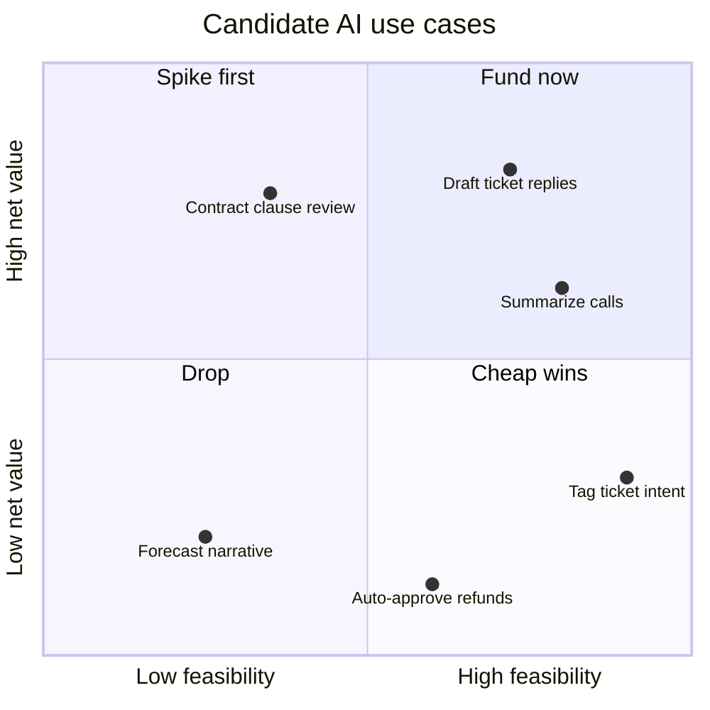
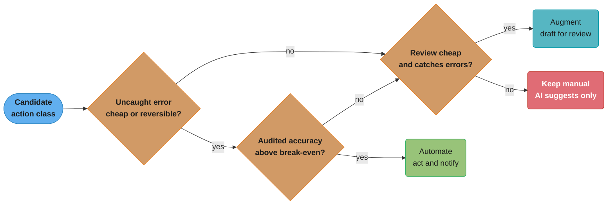
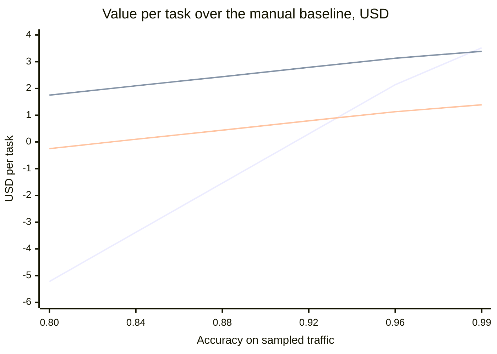
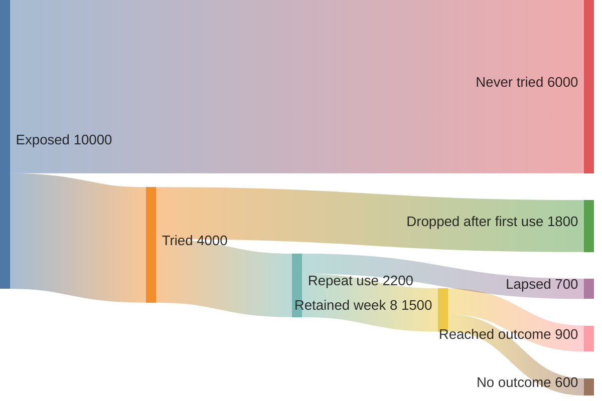

# Applied AI Product Decisions

> **Version anchor (2026-11-06).** Vendor terms on this page were read from the primary source on
> 2026-11-06: Microsoft Customer Copyright Commitment required mitigations (Microsoft Learn page,
> updated 2026-07-13), AWS Service Terms section 50.10 (page updated 2026-11-05), Anthropic
> Commercial Terms of Service (effective 2025-06-17), and the Google Cloud generative AI
> indemnification announcement (published 2023-10-13). Terms change, so read the live text at
> signing. Every other dollar figure, rate and count on this page is an illustrative input to a
> formula. It is not a market fact.

---

## 1. Concept Overview

Most AI feature work starts after someone has already decided what to build. This module covers
the decisions before that point and the ones after launch that decide whether the feature stays:

- Which of 20 to 30 candidate use cases gets funded, ranked by value net of verification and
  undetected-error cost.
- How a time-boxed feasibility spike for an AI feature produces a go or kill decision from a
  baseline, a bar, a sample size and a kill rule.
- Whether to buy a finished vendor AI product or build on a model API, judged on the outcome of
  the whole workflow.
- Which IP indemnity and copyright-commitment terms to check before signing, as a dated
  cross-provider checklist.
- How to read an AI-feature adoption funnel from exposure to measured outcome.
- How to promote and demote an agent's autonomy per action class from audited outcomes.
- How to measure overreliance as an accept-when-wrong rate in a controlled study.

The common thread is that a probabilistic feature is worth its incremental value over the non-AI
process. That value depends on the error rate, on who checks the output, and on what a missed
error costs. Accuracy is one input to that number.

**Boundary.** Other pages own the techniques this module uses. This page links to them and does
not teach them again.

- Should the task use an LLM or a trained model at all, and the prototype-to-production gap
  (target-volume cost, latency, distillation triggers):
  [Classical ML vs LLM](../../ml/ml_system_design/classical_ml_vs_llm.md).
- Domain patterns, the ROI chain in §6, and domain eval suites in §4.7:
  [AI Applications](../ai_applications/ai_applications.md).
- Building the eval set, sampling traces and failure taxonomies:
  [Error Analysis and Eval Design](../error_analysis_and_eval_design/error_analysis_and_eval_design.md).
- A/B tests, holdouts and novelty effects for generative features:
  [Experimentation for Generative Features](../../mlops/ai_release_engineering/experimentation_for_generative_features.md).
- Cost per call, self-host break-even and cost gates:
  [AI Cost Engineering and Unit Economics](../../mlops/ai_cost_engineering_and_unit_economics/ai_cost_engineering_and_unit_economics.md).
- Seat, usage and outcome pricing (§4.8):
  [Business and Finance Vocabulary](../../soft_skills/business_and_finance_vocabulary/business_and_finance_vocabulary.md).
- Build, buy or assemble per platform layer, lock-in and exit cost:
  [ML Platform Architecture and Build vs Buy](../../mlops/ml_platform_architecture_and_build_vs_buy/ml_platform_architecture_and_build_vs_buy.md).
- Model families and licences:
  [LLM Ecosystem and Landscape](../llm_ecosystem_and_landscape/llm_ecosystem_and_landscape.md).
- Vendor contract terms such as retirement notice, data use, retention, region and incident notice
  (§6.7), and shadow AI (§6.9):
  [AI Governance and Model Risk Operations](../../mlops/ai_governance_and_model_risk_operations/ai_governance_and_model_risk_operations.md).
- EU AI Act and other regulation:
  [AI Regulations and Compliance](../ai_regulations_and_compliance/ai_regulations_and_compliance.md).
- Approval gates, approval rate and stop-and-correct rate as UX signals:
  [Agent UX Patterns](../agents_and_tool_use/agent_ux_patterns.md).
- Chaining, routing and orchestration patterns:
  [Agentic Workflow Patterns](../agentic_workflow_patterns/agentic_workflow_patterns.md).
- Why usage is not an outcome, and measured versus reported evidence:
  [AI-Era Engineering Leadership](../../soft_skills/ai_era_engineering_leadership/ai_era_engineering_leadership.md).
- Kill switches, degradation modes and incident response:
  [AI Incident Response and Reliability](../../mlops/ai_incident_response_and_reliability/ai_incident_response_and_reliability.md).
- Calibrated thresholds `p > C_FP/(C_FP+C_FN)`, abstain bands and expected cost per decision:
  [Decision Models](../../mlops/decision_models/decision_models.md).

---

## 2. Intuition

> **One-line analogy**: an AI feature is a fast new hire who is sometimes wrong. What the hire is
> worth depends on who checks the work and on what a missed mistake costs.

**Mental model.** Write the value of a feature as one line of arithmetic:

```
value = volume x [ p_correct x v_task
                 + p_wrong_detected x (v_fallback - c_detected)
                 - p_wrong_undetected x c_error
                 - p_review x c_review
                 - c_run ]
        - baseline value
```

`p_correct` is accuracy on sampled real traffic. A wrong output either gets caught (by a reviewer,
a check, or the user) and falls back to the manual path, or it gets through and costs `c_error`.
Review cost applies only to the share that is reviewed. The baseline is what the non-AI process
already delivers, so the result is the increment the AI adds.

**Why it matters.** Teams quote accuracy because it is the number the eval produces. The decision
turns on the two cost terms. A feature at 95% accuracy loses money when each uncaught error costs
$100 and nobody reviews. The same model earns money when a $1 review catches most errors (§6.1).
The cost of verification decides more ship decisions than the accuracy does.

**Key insight.** Put a price on the error, the review and the baseline before the first prompt.
Then accuracy becomes a bar to clear.

---

## 3. Core Principles

- **Set the error budget before you pick a model.** Write down `c_error`, `c_review`, the catch
  rate and the baseline. They give a break-even accuracy. The model must clear that bar on real
  traffic.
- **Augment before you automate.** Start where a person reviews the output. Remove the review
  only for an action class whose audited outcomes show an error rate under its budget.
- **The eval set is the spec.** A use case is defined by the sampled tasks it must handle and the
  grading rule. A product brief that has no eval set has no definition of done. See
  [Error Analysis and Eval Design](../error_analysis_and_eval_design/error_analysis_and_eval_design.md).
- **Agree the kill criteria before you build.** A spike has a time box, a bar and a kill rule
  that the sponsor signs before the first result. A kill rule written after the result is a
  negotiation.
- **Buy commodity, build what differentiates.** A vendor product wins when the workflow is the
  same at every customer. Build on a model API when the workflow, the data or the eval set is the
  edge.
- **Earn autonomy per action class.** Tagging a ticket and issuing a refund are different
  classes. Each class moves up the autonomy ladder on its own evidence and drops down on its own
  failures.

---

## 4. Types / Architectures / Strategies

### 4.1 Automation levels

| Level | What the AI does | Who acts | Typical use |
|---|---|---|---|
| Suggest | Offers options or hints | Person decides and acts | High error cost, poor accuracy, new class |
| Draft for review | Produces the full output | Person edits and sends | Replies, summaries, code changes |
| Act with approval | Prepares the action | Person approves each action | Refunds, account changes, outbound mail |
| Act and notify | Acts, then tells a person | Person can undo within a window | Reversible actions with audited low error |
| Autonomous | Acts, logs only | Nobody in the loop per action | Cheap, reversible, high-volume actions |

Each action class sits at one level. The levels map onto the gate patterns in
[Agent UX Patterns](../agents_and_tool_use/agent_ux_patterns.md).

### 4.2 Sourcing options

| Option | You own | Vendor owns | Switch cost |
|---|---|---|---|
| Buy a finished vendor AI product | Configuration, content, adoption | Model, prompts, workflow, UI | Low to medium: content export, retraining staff |
| Build on a model API | Workflow, prompts, eval set, UI | Model weights and serving | Medium: prompts and thresholds re-qualify per provider |
| Fine-tune a hosted model | Training data, adapter config, eval set | Base model and serving | High if the tuned weights cannot leave the provider |
| Self-host an open-weight model | Everything above plus serving and GPUs | Nothing beyond the licence | Low model lock-in, high operating cost |

### 4.3 Failure modes

| Failure mode | What it looks like | First check |
|---|---|---|
| Stuck in pilot | Demo works, no production date, sponsor loses interest | Was there a bar and a kill rule before the pilot? |
| Wrapper risk | Product value is a thin layer over a model API | What survives if the provider ships the same feature? |
| Overreliance | Reviewers accept wrong output they would catch alone | Accept-when-wrong rate in a controlled study |
| Adoption stall | Many users try once, few come back | Funnel step with the lowest conversion |

---

## 5. Architecture Diagrams

### Use-case portfolio: value against feasibility



Net value on the y-axis is already net of review cost and undetected-error cost, so "auto-approve
refunds" sits low even though its accuracy is high. The §6.2 code produces this ranking.

### Automate, augment or keep manual



Run the chart once per action class, not once per feature. One feature can automate tagging,
augment replies and keep refunds manual.

### Incremental value per task against accuracy



The task is the §6.1 refund-reply case: `v_task` $6, manual cost $4, `c_error` $40. The steep
line has no review. The top line reviews every output at $0.50 and the bottom line reviews every
output at $2.50, both with a 90% catch rate. Without review the feature breaks even near 91%
accuracy. Cheap review moves break-even down to about 60%. Above about 93% accuracy the unreviewed
design beats the $2.50 review, and above about 99% it beats the $0.50 review. Past those points the
review costs more than the errors it catches.

### Adoption funnel



Of 10,000 exposed users, 40% tried the feature. That is the number a login dashboard shows. Only
9% reached the outcome event. Whether the feature caused it is a separate test against a randomized
holdout. The §6.8 code finds the leakiest step.

---

## 6. How It Works - Detailed Mechanics

### 6.1 Incremental value of one feature

The calculator below implements the §2 formula. Review applies only to the reviewed share, and a
reviewer catches only part of the wrong outputs in that share. The threshold machinery for a
single decision (calibrated probability, abstain band) lives in
[Decision Models](../../mlops/decision_models/decision_models.md) §6.6. This code works one level
up, on the value of the whole feature.

```python
from dataclasses import dataclass


@dataclass(frozen=True)
class Task:
    volume: int              # tasks per month
    v_task: float            # value of one task done right, USD
    c_manual: float          # labor cost of the non-AI process per task
    c_error: float           # cost of one wrong output nobody caught
    c_detected: float        # extra handling when review catches a wrong output
    c_run: float             # inference and serving cost per task


@dataclass(frozen=True)
class Design:
    p_correct: float         # accuracy on sampled real traffic
    p_review: float          # share of outputs a person reviews
    catch_rate: float        # share of wrong outputs a reviewer catches
    c_review: float          # reviewer cost per reviewed output


def incremental_value(t: Task, d: Design) -> float:
    """Monthly value of the AI design minus the value of the manual baseline."""
    p_wrong = 1 - d.p_correct
    p_wrong_detected = p_wrong * d.p_review * d.catch_rate
    p_wrong_undetected = p_wrong - p_wrong_detected
    v_fallback = t.v_task - t.c_manual          # a person redoes the caught task
    per_task = (
        d.p_correct * t.v_task
        + p_wrong_detected * (v_fallback - t.c_detected)
        - p_wrong_undetected * t.c_error
        - d.p_review * d.c_review
        - t.c_run
    )
    baseline = t.v_task - t.c_manual
    return t.volume * (per_task - baseline)


def break_even_accuracy(t: Task, d: Design) -> float:
    """Accuracy at which incremental value is zero. Value is linear in p_correct."""
    lo = incremental_value(t, Design(0.0, d.p_review, d.catch_rate, d.c_review))
    hi = incremental_value(t, Design(1.0, d.p_review, d.catch_rate, d.c_review))
    return -lo / (hi - lo)


refund_replies = Task(volume=100_000, v_task=6.00, c_manual=4.00,
                      c_error=40.00, c_detected=0.50, c_run=0.02)
draft_30pct = Design(p_correct=0.92, p_review=0.30, catch_rate=0.90, c_review=1.00)

print(f"draft, 30% reviewed: {incremental_value(refund_replies, draft_30pct):>10,.0f} USD/month")
print(f"break-even accuracy: {break_even_accuracy(refund_replies, draft_30pct):.3f}")

payouts = Task(volume=100_000, v_task=6.00, c_manual=4.00,
               c_error=100.00, c_detected=0.50, c_run=0.02)
auto = Design(p_correct=0.95, p_review=0.0, catch_rate=0.0, c_review=0.0)
reviewed = Design(p_correct=0.95, p_review=1.0, catch_rate=0.90, c_review=1.00)
print(f"95% accurate, no review:  {incremental_value(payouts, auto):>10,.0f} USD/month")
print(f"95% accurate, all review: {incremental_value(payouts, reviewed):>10,.0f} USD/month")
```

Output:

```
draft, 30% reviewed:     89,640 USD/month
break-even accuracy: 0.894
95% accurate, no review:    -132,000 USD/month
95% accurate, all review:    224,750 USD/month
```

Read the last two lines together. The model is the same and the accuracy is the same. The only
difference is a $1 review that catches 90% of errors, and it moves the feature from a $132,000
monthly loss to a $224,750 monthly gain. The break-even accuracy of 0.894 becomes the bar for the
§6.3 spike.

`c_error` is the hardest input to estimate. Take it from incident history: refunds paid in
error, chargebacks, churn after a wrong answer, or legal exposure. When nobody can estimate it,
run the calculator at the low and high ends of the range. If the sign of the result changes, the
use case needs a person in the loop until you have better data.

### 6.2 Ranking a portfolio of candidates

A team with 30 candidates cannot spike all of them. It needs a cheap first-pass score that every
product manager can fill in from a demo and a spreadsheet. The common first attempt scores the
wrong thing.

```python
# BROKEN: ranks by accuracy x volume x minutes saved
from dataclasses import dataclass


@dataclass(frozen=True)
class UseCase:
    name: str
    volume: int            # tasks per month
    accuracy: float        # spike estimate on sampled traffic
    minutes_saved: float   # per task, from a demo
    c_error: float         # cost of one undetected wrong output, USD
    review_share: float    # share of outputs a person must review
    c_review: float        # reviewer cost per reviewed output, USD


CANDIDATES = [
    UseCase("auto-approve refunds", 60_000, 0.96, 6.0, 120.0, 0.0, 0.0),
    UseCase("draft ticket replies", 90_000, 0.90, 4.0, 8.0, 1.0, 0.60),
    UseCase("summarize calls", 40_000, 0.93, 5.0, 2.0, 0.1, 0.40),
    UseCase("tag ticket intent", 150_000, 0.88, 0.5, 1.0, 0.05, 0.20),
]


def score(u: UseCase) -> float:
    return u.accuracy * u.volume * u.minutes_saved


for u in sorted(CANDIDATES, key=score, reverse=True):
    print(f"{u.name:<22} {score(u):>10,.0f}")
```

Output:

```
auto-approve refunds      345,600
draft ticket replies      324,000
summarize calls           186,000
tag ticket intent          66,000
```

The score puts auto-approved refunds first. It reads `c_error`, `review_share` and `c_review`
from the records and never uses them. At 96% accuracy with no review, 4% of 60,000 refunds go out
wrong every month at $120 each. That is $288,000 of error cost against about $242,000 of labor
saved. The use case loses money, and the broken score funds it first.

The fix prices the error and the review, weights by the chance the spike passes, and divides by
effort:

```python
from dataclasses import dataclass

LABOR_PER_MINUTE = 0.70  # loaded cost of one agent minute, USD


@dataclass(frozen=True)
class UseCase:
    name: str
    volume: int
    accuracy: float
    minutes_saved: float
    c_error: float
    review_share: float
    c_review: float
    catch_rate: float = 0.9      # share of wrong outputs a reviewer catches
    build_weeks: int = 6
    p_spike_pass: float = 0.6    # prior that the feasibility spike clears its bar


def monthly_value(u: UseCase) -> float:
    """Labor saved on correct outputs, minus review cost and uncaught-error cost."""
    p_wrong = 1 - u.accuracy
    p_uncaught = p_wrong * (1 - u.review_share * u.catch_rate)
    saved = u.accuracy * u.minutes_saved * LABOR_PER_MINUTE
    per_task = saved - u.review_share * u.c_review - p_uncaught * u.c_error
    return u.volume * per_task


def priority(u: UseCase) -> float:
    """Risk-weighted value per build week. Negative value never ranks."""
    return max(monthly_value(u), 0.0) * u.p_spike_pass / u.build_weeks


CANDIDATES = [
    UseCase("auto-approve refunds", 60_000, 0.96, 6.0, 120.0, 0.0, 0.0),
    UseCase("draft ticket replies", 90_000, 0.90, 4.0, 8.0, 1.0, 0.60),
    UseCase("summarize calls", 40_000, 0.93, 5.0, 2.0, 0.1, 0.40),
    UseCase("tag ticket intent", 150_000, 0.88, 0.5, 1.0, 0.05, 0.20, build_weeks=2),
]

for u in sorted(CANDIDATES, key=priority, reverse=True):
    print(f"{u.name:<22} value {monthly_value(u):>10,.0f}  priority {priority(u):>8,.0f}")
```

Output:

```
draft ticket replies   value    165,600  priority   16,560
summarize calls        value    123,504  priority   12,350
tag ticket intent      value     27,510  priority    8,253
auto-approve refunds   value    -46,080  priority        0
```

`monthly_value()` is the §6.1 formula with the baseline folded into minutes saved, because that
is the data a product manager has at ranking time. Use it to rank. Use the full §6.1 calculator
on the few candidates that reach a spike. Auto-approved refunds drop to the bottom here. As a
"draft refund decision for approval" design, with review on every case, the same candidate can
come back with a positive value. Score each design on its own row, because one idea can have
several designs.

Three rules keep the ranking honest:

- Fill every row with the same assumptions sheet (loaded labor rate, catch rate, review cost by
  role). Different assumptions per sponsor turn the ranking into a lobbying contest.
- Score the top 8 to 10 with a range for each uncertain input. A candidate whose value changes
  sign inside its range goes to a spike. It does not go to funding.
- Keep at least one cheap, low-risk candidate in the funded set. It ships first and builds the
  eval, review and monitoring paths the bigger bets need.

### 6.3 Feasibility spike protocol

A generic engineering spike tests whether an integration can work at all. The risk-first version
of that is in
[Technical Leadership and Execution](../../soft_skills/technical_leadership_and_execution/technical_leadership_and_execution.md).
An AI spike adds a statistical question: is accuracy on real traffic above the bar, with enough
items to tell? Fix four things before the spike starts:

| Input | Where it comes from | Example |
|---|---|---|
| Baseline | Accuracy of the current process on the same sample | 0.86 (agents, double-graded sample) |
| Bar | Break-even accuracy from §6.1 | 0.894 |
| Sample size | Interval width at the expected accuracy, then the odds of a go (below) | 453 items for +/- 2.5 points at 0.92 |
| Time box and kill rule | Sponsor sign-off | 2 weeks, one extension, then kill |

```python
import math
from dataclasses import dataclass
from enum import Enum

Z95 = 1.96


def wilson(successes: int, n: int, z: float = Z95) -> tuple[float, float]:
    """Wilson score interval for a binomial rate."""
    if n == 0:
        return 0.0, 1.0
    p = successes / n
    denom = 1 + z * z / n
    centre = (p + z * z / (2 * n)) / denom
    half = z * math.sqrt(p * (1 - p) / n + z * z / (4 * n * n)) / denom
    return centre - half, centre + half


def sample_size(expected: float, half_width: float, z: float = Z95) -> int:
    """Labeled items needed so the interval is about +/- half_width wide."""
    return math.ceil(z * z * expected * (1 - expected) / half_width**2)


class Verdict(Enum):
    GO = "go: lower bound clears the bar"
    KILL = "kill: upper bound is below the bar"
    EXTEND = "extend once: interval straddles the bar"
    TIMEBOX = "kill: time box spent and still unresolved"


@dataclass(frozen=True)
class Spike:
    baseline: float      # accuracy of the current process on the same sample
    bar: float           # break-even accuracy from the value model
    weeks: int           # time box, agreed before the spike starts

    def verdict(self, correct: int, n: int, extended: bool) -> Verdict:
        lo, hi = wilson(correct, n)
        if lo >= max(self.bar, self.baseline):
            return Verdict.GO
        if hi < self.bar:
            return Verdict.KILL
        return Verdict.TIMEBOX if extended else Verdict.EXTEND


spike = Spike(baseline=0.86, bar=0.894, weeks=2)
n = sample_size(expected=0.92, half_width=0.025)
print(f"label {n} items sampled from real traffic")

for correct, total, extended in [(419, 453, False), (404, 453, False), (381, 453, False),
                                 (815, 906, True)]:
    lo, hi = wilson(correct, total)
    v = spike.verdict(correct, total, extended)
    print(f"{correct}/{total}  [{lo:.3f}, {hi:.3f}]  {v.value}")
```

Output:

```
label 453 items sampled from real traffic
419/453  [0.897, 0.946]  go: lower bound clears the bar
404/453  [0.860, 0.917]  extend once: interval straddles the bar
381/453  [0.805, 0.872]  kill: upper bound is below the bar
815/906  [0.878, 0.917]  kill: time box spent and still unresolved
```

The Wilson interval stays inside [0, 1] and behaves at small n and near 0 or 1, where the normal
approximation does not. Twenty correct out of twenty gives a Wilson lower bound of 0.839, which
is below this bar. A demo set of 20 with no errors cannot prove a 0.894 use case.

A width target is not a power target. If the true accuracy is exactly 0.92, the observed rate
falls below 0.92 about half the time, and then the lower bound misses 0.894. At 453 items the
chance of a go on the first look is 46%. The extension to 906 items lifts it to 73%, and about
1,050 items reach 80%. Budget labeling for the larger number when the expected accuracy sits near
the bar.

The spike also records cost per task, p95 latency and the top failure categories from open
coding. The failure list decides whether an extension is worth it: a cluster of fixable
retrieval misses argues for one more week, and errors spread across every slice argue for a
kill. How to sample the items and code the failures is in
[Error Analysis and Eval Design](../error_analysis_and_eval_design/error_analysis_and_eval_design.md)
§6.1 to §6.5.

### 6.4 Vendor bake-off harness

A finished vendor AI product and a build on a model API answer different questions. The vendor
sells a workflow. The build sells control. Compare them on the workflow outcome, graded blind on
your own sampled tasks, and price each one per successful task.

```python
import random
from collections import defaultdict
from dataclasses import dataclass
from typing import Callable


@dataclass(frozen=True)
class Case:
    case_id: str
    slice: str          # e.g. "billing", "multi-step", "non-English"


@dataclass(frozen=True)
class Candidate:
    name: str
    run: Callable[[Case], str]       # returns the candidate's deliverable
    cost_per_task: float             # licence share + usage + review, USD


def blind_grade(cases: list[Case], candidates: list[Candidate],
                grade: Callable[[Case, str], bool], seed: int = 7) -> dict[str, dict]:
    """Shuffle so graders cannot infer the candidate from order."""
    rng = random.Random(seed)
    jobs = [(c, cand) for c in cases for cand in candidates]
    rng.shuffle(jobs)
    results: dict[str, dict] = defaultdict(
        lambda: {"ok": 0, "n": 0, "by_slice": defaultdict(list)})
    for case, cand in jobs:
        output = cand.run(case)
        passed = grade(case, output)            # the grader never sees cand.name
        r = results[cand.name]
        r["ok"] += passed
        r["n"] += 1
        r["by_slice"][case.slice].append(passed)
    for cand in candidates:
        r = results[cand.name]
        r["success_rate"] = r["ok"] / r["n"]
        r["cost_per_success"] = cand.cost_per_task * r["n"] / max(r["ok"], 1)
        r["worst_slice"] = min(r["by_slice"],
                               key=lambda s: sum(r["by_slice"][s]) / len(r["by_slice"][s]))
    return results


rng = random.Random(1)
slices = ["billing"] * 120 + ["multi-step"] * 60 + ["non-English"] * 20
cases = [Case(f"c{i}", s) for i, s in enumerate(slices)]


def simulated(rates: dict[str, float]) -> Callable[[Case], str]:
    return lambda c: "pass" if rng.random() < rates[c.slice] else "fail"


candidates = [
    Candidate("vendor product A",
              simulated({"billing": 0.95, "multi-step": 0.62, "non-English": 0.40}), 0.90),
    Candidate("vendor product B",
              simulated({"billing": 0.88, "multi-step": 0.80, "non-English": 0.85}), 1.10),
    Candidate("build on model API",
              simulated({"billing": 0.90, "multi-step": 0.78, "non-English": 0.80}), 0.55),
]

results = blind_grade(cases, candidates, grade=lambda case, out: out == "pass")
for name, r in results.items():
    print(f"{name:<20} success {r['success_rate']:.2f}  cost/success ${r['cost_per_success']:.2f}"
          f"  worst slice {r['worst_slice']}")
```

Output:

```
vendor product B     success 0.89  cost/success $1.24  worst slice multi-step
vendor product A     success 0.80  cost/success $1.12  worst slice non-English
build on model API   success 0.82  cost/success $0.67  worst slice non-English
```

Vendor A's demo was on billing, its best slice at 95%. On the full sample it scores 0.80, which 200
cases cannot separate from the build's 0.82, and its non-English slice fails 12 of 20 tasks. The build looks cheapest per success, but its $0.55 must
include the engineering time to build and run it, spread over the expected volume. Leave that out
and the comparison favors building every time. The `simulated()` stub stands in for real calls.
In a real bake-off, `run` calls the vendor's trial tenant or your prototype, and `grade` is the
rubric from your eval set applied by people who do not know which candidate produced the output.

### 6.5 IP indemnity and copyright-commitment checklist

Most generative AI providers will defend a commercial customer against third-party IP claims about
output, under conditions. The conditions decide whether the cover applies to your design, so read
each clause as a list of controls you must keep running.

| Check | Microsoft Customer Copyright Commitment | AWS Service Terms §50.10 | Anthropic Commercial Terms | Google Cloud gen AI indemnity |
|---|---|---|---|---|
| Source and date | Microsoft Learn required-mitigations page, updated 2026-07-13 | AWS Service Terms, updated 2026-11-05 | Commercial Terms, effective 2025-06-17 | Announcement, 2023-10-13 |
| What is covered | Third-party IP claims about output content from covered products | Third-party IP claims about output of listed "Indemnified Generative AI Services" | Claims that paid use of the services, including training data, or its outputs infringe IP | Two prongs: training data used to build Google's models, and generated output |
| Which products | Commercial Copilots, Azure OpenAI, Copilot Studio, GitHub offerings | Amazon's own models and services on the list, with named free tiers excluded | Paid use of Anthropic's services | Covered-service list in the 2023 post and Google's terms |
| Controls you must keep on | Azure OpenAI: a metaprompt against infringement, a retained testing and evaluation report, and the jailbreak filter in filter mode. Text use cases need the protected-material text filter in filter mode. Code use cases need the protected-material code filter in annotate or filter mode, and annotate mode obliges you to follow the cited licence | Do not interfere with or fail to enable available filters and other tools | No filter condition named in the clause | Do not intentionally create infringing output, and use the tools offered, such as source citation |
| Exclusions to map to your design | Output flagged later by the asynchronous filter is not covered (for code, unless you follow the cited licence). Copilot Studio output from a model hosted outside Copilot Studio is not covered unless that model runs in Azure OpenAI with its mitigations (from 2025-06-01) | Infringing inputs, fine-tuned or modified services, use after notice to stop, output you know or should know infringes, trademark claims | Your modifications, combination with non-Anthropic technology, your inputs, knowing infringement, patented inventions in output, trademark use | Intentional infringement |
| Change process | Six months to deploy a newly published mitigation. For a new service, feature, model or use case, new requirements apply from launch | Terms page changes in place | Versioned terms | Terms page changes in place |

Turn each exclusion into an engineering question before signing:

- Does the design fine-tune or modify the covered service? AWS excludes a claim that would not
  have happened without your fine-tuning.
- Does the output pass through your own post-processing or get combined with other content?
  Anthropic excludes modifications and combinations.
- Are the required filters configured in the mode the terms name, and does a deploy check fail
  when someone turns one off? Microsoft and AWS tie cover to those settings.
- Which model actually served the output? Through a gateway with fallback, a request can reach a
  provider whose terms differ from the primary's. Log the provider and model per request.
- Can you produce the evidence a claim needs? Microsoft asks for the retained testing and
  evaluation report. AWS asks for prompt notice and records.

Two terms sit beside the indemnity and belong in the same review. Anthropic's Commercial Terms say
"Anthropic may not train models on Customer Content from Services." Retirement notice, retention,
region and incident-notice terms are in
[AI Governance and Model Risk Operations](../../mlops/ai_governance_and_model_risk_operations/ai_governance_and_model_risk_operations.md)
§6.7. For image generation, training-data provenance as a sales requirement is worked through in
[Design an Image Generation Platform](../case_studies/design_image_generation_platform.md).
Legal counsel signs the contract. Engineering owns the controls the contract assumes.

### 6.6 Overreliance audit

Overreliance is a reviewer accepting a wrong output because the AI produced it. Approval rate
cannot see it, because a rubber-stamped wrong output and a checked right output both count as
approvals. Measure it directly as the **accept-when-wrong rate**: of the outputs known to be
wrong, the share a reviewer accepted unchanged.

You need outputs whose correctness you know in advance. Get them only from:

- A consented user study, where participants know some outputs are planted errors.
- An offline simulation that replays recorded tasks to reviewers in a test environment.
- Shadow outputs in a separate review queue, where no decision on them reaches a customer or a
  downstream system.

Never seed wrong outputs into live traffic. A planted wrong refund or reply is a real error with
real cost, and doing it without consent is deception.

```python
import math
import random
from dataclasses import dataclass


def wilson(successes: int, n: int, z: float = 1.96) -> tuple[float, float]:
    if n == 0:
        return 0.0, 1.0
    p = successes / n
    denom = 1 + z * z / n
    centre = (p + z * z / (2 * n)) / denom
    half = z * math.sqrt(p * (1 - p) / n + z * z / (4 * n * n)) / denom
    return centre - half, centre + half


@dataclass(frozen=True)
class Trial:
    reviewer: str
    seeded_wrong: bool    # the study planted a wrong output here
    accepted: bool        # reviewer accepted the output unchanged


def accept_when_wrong(trials: list[Trial]) -> tuple[float, float, float]:
    wrong = [t for t in trials if t.seeded_wrong]
    accepted = sum(t.accepted for t in wrong)
    lo, hi = wilson(accepted, len(wrong))
    return accepted / len(wrong), lo, hi


def simulate(reviewers: int, items: int, seed_rate: float, miss_rate: float,
             rng: random.Random) -> list[Trial]:
    """Consented offline study: each reviewer sees `items` outputs, errors planted at seed_rate."""
    out = []
    for r in range(reviewers):
        for _ in range(items):
            wrong = rng.random() < seed_rate
            accepted = (rng.random() < miss_rate) if wrong else (rng.random() < 0.97)
            out.append(Trial(f"r{r}", wrong, accepted))
    return out


rng = random.Random(3)
plain_ui = simulate(reviewers=24, items=40, seed_rate=0.10, miss_rate=0.45, rng=rng)
cited_ui = simulate(reviewers=24, items=40, seed_rate=0.10, miss_rate=0.20, rng=rng)

for label, trials in [("plain draft", plain_ui), ("draft with cited sources", cited_ui)]:
    rate, lo, hi = accept_when_wrong(trials)
    print(f"{label:<26} accept-when-wrong {rate:.2f}  95% CI [{lo:.2f}, {hi:.2f}]")
```

Output:

```
plain draft                accept-when-wrong 0.46  95% CI [0.36, 0.56]
draft with cited sources   accept-when-wrong 0.18  95% CI [0.12, 0.27]
```

The miss rates in `simulate()` are inputs to show the harness. Your study measures them. Three
design points make the number trustworthy:

- **Control arm.** Run the same items with no AI draft. If reviewers miss 15% of errors when they
  work alone, then 46% accept-when-wrong with the draft means the draft is making review worse.
- **Planted-error mix.** Plant errors of the kinds your failure taxonomy found, at a rate close to
  the real error rate. A 50% planted rate teaches reviewers to distrust everything and
  understates overreliance.
- **Per-reviewer view.** Report the spread across reviewers. A team average can hide two
  reviewers who accept almost everything. The pooled interval above treats every trial as
  independent, so with 24 reviewers it is too narrow. Bootstrap over reviewers for the interval
  you report.

Use the rate in two places. One minus the rate is the measured `catch_rate` input to §6.1, which
is often far below the 0.9 that a business case assumes. It also tests UI changes, such as cited sources or highlighted
uncertain spans, by how much they lower accept-when-wrong. Confidence signals and step views are
described in [Agent UX Patterns](../agents_and_tool_use/agent_ux_patterns.md).

### 6.7 Autonomy promotion and demotion per action class

Approval rate is a UX signal. It tells you whether reviewers trust the agent. It does not tell you
whether the agent was right, and §6.6 shows why. Promotion must rest on **audited outcomes**: a
sample of the agent's proposed actions, approved or not, checked against ground truth after the
fact. An audit of executed actions alone measures the agent plus its reviewer, and promotion
removes the reviewer.

The rule:

- Promote one level when the Wilson upper bound on the audited error rate is below the class
  error budget, over at least `min_audited` outcomes.
- Irreversible action classes stop at "act with approval". Lifting that cap is a policy decision
  for the risk owner. It is never an automatic promotion.
- Any severe error drops the class to "suggest". Drift drops it one level until it earns the level
  back. Drift here means a model snapshot change, a prompt change, or an input mix change.

The action-risk classes for a computer-use agent are in
[Design a Computer Use Agent](../case_studies/design_computer_use_agent.md) §4.2.

```python
import math
from dataclasses import dataclass
from enum import IntEnum


def wilson_upper(errors: int, n: int, z: float = 1.96) -> float:
    if n == 0:
        return 1.0
    p = errors / n
    denom = 1 + z * z / n
    centre = (p + z * z / (2 * n)) / denom
    return centre + z * math.sqrt(p * (1 - p) / n + z * z / (4 * n * n)) / denom


class Level(IntEnum):
    SUGGEST = 0
    DRAFT_FOR_REVIEW = 1
    ACT_WITH_APPROVAL = 2
    ACT_AND_NOTIFY = 3
    AUTONOMOUS = 4


@dataclass(frozen=True)
class ActionClass:
    name: str
    level: Level
    error_budget: float      # max tolerated outcome error rate at the next level
    min_audited: int         # audited outcomes needed before a promotion
    reversible: bool


@dataclass(frozen=True)
class Evidence:
    audited: int             # proposals checked against ground truth, not approvals
    errors: int
    severe_errors: int       # any one of these demotes
    drift: bool              # input mix or model snapshot changed since last review


def next_level(ac: ActionClass, ev: Evidence) -> Level:
    if ev.severe_errors > 0:
        return Level.SUGGEST
    if ev.drift:
        return Level(max(ac.level - 1, Level.SUGGEST))
    ceiling = Level.AUTONOMOUS if ac.reversible else Level.ACT_WITH_APPROVAL
    if ac.level >= ceiling or ev.audited < ac.min_audited:
        return ac.level
    if wilson_upper(ev.errors, ev.audited) < ac.error_budget:
        return Level(ac.level + 1)
    return ac.level


CASES = [
    (ActionClass("tag ticket", Level.ACT_WITH_APPROVAL, 0.02, 400, True),
     Evidence(600, 3, 0, False)),
    (ActionClass("tag ticket", Level.ACT_WITH_APPROVAL, 0.02, 400, True),
     Evidence(600, 9, 0, False)),
    (ActionClass("issue refund", Level.ACT_WITH_APPROVAL, 0.005, 1000, False),
     Evidence(5000, 1, 0, False)),
    (ActionClass("send reply", Level.ACT_AND_NOTIFY, 0.01, 500, True),
     Evidence(800, 2, 1, False)),
    (ActionClass("send reply", Level.ACT_AND_NOTIFY, 0.01, 500, True),
     Evidence(800, 2, 0, True)),
]

for ac, ev in CASES:
    upper = wilson_upper(ev.errors, ev.audited)
    print(f"{ac.name:<13} {ev.errors:>2}/{ev.audited:<5} upper {upper:.4f}  "
          f"{ac.level.name} -> {next_level(ac, ev).name}")
```

Output:

```
tag ticket     3/600   upper 0.0146  ACT_WITH_APPROVAL -> ACT_AND_NOTIFY
tag ticket     9/600   upper 0.0283  ACT_WITH_APPROVAL -> ACT_WITH_APPROVAL
issue refund   1/5000  upper 0.0011  ACT_WITH_APPROVAL -> ACT_WITH_APPROVAL
send reply     2/800   upper 0.0091  ACT_AND_NOTIFY -> SUGGEST
send reply     2/800   upper 0.0091  ACT_AND_NOTIFY -> ACT_WITH_APPROVAL
```

Nine errors in 600 is an observed rate of 1.5%, under the 2% budget. The upper bound is 2.8%, so
the class does not move. The refund class has the best record and stays put, because it is
irreversible. The last two rows have the same error count. One severe error sends the reply class
to the bottom, and a snapshot change costs it one level.

Audits cost money. Size them per class: for a 1% budget, the upper bound falls under it only after
381 audited outcomes with zero errors, or 563 with one error. Spread the audit sample over the
period. An audit drawn from one quiet week will not see the cases that cause errors.

### 6.8 Adoption funnel metrics

Logins and weekly active users count people who opened the feature. A product decision needs to
know whether the feature moved an outcome. Define five stages with fixed rules and count each one
per cohort.

```python
from dataclasses import dataclass

STAGES = ("exposed", "tried", "repeat", "retained", "outcome")


@dataclass(frozen=True)
class Funnel:
    exposed: int     # eligible users who saw the entry point in the period
    tried: int       # used it at least once
    repeat: int      # used it on 3+ separate days within 14 days of first use
    retained: int    # still using it in week 8
    outcome: int     # retained users who reached the outcome event, e.g. ticket closed, no reopen


def leaks(f: Funnel) -> list[tuple[str, float]]:
    counts = [getattr(f, s) for s in STAGES]
    steps = [(f"{a} -> {b}", nb / na) for a, b, na, nb in
             zip(STAGES, STAGES[1:], counts, counts[1:])]
    return sorted(steps, key=lambda step: step[1])


support_drafts = Funnel(exposed=10_000, tried=4_000, repeat=2_200, retained=1_500, outcome=900)
print(f"logins-style headline: {support_drafts.tried / support_drafts.exposed:.0%} adoption")
end_to_end = support_drafts.outcome / support_drafts.exposed
print(f"end to end:            {end_to_end:.0%} of exposed users")
for step, rate in leaks(support_drafts):
    print(f"  {step:<20} {rate:.0%}")
```

Output:

```
logins-style headline: 40% adoption
end to end:            9% of exposed users
  exposed -> tried     40%
  tried -> repeat      55%
  retained -> outcome  60%
  repeat -> retained   68%
```

Each leak has a different fix:

| Step | Usual cause | What to try |
|---|---|---|
| exposed -> tried | Entry point is outside the workflow, or users do not know what it does | Put the feature where the task already happens |
| tried -> repeat | First output was wrong or slow, or editing it took longer than writing it | Sample first-use sessions and code the failures |
| repeat -> retained | Novelty fades, or the feature helps on a small share of tasks | Check novelty decay and the share of tasks it handles |
| retained -> outcome | People use the output but the outcome does not move | Check whether outputs are edited away, and test the outcome against a holdout |

The outcome count does not show that the feature caused the outcome. Compare the outcome rate of
the whole exposed cohort with a randomized holdout that never saw the feature. A comparison of
users against non-users picks up the fact that heavy users already differ from other users.
Randomization units, novelty decay and sample sizes for this are in
[Experimentation for Generative Features](../../mlops/ai_release_engineering/experimentation_for_generative_features.md).

---

## 7. Real-World Examples

**Microsoft Customer Copyright Commitment (primary source, checked 2026-11-06).** Microsoft
[announced the Copilot Copyright Commitment](https://blogs.microsoft.com/on-the-issues/2023/09/07/copilot-copyright-commitment-ai-legal-concerns/)
on 2023-09-07 for paid commercial Copilot services. On 2023-11-15 it extended the program to Azure
OpenAI Service output and renamed it the Customer Copyright Commitment. The
[Microsoft Learn page of required mitigations](https://learn.microsoft.com/en-us/azure/ai-foundry/responsible-ai/openai/customer-copyright-commitment)
(updated 2026-07-13) lists a metaprompt against infringement and a retained testing and evaluation
report for Azure OpenAI. Every text and code use case also needs the jailbreak filter in filter
mode. Text needs the protected-material text filter in filter mode, and code needs the
protected-material code filter in annotate or filter mode. The page gives customers six months to
put a newly published mitigation in place. The design lesson: the indemnity is a set of
deploy-time settings, so treat them as configuration under change control.

**[AWS Service Terms §50.10](https://aws.amazon.com/service-terms/) (primary source, page updated
2026-11-05).** AWS defends customers
against third-party IP claims about output from a named list of "Indemnified Generative AI
Services": Amazon's own Nova and Titan models and a set of Amazon services, with named free tiers
excluded. The exclusions include inputs that infringe, failing to enable available filters,
fine-tuning or modifying the service, output you know or should know infringes, and trademark
claims. A model from another provider that you call through the same console is not on that list.
Its own provider's terms apply.

**[Anthropic Commercial Terms](https://www.anthropic.com/legal/commercial-terms) (primary source,
effective 2025-06-17).** Anthropic defends customers
against claims that paid use of its services, including the data used to train its models, or
the outputs infringe third-party IP. It excludes modifications, combination with technology not
provided by Anthropic, customer inputs, knowing infringement, patented inventions in output, and
trademark use. The same terms say Anthropic may not train models on customer content. Anthropic's
[2023-12-19 announcement](https://www.anthropic.com/news/expanded-legal-protections-api-improvements)
extended the protection to customers on Amazon Bedrock from 2024-01-02.

**[Google Cloud generative AI indemnification](https://cloud.google.com/blog/products/ai-machine-learning/protecting-customers-with-generative-ai-indemnification)
(primary source, published 2023-10-13).** Google
announced two prongs: one for its use of training data to build its generative models, and one
for generated output from covered services. The output prong applies if the customer did not try
to create infringing output on purpose and uses the tools offered, such as source citation. The
2023 post lists the covered services as of that date. Read the live list in Google's terms at
signing.

**Klarna and Air Canada, linked.** Klarna's LLM-first support rollout and its partial return to a
human and AI hybrid is told with sources in
[Classical ML vs LLM](../../ml/ml_system_design/classical_ml_vs_llm.md) §7. The Air Canada tribunal
decision, which held the airline responsible for a policy its chatbot invented, is in
[AI Incident Response and Reliability](../../mlops/ai_incident_response_and_reliability/ai_incident_response_and_reliability.md)
§7. Read both as `c_error` evidence: the cost of an uncaught wrong answer landed on the deployer.

---

## 8. Tradeoffs

### Sourcing options

| Factor | Buy a vendor AI product | Build on a model API | Fine-tune a hosted model | Self-host open weights |
|---|---|---|---|---|
| Time to first production use | Weeks | 1 to 3 months | 2 to 4 months | 3 to 6 months |
| Fit to your workflow | Vendor's workflow | Yours | Yours | Yours |
| Who owns the eval set | Must be yours anyway | Yours | Yours | Yours |
| Model choice and upgrades | Vendor decides when | You pick, provider retires | Tied to the base model's lifecycle | You decide |
| Cost shape | Seat or outcome price | Usage price plus your team | Usage plus training runs | GPUs, on-call, upgrades |
| Lock-in surface | Workflow, content, user habits | Prompts, tool schemas, thresholds | Tuned weights if they cannot leave | Low on the model, high on ops |
| Best when | Workflow is the same everywhere | Workflow or data is the edge | Format or domain style the base model misses | Volume, latency or data rules force it |

Seat, usage and outcome pricing are defined in
[Business and Finance Vocabulary](../../soft_skills/business_and_finance_vocabulary/business_and_finance_vocabulary.md)
§4.8. The self-host break-even is in
[AI Cost Engineering and Unit Economics](../../mlops/ai_cost_engineering_and_unit_economics/ai_cost_engineering_and_unit_economics.md)
§6.4.

### Automation levels

| Factor | Suggest | Draft for review | Act with approval | Act and notify | Autonomous |
|---|---|---|---|---|---|
| Labor saved per task | Low | Medium | Medium to high | High | Highest |
| Review cost | None | Every output | Every action | Undo window only | Audit sample only |
| Uncaught error exposure | Lowest | Depends on catch rate | Depends on catch rate | Until undo | Full |
| Overreliance risk | Low | High | High (approval fatigue) | Medium | Not applicable |
| Evidence to reach it | None | Spike passes | Spike passes, catch rate measured | Audited outcomes under budget | Audited outcomes, reversible class |

---

## 9. When to Use / When NOT to Use

**Use the full machinery (value model, spike, bake-off, autonomy ladder) when:**
- More than a handful of candidate use cases compete for the same team.
- A wrong output costs money, a customer, or legal exposure.
- The feature takes actions, not only text that a person reads.
- A vendor contract or a provider commitment longer than one year is on the table.

**Use a lighter version when:**
- The feature is internal, reversible, and read by experts, such as a summary of an incident
  channel. A 200-item sample and a one-page value estimate are enough.
- One candidate is the obvious first choice and has a low error cost. Run the spike and skip the
  portfolio ranking.

**Do not use it when:**
- The decision is whether to use an LLM at all versus a trained model or rules. Start with
  [Classical ML vs LLM](../../ml/ml_system_design/classical_ml_vs_llm.md).
- The question is a single threshold on a single decision. Use
  [Decision Models](../../mlops/decision_models/decision_models.md).
- The team is still exploring what the model can do with no user or workflow in mind. Explore
  first, then rank.

---

## 10. Common Pitfalls

These are composites of common failure patterns, not single published incidents.

**The demo use case.** A team picked its first use case because the demo looked good in a
leadership review. The demo used 20 tickets an engineer chose. The production sample had a
long tail of multi-issue tickets the demo never showed, and accuracy on real traffic was 14
points lower. Six months went to prompt tweaks before anyone computed the break-even. Fix: rank
from §6.2, then prove the winner with a §6.3 spike on sampled traffic.

**"92% on the eval set, so we are done."** The eval said 92%. The value model, never built, would
have said the break-even was 94% for an unreviewed design. The team shipped without review, and
the error cost showed up as refund write-offs a quarter later. Fix: quote accuracy next to
break-even, and never without it.

**Lock-in found at deprecation.** A product built its prompts, tool schemas and score thresholds
on one provider snapshot. The retirement notice gave 90 days. The replacement snapshot changed
output length and score distribution, the thresholds sent twice as many cases to review, and the
review team could not absorb it. Fix: keep the eval set and gateway contract provider-neutral,
re-calibrate thresholds per snapshot as in
[Decision Models](../../mlops/decision_models/decision_models.md) §10.1, and record retirement
terms per §6.7 of the governance page.

**Adoption measured as logins.** A dashboard showed 70% weekly active use, and the program was
declared a success. Repeat use on substantive tasks was under 20%, and the outcome metric did not
beat the holdout. Most "active" users opened the panel and closed it. Fix: report the §6.8 funnel
with an outcome stage against a holdout.

**Promotion on approval rate.** An agent's ticket-closing action had a 96% approval rate and was
moved to act-and-notify. An outcome audit afterwards found reviewers approved most closes in
under three seconds, and 6% of closed tickets reopened within a week. Fix: promote on audited
outcomes per §6.7, and measure accept-when-wrong per §6.6.

---

## 11. Technologies & Tools

| Tool | Purpose | Notes |
|---|---|---|
| Promptfoo | Eval runs for a spike or bake-off | Runs one test set against several providers and prompts |
| Inspect AI | Eval framework | Task, solver and scorer structure suits a reusable spike harness |
| Braintrust | Eval tracking and human review | Experiments compare candidates on the same dataset |
| Langfuse | Tracing and annotation queues | Source of sampled real traffic for spikes and audits |
| Label Studio | Human grading | Blind grading setup for bake-offs and outcome audits |
| Argilla | Human feedback and grading | Dataset-centric review for eval sets |
| Statsig | Experiments and holdouts | Holdout groups for the funnel outcome stage |
| GrowthBook | Experiments and feature flags | Open-source option for holdouts and staged exposure |
| statsmodels | Statistics | `proportion_confint(method="wilson")` for spike and audit intervals |
| LiteLLM | Model gateway | Keeps provider calls behind one contract so a switch is a config change |

---

## 12. Interview Questions with Answers

**Q: The model got all 20 hand-picked demo examples right. Is the use case proven?**
**Short:** No: hand-picked examples measure how they were chosen, and even 20 of 20 has a Wilson lower bound near 0.84, so proof needs hundreds of tasks sampled from real traffic.

No, because someone who knew what the model does well chose the examples. A hand-picked set
measures the selection, and the selection leaves out the long tail that real traffic carries.
Even an unbiased 20 of 20 gives a Wilson lower bound of 0.839, which cannot prove a bar of 0.89.
Sample hundreds of items from real traffic, stratified by slice, and score them against a
break-even bar written down before the test. The sample size grows as the expected accuracy gets
closer to the bar, as in §6.3.

**Q: When is a 95%-accurate feature worth less than no feature at all?**
**Short:** When the 5% of wrong outputs that reach users cost more than the 95% of correct ones save, which happens with a high error cost and no review step that catches errors.

A 95%-accurate feature loses money when its wrong outputs reach users unchecked and each one
costs far more than a correct output saves. In §6.1, with $100 per uncaught error, no review
loses $132,000 a month against the manual baseline. The same model with a $1 review that catches
90% of errors gains $224,750 a month. Compute the break-even accuracy for each design before you
quote accuracy, and treat the review step as part of the product.

**Q: Why does "time saved per task" overstate the value of an AI feature?**
**Short:** It is measured on tasks the AI handles well and leaves out review time, rework on wrong outputs, failed tasks, users who never adopt, and whether saved minutes become money.

Time saved per task is usually measured on successful tasks, by willing users, before anyone
checks the output. It leaves out the review time, the cleanup when an output is wrong, and the
tasks the AI cannot do at all. It also assumes saved minutes turn into money, which happens only
when the team takes on more volume without hiring or moves people to other work. The review
adjustment is large: the GDPval analysis in
[AI Applications](../ai_applications/ai_applications.md) §4.7 shows how far a naive speed
advantage shrinks once review and fixing time are counted. Report incremental value over the
baseline, as in §6.1, in place of minutes.

**Q: Usage of the AI feature is high, but the business outcome has not moved. What do you check?**
**Short:** Check whether outputs survive or get edited away, compare the exposed cohort's outcome with a randomized holdout, and check whether the outcome lags usage.

High usage with a flat outcome means people open the feature but it does not change the work.
First check whether outputs survive: edit distance between the draft and what was sent, and the
share of drafts discarded. Then compare outcomes against a randomized holdout, since heavy users
differ from other users before they touch the feature. Also check the timing, because some
outcomes such as churn lag usage by months. The leadership view of usage versus outcome is in
[AI-Era Engineering Leadership](../../soft_skills/ai_era_engineering_leadership/ai_era_engineering_leadership.md).

**Q: The agent's approval rate is 97%. Can you promote it to act without approval?**
**Short:** No: approvals include wrong actions reviewers missed, so promote only when the Wilson upper bound on the audited error rate is under the class budget.

No, because an approval is a reviewer's quick judgment and says nothing about the outcome. A
rubber-stamped wrong action and a checked right action both count as approvals, so a high rate
can hide overreliance. Audit a sample of the agent's proposed actions, approved or not, against
ground truth, per action class.
Promote when the Wilson upper bound on the audited error rate falls below that class's budget,
and keep irreversible classes at act-with-approval unless the risk owner decides otherwise. Use
approval rate as a trust signal for the UX, as in
[Agent UX Patterns](../agents_and_tool_use/agent_ux_patterns.md).

**Q: What is overreliance on an AI feature, and how do you measure it?**
**Short:** Overreliance is accepting wrong AI output a person would catch alone, measured as the accept-when-wrong rate on planted errors in a consented study, never on live traffic.

Overreliance is the share of wrong AI outputs that users accept because the AI produced them.
Measure it with outputs whose correctness you know: planted errors in a consented user study, an
offline replay, or shadow outputs whose review decisions never reach a customer or downstream
system. Never plant wrong outputs in
live traffic, because each one is a real error. Compare against a no-AI control arm, and report
the spread across reviewers. The measured rate replaces the assumed catch rate in the value
model, which is often far too optimistic.

**Q: How do you decide whether to automate, augment, or keep a task manual?**
**Short:** Automate when uncaught errors are cheap or reversible and audited accuracy clears break-even, augment when review is cheap and catches errors, and keep it manual when neither holds.

Decide from three numbers: the cost of an uncaught error, the cost and catch rate of review, and
the accuracy measured on real traffic. Make the decision per action class, because one feature
can automate tagging, augment replies, and keep refunds manual. The §5 flowchart encodes the
order of the questions. The threshold for a single decision inside an automated class comes from
[Decision Models](../../mlops/decision_models/decision_models.md). Revisit the choice when audited
outcomes or the error cost change.

**Q: You have 30 candidate AI use cases and budget for 3. How do you rank them?**
**Short:** Rank by value after review and error cost, times the chance the spike passes, per build week, and spike the top few before you fund any of them.

Rank by expected incremental value per unit of effort, not by accuracy alone. Score all
30 from one shared assumptions sheet, with value net of review cost and uncaught-error cost, as
in §6.2. A score that ignores error cost will rank an unreviewed high-stakes action first. Put
ranges on the uncertain inputs, send the top five or six to time-boxed spikes, and fund three
from the spike results. Keep one cheap, low-risk candidate in the funded set to build the eval
and review paths early.

**Q: What should a feasibility spike for an AI feature produce, and when do you kill it?**
**Short:** It produces an accuracy interval on sampled real traffic against an agreed bar, and you kill when the upper bound is under the bar or the time box ends unresolved.

A spike should end in a go or kill decision, backed by an interval, inside a time box agreed
before it starts. Fix the baseline accuracy of the current process, the break-even bar, the
sample size and the kill rule up front. Go when the Wilson lower bound clears the bar and the
baseline. Kill when the upper bound is below the bar. Allow one extension when the interval
straddles the bar, then kill. Record cost per task, latency and the top failure categories, since
they decide whether an extension is worth it.

**Q: How do you choose between buying a vendor AI product, building on a model API, and fine-tuning or self-hosting?**
**Short:** Buy when the workflow is the same everywhere and a vendor passes your eval, build on an API when workflow or data is your edge, and tune or self-host when volume or data rules force it.

Choose by where the advantage sits and by outcomes measured on your own eval set. A vendor
product fits when every company runs the workflow the same way, such as meeting notes. A build on
a model API fits when your workflow, data or eval set is what customers pay for. Fine-tuning and
self-hosting come later, when volume, latency or data residency make them pay. The triggers are
in [Classical ML vs LLM](../../ml/ml_system_design/classical_ml_vs_llm.md) and the break-even in
[AI Cost Engineering and Unit Economics](../../mlops/ai_cost_engineering_and_unit_economics/ai_cost_engineering_and_unit_economics.md).
Make the choice per capability, not once for the whole product.

**Q: How do you run a vendor bake-off without being fooled by the demo?**
**Short:** Grade every candidate blind on tasks sampled from your own traffic, score the finished workflow per slice, and compare cost per successful task, not seat or call price.

Use your own sampled tasks, graded blind, and score the finished workflow, not the answer text.
Vendor demos run on the vendor's best slice, so report the worst slice for each candidate. Price
each candidate per successful task, with licence, usage, review and your own engineering time
included. Run the trial on production-like data under a signed data agreement, because a sandbox
with clean data hides the failures you care about. The harness in §6.4 shows the shape.

**Q: Which IP indemnity terms do you check before signing for a generative AI service?**
**Short:** Check which tiers and services are covered, whether training data and output are both covered, the controls you must keep on, the exclusions, and the claim procedure.

Read the indemnity as a list of conditions you must keep meeting, because a settings change can
end the cover. Microsoft ties Azure OpenAI cover to a metaprompt, a retained evaluation report and
specific filters. AWS excludes fine-tuned or modified services and disabled filters. Anthropic
excludes modifications and combinations with other technology (all checked 2026-11-06). Map each
exclusion to a control in your design, log which provider served each output, and keep the
evidence a claim needs. Retirement, retention and region terms belong in the same review.

**Q: What is wrapper risk for an AI product?**
**Short:** Wrapper risk is a product whose value is a thin layer over someone else's model, so the model provider or a competitor can copy it and customers can switch away cheaply.

Wrapper risk is the chance that your product's value sits in someone else's model. If the
provider ships the same feature, or a competitor writes the same prompt, you have nothing left to
sell. Protection comes from assets the model provider does not have: proprietary data, deep
workflow integration, a domain eval set and distribution. The same risk seen from the buyer's
side, lock-in to a vendor's platform, is ranked by exit cost in
[ML Platform Architecture and Build vs Buy](../../mlops/ml_platform_architecture_and_build_vs_buy/ml_platform_architecture_and_build_vs_buy.md).

**Q: Which assets survive a switch of model provider?**
**Short:** The eval set, failure taxonomy, labeled data, traces and gateway contract survive, while prompts, tool schemas, thresholds and tuned weights need rework.

The assets that survive describe your problem, not the model. The eval set, failure taxonomy,
labeled data and recorded traces move unchanged. So does a gateway contract that product code
calls in place of a provider SDK. Prompt wording and tool schemas need re-tuning, and score
thresholds need re-calibration on the new model. Weights fine-tuned on a closed API often cannot
leave it. The gateway-first migration order is in
[ML Platform Architecture and Build vs Buy](../../mlops/ml_platform_architecture_and_build_vs_buy/ml_platform_architecture_and_build_vs_buy.md)
§6.4 and §6.8.

**Q: How do you make user friction proportional to risk in an AI feature?**
**Short:** Set confirmation, review and undo per action class from the cost of an uncaught error and whether the action can be undone, so cheap actions flow and irreversible ones stop.

Set friction per action class from two facts: what an uncaught error costs and whether the action
can be undone. Reversible, cheap actions get an undo window in place of a confirmation dialog.
Irreversible actions always stop for a person. Uniform friction backfires, because reviewers who
approve hundreds of harmless actions start approving the harmful one too. A worked action gate
with three risk classes is in
[Design a Computer Use Agent](../case_studies/design_computer_use_agent.md).

**Q: What does an AI-feature adoption funnel measure, and how do you use it?**
**Short:** It counts users at each stage from exposure to the outcome event, and you fix the lowest-converting step first and test the outcome against a randomized holdout.

The funnel follows one cohort from exposure to a measured outcome. Each stage has a fixed rule,
such as repeat use on three separate days within 14 days. A login count reports only the second
stage. Find the step with the lowest conversion, because each step has a different cause: entry
point placement, a bad first output, novelty decay, or outputs that are edited away. The outcome
stage needs a randomized holdout to mean anything.

**Q: What goes into the post-launch operating budget of an AI feature?**
**Short:** Inference, review labor, eval runs and labeling, monitoring, on-call, licence growth, and re-qualification each time the provider retires a model snapshot.

Budget for the recurring costs the launch case leaves out. Inference grows with adoption. Review
labor grows with volume until autonomy is earned. Eval runs, labeling and outcome audits run every
release. Monitoring and on-call need named owners. Each provider snapshot retirement means a full
re-qualification: eval, threshold re-calibration and a staged rollout. Eval and shadow-traffic
costs are worked through in
[AI Cost Engineering and Unit Economics](../../mlops/ai_cost_engineering_and_unit_economics/ai_cost_engineering_and_unit_economics.md)
§6.10.

**Q: When should you kill an AI feature that technically works?**
**Short:** Kill it when its incremental value over the non-AI baseline stays at or below zero after review and error costs, or its outcome does not beat a holdout over an agreed period.

Kill it when it works but does not pay. Working means it meets its accuracy bar. Paying means its
incremental value over the manual baseline is positive after review cost, error cost and its
share of the operating budget. Agree the review period and the kill rule at launch, so the
decision is a check against a number and not a debate. Before you turn it off, keep the eval set,
traces and failure taxonomy: they make the next attempt cheaper.

---

## 13. Best Practices

- Write `c_error`, `c_review`, the catch rate and the baseline before you choose a model.
- Quote accuracy only next to the break-even accuracy for the design.
- Score all candidates from one shared assumptions sheet.
- Sign the spike's bar, sample size, time box and kill rule before the first result.
- Sample eval items from real traffic. Never use hand-picked demo examples as evidence.
- Grade bake-offs blind and price them per successful task, with your own engineering time
  included.
- Map every indemnity exclusion to a deploy check, and log the provider and model per output.
- Measure accept-when-wrong in a consented study before you trust a review step.
- Promote autonomy per action class on audited outcomes. Cap irreversible classes.
- Demote on any severe error and on drift, without waiting for a review meeting.
- Report the full adoption funnel, and test the outcome against a randomized holdout.
- Keep the eval set, failure taxonomy and gateway contract provider-neutral.
- Re-run the value model when the provider changes price, the snapshot changes, or the error
  cost changes.

---

## 14. Case Study

### Illustrative composite: a freight forwarder ranks 24 use cases and funds 3

This case is an illustrative composite. The company, its numbers and its outcomes are invented to
show the method. They are not data from a real company.

**Situation.** A mid-size freight forwarder handles about 40,000 shipments a month. Its operations
staff of 180 spend most of their day on documents and email: commercial invoices, packing lists,
customs declarations, carrier updates and customer questions. The leadership team collected 24
candidate AI use cases from department heads and set a budget for three spikes in one quarter,
with two engineers and one analyst.

**Ranking.** The analyst filled the §6.2 sheet for all 24 in two days, using one loaded labor rate
($0.75 per minute), one review cost per role, and a 0.9 catch rate as a placeholder. Five
candidates had negative value at any plausible accuracy, because each acted on money or legal
filings with no review step. Two of those came back as positive "draft for approval" designs. The
top six by priority were:

| Rank | Use case | Design | Monthly value range | Notes |
|---|---|---|---|---|
| 1 | Extract fields from commercial invoices | Draft for review | $38k to $61k | High volume, errors caught at review |
| 2 | Summarize carrier email threads into shipment status | Act and notify | $22k to $35k | Reversible, low error cost |
| 3 | Suggest tariff classification codes | Draft for approval | -$15k to $48k | Sign changes inside the range |
| 4 | Draft customer replies on shipment status | Draft for review | $12k to $20k | Depends on use case 2 |
| 5 | Flag missing documents before filing | Suggest | $9k to $14k | Cheap, builds the eval path |
| 6 | Quote freight rates from email requests | Draft for review | -$4k to $16k | Pricing errors costly |

The team funded spikes for use cases 1, 2 and 3. Use case 3 went to a spike because its range
crossed zero. The analyst kept use case 5 on the list as the cheap first ship if a spike failed.

**Spikes.** Each spike sampled tasks from the previous quarter's real documents, stratified by
carrier, country and document quality, with a break-even bar from the §6.1 calculator.

- Invoice extraction: 460 sampled invoices, bar 0.88 per required field set. The Wilson interval
  was [0.91, 0.95]. Go.
- Carrier email summaries: 400 threads, bar 0.80 because errors are cheap and visible. Interval
  [0.86, 0.92]. Go, starting at "draft for review" until audited outcomes support a
  promotion.
- Tariff classification: the bar was 0.93, since a wrong code can mean penalties and delayed
  shipments, and the brokers' own baseline on the double-graded sample was 0.90. The first 450
  items gave [0.881, 0.934], which straddles the bar, so the spike took its one extension. The
  combined 900 items gave [0.887, 0.925]. The upper bound fell below the bar. Kill.

The tariff spike's failure list showed most errors in a few product families where the right code
depends on facts missing from the invoice, such as material composition. A better prompt cannot
supply facts the documents do not contain. The team recorded that finding with the eval set, so a
future attempt starts from it. Because the sponsor signed the kill rule before the spike, the
kill cost the agreed time box and no argument.

**Build and bake-off.** For invoice extraction, two vendor document products and a build on a
model API went through a blind bake-off on 300 held-out invoices. One vendor scored highest on
clean scanned invoices and lowest on photographed ones, which were 18% of volume. The build won
on cost per successful extraction once two engineer-months were spread over two years of volume.
The other vendor also cleared the 0.88 bar and won on time to first use. The team bought that
vendor's product for the first year, behind its own gateway contract and its own eval set, and
wrote down the review date.

**Contract review.** Engineering mapped the vendor's indemnity exclusions to controls. The vendor
excluded output from customer-modified templates, so template changes went through change
control. Outputs were logged with vendor and model version per document.

**Autonomy and adoption.** Carrier email summaries ran at "draft for review" for six weeks. An
audit of 620 drafts, graded before any reviewer edit, found 4 errors against a 2% budget. The
Wilson upper bound was 1.65%, and the class moved up one level, to "act with approval". At week 8 the funnel showed that 85%
of operations staff had tried invoice extraction and 61% used it repeatedly. Documents per staff
hour beat the holdout team by 22%. The team took the outcome stage to the budget review, not the
login count.
