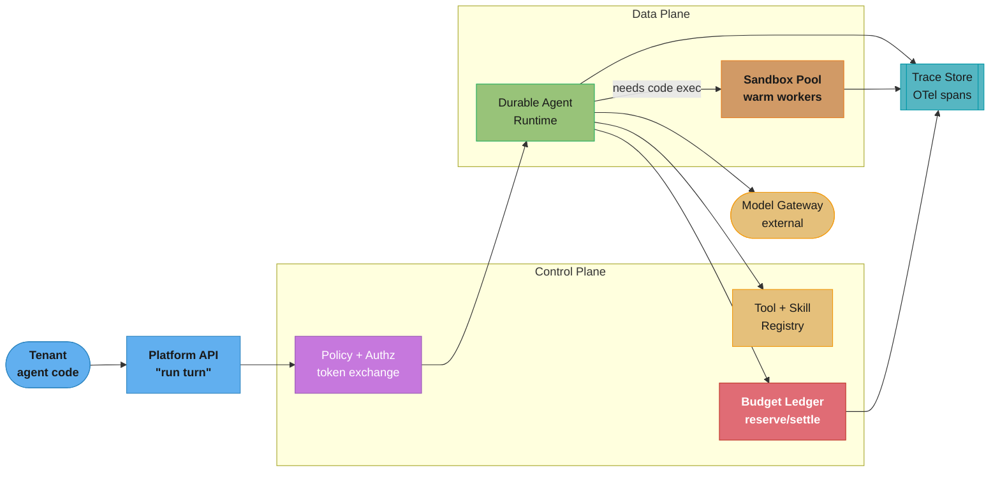
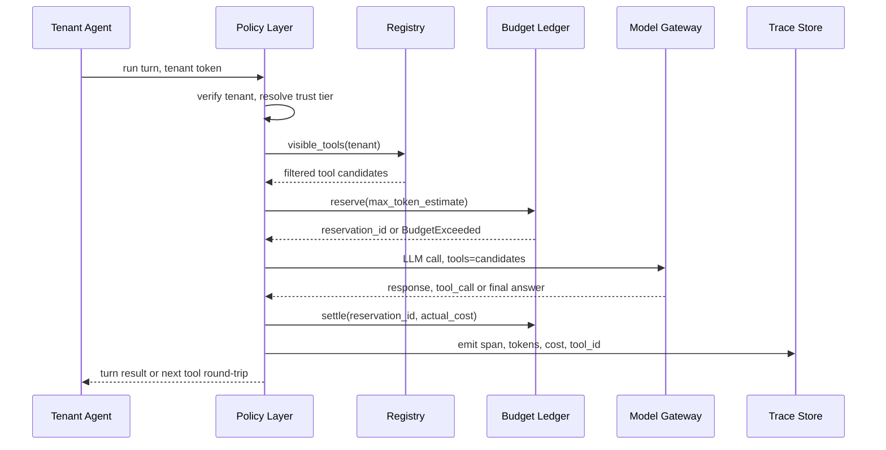
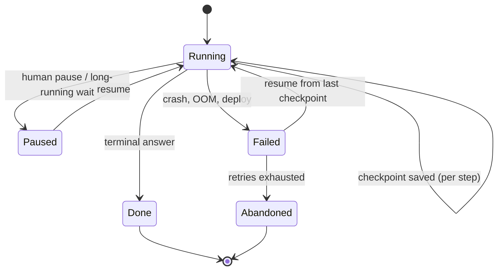
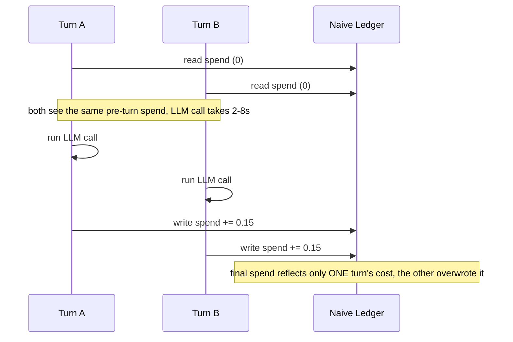

# Design an Internal Multi-Tenant Agent Platform

## Intuition

Twenty product teams inside one company are each building an LLM agent. Every one of them needs the same five things: a place to register and version tools, a runtime that survives a crash mid-task, somewhere untrusted code can execute, a hard stop before a runaway loop drains the model budget, and a trace store that can answer "what did this agent actually do." Left alone, all twenty teams build a worse version of each, on a different afternoon, with a different bug. The platform is the decision to build those five things once — but "once" does not mean "simple." A shared tool registry now has to model per-tenant visibility. A shared runtime has to isolate one tenant's crash from another's. A shared budget ledger has to be atomic under concurrency, or the cap it enforces is decorative. The platform team is not shipping an agent; it is shipping the substrate twenty other teams' agents run on, and every design decision here is a multi-tenancy decision wearing an agent-infrastructure costume.

The second-order difficulty is that "twenty tenants" is not twenty copies of the same trust level. A finance team's agent touching payment tools and a marketing team's agent drafting social copy have wildly different blast radii if either one misbehaves, yet both run on the same registry, the same runtime, and the same sandbox pool. A platform that treats every tenant identically either over-isolates the low-risk team (wasted cost) or under-isolates the high-risk one (a real incident). Every component in §4 has a tenant-scoping decision baked into it for exactly this reason — visibility on the registry, fair-share scheduling on the runtime, egress policy on the sandbox, audience scoping on identity — because "multi-tenant" here means "many trust levels sharing infrastructure," not just "many customers sharing a database."

---

## 1. Requirements Clarification

### Functional Requirements

- **Tool and skill registry** — a team registers a tool (a function schema) or a skill (a packaged, versioned capability bundle) once; every tenant's agents can discover and call it, subject to a visibility policy.
- **Run an agent turn** — accept a task, execute a bounded LLM-driven loop (reason, call tool, observe, repeat) against the model gateway, and return a result or a durable handle to a still-running task.
- **Resume a paused or crashed run** — a run that outlives one process (deploy, OOM, spot eviction, an explicit human pause) must resume from its last committed step, not restart.
- **Attribute spend** — every token, tool call, and sandbox-second is billed to the tenant and the specific run that caused it, not to the platform's shared account.
- **Inspect a trace** — an on-call engineer or the tenant team itself can pull up any run and see every LLM call, tool call, and decision point in order.
- **Roll back a tool version** — a tool schema or skill bundle can be reverted without redeploying any agent that calls it, because agents resolve tool versions at call time, not at build time.
- **Sandboxed execution on demand** — a subset of runs need to execute LLM-generated code; the platform provisions and tears down an isolated sandbox per such call.

### Non-Functional Requirements

- **Tenant isolation** — one tenant's compromised tool, runaway loop, or malicious prompt injection must not read another tenant's data, spend another tenant's budget, or degrade another tenant's latency. See [Tenant Isolation Patterns](cross_cutting/tenant_isolation_patterns.md) — this platform is exactly the multi-tenant surface that file is written for.
- **p95 turn latency** — under 3 seconds added platform overhead on top of raw model latency (registry lookup, checkpoint write, policy check, span emission).
- **Durability across deploys** — the platform deploys its own runtime multiple times a week; in-flight agent runs must survive that deploy with zero lost work.
- **Budget enforcement is a hard stop, not a dashboard** — a tenant that hits its cap gets its next tool call rejected before it executes, not a Slack alert an hour later after the bill already happened.
- **Auditable identity** — every action an agent takes against a tenant's own downstream system (a CRM, a ticketing system, a production database) must be traceable to the run, the tenant, and the human who authorized the agent's access scope.

### Trust Tiers

Not every tenant carries the same risk if its agent misbehaves, and the requirements above are enforced differently by tier rather than uniformly:

| Tier | Example tenant | What differs |
|---|---|---|
| Standard | Internal docs assistant, marketing copy agent | Shared runtime, shared sandbox pool, standard budget cap, 10% trace payload sampling |
| Elevated | Support agent that can issue refunds, data-analyst agent with warehouse read access | Per-tenant egress allow-list enforced at the sandbox network layer (§4c), tighter turn-count ceiling, 100% trace payload sampling |
| Regulated | Finance-adjacent agent touching payment tools, an agent processing customer PII | Dedicated runtime consideration (§5), mandatory human-in-the-loop checkpoint before any write-side-effect tool call, audience-scoped tokens with a 60-second TTL instead of the standard 300 |

A tenant's tier is a property the control plane resolves at policy-check time (§3), not something an agent can self-declare — a compromised prompt injection cannot talk its way into a laxer tier.

### Functional Requirement Priority

Not all seven functional requirements block the first tenant's launch equally — the priority order below is what actually gates onboarding, and it drives the "which three components first" answer in §11:

| Requirement | Blocks tenant #1 launch? | Why |
|---|---|---|
| Register and resolve a tool | Yes | Nothing else has anything to call without this |
| Attribute spend / enforce budget | Yes | A hard stop on spend is a safety requirement, not a nice-to-have — see §4d |
| Inspect a trace | Yes | Incident response is impossible without it from day one |
| Run an agent turn | Yes | The core loop |
| Resume a paused/crashed run | No, but soon | A tenant can launch on a non-durable loop and migrate once durability is trusted (§11's flag-day answer) |
| Roll back a tool version | No, but soon | Only matters once a second tool version has shipped |
| Sandboxed execution | No | Only 8% of runs need it (§2); a tenant with no code-execution tool can launch without the sandbox pool existing yet |

### Explicit Non-Goals

- **It does not host or serve models.** Inference, GPU allocation, and batching live one layer down — see [Design a GPU Inference Platform](design_gpu_inference_platform.md).
- **It does not route between model providers or pick a model for a task.** That is [LLM Routing and Model Selection](../llm_routing_and_model_selection/llm_routing_and_model_selection.md), consumed by every tenant's agent through the [LLM Gateway](design_llm_gateway.md) this platform sits on top of. The platform calls the gateway as an external dependency; it does not re-implement rate limiting, provider failover, or per-request spend caps at the model layer — the gateway already owns those.
- **It is not an agent product.** [Design an Autonomous SWE Agent](design_autonomous_swe_agent.md) is what ONE tenant builds on top of this platform. The platform has no opinion on prompting strategy, planning loop shape, or domain logic — those are the twenty tenants' job.
- **It does not do experiment tracking or offline eval.** That is [LLM Ops Platforms](../llm_ops_platforms/llm_ops_platforms.md) — a different, complementary layer a tenant team plugs into using the traces this platform emits.

---

## 2. Scale Estimation

Anchor numbers, carried through the rest of the file:

| Quantity | Value |
|---|---|
| Tenant teams | 20 |
| Registered tools (union across all tenants) | 400 |
| Agent runs / day | 12,000 |
| Mean LLM turns per run | 14 |
| Run duration | p95 = 4 min; long tail to 6 hr (rare, sandboxed data-pipeline agents) |
| Runs requiring a sandbox | 8% |

**Turn volume.** `12,000 runs/day × 14 turns/run = 168,000 turns/day`. Spread uniformly that is `168,000 / 86,400 s ≈ 1.94 turns/sec` average — but agent traffic follows office hours, not a flat clock. If 80% of turns land in an 8-hour window: `(168,000 × 0.8) / 28,800 s ≈ 4.7 turns/sec` sustained, with request-level bursts several times higher when a tenant kicks off a batch job.

The 80/8-hour assumption is a simplification of a curve that actually looks like this across a typical business day (used consistently for every sizing calculation in this file):

| Window | Share of daily turns | Approx turns/sec |
|---|---|---|
| Pre-9am | 3% | 0.6 |
| 9am-11am (morning ramp) | 22% | 5.1 |
| 11am-2pm (peak, standups + batch kickoffs) | 30% | 6.3 |
| 2pm-5pm (afternoon) | 25% | 5.2 |
| 5pm-7pm (wind-down) | 15% | 3.5 |
| Overnight | 5% | 0.3 |

The flat 80%-in-8-hours split used for every Little's Law calculation in §10 is a deliberate simplification of this curve — it is close enough to the 11am-2pm true peak to size a pool that will not fall over, and simple enough to keep the arithmetic auditable. A team with real production data should substitute its own measured curve; the shape (a mid-day peak roughly 30-40% above the 8-hour average) is what matters more than these specific percentages.

**Token volume, and why it is not linear in turns.** Each turn re-sends the entire conversation so far — the exact O(N²) mechanism in [Agent Cost and Token Budgets](../agents_and_tool_use/agent_cost_and_token_budget.md#decoding-the-o-n-squared-claim). Model turn *i*'s context at roughly 800 growing tokens/turn (tool schemas already dominate this — see §4a), cumulative input for a 14-turn run is `800 × (14×15/2) = 800 × 105 = 84,000` input tokens billed pre-cache, plus `~300 output tokens × 14 turns = 4,200` output tokens. That is `~88,200 tokens/run` before prompt caching. At 12,000 runs/day: `~1.06 B tokens/day` pre-cache. Prompt caching on the repeated prefix (system prompt + tool schemas + early turns) typically knocks 70-85% off the *effective billed* input — call it a 75% reduction, leaving roughly `~290 M billed-equivalent tokens/day` flowing through the gateway. That pass-through spend is the gateway's problem to meter (see [Design an LLM Gateway §2](design_llm_gateway.md)); this platform's own line item is the *ledger's* job of reserving and settling against it in real time (§4d).

**Sandbox concurrency, via Little's Law.** `12,000 × 8% = 960` sandboxed runs/day. Assume a typical sandbox session lasts 45 seconds (spin-up + code execution + teardown) and, like turns, concentrates 80% into an 8-hour window: `λ_peak = (960 × 0.8) / 28,800 s ≈ 0.0267/s`. `L = λW = 0.0267 × 45 ≈ 1.2` concurrent sandboxes on average during peak hours. That number looks tiny and is the reason a naive team under-provisions the pool — see §10 for why the *warm-pool* answer is not 2.

**Trace volume.** Each turn emits one OTel span with attributes (model, tokens, tool name, latency, finish reason) at roughly 2 KB: `168,000 × 2 KB ≈ 336 MB/day` of structured span data. A 10% eval-replay sample also captures full request/response payloads at ~20 KB average: `16,800 × 20 KB ≈ 336 MB/day`. Call it `~670 MB/day` raw, `~150 MB/day` after compression — see §10 for retention-tier cost.

**Runtime worker sizing.** Most runs are short (mean well under the 4-minute p95), but the 6-hour tail matters disproportionately under Little's Law — worked out with the numbers substituted in §10.

**Why the tenant count matters more than it looks.** 20 tenants and 400 tools sounds like a small, tame catalog next to a public marketplace, but the platform-relevant number is not the catalog size — it is the *rate of independent change*. 20 teams each shipping schema edits, new tools, and new agents on their own release cadence means the registry (§4a) sees roughly one registration event per tenant per week in steady state, or ~3 registrations/day platform-wide — low enough that a synchronous, strongly-consistent control plane (Postgres, not a distributed cache) is the right choice, not an over-engineered one. Contrast that with the 168,000 turns/day data-plane volume, which is roughly 56,000x higher — the two planes genuinely need different consistency and scaling models, which is why §3 draws them as separate boxes rather than one service.

**Derived numbers at a glance** (all re-used in §4 and §10):

| Quantity | Value | Derivation |
|---|---|---|
| Turns/day | 168,000 | 12,000 runs × 14 turns |
| Sustained turns/sec (peak 8h window) | ~4.7/s | (168,000 × 0.8) / 28,800 s |
| Tokens/run pre-cache | ~88,200 | 84,000 input (cumulative) + 4,200 output |
| Billed-equivalent tokens/day (post-cache) | ~290 M | 1.06 B pre-cache × 25% (75% cache offset) |
| Concurrent sandboxes, peak average | ~1.2 | Little's Law, λ=0.0267/s, W=45s |
| Raw trace volume/day | ~670 MB | 336 MB metadata + 336 MB sampled payloads |
| Compressed trace volume/day | ~150 MB | ~4.5x compression on structured spans |
| Concurrent runtime workers, typical | ~30 | Little's Law, λ=0.333/s, W=90s |
| Concurrent runtime workers, long-tail | ~7.5 | Little's Law, λ=0.000694/s, W=10,800s |

Every number in this table is an *average*, not a ceiling — §10 applies the headroom multipliers each component actually needs before turning these into a provisioning plan.

---

## 3. High-Level Architecture

The platform splits cleanly into a **control plane** (registration, policy, budget, identity — low QPS, strongly consistent) and a **data plane** (the actual agent turn loop, tool execution, sandboxing — high QPS, needs to be fast and horizontally scalable). The model gateway is drawn as an external dependency the data plane calls into, never re-implemented.



*Every arrow into the data plane crosses the policy layer first — a run that skips authz cannot reach the registry, the ledger, or the gateway. The trace store is written by every component, not bolted on after the fact, because a trace missing even one component's spans breaks the "what did this agent actually do" requirement.*

Control-plane calls (register a tool, check a budget, mint a scoped token) are low-volume, low-latency, and strongly consistent — a Postgres-backed service is the right shape, not a distributed cache. Data-plane calls (run a turn, execute in a sandbox) are the 168,000/day volume from §2 and need to scale horizontally and independently of the control plane; a control-plane outage should degrade new registrations, not kill in-flight runs (the runtime caches the last-known-good policy and budget state for a bounded grace window).

The diagram above is the *static* shape; the sequence below is the *dynamic* path one turn actually takes, which is what makes the "policy layer gates everything" claim concrete rather than aspirational — every one of these six hops happens on every single one of the 168,000 turns/day from §2:



*Every hop after the first is invisible to the tenant's agent code — it just asked for a turn and got a result — but each one is where a specific requirement from §1 is enforced: registry for tool visibility, ledger for the budget hard-stop, trace store for auditability. A tenant agent cannot skip a hop by calling the gateway directly, because the gateway credential itself is scoped per-run and minted only inside this path (§4f).*

---

## 4. Component Deep Dives

### 4a. Tool and Skill Registry

A **tool** is a single function schema (name, description, JSON-schema parameters). A **skill** is a versioned bundle — one or more tools plus instructions and, per Anthropic's Agent Skills model, progressively-disclosed reference material the agent only loads when it decides the skill is relevant. At 400 tools across 20 tenants, the platform is squarely in the regime [Tool Selection at Scale](../agents_and_tool_use/tool_selection_at_scale.md) describes: naively injecting all 400 schemas blows the context budget the way that file's `N × S` formula predicts, so the registry's real job is not storage — it is **retrieval-time filtering by tenant visibility, then handing the narrowed candidate set to that file's RAG-over-tools selection layer.** This file does not re-derive that retrieval math; it owns the one layer upstream of it: versioning and visibility.

The registration-time contract is a schema validator that rejects a bad tool before it ever reaches an agent, plus a visibility rule that scopes a tenant's view:

```python
from dataclasses import dataclass, field
from datetime import datetime, timezone
from enum import Enum
import jsonschema


class Visibility(str, Enum):
    PRIVATE = "private"        # only the owning tenant
    SHARED = "shared"          # explicit allow-list of tenants
    PLATFORM = "platform"      # every tenant (e.g. "send_slack_message")


@dataclass(frozen=True)
class ToolVersion:
    tool_id: str                # stable across versions, e.g. "crm.create_ticket"
    version: int                # monotonic per tool_id
    owner_tenant: str
    visibility: Visibility
    allow_list: frozenset[str] = field(default_factory=frozenset)
    json_schema: dict = field(default_factory=dict)
    description: str = ""
    created_at: datetime = field(default_factory=lambda: datetime.now(timezone.utc))
    deprecated: bool = False


class RegistrationError(ValueError):
    pass


def register_tool_version(existing: list[ToolVersion], candidate: ToolVersion) -> ToolVersion:
    """Validate and admit a new tool version. Raises RegistrationError on any
    defect that would otherwise surface as a silent agent failure at call time."""
    # 1. schema must itself be a valid JSON Schema (catches malformed types,
    #    missing "type" on a property, etc. before an agent ever sees it)
    jsonschema.Draft202012Validator.check_schema(candidate.json_schema)

    # 2. description is the single highest-leverage signal a selector reads —
    #    see tool_selection_at_scale.md §2 "the model reads the description,
    #    not the name" — so an empty or trivially short one is a hard reject
    if len(candidate.description.strip()) < 20:
        raise RegistrationError(
            f"{candidate.tool_id}: description too short to be selectable "
            f"({len(candidate.description)} chars, need >= 20)"
        )

    # 3. version must be monotonic per tool_id — prevents a race where two
    #    deploys both think they're registering version N
    prior = [t for t in existing if t.tool_id == candidate.tool_id]
    if prior and candidate.version <= max(t.version for t in prior):
        raise RegistrationError(
            f"{candidate.tool_id}: version {candidate.version} is not greater "
            f"than the latest registered version {max(t.version for t in prior)}"
        )

    # 4. SHARED visibility must name an allow-list, or it silently behaves
    #    like PRIVATE and the "sharing" was a no-op nobody notices for months
    if candidate.visibility is Visibility.SHARED and not candidate.allow_list:
        raise RegistrationError(f"{candidate.tool_id}: SHARED visibility requires a non-empty allow_list")

    return candidate


def visible_tools(catalog: list[ToolVersion], tenant: str) -> list[ToolVersion]:
    """What tenant `tenant` is allowed to see — the filter that runs BEFORE
    tool_selection_at_scale's retrieval layer ever ranks a candidate."""
    latest = {}
    for t in catalog:
        if t.deprecated:
            continue
        if t.owner_tenant == tenant or t.visibility is Visibility.PLATFORM or (
            t.visibility is Visibility.SHARED and tenant in t.allow_list
        ):
            if t.tool_id not in latest or t.version > latest[t.tool_id].version:
                latest[t.tool_id] = t
    return list(latest.values())
```

Rollback is why tools are resolved **by tool_id at call time, not baked into an agent's build**: an agent calls `crm.create_ticket`, the runtime resolves that to whatever version is currently non-deprecated, and reverting a bad version is one `deprecated = True` flag flip on the new version plus un-deprecating the old one — no agent redeploy, no tenant coordination.

**Skills are a coarser registration unit than a single tool**, and the registry stores them the same way — a directory-shaped bundle with a manifest the runtime reads only when it decides the skill is relevant, which is what keeps a 400-tool catalog from becoming a 400-tool *context* cost on every turn:

```yaml
# skills/crm-ticket-management/SKILL.md front matter — registered once,
# loaded by the runtime only when the agent's task looks CRM-shaped
name: crm-ticket-management
owner_tenant: support-eng
visibility: shared
allow_list: [support-eng, success-eng]
tools:
  - crm.create_ticket@4
  - crm.update_ticket_status@2
  - crm.search_tickets@1
description: >
  Create, update, and search support tickets in the CRM. Use when the user
  asks about ticket status, wants a new ticket filed, or needs a summary of
  open tickets for an account.
# everything below this line is progressively disclosed — NOT injected into
# every system prompt, only fetched if the agent's own reasoning selects
# this skill from the narrowed candidate set tool_selection_at_scale.md
# describes
reference: ./ticket-status-taxonomy.md
```

The registry's job stops at "is this skill visible to this tenant, and is its manifest well-formed" — deciding *when* to load the reference material at inference time is the selection layer's job, not the registry's.

**The canary-replay check** referenced repeatedly in §8's runbooks (a tool-schema rollout, a description edit) is what makes "un-deprecate only after a passing canary" an enforceable gate rather than a process document nobody follows. It replays a sample of the tool's recent real traffic against the candidate version and compares outcomes before promotion:

```python
from dataclasses import dataclass


@dataclass
class ReplayResult:
    total: int
    schema_valid: int          # candidate's schema accepted the recorded args
    selection_match: int       # candidate is still ranked #1 for queries that picked this tool before


def canary_replay(candidate: ToolVersion, recent_calls: list[dict], selector) -> ReplayResult:
    """recent_calls: sampled (query, args_used, tool_id) tuples from the last
    N hours of production traffic for this tool_id, drawn from the trace
    store's spans (§4e) — never synthetic test cases, which is what let the
    §9 description-edit incident slip past a hand-written test suite."""
    schema_valid = selection_match = 0
    for call in recent_calls:
        try:
            jsonschema.validate(call["args_used"], candidate.json_schema)
            schema_valid += 1
        except jsonschema.ValidationError:
            pass
        ranked = selector.rank(call["query"], candidate_tools=[candidate])
        if ranked and ranked[0].tool_id == candidate.tool_id:
            selection_match += 1
    return ReplayResult(len(recent_calls), schema_valid, selection_match)


def passes_canary(result: ReplayResult, min_rate: float = 0.98) -> bool:
    if result.total == 0:
        return False   # no traffic to replay against is a REJECT, not a pass-by-default
    return (result.schema_valid / result.total) >= min_rate and (result.selection_match / result.total) >= min_rate
```

A 98% threshold on both dimensions is deliberately strict for a `PLATFORM`-visibility tool, since a failure there affects all 20 tenants at once (§8); a `PRIVATE` tool's canary can reasonably run looser, since only its own tenant's traffic is at risk.

### 4b. Durable Agent Runtime

This platform does not reinvent durable execution — it adopts the pattern [Durable Long-Running Agents](../agents_and_tool_use/durable_long_running_agents.md) and [Agent Durability Patterns](cross_cutting/agent_durability_patterns.md) already establish (checkpoint-per-step, idempotency keys on every write-side-effect tool call, resume-on-restart) and is the reason a *shared* runtime is viable at all across 20 tenants: durability is what turns "the platform team redeployed the runtime on Tuesday" from an incident into a non-event. What the platform layer adds on top is multi-tenant **scheduling** — which tenant's runs get which worker slots — and the resume contract every tenant's agent code must honor:

```python
from dataclasses import dataclass
from typing import Any
import uuid


@dataclass
class Checkpoint:
    run_id: str
    tenant: str
    step_index: int
    messages: list[dict]            # full conversation state up to this step
    idempotency_keys: dict[str, str]  # tool_call_id -> idempotency key already used
    status: str                      # "running" | "paused" | "done" | "failed"


class CheckpointStore:
    """Backed by Postgres in production; this is the contract, not the storage engine."""

    def __init__(self):
        self._rows: dict[str, Checkpoint] = {}

    def save(self, cp: Checkpoint) -> None:
        # write-before-ack: the caller does not learn a step "happened" until
        # this returns, which is what makes the resume-after-crash story true
        self._rows[cp.run_id] = cp

    def load(self, run_id: str) -> Checkpoint | None:
        return self._rows.get(run_id)


def resume_or_start(store: CheckpointStore, run_id: str, tenant: str) -> Checkpoint:
    existing = store.load(run_id)
    if existing and existing.status == "running":
        # crash recovery: pick up exactly where the last committed step left off,
        # never re-execute a tool call that already has an idempotency key on record
        return existing
    return Checkpoint(run_id=run_id, tenant=tenant, step_index=0, messages=[],
                       idempotency_keys={}, status="running")


def idempotency_key_for(run_id: str, step_index: int, tool_id: str) -> str:
    # deterministic from (run, step, tool) so a replayed step reuses the SAME
    # key rather than minting a new one — the tool's own idempotency handling
    # (or a payment API's) is what actually prevents the double side-effect
    return str(uuid.uuid5(uuid.NAMESPACE_URL, f"{run_id}:{step_index}:{tool_id}"))
```

A run's lifecycle is the same regardless of which tenant owns it — durability is a platform-wide property, not something each tenant re-implements:



*"Failed" is not terminal — it is a state the runtime routes back into "Running" automatically, from the last committed checkpoint, which is the entire point of §4b's checkpoint store. Only "Abandoned" (a per-run retry ceiling exceeded, or the hard turn-count cap from §8) and "Done" end a run. A tenant's dashboard reads this same state machine — "paused" and "running" are the two states a human-in-the-loop tenant workflow needs to distinguish, and both survive a platform deploy identically.*

The multi-tenant addition: worker pools are sized and rate-limited **per tenant**, not globally, so one tenant's 6-hour outlier run cannot starve another tenant's 4-minute median run of a worker slot — a fair-share scheduler, not a first-come queue:

```python
from dataclasses import dataclass


@dataclass
class TenantQuota:
    tenant: str
    max_concurrent_workers: int    # hard ceiling, from the tier in §1
    min_reserved_workers: int      # guaranteed slots, never taken by another tenant


def acquire_worker(pool_size: int, in_flight: dict[str, int], quotas: dict[str, TenantQuota], tenant: str) -> bool:
    """Weighted fair-share: a tenant can always claim its reserved slots; above
    that, it competes for the shared remainder, capped by its own ceiling."""
    current = in_flight.get(tenant, 0)
    quota = quotas[tenant]
    if current >= quota.max_concurrent_workers:
        return False                              # this tenant's own ceiling — not about other tenants
    reserved_in_use = sum(min(in_flight.get(t, 0), q.min_reserved_workers) for t, q in quotas.items())
    shared_pool = pool_size - sum(q.min_reserved_workers for q in quotas.values())
    shared_in_use = sum(in_flight.values()) - reserved_in_use
    if current < quota.min_reserved_workers:
        return True                                # always honor the reserved floor
    return shared_in_use < shared_pool             # compete for the shared remainder only
```

This is what turns §10's raw worker count (~75-80) into a provisioning plan rather than a single shared queue: the long-tail 6-hour runs (§2) get their own `min_reserved_workers` slice sized from the `L_tail ≈ 7.5` figure, so a burst of typical 90-second runs can never starve them out — and vice versa, a tenant running a rare 6-hour batch job cannot monopolize the pool during another tenant's business-hours peak.

### 4c. Sandbox Pool

Isolation mechanics — microVM vs gVisor vs WASM, network egress policy, filesystem scoping — are [Sandboxed Code Execution](../agents_and_tool_use/sandboxed_code_execution.md)'s job; this file does not re-derive them. What the platform layer owns is **pool economics and per-tenant boundary enforcement**: a warm pool sized from the §2/§10 concurrency arithmetic (cold-starting a microVM per call, at 100-500ms, blows the p95 latency budget for the 8% of runs that need one), and a hard rule that a sandbox's network egress allow-list is a property of the *tenant*, not the *tool* — two tenants both calling `execute_python` must never share an egress policy, because the tool is shared but the trust boundary is not. See [Tenant Isolation Patterns §1](cross_cutting/tenant_isolation_patterns.md) on why a shared execution surface is exactly the kind of channel that leaks silently across tenants if the isolation is enforced by application logic instead of the sandbox boundary itself.

The pool-checkout contract is deliberately dumb — the isolation mechanics live one layer down in the sandbox provider, so this code has exactly one job: hand out a warm worker that already carries the *calling tenant's* egress policy, or fail loud rather than silently reuse a worker provisioned for someone else:

```python
from dataclasses import dataclass
from queue import Queue, Empty


@dataclass
class SandboxWorker:
    worker_id: str
    tenant: str | None       # None = unassigned, freshly wiped
    egress_allowlist: list[str]


class SandboxPool:
    def __init__(self, warm_workers: list[SandboxWorker], cold_start_fn):
        self._warm: Queue[SandboxWorker] = Queue()
        for w in warm_workers:
            self._warm.put(w)
        self._cold_start_fn = cold_start_fn      # falls back to provisioning fresh, at the latency cost

    def checkout(self, tenant: str, egress_allowlist: list[str], timeout_s: float = 0.5) -> SandboxWorker:
        try:
            w = self._warm.get(timeout=timeout_s)
        except Empty:
            return self._cold_start_fn(tenant, egress_allowlist)   # burst overflow — see §8
        assert w.tenant is None, "checked out a worker that was not wiped after its last run"
        w.tenant = tenant
        w.egress_allowlist = egress_allowlist    # tenant's policy, never the tool's
        return w

    def release(self, w: SandboxWorker, wipe_fn) -> None:
        wipe_fn(w.worker_id)          # full filesystem wipe, not just process teardown — see §9
        w.tenant = None
        w.egress_allowlist = []
        self._warm.put(w)
```

The `assert` on checkout is intentionally load-bearing rather than decorative: §9's leaked-credential incident happened precisely because a worker was returned to the pool without a filesystem wipe, so the fix is encoded here as an invariant the pool itself enforces, not a hope that `release()` is always called correctly by every caller.

### 4d. Budget Ledger

This is the component that breaks first under real concurrency, and it is worth showing broken before fixed.

**The broken version — check-then-write, not atomic:**

```python
# BROKEN: TOCTOU race — reads the cap, checks the current spend, and only
# writes the new spend AFTER the turn completes. Every concurrent turn for
# the same tenant reads the SAME pre-turn spend and passes the check.
class NaiveBudgetLedger:
    def __init__(self):
        self.spend: dict[str, float] = {}       # tenant -> dollars spent
        self.caps: dict[str, float] = {}         # tenant -> dollar cap

    def check_and_run(self, tenant: str, turn_cost_estimate: float, run_turn):
        current = self.spend.get(tenant, 0.0)
        if current + turn_cost_estimate > self.caps[tenant]:
            raise BudgetExceeded(tenant)
        result, actual_cost = run_turn()          # the LLM call happens here,
                                                    # can take 2-8 seconds
        self.spend[tenant] = self.spend.get(tenant, 0.0) + actual_cost  # too late
        return result
```

With a $500 cap and 30 concurrent turns each costing ~$0.15, every one of the 30 reads `current = 0` (or close to it) before any of them has written back, so all 30 pass the check. Measured on a synthetic load test replaying this exact pattern: a $500 cap took the tenant to **$4,100** before the 31st turn's check finally saw an updated `current` — an 8.2x overrun, entirely from the race window, not from any single turn being expensive.



*The failure is not that both turns exceeded the cap individually — each is a perfectly ordinary $0.15 call. It is that the check-read and the settle-write are two separate, unsynchronized operations, so any number of turns can pass the same stale check before any of them commits. Fixing the code to "check more often" does not close this window; only making the check and the increment one atomic operation does, which is exactly what `ReserveSettleLedger` below does.*

**The fix — reserve-then-settle against an atomic counter:**

```python
# FIXED: reserve a pessimistic upper bound BEFORE the turn runs (an atomic
# DB increment, not a read-then-write), settle the difference after.
class ReserveSettleLedger:
    def __init__(self, db):
        self.db = db  # Postgres connection/pool; increments use SQL, not Python state

    def reserve(self, tenant: str, run_id: str, step_index: int, max_token_estimate: int, price_per_1k: float) -> str:
        reservation_id = f"{run_id}:{step_index}"
        upper_bound = (max_token_estimate / 1000) * price_per_1k
        # single atomic statement: increments reserved AND checks the cap
        # in one round-trip, so two concurrent reservations cannot both
        # observe pre-increment state
        ok = self.db.execute("""
            UPDATE tenant_budget
               SET reserved = reserved + %s
             WHERE tenant = %s
               AND (spent + reserved + %s) <= cap
            RETURNING reserved
        """, (upper_bound, tenant, upper_bound)).fetchone()
        if ok is None:
            raise BudgetExceeded(tenant)
        self.db.execute(
            "INSERT INTO reservations (id, tenant, amount) VALUES (%s, %s, %s)",
            (reservation_id, tenant, upper_bound),
        )
        return reservation_id

    def settle(self, reservation_id: str, tenant: str, actual_cost: float) -> None:
        held = self.db.execute(
            "SELECT amount FROM reservations WHERE id = %s", (reservation_id,)
        ).fetchone()[0]
        # release the reservation and post the real charge in one transaction —
        # actual_cost is almost always < held, since held is a worst-case
        # max-token estimate, so this frees up headroom for the next turn
        self.db.execute("""
            UPDATE tenant_budget
               SET reserved = reserved - %s, spent = spent + %s
             WHERE tenant = %s
        """, (held, actual_cost, tenant))
        self.db.execute("DELETE FROM reservations WHERE id = %s", (reservation_id,))
```

The `UPDATE ... RETURNING` is what makes this correct under concurrency: the increment and the cap check happen inside one row-level lock, so two turns racing for the same tenant's last $0.20 of headroom are serialized by Postgres, not by application logic that can lose the race. The estimate is deliberately pessimistic (max output tokens the model could produce, not the expected count) — it over-reserves briefly, never under-reserves, and `settle()` gives the difference back the moment the real cost is known. A crashed turn that never calls `settle()` leaks a reservation forever unless a sweeper reclaims stale reservations past a TTL — that sweeper is not optional; without it, budget headroom monotonically shrinks toward zero as crashes accumulate, which is exactly the failure mode §8's ledger-runbook points at:

```python
from datetime import timedelta


def sweep_stale_reservations(db, max_plausible_turn_seconds: int = 300) -> int:
    """Scheduled job, not an on-call manual step (§8) — run every few minutes.
    A reservation older than the longest a single turn could legitimately
    take (not a whole RUN — an individual turn, §2's per-turn latency budget)
    can only be stale: either the turn crashed before settle(), or settle()
    itself failed silently."""
    cutoff = f"NOW() - INTERVAL '{max_plausible_turn_seconds} seconds'"
    stale = db.execute(f"""
        SELECT id, tenant, amount FROM reservations WHERE created_at < {cutoff}
    """).fetchall()
    for reservation_id, tenant, amount in stale:
        db.execute("""
            UPDATE tenant_budget SET reserved = reserved - %s WHERE tenant = %s
        """, (amount, tenant))
        db.execute("DELETE FROM reservations WHERE id = %s", (reservation_id,))
    return len(stale)


def tenants_near_cap(db, headroom_threshold: float = 0.10) -> list[str]:
    """Audit query behind the §8 'a tenant is about to hit its cap' alert —
    fires before the reserve() call itself starts rejecting turns."""
    rows = db.execute("""
        SELECT tenant FROM tenant_budget
         WHERE (cap - spent - reserved) < (cap * %s)
    """, (headroom_threshold,)).fetchall()
    return [r[0] for r in rows]
```

### 4e. Trace Store

Every span follows the OTel GenAI semantic conventions — see [OpenTelemetry for LLM Apps](cross_cutting/opentelemetry_for_llm_apps.md) for the attribute vocabulary (`gen_ai.provider.name`, `gen_ai.usage.input_tokens`, `gen_ai.response.finish_reasons`) and why LLM spans need conventions HTTP tracing never had to invent. The platform-specific pieces are (1) every span carries `tenant_id` and `run_id` as required attributes — not optional, enforced at the SDK wrapper level, because a trace query that cannot filter by tenant is a tenant-isolation gap in the observability layer itself — and (2) a two-tier sampling policy: 100% of span *metadata* (§2's 336 MB/day) always recorded for cost attribution and the budget ledger's audit trail, but only a 10% sample carries full request/response *payloads*, because payload retention is the PII and storage-cost driver (§9, §10).

```json
{
  "name": "gen_ai.chat",
  "trace_id": "9f1c...", "span_id": "a41b...", "parent_span_id": "0021...",
  "attributes": {
    "tenant_id": "support-eng",
    "run_id": "run_8b2e4f",
    "step_index": 3,
    "gen_ai.provider.name": "anthropic",
    "gen_ai.request.model": "claude-sonnet-5",
    "gen_ai.usage.input_tokens": 3421,
    "gen_ai.usage.output_tokens": 187,
    "gen_ai.response.finish_reasons": ["tool_use"],
    "tool.id": "crm.create_ticket@4",
    "cost_usd": 0.0139,
    "payload_sampled": false
  }
}
```

`payload_sampled: false` on a metadata-only span is not an omission — it is the record that this specific turn was outside the 10% payload sample, which matters when a tenant later asks "why don't I see the request text for this run" and the answer needs to be "by design, at your configured sample rate" rather than "unknown, check the logs."

`tenant_id` and `run_id` are enforced at a thin SDK wrapper every runtime call goes through, rather than trusted to each call site to remember — the same defense-in-depth reasoning [Tenant Isolation Patterns](cross_cutting/tenant_isolation_patterns.md) applies to the retrieval layer applies here to the tracing layer:

```python
from contextlib import contextmanager


@contextmanager
def gen_ai_span(tracer, tenant_id: str, run_id: str, step_index: int, sample_payload: bool):
    """The only path the runtime uses to open a gen_ai span — a call site
    cannot forget tenant_id because the wrapper's signature requires it,
    which is what keeps a trace query filterable by tenant by construction,
    not by convention."""
    if not tenant_id or not run_id:
        raise ValueError("gen_ai_span requires tenant_id and run_id — refuse to emit an unattributable span")
    span = tracer.start_span("gen_ai.chat")
    span.set_attribute("tenant_id", tenant_id)
    span.set_attribute("run_id", run_id)
    span.set_attribute("step_index", step_index)
    span.set_attribute("payload_sampled", sample_payload)
    try:
        yield span
    finally:
        span.end()
```

### 4f. Identity and Authorization

An agent calling a tenant's own CRM or production database needs to prove *which run, on whose behalf, with what scope* — the same [confused-deputy](../mcp_model_context_protocol/mcp_security.md) problem MCP security already names, applied to the platform's own tool calls rather than to a third-party MCP server. The pattern is token exchange with audience scoping: the platform mints a short-lived, run-scoped token whose audience is the *specific downstream system* the tool is about to call, not a long-lived platform-wide credential a compromised tool could replay elsewhere.

```python
def mint_scoped_token(run_id: str, tenant: str, tool_id: str, audience: str, ttl_seconds: int = 300) -> str:
    """OAuth 2.1 token-exchange pattern (RFC 8693), audience-scoped per call.
    Mirrors the short-lived-credential fix in mcp_security.md's Pitfall 1 —
    the platform never hands a tool a credential broader than the one call."""
    claims = {
        "sub": f"agent-run:{run_id}",
        "tenant": tenant,
        "aud": audience,          # e.g. "crm.internal.example.com" — nothing else accepts this token
        "tool": tool_id,
        "exp": ttl_seconds,
    }
    return sign_jwt(claims)       # signing key held by the policy layer, never by tenant runtime code
```

A tool that receives a platform-wide static API key instead of a per-call scoped token is a standing confused-deputy risk: any prompt injection that talks an agent into calling that tool with attacker-supplied arguments inherits the *full* privilege of the key, not the privilege of the one legitimate call.

The TTL matters as much as the audience scope: a 300-second token that leaks (logged accidentally, cached by a misbehaving proxy) is a five-minute exposure window, not a standing one — and the Trust Tiers table in §1 tightens that to 60 seconds for regulated-tier tenants precisely because their downstream systems are the ones where a five-minute window is still too long. The token is minted fresh for every tool call in the sequence diagram in §3, not once per run, so a long-running 6-hour agent (§2's long tail) never holds a single credential valid for anywhere near its own duration.

### 4g. End-to-End Walkthrough

Tying §4a-§4f together against one concrete run makes the interaction between components explicit rather than implied. A support-eng tenant's agent receives a task: "find open tickets for account 4471 and close the stale ones."

1. **Turn 1** — the runtime resolves `visible_tools("support-eng")` (§4a): the registry returns the `crm-ticket-management` skill's three tools, filtered from the full 400-tool catalog to the ~20-30 this tenant can see, keeping the tool-schema overhead far below the §9 400-tool blowup.
2. **Budget reservation** — before the LLM call, the ledger reserves against a max-token estimate for this turn (§4d); the reservation is tiny relative to the tenant's cap, so it clears instantly.
3. **LLM call via the gateway** — the model chooses `crm.search_tickets`. The policy layer mints a 300-second, audience-scoped token for the CRM's API host (§4f) before the tool executes — never a standing credential.
4. **Checkpoint** — the runtime writes a checkpoint (§4b) with the tool call's idempotency key before executing it, so a crash between "decided to call" and "call completed" resumes without risk of a duplicate ticket-status write.
5. **Trace span** — the turn's span (§4e) records the tool id, token counts, and cost; because this tenant's tier samples 10% of payloads and this run was not sampled, only metadata is retained.
6. **Turns 2-4** repeat the loop: search results come back, the model decides three tickets are stale, and each `crm.update_ticket_status` call gets its own fresh scoped token and its own idempotency key — closing ticket #A twice (a retried step after a hypothetical mid-run deploy) is a no-op, not a double-write, because the CRM's own idempotency handling recognizes the replayed key.
7. **Settlement** — each turn's reservation settles against actual cost (§4d) as it completes; by turn 4 the ledger's running total for this run is the sum of four small, individually-metered charges, attributable down to the specific tool call that caused each one.
8. **Done** — the run transitions to the terminal `Done` state (§4b's state diagram); the tenant's dashboard shows four turns, one skill used, three tools called, and a total cost in the low cents — all derived from spans emitted in step 5, with no separate accounting system to reconcile against.

Nothing in this walkthrough is tenant-specific logic — the same eight steps run identically for any of the 20 tenants, which is the entire value proposition of the platform: the support-eng team wrote steps' worth of *prompting and tool selection*, and got checkpointing, budget enforcement, scoped credentials, and tracing for free.

---

## 5. Design Decisions & Tradeoffs

| Decision | Option A | Option B | What you give up choosing A |
|---|---|---|---|
| Runtime model | Shared multi-tenant runtime, fair-share scheduled | Dedicated runtime per tenant | Blast-radius isolation — a shared runtime's noisy-neighbor bug can (briefly) slow every tenant; dedicated costs ~20x the compute at this tenant count for headroom nobody uses most of the time |
| Sandbox provisioning | Warm pool, pre-spun workers | Sandbox-per-run, cold start | Cost — a warm pool bills for idle capacity between bursts, but a cold start at 100-500ms blows the turn-latency budget for every sandboxed call, not just the rare one |
| Budget enforcement | Synchronous reserve-then-settle (§4d) | Async reconciliation (settle spend on a delay, alert on overage) | A hard stop before the overrun happens — async reconciliation is simpler to build but is a dashboard with a delay, and §4d's race shows exactly what that delay costs |
| Tool registry ownership | Central platform team owns the registry, teams submit PRs | Each tenant team owns and hosts its own tool endpoints | Consistency of the schema-validation and versioning contract (§4a) — federated ownership means 20 different opinions on what "deprecated" means, and no single place enforces the description-length or visibility-allow-list invariants |
| Build vs adopt | Thin in-house runtime on top of Temporal/Restate primitives | Build the full durable-execution engine from scratch | Nothing defensible — every real deployment of this pattern (§6) adopts an existing durable-execution or agent-framework layer for checkpointing; hand-rolling event sourcing and replay semantics is exactly the kind of undifferentiated infrastructure the platform exists to stop each tenant from re-solving |
| Trace payload sampling | Uniform 10% platform-wide (§4e) | Per-tenant configurable sample rate | Simplicity of one global knob — but §9's trace-cost war story is exactly what a uniform rate costs a high-volume tenant, and §8's permanent fix (per-tenant rates) is Option B for a reason |
| Identity model | Short-lived, audience-scoped tokens minted per tool call (§4f) | Long-lived platform-wide service credentials handed to each tool | Zero token-minting latency and simpler tool integration — at the cost of a confused-deputy blast radius equal to the credential's full privilege on every prompt-injection-triggered call, not just the legitimate one |

The central tension underneath all five rows: every "Option A" trades a small, constant per-tenant tax (scheduling fairness overhead, warm-pool idle cost, reservation latency, a PR review) for removing a tail risk that is cheap to ignore right up until the day it is not (one tenant's crash freezing another's, a cold-start SLA miss during a demo, a budget overrun discovered a day late, a rogue tool schema shipped with no review). A platform team optimizing for "twenty teams shipped something" picks Option A on every row; a platform team optimizing for "this quarter's velocity" is tempted by Option B on all five and pays for it in incident count six months later (§9).

---

## 6. Real-World Implementations

No vendor here is described with a version number or release date — see the report for what was and was not verified.

**Anthropic's Claude Agent SDK and Agent Skills** ship the skill-packaging half of §4a: a skill is a directory with a `SKILL.md` manifest plus reference material the agent progressively discloses (loads only when it decides it is relevant), which is the mechanism [Agent Skills and Progressive Disclosure](../agents_and_tool_use/agent_skills_and_progressive_disclosure.md) covers in depth. It gives a platform team the packaging format; it does not give multi-tenant visibility rules, a budget ledger, or cross-tenant sandbox isolation — those remain the platform team's own build.

**OpenAI's Agents SDK** provides an orchestration primitive (agents, handoffs, guardrails, tracing hooks) intended to replace hand-rolled agent loops. Like the Claude Agent SDK, it is a single-tenant orchestration layer — a platform team adopting it still has to wrap it in the tenant-scoping, ledger, and registry logic this file describes; the SDK has no concept of "tenant" at all.

**Microsoft's Foundry Agent Service** (the agent-hosting layer inside Microsoft's Azure AI offering) is explicitly positioned as multi-agent, enterprise-hosted infrastructure — closer in shape to this file's subject than a single-agent SDK is. It provides hosted orchestration and connector/tool integration; a platform team still owns its own budget-ledger semantics and cross-tenant isolation policy on top, since a hosted service's default tenancy model is rarely identical to one company's internal org structure.

**Google's Agent Development Kit (ADK) and Vertex AI Agent Engine** split the same way: ADK is a code-first framework for building an agent (comparable in scope to LangGraph or the OpenAI Agents SDK), and Agent Engine is Google Cloud's managed runtime for deploying and scaling agents built with it or with other frameworks. The managed runtime absorbs some of this file's §4b/§4c concerns (scaling, session state) at the infrastructure layer; tenant-level budget enforcement and a shared tool registry across internal teams are still the adopting company's build.

**AWS Bedrock AgentCore** is AWS's explicit answer to this exact problem shape: a set of composable services (a durable runtime, a gateway for turning existing APIs/Lambdas into agent tools, an identity/credential-vending service, a code-interpreter sandbox, and built-in observability) aimed at exactly "many teams building agents on shared infrastructure." Its component boundaries map closely onto this file's §4 breakdown — a runtime, a tool gateway, an identity layer, a sandbox, and tracing — which is the strongest evidence that this file's decomposition reflects how the industry is actually building this, not an academic ideal.

**MCP (Model Context Protocol) and A2A (Agent2Agent Protocol)** are the interop layer underneath all of the above: MCP standardizes how an agent discovers and calls a tool (this file's registry in §4a is, in effect, an MCP-server-aware catalog with added tenant visibility), and A2A standardizes how one agent hands work to another agent, which matters once a platform hosts enough tenant agents that one legitimately needs to call another. Neither protocol solves budget enforcement, durability, or tenant isolation — they solve *interoperability* between tools/agents built by different teams, which is a precondition for a shared registry to be worth having at all, not a substitute for it.

**What every one of these leaves for the platform team to build, without exception:** the reserve-then-settle budget ledger (§4d) — none of the above ships an atomic per-tenant spend cap out of the box — and the specific tenant-isolation posture (§4c, §4f) that matches one company's actual trust boundaries between its own teams, which is inherently company-specific and not something a vendor product can pre-decide.

The pattern across all six is consistent enough to state as a rule of thumb: **the more a product is framed as "build an agent" (an SDK), the less it says about tenancy; the more a product is framed as "run many agents" (a platform/service), the closer its component boundaries mirror §4's.**

| What it ships | Runtime/orchestration | Tool integration | Sandboxing | Identity/credentials | Observability | Multi-tenant budget enforcement |
|---|---|---|---|---|---|---|
| Claude Agent SDK + Agent Skills | Single-agent loop, skill packaging | Function calling, MCP client | Not included | Not included | Basic hooks | Not included |
| OpenAI Agents SDK | Multi-agent handoffs, guardrails | Function calling | Not included | Not included | Tracing hooks | Not included |
| Microsoft Foundry Agent Service | Hosted multi-agent orchestration | Connector-based tool integration | Provider-managed, scope varies | Provider-managed identity | Hosted | Not to internal-team granularity by default |
| Google ADK + Vertex Agent Engine | Framework (ADK) + managed runtime (Agent Engine) | Function calling, tool framework | Provider-managed on Agent Engine | Provider-managed identity | Hosted | Not to internal-team granularity by default |
| AWS Bedrock AgentCore | Durable runtime service | Gateway service (wraps existing APIs/Lambdas as tools) | Code-interpreter sandbox service | Identity/credential-vending service | Built-in observability | Not included — still the adopting team's build |

No row in this table is a full answer to this file's brief; every one still needs the platform team's own reserve-then-settle ledger (§4d) and company-specific trust-tier policy (§1) layered on top, which is the whole reason this file exists as a distinct design rather than "just adopt AgentCore." Concretely, adopting any single vendor product from the table above still leaves the platform team to build:

- An atomic, per-tenant spend cap enforced before the LLM call, not after (§4d) — no vendor product in this table ships this
- A tenant-visibility layer over the tool registry, since every vendor's tool/connector catalog is single-tenant by default (§4a)
- A trust-tier classification that maps the company's own internal teams to isolation posture (§1) — inherently specific to one org chart
- A canary-replay gate for tool/schema changes (§4a, §8) tuned to the company's own traffic patterns
- Cross-component trace correlation that ties a vendor's runtime spans to the same `tenant_id`/`run_id` the ledger and registry use (§4e)

The gap is consistent across every vendor precisely because none of them can see a company's internal trust boundaries or its own bill of tenants — that information does not exist until the platform team supplies it.

---

## 7. Technologies & Tools

| Category | Options | What it's for | What it does not solve |
|---|---|---|---|
| Durable execution | Temporal, Restate, LangGraph checkpointers | Checkpoint-per-step, crash recovery, resumable workflows (§4b) | Tenant-aware scheduling, budget enforcement — those are built on top |
| Sandboxing | Firecracker (microVM), gVisor, E2B, Modal | Isolated, resource-bounded code execution (§4c); mechanics owned by [Sandboxed Code Execution](../agents_and_tool_use/sandboxed_code_execution.md) | Per-tenant egress policy is application config layered over the sandbox, not provided by it |
| Registry / schema | OpenAPI, JSON Schema, MCP | Tool definition format and discovery protocol (§4a) | Visibility rules, versioning policy, and description-quality gates are platform-specific, not protocol-specified |
| Observability | OpenTelemetry (GenAI semantic conventions), Langfuse, LangSmith | Span emission, trace storage, cost dashboards (§4e) | Per-tenant filtering and retention-tier policy must be configured; not a default of any of these |
| Budget / ledger | Postgres (row-level atomic updates), Redis (fast counters with a durable Postgres backstop) | Reserve-then-settle spend tracking (§4d) | An in-memory-only counter (bare Redis, no durable backstop) loses the ledger on a restart — needs a write-ahead path to durable storage |
| Identity | OAuth 2.1 token exchange (RFC 8693), short-lived JWTs | Audience-scoped, run-scoped credentials for downstream calls (§4f) | Does not itself prevent prompt injection from choosing to call a legitimate, correctly-scoped tool with attacker-chosen arguments — that is a guardrails/policy problem, not a token-scoping one |
| Agent frameworks (per-tenant, not platform-owned) | Claude Agent SDK, OpenAI Agents SDK, LangGraph, Google ADK | What a tenant team writes its actual agent loop in — see §6 | Multi-tenancy of any kind; every one of these is single-agent, single-tenant scoped by design |
| Interop protocols | MCP (tool discovery/invocation), A2A (agent-to-agent handoff) | Standardized wire formats so a tool or a sub-agent built by one team is callable by another's agent without custom glue | Neither protocol enforces a budget, a trust boundary, or a durability guarantee — they make interoperability possible, not safe by default |

None of these eight categories is a single-vendor decision made once; each is re-evaluated as tenant count grows. Temporal's polyglot workflow model earns its operational overhead once the runtime is genuinely shared across 20 tenants' worth of heterogeneous tool calls (§4b); a two-tenant pilot could reasonably start with LangGraph's lighter checkpointing and migrate later, since the checkpoint *contract* in §4b's code (save-before-ack, idempotency keys) is the part that has to be right, not the specific engine underneath it. The same applies to the budget/ledger row: Redis alone is tempting for its raw throughput, but §4d's `ReserveSettleLedger` needs the row-level atomic `UPDATE ... RETURNING` semantics a durable relational store gives essentially for free — a bare in-memory counter reintroduces exactly the kind of silent-loss risk (a restart wipes reservations, the sweeper never runs) this file spent §4d ruling out.

---

## 8. Operational Playbook

On-call ownership follows the control-plane/data-plane split from §3 — a data-plane incident (a stuck run, a sandbox burst) pages the platform SRE rotation, while a control-plane incident (a bad registration, a policy misconfiguration) pages whichever component's on-call owns that service, since control-plane services are small enough to each have a clear single owner:

| Incident class | Primary on-call | Escalates to |
|---|---|---|
| Tool failure, schema rollout | Registry service on-call | Owning tenant team (if tenant-specific) |
| Runaway loop, sandbox exhaustion | Platform SRE (data plane) | Tenant team, if the pattern is agent-design-specific |
| Budget/ledger anomaly | Ledger service on-call | Finance/platform lead, if the anomaly implies a billing dispute |
| Identity/token exposure | Security on-call | Platform SRE, for signing-key rotation |
| Trace-store cost spike | Platform SRE | Whichever tenant's sample-rate change caused it |

**A tool starts failing for one tenant.** Signal: per-tool, per-tenant error-rate dashboard (from §4e spans) spikes for `tenant_id=X, tool_id=Y` while every other tenant's calls to the same tool are healthy — this rules out an upstream outage in the tool's own backend and points at tenant-specific input or a recent schema change. Immediate mitigation: mark that tool version `deprecated` for that tenant only (visibility rules in §4a support a per-tenant override), which routes their agents' next resolution to the prior working version with zero redeploy. Permanent fix: the owning team's next registration must pass a canary check against a replay of the failing tenant's actual recent calls before it un-deprecates.

**A runaway agent loop.** Signal: a single `run_id` crosses a per-run turn-count threshold (e.g. 40 turns, well past the mean-14 baseline from §2) without reaching a terminal state. Immediate mitigation: the runtime enforces a hard per-run turn cap independent of the budget ledger — budget stops *spend*, this stops *time* — and force-terminates with the last checkpoint preserved for post-mortem replay. Permanent fix: if the pattern recurs for one tenant's agent design (e.g. a tool that returns an ambiguous result the model keeps re-querying), that is fed back to the tenant team, not silently patched around by raising the platform's cap.

**Sandbox pool exhaustion.** Signal: sandbox acquisition latency (time from "runtime requests a sandbox" to "sandbox ready") crosses its SLA — the warm pool's steady-state size (§10) was sized for average concurrency, not a burst. Immediate mitigation: burst overflow to cold-start provisioning (accepting the latency hit) rather than queuing requests silently, because a silent queue looks like a hang to the calling tenant. Permanent fix: if bursts recur predictably (e.g. one tenant's nightly batch job), give that tenant a reserved sub-pool rather than resizing the shared pool for everyone's worst case.

**A bad tool-schema rollout.** Signal: the description-length and schema-validation gates in §4a's `register_tool_version` catch malformed schemas at registration time, but a schema that is *valid* and still wrong (a renamed required parameter, a changed enum) passes validation and only shows up as a spike in tool-call parse failures downstream. Immediate mitigation: same per-tenant deprecation rollback as the tool-failure runbook above, scoped platform-wide this time since a schema-parse failure is not tenant-specific. Permanent fix: require a shadow-traffic canary (replay recent real calls against the new schema before promoting) for any change to a `PLATFORM`-visibility tool, since those affect all 20 tenants simultaneously.

**Trace-store cost spike.** Signal: monthly storage bill for the trace store grows faster than §2's linear turn-volume projection. Immediate mitigation: audit the full-payload sample rate (§4e's 10%) — a tenant onboarding a high-volume batch agent without adjusting the platform-wide sample rate is the most common cause, since 10% of a 5x traffic increase is still a 5x storage increase. Permanent fix: per-tenant sample-rate configuration instead of one global 10%, so a high-volume, low-sensitivity workload (internal data processing) can run at 1% while a low-volume, high-scrutiny workload (an agent touching financial data) stays at 100%.

**A scoped identity token is found in a log.** Signal: a security scan or a routine log audit surfaces a `gen_ai`-adjacent log line containing a signed JWT from §4f. Immediate mitigation: the token's short TTL (300 seconds, or 60 for regulated-tier per §1) is the first line of defense — confirm the token has already expired before treating this as an active-exposure incident, then rotate the signing key only if the TTL has not yet elapsed. Permanent fix: audit the logging middleware for anywhere a full request/response is logged verbatim rather than through the redaction path the trace store already applies (§4e), since a leak in ad-hoc debug logging bypasses the sampling and redaction the platform's own trace pipeline enforces.

**Budget ledger reservation leak.** Signal: a tenant's available headroom (`cap - spent - reserved`) trends toward zero over hours or days without a matching rise in `spent` — reservations are accumulating without settling, almost always from runs that crashed between `reserve()` and `settle()` (§4d) before the runtime's own crash-recovery path re-ran them. Immediate mitigation: run the stale-reservation sweeper manually against reservations older than the platform's maximum plausible turn duration, reclaiming the headroom. Permanent fix: the sweeper is a scheduled job, not an on-call manual step — if it is not already running on a cron, standing one up is the actual fix, not the one-off reclaim.

---

## 9. Common Pitfalls & War Stories

**The budget race (§4d).** A naive check-then-write ledger let 30 concurrent turns for one tenant blow a $500 cap to **$4,100** — an 8.2x overrun purely from the race window between the check and the write, with no single turn behaving abnormally. Fixed by reserve-then-settle against an atomic DB increment.

**A tool description change silently re-routed selections.** A team editing `crm.create_ticket`'s description for clarity (no schema change, no version bump needed by the letter of the versioning rule) shifted which tool the selection layer's retrieval ranked highest for ambiguous queries — see [Tool Selection at Scale](../agents_and_tool_use/tool_selection_at_scale.md) on why the description, not the name, drives selection. Post-incident measurement: **30% of calls that should have gone to the intended tool instead selected a similarly-worded sibling tool** for the following six hours, until the description was reverted. Fix: description edits now require the same canary-replay check as a schema change, not just a version bump.

**A non-idempotent payment tool got retried after a deploy.** A tenant's agent was mid-tool-call when the platform runtime redeployed; the resumed run replayed the tool call because the idempotency key generation (§4b) had not yet been retrofitted onto that tenant's oldest agent, which predated the idempotency-key requirement. Result: **one duplicate charge, $340**, caught by the tenant's own downstream reconciliation the next day, not by the platform. Fix: idempotency keys became a registration-time requirement for any tool tagged as a write side-effect — `register_tool_version` now rejects a write-tagged tool with no idempotency-key contract documented in its schema.

**Unbounded trace retention cost more than inference.** Before per-tenant sample-rate configuration (§8) existed, one data-heavy tenant's batch agent ran at the platform-wide 10% full-payload sample rate against 5x its projected traffic; the resulting trace-store bill for that tenant alone reached **roughly 40% of the tenant's own LLM inference spend for the month** — an observability cost nearly half the size of the workload it was observing. Fixed by per-tenant sample-rate tuning.

**A shared sandbox base image leaked one tenant's credentials into another's run.** An early sandbox image baked a shared service-account credential into the image filesystem for convenience (a temporary debugging shortcut that shipped to production); because the warm pool reused images across tenants without a full image reset between assignments, a code-execution call from tenant B could read a leftover credential file written during a prior tenant A session. No confirmed exfiltration was found in the post-incident audit, but the exposure window was measured at **11 days** before a routine image-hygiene review caught it. Fixed by mandatory filesystem wipe (not just process teardown) between any sandbox reassignment across tenant boundaries — see [Tenant Isolation Patterns](cross_cutting/tenant_isolation_patterns.md) on why "the process exited" is not the same isolation guarantee as "the filesystem was wiped."

**The 400-tool context blowup.** Before the registry's visibility filter (§4a) was tenant-scoped, every agent's system prompt included the full 400-tool union across all 20 tenants, not just the ~20-30 tools relevant to its own tenant. At an average 300 tokens/schema, that is **120,000 tokens of tool-schema overhead alone, per turn, before a single user token** — on a 128K-context model, over 90% of the window was gone before the conversation began. Fixed by making `visible_tools()` (§4a) tenant-scoped by construction rather than an opt-in filter agents could forget to apply.

**A shared registry validation bug blocked every tenant at once.** A change to `register_tool_version`'s description-length check (§4a) introduced a regression that rejected any description containing a specific Unicode character common in one tenant's localized tool descriptions — an edge case invisible in the platform team's own test suite, which used ASCII-only fixtures. Because the registry is a single shared service, the bug did not just break that one tenant's registrations; it blocked **all 20 tenants' pending tool registrations for roughly 90 minutes** until the fix shipped, since every tenant's CI pipeline calls the same validation endpoint on every deploy that touches a tool schema. Fixed by adding non-ASCII description fixtures to the registry's own test suite, and by treating a validation-logic change to a shared control-plane service as a higher-review-bar change than an ordinary feature — exactly the centralized-failure-mode tradeoff named in §11's registry-ownership question, playing out for real.

**A dedicated-vs-shared runtime decision made too late.** One regulated-tier tenant (§1) was onboarded onto the shared runtime by default, the same as every standard-tier tenant, because at onboarding time the platform had no automated tier check gating which runtime a new tenant landed on. A compliance review six weeks later flagged the shared-host co-location as a finding, requiring an emergency migration of that tenant's in-flight runs to dedicated infrastructure — a migration that, unlike the incremental path described in §11's flag-day question, had to happen under a compliance deadline rather than on the platform team's own schedule, costing **roughly three engineer-weeks** that a tier check at onboarding time would have avoided entirely. Fixed by making trust-tier classification a required, validated field at tenant onboarding, not a retrofit.

---

## 10. Capacity Planning

**Sandbox pool size.** §2's Little's Law gives `L ≈ 1.2` concurrent sandboxes at *average* peak-hour load. A pool sized to 1.2 warm workers would queue on every burst above the mean — bursts are the normal case for a batch-triggered tenant workload, not the exception. Standard practice for a bursty Poisson-ish arrival process is 3-5x the average-utilization headroom to keep queueing probability low (an M/M/c approximation, not exact here since arrivals are tenant-correlated, not independent): **warm pool of 6-8 workers**, with cold-start overflow (§8) absorbing anything past that rather than over-provisioning idle capacity for the rare larger burst.

The overflow path's cost is why 6-8 is the right target rather than sizing generously past it — cold-start latency and warm-pool idle cost trade off directly:

| Concurrent sandbox demand | Warm pool (8) response | All cold-start | Latency cost of relying on cold-start alone |
|---|---|---|---|
| 1-8 | Instant checkout | 100-500ms per request | Blows the p95 turn-latency budget from §1 on every sandboxed call |
| 9-15 (burst) | Overflow to cold-start for the excess | 100-500ms per request | Acceptable — bounded to the burst tail only, not every call |
| 16+ (rare, correlated burst) | Overflow queue grows, checkout latency degrades | N/A | Signal to give the offending tenant a reserved sub-pool (§8) |

An 8-worker warm pool costs roughly $2,500-4,000/month idle-inclusive (§10's infra table); an all-cold-start design would remove that idle cost but push 100% of sandboxed turns into the "blows the latency budget" row above — the warm pool is not a luxury, it is what makes the sandbox usable inside the platform's own latency SLA at all.

**Trace storage growth and retention tiers.** §2 gives `~150 MB/day` compressed. Over a 30-day hot-retention window (fast query path, used for live debugging and the budget ledger's audit trail): `150 MB × 30 ≈ 4.5 GB` hot. Beyond 30 days, drop full payloads and keep only span metadata (the always-100%-sampled 336 MB/day pre-compression, roughly `~75 MB/day` compressed) in a cold tier for compliance/audit — 1 year of cold metadata: `75 MB × 365 ≈ 27 GB`. Total steady-state storage footprint: roughly 4.5 GB hot + 27 GB cold, growing linearly with tenant count and turn volume, which is the number to re-derive whenever a new tenant's projected traffic is known in advance.

**Runtime worker count, via Little's Law with the long tail included.** Two populations of runs need to be summed separately because their durations differ by three orders of magnitude:
- *Typical runs*: mean duration ~90 seconds (most runs finish well under the 4-minute p95). At peak-hour arrival `λ_peak = (12,000 × 0.8) / 28,800 s ≈ 0.333/s`: `L_typical = λW = 0.333 × 90 ≈ 30` concurrent runs.
- *Long-tail runs*: roughly 0.5% of runs (60/day) run for a mean ~3 hours (10,800 s) — the sandboxed, data-pipeline-shaped agents. `λ_tail = 60 / 86,400 s ≈ 0.000694/s`: `L_tail = 0.000694 × 10,800 ≈ 7.5` concurrent, from a population that is under 1% of daily run *count* but consumes a worker for three orders of magnitude longer than a typical run.

Combined average concurrency: `30 + 7.5 ≈ 37.5`. With 2x headroom for burst absorption and to avoid the tail population starving the typical population of workers during a coincident spike: **~75-80 runtime workers**, provisioned so that long-tail runs are scheduled onto a separately-capped worker subset (§4b's fair-share point) rather than competing for the same slots as the 90-second median run.

**Headroom policy.** Every number above assumes 80% of traffic lands in an 8-hour window; if a tenant's workload is genuinely 24/7 (a scheduled nightly batch outside business hours, for instance), that tenant's contribution to `λ` should be modeled on its own arrival curve rather than folded into the shared 80/8-hour assumption, or the shared pool will be sized wrong for both populations at once.

**Platform infrastructure spend, monthly.** This is the platform's *own* infra bill — the runtime workers, sandbox pool, trace store, and ledger database — not the pass-through LLM token spend, which the gateway meters separately (§2, [Design an LLM Gateway](design_llm_gateway.md)):

| Line item | Basis | Rough monthly cost |
|---|---|---|
| Runtime workers (~75-80, mixed typical/long-tail pools) | Modest per-worker compute; long-tail pool sized smaller but held longer | $9,000-12,000 |
| Sandbox pool (6-8 warm + cold-start overflow) | microVM/container compute, billed near-continuously for the warm set | $2,500-4,000 |
| Trace store (4.5 GB hot + 27 GB/year cold, growing) | Hot-tier query-optimized storage costs far more per GB than cold archival | $1,500-2,500 |
| Budget ledger (Postgres, row-level atomic updates at turn volume) | Modest at 168,000 turns/day of small transactional writes | $500-800 |
| **Total platform infra** | | **~$14,000-19,000/month** |

Set against the ~290M billed-equivalent tokens/day the platform routes through the gateway (§2) — a pass-through spend an order of magnitude larger — the platform's own infra is a small tax on top of the model spend it did not cause and does not control. That ratio is the argument for why the platform is worth operating centrally: the infra cost of running it once is a rounding error next to what 20 uncoordinated re-implementations of the same five components would cost in incidents alone (§9's total war-story impact, summed, already exceeds a full month of this table).

The model spend itself is governed by the same batching and utilization economics as any GPU inference fleet — see [GPU Pool Economics](cross_cutting/gpu_pool_economics.md) on why token throughput, not request count, is the metric that determines whether that ~290M tokens/day costs the company a fleet running at 15% utilization or the same fleet at 65%. This platform does not own that lever (the gateway and the inference platform beneath it do), but the ratio above is only favorable *because* the gateway is running an efficient pool — an inefficiently-batched inference fleet would make the platform's own $14-19K/month look irrelevant against a token bill that is 10x what it needed to be.

---

## 11. Interview Discussion Points

**Q: What breaks first as you go from 3 tenants to 30?**
The budget ledger and the tool registry, in that order. At 3 tenants, a check-then-write budget race is rare enough to go unnoticed for months; at 30 tenants with correlated traffic (several teams' batch jobs firing near the same hour), concurrent-turn collisions on one tenant's budget become a daily event, not a tail case. The registry breaks second: at 3 tenants nobody has registered two tools with confusingly similar descriptions, but past roughly 10 tenants sharing a 200+ tool catalog, description collisions (§9's 30% mis-selection incident) start happening because no single team can review every other team's tool descriptions for ambiguity.

**Q: Why is budget enforcement a distributed-systems problem, not a dashboard?**
Because "check the budget, then run the turn, then record the spend" has a race window the moment two turns for the same tenant can be in flight concurrently — which is true for any tenant running more than one agent instance. A dashboard reports what already happened; the requirement in §1 is a hard stop *before* the spend happens, which needs the check and the reservation to be the same atomic operation, not two operations hoping nothing races between them.

**Q: When is a per-tenant dedicated runtime worth the extra cost over a shared one?**
When a tenant's workload has a genuinely different trust or compliance boundary from the rest — a tenant processing regulated data where even transient co-location with other tenants' code on the same host is a compliance finding, not just a preference. For everyone else, the shared runtime's fair-share scheduling (§4b) delivers isolation good enough that the ~20x cost multiplier of dedicated infrastructure (§5) buys safety margin nobody needed.

**Q: How do you version a tool without breaking agents that are mid-run against the old version?**
Tools resolve by `tool_id` at call time (§4a), and a checkpointed run (§4b) that started against version N keeps calling version N until it completes, even if version N+1 is registered mid-run — the checkpoint's messages array already committed to N's schema shape, and swapping schemas under a live conversation would corrupt the tool-call/tool-result pairing the model has already reasoned about. Rollback and forward-version both work the same way: deprecate, don't delete, and let in-flight runs finish on whatever version they started with.

**Q: How do you attribute a dollar to a team when one run touches four different models through the gateway?**
Every model call the gateway makes on behalf of a run carries that run's `run_id` and `tenant_id` (§4e), so the gateway's own per-call cost (already computed there — see [Design an LLM Gateway](design_llm_gateway.md)) rolls up by `run_id` regardless of which of the four models served which turn. The platform's ledger doesn't need to know model-specific pricing; it needs the gateway to report cost-per-call tagged with the platform's IDs, and it sums.

**Q: What would you explicitly NOT build?**
Model routing and provider failover — that's the gateway's job and duplicating it means two systems disagreeing about which model handled a request. A custom durable-execution engine from scratch — every real deployment in §6 adopts an existing durable-execution primitive; hand-rolling event sourcing and replay semantics is exactly the undifferentiated heavy lifting this platform exists to absorb once instead of twenty times. And a bespoke sandbox isolation mechanism — Firecracker/gVisor-class isolation is a solved, security-audited problem; building your own container escape surface from scratch to save a vendor fee is a bad trade at any tenant count.

**Q: How do you migrate twenty teams onto this without a flag day?**
Tool-by-tool and tenant-by-tenant, not platform-wide at once. Because tools resolve by `tool_id` at call time and skills are additive, a tenant can register its existing tools into the shared registry (visibility=PRIVATE, changing nothing about who can call them) while still running its own bespoke runtime, then migrate its runtime calls to the platform's durable runtime once it trusts the checkpoint/resume contract, then finally open selected tools to PLATFORM or SHARED visibility once it wants other teams to use them. Each step is independently reversible, which is what makes "no flag day" possible — a single big-bang cutover is exactly the shape of change this incremental path is designed to avoid.

**Q: What's the failure mode of a shared tool registry that a federated one avoids, and why accept it anyway?**
A shared registry is a single point of policy failure: one bad merge to the validation logic in `register_tool_version` can block every tenant's registrations simultaneously, whereas a federated model would only break the team that owns the change. The platform accepts this because the alternative — twenty different interpretations of "deprecated," "visibility," and schema validity — is a worse failure mode that fails silently (a tenant's agent gets a malformed schema and produces garbage tool calls) instead of loudly (a registration API returns an error). A loud, centralized failure is easier to page on than twenty quiet, divergent ones.

**Q: Why does the trace store need 100% span-metadata sampling even when full-payload sampling is only 10%?**
Because the budget ledger's audit trail and the tool-failure runbook (§8) both depend on being able to answer "what happened on every single turn," not just a sample — a tenant disputing a bill needs every turn's cost accounted for, not a statistically-representative 10%. Full payloads are expensive (PII handling, storage) and mostly useful for eval replay and deep debugging, where a 10% sample is genuinely sufficient; cost attribution and incident response are not sampling-tolerant.

**Q: How would you decide whether a new capability belongs in the platform or in one tenant's agent?**
The test is whether at least two tenants would independently build the same thing, and whether getting it wrong has a cross-tenant consequence (a security boundary, a shared cost pool, a shared credential). A prompting strategy, a domain-specific planning loop, or a UI is single-tenant by nature and belongs in the agent. A new isolation primitive, a new budget-enforcement mode, or a new identity-scoping pattern touches every tenant's trust boundary and belongs in the platform, even if only one tenant asked for it first — because the next fifteen tenants will need it too, on a timeline nobody can predict, and building it into the platform now is cheaper than nineteen more one-off copies later.

**Q: Why does the sandbox pool need per-tenant egress policy instead of per-tool egress policy?**
Because the tool is shared across tenants but the trust boundary is not — `execute_python` looks identical whether support-eng or the regulated-tier finance-adjacent tenant calls it, but what each tenant's code is trusted to reach on the network differs by trust tier (§1). A per-tool policy would either be the union of every tenant's needs (too permissive for the low-trust caller) or the intersection (too restrictive for the high-trust one). Binding the policy to the checkout call (§4c's `SandboxWorker.egress_allowlist`, set fresh on every `checkout()`) is what lets one tool schema serve every tenant correctly.

**Q: What's the actual difference between checkpoint granularity and idempotency, and why does a production agent need both?**
Checkpoint granularity is about *how much work you redo* after a crash — checkpoint every step and you redo at most one step; checkpoint every ten steps and you might redo nine. Idempotency is about *whether redoing a step is safe* — a read-only tool call is safe to redo regardless of granularity, but a write-side-effect call (create a ticket, charge a card) redone without an idempotency key duplicates the side effect regardless of how fine-grained the checkpointing was. A production agent that mixes reads and writes (§4g's walkthrough calls both `crm.search_tickets` and `crm.update_ticket_status` in the same run) needs fine-grained checkpoints for fast recovery AND idempotency keys on every write, because neither one substitutes for the other — this is exactly the separable-concerns point [Agent Durability Patterns](cross_cutting/agent_durability_patterns.md) makes generally, applied here to a run that mixes both call types in normal operation.

**Q: If you could only build three of the platform's components before the first tenant migrates, which three, and why?**
The registry, the budget ledger, and the trace store — in that order of urgency, not the durable runtime or the sandbox pool. A tenant can run its own bespoke agent loop against a registry that resolves shared tools (§11's migration answer above shows this path explicitly), so durability and sandboxing are addable later without blocking onboarding. But a tenant operating with no budget ledger has no hard stop on spend from day one, which is the single most expensive thing to discover missing after the fact (§4d, §9) — and a tenant operating with no trace store is flying blind the first time something goes wrong, with no way to even diagnose the incident that budget gap just caused. Durability and sandboxing are capability gaps; a missing ledger or trace store is a safety gap, and safety gaps get built first.
