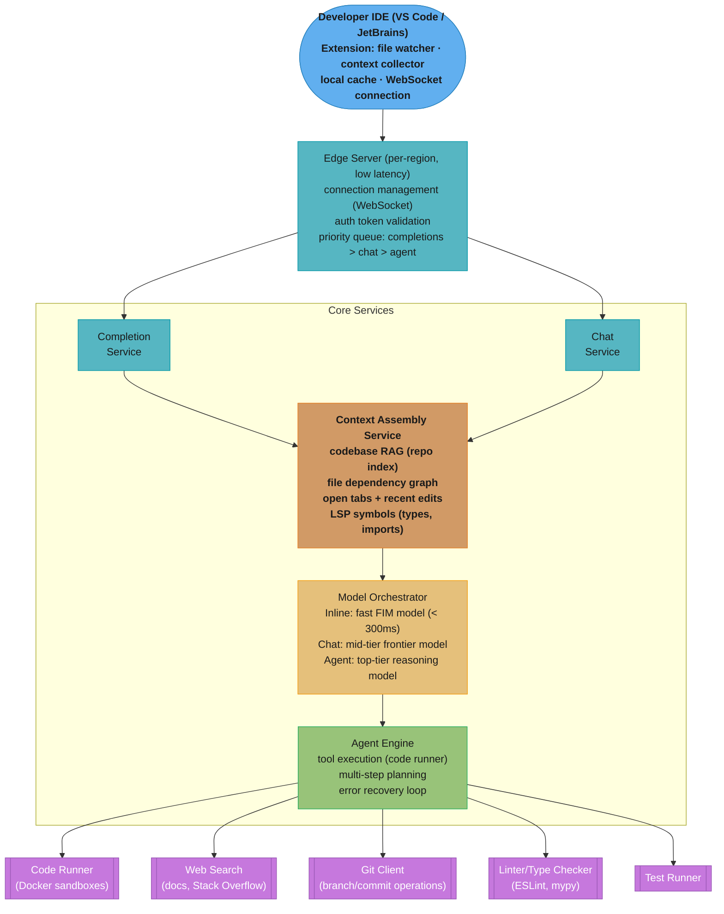
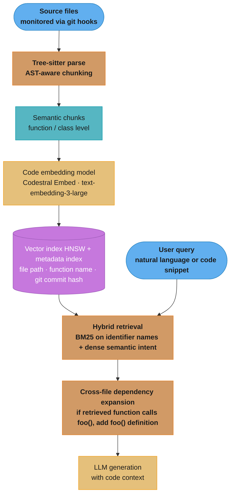

# Case Study: Design an AI Coding Assistant (Cursor/Devin-Style)

## Intuition

> **Design intuition**: An AI coding assistant (Cursor/Devin-style) has three distinct interaction modes with fundamentally different latency requirements: inline completions (300ms), chat (2-5s), and autonomous agents (minutes). Each mode requires different models, different context assembly, and different serving infrastructure.

**Key insight for this design**: The repository context problem is central — an LLM seeing only the current file gives poor completions; seeing the entire 500K-token codebase is expensive. The solution is a retrieval layer (embedding-based file selection + dependency graph analysis) that assembles the most relevant 20-50K token context for each request.

See also: [Agent Harness Engineering](../agent_harness_engineering/agent_harness_engineering.md) for the instructions, feedback and mechanical rules around the model, and [Design an Agent-First Software Factory](design_agent_first_software_factory.md) for an organization where agents write all the code.

---

## 1. Requirements Clarification

### Functional Requirements
- Inline code completions as developer types (< 300ms)
- Chat interface for code questions, explanations, and refactoring
- Autonomous multi-file editing: "add unit tests for all functions in auth module"
- Codebase-aware: understands full repository structure and dependencies
- Multi-language: Python, JavaScript/TypeScript, Java, Go, Rust, C++
- Terminal integration: run commands, observe output, fix errors autonomously
- Git-aware: can create branches, make commits, generate PR descriptions
- Tool use: web search for documentation, run tests, linter feedback

### Non-Functional Requirements
- **Completion latency**: < 300ms for inline suggestions
- **Chat latency**: < 3s first token, complete in < 15s
- **Agent task latency**: minutes (autonomous tasks can take 2-30 minutes)
- **Privacy**: code stays local or in private tenant; no training on user code
- **Scale**: 500K developer seats; 5M completions/hour peak

### Out of Scope
- Code execution environment (use existing Docker/CI infrastructure)
- Version control hosting (use GitHub/GitLab)
- Code review approval workflows

---

## 2. Scale Estimation

### Traffic Estimates
```
Developer seats: 500K
Active at peak (10am-2pm): 30% = 150K concurrent developers
Completions per active developer per hour: 30 (after debounce/filtering)
Peak completion QPS: 150K × 30 / 3600 = 1,250 req/sec

Chat queries: 10/developer/hour
Peak chat QPS: 150K × 10 / 3600 = 416 req/sec

Agent tasks: 2/developer/day
Daily agent tasks: 500K × 2 = 1M tasks/day

Token estimates:
  Completion: 1,500 input + 40 output = 1,540 tokens
  Chat: 3,000 input + 500 output = 3,500 tokens
  Agent task: 10,000 input + 2,000 output per step × 10 steps = 120,000 tokens
```

### Context Budget
```
Codebase sizes:
  Small (startup): < 50K tokens
  Medium (scale-up): 50K-500K tokens
  Large (enterprise): 500K-5M tokens

Strategy by codebase size:
  < 50K tokens: put entire codebase in long context. Frontier models now ship
    1M-token context windows as standard (Claude Opus 5.5 / Sonnet 5.5, gpt-6.2),
    so "does it fit" is rarely the binding constraint any more — cost and the
    "lost in the middle" attention falloff are.
  50K-500K tokens: smart RAG selection (top-20 most relevant files)
  > 500K tokens: strict RAG (top-10 files by relevance + dependency graph)
```

---

## 3. High-Level Architecture



Requests flow from the IDE extension through a per-region edge server whose priority queue orders completions (< 300ms budget) ahead of chat and agent traffic; both interactive services share one context assembly layer, and the agent engine fans out to five sandboxed tool services.

---

## 4. Component Deep Dives

### 4.1 Repository Indexing and RAG

```
Local index (built in IDE extension, lives on developer's machine):

What gets indexed:
  1. All source files (Python, JS, Java, etc.)
  2. Configuration files (package.json, requirements.txt, Dockerfile)
  3. Test files (important for agent tasks)
  4. README and documentation

Index structure (built with Tree-sitter AST parsing):
  Function index:
    {name, file_path, line_start, line_end, signature, docstring, body_hash}
  Class index:
    {name, file_path, methods[], parent_class, imports}
  Symbol index:
    {symbol, type (function/class/variable), defined_at, used_at[]}
  Import graph:
    {file → imports_from[]}  # for dependency traversal

Embedding index:
  Each function/class → embedded as code unit
  Stored in local FAISS index (SQLite backing)
  Index build time: 30-120 seconds for 1M lines of code
  Incremental update on file save: < 100ms

Query at completion time:
  1. Embed current code context (cursor surroundings)
  2. ANN search in local FAISS index
  3. Return top-10 relevant functions/classes
  4. Inject into prompt as "Related symbols from codebase"

Dependency graph traversal (for agent tasks):
  If editing users.py → also include: models/user.py, db/user_repository.py
  Traverse: import graph to find directly related files
  Max depth: 2 levels of imports (avoid context explosion)
```

### 4.2 Completion Service (< 300ms)

```
Tight latency budget breakdown:
  IDE debounce: 75ms (don't trigger on every keystroke)
  Network (edge PoP): 20ms RTT
  Context assembly (local index query): 10ms
  Prompt building: 5ms
  LLM inference: 150ms  ← must be fast
  Network return + render: 20ms
  Total: ~280ms

Model selection for completions:
  Requirement: fast inference, good code quality, FIM support
  Options:
    Codestral 25.08 (Mistral, FIM-native via a dedicated fill-in-the-middle
      endpoint, 256K context, $0.30/M in and $0.90/M out): the standard
      hosted choice. Mistral does not publish a parameter count for the
      Codestral line, so size it by measured throughput, not by params.
    A small local code model (1-3B, quantized): ~30ms but lower quality
    A general chat model without native FIM: worse for mid-file completions,
      because it must reconstruct the suffix rather than condition on it
  Commercial assistants (Cursor, Copilot) serve completions from
  proprietary in-house models they do not document; treat any specific
  claim about which model backs which product as unverifiable.

Completion prompt (FIM format):
  <file_path>src/auth/users.py</file_path>
  <related_context>
  # From db/user_repository.py:
  def get_user_by_id(id: int) -> Optional[User]:
  def create_user(email: str, password_hash: str) -> User:
  </related_context>
  <prefix>
  def authenticate(email: str, password: str) -> Optional[str]:
      user = UserRepository.get_user_by_email(email)
      if user is None:
          return None
  </prefix>
  <suffix>
      return token
  </suffix>
  <mid>

  Expected completion: [code that verifies password and generates JWT token]

Local cache:
  LRU cache of recent completions by (file_hash, cursor_position)
  If file unchanged and cursor near same position → return cached
  Cache hit rate: 25% (saves 75ms + backend request)
```

### 4.3 Chat Service

```
Chat is where developers ask complex questions about their code.

Session context management:
  Window: current file (full) + conversation history (10 turns)
  Available budget: 128K context - current file - conversation
  Fill with: top-5 relevant codebase files from RAG

Special chat commands:
  @file src/auth.py → include entire file in context
  @folder src/api/  → include all files in folder (if fits in context)
  #explain          → trigger explanation template
  #refactor         → include refactoring guidelines in system prompt
  #tests            → set mode to test generation

Supported query types:
  Code explanation: "explain this function"
  Bug analysis: "why is this test failing?" + test output
  Refactoring: "refactor this to use the repository pattern"
  Documentation: "write docstrings for all public methods"
  Code review: "review this PR diff for issues"
  Architecture: "how should I structure the database layer?"

Chat prompt:
  [System]
  You are an expert software engineer with deep knowledge of {detected_languages}.
  The developer is working in a {repo_type} codebase.
  Provide clear, concise answers. Include code examples when helpful.
  When modifying code, show the full modified function (not just the changed part).

  [Codebase context]
  ... (top-5 relevant files from RAG) ...

  [Current file]
  ... (full current file if < 50K tokens) ...

  [Conversation]
  ... (last 10 messages) ...

  [User]
  {user_message}
```

### 4.4 Agent Engine (Autonomous Multi-File Editing)

The agent runs an observe → plan → act → reflect loop with tool use (pattern details: [ReAct and Reasoning Patterns](../agents_and_tool_use/react_and_reasoning_patterns.md)).

```
Agent tasks: "Add unit tests for all functions in the auth module"

This requires: planning, file operations, code generation, test running, error fixing.

Architecture: ReAct loop with tool use

Tools available to agent:
  read_file(path) → file content
  write_file(path, content) → apply edit
  create_file(path, content) → new file
  run_terminal(command) → stdout, stderr, exit_code
  search_codebase(query) → relevant symbols
  web_search(query) → documentation results
  git_status() → current changes
  git_commit(message) → commit changes

Agent loop:
  WHILE task_not_complete AND steps < max_steps:
    1. [Observe] Gather current state (files, test results, errors)
    2. [Plan] Reason about next action (chain-of-thought reasoning)
    3. [Act] Execute one tool call
    4. [Reflect] Observe result; update plan if unexpected

Example execution for "add unit tests for auth module":

Step 1: search_codebase("auth module functions")
  → Found: authenticate(), create_user(), refresh_token() in auth/users.py

Step 2: read_file("auth/users.py")
  → Read file; understand function signatures and logic

Step 3: read_file("tests/test_auth.py")
  → File exists; currently has 2 tests; need to add 10 more

Step 4: web_search("pytest unit testing auth JWT tokens best practices")
  → Found: patterns for mocking JWT, testing edge cases

Step 5: write_file("tests/test_auth.py", [new content with all tests])
  → File written

Step 6: run_terminal("pytest tests/test_auth.py -v")
  → 8/12 tests pass; 4 fail: TypeError on mock_db fixture

Step 7: [Analyze failure] → understand fixture setup issue

Step 8: write_file("tests/test_auth.py", [fixed content])
  → Updated conftest.py fixture usage

Step 9: run_terminal("pytest tests/test_auth.py -v")
  → 12/12 tests pass

Step 10: git_commit("Add comprehensive unit tests for auth module")
  → Committed

Task complete. Summary: Added 10 unit tests, fixed fixture issue, all passing.

Model for agent tasks:
  Use a current frontier agentic-coding model: Claude Opus 5.5 / Sonnet 5.5,
    or gpt-6.2-sol. Adaptive-thinking models handle multi-step planning
    better than a fast completion model at any size.
  Each agent step: 1-2 LLM calls
  Average task: 10-20 steps = 20-40 LLM calls per agent task
```

### 4.5 Code Execution Sandbox

Isolation requirements and escape vectors are covered in depth in [Sandboxed Code Execution](../agents_and_tool_use/sandboxed_code_execution.md).

```
Agent runs terminal commands → must be secure, isolated, controlled.

Sandbox architecture (Docker-based):
  Per agent task: dedicated container
    Image: base language image + project dependencies
    Resources: 2 CPU, 4GB RAM, 10GB disk
    Network: isolated (no outbound except package registries)
    Timeout: 30 minutes max per agent task

Container lifecycle:
  Task start → create container (warm pool of pre-created containers)
  Code changes → sync files to container via volume mount
  Terminal command → exec in container → capture stdout/stderr
  Task complete → destroy container

Warm container pool:
  Pre-create 100 containers per language (Python, Node, Java, Go)
  Container creation takes 5-10 seconds → warm pool = instant start
  Auto-scale pool based on agent task queue depth

Security constraints:
  No: outbound network to arbitrary hosts (only npm/pypi/maven registries)
  No: privileged operations (no sudo, no /proc access)
  No: access to host filesystem (volume mount is isolated project copy)
  Rate limit: 100 commands per task (prevent infinite loops)

Output handling:
  Stdout/stderr: streamed to agent and developer in real time
  Large outputs (test logs): truncated to last 5,000 characters
  Exit codes: non-zero triggers agent error analysis
```

### 4.6 Context Window Management for Large Codebases

A coding assistant serving a monorepo with 500,000 files cannot embed the entire codebase in the context window. The challenge is selecting the right 1,500-4,000 tokens of code context from millions of available tokens.

**Context prioritization algorithm:**

```python
from dataclasses import dataclass, field
from pathlib import Path
import tree_sitter

@dataclass
class ContextSlot:
    content: str
    token_count: int
    priority: int  # 1 = highest priority
    source: str

def build_context_window(
    cursor_file: str,
    cursor_line: int,
    open_tabs: list[str],
    workspace_root: str,
    token_budget: int = 3000,
) -> list[ContextSlot]:
    slots: list[ContextSlot] = []

    # Priority 1: Cursor-adjacent code (800 tokens)
    cursor_context = extract_cursor_adjacent(cursor_file, cursor_line, token_budget=800)
    slots.append(ContextSlot(cursor_context, 800, 1, "cursor_adjacent"))

    # Priority 2: Current file outline (200 tokens: function signatures, class names)
    outline = extract_file_outline(cursor_file)  # tree-sitter AST traversal
    slots.append(ContextSlot(outline, 200, 2, "file_outline"))

    # Priority 3: Open tabs (500 tokens total, most recent first)
    tab_budget = 500
    for tab_path in sorted(open_tabs, key=lambda p: get_last_access(p), reverse=True):
        if tab_path == cursor_file:
            continue
        tab_outline = extract_file_outline(tab_path)
        tab_tokens = count_tokens(tab_outline)
        if tab_budget >= tab_tokens:
            slots.append(ContextSlot(tab_outline, tab_tokens, 3, f"open_tab:{tab_path}"))
            tab_budget -= tab_tokens

    # Priority 4: RAG-retrieved imports and dependencies (remaining budget)
    remaining = token_budget - sum(s.token_count for s in slots)
    if remaining > 200:
        deps = retrieve_dependency_signatures(cursor_file, workspace_root, token_budget=remaining)
        slots.append(ContextSlot(deps, remaining, 4, "dependency_signatures"))

    return slots
```

### 4.7 Tree-Sitter AST-Based Chunking

Standard text chunking (by character count or line count) splits code at syntactically meaningless points. Tree-sitter parses code into a concrete syntax tree and enables semantically-aware chunking:

```python
from tree_sitter_language_pack import get_parser

def extract_semantic_chunks(
    source_code: str,
    language: str,  # "python", "typescript", "rust", etc.
    max_chunk_tokens: int = 512,
) -> list[dict]:
    """Split code into semantically complete chunks using AST boundaries."""
    parser = get_parser(language)
    tree = parser.parse(source_code.encode("utf-8"))

    chunks = []
    root_node = tree.root_node

    for node in root_node.children:
        node_text = source_code[node.start_byte:node.end_byte]
        token_count = count_tokens(node_text)

        if node.type in ("function_definition", "class_definition",
                          "function_declaration", "method_definition"):
            if token_count <= max_chunk_tokens:
                chunks.append({
                    "content": node_text,
                    "type": node.type,
                    "start_line": node.start_point[0] + 1,
                    "end_line": node.end_point[0] + 1,
                    "tokens": token_count,
                })
            else:
                # Large function: split by inner logical blocks (docstring + signature + body)
                chunks.extend(split_large_function(node, source_code, max_chunk_tokens))

    return chunks

# Result: chunks are always syntactically complete (no cut-off class bodies or function signatures).
# The retrieval gain over character-based chunking is real but workload-specific; measure it on your
# own repo rather than quoting a fixed percentage, since published numbers vary widely by language,
# chunk size, and embedding model.
```

### 4.8 Code-Specific RAG Architecture

Code RAG differs from document RAG (baseline pipeline: [RAG Fundamentals](../rag_fundamentals/rag_fundamentals.md)) in three key ways: (1) code has structure (AST) not present in prose; (2) code has dependencies (imports, function calls) that cross file boundaries; (3) code changes frequently (every git commit may invalidate embeddings for modified files).



The indexing path (git hooks → tree-sitter → embeddings) keeps chunks syntactically complete; at query time hybrid retrieval merges BM25 identifier matches with dense semantic matches, then dependency expansion pulls in the definitions of called functions so the LLM never sees a call site without its callee.

**Incremental re-indexing via git hooks.** The first version looked right and broke on the first
deleted file:

```python
# BROKEN: `git diff --name-only` also lists deleted and renamed files, so read_text() raises
# FileNotFoundError and the run aborts; extract_semantic_chunks() never sets chunk["id"], so
# upsert raises KeyError; and a crash halfway leaves the index half-updated with no record of
# where it stopped.
def incremental_reindex(workspace_root: str, vector_db, last_indexed_commit: str) -> str:
    changed = subprocess.run(["git", "diff", "--name-only", last_indexed_commit, "HEAD"],
                             capture_output=True, text=True).stdout.split()
    for file_path in changed:
        source = Path(workspace_root, file_path).read_text()
        vector_db.delete(filter={"file_path": file_path})
        for chunk in extract_semantic_chunks(source, detect_language(file_path)):
            vector_db.upsert(chunk["id"], embed_code(chunk["content"]), metadata=chunk)
    return subprocess.run(["git", "rev-parse", "HEAD"], capture_output=True, text=True).stdout.strip()
```

```python
# FIX: read change status, handle deletes and renames, derive deterministic chunk IDs, and pin
# the target commit first so a crash simply re-runs the same range.
import hashlib
import subprocess
from pathlib import Path

CODE_SUFFIXES = (".py", ".ts", ".java", ".go")

def changed_files(repo: str, old: str, new: str) -> list[tuple[str, str, str | None]]:
    """Return (status, path, old_path) for code files changed between two commits."""
    out = subprocess.run(["git", "-C", repo, "diff", "--name-status", "-M", old, new],
                         capture_output=True, text=True, check=True).stdout
    rows: list[tuple[str, str, str | None]] = []
    for line in out.splitlines():
        parts = line.split("\t")
        status = parts[0][0]                      # A, M, D or R (R100 -> R)
        path = parts[-1]
        old_path = parts[1] if status == "R" else None
        if path.endswith(CODE_SUFFIXES) or (old_path or "").endswith(CODE_SUFFIXES):
            rows.append((status, path, old_path))
    return rows

def chunk_id(path: str, chunk: dict) -> str:
    digest = hashlib.sha1(chunk["content"].encode()).hexdigest()[:12]
    return f"{path}:{chunk['start_line']}:{digest}"

def incremental_reindex(repo: str, vector_db, last_indexed_commit: str) -> str:
    head = subprocess.run(["git", "-C", repo, "rev-parse", "HEAD"],
                          capture_output=True, text=True, check=True).stdout.strip()
    for status, path, old_path in changed_files(repo, last_indexed_commit, head):
        vector_db.delete(filter={"file_path": old_path or path})
        if status == "D":
            continue
        source = Path(repo, path).read_text(errors="replace")
        for chunk in extract_semantic_chunks(source, detect_language(path)):
            vector_db.upsert(chunk_id(path, chunk), embed_code(chunk["content"]),
                             metadata={**chunk, "file_path": path, "commit": head})
    return head  # the caller persists this only after the loop completes
```

Deleting by `file_path` before re-inserting makes each file's update idempotent, so re-running the
same commit range after a crash converges to the same index.

### 4.9 Security Scanning Integration

A coding assistant that can generate and apply code must not introduce security vulnerabilities. Integrating security scanning into the generation pipeline:

```python
import subprocess
import json
from typing import Literal

ScanTool = Literal["bandit", "semgrep", "gitleaks"]

def scan_generated_code(
    code: str,
    language: str,
    tools: list[ScanTool] = ["semgrep"],
) -> dict:
    """Run static analysis on generated code before presenting to user."""
    import tempfile, os
    with tempfile.NamedTemporaryFile(
        mode="w",
        suffix={"python": ".py", "typescript": ".ts", "java": ".java"}.get(language, ".txt"),
        delete=False,
    ) as f:
        f.write(code)
        tmp_path = f.name

    findings = []
    try:
        if "semgrep" in tools:
            result = subprocess.run(
                ["semgrep", "--config=auto", "--json", tmp_path],
                capture_output=True, text=True, timeout=10,
            )
            semgrep_output = json.loads(result.stdout)
            findings.extend([
                {
                    "tool": "semgrep",
                    "rule": r["check_id"],
                    "severity": r["extra"]["severity"],
                    "message": r["extra"]["message"],
                    "line": r["start"]["line"],
                }
                for r in semgrep_output.get("results", [])
            ])
    finally:
        os.unlink(tmp_path)

    return {
        "has_findings": len(findings) > 0,
        "critical_count": sum(1 for f in findings if f["severity"] == "ERROR"),
        "findings": findings,
    }

# Usage in code generation pipeline:
def generate_code_with_security_check(prompt: str, client) -> dict:
    generated = generate_code(prompt, client)
    scan_result = scan_generated_code(generated["code"], generated["language"])
    if scan_result["critical_count"] > 0:
        # Re-prompt with security findings
        fixed = generate_code_with_security_context(prompt, generated["code"], scan_result, client)
        return {**fixed, "security_scan": scan_generated_code(fixed["code"], fixed["language"])}
    return {**generated, "security_scan": scan_result}
```

---

## 5. Design Decisions & Tradeoffs

| Decision | Chosen | Alternative | Reason |
|----------|--------|-------------|--------|
| Completion model | Codestral (FIM-native) | General chat model without FIM | FIM-native gives better mid-file completions |
| Context collection | Hybrid (local FAISS + LSP) | Pure embedding RAG | LSP gives precise type info; FAISS for semantic |
| Repo index | Local (developer machine) | Remote server | Zero latency; privacy (code stays local) |
| Agent model | Claude Opus 5.5 / Sonnet 5.5 or gpt-6.2-sol | Smaller models | Agent tasks need strong reasoning; cost acceptable |
| Sandbox | Docker (warm pool) | VM | Cold container start is 5-10s and a VM is ~30s; a warm pool amortizes that to a near-instant checkout from the pool |
| Network access | IDE WebSocket persistent | HTTP polling | Low latency; instant push; efficient |
| Privacy | On-premise option | Cloud only | Enterprise requirement; enables regulated industries |

### Privacy Architecture

```
Enterprise requirements: code never leaves the company network

Deployment modes:
  1. Cloud (default): code sent to API (encrypted in transit, not stored)
  2. Private Cloud: deploy assistant in customer's VPC (AWS/GCP/Azure)
  3. On-premise: full deployment in customer data center

For on-premise / private cloud:
  Self-hosted LLMs: a current open-weights code model (e.g. the Qwen Coder
    line) served locally
  Local inference: vLLM cluster inside customer network
  Local index: FAISS index on developer's machine or local server
  No external API calls: the web_search tool is repointed at an internal
    docs index (self-hosted search over vendored docs and the company wiki)
  Audit log: stored in customer's own storage

Code handling policy:
  - Code snippets: used for inference, not stored after response
  - No training: user code never used to train or fine-tune models
  - Embeddings: computed locally (IDE extension), not sent to cloud
  - BAA available: for HIPAA-covered code (e.g., healthcare companies)
```

---

## 6. Real-World Implementations

| Product | Shape | Technical detail worth citing |
|---------|-------|-------------------------------|
| GitHub Copilot | IDE completions, chat and agent mode | GitHub's 2023 engineering write-up: the fast completion model saw ~6,000 characters of prompt; "neighboring tabs" (matching snippets from open files) raised acceptance by 5% relative; fill-in-the-middle raised it by 10% relative, both measured by A/B test |
| Cursor (Anysphere) | AI-native editor forked from VS Code | Instant Grep builds and queries its search index on the developer's machine and does not upload paths or code or store embeddings for search; an Explore subagent runs broad searches in its own context window with a faster model and returns only findings; Privacy Mode means no training on your data; SOC 2 Type II plus ISO 27001 and ISO 42001 |
| Claude Code (Anthropic) | Terminal and IDE coding agent | Generally available May 2025; navigates the repo with agentic search (grep, glob, file reads) instead of a prebuilt vector index; every file edit and shell command is gated by a permission mode, which is the "show diff, require approval" loop of 4.4 |
| Devin (Cognition) | Autonomous agent in a cloud sandbox | At launch in March 2024 Cognition reported 13.86% of SWE-bench issues resolved end to end, against a 1.96% prior best; it represents the "full autonomy" end of the spectrum discussed in Section 11 |

The trend across 2025-2026 is visible in the table: the IDE products moved from a remote embedding
index toward local grep plus subagents for search, while keeping a fast FIM model for completions.
Embedding RAG (4.8) is still the right tool for "find code that does X" across a 500K-file monorepo;
exact-symbol lookups go to grep and LSP.

---

## 7. Technologies & Tools

| Layer | Choice | Why | Alternative |
|-------|--------|-----|-------------|
| Completion model | Self-hosted FIM code model (3B-7B) on vLLM | < 300ms P95 needs a small model next to the user; prefix caching on the file outline | hosted API (adds 80-150ms network) |
| Chat model | gpt-6.1-terra or Claude Sonnet 5.5 | quality per dollar for 2-5 s interactions | top-tier model (2-8x the price) |
| Agent model | Claude Opus 5.5 or gpt-6.2-sol | long-horizon planning and tool use | small models (loop and stall) |
| Parsing | Tree-sitter | incremental, error-tolerant parse for 40+ languages | regex chunking (splits functions) |
| Symbol resolution | LSP `textDocument/definition` | exact cross-file types | embeddings (fuzzy) |
| Search | local grep index + FAISS HNSW | exact identifiers in < 50ms, semantic intent in < 5ms | remote vector DB (50ms+ per hop) |
| Sandbox | Docker warm pool, gVisor for untrusted repos | 5-10s cold start amortized to near zero | Firecracker microVMs (stronger isolation, more ops) |
| Static analysis | Semgrep, Bandit, gitleaks | block insecure generated code before it is shown | trust the model |
| Transport | IDE WebSocket with cancellation | stale completion requests are cancelled on the next keystroke | HTTP polling |

---

## 8. Operational Playbook

**Completion canary.** Every completion-model or prompt change ships to 5% of seats first and must
hold the acceptance rate within 1 percentage point of control for 48 hours. The agent tier runs a
nightly suite of 300 internal tasks with hidden tests; a > 3-point drop blocks promotion. See
[LLM Eval Harness in Production](./cross_cutting/llm_eval_harness_in_production.md).

**Tracing.** One OTel trace per request with `gen_ai.request.model`, `gen_ai.usage.input_tokens`,
the context-assembly breakdown (cursor, outline, tabs, dependencies) and an `accepted` attribute
written back when the user keeps or rejects the suggestion. Agent tasks get one span per step and
per tool call. See [OpenTelemetry for LLM Apps](./cross_cutting/opentelemetry_for_llm_apps.md).

**Chat streaming.** Chat responses stream over the IDE WebSocket; first-token P95 < 2s is the SLO,
and a cancelled request must free its decode slot within 100ms. See
[Streaming at Scale](./cross_cutting/streaming_at_scale.md).

**Durable agent tasks.** A 2-30 minute agent task checkpoints after every step (git commit on a
scratch branch plus the step log), so a worker crash resumes from the last step instead of
replaying tool calls. See [Agent Durability Patterns](./cross_cutting/agent_durability_patterns.md).

**Tenant isolation and GPU pools.** Each enterprise tenant gets its own index namespace and audit
log; the completion GPU pool is shared but sized per region from the FLOP math in Section 10. See
[Tenant Isolation Patterns](./cross_cutting/tenant_isolation_patterns.md) and
[GPU Pool Economics](./cross_cutting/gpu_pool_economics.md).

**Runbook: completion latency spike.** Symptom: P95 > 300ms for 10 minutes. Check prefix-cache hit
rate first (a prompt-template change that reorders the outline drops it from ~70% to ~0%), then
GPU queue depth. Fix: revert the template or add replicas; never raise the debounce to hide it.

### Quality Metrics and SLOs

```
Completion quality:
  Acceptance rate: accepted / shown (target > 30%)
  Edit distance: chars changed in accepted suggestion (lower = better)
  "Kept as is" rate: suggestion accepted without any edits (target > 20%)

Chat quality:
  Developer satisfaction: thumbs up/down feedback (target > 80% positive)
  Code correctness: does suggested code compile/run? (tracked async)
  Hallucination rate: code references non-existent functions

Agent quality:
  Task completion rate: % of agent tasks fully completed (target > 70%)
  Human intervention rate: % that required developer fixes
  Test pass rate: % of generated code that passes tests on first try
  Lines of code generated per task: productivity metric

Latency SLOs:
  Completion P95 < 300ms
  Chat first-token P95 < 2s
  Agent step P95 < 10s

Codebase index quality:
  Index coverage: % of symbols indexed vs total
  RAG recall: % of relevant files found for sample queries
  Index freshness: time since last update < 5 seconds
```

---

## 9. Common Pitfalls & War Stories

**Prompt injection through the repository.** A README in a cloned dependency told the agent to "run
the setup script" that piped a remote shell script into bash. The agent ran it inside the sandbox,
which had outbound network access; 1 developer token was exfiltrated before egress alerts fired
22 minutes later. Fix: sandbox egress is deny-by-default with an allowlist of package registries,
and shell commands that fetch and execute remote content always require approval.

**Stale completions from un-cancelled requests.** Firing a request per keystroke without
cancelling the previous one tripled GPU load at peak and showed suggestions for text the developer
had already typed past. Fix: 75ms debounce plus cancellation of the in-flight request on every
keystroke; GPU load fell by ~60%.

Three more incidents, each with the fix that stuck:

**Failure 1 — Agent Infinite Loop Overwriting Production Configuration Files**

A coding agent tasked with "update the database configuration for the new region" entered a loop: it read the config, generated an update, wrote the file, then re-read the file and determined it still needed updating (because the region endpoint format was different from what it expected). After 8 iterations, it had overwritten the config file 8 times and corrupted the format. No human review gate existed for file writes.

**Detection:** CI pipeline failed after the agent's commit triggered a config validation job. By the time detection occurred, the config had been committed and pushed.

**Recovery:** Revert to the last good commit using `git revert`. Added a mandatory human approval step for any file write in the `config/`, `infrastructure/`, and `secrets/` directories. Added a git diff preview step before any commit: the agent proposes the diff, the engineer approves, then the commit is made.

**Failure 2 — Code RAG Retrieving Outdated API Signatures After Library Upgrade**

The team upgraded from SQLAlchemy 1.3 to 2.0. The code RAG index still contained 50,000 cached chunks from the old codebase using the legacy Query API — `session.query(User).filter(...)` and bare-string `session.execute("SELECT ...")`. In 2.0 the first is legacy and the second raises, because raw SQL must be wrapped: `session.execute(text("SELECT ..."), params)`. After the upgrade, the assistant kept generating the pre-2.0 forms it saw in the stale index, causing runtime errors. The RAG index was not invalidated on library version changes.

**Fix:** Added a dependency hash to the index metadata. When `requirements.txt` or `pyproject.toml` changes, invalidate all chunks that reference changed packages by re-indexing all files that import those packages.

### Incident: Agent Overwrites Correct Code with Regression

**What happened:** A SWE-agent tasked with "fix the failing unit tests in the auth module" found a test asserting `token_expiry = 7200` seconds. The test was failing because a recent PR had deliberately cut expiry to 900 seconds under the security team's new session policy, and nobody had updated the test. The agent, treating the test as the source of truth, reverted the code to 7200 seconds, which silently re-lengthened every session token by 8x. The agent had no way to know that the test was stale, not the code.

**Root cause:** The agent was given test failures as the ground truth without the ability to consult the PR history or security team's decision rationale.

**Fix applied:**
```python
def should_modify_production_code_to_pass_test(
    failing_test: TestCase,
    proposed_code_change: CodeChange,
    git_client: GitClient,
) -> tuple[bool, str]:
    """
    Check if the test itself may be stale before modifying code to pass it.
    """
    # Check if the test was last modified before the code it tests
    test_last_modified = git_client.get_last_modified_date(failing_test.file_path)
    code_last_modified = git_client.get_last_modified_date(proposed_code_change.target_file)

    if test_last_modified < code_last_modified:
        # Code was modified more recently than the test — test may be stale
        # Require human confirmation before modifying code to match old test
        return False, (
            f"Test was last modified {test_last_modified}, but the code was modified "
            f"{code_last_modified}. The test may be stale. Please confirm whether to "
            f"update the test or revert the code."
        )
    return True, "Test is current — safe to modify code to pass test."
```

**Prevention:** Agents that modify code to pass tests must verify recency: if the code under test was modified more recently than the test, the test is potentially stale. Require explicit human confirmation before reverting newer code to satisfy older tests.

---

## 10. Capacity Planning

Internal deployment for 4,000 engineers: self-hosted completion tier, hosted chat and agent tiers.
Prices are November 2026 list rates.

```
Request rate estimation:
  4,000 engineers × avg 8 active coding hours/day
  Completion requests: 1 per 3 seconds = 20/min × 480 min = 9,600/day/engineer
  Total daily completions: 4,000 × 9,600 = 38.4M completions/day
  Chat requests (Copilot Chat-style): 4,000 × 40 chats/day = 160,000/day
  Agent tasks (multi-step): 4,000 × 2 tasks/day = 8,000 long-running tasks/day

Completion serving (self-hosted FIM model)
  Peak rate: 38.4M / (8h × 3600s) = 1,333 completions/sec peak

  Size this on FLOPs, never on a quoted requests/sec number. A completion is
  dominated by prefill over the ~1,500-token context, not by the 40 decoded
  tokens:
    3B FIM model, prefill: 2 × 3e9 × 1,500 = 9 TFLOP
    decode 40 tokens:      2 × 3e9 × 40    = 0.24 TFLOP
    with ~70% prefix-cache hit on the stable file-outline prefix,
    effective ≈ 3 TFLOP per completion
  H100 BF16 dense peak is 989 TFLOPS; at a realistic 40% MFU ≈ 400 TFLOPS.
    Required: 1,333 × 3 / 400 = ~10 H100s (2× headroom: 20 H100s)
    Cost: 20 × $2.50/hr × 24 × 365 = $438,000/year

  Sanity check for interviews: a claim like "350 FIM completions/sec on one
  mid-range GPU" for a 7B model is off by two orders of magnitude. 7B over
  1,500 prefill tokens is 21 TFLOP per request, so 350/sec would demand
  7.4 PFLOPS from a single card — more than any single accelerator shipped.

Chat serving (hosted API model, gpt-6.1-terra at $1/M in, $5/M out):
  Output: 160,000 × 2,000 tok = 320M tok/day × $5/M = $1,600/day
  Input:  160,000 × 3,000 tok = 480M tok/day × $1/M  = $480/day
  Chat total: $2,080/day = $759K/year

Agent serving (Claude Sonnet 5.5 at $2/M in, $10/M out; 15k tokens/task
  split ~12k input / 3k output):
  Input:  8,000 × 12,000 = 96M tok/day × $2/M  = $192/day
  Output: 8,000 ×  3,000 = 24M tok/day × $10/M = $240/day
  Agent total: $432/day = $158K/year

Total AI infrastructure cost: $438K + $759K + $158K = ~$1.36M/year
Cost per engineer: $339/year ($28/month) vs a $19/month Copilot Business seat
  — a 1.5× premium
Justification: self-hosting the completion tier means no code leaves the VPC.
  The premium sits mostly in the hosted chat tier (56% of the bill). If the
  goal is a defensible cost story, the lever is routing simple chat turns to
  gpt-6-luna ($0.10/$0.50), not squeezing the self-hosted GPUs.

Semantic cache for completions (identical context within 60-second window):
  Hit rate: 12% (coders repeat similar patterns within a session)
  Because the completion model is self-hosted, a cache hit saves GPU time
  rather than API spend: 38.4M × 0.12 × 3 TFLOP = 13.8 PFLOP/day avoided,
  ~1.2 H100-equivalent, roughly $75/day. The cache is worth more for cutting
  p99 latency variance than for the dollar saving.
```

---

## 11. Interview Discussion Points

**Q: Why does a local index beat a remote vector database for inline completions?**
**Short:** At a 300ms budget a 50ms+ remote hop burns 17% before inference; a local index answers in under 5ms and keeps code on the machine.

At < 300ms total budget, a round-trip to a remote vector DB (50ms+ latency) would consume 17% of the budget before inference. Local FAISS queries in < 5ms, and Cursor's Instant Grep shows the same choice for exact matches: the index is built and queried on the developer's machine. The downside: the index must be maintained on the developer's machine and kept in sync. For code that changes frequently, incremental updates on file save keep the index fresh.

**Q: What makes a coding agent unreliable, and how do you contain it?**
**Short:** It makes wrong assumptions, breaks working code or loops; run tests after each change, checkpoint in git, show every diff, and cap steps and file edits.

The hardest challenge is not generating code; it is ensuring the agent does not make wrong assumptions, break working code, or loop endlessly. Mitigations: (1) always run tests after changes; (2) use git to checkpoint before each agent task (easy rollback); (3) surface all changes to the developer before committing; (4) set hard limits (max steps, max file edits).

**Q: Why use three different models instead of one?**
**Short:** Completions need a fast FIM model, chat a mid-tier model and agents a top-tier planner; one model is either too slow for completions or too weak for agents.

Completions need speed (a FIM-native code model like Codestral); chat needs quality (a mid-tier frontier model); agent tasks need planning (a top-tier adaptive-thinking model). Using one model for all three would mean either too slow for completions or too weak for agent planning. The 10ms routing decision is what unlocks the order-of-magnitude cost spread between the tiers.

**Q: How much context should an inline completion get?**
**Short:** About 1,500-4,000 tokens: quality gains flatten quickly while prefill latency grows linearly, so the budget is a product decision as much as a technical one.

Providing more context (open tabs, dependency files) improves completion quality but adds tokens and increases latency. The gain per extra token falls off quickly while prefill time grows linearly; GitHub's own 2023 write-up shows how much a small, well-chosen prompt can do (about 6,000 characters, with neighboring tabs adding 5% relative acceptance). The context budget is a product decision, not just a technical one.

**Q: Should a coding assistant act autonomously or propose changes for approval?**
**Short:** Propose, show the diff and require approval for anything touching business logic; reserve full autonomy for low-risk work like tests, boilerplate and docs.

Unlike Devin, which tries to complete engineering tasks fully autonomously, a coding assistant should work in tight collaboration: propose changes, show the diff, require approval, apply. This human-in-the-loop design sacrifices some autonomy for safety and trust. Most enterprise teams prefer assisted autonomy over full autonomy.

**Q: How does an agent work on a file longer than its context window?**
**Short:** Slide over the file in chunks with 20% overlap and carry a ~200-token state summary of symbols seen, variables changed and pending tasks.

Use a sliding window with overlap: divide the file into chunks with 20% overlap between adjacent chunks (so that code at chunk boundaries appears in both chunks). The agent processes each chunk independently but maintains a persistent "state object" across chunks: a running summary of (1) functions and classes seen; (2) variables modified; (3) pending tasks. At each chunk, the state object is prepended to the context window as a compact summary (~200 tokens). This lets the agent stay coherent across a 100,000-token file using a 4,000-token window, at the cost of multiple LLM passes.

**Q: How does tree-sitter AST chunking improve code retrieval over character chunking?**
**Short:** Every chunk is a complete function, class or method, so embeddings represent coherent units instead of fragments cut mid-signature.

Character-based chunking cuts at arbitrary positions: in the middle of a function, between a method signature and its body, or between a class definition and its methods. When these malformed chunks are embedded and retrieved, the embedding model cannot produce a meaningful representation of an incomplete fragment, which measurably reduces retrieval accuracy on code search; the size of the gap depends heavily on language, chunk size, and embedding model, so treat any single headline percentage with suspicion. Tree-sitter ensures every chunk is a syntactically complete unit (a function, a class, a method), which produces coherent embeddings and prevents meaningless fragments from being retrieved.

**Q: How should you quote benchmark numbers when comparing autonomous and assisted coding agents?**
**Short:** Quote the benchmark you ran, with its date; SWE-bench Verified is contaminated and OpenAI stopped reporting it in February 2026 in favour of SWE-bench Pro.

Full-autonomy agents can complete multi-step engineering tasks without human checkpoints, but they still introduce subtle bugs that only surface at runtime, and headline benchmark numbers overstate real-world reliability. OpenAI stopped reporting SWE-bench Verified on 2026-02-23: frontier models can reproduce many gold patches from training data, and at least 59.4% of the hard tasks it audited had tests that reject correct fixes. It recommends SWE-bench Pro instead. Assisted generation (Copilot Chat, Cursor) shows the diff before applying changes and requires approval, so the change the human asked for is validated by the human. In production codebases, full autonomy fits low-risk tasks (writing tests for existing functions, boilerplate, documentation); assisted generation is required for changes to business logic, database schemas, or security-sensitive code.

**Q: How do you implement "explain this code" across multiple files?**
**Short:** Parse the function with tree-sitter, resolve each external symbol via LSP go-to-definition, and add dependency signatures, not bodies, to the context.

When the user highlights a function and asks "explain this," the system: (1) extracts the function's AST using tree-sitter; (2) identifies all external symbols called within it (function calls, class references, globals); (3) resolves each symbol to its definition via LSP `textDocument/definition`; (4) retrieves the signatures (not full bodies) of all direct dependencies; (5) builds a context with the target function plus dependency signatures. This explains what `process_payment()` does even when it calls `stripe_client.charge()` from a third-party library, because the signature is included and the LLM understands the interface without the implementation.

**Q: How would you adapt output for beginners versus experts, and can you detect the level automatically?**
**Short:** Infer level from query vocabulary, the user's own code and acceptance patterns, store a per-user score, and vary comment density and verbosity.

Auto-detect expertise from: (1) query vocabulary (beginners use natural-language descriptions; experts use terms like "O(n log n)" or "thread-safe"); (2) code in open tabs (comment density, naming, use of generators or decorators); (3) acceptance patterns (beginners accept longer, commented explanations; experts accept concise completions and edit them). Beginners get code with inline comments explaining each step; experts get idiomatic, concise code. Store a per-user expertise score (0-100) in the profile, updated with each interaction.

**Q: How do you keep the assistant from suggesting deprecated APIs or insecure patterns?**
**Short:** Run static analysis such as Semgrep on every generated block and block on a hit; add secure-coding guidelines to the prompt and filter training data.

Three layers: (1) training-data exclusion of files that use deprecated APIs or insecure patterns (`eval()`, MD5, DES, `pickle.load` on untrusted input); (2) output post-processing with static analysis on every generated block (Semgrep, Bandit, SpotBugs): if a security rule fires, the suggestion is blocked and a warning is returned; (3) retrieval of an internal secure-coding guidelines knowledge base into the prompt so the model prefers secure alternatives. Layer (2) is mandatory; layers (1) and (3) improve proactive avoidance. Re-index after dependency upgrades, or the retrieval layer keeps feeding the old API back (Section 9).

**Q: How would you build a feedback loop that improves the assistant from user corrections?**
**Short:** Log accepted-then-edited completions as preference pairs, collect 50K or more, fine-tune the FIM model with DPO, and A/B test acceptance before rollout.

(1) When a user accepts a completion and modifies it within 10 keystrokes, log `{original_completion, user_edit, context}`; (2) the edited version is the preferred one; (3) collect at least 50,000 such pairs before fine-tuning; (4) use DPO to fine-tune the FIM model: no reward model, lower cost than PPO-based RLHF; (5) A/B test acceptance of the tuned model against the base model on held-out users. Expect a 3-5 point acceptance gain per cycle with high-quality pairs. Only tenants that opted in contribute pairs, which keeps the "no training on user code" promise intact for everyone else.
