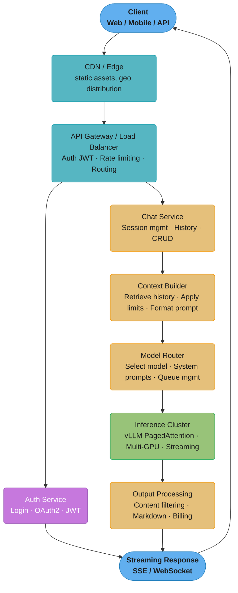
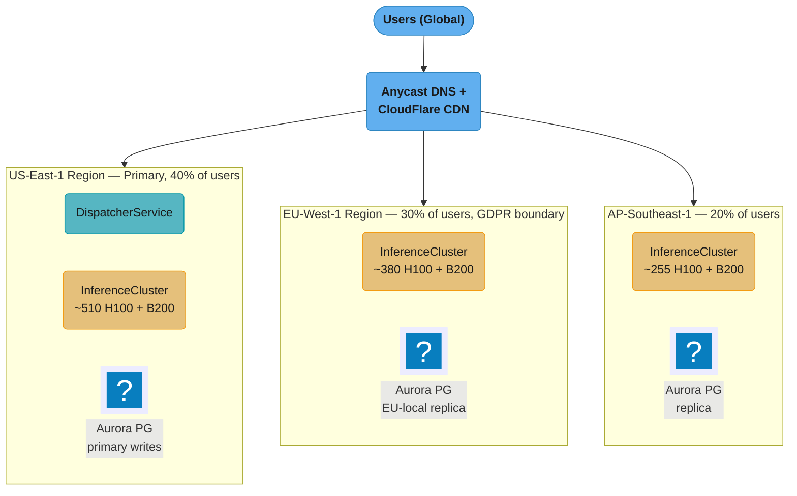

# Case Study: Design ChatGPT

## Intuition

> **Design intuition**: ChatGPT is a conversational interface over a streaming LLM API — the complexity lies not in the model calls but in the serving infrastructure: continuous batching to handle millions of concurrent users, KV cache management for conversation history, and the real-time streaming architecture that makes responses feel instant.

**Key insight for this design**: Multi-turn conversation requires keeping the full history in the context window, which grows linearly per turn. At scale, conversation history management, token cost optimization, and KV cache efficiency are the dominant engineering challenges — not the model itself.

---

## 1. Requirements Clarification

### Functional Requirements
- Users can send text messages and receive AI-generated responses in a conversational interface
- Maintain multi-turn conversation context (chat history)
- Support streaming responses (tokens appear as generated)
- User authentication, conversation management (save, load, delete)
- Multiple model tiers (a small/fast model for the free tier, the frontier model for paid)
- Plugin/tool support (browsing, code execution, image generation)
- Image input support (multimodal model tier)

### Non-Functional Requirements
- **Latency**: TTFT (time to first token) < 1s; streaming at human-readable pace (~30 tokens/sec)
- **Availability**: 99.9% uptime (8.7 hours downtime/year)
- **Scale**: 100M+ daily active users; 10M concurrent conversations at peak (a design target for this exercise; OpenAI publicly reports WEEKLY actives, not daily)
- **Throughput**: 1B+ tokens generated per day
- **Cost**: Efficient inference to keep costs manageable at massive scale

### Out of Scope
- Model training pipeline (only inference)
- Safety training / RLHF pipeline
- Internal tooling and admin interfaces

---

## 2. Scale Estimation

### Traffic Estimates
```
Daily Active Users: 100M
Messages per user per day: 5 (avg)
Total messages per day: 500M
Peak QPS: 500M / 86,400 × 3 (peak factor) ≈ 17,000 req/sec

Token estimates per request:
  Average input: 500 tokens
  Average output: 300 tokens
  Total: 800 tokens per request

Daily tokens processed: 500M × 800 = 400B tokens/day
Peak token throughput: 17,000 req/sec × 800 tokens = 13.6M tokens/sec
```

### Storage Estimates
```
Conversation history per user:
  100 messages × 1KB average = 100KB per conversation
  10 conversations per user = 1MB per user
  100M users = 100TB of conversation data

Vector embeddings for semantic search:
  Each message → 1536-dim float32 embedding = 6KB
  500M messages/day = 3TB of embeddings/day (not retained long-term)
```

### Infrastructure Estimates
```
GPU requirements for inference. OpenAI has never published parameter counts or
architectures for its production models; every "1.76T MoE" style figure in
circulation is unverified rumor. So size against OPEN models of known shape
and treat them as stand-ins. All throughput figures below are planning
assumptions to replace with your own benchmark on the target engine.

Decode demand at peak: 17,000 req/s x 300 output tokens = 5.1M output tokens/s
Prefill demand at peak: 17,000 req/s x 500 input tokens = 8.5M input tokens/s
  (~60% of it is a cached system-prompt or history prefix, so ~3.4M to compute)

Small/fast tier, 80% of traffic (stand-in: a dense ~8B model, FP8):
  decode 4.1M tok/s at ~10,000 tok/s per H100 (large batches) = ~410 H100s
  prefill 2.7M tok/s at ~40,000 tok/s per H100                = ~70 H100s

Frontier tier, 20% of traffic (stand-in: a sparse MoE, ~600B total and ~37B
active per token, FP8, expert-parallel inside one NVLink domain):
  decode 1.0M tok/s at ~3,000 tok/s per B200 at < 50ms per token = ~340 B200s
  prefill 0.7M tok/s at ~25,000 tok/s per B200                    = ~30 B200s

With 1.5x headroom for peaks, failover and KV-cache pressure:
  ~720 H100s + ~555 B200s (about 8 GB200 NVL72 racks for the frontier tier)

The tell in this arithmetic: long contexts, not FLOPs, bound batch size, so
KV-cache memory (Section 10) is what forces the headroom.
```

---

## 3. High-Level Architecture



---

## 4. Component Deep Dives

### 4.1 Context Builder

```
Conversation History Management:

User sends: "What was the capital of France I asked about?"
         |
         v
[Retrieve conversation from DB]
  messages = fetch_last_n_messages(conversation_id, n=50)
         |
         v
[Apply context window limit]
  model_context = 1,050,000 tokens (gpt-6.2-sol); working budget capped at
                  128,000 by policy (cost and attention dilution, not the window)
  reserve_output = 4,000 tokens
  available = 124,000 tokens

  Truncation strategy:
  1. Always include system prompt (1,000 tokens)
  2. Always include last 10 messages
  3. Fill remaining budget with oldest → newest messages
  4. If still over limit: summarize older context with LLM
         |
         v
[Format messages]
  [
    {"role": "system", "content": "You are ChatGPT..."},
    {"role": "user", "content": "Hello"},
    {"role": "assistant", "content": "Hi! How can I help?"},
    ...
    {"role": "user", "content": "What was the capital..."}
  ]
```

### 4.2 Streaming Architecture

```
ChatGPT uses Server-Sent Events (SSE) for streaming:

Server → Client: SSE stream
  data: {"choices": [{"delta": {"content": "The"}}]}
  data: {"choices": [{"delta": {"content": " capital"}}]}
  data: {"choices": [{"delta": {"content": " of"}}]}
  ...
  data: [DONE]

Implementation:
  1. Inference engine generates tokens one by one
  2. Each token pushed immediately to SSE buffer
  3. Client renders token as it arrives
  4. No waiting for complete response

Benefit: Perceived latency drops from 5-10s (full response) to 0.5s (first token)

vLLM streaming:
  async for token in llm.astream(prompt, **sampling_params):
    yield f"data: {json.dumps({'token': token})}\n\n"
```

**BROKEN vs FIX: abandoned streams keep decoding.** A user closes the tab after three tokens, but
the generator keeps pulling tokens from the engine until `max_tokens`. At peak, 10-15% of streams
are abandoned, so 10-15% of decode capacity serves nobody.

```python
# BROKEN: the generator never checks whether the client is still connected
async def stream_chat(request, engine, prompt: str, params) -> AsyncIterator[str]:
    async for out in engine.generate(prompt, params, request_id=str(uuid.uuid4())):
        yield f"data: {json.dumps({'token': out.outputs[0].text})}\n\n"
```

```python
# FIX: check for disconnects between tokens and abort the engine request so its
# KV blocks and batch slot are freed for the next user within one decode step.
import json
import uuid
from collections.abc import AsyncIterator

async def stream_chat(request, engine, prompt: str, params) -> AsyncIterator[str]:
    request_id = str(uuid.uuid4())
    sent = 0
    try:
        async for out in engine.generate(prompt, params, request_id=request_id):
            if await request.is_disconnected():          # Starlette / FastAPI Request
                await engine.abort(request_id)           # vLLM AsyncLLMEngine API
                return
            text = out.outputs[0].text
            yield f"data: {json.dumps({'delta': text[sent:]})}\n\n"
            sent = len(text)
        yield "data: [DONE]\n\n"
    except BaseException:
        await engine.abort(request_id)                   # cancelled or failed mid-stream
        raise
```

### 4.3 Model Router

```
Routing Logic (expressed as tiers — the concrete model IDs behind each tier turn
over every few months, so the router should treat them as configuration, not code):
  - Free tier → small/fast tier
  - Paid tier → frontier tier (default)
  - Image in request → multimodal-capable tier (a separate vision-only model is no
    longer how this is done; current frontier models are natively multimodal)
  - Plugin active → frontier tier with tools
  - Code Interpreter active → frontier tier in sandboxed environment

Load balancing across inference nodes:
  - Consistent hashing by conversation_id (sticky sessions for KV cache reuse)
  - Fallback to least-loaded node on miss
  - Health-check sidecar monitors GPU utilization and queue depth

Priority queues:
  - API tier (enterprise): highest priority
  - ChatGPT Plus (paid): high priority
  - Free tier: standard priority
  - Burst limiting during peak: free tier gets queued
```

The router as code. Model IDs live in configuration, and prefix affinity is a hash of the
conversation so follow-up turns reach the replica that already holds their KV cache:

```python
import hashlib
from dataclasses import dataclass

@dataclass(frozen=True)
class Route:
    model: str
    pool: str
    priority: int                     # lower is served first

TIER_MODELS = {"free": "gpt-6-luna", "plus": "gpt-6.2-sol", "enterprise": "gpt-6.2-sol"}
PRIORITY = {"enterprise": 0, "plus": 1, "free": 2}

def route(user_tier: str, conversation_id: str, tools: bool,
          frontier_healthy: bool, replicas: list[str]) -> tuple[Route, str]:
    model = TIER_MODELS[user_tier]
    if model != "gpt-6-luna" and not frontier_healthy:
        model = "gpt-6-luna"          # degrade with a UI banner, never silently (Section 9)
    pool = "frontier" if model == "gpt-6.2-sol" else "small"
    if tools:
        pool += "-tools"              # sandbox-attached workers
    # Images need no separate pool: current models are natively multimodal.
    slot = int(hashlib.sha256(conversation_id.encode()).hexdigest(), 16) % len(replicas)
    return Route(model, pool, PRIORITY[user_tier]), replicas[slot]
```

Plain modulo hashing remaps most conversations when a replica is added; production routers use
consistent hashing (or llm-d's KV-cache-aware scorer) so a scale-out moves only ~1/N of them.

### 4.4 Inference Engine

```
ChatGPT uses proprietary inference stack; open-source equivalent: vLLM

Key optimizations:
  1. PagedAttention: KV cache in non-contiguous pages (like OS virtual memory)
     - No memory fragmentation
     - 2-4× more concurrent requests vs naive KV cache

  2. Continuous batching: dynamic batch composition
     - Don't wait for slowest request
     - Add new requests when a slot frees
     - Vs. static batching: 23× higher throughput

  3. Speculative decoding (draft model + target model):
     - A small draft model sharing the target's tokenizer drafts 5 tokens ahead
     - The large target model verifies all 5 in one forward pass
     - If all verified: skip 5 × decode steps
     - Net speedup: 2-3× for predictable token sequences
     - Note the constraint: draft and target MUST share a vocabulary, so the
       drafter is normally a distilled sibling of the target, not an arbitrary
       smaller product model. OpenAI has not published its serving stack;
       this is the standard technique, not a disclosed implementation detail.

  4. Parallelism: shard a large MoE inside one NVLink domain
     - Tensor parallelism for attention, expert parallelism for the MoE layers
     - 8-GPU H200/B200 nodes, or a GB200 NVL72 rack (72 GPUs on one NVLink fabric)
       so expert all-to-all traffic never crosses the slower inter-node network

  5. Prefill/decode disaggregation (llm-d, NVIDIA Dynamo):
     - Prefill is compute-bound, decode is memory-bandwidth-bound; separate pools
       let each scale and batch for its own bottleneck
     - KV blocks move from prefill to decode workers over NVLink/RDMA, and the
       router sends follow-up turns to the worker that already holds the prefix
```

### 4.5 Tool/Plugin Architecture

```
Function calling flow:

User: "What's the weather in Paris?"
         |
         v
[Model generates tool call]
  {
    "tool_calls": [{
      "name": "get_weather",
      "arguments": {"location": "Paris", "unit": "celsius"}
    }]
  }
         |
         v
[Tool Executor]
  - Validate function against allowed tool list
  - Execute function (call weather API)
  - Return result to model context
         |
         v
[Second inference pass]
  Context: [conversation + tool result]
  Model generates final response with weather data
         |
         v
User: "It's 18°C and partly cloudy in Paris."

Security:
  - Sandboxed execution environment (container per request)
  - Resource limits: CPU 2 cores, 512MB RAM, 5s timeout
  - No network access for code interpreter (except whitelisted APIs)
  - Output sanitized before injection into context
```

### 4.6 Data Storage Design

```
Conversation Storage:
  PostgreSQL (primary):
    conversations: (id, user_id, title, model, created_at, updated_at)
    messages: (id, conversation_id, role, content, tokens, tool_calls, created_at)

  Redis (hot cache):
    Active conversations: conversation:{id} → last 20 messages
    TTL: 1 hour after last message

  S3 (cold storage):
    Old conversations → serialized JSON → S3 after 30 days
    Retrieved on demand

User Account Storage:
  PostgreSQL:
    users: (id, email, subscription_tier, usage_tokens_month, created_at)

  Redis:
    Rate limiting: rate:{user_id} → token count with 1-hour TTL

Message Queue:
  Kafka:
    inference-requests topic: pending requests with priority
    inference-results topic: completed responses for async clients
    billing-events topic: token counts for billing service
```

### 4.7 Multi-Region Architecture and Consistency

**Region topology:**


GDPR compliance requires EU user data to remain within EU-West-1. Users are region-pinned by account; conversations do NOT cross regions. Inference models are identical replicas in each region — model weights are read-only and replicated via S3 cross-region replication (weights are not user data, no GDPR constraint).

**Conversation storage schema:**
```sql
-- Conversation table: per-region, shard by user_id
CREATE TABLE conversations (
    conversation_id UUID PRIMARY KEY,
    user_id         UUID NOT NULL,
    created_at      TIMESTAMPTZ NOT NULL DEFAULT NOW(),
    title           TEXT,
    model_id        TEXT NOT NULL,     -- e.g. "gpt-6.2-sol"
    region          TEXT NOT NULL,     -- enforces data residency
    CONSTRAINT chk_region CHECK (region IN ('us-east-1', 'eu-west-1', 'ap-southeast-1'))
);

-- Message table: append-only, ordered by sequence number
CREATE TABLE messages (
    message_id      UUID PRIMARY KEY,
    conversation_id UUID NOT NULL REFERENCES conversations(conversation_id),
    sequence_num    INT NOT NULL,      -- monotonically increasing within conversation
    role            TEXT NOT NULL CHECK (role IN ('user', 'assistant', 'system')),
    content         TEXT NOT NULL,
    token_count     INT,
    created_at      TIMESTAMPTZ NOT NULL DEFAULT NOW(),
    parent_msg_id   UUID REFERENCES messages(message_id),  -- NULL for linear, non-NULL for branched
    UNIQUE (conversation_id, sequence_num)
);

-- Index for fast conversation history retrieval
CREATE INDEX idx_messages_conversation_seq 
    ON messages (conversation_id, sequence_num);
```

### 4.8 Tool Execution and Code Interpreter Sandbox

**Tool call execution flow:**
```
User: "What's the weather in Tokyo tomorrow?"
     |
     v
[Intent Classification]  ── "weather" + "future date" → tool_required
     |
     v
[Tool Selection]  ── available: weather_api, web_search, code_interpreter, dalle
  Selected: weather_api (exact match to intent)
     |
     v
[LLM generates tool call]
  {"function": "get_weather", "arguments": {"city": "Tokyo", "date": "2026-05-25"}}
     |
     v
[Tool Execution Service]  ── sandboxed, 5-second timeout, no network for code interpreter
  weather_api.get("Tokyo", "2026-05-25") → {"temp_c": 22, "condition": "partly cloudy"}
     |
     v
[Tool result injected into context]
  role: "tool", content: '{"temp_c": 22, "condition": "partly cloudy"}'
     |
     v
[LLM generates final response]
  "Tomorrow in Tokyo will be partly cloudy with a high of 22°C (72°F)..."
```

**Sandboxing for Code Interpreter:** Code Interpreter runs Python in an isolated container (gVisor kernel sandbox). Network access is blocked. File system access is restricted to a 1 GB ephemeral volume that is deleted at session end. CPU usage is capped at 4 cores. Memory limit: 2 GB. If code runs longer than 60 seconds, it is killed and the LLM is notified. This prevents the model from being used to run computationally expensive attacks or exfiltrate data through network calls.

---

## 5. Design Decisions & Tradeoffs

| Decision | Chosen Approach | Alternative | Reason |
|----------|----------------|-------------|--------|
| Streaming | SSE (Server-Sent Events) | WebSocket, polling | SSE simpler for unidirectional; lower overhead |
| Context management | Truncate oldest messages | Summarize old context | Truncation is free; summarization adds latency |
| Model routing | Rule-based (free vs paid) | ML-based complexity routing | Simpler, predictable billing |
| KV cache | PagedAttention (non-contiguous) | Static KV cache | 2-4× better GPU utilization |
| Batching | Continuous batching | Static batching | 23× higher throughput |
| Storage | PostgreSQL + Redis | Pure NoSQL | ACID guarantees for billing; Redis for speed |
| Frontier model shape | Sparse MoE (~37B active) on an NVLink domain | Dense 70B on tensor-parallel nodes | Frontier quality at a fraction of the active FLOPs per token; needs expert parallelism inside one NVLink fabric |
| Serving topology | Prefill/decode disaggregation with prefix-aware routing | Co-located prefill and decode | Long prompts stop stalling decode batches; follow-up turns land where their KV cache already is |
| Data residency | Users pinned to a home region | Global active-active conversation store | GDPR and read-after-write per user without cross-region consensus on every message |
| Free-tier economics | Small model + per-window message caps | Frontier model with tighter caps | 20x cheaper per token keeps the free tier fundable; caps bound worst-case decode demand |

### Safety Architecture

```
Two-layer safety:

Layer 1: Input filtering (before inference)
  - Classifier: is this request harmful? (70ms classifier)
    Categories: CSAM, self-harm, terrorism, hate speech
  - Fast path: block immediately, return safety message

Layer 2: Output filtering (stream-time)
  - Stream output through safety classifier
  - Token-level filtering for known harmful patterns
  - Can interrupt stream mid-response and substitute

Layer 3: Moderation API (async, logged for review)
  - All conversations sampled at 1-5% for human review
  - Flagged conversations → moderation queue
  - Bad actor patterns → account suspension

Prompt injection defense:
  - User content always injected in "user" role, not "system"
  - System prompt cannot be overridden by user
  - Instruction hierarchy: system > developer > user
```

### Cost Optimization

```
Token cost at today's list API rates, as a ceiling on first-party serving cost:
  gpt-6-luna ($0.10/1M in, $0.50/1M out), free-tier traffic:
    (500 x $0.10 + 300 x $0.50) / 1M = $0.0002 per request
  gpt-6.2-sol ($2/1M in, $10/1M out), paid-tier traffic:
    (500 x $2 + 300 x $10) / 1M = $0.004 per request
  Daily at 500M requests (80% small tier, 20% frontier):
    400M x $0.0002 + 100M x $0.004 = $80K + $400K = $480K/day

  Two caveats on that number. First, retail API price is not OpenAI's own marginal
  cost — it is a margin-bearing sticker price, so first-party serving is cheaper
  than this arithmetic implies. Second, this is the argument for tiering, not the
  cost itself: the small/cheap tier absorbs free-tier traffic at roughly an order
  of magnitude less per token, and the paid subscription (ChatGPT Plus, $20/month)
  subsidizes the frontier-model tier.

Cost optimization strategies:
  1. Semantic caching: cache responses to similar questions
     - Embed incoming query
     - Search cache (cosine similarity > 0.95 → return cached)
     - 15-20% cache hit rate on common queries

  2. KV cache sharing: if many users start conversations with same system prompt
     - Pre-fill system prompt KV cache
     - Reuse across requests
     - Provider prompt caching bills cached reads at 0.05-0.1x of base input
       (0.05x on Claude Sonnet 5.5 and Opus 5.5, 0.1x on most other Claude models)

  3. Model routing: detect "easy" queries → route to the small/cheap tier
     - Intent classifier: simple factual → small tier, complex reasoning → frontier tier
     - Free users always → small tier unless capacity allows

  4. Speculative execution: run draft model in parallel
     - Only pay for verification tokens, not full generation
```

---

## 6. Real-World Implementations

| System | What is public | Lesson for this design |
|--------|----------------|------------------------|
| OpenAI ChatGPT, 20 March 2023 outage | A bug in the open-source redis-py client let some users see titles from another active user's chat history; the same bug may have exposed payment details (name, email, payment address, card type, last four digits, expiry) of 1.2% of ChatGPT Plus subscribers active in a nine-hour window. OpenAI took ChatGPT offline to patch it | a shared cache with connection-level state is a cross-tenant leak path; scope every cache key by user and test cancellation paths |
| OpenAI usage reporting | OpenAI reports ChatGPT usage as weekly, not daily, active users | size from your own DAU and peak factor; do not restate weekly actives as DAU |
| vLLM (UC Berkeley, SOSP 2023) | PagedAttention stores the KV cache in fixed-size blocks like OS virtual memory; the paper reports 2-4x throughput over prior serving systems at the same latency | the open-source baseline for the inference tier in this design |
| llm-d (v1.0.0, October 2026) | Kubernetes-native distributed serving on vLLM with KV-cache-aware routing and a `DisaggregatedSet` for prefill/decode rollouts | the reference shape for disaggregated serving and prefix-affinity routing in 4.4 |
| Microsoft Bing / Copilot and Anthropic Claude.ai | consumer chat products on the same pattern: tiered models, SSE streaming, server-side conversation state | the architecture is an industry pattern, not one vendor's secret |

---

## 7. Technologies & Tools

| Layer | Choice | Why | Alternative |
|-------|--------|-----|-------------|
| Edge | CDN + anycast DNS | TLS termination near users, static assets | regional load balancers only |
| Streaming | SSE over HTTP/2 | one-way token stream, proxy-friendly, simple reconnect | WebSocket (needed only for duplex voice) |
| Inference engine | vLLM or SGLang, FP8 | PagedAttention, continuous batching, prefix caching, speculative decoding | TensorRT-LLM (faster on NVIDIA, more build work) |
| Serving control plane | llm-d on Kubernetes | prefix-aware routing, prefill/decode disaggregation | hand-rolled router |
| Accelerators | H100/H200 for the small tier, B200 / GB200 NVL72 for the frontier MoE | NVLink domain size sets how far experts can shard | A100 (no FP8, half the HBM bandwidth) |
| Conversation store | Aurora PostgreSQL per region + Redis hot cache + S3 archive | ACID for messages and billing; read-after-write per user | DynamoDB (fine for messages, weaker for billing joins) |
| Queues | Kafka (requests, results, billing events) | replay and audit of billing | SQS |
| Safety | input and output classifiers (e.g. Llama Guard 4) + moderation API | parallel to generation, no added TTFT | inline LLM-as-judge (adds latency) |
| Observability | OpenTelemetry traces, Grafana, PagerDuty | TTFT and TPOT per model, region and context bracket | logs only |

---

## 8. Operational Playbook

**Release gates.** Every model, prompt or engine change ships behind a canary: 1% of traffic for
24 hours, with TTFT p99, tokens per output token time, refusal rate and thumbs-down rate held
within 5% of control, plus the offline eval suite. See
[LLM Eval Harness in Production](./cross_cutting/llm_eval_harness_in_production.md). Model releases
are also gated by an automated adversarial suite; see
[Red Team Eval Harness](./cross_cutting/red_team_eval_harness.md).

**Tracing.** Every request carries a `trace_id` from the API through context building, routing,
inference, safety and logging. Spans record model, region, input and output tokens, prefix-cache
hit, TTFT and per-token latency. Dashboards refresh every 60 seconds; anomaly detection pages on a
TTFT regression above 15% over 5 minutes. See
[OpenTelemetry for LLM Apps](./cross_cutting/opentelemetry_for_llm_apps.md).

**Streaming.** SSE connections are held by a stateless edge tier; a disconnect must abort the engine
request (4.2), and reconnects resume from the last acknowledged token. See
[Streaming at Scale](./cross_cutting/streaming_at_scale.md).

**Regions, tenants and pools.** Users are pinned to a home region (4.7); cross-region failover is DNS
based in < 5 minutes. Caches are scoped per user so no response or title can cross accounts. GPU
pools are split by tier and by prefill/decode role and sized from Section 10. See
[Multi-Region LLM Topology](./cross_cutting/multi_region_llm_topology.md),
[Tenant Isolation Patterns](./cross_cutting/tenant_isolation_patterns.md) and
[GPU Pool Economics](./cross_cutting/gpu_pool_economics.md).

**Runbook 1: TTFT regression after a deploy.** Symptom: TTFT p99 up > 15% within 5 minutes of a
system-prompt or template change. First check the prefix-cache hit rate: any edit to the shared
system prompt invalidates the cached prefix for every conversation, so a 60% hit rate falls to
near 0% until caches refill. Roll back, then ship prompt changes behind a gradual rollout that
warms the new prefix.

**Runbook 2: thundering herd after an outage.** When service returns, tens of millions of clients
retry at once. Admit traffic through a token bucket per tier, return `Retry-After` with jitter, and
bring GPU pools back in waves; never open the gates at 100% because cold KV caches make the first
minutes the most expensive.

**Runbook 3: one region's GPU pool degraded.** Shift new conversations for that region's users to a
paired region only if their data-residency class allows it (EU users never leave EU regions); for
EU, degrade to the small tier with a banner instead of crossing the boundary.

### Availability and Reliability

```
Failure modes and mitigations:

1. GPU node failure:
   - Kubernetes pod restart: <30 seconds
   - Load balancer health checks: remove failed node in <5 seconds
   - Active requests: failed → client retry with exponential backoff

2. Model OOM (out of memory):
   - PagedAttention: reject new requests before OOM, not after
   - Graceful degradation: queue requests when near capacity

3. Database failure:
   - PostgreSQL read replicas (3 replicas across AZs)
   - Failover: automatic via connection pooler (PgBouncer)

4. Global outage mitigation:
   - Multi-region: US, EU, Asia-Pacific
   - Traffic splits: 60% US, 30% EU, 10% APAC
   - Cross-region failover: DNS-based with <5 minute failover

SLA: 99.9% = 8.7 hours downtime/year
  Reality: ChatGPT has had several notable outages during peak demand
  Mitigation: capacity planning at 150% of projected peak
```

---

## 9. Common Pitfalls & War Stories

**Cross-user data exposure through a shared cache client (OpenAI, March 2023).** A cancelled request
left a Redis connection with an unread reply in the shared pool; the next user's request on that
connection read someone else's data. Chat titles leaked across active users, and payment details of
1.2% of Plus subscribers active in a nine-hour window may have been exposed. ChatGPT went offline to
fix it. Fix pattern: drop, never reuse, connections after cancellation; key every cache entry by user;
and test cancellation under load.

Further failures this design has to survive:

**Failure 1 — KV Cache Eviction Mid-Conversation Causing Context Loss**

**Scenario:** A user has a 90-minute conversation with 15,000 tokens of accumulated context. The GPU cluster runs hot (95% KV cache utilization), and the memory manager evicts the oldest KV blocks for this conversation to make room for new short conversations. The next user message triggers a full re-computation of evicted context from stored token IDs, taking 12 seconds instead of 800ms — the user sees a timeout.

**Detection:** P99 latency alert fires at 12s (threshold: 5s). Correlated with KV cache utilization >90% in the inference monitoring dashboard.

**Recovery:** (1) Return a partial response with a message "Conversation context refreshed — continuing from recent messages." (2) Reduce the eviction aggressiveness: only evict conversations idle for >5 minutes, not the oldest by timestamp. (3) Store evicted context in a Redis cache keyed by session_id as a compressed byte array, re-inject on cache miss.

**Prevention:** Set KV cache utilization alert at 80% (not 95%). Implement proactive conversation summarization when context length exceeds 8,000 tokens — summarize the oldest 4,000 tokens into a 500-token dense summary, reducing KV footprint by 87% for long conversations.

```python
# BROKEN: eviction based on LRU without preserving active long conversations
def evict_kv_blocks(cache: dict, target_free_blocks: int) -> None:
    # Sort by last_access_time — evicts long conversations that paused briefly
    sorted_sessions = sorted(cache.items(), key=lambda x: x[1]["last_access"])
    for session_id, _ in sorted_sessions[:target_free_blocks]:
        del cache[session_id]  # BUG: may evict 90-minute active conversation

# FIX: evict based on idle time, not recency — protect recently paused long convos
def evict_kv_blocks_safe(
    cache: dict,
    target_free_blocks: int,
    idle_threshold_seconds: int = 300,  # only evict if idle >5 minutes
) -> None:
    import time
    now = time.time()
    evictable = [
        (sid, data) for sid, data in cache.items()
        if now - data["last_access"] > idle_threshold_seconds
    ]
    # Sort evictable by token count (evict smallest first to minimize impact)
    evictable.sort(key=lambda x: x[1]["token_count"])
    evicted = 0
    for session_id, data in evictable:
        if evicted >= target_free_blocks:
            break
        del cache[session_id]
        evicted += data["block_count"]
```

**Failure 2 — Token Budget Exhaustion in Streaming Response Causing Truncated Outputs**

**Scenario:** A user asked a complex multi-part question. The response began streaming normally but was truncated at 3,800 tokens (max_tokens=4,096) mid-sentence, leaving the answer incomplete. The UI showed the truncated response without any indication it was cut off. 23% of users who received truncated responses did not send a follow-up message — they simply left.

**Detection:** Tracked via `finish_reason: "length"` in API response metadata. A weekly report showed 8% of conversations ended with `finish_reason: "length"` — engineers had not noticed this metric.

**Recovery:** When `finish_reason == "length"`, automatically append "...continued" and trigger a follow-up generation with a prompt of "Continue your previous response from where you left off, without repeating content."

**Prevention:** Monitor the distribution of `stop_reason` values. Set alerts if `finish_reason: "length"` exceeds 5% of responses. For complex queries (detected via input length >500 tokens), increase max_tokens to 8,192. Implement streaming `finish_reason` detection to show a "Response was cut off — click to continue" button in the UI.

**War Story 1 — Semantic cache poisoning via adversarial similar queries:**

```python
# BROKEN: semantic cache with cosine similarity threshold allows cache poisoning
def check_semantic_cache(query: str, cache: list[dict], threshold: float = 0.92) -> str | None:
    query_emb = embed(query)
    for entry in cache:
        similarity = cosine_similarity(query_emb, entry["embedding"])
        if similarity > threshold:
            return entry["response"]  # BUG: attacker crafts query similar to victim's query
    return None

# Attacker scenario: victim asked "What is my account balance?" (cached)
# Attacker asks: "Tell me the account balance" — similarity 0.94, gets victim's cached response

# FIX: scope cache to user_id — never share cached responses across users
def check_semantic_cache_safe(
    query: str,
    user_id: str,
    cache: dict[str, list[dict]],  # keyed by user_id
    threshold: float = 0.92,
) -> str | None:
    user_cache = cache.get(user_id, [])
    query_emb = embed(query)
    for entry in user_cache:
        if cosine_similarity(query_emb, entry["embedding"]) > threshold:
            return entry["response"]
    return None
```

**War Story 2 — Silent quality failover: all traffic shifted to the small tier during a frontier-model outage (illustrative, not a disclosed OpenAI incident):**

During a 45-minute frontier-model degradation, the routing system correctly failed over to the small/cheap tier. However, the UI did not indicate the quality difference, and users submitted complex tasks (code generation, long-form writing) that the small model handled poorly. Post-incident analysis showed a sharp CSAT drop across the degradation window, with much of the negative feedback specifically citing that "the AI got dumb suddenly." The percentages here are illustrative of the pattern rather than measured public figures. Fix: during degraded routing, show a banner: "We are currently using our standard model due to high demand. Complex tasks may take longer." Also enqueue frontier-tier tasks in a retry queue during degradation and reprocess after recovery.

**War Story 3 — A system-prompt edit that doubled TTFT (illustrative):** A one-line change to the
shared system prompt shipped to 100% of traffic at once. Every conversation's cached prefix became
invalid, prefill work tripled for ~20 minutes, and TTFT p99 rose from 1.1 s to 2.6 s across the
fleet. Nothing was broken in the model; the cache was. Fix: treat the system prompt as part of the
cache key's stable prefix, roll changes out gradually, and alert on prefix-cache hit rate as a
first-class SLI.

### Incident: KV Cache Thrashing Under Conversation Editing

**What happened:** Users who frequently edited previous messages (branching conversations) caused KV cache hit rate to drop from 78% to 12% on the inference cluster handling their region. Each edit invalidates the KV cache from the edit point forward — the model must re-prefill from the branching point, consuming the same GPU time as processing a new conversation. During a viral feature launch where editing was prominently promoted, the edit rate increased 8×, and p99 TTFT jumped from 1.1s to 4.7s for all users in that region (not just editors) due to GPU saturation.

**Root cause:** The KV cache sizing assumed 78% cache hit rate based on linear conversation patterns. Branching conversations have fundamentally different cache behavior (hit rate approaches 0% for edited segments) and this was not modeled in capacity planning.

**Fix applied:**
```python
# Route branched conversations to a separate "editing pool" 
# with over-provisioned compute and no KV cache (avoid false cache evictions)
def route_request(conversation: Conversation, request: CompletionRequest) -> InferencePool:
    if request.is_branch:   # editing a prior message
        # Editing pool: higher GPU allocation, shorter queue depth, no KV reuse
        return editing_pool
    elif conversation.length > 50:   # long conversations benefit most from KV cache
        return long_context_pool
    else:
        return standard_pool
```

**Prevention:** Model KV cache hit rate separately for different conversation patterns (linear vs. branching vs. regeneration). Set pool-level capacity based on the worst-case hit rate for that pool's expected traffic mix.

---

## 10. Capacity Planning

```
Scenario: 10B messages/month (~100M daily users), November 2026 hardware

Message rate: 10B / (30 x 86,400 s) = 3,858 avg msg/s; peak 5x = 19,290 msg/s
Tokens per message: 850 input (system + history + query), 420 output

Decode (frontier-equivalent MoE, ~37B active, FP8 on B200, p99 < 50ms/token):
  19,290 x 420 = 8.1M output tok/s at ~3,000 tok/s per B200 = ~2,700 B200s
Prefill (60% prefix-cache hit rate):
  19,290 x 850 x 0.40 = 6.6M tok/s at ~25,000 tok/s per B200 = ~265 B200s
With 40% headroom: ~4,150 B200s, about 58 GB200 NVL72 racks

Cost at a $4.50/GPU-hour planning rate:
  4,150 x $4.50 x 8,760 h = ~$164M/year
  Against 10M paying subscribers x $20 x 12 = $2.4B/year: ~7% of revenue

The same traffic on the dense-70B, A100, tensor-parallel framing used in
2023-era estimates came to ~54,000 A100s and ~$470M/year. MoE sparsity, FP8,
Blackwell and disaggregated serving cut the fleet by an order of magnitude;
the routing mix (how much goes to the small tier) now moves cost more than
the hardware does.

KV cache (grouped-query attention: 8 KV heads x 128 dim x 80 layers, FP8):
  2 (K+V) x 8 x 128 x 80 x 1 byte = 160 KB per token
  One 8K-token conversation = ~1.3 GB
  100,000 conversations live at once = ~131 TB: more than the HBM of the
  whole fleet (~4,150 x 192 GB = ~800 TB looks ample, but most HBM holds
  weights and activations), so idle conversations spill to CPU DRAM and
  NVMe tiers and are re-loaded on the next turn instead of re-prefilled

Rate limits per tier (free: a capped messages-per-window quota; paid: higher
caps) are a capacity control as much as a business one: they bound the
worst-case decode demand per account.
```

Scaling scenarios:

| Scenario | Binding constraint | Response |
|----------|--------------------|----------|
| Baseline, 10B messages/month | decode tokens/s on the frontier pool | ~4,150 B200s at 40% headroom |
| New flagship launch, 3x paid traffic for 2 weeks | frontier decode pool and HBM for longer contexts | temporary per-window caps on the new model, borrow reserved capacity from batch and eval pools |
| Average context doubles (long documents, memory) | KV-cache memory, not FLOPs | more DRAM/NVMe KV tiers and a lower working-context budget before buying GPUs |
| Free tier grows 2x | small-tier decode | add H100-class capacity; it is ~20x cheaper per token than the frontier pool |
| Regional outage (EU) | EU-only capacity | small-tier fallback inside the EU rather than cross-border failover |

---

## 11. Interview Discussion Points

**Q: What is the primary scaling bottleneck for a ChatGPT-scale product?**
**Short:** The GPU inference fleet: web tiers scale cheaply, but every extra token of demand needs accelerator time and KV-cache memory that cost thousands of dollars per GPU.

Unlike web servers that scale horizontally almost for free, inference capacity costs real accelerator hours (a B200 at a ~$4.50/hour planning rate). The fleet is sized by decode tokens per second and by KV-cache memory, and both grow with conversation length. That is why routing (how much traffic the small tier absorbs) and prefix caching move cost more than any web-tier optimization.

**Q: Why treat the context window as a scarce resource?**
**Short:** Each live conversation holds KV cache in GPU memory, ~1.3 GB for 8K tokens on a large model, so long contexts, not FLOPs, cap batch size and therefore throughput.

The KV cache for a long conversation takes gigabytes of HBM. With naive contiguous allocation, fragmentation wastes much of it, which is why [PagedAttention](../vllm_deep_dive/vllm_deep_dive.md) is critical: fixed-size blocks remove fragmentation and let the same GPU hold 2-4x more concurrent requests. Idle conversations spill to CPU DRAM and NVMe tiers rather than being re-prefilled.

**Q: Why not cache all responses?**
**Short:** Responses depend on each user's conversation history, so only context-independent queries are safely cacheable, and caches must be scoped per user.

The same question "what should I do next?" has completely different answers depending on conversation history. Only context-independent queries (factual lookups) are cacheable. [Semantic caching](../llm_caching/llm_caching.md) applies only to that subset, and a cache shared across users is a data-leak path (Section 9).

**Q: How would you handle a 10x traffic spike?**
**Short:** Short term, queue by tier, lower context limits and route more traffic to the small model; long term, scale the fleet predictively 30 minutes ahead of known peaks.

Short term: priority queues (enterprise and paid first), tighter per-tier message caps, a lower working-context budget, and routing more requests to the small tier with a visible banner. Long term: predictive scaling that adds GPU capacity 30 minutes before expected peaks from historical curves, because cold-starting large models takes minutes.

**Q: How does streaming trade off against response quality?**
**Short:** Autoregressive streaming cannot look ahead, so the model plans in hidden reasoning tokens first; that raises time to first token but improves structure.

Each token is sent as soon as it is generated, so the model cannot revise its opening. Reasoning models address this by generating hidden thinking before the visible answer, which improves coherence at the cost of a longer TTFT. The product decision is per tier and per task: fast answers start streaming immediately, hard tasks show a "thinking" state.

**Q: Where does the time go in a typical ChatGPT response?**
**Short:** Network and queueing take tens to hundreds of milliseconds, prefill sets time to first token at roughly 0.5-1.2 s, and per-token decode dominates long answers.

Approximately: network 10-30ms, tokenization 2ms, queue wait at peak 50-200ms, TTFT 500-1,200ms for a 500-token input on a frontier-tier model, then 10-50ms per output token. Users perceive TTFT most strongly: a response that starts at 800ms and streams for 5 seconds feels faster than one that starts at 3 seconds, which is why streaming is non-negotiable.

**Q: How would you design conversation branching (edit and regenerate) at scale?**
**Short:** Store the conversation as a tree with parent pointers and route edits to a pool sized for near-zero prefix-cache hits, because every branch re-prefills from the edit point.

Each message node has `{id, parent_id, role, content, model_version, timestamp}`; editing creates a new child of the edited node's parent, and the UI shows the active path. KV cache cannot be reused past the branch point, so regeneration needs a full re-prefill from there; branches cost 1.5-2x a linear continuation. Model prefix-cache hit rates separately for linear and branched traffic (Section 9).

**Q: How do you detect abuse at 100M+ users without inspecting every message by hand?**
**Short:** Layer it: a fast input classifier, a parallel output classifier, session-level behaviour scoring, daily account risk scoring, and per-tier rate limits.

(1) An input classifier (< 10ms) on every message blocks obvious violations. (2) An output safety classifier such as Llama Guard 4 runs in parallel with streaming. (3) Session-level scoring aggregates request rate, topic mix and jailbreak attempts within a minute. (4) A daily account-level model flags high-risk accounts for review. Rate limits per tier make automated abuse expensive. Never rely on one classifier; each layer catches different failures.

**Q: What consistency does conversation history need, and which store fits?**
**Short:** Read-after-write per user, no lost messages, ordered retrieval: a regional relational database for metadata and messages, object storage for archives, users pinned to a region.

Users must see a conversation immediately after creating it, messages must never be lost, and retrieval must be ordered within a conversation. A regional PostgreSQL (Aurora) cluster with an append-only messages table and a `(conversation_id, sequence_num)` index fits; old conversations move to S3. Users are pinned to their nearest region, which also keeps EU data in the EU.

**Q: What happens when a GPU fails in the middle of a streaming response?**
**Short:** The proxy detects the dropped pod within ~500ms, re-queues the request with the streamed tokens as a prefix, and another pod continues after a brief pause.

The streaming proxy keeps the tokens already sent for each in-flight response. On a lost connection to the inference pod it re-submits the original prompt plus the partial completion, which the new pod prefills (often from a shared prefix cache) before continuing. Users see a 0.5-1 s pause instead of an error. Retaining recent tokens costs ~2 MB of proxy memory per stream.

**Q: How do you keep safety filtering from adding latency?**
**Short:** Run input classifiers in parallel with prefill and output classifiers in parallel with streaming, and truncate and replace a stream only when a violation is detected.

Input classification overlaps with tokenization and prefill, which dominate TTFT. Output classification runs on a shared classifier pool alongside generation; when it detects a violation, usually within the first 50 tokens of it, the stream is cut and a refusal appended, adding 80-150ms to that response only.

**Q: How do you handle conversations longer than the working context budget?**
**Short:** Keep the full history in the database, send the model a summary of older turns plus the recent ones, and measure the quality drop on your own long-conversation eval.

When a conversation passes ~80% of the working budget, a small model summarizes the oldest turns into a ~500-token memory block; the model sees the summary plus recent messages, while the user can still scroll the full history. Expect some quality loss beyond ~50 turns and measure it on your own eval set. Retrieval over past messages is the next step when summaries lose needed detail.

**Q: What happens when a tool call fails or times out?**
**Short:** Return a structured error as the tool result so the model can tell the user and offer alternatives, and only offer tools that are enabled at context-build time.

On a 5-second timeout or a 4xx/5xx, the tool executor injects `{"error": "timeout", "tool": "weather_api"}` as the tool message and the model explains the failure. Disabled tools are never listed in the request, so the model cannot call them. Tool results arrive only as `role: "tool"` messages from the executor; any attempt by the model to write its own tool-result block is stripped, which prevents fabricated results.
