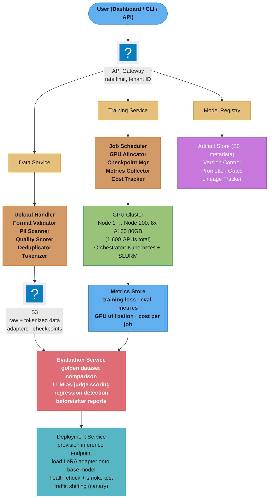
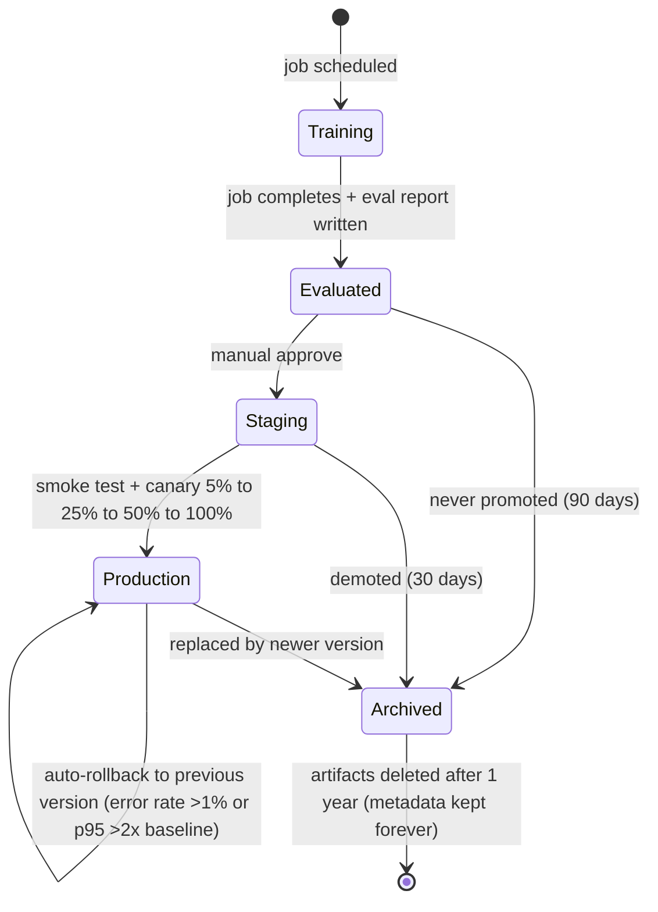

# Case Study: Design an LLM Fine-Tuning Platform
## Intuition

> **Design intuition**: An LLM fine-tuning platform is a GPU-orchestrated training pipeline with a self-serve data management layer -- like a CI/CD system for model weights instead of application code. Users push data, configure training jobs, watch metrics converge in real time, evaluate results against baselines, and promote models through staging to production. The platform abstracts GPU cluster complexity behind a simple API.

**Key insight for this design**: The data pipeline is the quality bottleneck, not the training loop. A fine-tune on garbage data produces a garbage model regardless of hyperparameters. The platform must invest heavily in data validation (format correctness, quality scoring, PII detection, deduplication) before a single GPU cycle is spent. Second, LoRA is the default -- full fine-tuning is the exception for <5% of jobs, reserved for users who demonstrate they have enough data (>100K examples) and budget (>$10K per run).

For serving and versioning the adapters this platform produces, see [LoRA Adapter Serving and Lifecycle](../../mlops/lora_adapter_serving_and_lifecycle/lora_adapter_serving_and_lifecycle.md).

---

## 1. Requirements Clarification

### Functional Requirements
- Self-serve upload of training datasets (CSV, JSONL) up to 50GB per file
- Data validation: schema checks, quality scoring (perplexity, diversity), PII detection, deduplication
- Training job configuration: model selection, LoRA vs full fine-tune, hyperparameter presets
- Real-time training monitoring: loss curves, eval metrics, ETA, GPU utilization
- Automated evaluation: before/after comparison on golden datasets, LLM-as-judge scoring
- Model registry: versioned model artifacts with full lineage (data hash, config, eval scores)
- Promotion workflow: staging -> production with approval gates
- Inference endpoint provisioning for deployed fine-tuned models
- Cost estimation before job submission; per-job cost tracking and billing

### Non-Functional Requirements
- **Multi-tenancy**: 2,000 enterprise tenants with isolated data, models, and GPU quotas
- **Concurrent jobs**: 500 training jobs running simultaneously across the GPU cluster
- **GPU utilization target**: >85% cluster utilization (GPUs cost $2-3/hour each; idle GPUs burn money)
- **Job start latency**: <5 minutes from submission to first training step (queue time + setup)
- **Data pipeline throughput**: Process 1TB of uploaded data per hour across all tenants
- **Model storage**: ~400TB total across datasets, checkpoints and artifacts (fine-tuned adapters average 500MB for LoRA, 30GB for full models; see the 336TB 12-month artifact figure in Section 2)
- **Availability**: 99.9% for API and dashboard; training jobs tolerant to node failures via checkpointing
- **Compliance**: SOC 2, GDPR (data deletion on request), optional HIPAA for healthcare tenants

### Out of Scope
- Base model pre-training (platform only fine-tunes existing base models)
- Custom model architecture design
- Inference auto-scaling (handled by separate serving platform)
- Synthetic data generation (available as a separate service, can feed into this platform)

---

## 2. Scale Estimation

### Training Job Volume
```
Active tenants: 2,000
Jobs per tenant per month: 10 average (power users: 50+, casual: 2-3)
Total jobs per month: 20,000
Concurrent running jobs (peak): 500
Average job duration: 4 hours (LoRA), 48 hours (full fine-tune)
Job mix: 92% LoRA, 5% QLoRA, 3% full fine-tune

GPU requirements per job:
  LoRA (7B model): 1x A100 80GB
  LoRA (70B model): 4x A100 80GB (tensor parallelism)
  QLoRA (70B model): 1x A100 80GB (4-bit quantized base)
  Full fine-tune (7B): 8x A100 80GB (FSDP)
  Full fine-tune (70B): 32x A100 80GB (FSDP + tensor parallelism)

Peak GPU demand: ~1,200 A100 GPUs
  (460 LoRA jobs x 1.5 avg GPUs = 690) + (25 QLoRA x 1 = 25)
  + (15 full x 32 avg = 480)  ->  1,195
Cluster size: 1,600 A100 GPUs (~33% headroom for scheduling + failures)
```

### Data Volume
```
Dataset uploads per day: ~700
Average dataset size: 200MB (JSONL with prompt-completion pairs)
Daily upload volume: 700 x 200MB = 140GB/day
Peak upload rate: 50 concurrent uploads

Validation pipeline:
  PII scan throughput: 10GB/hour per worker
  Quality scoring: 5GB/hour per worker (requires embedding + perplexity computation)
  Workers needed at peak: 20 validation workers

Storage:
  Raw datasets (90-day retention): 140GB/day x 90 = 12.6TB
  Processed datasets (tokenized, ready for training): ~2x raw = 25TB
  Model artifacts (LoRA adapters): 20,000 jobs/month x 500MB avg = 10TB/month
  Model artifacts (full models): 600 jobs/month x 30GB = 18TB/month
  Total model storage (12-month retention): 336TB
  Checkpoints (7-day retention): 500 concurrent x 2GB avg = 1TB active
```

### Cost Baseline
```
GPU cluster: 1,600 A100s x $2.50/hr = $4,000/hr = $2.88M/month
Storage (S3): 400TB x $0.023/GB = $9,200/month
Compute (validation, API, orchestration): ~$50,000/month
Networking (data transfer): ~$15,000/month
Total infrastructure: ~$3M/month

Revenue target: charge 2-3x infrastructure cost
  LoRA job (7B, 4 hours, 1 GPU): $10 GPU + $2 platform fee = $12
  LoRA job (70B, 8 hours, 4 GPUs): $80 GPU + $10 platform fee = $90
  Full fine-tune (7B, 48 hours, 8 GPUs): $960 GPU + $100 platform fee = $1,060
```

---

## 3. High-Level Architecture



The gateway fans out to the three core services; training jobs flow through the scheduler onto the 1,600-GPU A100 cluster, and the data pipeline (S3) plus training metrics converge on the evaluation service that gates promotion into the deployment service.

---

## 4. Component Deep Dives

### 4.1 Data Pipeline

```
Upload flow (user perspective):
  POST /v1/datasets with multipart JSONL file
     |
     v
  [Upload Handler]
  - Presigned S3 URL for large files (>100MB bypass API gateway)
  - Chunked upload with resumption (tus.io protocol)
  - Max file size: 50GB
  - Accepted formats: JSONL (primary), CSV (converted to JSONL)
     |
     v
  [Format Validator] (Stage 1: fast, <30 seconds for 1GB)
  - Schema check: every line valid JSON
  - Required fields: "messages" array with role/content pairs
  - Role validation: system (optional), user (required), assistant (required)
  - Token count per example: warn if >4096, reject if >model context length
  - Minimum examples: 10 (LoRA), 100 (recommended), 100K (full fine-tune)
  - Maximum examples: 10M
  - Encoding: UTF-8 only, reject binary content
     |
     v
  [PII Scanner] (Stage 2: ~10GB/hour per worker)
  - Named Entity Recognition (NER) for: SSN, credit card, phone, email, address
  - Regex patterns for structured PII (SSN: XXX-XX-XXXX, CC: 16-digit patterns)
  - Configurable: block (reject dataset), redact (replace with [REDACTED]), warn (flag only)
  - HIPAA mode: scan for PHI (Protected Health Information) -- medical record numbers,
    diagnosis codes, patient names cross-referenced with medical terms
  - Output: PII report with line numbers and entity types found
     |
     v
  [Quality Scorer] (Stage 3: ~5GB/hour per worker)
  - Perplexity check: compute perplexity of assistant responses against base model
    If perplexity is extremely low (<2): likely copied from base model (no learning signal)
    If perplexity is extremely high (>50): likely garbage or wrong language
  - Diversity analysis: embedding-based clustering of prompts
    Flag if >30% of prompts cluster within cosine similarity 0.95 (near-duplicates)
  - Length analysis: histogram of prompt/response lengths
    Flag if >50% of responses are <20 tokens (too short to be useful)
  - Instruction-following check: sample 100 examples, use LLM-as-judge to score
    whether assistant response actually follows the user instruction (1-5 scale)
    Flag if average score <3.0
  - Output: quality report with overall score (A/B/C/D/F) and per-metric breakdown
     |
     v
  [Deduplicator] (Stage 4)
  - Exact match: SHA-256 hash of (user_message + assistant_message)
  - Near-duplicate: MinHash with Jaccard similarity >0.85
  - Cross-dataset: check against tenant's other datasets (optional)
  - Action: remove duplicates, report count
     |
     v
  [Tokenizer] (Stage 5: final preparation)
  - Apply prompt template for target model (ChatML, Llama, Mistral format)
  - Tokenize with model-specific tokenizer
  - Pack examples into training sequences (bin-packing for efficiency)
  - Shuffle and split: 90% train, 10% validation (or user-specified split)
  - Write tokenized dataset to S3 in optimized format (memory-mapped Arrow)
  - Output: tokenized dataset path + statistics (total tokens, sequence count)

Validation dataset record in PostgreSQL:
  {
    dataset_id: uuid,
    tenant_id: uuid,
    name: "customer_support_v3",
    status: "validated",             // uploading | validating | validated | failed
    raw_path: "s3://datasets/raw/{tenant}/{dataset_id}.jsonl",
    processed_path: "s3://datasets/processed/{tenant}/{dataset_id}/",
    format: "jsonl",
    example_count: 15420,
    total_tokens: 8_234_000,
    quality_score: "B+",
    pii_report: {ssn: 0, email: 12, phone: 3},
    pii_action: "redacted",
    duplicate_count: 234,
    created_at: timestamp,
    expires_at: timestamp            // 90-day retention default
  }
```

### 4.2 Training Orchestration

```
Job submission flow:
  POST /v1/training/jobs
  {
    "dataset_id": "ds_abc123",
    "base_model": "meta-llama/Llama-3.3-70B-Instruct",
    "method": "lora",               // lora | qlora | full
    "hyperparameters": "preset:quality",  // preset or custom
    "epochs": 3,
    "eval_dataset_id": "ds_eval456"  // optional golden dataset
  }
     |
     v
  [Pre-flight Checks]
  - Dataset exists and status = "validated"
  - Base model available in model catalog
  - Tenant has sufficient GPU quota remaining
  - Cost estimate generated and within tenant budget
     |
     v
  [Cost Estimator]
  Estimated cost = GPU_count x estimated_hours x GPU_rate + platform_fee
  Calculation:
    total_tokens = dataset.total_tokens x epochs
    tokens_per_second = model_benchmark[base_model][method]
      (Llama-3.3-70B LoRA: ~8,000 tokens/sec on 4x A100)
    estimated_seconds = total_tokens / tokens_per_second
    estimated_hours = estimated_seconds / 3600
    GPU_count = hardware_requirements[base_model][method]
    estimated_cost = GPU_count x estimated_hours x $2.50 + platform_fee
  Return estimate to user before charging
     |
     v
  [Job Queue] (Redis sorted set, priority = submission_time + tier_boost)
  Priority tiers:
    Enterprise tier: +0 (highest priority, submitted time is effective priority)
    Pro tier: +300 seconds penalty
    Free tier: +1800 seconds penalty (30-minute delay)
  Fair scheduling:
    Max concurrent jobs per tenant: 20 (enterprise), 5 (pro), 1 (free)
    If tenant at limit: job waits regardless of priority
     |
     v
  [GPU Allocator] (runs every 10 seconds)
  Scheduling algorithm: bin-packing with affinity
    1. Sort pending jobs by priority (highest first)
    2. For each job, find nodes with enough free GPUs
    3. Prefer nodes where base model weights are already cached (saves 5-15 min load time)
    4. Prefer co-locating multi-GPU jobs on same node (NVLink > network)
    5. If no capacity: job stays queued, tenant notified with ETA

  GPU allocation examples:
    LoRA 7B:   1x A100 on any node
    LoRA 70B:  4x A100 on same node (NVLink)
    Full 7B:   8x A100 on same node (FSDP, all-reduce)
    Full 70B:  32x A100 across 4 nodes (FSDP + tensor parallel, NCCL RDMA)
     |
     v
  [Training Worker] (Kubernetes pod on allocated GPUs)
  Setup (2-5 minutes):
    1. Pull base model weights from model cache (NVMe SSD on each node)
       If not cached: download from S3 (70B model = 140GB at 10Gbps = ~2 min)
    2. Pull tokenized dataset from S3
    3. Initialize training framework (PyTorch + Hugging Face Trainer)
    4. Load LoRA config or FSDP config

  Training loop:
    - Forward pass -> loss computation -> backward pass -> optimizer step
    - Log metrics every 10 steps: train_loss, learning_rate, grad_norm, tokens_per_sec
    - Evaluate on validation set every 100 steps (or every epoch for small datasets)
    - Checkpoint every 30 minutes to S3 (LoRA checkpoint: ~500MB, full: ~30GB)
    - Heartbeat every 60 seconds to orchestrator

  Failure recovery:
    - If heartbeat missed for 3 minutes: mark node unhealthy
    - Reschedule job on new GPUs, resume from last checkpoint
    - Maximum retries: 3 (then mark job as failed, notify user)
    - Checkpoint retention: 7 days after job completion
```

**Real PyTorch training loop with FSDP:** gradient accumulation 8 steps (70B LoRA); bf16 halves memory (140GB -> 70GB); FSDP on 8x H100 shards 70B to ~20GB/GPU.

```python
from __future__ import annotations
from contextlib import nullcontext
from dataclasses import dataclass
from functools import partial
import torch, torch.distributed as dist
from torch.distributed.fsdp import FullyShardedDataParallel as FSDP
from torch.distributed.fsdp.wrap import transformer_auto_wrap_policy
from torch.amp import autocast
# LlamaDecoderLayer is NOT in transformers' top-level __all__ — importing it from
# `transformers` directly raises ImportError. Import from the model module.
from transformers.models.llama.modeling_llama import LlamaDecoderLayer

@dataclass
class TrainingConfig:
    model_name: str; dataset_path: str; output_dir: str
    learning_rate: float = 2e-4; gradient_accumulation_steps: int = 8  # 8 steps typical for 70B LoRA
    max_grad_norm: float = 1.0; bf16: bool = True
    checkpoint_every_steps: int = 500; loss_spike_multiplier: float = 3.0

class FineTuningTrainer:
    """FSDP-wrapped training loop with gradient accumulation and loss-spike detection."""

    def train(self, config: TrainingConfig) -> dict:
        mp = torch.distributed.fsdp.MixedPrecision(param_dtype=torch.bfloat16, reduce_dtype=torch.bfloat16)
        # transformer_auto_wrap_policy takes (module, recurse, nonwrapped_numel,
        # transformer_layer_cls); FSDP supplies the first three. Calling it directly
        # is a TypeError — bind transformer_layer_cls with functools.partial.
        wrap_policy = partial(transformer_auto_wrap_policy,
                              transformer_layer_cls={LlamaDecoderLayer})
        model = FSDP(self._load_model(config.model_name),
                     auto_wrap_policy=wrap_policy,
                     mixed_precision=mp if config.bf16 else None)
        optimizer = torch.optim.AdamW(model.parameters(), lr=config.learning_rate)
        amp_ctx = autocast("cuda", dtype=torch.bfloat16) if config.bf16 else nullcontext()
        running_sum, running_n, last_ckpt = 0.0, 0, ""
        for step, batch in enumerate(self._build_dataloader(config.dataset_path)):
            with amp_ctx:
                loss = model(**batch).loss
            # BROKEN: loss.backward() without normalization makes the effective LR scale with
            # gradient_accumulation_steps (8x larger gradient than a single-step update).
            # FIX: divide loss before .backward() so accumulated gradient == single-step gradient.
            loss = loss / config.gradient_accumulation_steps   # FIX
            loss.backward()
            raw_loss = loss.item() * config.gradient_accumulation_steps
            running_sum += raw_loss; running_n += 1
            # Loss spike: auto-checkpoint + alert if loss > 3x rolling mean.
            if running_n > 20 and raw_loss > config.loss_spike_multiplier * (running_sum / running_n):
                self._save_checkpoint(model, optimizer, step, config.output_dir, tag="spike")
                import logging; logging.warning(f"Loss spike step {step}: {raw_loss:.3f} > {config.loss_spike_multiplier}x mean")
            if (step + 1) % config.gradient_accumulation_steps == 0:
                torch.nn.utils.clip_grad_norm_(model.parameters(), config.max_grad_norm)
                optimizer.step(); optimizer.zero_grad()
            if (step + 1) % config.checkpoint_every_steps == 0:  # write to temp, atomic rename
                last_ckpt = self._save_checkpoint(model, optimizer, step, config.output_dir)
        return {"final_loss": raw_loss, "steps": step + 1, "checkpoint": last_ckpt}

    def _save_checkpoint(self, model, optimizer, step, out, tag="ckpt") -> str:
        """Atomic write: temp -> rename. FSDP consolidates shards on rank 0 only."""
        tmp, final = f"{out}/.tmp_{tag}_{step}", f"{out}/{tag}_{step}"
        with FSDP.state_dict_type(model, torch.distributed.fsdp.StateDictType.FULL_STATE_DICT):
            if dist.get_rank() == 0:
                torch.save({"model": model.state_dict(), "optimizer": optimizer.state_dict(), "step": step}, tmp)
                import shutil; shutil.move(tmp, final)
        return final

    def _load_model(self, name):
        from transformers import AutoModelForCausalLM
        return AutoModelForCausalLM.from_pretrained(name, torch_dtype=torch.bfloat16)

    def _build_dataloader(self, path):
        from torch.utils.data import DataLoader; from datasets import load_from_disk
        return DataLoader(load_from_disk(path), batch_size=1, shuffle=True)
```

> See [Training Infrastructure](../training_infrastructure/training_infrastructure.md) for the full FSDP wrap policy and ZeRO sharding details.

### 4.3 Hyperparameter Management

```
Presets (users pick one, or override individual values):

lora_quality:
  learning_rate: 2e-4
  lora_rank: 64
  lora_alpha: 128
  lora_dropout: 0.05
  target_modules: ["q_proj", "k_proj", "v_proj", "o_proj", "gate_proj", "up_proj", "down_proj"]
  batch_size: auto (maximize GPU memory utilization)
  gradient_accumulation_steps: 4
  warmup_ratio: 0.03
  weight_decay: 0.01
  lr_scheduler: cosine
  bf16: true
  epochs: 3

lora_fast:
  learning_rate: 5e-4
  lora_rank: 16
  lora_alpha: 32
  lora_dropout: 0.1
  target_modules: ["q_proj", "v_proj"]
  epochs: 1

qlora_memory_efficient:
  quantization: 4-bit (NF4)
  double_quant: true
  lora_rank: 32
  lora_alpha: 64
  paged_adamw: true
  gradient_checkpointing: true

full_finetune:
  learning_rate: 2e-5
  batch_size: auto
  fsdp: "full_shard auto_wrap"
  fsdp_transformer_layer_cls: "LlamaDecoderLayer"
  gradient_checkpointing: true
  bf16: true
  epochs: 2-3

Auto batch size:
  Available GPU memory: 80GB per A100
  Model memory (70B bf16): ~140GB (spread across GPUs)
  LoRA overhead: ~2GB
  Activation memory per sample: varies by sequence length
  Binary search: start at batch_size=1, double until OOM, then fine-tune
  Typical results: LoRA 7B = batch 16, LoRA 70B = batch 4, Full 7B = batch 8

Early stopping:
  Monitor validation loss
  Patience: 3 evaluations without improvement
  Restore best checkpoint
  Notify user: "Training stopped early at epoch 2.3 (val_loss plateaued at 1.42)"
```

### 4.4 Evaluation Service

```
Evaluation runs automatically after training completes (and optionally during training).

Three evaluation modes:

Mode 1: Automated Metrics (runs in <5 minutes)
  - Validation loss: final val_loss from training (already computed)
  - Perplexity: exp(val_loss) on held-out validation set
  - Token accuracy: % of tokens in assistant response predicted correctly
  - Comparison: base model perplexity vs fine-tuned perplexity on same eval set
    Healthy: fine-tuned perplexity 10-30% lower than base
    Warning: fine-tuned perplexity higher than base (possible overfitting or bad data)

Mode 2: Golden Dataset Comparison (runs in 10-30 minutes)
  - User provides golden dataset: {input, expected_output} pairs
  - Run inference with base model on golden set -> base_predictions
  - Run inference with fine-tuned model on golden set -> finetuned_predictions
  - Compute:
    Exact match rate: % where finetuned_prediction == expected_output
    ROUGE-L: overlap between prediction and expected output
    Task-specific metrics:
      Classification: accuracy, F1, confusion matrix
      Extraction: precision, recall of extracted entities
      Generation: BLEU, ROUGE, BERTScore
  - Report: side-by-side comparison table
```

| Metric | Base Model | Fine-Tuned | Delta |
|--------|------------|------------|-------|
| Exact Match | 42% | 78% | +36% |
| ROUGE-L | 0.51 | 0.74 | +0.23 |
| Avg Latency | 1.2s | 1.2s | +0ms |
| Token Cost/Query | $0.015 | $0.015 | $0 |

```
Mode 3: LLM-as-Judge Quality Scoring (runs in 15-45 minutes)
  - Sample 200 examples from golden dataset
  - For each example, generate response with both base and fine-tuned model
  - Submit to judge LLM (GPT-6.2 Sol or Claude Sonnet 5.5, both $2/1M in, $10/1M out):
    Prompt template:
      "You are an expert evaluator. Given the instruction and two responses (A and B,
       order randomized), rate each on: accuracy (1-5), helpfulness (1-5),
       safety (1-5), instruction following (1-5). Then pick the better response."
  - Randomize A/B position to avoid position bias
  - Aggregate: win rate of fine-tuned vs base, average score improvement
  - Judge cost at those list prices, ~1,800 input + ~200 output tokens per example:
      200 x (1,800 x $2e-6 + 200 x $1e-5) = 200 x $0.0056 = ~$1.12 per run
    Billed to the tenant at a flat $4 evaluation fee (see 4.7)

Regression detection:
  - If fine-tuned model scores worse than base on any metric by >5%: flag as regression
  - If fine-tuned model produces toxic/harmful content not present in base: block deployment
  - Safety check: run 50 adversarial prompts from the red-team suite (Section 8)
    If any new safety failures: require manual review before promotion

Evaluation record:
  {
    eval_id: uuid,
    job_id: uuid,
    model_version: "ft:llama-3.3-70b:acme:v3",
    base_model: "meta-llama/Llama-3.3-70B-Instruct",
    metrics: {
      val_loss: 1.42,
      perplexity: 4.14,
      golden_exact_match: 0.78,
      golden_rouge_l: 0.74,
      judge_win_rate: 0.72,
      judge_avg_score: 4.1,
      safety_pass: true,
      regression_detected: false
    },
    comparison_table: [...],
    created_at: timestamp
  }
```

**Eval-gated promotion gate (Python):** FAIL if PPL increases >5% or task metric drops >3%; REVIEW within +-1%; else PASS. Runs 15-30 min on 500 examples (1x A100).

```python
from __future__ import annotations
import math
from dataclasses import dataclass
from enum import Enum

class GateDecision(str, Enum):
    PASS = "PASS"; FAIL = "FAIL"; REVIEW = "REVIEW"

@dataclass
class EvalDataset:
    task_type: str; examples: list[dict]  # {"input": str, "expected": str}

@dataclass
class GateResult:
    decision: GateDecision; perplexity_delta_pct: float; task_metric_delta_pct: float; details: dict

class EvalGate:
    PPL_FAIL = 0.05; TASK_FAIL = 0.03; REVIEW_BAND = 0.01

    def check(self, model_checkpoint: str, baseline_checkpoint: str, eval_dataset: EvalDataset) -> GateResult:
        # Perplexity eval (model-agnostic): positive delta = lower (better) PPL.
        baseline_ppl = self._perplexity(baseline_checkpoint, eval_dataset.examples)
        finetuned_ppl = self._perplexity(model_checkpoint, eval_dataset.examples)
        ppl_delta_pct = (baseline_ppl - finetuned_ppl) / baseline_ppl
        # Task-specific golden-set metric (BLEU/pass@1/accuracy/ROUGE-L by task_type).
        baseline_score = self._golden_score(baseline_checkpoint, eval_dataset)
        finetuned_score = self._golden_score(model_checkpoint, eval_dataset)
        task_delta_pct = (finetuned_score - baseline_score) / max(baseline_score, 1e-9)

        details = {
            "baseline_ppl": round(baseline_ppl, 3), "finetuned_ppl": round(finetuned_ppl, 3),
            "ppl_delta_pct": round(ppl_delta_pct * 100, 2),
            "task_delta_pct": round(task_delta_pct * 100, 2), "task_type": eval_dataset.task_type,
        }
        if ppl_delta_pct < -self.PPL_FAIL:
            return GateResult(GateDecision.FAIL, ppl_delta_pct, task_delta_pct, details)
        if task_delta_pct < -self.TASK_FAIL:
            return GateResult(GateDecision.FAIL, ppl_delta_pct, task_delta_pct, details)
        if abs(task_delta_pct) < self.REVIEW_BAND:
            return GateResult(GateDecision.REVIEW, ppl_delta_pct, task_delta_pct, details)
        return GateResult(GateDecision.PASS, ppl_delta_pct, task_delta_pct, details)

    def _perplexity(self, checkpoint: str, examples: list[dict]) -> float:
        """Load checkpoint; forward pass on up to 500 examples; return exp(mean CE loss). ~15-30 min 1x A100."""
        import torch, math
        from transformers import AutoModelForCausalLM, AutoTokenizer
        m = AutoModelForCausalLM.from_pretrained(checkpoint, torch_dtype=torch.bfloat16).cuda().eval()
        tok = AutoTokenizer.from_pretrained(checkpoint)
        with torch.no_grad():
            losses = [m((ids := tok(e["input"], return_tensors="pt").input_ids.cuda()), labels=ids).loss.item() for e in examples[:500]]
        return math.exp(sum(losses) / len(losses))

    def _golden_score(self, checkpoint: str, dataset: EvalDataset) -> float:
        """Generate predictions; score with BLEU/pass@1/accuracy/ROUGE-L by task_type."""
        raise NotImplementedError("See evaluation_and_benchmarks module.")
```

> See [LLM Evaluation and Benchmarks](../evaluation_and_benchmarks/evaluation_and_benchmarks.md) for the full eval harness including LLM-as-judge pipelines and RAGAS integration.

### 4.5 Model Registry

```
The model registry is the system of record for all fine-tuned model artifacts.

Model versioning scheme:
  ft:{base_model}:{tenant}:{suffix}:{version}
  Example: ft:llama-3.3-70b:acme:customer-support:v3

Model artifact stored in S3:
  s3://models/{tenant_id}/{model_id}/
    adapter_config.json        (LoRA hyperparameters)
    adapter_model.safetensors  (LoRA weights, ~500MB for rank-64 on 70B)
    tokenizer/                 (if modified; usually inherited from base)
    training_config.json       (full training configuration)
    eval_report.json           (evaluation results)
    README.md                  (auto-generated model card)

Model metadata in PostgreSQL:
  {
    model_id: uuid,
    tenant_id: uuid,
    display_name: "customer-support-v3",
    base_model: "meta-llama/Llama-3.3-70B-Instruct",
    method: "lora",
    status: "evaluated",    // training | evaluated | staging | production | archived
    version: 3,
    training_job_id: uuid,
    dataset_id: uuid,
    dataset_hash: "sha256:abc...",   // exact data used
    hyperparameters: {...},
    eval_scores: {
      val_loss: 1.42,
      golden_exact_match: 0.78,
      judge_win_rate: 0.72
    },
    artifact_path: "s3://models/acme/ft-abc123/",
    artifact_size_bytes: 524_288_000,
    created_at: timestamp,
    promoted_at: timestamp,          // null until promoted
    promoted_by: "user@acme.com"
  }

Lineage tracking:
  Every model records:
    - Exact dataset version (hash) used for training
    - Base model version (hash of weights)
    - Training configuration (all hyperparameters)
    - Evaluation scores
    - Parent model (if iteratively fine-tuned)

  Query: "What data was used to train the model currently in production?"
    model(production) -> training_job -> dataset -> raw upload file
    Full audit trail for compliance
```



The model lifecycle is a one-way promotion ladder with human gates: staging entry requires manual
approval, production entry requires a passing smoke test plus staged canary, and the previous
production model is kept warm for 24 hours so rollback is an alias flip, not a redeploy.

```
Promotion workflow details:

  Staging:
    - Deploy to staging inference endpoint
    - Run smoke test suite (20 canonical inputs, check outputs are reasonable)
    - Run latency benchmark (p50, p95, p99 must meet SLA)
    - Optional: shadow traffic (mirror 5% of production traffic, compare outputs)
    - Duration: 1-24 hours (configurable)

  Production promotion:
    - Requires explicit approval (API call or dashboard button)
    - Canary deployment: 5% traffic for 1 hour, then 25%, 50%, 100%
    - Automatic rollback if error rate >1% or latency p95 >2x baseline
    - Previous production model kept warm for 24 hours (instant rollback)

Retention by lifecycle stage:
    Production models: kept indefinitely
    Staging models: 30 days after demotion
    Evaluated models never promoted: 90 days
    Archived: metadata kept forever, artifacts deleted after 1 year
```

**LoRA adapter serving with LRU hot-swap:**

Memory budget per H100 node: ~70GB base weights + 4GB adapter cache (20 x 200MB rank-16 LoRA) = 74GB reserved; 1,000 adapters served from one replica via LRU eviction.

```python
from __future__ import annotations
import time; from collections import OrderedDict; from threading import Lock
import boto3, torch; from peft import PeftModel

MAX_CACHED_ADAPTERS = 20; NVME_CACHE_DIR = "/nvme/adapters"  # 20 x 200MB = 4GB; NVMe <50ms vs S3 ~2s

class LoRAServingManager:
    """Hot-swaps LoRA adapters onto shared base model. No 140GB reload between requests."""

    def __init__(self, base_model: str, s3_bucket: str) -> None:
        self._s3 = boto3.client("s3"); self._bucket = s3_bucket
        self._cache: OrderedDict[str, tuple[PeftModel, float]] = OrderedDict(); self._lock = Lock()
        from transformers import AutoModelForCausalLM  # bf16 device_map="auto"; loaded once at startup
        self._base = AutoModelForCausalLM.from_pretrained(base_model, torch_dtype=torch.bfloat16, device_map="auto")

    def load_adapter(self, adapter_id: str, base_model: str) -> None:
        """Load into GPU cache: <500ms from NVMe, ~2s from S3 on first access."""
        with self._lock:
            if adapter_id in self._cache:
                self._cache.move_to_end(adapter_id); self._cache[adapter_id] = (self._cache[adapter_id][0], time.monotonic()); return
            if len(self._cache) >= MAX_CACHED_ADAPTERS:
                self.unload_lru()
            self._cache[adapter_id] = (PeftModel.from_pretrained(self._base, self._ensure_local(adapter_id), is_trainable=False).eval(), time.monotonic())

    def unload_lru(self) -> str:  # evict LRU; free GPU memory; return evicted adapter_id
        lru_id, (model, _) = next(iter(self._cache.items()))
        del self._cache[lru_id]; del model; torch.cuda.empty_cache(); return lru_id

    def list_loaded(self) -> list[str]:  # MRU first
        with self._lock: return list(reversed(list(self._cache.keys())))

    def _ensure_local(self, adapter_id: str) -> str:
        import os; local = f"{NVME_CACHE_DIR}/{adapter_id}"
        if not os.path.isdir(local):
            os.makedirs(local, exist_ok=True)
            for f in ["adapter_model.safetensors", "adapter_config.json"]:
                self._s3.download_file(self._bucket, f"models/{adapter_id}/{f}", f"{local}/{f}")
        return local
```

> See [Inference Engines](../inference_engines/inference_engines.md) for vLLM's LoRA multiplexing implementation and PagedAttention KV cache interaction with multi-adapter serving.

### 4.6 Multi-Tenancy and Isolation

```
Isolation model: shared-infrastructure, isolated-data

Data isolation:
  - S3: separate prefix per tenant (s3://datasets/{tenant_id}/...)
  - PostgreSQL: tenant_id column on every table, row-level security (RLS)
    CREATE POLICY tenant_isolation ON datasets
      USING (tenant_id = current_setting('app.current_tenant')::uuid);
  - No cross-tenant data access possible at storage layer
  - Encryption: per-tenant KMS keys for data at rest
    Tenant can bring own key (BYOK) for HIPAA compliance

Compute isolation:
  - Training jobs run in isolated Kubernetes pods
  - Each pod: dedicated network namespace, no inter-pod communication
  - GPU allocation: dedicated GPUs per job (no GPU sharing between tenants)
  - Memory: pod memory limits enforced (OOM kills job, not neighbor)
  - Base model weights: shared read-only cache (not tenant-specific)

GPU quota management:
  Tier-based GPU quotas:
    Free tier: 1 concurrent GPU, 10 GPU-hours/month
    Pro tier: 8 concurrent GPUs, 200 GPU-hours/month
    Enterprise tier: 64 concurrent GPUs, 5,000 GPU-hours/month
    Custom tier: negotiated limits

  Quota enforcement:
    Before job submission: check remaining GPU-hours
    During job: decrement quota every minute (Redis atomic counter)
    If quota exhausted mid-training: checkpoint and pause (not kill)
    User can purchase additional GPU-hours to resume

Fair scheduling across tenants:
  Problem: one tenant submitting 100 jobs should not starve others
  Solution: weighted fair queuing
    Each tenant gets a "virtual clock" that advances proportional to GPU-hours consumed
    Scheduler picks the job from the tenant with the lowest virtual clock
    Effect: heavy users get throttled, light users get priority
    Starvation prevention: no tenant waits more than 30 minutes if GPUs are available
```

The shared-infrastructure, isolated-data model and the BYOK option follow [Tenant Isolation Patterns](./cross_cutting/tenant_isolation_patterns.md); the per-job checkpoint and resume contract is in [Training Loop Internals](./cross_cutting/training_loop_internals.md).

### 4.7 Cost Tracking and Billing

```
Cost components per training job:
  1. GPU compute:
     GPU-seconds = num_GPUs x wall_clock_seconds
     Cost = GPU-seconds x rate_per_GPU_second
     Rate: A100 80GB = $2.50/hr = $0.000694/sec
     Example: 4x A100 for 6 hours = 4 x 21,600 x $0.000694 = $60.00

  2. Data processing:
     Validation compute: $0.10 per GB processed
     Tokenization: $0.05 per GB
     Example: 2GB dataset = $0.30

  3. Evaluation:
     Automated metrics: free (computed during training)
     Golden dataset inference: charged at inference rate ($0.01/1K tokens)
     LLM-as-judge: charged at judge model rate (pass-through)
     Example: 200 golden examples = ~$4.00

  4. Storage:
     Dataset storage: $0.023/GB/month (S3 standard)
     Model artifacts: $0.023/GB/month
     Example: 500MB LoRA adapter for 6 months = $0.07

  5. Platform fee:
     Fixed per-job fee: $2 (LoRA), $10 (QLoRA), $50 (full fine-tune)
     Covers: scheduling, monitoring, API overhead

Cost estimation API (called before job submission):
  POST /v1/training/estimate
  Request: {dataset_id, base_model, method, epochs, hyperparameters}
  Response:
  {
    "estimated_cost": {
      "gpu_compute": "$60.00",
      "data_processing": "$0.30",
      "evaluation": "$4.00",
      "storage_monthly": "$0.07",
      "platform_fee": "$2.00",
      "total_one_time": "$66.30",
      "confidence_interval": "$55-$80"
    },
    "estimated_duration": "5h 20m",
    "gpu_allocation": "4x A100 80GB",
    "estimated_start_time": "2026-11-25T14:30:00Z"
  }

Real-time cost tracking during training:
  - Cost meter updates every 60 seconds
  - Dashboard shows: elapsed cost, burn rate, projected total
  - Alert if projected cost exceeds estimate by >50%
  - User can set hard budget cap: job killed if cost exceeds cap

Billing integration:
  - Monthly invoice per tenant
  - Line items: per-job breakdown with job ID, model, duration, cost
  - Usage dashboard: cost by model, by dataset, by time period
  - Spend anomaly detection: alert if daily spend >2x 7-day average
```

### 4.8 API Surface

Base URL `https://api.finetune.example.com/v1`, Bearer API key per tenant. Every mutating call takes an `Idempotency-Key` header so a retried job submission never launches two GPU jobs.

| Endpoint | Purpose | Notes |
|----------|---------|-------|
| `POST /datasets` | Upload JSONL (presigned URL above 100MB) | Returns `ds_*` id; status `uploading -> validating -> validated` |
| `GET /datasets/{id}/quality-report` | Perplexity, diversity, PII and duplicate report | Drives the A-F quality grade |
| `POST /training/estimate` | Cost and duration estimate, no job created | Same estimator as 4.2 |
| `POST /training/jobs` | Create job: `dataset_id`, `base_model`, `method`, preset or overrides, `budget_cap_usd`, `suffix` | Returns `ftjob_*` and model name `ft:llama-3.3-70b:acme:customer-support:v1` |
| `GET /training/jobs/{id}` | Status, step, ETA, live loss and cost | `queued, running, evaluating, completed, failed` |
| `POST /training/jobs/{id}/cancel` | Stop and keep last checkpoint | Partial billing |
| `POST /evaluations` | Run `metrics`, `golden_comparison`, `llm_judge` | Judge model is a pass-through cost |
| `POST /models/{id}/promote` / `rollback` | Move `evaluated -> staging -> production`; rollback < 30 s | Promotion needs an approval note |

---

## 5. Design Decisions & Tradeoffs
| Decision | Chosen | Alternative | Reason |
|----------|--------|-------------|--------|
| Default fine-tune method | LoRA | Full fine-tune | 95% of use cases need LoRA; 10-50x cheaper; comparable quality for most tasks |
| GPU scheduling | Kubernetes + custom scheduler | SLURM only | K8s for pod lifecycle + custom bin-packer for GPU affinity; SLURM alone lacks multi-tenant isolation |
| Checkpoint storage | S3 with 7-day retention | Persistent NVMe on nodes | S3 survives node failures; NVMe is faster but ephemeral; 7 days balances cost vs resume ability |
| Data validation | Multi-stage pipeline (5 stages) | Single-pass validation | Fail fast on format errors (cheap) before expensive PII/quality checks; each stage can scale independently |
| Evaluation approach | Three modes (metrics + golden + judge) | Metrics only | Automated metrics miss quality nuances; LLM-as-judge catches subtle regressions human evals would find |
| Model promotion | Manual approval gates | Auto-promote on metric threshold | Fine-tuned models can have subtle quality issues metrics miss; human-in-the-loop reduces risk |
| Multi-tenancy | Shared infra + data isolation | Dedicated clusters per tenant | Cost-effective at 2,000 tenants; dedicated clusters only for top-tier enterprise (custom pricing) |
| Hyperparameters | Preset-based with overrides | Full manual configuration | Most users are not ML engineers; presets encode best practices; power users can still override |
| Cost model | Per-GPU-second + platform fee | Flat per-job pricing | Fair billing proportional to resource usage; platform fee covers fixed overhead |
| Base model caching | NVMe SSD on each GPU node | Download from S3 every time | 70B model = 140GB; downloading every job wastes 2-5 min; NVMe cache serves in seconds |

---

## 6. Real-World Implementations

- **OpenAI** ran the reference self-serve fine-tuning API (upload JSONL, create a job, get an `ft:` model ID) that this design's API mirrors. On its deprecations page OpenAI moved the cutoff for creating new self-serve fine-tuning jobs to **2026-12-15**; existing fine-tuned models keep serving until their base model retires. The lesson for a platform builder: a tenant's fine-tune is only as durable as the vendor's base-model lifecycle, which is why this design fine-tunes open-weight bases it controls.
- **Together AI** and **Fireworks AI** offer LoRA and full fine-tuning on open-weight models and then serve the resulting adapters on shared multi-LoRA deployments, so a tenant pays per token instead of reserving a GPU per adapter.
- **Predibase** (acquired by Rubrik in 2025) built LoRAX, an open-source server that hot-swaps thousands of LoRA adapters on one base model, the serving-side twin of 4.5.
- **Amazon Bedrock** custom models and **Google Vertex AI** tuning wrap the same job/dataset/model-registry shape in a managed cloud console with IAM-scoped data access, which is the multi-tenancy model of 4.6.
- **Databricks Mosaic AI** fine-tuning and **Unsloth** sit at two ends of the same trade: managed multi-node jobs with lineage in the lakehouse versus single-GPU kernels that cut LoRA memory enough to fit a 70B QLoRA job on one 80GB GPU.

---

## 7. Technologies & Tools

| Layer | Choice | Why | Alternative |
|-------|--------|-----|-------------|
| Trainer | Hugging Face TRL `SFTTrainer` + PEFT (LoRA, QLoRA, DoRA) | Standard config surface for 92% LoRA jobs | Axolotl, torchtune, Unsloth |
| Distributed training | PyTorch FSDP2 (`fully_shard`) | Shards params, grads and optimizer state for full fine-tunes | DeepSpeed ZeRO-3, Megatron for > 70B |
| Orchestration | Kubernetes + Kueue for gang admission and quotas | Tenant quotas and all-or-nothing multi-GPU admission | Ray Train, Slurm |
| Data validation | Presidio (PII), MinHash LSH (dedup), Llama Guard (safety) | Each stage scales independently | Cloud DLP APIs |
| Experiment tracking | MLflow or Weights & Biases | Loss curves, configs and artifacts per job | TensorBoard |
| Registry and lineage | PostgreSQL + S3 with content hashes | Dataset-to-model audit trail for SOC 2 and GDPR | MLflow Model Registry |
| Adapter serving | vLLM multi-LoRA or LoRAX | One base model, many adapters, no 140GB reload | Merged per-tenant models |
| Eval | LLM judge (Claude Sonnet 5.5 or GPT-6.2 Sol) + golden sets | Pairwise win rate with randomized order; harness in [LLM Eval Harness in Production](./cross_cutting/llm_eval_harness_in_production.md) | Human review only |
---

## 8. Operational Playbook

### Eval Pipeline (every job, automated)

Every fine-tuning job must pass the eval gate before promotion. Gate runs automatically on job completion:
1. Perplexity + token accuracy from validation loss: <5 minutes.
2. Golden-set eval on 500 examples: 15-30 minutes on 1x A100.
3. Task-specific metric (BLEU / pass@1 / accuracy / ROUGE-L).
4. Decision: PASS auto-promotes; FAIL surfaces regression diff in dashboard; REVIEW routes to human queue.

See [LLM Evaluation and Benchmarks](../evaluation_and_benchmarks/evaluation_and_benchmarks.md) for the full eval harness.

### Observability (OpenTelemetry trace per job)

```
job_span: job_id, tenant_id, base_model, method, dataset_hash
  +-- data_pipeline_span: num_examples, num_tokens, pii_redacted, quality_score
  +-- training_span (per 500-step checkpoint): train_loss, val_loss, grad_norm,
  |     gpu_util_pct, mfu_pct, tokens_per_second, learning_rate
  +-- eval_span: perplexity_delta_pct, task_metric_delta_pct, gate_decision
```

GPU-seconds per span tagged with tenant_id + job_id feed billing directly. Span names and `gen_ai.*` attributes follow [OpenTelemetry for LLM Apps](./cross_cutting/opentelemetry_for_llm_apps.md); dashboards are covered in [LLM Observability and Monitoring](../llm_observability_and_monitoring/llm_observability_and_monitoring.md).

### Incident Runbooks

**Runbook 1 — Loss spike mid-training**
Symptom: loss > 3x rolling mean. Auto-response: `FineTuningTrainer` saves emergency checkpoint `spike_{step}` and logs WARNING. Diagnosis: inspect the batch at that step index in training span -- common cause is a corrupted JSONL line with garbled token sequences that passed format validation. Resolution: if loss does not recover within 50 steps, cancel job, remove offending batch, restart from last clean checkpoint (max 500 steps lost).

**Runbook 2 — GPU OOM during FSDP**
Symptom: `torch.cuda.OutOfMemoryError` at step N; pod exits, node stays healthy (OOM is per-pod). Diagnosis: check `sequence_length_max` in training span -- a batch with 8192 tokens vs typical 2048 can exceed per-GPU HBM even with FSDP sharding. Resolution: reduce `max_length` or `per_device_batch_size` by 1 and resubmit; orchestrator auto-retries up to 3 times from last checkpoint. Persistent failure at same step -> manual review for pathologically long examples.

**Runbook 3 — Eval gate regression blocking tenant**
Symptom: `gate_decision=FAIL` on every job iteration; tenant reports "model is worse than base." Diagnosis: open eval report -- common causes: (a) golden set misaligned with task, (b) golden set too small (<50 examples, metric estimate noisy), (c) catastrophic forgetting from too-narrow training data. Resolution: (a)/(b) replace golden set or allow manager-approved gate bypass (audit-logged for SOC 2); (c) recommend data augmentation or reduce LoRA rank. The 50-prompt safety probe in the gate comes from [Red Team Eval Harness](./cross_cutting/red_team_eval_harness.md).

---

## 9. Common Pitfalls & War Stories

**Gradient-accumulation loss normalization.** In October 2024 Unsloth showed that Hugging Face Transformers' gradient accumulation did not match full-batch training: each micro-batch's cross-entropy was averaged over its own non-padded token count and then summed, so batches with uneven sequence lengths over-weighted short examples. Transformers shipped a fix in 4.46. Platform impact in this design's terms: every job with `gradient_accumulation_steps > 1` and mixed-length data trains on a subtly different objective. A 2-week window of 9,000 jobs at an average $12 is $108K of compute to re-run for tenants who ask. Prevention: pin the trainer version per job, record it in lineage, and keep a regression test that compares accumulated and full-batch loss on a fixed mixed-length batch to 1e-4.

**Chat template mismatch between training and serving.** A tenant trains with the Llama 3 chat template and the serving stack applies ChatML. The adapter sees token sequences it never trained on, and golden-set exact match drops from 78% to 41% in production while offline eval, which used the training template, still reads 78%. Impact: 3 days of degraded answers on a support bot at 40K queries/day before the tenant noticed. Prevention: store the exact template string and tokenizer hash in `training_config.json` and have the serving loader refuse an adapter whose template hash differs.

**Torn checkpoint on node loss.** A pre-fix checkpoint writer streamed directly to the final S3 key. A node died mid-write, the resume path loaded a truncated optimizer state, and the run diverged 400 steps later. Impact: 37 multi-GPU jobs restarted from step 0, about 1,800 wasted A100-hours (~$4,500) in one incident. Prevention: the temp-file-then-rename pattern in 4.2 plus a manifest written last, so resume only trusts checkpoints with a complete manifest. [Training Loop Internals](./cross_cutting/training_loop_internals.md) covers the full checkpoint contract.

**Redaction token becomes a learned behaviour.** PII redaction replaced emails with `[REDACTED]` in 12% of examples. The fine-tuned model learned to emit `[REDACTED]` in place of any email-like slot, including the company's own support address. Impact: 6% of production replies contained the literal token. Prevention: redact with realistic synthetic surrogates (fake but well-formed emails) and add a golden-set assertion that the output never contains the redaction marker.

**Eval contamination inflates the gate.** A tenant uploaded a golden set drawn from the same ticket export as the training set; 30% of golden examples were near-duplicates of training rows. The judge win rate read 0.91 and the model promoted, then lost to the base model in the online A/B test. Prevention: run the Stage 4 MinHash deduplicator across training and golden sets and block promotion when overlap exceeds 5%.

---

## 10. Capacity Planning

GPU fleet sizing follows the peak-concurrency arithmetic in Section 2; the spot-versus-reserved blend below follows the cost model in [GPU Pool Economics](./cross_cutting/gpu_pool_economics.md).
```
Platform economics at scale (monthly):

Revenue:
  20,000 jobs/month
  Job mix: 18,400 LoRA ($12 avg) + 1,000 QLoRA ($25 avg) + 600 full ($1,060 avg)
  LoRA revenue:  18,400 x $12 = $220,800
  QLoRA revenue:  1,000 x $25 = $25,000
  Full revenue:     600 x $1,060 = $636,000
  Evaluation fees: 20,000 x $4 = $80,000
  Storage fees: ~$10,000
  Total monthly revenue: ~$971,800

Infrastructure cost:
  GPU cluster (1,600 A100s): $2,880,000
  BUT: not all GPUs busy 24/7
  Average utilization target: 85%
  Effective GPU cost: $2,880,000 x 0.85 = $2,448,000 (cost of utilized GPUs)
  15% idle cost: $432,000 (unavoidable headroom for scheduling)

  Storage (S3, 400TB): $9,200
  Compute (API, validation, evaluation): $50,000
  Networking: $15,000
  Operations team (10 engineers): $250,000

  Total monthly cost: ~$3,204,200

Revenue covers only ~$971,800 / $3,204,200 = 30% of cost.
(Stated as a gross margin that is -230%: (971,800 - 3,204,200) / 971,800.)

Read the shape of this before reaching for growth as the fix. Job volume drives
both revenue AND GPU cost roughly linearly, so **adding tenants does not close a
30%-of-cost gap** — it scales both sides and holds the ratio. The levers that
actually change the ratio are price, GPU unit cost, and utilization:

  1. Price. Section 2 sets a target of charging 2-3x infrastructure cost; the job
     prices above charge ~1.2x ($10 of GPU billed at $12). Closing that alone is
     the single largest lever and is required for any break-even path.
  2. Spot/preemptible GPUs for non-urgent LoRA jobs (60% cheaper).
     LoRA is 690 of the 1,195 peak GPUs (~58% of the fleet); if 70% of those jobs
     tolerate preemption, the discount applies to 0.58 x 0.70 = 40% of GPU spend:
     0.40 x 0.60 x $2.88M = ~$700K/month saved.
  3. GPU utilization improvements:
     Time-slicing: run small LoRA jobs on same GPU (non-overlapping memory)
     Packing: fill gaps between large jobs with small ones
     Target: 92% utilization -> saves ~$200K/month vs 85%
  4. Higher-value jobs (enterprise custom pricing):
     Dedicated clusters: $50K+/month per enterprise tenant
     10 enterprise tenants = $500K/month

Break-even needs (1) plus (2) and (3), not tenant growth: roughly doubling job
pricing toward the Section 2 target takes revenue to ~$1.9M against a
spot-and-utilization-optimized cost near $2.3M, and the enterprise-tier revenue
in (4) closes the remainder. Tenant count then scales a positive-margin business
instead of a negative one.

Caveat on utilization: the job mix above consumes roughly 460,000 GPU-hours/month
(18,400 LoRA x 4h x 1.5 GPU + 1,000 QLoRA x 4h + 600 full x 48h x 12 GPU) against
a fleet capacity of 1,600 x 720 = 1,152,000 GPU-hours. That is ~40% average
utilization, well under the >85% NFR target -- the 1,600-GPU fleet is sized for
peak concurrency, not average demand, and closing that gap is what lever (3) means.

Key cost levers:
  GPU utilization (biggest lever): every 1% improvement = $28,800/month saved
  Spot instance mix: 60% of the fleet on spot at a 60% discount
    = 0.60 x 0.60 x $2.88M = ~$1.04M/month saved
  Training efficiency: better hyperparameter defaults reduce average job time 15%
  Cache base model weights: saves 5 min/job x 20,000 jobs = 1,667 GPU-hours = $4,167/month
```

---

## 11. Interview Discussion Points

**Q: Why default to LoRA instead of full fine-tuning?**
**Short:** LoRA trains 0.1-1% of parameters, so a 70B job runs on 4 GPUs for $60-90 instead of 32 GPUs for $1,000+, with most of the quality gain for typical tasks.

LoRA trains only 0.1-1% of model parameters (low-rank adapters injected into attention layers), which removes the optimizer state and gradients for the frozen base and so cuts training memory several-fold. The LoRA paper (Hu et al., 2021) reports a 3x VRAM reduction on GPT-3 175B with Adam and roughly 25% training-throughput improvement — note that is a throughput gain, not the order-of-magnitude speedup sometimes claimed; the large wins are memory and the ability to fit on fewer GPUs. For a 70B model, full fine-tuning requires 32 A100 GPUs and costs $1,000+; LoRA runs on 4 GPUs for $60-90 and, on this platform's own golden-set evals, recovers most of the quality gain for typical domain-adaptation tasks. Full fine-tuning is only justified when the domain shift is extreme (e.g., English model to Japanese medical) and the dataset exceeds 100K examples. The platform should steer users toward LoRA by default and require explicit justification (minimum dataset size, budget confirmation) for full fine-tuning jobs.

**Q: How do you handle the noisy neighbor problem on a shared GPU cluster?**
**Short:** Dedicated GPUs per job, separate network paths for NCCL and data loading, and virtual-clock fair scheduling so no tenant can monopolize the queue.

Three mechanisms work together. First, GPU isolation: each training job gets dedicated GPU(s) with no time-sharing -- one job per GPU eliminates memory contention and CUDA context switching. Second, network bandwidth isolation: NCCL traffic for distributed training jobs uses dedicated RDMA lanes; data loading traffic uses separate NICs. Third, fair scheduling with virtual clocks prevents any single tenant from monopolizing the queue. The remaining risk is CPU and disk I/O contention on shared nodes -- mitigated by pod resource limits (CPU requests/limits, ephemeral storage limits) and by scheduling memory-intensive jobs on dedicated high-memory nodes.

**Q: What happens when a GPU fails mid-training?**
**Short:** The orchestrator detects the failure, reschedules the job on healthy GPUs, and resumes from the last 30-minute checkpoint, losing at most 30 minutes of work.

The platform checkpoints every 30 minutes to S3, storing optimizer state, model weights (or LoRA adapter weights), learning rate schedule position, data loader position, and random seed state. When a GPU failure is detected (heartbeat timeout after 3 minutes, CUDA error, or ECC memory error), the orchestrator marks the node unhealthy, evicts all jobs on that node, and reschedules each job on healthy GPUs starting from the last checkpoint. Maximum data loss is 30 minutes of training. For multi-GPU FSDP jobs, all GPUs must be replaced since FSDP state is sharded across them. The checkpoint-resume adds 2-5 minutes of overhead (download checkpoint, reinitialize training state). After 3 failed retries, the job is marked failed and the user is notified with a partial refund.

**Q: How do you prevent users from fine-tuning models on harmful data?**
**Short:** Layered defenses: PII scanning, a safety classifier on sampled examples, adversarial safety evals before promotion, and output filters after deployment.

The data pipeline has multiple defense layers. PII detection catches personal data (SSN, medical records) before it enters training. Content safety scoring samples 500 examples and runs them through a safety classifier (Llama Guard) to detect hate speech, violence instructions, or CSAM. If >2% of examples are flagged, the dataset is rejected with a detailed report. During training, the evaluation service runs adversarial safety prompts against the fine-tuned model -- if it produces harmful outputs not present in the base model (regression), deployment is blocked. Post-deployment, inference endpoints include output safety filters. These layers are defense-in-depth; no single layer is foolproof, but together they raise the bar significantly.

**Q: Why not let users bring arbitrary PyTorch training scripts instead of a managed config?**
**Short:** Arbitrary code on shared GPUs enables data exfiltration, crypto mining and node crashes, and makes cost and memory impossible to predict, so it goes to a dedicated tier.

Arbitrary code execution on GPU clusters creates severe security and operational risks: users could mine cryptocurrency, exfiltrate data from shared storage, crash nodes with OOM or infinite loops, or install malicious packages. The managed approach constrains the training loop to well-tested configurations (LoRA/QLoRA/FSDP with Hugging Face Trainer), which allows the platform to accurately estimate cost, predict GPU memory usage, guarantee checkpoint/resume works, and provide meaningful training metrics. Power users who need custom training loops are offered a "dedicated cluster" tier where they get isolated VMs with SSH access -- at 5-10x the cost of managed jobs.

**Q: How does the cost estimator work, and how accurate is it?**
**Short:** It divides total training tokens by benchmarked tokens per second for the model, method and GPU, then multiplies by GPU count and rate; it lands within 20% for 80% of jobs.

The estimator uses benchmarked throughput tables: for each (base_model, method, GPU_type) combination, the platform has measured tokens-per-second under typical conditions (e.g., Llama 3.3 70B LoRA on 4xA100: 8,000 tokens/sec). Estimated time = (total_tokens x epochs) / throughput. Estimated cost = time x GPU_count x rate. The confidence interval accounts for variance in sequence length distribution (longer sequences are slower), batch size effects, and queue wait time. In production, the estimator achieves within 20% accuracy for 80% of jobs. The remaining 20% are outliers from unusual sequence length distributions or unexpected early stopping. Users can set a hard budget cap -- the platform kills the job if cost exceeds the cap, ensuring no surprise bills.

**Q: How would you implement A/B testing between a base model and a fine-tuned model in production?**
**Short:** Split traffic at the inference endpoint with a canary percentage, log both variants, compare online metrics, and roll back automatically on error or latency breaches.

The deployment service supports traffic splitting at the inference endpoint level. When promoting a fine-tuned model, the user configures a canary percentage (e.g., 5%). The load balancer routes 5% of requests to the fine-tuned model and 95% to the current production model (base or previous fine-tune). Both responses are logged with a variant tag. The evaluation service computes online metrics: latency comparison, user feedback scores (thumbs up/down), task-specific KPIs (e.g., customer support ticket resolution rate). After the configured observation period (1-24 hours), the user reviews metrics and decides to promote (shift to 100%) or rollback. Automatic rollback triggers if fine-tuned model error rate exceeds base by >1% or latency p95 exceeds 2x.

**Q: What is the model lineage problem and why does it matter for enterprises?**
**Short:** Enterprises must prove which data trained which model, so the registry stores immutable hashes linking each prediction to model, job, dataset and raw upload.

Regulated industries (finance, healthcare) require audit trails: "Which data trained the model that made this decision?" The model registry stores cryptographic hashes of the exact dataset, training configuration, and base model weights used for each fine-tuned version. Given any production prediction, you can trace: prediction -> model version -> training job -> dataset version -> raw upload file. This chain is immutable -- even if the dataset or model is later deleted, the metadata and hashes persist. For GDPR compliance, if a user requests data deletion, the platform can identify which models were trained on that data, flag them for retraining, and prove the data was removed. Without lineage tracking, an enterprise cannot answer "was this customer's data used in model training?" -- a compliance failure.

**Q: How do you handle the cold start problem for base model weights?**
**Short:** Cache popular base models on node NVMe and prefetch from the job queue, avoiding a 2-minute 140GB download that wastes about $6,700 a month of GPU time.

A 70B parameter model in bf16 is approximately 140GB. Downloading from S3 at 10Gbps takes about 2 minutes. If every training job downloads fresh, that is 2 minutes of wasted GPU time: 4 GPUs x (2/60) h x $2.50/GPU-h = $0.33 per job, or ~$6,700/month across 20,000 jobs. The solution is a two-tier cache: each GPU node has 2TB NVMe SSD that caches the 3-4 most popular base models (covering 90% of jobs). A background daemon pre-fetches models based on the job queue -- if a Llama 3.3 70B job is queued for node 7 and node 7 does not have it cached, the daemon starts downloading before the job is scheduled. Cache eviction uses LFU (least frequently used) with a 7-day minimum retention. For the 10% of jobs using rare models, the 2-minute download is acceptable and included in the cost estimate.

**Q: How would you evolve this platform to support continual learning / online fine-tuning?**
**Short:** Add a streaming feedback pipeline, scheduled retraining on new plus original data, and forgetting checks against the original golden set before each promotion.

The current design is batch-oriented: upload data, train, evaluate, deploy. Continual learning requires three additions. First, a streaming data pipeline that accepts real-time feedback (user corrections, thumbs-down signals) and accumulates them into training batches automatically. Second, scheduled retraining triggers: "retrain every Sunday using the last 7 days of feedback data, merged with the original training set." Third, catastrophic forgetting prevention: when retraining on new data, evaluate on the original golden set to ensure old capabilities are preserved. The model registry already supports versioning, so each retrained model becomes a new version with full lineage. The key architectural change is the data pipeline: it must support append-mode datasets that grow over time, rather than static uploads.
**Q: Why build on open-weight base models when hosted fine-tuning APIs exist?**
**Short:** Because a hosted fine-tune lives only as long as the vendor's base model and job API; OpenAI moved its self-serve job-creation cutoff to 2026-12-15.

A tenant's adapter is an asset tied to one exact set of base weights. When a vendor retires the base model, every fine-tune built on it stops serving on the same date, and when the vendor closes job creation, the tenant cannot even retrain. OpenAI's deprecations page shows both: self-serve fine-tuning job creation ends on 2026-12-15, and existing fine-tuned models serve only until their base model's shutdown. Owning the base weights (Llama, Qwen, gpt-oss) moves that lifecycle decision inside your own change control: you choose when to migrate, and you can re-train the same data on a new base and gate it with the same eval suite. Keep a hosted-API path for tenants who want it, but price in a forced migration every 12-18 months.