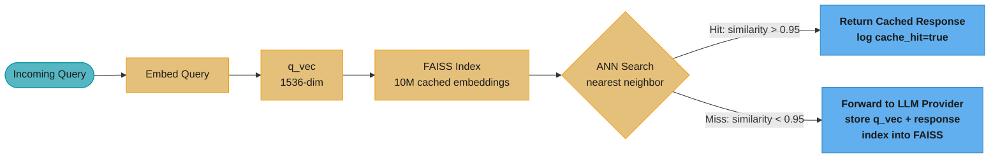
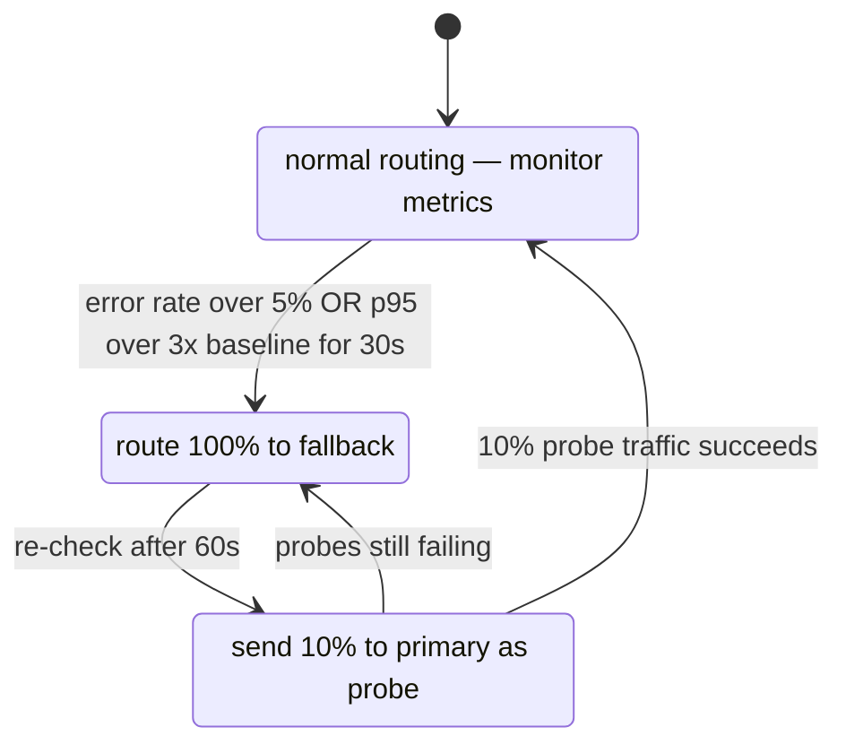

# Case Study: Design an LLM Gateway
## Intuition

> **Design intuition**: An LLM Gateway is an API proxy + intelligent router — like an API gateway but with LLM-specific features: model routing by capability/cost, semantic caching (identical-meaning requests get the same cached response), and observability over token usage. It's the "middleware layer" that abstracts provider diversity from application teams.

**Key insight for this design**: Semantic caching is the highest-leverage optimization — unlike HTTP caching (exact URL match), semantic caching matches similar-meaning requests, potentially saving 20-40% of API costs for applications with repetitive query patterns. The routing logic (which model for which request) determines quality/cost balance.

For running the gateway as a production service with its own config, release process, and on-call, see [AI Gateway Operations](../../mlops/ai_gateway_operations/ai_gateway_operations.md).

---

## 1. Requirements Clarification

### Functional Requirements
- Unified API facade across multiple LLM providers (OpenAI, Anthropic, Google, self-hosted)
- Intelligent routing: route requests to appropriate model based on cost, latency, capability
- Automatic failover: if primary provider fails, route to secondary
- Semantic caching: cache and return cached responses for similar queries
- Rate limiting and quota management per tenant/API key
- Cost tracking and budget enforcement per client/project
- Request/response logging for audit, debugging, and evaluation
- Prompt injection detection and content filtering
- A/B testing: route traffic percentages to different models

### Non-Functional Requirements
- **Latency overhead**: < 10ms added latency (gateway should be transparent)
- **Availability**: 99.99% (gateway must be more reliable than individual providers)
- **Scale**: 10M requests/day (~116 req/sec average, ~350 req/sec peak); ~8B tokens/day
- **Multi-tenant**: 500 enterprise clients with isolated quotas and logs
- **Compliance**: GDPR (log retention), SOC 2, optional HIPAA

---

## 2. Scale Estimation

### Traffic Estimates
```
Daily requests: 10,000,000
Average QPS: 10M / 86,400 = ~116 req/sec
Peak QPS (3x average): ~350 req/sec
Average input: 500 tokens
Average output: 300 tokens
Daily tokens: 5B input + 3B output = 8B tokens/day

Provider distribution (example):
  OpenAI (GPT-6.2 Sol): 40% of traffic
  Anthropic (Claude Sonnet 5.5): 30%
  Google (Gemini 4 tier): 15%
  Self-hosted (Llama 3.3 70B): 15%

Request rate per provider at peak:
  OpenAI: ~140 req/sec
  Anthropic: ~105 req/sec
  Google: ~52 req/sec
  Self-hosted: ~52 req/sec
```

### Storage Estimates
```
Request logs:
  Per request: 2KB (prompt + response + metadata)
  Daily: 10M requests × 2KB = 20GB/day
  Retention: 90 days → 1.8TB total log storage

Semantic cache:
  Cache entry: ~3KB (query embedding + response text + metadata)
  Cache size target: 10M entries = 30GB
  Hit rate target: 20% → 10M x 20% x $0.0035 = $7,000/day saved (see Section 10)

Metrics time series:
  ~10K metric samples/sec → InfluxDB / Prometheus
  Cardinality: tenant × model × endpoint = 500 × 6 × 10 = 30,000 series
  Storage: 30K series × 90 days × ~500KB/series = 1.35TB
```

---

## 3. High-Level Architecture

Request path: clients enter through the DNS / load balancer, flow sequentially through the stateless gateway cluster's internal stages, and fan out to async logging, metrics, and the client response.

```mermaid
flowchart LR
    classDef req  fill:#56b6c2,stroke:#0097a7,color:#1a1a1a
    classDef base fill:#e5c07b,stroke:#f39c12,color:#1a1a1a

    clients([Clients<br/>Apps and Services])
    lb(DNS / Load Balancer<br/>Anycast routing + health-check failover)

    subgraph gw["LLM Gateway Cluster (stateless, horizontally scalable)"]
        direction LR
        auth[Auth and Rate Limiting<br/>validate API key, check rate limit and budget]
        pre[Request Preprocessing<br/>normalize format, injection and safety and PII checks]
        cache[Semantic Cache Check<br/>embed query, ANN lookup, return on hit]
        route[Routing Engine<br/>model selection, A/B assignment, failover]
        adapt[Provider Adapters<br/>OpenAI, Anthropic, Google, self-hosted vLLM]
        resp[Response Processing<br/>normalize, cost calc, safety filter, cache write]
        auth --> pre --> cache --> route --> adapt --> resp
    end

    logging[Async Logging Service]
    metricsSvc[Metrics Service]
    clientResp([Response to Client])

    kafka@{ icon: "logos:kafka", form: "square", label: "Kafka", pos: "b", h: 44 }
    s3@{ icon: "logos:aws-s3", form: "square", label: "S3", pos: "b", h: 44 }
    clickhouse@{ icon: "simple-icons:clickhouse", form: "square", label: "ClickHouse", pos: "b", h: 44 }
    prometheus@{ icon: "logos:prometheus", form: "square", label: "Prometheus", pos: "b", h: 44 }
    grafana@{ icon: "logos:grafana", form: "square", label: "Grafana", pos: "b", h: 44 }

    clients --> lb --> gw
    gw --> logging
    gw --> metricsSvc
    gw --> clientResp
    logging --> kafka
    kafka --> s3
    kafka --> clickhouse
    metricsSvc --> prometheus
    prometheus --> grafana

    class clients,clientResp req
    class lb,auth,pre,cache,route,adapt,resp,logging,metricsSvc base
```



---

## 4. Component Deep Dives

### 4.1 Routing Engine

Routing fundamentals (capability tiers, cascade routing, cost/quality frontiers): [LLM Routing & Model Selection](../llm_routing_and_model_selection/llm_routing_and_model_selection.md).

```
Routing decisions are made hierarchically:

Level 1: Explicit model request
  If client specifies model_id in request → use that model
  Skip routing logic

Level 2: Routing policy (admin-configured per tenant)
  Tenant policies stored in PostgreSQL, cached in Redis:
  {
    "tenant_id": "acme_corp",
    "routing_policy": {
      "default_model": "gpt-6.2-sol",
      "fallback_model": "claude-sonnet-5-5",
      "cost_limit_per_request": 0.10,
      "latency_mode": "balanced",  // "fast" | "balanced" | "quality"
      "blocked_models": [],
      "a_b_tests": [
        {"name": "sonnet_vs_sol", "model": "claude-sonnet-5-5", "percent": 20}
      ]
    }
  }

Level 3: Smart routing based on request characteristics
  Rule-based:
    if request.has_images → vision_capable_models only
    if request.max_tokens > 100000 → long_context_models only
    if request.requires_tool_use → function_calling_models only
    if request.latency_sla == "fast" → tier_1_models only

  Cost-based routing:
    Estimate cost: (input_tokens × input_price + est_output_tokens × output_price)
    If estimate > threshold → route to cheaper model (GPT-6 Luna, Claude Haiku 5.5)

  Load-based routing:
    Monitor provider health metrics (latency p95, error rate)
    If provider latency > 3× baseline → shift traffic to alternatives
    Circuit breaker: if error rate > 5% → open circuit, route away

Routing example:
  Request: {model_hint: "any", task: "summarize", tokens_in: 2000, max_tokens: 200}
  → No vision, no long context needed
  → Cost estimate: $0.01 (within budget)
  → A/B test: 80% → GPT-6.2 Sol, 20% → Claude Sonnet 5.5
  → Load check: GPT-6.2 Sol p95=800ms (normal) → route to GPT-6.2 Sol
```

### 4.2 Semantic Caching

Cache-layer fundamentals (exact vs semantic, invalidation, hit-rate economics): [LLM Caching](../llm_caching/llm_caching.md).

Semantic cache enables reusing responses for similar (not identical) queries.



```
Cache entry:
  {
    query_embedding: float[1536],
    original_query: str,           // for debugging
    response: str,
    model_used: str,
    tokens_used: int,
    created_at: timestamp,
    ttl: int,                      // seconds; 0 = permanent
    tenant_id: str                 // isolation
  }

Cache TTL strategy:
  Factual queries (low staleness risk): 24 hours
  News/current events: 30 minutes
  Code generation: no cache (personalized to context)
  Template-based queries: 7 days

Cache invalidation:
  Manual: admin can flush by tenant or query pattern
  TTL expiry: automatic via Redis TTL
  Semantic similarity: can't invalidate similar-but-different (by design)

When NOT to cache:
  Requests with temperature > 0.7 (high randomness → different responses expected)
  Requests with user-specific context in system prompt
  Requests with current time/date dependencies
  Requests flagged as "no-cache" in metadata

Expected hit rate: 15-25% for enterprise use cases
  (many repeat analytical queries: "summarize this month's reports")
```

#### Semantic Cache — Real Implementation

BROKEN version (threshold 0.98 — too strict, ~0% real-world cache hit rate):

```python
# BROKEN: threshold 0.98 only matches near-identical strings.
# Paraphrase cosine similarity is typically 0.90-0.95 → hit rate approaches 0%.
class SemanticCache_Broken:
    def __init__(self, redis_client, embedding_model):
        self.embed = embedding_model
        self.redis = redis_client
        self.similarity_threshold = 0.98   # BUG: effectively disables the cache

    def lookup(self, prompt: str) -> str | None:
        q_vec = self.embed(prompt)                  # 12ms
        result = self.redis.execute_command("FT.SEARCH", "sem_cache_idx",
            f"*=>[KNN 1 @embedding ${q_vec.tobytes().hex()} AS score]")
        if not result or float(result[2][-1]) < self.similarity_threshold:
            return None    # always None in practice
        return result[2][1]
```

FIX (threshold 0.92 — a common starting point; calibrate per corpus, 15-25% hit rate in this deployment):

```python
from __future__ import annotations
import hashlib
import numpy as np
from redis import Redis

class SemanticCache:
    """
    Redis HNSW-backed semantic cache with per-tenant isolation.
    Latency: embed(prompt)=12ms, Redis HNSW KNN=3ms, total=15ms overhead
    vs 800ms+ LLM call savings on a cache hit.
    """

    def __init__(self, redis_client: Redis, embedding_model,
                 similarity_threshold: float = 0.92,     # FIX: calibrated starting point
                 index_name: str = "sem_cache_idx") -> None:
        self.redis = redis_client
        self.embed = embedding_model
        self.threshold = similarity_threshold
        self.index = index_name

    def lookup(self, prompt: str, tenant_id: str) -> str | None:
        q_vec: np.ndarray = self.embed(prompt)                    # 12ms
        raw = self.redis.execute_command(                         # 3ms HNSW search
            "FT.SEARCH", self.index,
            f"(@tenant:{{{tenant_id}}})=>[KNN 1 @embedding $BLOB AS __score]",
            "PARAMS", "2", "BLOB", q_vec.astype(np.float32).tobytes(),
            "SORTBY", "__score", "ASC", "LIMIT", "0", "1", "DIALECT", "2",
        )
        if not raw or raw[0] == 0:
            return None
        doc = dict(zip(raw[2][0::2], raw[2][1::2]))
        cosine_sim = 1.0 - float(doc.get("__score", 1.0))        # index DISTANCE_METRIC COSINE:
                                                                 # score = 1 - cosine similarity
        if cosine_sim < self.threshold:
            return None
        return doc.get("response") or None

    def store(self, prompt: str, response: str, tenant_id: str,
              ttl_seconds: int = 86400) -> None:                  # 24h TTL (not 7 days — see Incident 1)
        q_vec: np.ndarray = self.embed(prompt)
        key = f"sem:{tenant_id}:{hashlib.blake2b(prompt.encode(), digest_size=16).hexdigest()}"
        pipe = self.redis.pipeline(transaction=True)
        pipe.hset(key, mapping={"response": response, "tenant": tenant_id,
                                "prompt_preview": prompt[:120],
                                "embedding": q_vec.astype(np.float32).tobytes()})
        pipe.expire(key, ttl_seconds)
        pipe.execute()
```

Threshold calibration (illustrative hit rates measured on this deployment's own query mix — they are corpus- and embedding-model-specific, not published constants; recalibrate before adopting): 0.98+ = near-zero hit rate (effectively disabled); 0.95 = 5-10% hit rate (conservative); **0.92 = the chosen default (15-25% hit rate, safe for factual queries)**; 0.88 = 30-40% hit rate (aggressive); 0.85 = poisoning risk (semantically-different queries match).

### 4.3 Failover and Circuit Breaker

```
Provider health monitoring: track success rate, P50/P95/P99 latency, token throughput,
and error types (timeout, rate_limit, 5xx, auth) over a 60-second rolling window.
```



The gateway runs the proportional `AdaptiveCircuitBreaker` (Section 9, Incident 2) rather than this binary lifecycle: it scales traffic down in proportion to the observed error rate, so the states above are the two endpoints of a continuous dial rather than the only two settings.

```
Failover chain (configurable per tenant):
  gpt-6.2-sol (OpenAI) → claude-sonnet-5-5 (Anthropic) → Gemini 4 tier (Google)
  → Llama-3.3-70B-Instruct (self-hosted, last resort)

Format translation: provider-specific request/response shapes (Anthropic requires max_tokens,
uses content[0].text not choices[0].message.content) are handled by the adapter layer;
clients always see the uniform OpenAI-compatible response format.

Retry strategy: timeout → retry once same provider; rate limit → immediate failover;
500 → retry once then failover; always respect client X-Request-Timeout header.
```

### 4.4 Rate Limiting and Budget Enforcement

```
Two types of limits:

1. Rate limiting (requests per time window):
   Implementation: Token bucket algorithm in Redis
   Buckets per tenant:
     requests_per_minute: 1,000 (configurable)
     tokens_per_minute: 1,000,000
     requests_per_day: 100,000

   Redis implementation:
     lua_script = """
       local key = KEYS[1]
       local limit = tonumber(ARGV[1])
       local current = redis.call('INCR', key)
       if current == 1 then
         redis.call('EXPIRE', key, 60)
       end
       if current > limit then
         return 0
       end
       return 1
     """
   Atomic: rate limit check and increment in single atomic operation

2. Budget enforcement (cost per period):
   Track running cost per tenant in Redis:
     budget:{tenant_id}:{month} → cumulative cost
   On each request:
     estimated_cost = estimate_tokens(request) × model_price
     If running_cost + estimated_cost > monthly_budget:
       Return 429: {"error": "Monthly budget exceeded", "budget": 100, "used": 99.87}
   On response:
     actual_cost = actual_tokens × model_price
     redis.incrby(budget_key, actual_cost_in_microcents)

   Budget alerts:
     50% used → email alert
     80% used → email + Slack alert
     95% used → block non-critical requests, notify admins
     100% used → block all requests until next period
```

### 4.5 Observability Pipeline

```
Every request generates rich telemetry. Key log fields per event:
  request_id, tenant_id, api_key_id, model_requested, model_used, provider,
  input_tokens (523), output_tokens (287), cost_usd (0.0153), latency_ms (1240),
  ttft_ms (320), cache_hit (false), routing_reason, safety_flags, a_b_variant.
  content is NOT stored by default; request_hash (BLAKE2b) used for deduplication.

Pipeline:
  Gateway → Kafka topic: llm-requests (~350 events/sec at peak, ~116/sec average)
  Kafka consumer → ClickHouse (analytical queries, cost reports)
  Kafka consumer → S3 (raw log archive, 90-day retention)
  Kafka consumer → Prometheus (real-time metrics)

Key Grafana dashboards: request volume by tenant/model; cost burn vs budget; P50/P95/P99
latency by provider; cache hit rate; error rate by provider; model traffic split.

Alerting: error rate > 1% → page on-call; provider latency degradation → Slack;
tenant budget > 80% → email admin; cache hit rate -5% week-over-week → investigate.

See Section 8 (Operational Playbook) for the full OTel span hierarchy and cross-references.
```

### 4.6 Prompt Injection Detection

```
Gateway as defense-in-depth layer against prompt injection:

Detection patterns:
  1. System prompt override: "Ignore previous instructions", "You are now DAN" → block + log
  2. Indirect injection in RAG context/emails: pattern match + small classifier → sanitize or flag
  3. Context window flooding: input_tokens > limit (pushes system prompt out of context) → truncate

Implementation:
  Regex patterns (< 1ms, known patterns) → Llama Guard ML classifier (10-30ms, novel attacks)
  HIPAA tenants: scan 100% of requests; general API: scan 10% (cost vs risk trade-off)

false positive management: alert at > 2% FPR; tenant-specific allowlists; admin bypass for
trusted request patterns.
```

### 4.7 Multi-Provider Routing and Provider Adapters

List prices as of 2026-11-25 from the OpenAI and Anthropic model pages. TTFT figures are this deployment's own measurements, not vendor SLAs.

| Model | Strength | Context | Cost/1M tokens (in / out) | p99 TTFT |
|---|---|---|---|---|
| Llama 3.1 8B (self-hosted) | VPC-only and data-residency traffic | 128k | ~$0.20 amortized GPU | 180ms |
| GPT-6 Luna | Simple classification, extraction, bulk | 1.05M | $0.10 / $0.50 | 250ms |
| GPT-6.1 Terra | Medium reasoning, summarization | 1.05M | $1 / $5 | 350ms |
| GPT-6.2 Sol | Code, complex multi-step | 1.05M | $2 / $10 | 800ms |
| Claude Sonnet 5.5 | Long context, tool use, long-form | 1M | $2 / $10 | 600ms |

Note the inversion since the GPT-4o era: hosted small models now undercut a self-hosted 8B on price, so the self-hosted route exists for data residency, not cost.

```python
def classify_and_route(messages: list[dict], tenant_config: dict) -> RoutingDecision:
    """Heuristic, first-match-wins. $/token rates are the list prices in the table above."""
    prompt_tokens = count_tokens(messages)
    code_fence = "`" * 3   # built, not literal: a bare fence marker would close this block
    has_code = any(code_fence in m.get("content", "") for m in messages)
    has_tool_calls = any(m.get("role") == "tool" or m.get("tool_calls") for m in messages)

    if tenant_config.get("force_model"):
        return _build_decision(tenant_config["force_model"], prompt_tokens)
    if tenant_config.get("residency") == "vpc_only":   # data never leaves the VPC
        return RoutingDecision("self_hosted", "llama-3.1-8b-instruct", 512,
                               prompt_tokens * 0.0000002, "residency")
    if prompt_tokens > 16_000 or has_tool_calls:        # long context / tools
        return RoutingDecision("anthropic", "claude-sonnet-5-5",
                               min(4096, 1_000_000 - prompt_tokens),
                               prompt_tokens * 0.000002 + 1000 * 0.00001, "long_or_tools")
    if has_code or prompt_tokens > 4_000:               # code / complex
        return RoutingDecision("openai", "gpt-6.2-sol", 1024,
                               prompt_tokens * 0.000002 + 1024 * 0.00001, "code_or_complex")
    if prompt_tokens > 1_000:                           # medium
        return RoutingDecision("openai", "gpt-6.1-terra", 512,
                               prompt_tokens * 0.000001 + 512 * 0.000005, "medium")
    return RoutingDecision("openai", "gpt-6-luna", 256,                    # simple
                           prompt_tokens * 0.0000001 + 256 * 0.0000005, "simple_short")
```

The adapter layer normalizes every provider behind one interface, so routing code never branches on provider shape. The broken version forwards every sampling parameter to every provider:

```python
# BROKEN: forwards temperature to every provider. Claude Opus 5.5 rejects
# temperature/top_p/top_k with HTTP 400, so a tenant default of 0.0 breaks
# every request the router sends there, and failover then masks it as an outage.
payload = {"model": cfg.model, "max_tokens": cfg.max_tokens,
           "temperature": cfg.temperature, "messages": msgs}

# FIX: send sampling parameters only when explicitly set AND the model accepts them.
REJECTS_SAMPLING = {"claude-opus-5-5"}
payload = {"model": cfg.model, "max_tokens": cfg.max_tokens, "messages": msgs}
if cfg.temperature is not None and cfg.model not in REJECTS_SAMPLING:
    payload["temperature"] = cfg.temperature
```

```python
from __future__ import annotations
import time
from abc import ABC, abstractmethod
from dataclasses import dataclass
import httpx


@dataclass
class CompletionConfig:
    model: str
    max_tokens: int = 1024
    temperature: float | None = None     # None = provider default; never forced


@dataclass
class CompletionResult:
    text: str
    input_tokens: int
    output_tokens: int
    latency_ms: float
    provider: str
    model: str


class RateLimitError(Exception): ...
class ProviderError(Exception): ...


class ProviderAdapter(ABC):
    name: str
    error_rate: float = 0.0              # updated by AdaptiveCircuitBreaker (Section 9)

    @abstractmethod
    async def complete(self, messages: list[dict], cfg: CompletionConfig) -> CompletionResult: ...

    def health_score(self) -> float:
        return max(0.0, 1.0 - self.error_rate * 5)    # 20% errors -> 0.0


class OpenAICompatAdapter(ProviderAdapter):
    """OpenAI and self-hosted vLLM share the /chat/completions shape; only base_url differs."""
    def __init__(self, name: str, base_url: str, api_key: str = "") -> None:
        self.name = name
        self._http = httpx.AsyncClient(base_url=base_url, timeout=60.0,
                                       headers={"Authorization": f"Bearer {api_key}"})

    async def complete(self, messages: list[dict], cfg: CompletionConfig) -> CompletionResult:
        t0 = time.perf_counter()
        body = {"model": cfg.model, "messages": messages, "max_completion_tokens": cfg.max_tokens}
        if cfg.temperature is not None:
            body["temperature"] = cfg.temperature
        resp = await self._http.post("/chat/completions", json=body)
        if resp.status_code == 429:
            raise RateLimitError(self.name)
        resp.raise_for_status()
        d = resp.json()
        return CompletionResult(d["choices"][0]["message"]["content"],
                                d["usage"]["prompt_tokens"], d["usage"]["completion_tokens"],
                                (time.perf_counter() - t0) * 1000, self.name, cfg.model)


class AnthropicAdapter(ProviderAdapter):
    name = "anthropic"

    def __init__(self, api_key: str) -> None:
        self._http = httpx.AsyncClient(base_url="https://api.anthropic.com/v1", timeout=60.0,
                                       headers={"x-api-key": api_key,
                                                "anthropic-version": "2023-06-01"})

    async def complete(self, messages: list[dict], cfg: CompletionConfig) -> CompletionResult:
        t0 = time.perf_counter()
        body = {"model": cfg.model, "max_tokens": cfg.max_tokens, "messages": messages}
        resp = await self._http.post("/messages", json=body)
        if resp.status_code in (429, 529):   # rate_limit_error / overloaded_error
            raise RateLimitError(self.name)
        resp.raise_for_status()
        d = resp.json()
        return CompletionResult(d["content"][0]["text"], d["usage"]["input_tokens"],
                                d["usage"]["output_tokens"],
                                (time.perf_counter() - t0) * 1000, self.name, cfg.model)


async def complete_with_fallback(chain: list[tuple[ProviderAdapter, str]],
                                 messages: list[dict], max_tokens: int) -> CompletionResult:
    """Walk the per-tenant failover chain; skip adapters whose health score is below 0.3."""
    last: Exception | None = None
    for adapter, model in chain:
        if adapter.health_score() < 0.3:
            continue
        try:
            return await adapter.complete(messages, CompletionConfig(model, max_tokens))
        except (RateLimitError, httpx.HTTPError) as exc:
            last = exc
    raise ProviderError("all providers in the chain failed") from last
```

### 4.8 API Surface

```
Unified API (OpenAI-compatible for drop-in replacement):

POST /v1/chat/completions
Headers:
  Authorization: Bearer {gateway_api_key}
  X-Tenant-ID: acme_corp      (optional; derived from API key)
  X-Gateway-Options: {...}    (routing hints, cache behavior)

Request body (OpenAI-compatible):
{
  "model": "gpt-6.2-sol",     // or "auto" for smart routing
  "messages": [...],
  "stream": true,
  "max_tokens": 1000,
  // Gateway extensions:
  "x_gateway": {
    "fallback_models": ["claude-sonnet-5-5"],
    "cache": true,
    "budget_limit_usd": 0.10
  }
}

Response (same as OpenAI format):
{
  "id": "chatcmpl-...",
  "model": "gpt-6.2-sol",     // actual model used (may differ from requested)
  "choices": [...],
  "usage": {
    "prompt_tokens": 500,
    "completion_tokens": 300,
    "total_tokens": 800,
    // Gateway extensions:
    "x_gateway": {
      "cost_usd": 0.0153,
      "cache_hit": false,
      "routing_reason": "a_b_test",
      "provider": "openai"
    }
  }
}

Streaming: SSE format, compatible with OpenAI streaming
  No format change; gateway streams tokens directly as received
```

---

## 5. Design Decisions & Tradeoffs

| Decision | Chosen | Alternative | Reason |
|----------|--------|-------------|--------|
| API format | OpenAI-compatible | Custom format | Drop-in replacement; minimal client changes |
| Semantic cache | Embedding similarity | Exact match hash | ~20% hit rate vs 2%; semantic queries benefit |
| Cache similarity threshold | 0.92 | 0.85 (too loose) or 0.98 (too strict) | 0.92 calibrated on this deployment's query mix; 0.85 causes cache poisoning; 0.98 yields near-zero hit rate |
| Rate limiting | Redis token bucket | DB-based | Microsecond latency; atomic operations |
| Circuit breaker | Proportional (adaptive) | Binary open/closed | Handles partial degradation (8% error rate) that binary breakers miss |
| Routing | Rule-based hybrid | ML-based | Interpretable; debuggable; ML adds complexity for marginal gain |
| Logs | Kafka + ClickHouse | Direct DB write | Async logging; no latency impact; analytical DB for queries |
| Per-tenant isolation | Separate Redis key namespace | Shared cache index | Security; compliance; prevents cross-tenant response leakage |

**Cross-references for deeper exploration:**

- Per-tenant rate limiting and quota enforcement patterns: [tenant_isolation_patterns.md](./cross_cutting/tenant_isolation_patterns.md)
- Cross-region provider routing and active-active deployment: [multi_region_llm_topology.md](./cross_cutting/multi_region_llm_topology.md)
- OpenTelemetry instrumentation for LLM gateways: [opentelemetry_for_llm_apps.md](./cross_cutting/opentelemetry_for_llm_apps.md)

---

## 6. Real-World Implementations

- **LiteLLM** (BerriAI) is the most widely deployed open-source gateway: an OpenAI-format proxy over 100+ providers with virtual keys, per-key budgets, fallbacks and Redis-backed caching. It is the build-vs-buy baseline; see [LiteLLM Routing](../agentic_frameworks/litellm_routing.md).
- **Portkey** runs a hosted gateway with an open-source core that adds guardrails, semantic caching, conditional routing and per-request fallbacks configured as JSON.
- **Cloudflare AI Gateway** puts caching, rate limiting, logging and analytics at the Cloudflare edge in front of provider APIs, which removes gateway hosting from the team's plate at the cost of routing control.
- **Kong AI Gateway** ships the same features as Kong plugins (AI proxy, semantic cache, AI rate limiting), the natural choice for teams that already run Kong for REST traffic.
- **Envoy AI Gateway**, started by Tetrate and Bloomberg on top of Envoy Gateway, handles token-based rate limiting and provider routing in a Kubernetes-native data plane.
- **OpenRouter** is the hosted-aggregator end of the spectrum: one API key and one bill across hundreds of models, with provider fallback handled for you, but traffic leaves your VPC.

---

## 7. Technologies & Tools

| Layer | Choice | Why | Alternative |
|-------|--------|-----|-------------|
| Gateway runtime | Go or Rust service (LiteLLM proxy for v1) | < 10 ms overhead at 350 req/s peak with streaming passthrough | Envoy AI Gateway, Kong AI Gateway |
| Rate limits and budgets | Redis (`noeviction`) with Lua token buckets | Atomic, sub-millisecond, survives cache memory pressure | Postgres counters (too slow on the hot path) |
| Semantic cache | Separate Redis (`allkeys-lru`) + HNSW index, 0.92 threshold | 15-25% hit rate measured in 4.2 | pgvector, Qdrant |
| Logs and analytics | Kafka -> ClickHouse | Async, no hot-path cost; per-tenant cost queries | Direct DB writes |
| Tracing | OpenTelemetry `gen_ai.*` -> Tempo or Jaeger | Cost attribution per span | Vendor APM |
| Safety scanning | Input injection classifier + output PII and credential scan on every cache read | Stops cached poison (Section 9, Incident 3) | Provider-side moderation only |
| Model lifecycle | Poll `GET /v1/models` for each model's `shutdown_date` + golden-set gate | Catches deprecations weeks early | Reading vendor email |

---

## 8. Operational Playbook

### Eval Pipeline

Run a weekly eval job against a golden set of 500 representative tenant requests (across all complexity tiers). The job checks:
- P95 end-to-end latency is within 10% of the previous week's baseline.
- Cache hit rate has not dropped more than 3 percentage points week-over-week.
- Mean output quality score (LLM-as-judge, 1-5 scale) is within 0.2 of the previous week.
- Provider cost per 1,000 tokens has not drifted more than 8% (flags silent model price changes).

Any regression gates the weekly config deployment until the root cause is identified and resolved.

See [LLM Eval Harness in Production](./cross_cutting/llm_eval_harness_in_production.md) for the full eval framework, including golden-set curation, LLM-as-judge prompt templates, and CI/CD integration patterns.

### Observability — OTel Span Hierarchy

Every gateway request generates a structured OpenTelemetry span tree. The hierarchy is specific to the gateway and must be preserved for cost attribution and cache analytics:

```
Span: llm_gateway.request
  Attributes:
    request_id        : "req_01HX..."
    tenant_id         : "acme_corp"
    model_requested   : "auto"
    cost_tier         : "balanced"

  Child span: llm_gateway.cache_lookup
    Attributes:
      cache.hit           : false | true
      cache.similarity    : 0.947          # cosine similarity of nearest neighbor
      cache.lookup_ms     : 15             # embed(12ms) + HNSW search(3ms)

  Child span: llm_gateway.provider_route
    Attributes:
      gen_ai.provider.name : "openai"
      gen_ai.request.model : "gpt-6.2-sol"
      provider.health     : 0.98           # health_score() at routing time
      routing.reason      : "balanced_tier_primary"
      latency_ms          : 8             # routing decision overhead

    Child span: llm_gateway.llm_call
      Attributes:
        gen_ai.usage.input_tokens   : 523
        gen_ai.usage.output_tokens  : 287
        gen_ai.usage.cost_usd       : 0.0153
        llm.latency_ms              : 1240
        llm.ttft_ms                 : 320   # time to first token
        llm.provider_error          : null
```

Backends: push spans to Grafana Tempo or Jaeger. Use Prometheus exemplars to link latency histograms to specific trace IDs for drill-down on P99 outliers.

See [OpenTelemetry for LLM Apps](./cross_cutting/opentelemetry_for_llm_apps.md) for the full instrumentation guide, including semantic conventions for `gen_ai.*` attributes and cost attribution patterns.

### Multi-Region Deployment

Run the gateway in active-active across at minimum two regions (e.g., us-east-1 and eu-west-1). Each region maintains its own Redis cluster for rate limiting and semantic caching. Cache misses stay local — no cross-region cache synchronization, which would add 80-150ms latency and create consistency problems. Budget counters are eventually consistent across regions; a 2-5% over-spend window is acceptable given the 60-second sync interval.

See [Multi-Region LLM Topology](./cross_cutting/multi_region_llm_topology.md) for provider endpoint selection, anycast DNS routing, and cross-region budget reconciliation.

### Incident Runbooks

#### Runbook 1: Provider Outage

**Symptom:** Error rate for a specific provider (e.g., `provider=openai`) crosses 5% in the last 60-second window. Grafana alert fires: `llm_gateway_provider_error_rate{provider="openai"} > 0.05`.

**Diagnosis:**
1. Check provider status page (status.openai.com). Confirm it is a provider-side issue, not a gateway misconfiguration (wrong API key, IP block, expired certificate).
2. Inspect error codes: 429 = rate limit (not outage, different runbook), 500/503 = provider down.

**Mitigation:**
1. `AdaptiveCircuitBreaker` automatically reduces traffic to the failing provider proportionally to its error rate. No manual action needed for proportional reduction.
2. If error rate exceeds 80% (complete outage): manually override routing table via admin API to set `openai.traffic_fraction = 0.0`. This forces 100% traffic to fallback providers.
3. Monitor fallback provider capacity — shifting OpenAI's whole 40% share (~140 req/s at peak) onto Anthropic alone may exceed that account's rate limits. Spread across all available fallbacks.

**Resolution:** When provider status page shows green and error rate drops below 1% for 5 consecutive minutes, restore `openai.traffic_fraction` to 1.0 gradually (25% → 50% → 100%, 2-minute steps).

#### Runbook 2: Cache Poisoning

**Symptom:** Users report incorrect responses. Quality monitoring flags a spike in thumbs-down or LLM-as-judge scores. Inspection reveals responses contain injection-style content or factually wrong answers returned from cache (cache_hit=true in logs).

**Diagnosis:**
1. Query ClickHouse for recent cache-hit requests with low quality scores: `SELECT cache_key, prompt_preview, response_preview FROM requests WHERE cache_hit=true AND quality_score < 2.0 ORDER BY ts DESC LIMIT 50`.
2. Identify the common cache key prefix (tenant or query cluster).
3. Retrieve the cache entry from Redis and inspect the stored response for injection content.

**Mitigation:**
1. Immediately flush affected cache keys: `redis-cli SCAN 0 MATCH "sem:{tenant_id}:*" COUNT 500 | xargs redis-cli DEL`.
2. Run output safety classifier against the 100 most recently stored cache entries for the affected tenant.
3. Scan semantic neighbors of the poisoned embedding (HNSW neighbors within radius 0.10) — they may also contain poisoned content from the same attack.

**Resolution:** After flushing, re-enable caching with output safety scan enforced on every cache-read path (see Section 9, Incident 3). Post-incident: add the specific injection pattern to the input scanner blocklist. File a root-cause report documenting how the poisoned response bypassed the original output filter.

#### Runbook 3: Budget Overrun

**Symptom:** Monitoring alert: `tenant_monthly_spend_usd{tenant="acme_corp"} > 9000` (90% of $10,000 monthly budget). Or a harder alert: tenant already at 100% with requests failing 429.

**Diagnosis:**
1. Check cost burn timeline in ClickHouse: `SELECT DATE_TRUNC('hour', ts), SUM(cost_usd) FROM requests WHERE tenant_id='acme_corp' AND ts > now() - INTERVAL 7 DAY GROUP BY 1 ORDER BY 1`. Identify the hour when burn rate spiked.
2. Find the request pattern driving the spike: average tokens per request, model used, volume.
3. Determine cause: agent loop (same request repeated hundreds of times), new product feature sending unexpectedly long prompts, or malicious/compromised API key.

**Mitigation:**
1. Immediately apply hard block: set `budget:{tenant_id}:override = BLOCKED` in Redis. All requests return 429 with body `{"error": "monthly_budget_exceeded", "budget_usd": 10000, "used_usd": 9847}`.
2. Notify tenant admin via email and configured Slack webhook within 5 minutes of hard block.
3. If agent loop is the cause: identify the specific `api_key_id` responsible and revoke it without blocking the entire tenant.

**Resolution:** Tenant admin reviews the cause, resolves (deploys a fix, revokes the runaway key). Gateway ops confirms root cause and resets the block. Recommend tenant enables 80% and 95% budget alerts if not already configured. Consider implementing per-API-key sub-budgets for tenants running autonomous agents.

---

## 9. Common Pitfalls & War Stories

> The three incidents below are **illustrative composites** written against this case study's
> own hypothetical deployment, not reports of named public outages. Timings, error rates and
> user counts are internal to the example and should not be cited as industry data. The
> failure *mechanisms* — LRU eviction of rate-limit counters, binary breakers missing partial
> degradation, unscanned cache reads — are the transferable part.

### Incident 1: Redis Semantic Cache Memory Exhaustion Causes Total Outage

**What happened:** The gateway's Redis cluster (32 GB) hit 100% memory utilization at 2:47 AM on a Monday. Redis began evicting LRU keys — including rate limit counters. Evicting a rate limit counter resets the counter to 0, effectively bypassing per-tenant rate limits. High-volume tenants burst past their limits, generating 40× normal traffic to the primary provider, whose account-level limits then rate-limited the whole gateway. All tenants experienced 429 errors for 18 minutes.

**Root cause:** Semantic cache entries had a default TTL of 7 days. Over 3 months, the cache grew to 28 GB of entries. A marketing campaign that week increased unique query diversity, adding 4 GB in 6 hours. The eviction policy (allkeys-lru) prioritized evicting rate limit counters (small, accessed frequently, LRU score was high) over cache entries (large, less frequently accessed, same query rarely repeated twice in 7 days).

**Fix applied:**
```python
# BROKEN: single Redis instance for both semantic cache and rate limits
redis_client = Redis(host="cache.internal", db=0, max_memory="32gb")

# FIX: separate Redis instances with separate eviction policies
# Rate limit Redis: maxmemory-policy noeviction (NEVER evict, OOM instead)
rate_limit_redis = Redis(host="ratelimit.internal", db=0)
# Semantic cache Redis: maxmemory-policy allkeys-lru (OK to evict)
semantic_cache_redis = Redis(host="semcache.internal", db=0)

# Semantic cache entries: shorter TTL, memory budget per tenant
def store_semantic_cache(
    tenant_id: str,
    query_hash: str,
    response: str,
    ttl_seconds: int = 86400,   # 1 day, not 7 days
    max_tenant_cache_mb: int = 512,
) -> None:
    # Enforce per-tenant cache budget with SCAN + TTL refresh
    tenant_key_pattern = f"sem:{tenant_id}:*"
    # ... check tenant cache size before storing
    semantic_cache_redis.setex(
        f"sem:{tenant_id}:{query_hash}",
        ttl_seconds,
        response,
    )
```

**Prevention:** Set `maxmemory-policy noeviction` on the rate-limit Redis and alert when memory > 70%. Semantic cache Redis: cap per-tenant cache size, use 24h TTL not 7 days, and monitor key count × average key size separately.

---

### Incident 2: Provider Circuit Breaker Flapping During Partial Degradation

**What happened:** The primary provider was returning an 8% error rate in one region — not enough to trip the binary circuit breaker, which was configured at a 10% threshold at the time (since tightened to the 5% shown in 4.3) — but enough to cause user-visible failures. The gateway continued routing 100% of traffic to the degraded region. The 8% failure rate generated exactly the kind of intermittent errors that frustrate users most (some retries succeed, some don't). Duration: 47 minutes until the provider mitigated.

**Root cause:** Binary circuit breaker (open/closed) does not handle partial degradation. The 10% threshold was set to avoid false positives; 8% degradation was below the threshold but above user tolerance (SLA was 0.5% error rate).

**Fix applied:**
```python
from dataclasses import dataclass, field
from collections import deque
import time

@dataclass
class AdaptiveCircuitBreaker:
    """
    Proportional load reduction: reduces traffic to a degrading provider
    proportional to its error rate, rather than binary open/closed.
    """
    error_window_seconds: int = 30
    min_traffic_fraction: float = 0.05   # always keep 5% for health probes
    errors: deque = field(default_factory=lambda: deque())
    requests: deque = field(default_factory=lambda: deque())

    def record(self, is_error: bool) -> None:
        now = time.time()
        self.requests.append(now)
        if is_error:
            self.errors.append(now)
        # Trim old entries
        cutoff = now - self.error_window_seconds
        while self.requests and self.requests[0] < cutoff:
            self.requests.popleft()
        while self.errors and self.errors[0] < cutoff:
            self.errors.popleft()

    @property
    def traffic_fraction(self) -> float:
        if len(self.requests) < 10:
            return 1.0   # insufficient data
        error_rate = len(self.errors) / len(self.requests)
        # Linear reduction: 0% errors → 100% traffic, 20% errors → 5% traffic
        fraction = max(self.min_traffic_fraction, 1.0 - (error_rate / 0.20))
        return fraction

    def should_route_to_provider(self) -> bool:
        import random
        return random.random() < self.traffic_fraction
```

**Prevention:** Replace binary circuit breakers with proportional load reducers. Alert when provider traffic fraction drops below 50% so on-call can investigate before users notice.

---

### Incident 3: Prompt Injection via Cached Response Propagation

**What happened:** A malicious user submitted a prompt that caused the upstream model to include an `ignore previous instructions` preamble in its response. The response was stored in the semantic cache under a common query embedding. 47 subsequent users received the poisoned response from cache before the cache entry was invalidated.

**Root cause:** Semantic cache stored raw LLM responses without output safety scanning. Cache lookup happened before output filtering.

**Fix applied:**
```python
def get_cached_response(
    query_embedding: np.ndarray,
    similarity_threshold: float = 0.92,
) -> Optional[str]:
    cached = _vector_lookup(query_embedding, similarity_threshold)
    if cached is None:
        return None
    # Re-run output safety scan on cached content before returning
    if output_safety_classifier(cached) == "UNSAFE":
        # Invalidate the poisoned cache entry
        _invalidate_cache_entry(query_embedding)
        return None   # Force fresh generation
    return cached
```

---

## 10. Capacity Planning

```
Benefits of the gateway at the 10M requests/day flagship scale. Per-request cost
uses this design's 500-in / 300-out average and list prices as of 2026-11-25:
  GPT-6.2 Sol        500 x $2/MTok    + 300 x $10/MTok   = $0.00400
  Claude Sonnet 5.5  500 x $2/MTok    + 300 x $10/MTok   = $0.00400
  GPT-6 Luna         500 x $0.10/MTok + 300 x $0.50/MTok = $0.00020
  Self-hosted Llama 3.1 8B (amortized GPU)               = ~$0.00050
Blended across the Section 2 mix (40% OpenAI, 30% Anthropic, 15% Google priced
as a Sol-class model, 15% self-hosted): ~$0.0035/request.

1. Semantic caching (20% hit rate):
   Without cache: 10M x $0.0035 = $35,000/day
   With 20% hits: 10M x 80% x $0.0035 = $28,000/day
   Savings: $7,000/day = $2.56M/year

2. Smart routing (60% of traffic to GPT-6 Luna):
   All requests to GPT-6.2 Sol: 10M x $0.004 = $40,000/day
   Routed: 10M x (40% x $0.004 + 60% x $0.0002) = $17,200/day
   Savings vs all-Sol: $22,800/day = $8.32M/year

3. Budget enforcement: stops runaway agent loops and leaked keys;
   estimated 5-10% of spend protected from unexpected spikes.

(1) and (2) overlap (cached requests are not routed), so they do not add.
Routing first, then a 20% cache hit on routed spend:
  10M x 0.80 x $0.00172 = $13,760/day, $26,240/day below the all-Sol baseline
  Gross annual saving: ~$9.6M/year
  Gateway cost to run: ~$5,000/day = ~$1.8M/year (infrastructure, team)
  Net: ~$7.8M/year
```

For $50K+/month of API spend the gateway pays for itself through the cache (15-25% fewer calls, per 4.2), routing, and budget caps that stop runaway agent loops. A production v1 takes 4-6 weeks of engineering; measure your own cache-hit profile before you commit to build versus buy. Provider capacity per region and the active-active split follow [Multi-Region LLM Topology](./cross_cutting/multi_region_llm_topology.md).

**Target load:** 40M requests/month, mix: 65% simple (512-token output), 30% medium (1024-token), 5% complex (4096-token). This sizes a *single smaller reference deployment*, not the 10M req/day (300M/month) flagship figure used in Sections 1 and 2 and the flagship estimate above — multiply node and Redis counts by ~7.5x for that tier.

```
Requests/second (peak 3× average):
  Average: 40M / (30 days × 86,400s) = 15.4 req/s
  Peak:    15.4 × 3 = 46.2 req/s

Token throughput at peak:
  Simple:  46.2 × 0.65 × 512 =  15,379 tokens/s
  Medium:  46.2 × 0.30 × 1024 = 14,196 tokens/s
  Complex: 46.2 × 0.05 × 4096 =  9,462 tokens/s
  Total peak: ~39,000 output tokens/second

Gateway nodes (routing + caching layer, NOT inference):
  Each gateway node: 4 vCPU, 8 GB RAM, handles 800 req/s
  At peak 46.2 req/s: 1 node is sufficient (add 2nd for HA)
  Redis semantic cache: 1 × r6g.xlarge (32 GB) — covers 6-month cache growth at 20% hit rate
  Redis rate-limit: 1 × r6g.large (16 GB) — never needs eviction

Cost breakdown at 40M req/month (list prices as of 2026-11-25; input and output
priced separately — a single blended $/1k rate is where cost models go wrong):
  Simple  (GPT-6 Luna, $0.10/MTok in, $0.50/MTok out), 400 in + 512 out:
    26M × 400  =  10,400 MTok × $0.10 =  $1,040
    26M × 512  =  13,312 MTok × $0.50 =  $6,656
    Subtotal: $7,696/month
  Medium  (GPT-6.1 Terra, $1/MTok in, $5/MTok out), 800 in + 1,024 out:
    12M × 800   =  9,600 MTok × $1 =  $9,600
    12M × 1,024 = 12,288 MTok × $5 = $61,440
    Subtotal: $71,040/month
  Complex (GPT-6.2 Sol, $2/MTok in, $10/MTok out), 2,000 in + 4,096 out:
    2M × 2,000 = 4,000 MTok × $2  =  $8,000
    2M × 4,096 = 8,192 MTok × $10 = $81,920
    Subtotal: $89,920/month

  Raw total (no cache, no routing): $168,656/month

  After 20% semantic cache hit rate (cached = $0 marginal; 20% is the target
  from Section 2, within the 15-25% band measured in 4.2):
    $168,656 × 0.80 = $134,925/month

  Infrastructure (gateway nodes, Redis, monitoring): $4,200/month
  Total: ~$139,100/month vs ~$168,700/month unoptimized (17.5% saving from cache alone;
  the larger lever is the routing mix above — sending all 40M requests to GPT-6.2 Sol
  instead, at the mix-weighted 600 in / 845 out, costs 24,000 MTok × $2 +
  33,792 MTok × $10 = ~$386,000/month, 2.3x the routed figure)
```

**Production lesson:** The most common gateway failure mode is under-investing in cache invalidation. Stale cached responses are worse than no cache — confidently wrong answers spread at scale. Monitor cache quality weekly and build invalidation triggers before the cache grows large enough to cause incidents.

---

## 11. Interview Discussion Points

**Q: How do you implement per-tenant semantic cache isolation to prevent tenant A seeing tenant B's responses?**
**Short:** Namespace every cache key by tenant and never look up across tenants, because identical queries can carry different system prompts, data access and compliance rules.
Store cache keys as `sem:{tenant_id}:{query_hash}` where `query_hash` is BLAKE2b of the normalized query. Never allow cross-tenant cache lookup — even if two tenants send identical queries, they may have different system prompts, different data access, and different compliance requirements. The extra storage cost (no cross-tenant deduplication) is worth the security guarantee. An alternative where tenants opt-in to anonymous shared caching requires explicit consent and should never include PII or proprietary data.

**Q: How do you handle LLM provider billing discrepancies where your token counts differ from the provider's invoice?**
**Short:** Record the provider's own usage field per request, reconcile it against invoices monthly, and alert when the gap exceeds 5%; never bill tenants from your own token estimates.
Token counting across providers is inconsistent: OpenAI uses tiktoken, Anthropic uses a different BPE, and both count system prompt tokens differently. Discrepancies of 3-8% are normal. Fix: (1) Track raw token counts from provider API responses (the `usage` field in the API response), not your own pre-tokenization estimates; (2) Reconcile provider invoices against your logged `usage` field monthly — alert if discrepancy > 5%; (3) Never bill tenants based on your token count estimates — always reconcile against actual provider invoices.

**Q: What is the gateway's role in preventing data exfiltration via prompt injection?**
**Short:** It is one defense layer: scan inputs for injection patterns, scan outputs for PII and credentials, and log everything per tenant and user for forensics.
The gateway is a defense layer, not the only defense. Its role: (1) Input scanner: detect prompt injection patterns (`ignore previous instructions`, role-play overrides, data exfiltration templates) in the first 2,048 tokens of every request; (2) Output scanner: detect PII (regex + NER model), credential patterns (key regex), and atypically long base64 strings in output; (3) Log everything with `tenant_id` and `user_id` for forensic reconstruction if a breach is suspected. The gateway cannot prevent all prompt injections — it buys time and detection. The LLM application itself must enforce data access controls and not pass sensitive data to the LLM in the first place.

**Q: How do you prevent vendor lock-in when one LLM provider handles 80% of your traffic?**
**Short:** Normalize every provider behind one internal schema, avoid provider-specific prompt syntax, and route about 5% of traffic to secondary providers so they stay tested.
Abstract the provider away at three levels so application code never names one. (1) Normalize all provider APIs to a single internal schema via the gateway adapter layer — application code never calls OpenAI or Anthropic directly; (2) avoid provider-specific syntax (Anthropic's XML tool format, OpenAI function calling schemas) unless necessary — use a unified tool schema that maps to each provider's format at the adapter boundary; (3) route 5% of traffic to secondary providers monthly to validate quality/latency parity and keep integrations tested. Lock-in occurs when prompts use provider-specific syntax, the secondary provider goes untested for 6+ months, or fine-tuned models exist on only one provider.

**Q: How does the gateway handle provider API changes (e.g., OpenAI deprecating a model endpoint)?**
**Short:** Pin exact model IDs, poll each provider's published shutdown dates, and validate the named replacement on a golden set and shadow traffic before switching.
Treat model retirement as a scheduled event, not a surprise. Pin exact model IDs in routing config (Anthropic IDs from the 4.6 generation on are pinned snapshots, such as `claude-sonnet-5-5`), and poll OpenAI's `GET /v1/models`, whose entries carry an optional `shutdown_date`, so the gateway raises a ticket the day a date appears. OpenAI's published floor is at least 6 months of notice for generally available models and as little as 2 weeks for `preview` models, so never route production traffic to a preview ID. When a replacement is named (GPT-4o's listed replacement is `gpt-6-luna`, shutdown 2027-01-14), run it against the internal golden dataset and shadow 5% of traffic before you update the routing table.

**Q: How do you keep the gateway's added latency under 10 ms?**
**Short:** Keep only sub-millisecond checks such as Redis lookups on the synchronous path, push logging and deep safety analysis async, and pool provider connections.

The 10ms latency requirement is challenging. Every synchronous check in the request path (auth, rate limit, cache, safety filter) adds latency. The solution: run fast checks synchronously (Redis lookup: < 1ms), async checks where possible (logging, detailed safety analysis), and use connection pooling to LLM providers to amortize connection setup.

**Q: Why not just use LiteLLM or Portkey instead of building a gateway?**
**Short:** Off-the-shelf gateways cover routing and format translation; build only when you need custom routing, strict VPC-only compliance, tuned semantic caching or deep observability.

Open-source gateways ([LiteLLM](../agentic_frameworks/litellm_routing.md)) handle basic routing and format translation. Building in-house makes sense when you need: custom routing logic tightly integrated with your business rules, HIPAA/compliance requirements (data never leaves your VPC), custom semantic caching tuned to your query patterns, or deep integration with your observability stack.

**Q: How do you stop a wrong cached answer from spreading to every similar query?**
**Short:** Bound the blast radius with short TTLs, re-scan cached output on every read, A/B cache against fresh answers, and let a thumbs-down invalidate the entry.

Semantic cache poisoning is the risk. If a cached response is wrong (hallucination) and many similar queries hit the cache, the wrong answer spreads. Mitigation: TTL ensures old responses expire, A/B test cache vs. fresh to measure quality, allow users to "thumbs down" which invalidates the cache entry.

**Q: What latency penalty does failover add, and how do you shrink it?**
**Short:** Detection plus switching costs 100-200 ms and retries can make requests 2-5x slower, so keep connections to backup providers warm with about 1% shadow traffic.

Detecting failure + switching provider takes 100-200ms. Combined with retry logic, some requests might take 2-5× normal latency during provider incidents. For real-time applications, pre-warm connections to all providers and use shadow traffic (send 1% of requests to backup provider) to keep connections warm.

**Q: At what granularity should the gateway enforce budgets?**
**Short:** Hierarchically: tenant, then project, application and user, with each child limit capped by its parent; a tenant-wide monthly cap alone cannot stop one runaway agent.

Per-tenant monthly budget is the minimum. Production systems also need per-project, per-application, per-user granularity. Hierarchical budgets: tenant limit > project limit > user limit. Each level can set its own limit (must be ≤ parent limit).

**Q: A tenant's requests to Claude Opus 5.5 all fail with HTTP 400 after a routing change. What happened?**
**Short:** The adapter sent a parameter Opus 5.5 rejects, such as temperature; send sampling parameters only when the model accepts them and keep 400s out of breaker math.

The adapter forwarded a parameter the model rejects. Claude Opus 5.5 returns 400 for `temperature`, `top_p`, `top_k`, a thinking `budget_tokens`, forced `tool_choice`, and assistant prefill, so a gateway that injects a tenant-wide `temperature: 0` breaks every request routed there. Worse, the failover chain treats the 400 burst as provider failure and shifts traffic, which hides the bug behind a cost and quality change. Fix it at the adapter boundary (4.7): keep a per-model capability table, send sampling parameters only when explicitly set and accepted, and count 400s separately from 5xx so they never trip the circuit breaker.

**Q: What architectural principles keep a multi-tenant gateway safe at scale?**
**Short:** Separate cache and rate-limit Redis, proportional circuit breaking, safety scans on cache reads, pinned model IDs with shutdown polling, and one internal schema.

Five principles cover most of the incidents in Section 9.

- Separate Redis for cache (allkeys-lru eviction) and rate-limit counters (noeviction) — prevents rate-limit bypass during memory pressure
- Proportional load reducer replaces binary circuit breaker — handles partial degradation that binary OPEN/CLOSED misses
- Output safety scan runs on every cache read — prevents poisoned responses from propagating
- Pin exact model IDs and poll each provider's published `shutdown_date`; retirements become tickets, not outages
- Single internal schema at the adapter boundary keeps all application code provider-agnostic
