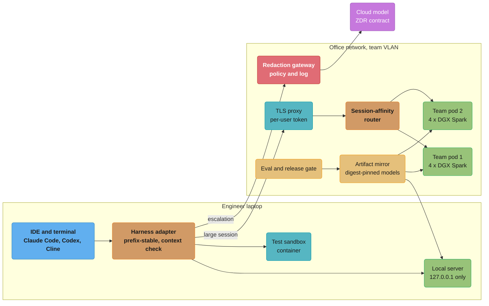

# Design a Local-First Coding Agent

## Intuition

A regulated company with 400 engineers wants what every engineering org wants in 2026: a coding agent that reads the repository, runs the tests, edits files and opens a pull request. The constraint that changes everything is in the contract with its customers and its regulator:
**source code may not leave company hardware.** Not "may not be retained", not "may be processed under a zero-data-retention agreement" — may not leave. That single sentence turns a product purchase into an infrastructure design. The model has to run on machines the company owns: the engineers' laptops, and a small number of team boxes on the office network. A cloud model is still allowed, but only for content that has passed a redaction gateway and only with a logged reason.

The design looks like a smaller version of a cloud coding assistant, and that resemblance is the trap. [Design an AI Coding Assistant](design_ai_coding_assistant.md), [Design GitHub Copilot](design_copilot.md) and [Design an Autonomous SWE Agent](design_autonomous_swe_agent.md) all assume elastic, provider-run inference: the provider absorbs prefill cost through its own prefix caching, context windows are large and known, and the GPU fleet scales with demand. None of that holds here. Inference is a fixed fleet of heterogeneous machines; every byte the harness changes early in a prompt costs seconds of a laptop's GPU; the context window is whatever the local runtime actually allocated, which may be a quarter of what the model card advertises; and the model server is a new network service on hundreds of machines, each one a potential remote shell.

**Key insight for this design.** On owned hardware, the expensive resource is not tokens, it is *re-read work*. An agent turn is mostly prefill (the whole session goes back to the model every step), so the design is won or lost on three things that have nothing to do with model quality: keeping the prompt prefix byte-stable so the cache survives, keeping the allocated context large enough that nothing is silently cut, and keeping the server reachable only by the harness that should reach it. Pick a 25-35B mixture-of-experts model with 3-4B active parameters for the laptops, because decode speed follows active bytes and memory capacity follows total bytes, and spend the remaining design effort on the cache, the context and the boundary.

---

## 1. Requirements Clarification

### Functional Requirements

- **Agent sessions in the IDE and terminal.** An engineer starts a session against a local repository; the agent reads files, searches, runs tests in a sandbox, edits files and proposes a commit. Harnesses: Claude Code and Codex through API compatibility, plus an IDE agent (Cline) for engineers who prefer it.
- **Local inference by default.** Every turn runs on the engineer's laptop unless the session is marked "large" (repository-wide refactor, cross-service change) or the laptop cannot serve it.
- **Team tier.** "Large" sessions run on a team box on the office network with a larger model.
- **Cloud escalation.** A turn may escalate to a cloud model only through the redaction gateway, which removes code and tool output by policy and logs the reason and size.
- **Model and quant rollout.** The platform team can ship a new model, quantization or chat template to the fleet behind an eval gate, and roll it back.
- **Offline operation.** A laptop with no network keeps working at the local tier.

### Non-Functional Requirements

| Requirement | Target | Why this number |
|---|---|---|
| Time to first token, cached turn | p50 under 2 s, p95 under 5 s on turns of up to 32K tokens of context | An agent step that waits longer than a test run feels broken |
| Decode speed | 30 tokens/s or more per session | A 250-token tool call plus brief reasoning returns in under 10 s |
| Cold session start (12K-token prefix) | under 10 s on team boxes, measured per laptop SKU | One-time cost per session, paid before the first useful turn |
| Allocated context | 64,000 tokens on every tier | Ollama's own guidance for agents and coding tools is at least 64,000 |
| Code egress | zero bytes of source or tool output to any cloud endpoint | Contractual and regulatory |
| Escalation logging | 100% of escalations logged with reason, size, user and session | Audit evidence |
| Server exposure | no model server reachable from outside its host or team VLAN | A model server with tools is a remote shell |
| Patch latency for runtime CVEs | under 72 hours fleet-wide for critical | The llama.cpp RPC RCE (CVE-2026-34159) was critical and unauthenticated |

### Data Classes

| Class | Examples | May go to the cloud tier? |
|---|---|---|
| C1 Source and tool output | file contents, diffs, test output, shell output, stack traces | Never |
| C2 Engineering metadata | file paths, symbol names, error categories | Only after path and symbol hashing |
| C3 Natural-language intent | the engineer's request, plan text written by the local model | Yes, after secret masking |
| C4 Public material | public library docs, public issue text | Yes |

### Requirement Priority

| Requirement | Blocks launch? | Reason |
|---|---|---|
| Local inference on laptops with 64K context | Yes | The product |
| Server exposure controls | Yes | A launch with open ports is a security incident, not a product |
| Model artifact gate (digest, template, eval) | Yes | Fleet-wide bad model is the largest blast radius |
| Team tier | No, week 6 | Large sessions can wait or run on the biggest laptops |
| Cloud escalation | No, week 10 | Needs the redaction gateway and legal sign-off |
| Offline mode | Comes free | Local inference already works offline |

### Explicit Non-Goals

- **Not a model-training platform.** No fine-tuning in scope; see [Design an LLM Fine-Tuning Platform](design_llm_fine_tuning_platform.md).
- **Not a multi-tenant GPU cloud.** The team boxes serve one company's engineers; see [Design a GPU Inference Platform](design_gpu_inference_platform.md) for the elastic version.
- **Not a new harness.** The design adapts existing harnesses through API compatibility and a thin adapter; agent loop design is in [Coding Agents](../coding_agents/coding_agents.md).
- **Not device fleet management.** Getting files onto laptops uses the existing MDM and the delivery patterns in [Edge and On-Device Deployment](../../mlops/edge_and_on_device_deployment/edge_and_on_device_deployment.md).

---

## 2. Scale Estimation

### Users and sessions

```
Engineers:                         400
Daily active (80%):                320
Agent sessions per active/day:     6
Turns per session (mean):          35
Turns per day:                     320 x 6 x 35 = 67,200

Session prompt at turn 1:          12,000 tokens
  system prompt + harness rules:    3,000
  tool definitions:                 4,000
  repo map and task:                5,000
Appended per turn (tool results):  1,200 tokens (mean)
Output per turn:                     250 tokens (tool call + short reasoning)
Context at turn 35:                12,000 + 35 x 1,200 = 54,000 tokens
Compaction threshold:              56,000 (64,000 allocated minus 8,000 reserve)
```

### Prefill work with and without a stable prefix

```
With prefix cache (append-only), per session:
  12,000 + 35 x 1,200                      =    54,000 tokens of prefill
Without (every turn re-reads everything):
  35 x 12,000 + 1,200 x (1 + 2 + ... + 35)
  = 420,000 + 1,200 x 630                  = 1,176,000 tokens of prefill
Ratio:                                       21.8x

Fleet per day (67,200 turns = 1,920 sessions):
  cached:     1,920 x 54,000               =   104 M prefill tokens
  uncached:   1,920 x 1,176,000            = 2,258 M prefill tokens
```

The 21.8x factor is the whole argument for treating prefix stability as a release gate. It is the same arithmetic Ollama and Together AI published (10 turns: 55 versus 10 units; 100 turns: 5,050 versus 100), applied to this company's session shape.

### Laptop sizing (derived from published specs; validated per SKU at rollout)

```
SKU A: MacBook Pro, M5 Pro, 48 GB unified memory, 307 GB/s
SKU B: Windows laptop with NVIDIA RTX Spark (N1X), 64 GB unified memory
       (NVIDIA publishes no memory bandwidth for N1X: SKU B is sized by measurement only)

Model: Qwen3.6-35B-A3B (Apache-2.0, 262K native context), 4-bit
  total weights:  35B x 4.5 bits / 8   = ~19.7 GB   (fits)
  active per token: 3B x 4.5 bits / 8  = ~1.69 GB  (what decode reads)
  cross-check: Apple measured Qwen3-30B-A3B 4-bit at 17.31 GB on an M5 MacBook Pro

Memory budget on SKU A (48 GB):
  macOS + IDE + browser + build tools     ~16 GB   (company measurement, P90)
  model weights                           ~19.7 GB
  left for KV cache at 64K + runtime      ~12 GB

Decode ceiling on SKU A, weight bytes only:
  307 GB/s / 1.69 GB                      = ~182 tokens/s
MoE efficiency seen on published benches (derived):
  DGX Spark, gpt-oss-120b MXFP4: measured 58.7 vs ceiling ~99   -> ~59%
  DGX Spark, Qwen3-Coder-30B-A3B Q8_0: measured 61.1 vs ~86     -> ~71%
Planning estimate SKU A: 0.59 x 182       = ~107 tokens/s at short context,
  lower at 50K context because KV reads add to every token.
Target 30 tokens/s: met with margin on paper; the rollout gate measures it.
```

The dense alternative shows why the MoE was chosen. Qwen3.8-27B at 4-bit is about 15.2 GB of weights, all of them read for every token: 307 / 15.2 is about 20 tokens/s before any inefficiency, which misses the 30 tokens/s target on SKU A unless speculative decoding carries it. (LM Studio's Splash engine reports 74 tokens/s on a 48 GB M5 Pro for Qwen3.8-27B using DFlash 2 speculative decoding; that is a vendor claim and the design does not depend on it.)

### Team tier sizing

```
Share of turns marked "large":           20%
Team-tier turns per day:                 67,200 x 0.20 = 13,440
Peak hour share of daily turns:          18%
Peak-hour team turns:                    2,419  (0.67 turns/s)

Model: gpt-oss-120b, MXFP4, 59.02 GiB on disk, Apache-2.0, 5.1B active
Measured on DGX Spark (llama.cpp bench, pp2048 / tg32, depth 0):
  prefill 2,443.9 tokens/s, decode 58.7 tokens/s

Busy time per cached turn (single stream):
  prefill 1,200 / 2,443.9                = 0.49 s
  decode    250 / 58.7                   = 4.26 s
  total                                  = 4.75 s
Cold session starts in peak hour:        69 x (12,000 / 2,443.9) = 69 x 4.9 s = 338 s
Busy seconds in peak hour:               2,419 x 4.75 + 338 = 11,828 s = 3.3 box-hours/hour

Boxes at 60% target utilization:         3.3 / 0.60 = 5.5 -> 6
Plus one failure domain spare per pod:   8 DGX Spark in 2 pods of 4
```

The arithmetic uses single-stream numbers on purpose. `llama-server` and Ollama batch concurrent requests, which raises aggregate throughput per box, but the gain depends on model, context and concurrency and must be measured on the actual boxes before the fleet is cut down.

### Escalation volume

```
Escalation rate target:                 4% of all turns
Escalated turns per day:                67,200 x 0.04 = 2,688
Redacted prompt size (C3 + C4 only):    ~6,000 tokens (no code, no tool output)
Cloud input tokens per day:             2,688 x 6,000 = ~16 M
Cloud output tokens per day:            2,688 x 800   = ~2.2 M
```

### Storage and distribution

```
Laptop model set:   Qwen3.6-35B-A3B 4-bit (GGUF for SKU B, MLX for SKU A) ~20 GB each
                    + a 4B-class fallback for low-memory states ~3 GB
Fleet download per model update:   400 x ~20 GB = ~8 TB over the office network and VPN
  at a 30-day staggered rollout:   ~270 GB/day average
Team box set:       gpt-oss-120b MXFP4 ~63.4 GB, Qwen3-Coder-Next 80B-A3B candidate
Artifact mirror:    every reviewed file stored once by SHA-256 digest
```

---

## 3. High-Level Architecture



The diagram has three trust boundaries. The laptop boundary: the local server listens on loopback only and the harness adapter is the only client. The office boundary: team boxes are reachable only through the TLS proxy, which authenticates every engineer and pins each session to one box. The company boundary: the only path out is the redaction gateway, and it never forwards C1 content.

| Component | Runs on | Owns |
|---|---|---|
| Harness adapter | Laptop, a local process in front of the harness | Prefix stability, context budgeting, tier choice, escalation requests |
| Local server | Laptop: MLX engine through Ollama on SKU A, llama.cpp on SKU B | Inference at the local tier, prompt cache |
| Test sandbox | Laptop container | Running the agent's shell and test commands |
| TLS proxy and affinity router | Office | Authentication, routing a session to the box that holds its cache |
| Team pods | Office, 2 x 4 DGX Spark | Large-session inference with gpt-oss-120b |
| Redaction gateway | Office | Policy enforcement, secret masking, egress log |
| Artifact mirror | Office | Reviewed model files and chat templates, by digest |
| Eval and release gate | Office CI | Model, quant and template qualification before rollout |

**A normal turn.** The engineer's harness sends a request to the adapter on the laptop. The adapter verifies that the prefix is unchanged from the previous turn, counts tokens against the 64,000 allocated, and forwards to the local server on 127.0.0.1. The server finds the session's prefix in its cache, prefills only the 1,200 new tokens and decodes the tool call. The adapter validates the tool call and returns it. Nothing crossed the network.

---

## 4. Component Deep Dives

### 4a. Laptop runtime profile and the capacity calculator

Each laptop SKU gets a runtime profile chosen by measurement, not by spec sheet. The profile fixes the engine, the model file, the allocated context and the bind address. The calculator below is the first filter: it rejects a model before anyone downloads 20 GB to try it.

```python
from __future__ import annotations

from dataclasses import dataclass


@dataclass(frozen=True)
class Device:
    name: str
    memory_gb: float            # unified memory or VRAM usable for the model server
    bandwidth_gb_s: float | None  # None when the vendor does not publish it
    reserved_gb: float          # OS, IDE, browser, build tools at P90


@dataclass(frozen=True)
class ModelFile:
    name: str
    total_params_b: float
    active_params_b: float
    bits_per_weight: float      # include block scales: 4-bit k-quants are ~4.5-4.9 bpw

    @property
    def weight_gb(self) -> float:
        return self.total_params_b * self.bits_per_weight / 8

    @property
    def active_gb(self) -> float:
        return self.active_params_b * self.bits_per_weight / 8


@dataclass(frozen=True)
class Verdict:
    fits: bool
    free_for_kv_gb: float
    decode_ceiling_tps: float | None
    planning_tps: float | None
    reason: str


def assess(device: Device, model: ModelFile, kv_budget_gb: float,
           moe_efficiency: float = 0.59, dense_efficiency: float = 0.85) -> Verdict:
    """Fit = total bytes + KV budget. Speed = bandwidth / active bytes, times measured efficiency."""
    free = device.memory_gb - device.reserved_gb - model.weight_gb
    if free < kv_budget_gb:
        return Verdict(False, free, None, None,
                       f"needs {kv_budget_gb:.1f} GB for KV at the target context, has {free:.1f}")
    if device.bandwidth_gb_s is None:
        return Verdict(True, free, None, None, "fits; bandwidth unpublished, measure decode on hardware")
    ceiling = device.bandwidth_gb_s / model.active_gb
    eff = moe_efficiency if model.active_params_b < model.total_params_b else dense_efficiency
    return Verdict(True, free, ceiling, ceiling * eff, "fits; planning speed is a pre-measurement estimate")


SKU_A = Device("MacBook Pro M5 Pro 48 GB", memory_gb=48, bandwidth_gb_s=307, reserved_gb=16)
SKU_B = Device("RTX Spark laptop 64 GB", memory_gb=64, bandwidth_gb_s=None, reserved_gb=16)
QWEN36_MOE = ModelFile("Qwen3.6-35B-A3B 4-bit", total_params_b=35, active_params_b=3, bits_per_weight=4.5)
QWEN38_DENSE = ModelFile("Qwen3.8-27B 4-bit", total_params_b=27, active_params_b=27, bits_per_weight=4.5)

if __name__ == "__main__":
    for model in (QWEN36_MOE, QWEN38_DENSE):
        print(model.name, assess(SKU_A, model, kv_budget_gb=8.0))
    # Qwen3.6-35B-A3B: fits, ~12.3 GB free, ceiling ~182 t/s, planning ~107 t/s
    # Qwen3.8-27B:     fits, ~16.8 GB free, ceiling ~20 t/s,  planning ~17 t/s -> misses 30 t/s
```

The 0.59 MoE efficiency is not a constant of nature. It is the ratio derived from llama.cpp's own DGX Spark bench for gpt-oss-120b (58.7 tokens/s measured against a weight-only ceiling of about 99), and the dense 0.85 sits inside the 82-89% band seen in Apple's MLX numbers and the 87% seen for a dense 7B Q8_0 on DGX Spark. The rollout gate replaces both with each SKU's measured value.

**The profile that ships for SKU A:**

```bash
# Ollama runs supported architectures on MLX by default on Apple silicon (v0.40.0+).
# Loopback only, context sized for agents, one model kept warm.
OLLAMA_HOST=127.0.0.1:11434 OLLAMA_CONTEXT_LENGTH=64000 ollama serve
ollama ps    # CONTEXT must read 64000 and PROCESSOR 100% GPU, or the profile fails its check
```

**The profile that ships for SKU B:**

```bash
llama-server -m /opt/models/sha256-<digest>/qwen3.6-35b-a3b-q4_k_m.gguf \
  --host 127.0.0.1 --port 9931 -c 65536 --jinja \
  --chat-template-file /opt/models/templates/qwen3.6-reviewed.jinja \
  --cache-ram 8192 --ctx-checkpoints 32 \
  --api-key-file /opt/models/local.key
```

Both profiles are checked every hour by the endpoint agent: bind address is loopback, allocated context is 64,000, the model file digest matches the mirror, and the engine version is at or above the patched floor.

### 4b. The harness adapter: prefix stability and context budgeting

The adapter sits between the harness and the local server, speaking the same API on both sides. It exists because harnesses are third-party code the company cannot patch, and because the two cheapest failures in this design (a busted prefix, a silently truncated prompt) are both visible at this layer.

**BROKEN: a wrapper that "helpfully" adds live context to the system prompt.**

```python
# BROKEN. Shipped in the pilot to give the agent situational awareness.
import datetime
import subprocess
from typing import Any


def enrich(body: dict[str, Any]) -> dict[str, Any]:
    branch = subprocess.run(["git", "branch", "--show-current"], capture_output=True, text=True).stdout
    status = subprocess.run(["git", "status", "--short"], capture_output=True, text=True).stdout
    header = f"Time: {datetime.datetime.now():%Y-%m-%d %H:%M:%S}\nBranch: {branch}\nStatus:\n{status}\n"
    msgs = body["messages"]
    msgs[0] = {"role": "system", "content": header + msgs[0]["content"]}   # rewrites token 1
    return body
# Effect on a 35-turn session: every turn re-reads the whole session.
# Measured on team boxes: p50 time to first token 0.6 s -> 13.1 s by turn 30.
```

**FIX: dynamic facts become a new message at the end, and the adapter enforces append-only.**

```python
from __future__ import annotations

import hashlib
import json
import subprocess
from dataclasses import dataclass, field
from typing import Any, Callable


def canonical(obj: Any) -> str:
    return json.dumps(obj, sort_keys=True, separators=(",", ":"), ensure_ascii=False)


@dataclass
class PrefixGuard:
    """Tracks the last request of a session and rejects early rewrites."""
    last_messages: list[str] = field(default_factory=list)
    tools_hash: str = ""

    def check(self, messages: list[dict[str, Any]], tools: list[dict[str, Any]]) -> list[str]:
        problems: list[str] = []
        th = hashlib.sha256(canonical(sorted(tools, key=lambda t: t["function"]["name"])).encode()).hexdigest()
        if self.tools_hash and th != self.tools_hash:
            problems.append("tool list changed mid-session")
        current = [canonical(m) for m in messages]
        for i, (old, new) in enumerate(zip(self.last_messages, current)):
            if old != new:
                problems.append(f"message {i} rewritten")
                break
        self.last_messages, self.tools_hash = current, th
        return problems


@dataclass
class HarnessAdapter:
    allocated_context: int
    reserve_output: int
    count_tokens: Callable[[list[dict[str, Any]]], int]
    forward: Callable[[dict[str, Any]], dict[str, Any]]
    on_violation: Callable[[str, list[str]], None]
    guards: dict[str, PrefixGuard] = field(default_factory=dict)

    def handle(self, session_id: str, body: dict[str, Any]) -> dict[str, Any]:
        body = dict(body)
        body["tools"] = sorted(body.get("tools", []), key=lambda t: t["function"]["name"])
        guard = self.guards.setdefault(session_id, PrefixGuard())
        problems = guard.check(body["messages"], body["tools"])
        if problems:
            self.on_violation(session_id, problems)       # counted, alerted, not blocked
        need = self.count_tokens(body["messages"]) + self.reserve_output
        if need > self.allocated_context:
            raise ContextBudgetExceeded(session_id, need, self.allocated_context)
        return self.forward(body)

    @staticmethod
    def live_facts_message() -> dict[str, str]:
        """Call when the agent needs fresh state; the result is APPENDED, never prepended."""
        status = subprocess.run(["git", "status", "--short"], capture_output=True, text=True).stdout
        return {"role": "user", "content": f"Current git status:\n{status}"}


class ContextBudgetExceeded(Exception):
    def __init__(self, session_id: str, need: int, have: int) -> None:
        super().__init__(f"session {session_id}: needs {need} tokens, {have} allocated; compact or move tier")
        self.need, self.have = need, have
```

Two decisions are deliberate. **Violations are alerted, not blocked**: a harness update that breaks the prefix should degrade speed, not stop engineers working, and the alert reaches the platform team within minutes. **Context overflow is a hard error**: the harness gets an explicit failure and compacts, or the adapter moves the session to the team tier. Silent truncation is never an option, because it removes instructions without anyone noticing.

### 4c. Team pods and session affinity

A session's cache lives on one box. If turn 7 lands on a different box than turn 6, that box re-reads the whole session and both boxes now hold a copy. Ollama and Together AI describe the same trade on the engine side: route by a session key to the node holding the cache, unless that node is overloaded, in which case a cache miss on an idle node can be the better deal.

```python
from __future__ import annotations

import bisect
import hashlib
from dataclasses import dataclass, field


@dataclass
class Box:
    name: str
    max_active: int          # concurrent sessions the box serves at target latency (measured)
    active: int = 0
    healthy: bool = True


@dataclass
class AffinityRouter:
    boxes: list[Box]
    vnodes: int = 64
    _ring: list[tuple[int, str]] = field(default_factory=list)
    _by_name: dict[str, Box] = field(default_factory=dict)

    def __post_init__(self) -> None:
        self._by_name = {b.name: b for b in self.boxes}
        for b in self.boxes:
            for v in range(self.vnodes):
                h = int(hashlib.sha256(f"{b.name}#{v}".encode()).hexdigest()[:16], 16)
                self._ring.append((h, b.name))
        self._ring.sort()

    def _walk(self, session_id: str):
        h = int(hashlib.sha256(session_id.encode()).hexdigest()[:16], 16)
        i = bisect.bisect(self._ring, (h, ""))
        seen: set[str] = set()
        for k in range(len(self._ring)):
            name = self._ring[(i + k) % len(self._ring)][1]
            if name not in seen:
                seen.add(name)
                yield self._by_name[name]

    def pick(self, session_id: str) -> tuple[Box, bool]:
        """Returns (box, cache_expected). Home box first; spill only when it is full or down."""
        for rank, box in enumerate(self._walk(session_id)):
            if box.healthy and box.active < box.max_active:
                return box, rank == 0
        raise RuntimeError("team tier saturated: queue the turn or run it on the laptop tier")
```

Consistent hashing keeps 7 of 8 sessions on their home box when one box fails, instead of reshuffling every session. The `cache_expected` flag feeds a metric: the share of team-tier turns served off their home box is the leading indicator that the pods need another box.

**Team box server configuration:**

```bash
llama-server -m /opt/models/sha256-<digest>/gpt-oss-120b-mxfp4.gguf \
  --host 10.20.0.11 --port 9931 -c 65536 --jinja \
  --chat-template-file /opt/models/templates/gpt-oss-reviewed.jinja \
  --cache-ram 32768 --ctx-checkpoints 32 \
  --api-key-file /etc/llama/proxy.key
# No --tools: the agent's tools run on the engineer's laptop sandbox, never on the team box.
# No RPC workers: each box serves gpt-oss-120b alone.
```

The team box binds the team VLAN address and accepts only the proxy's key. It runs no tools: the agent's file and shell tools execute in the engineer's own sandbox, so a compromised team box cannot reach anyone's repository. `--cache-ram` is raised from the 8,192 MiB default because 128 GB of unified memory minus about 63.4 GB of weights leaves room to keep idle sessions' prompt caches in host RAM; the exact value is set from the KV buffer sizes the server logs at startup.

### 4d. The redaction gateway

Escalation exists for one reason: some turns (a cross-service plan, an unfamiliar framework's idiom) are better answered by a frontier model. The gateway makes that possible without sending C1 data out.

```python
from __future__ import annotations

import hashlib
import hmac
import json
import re
import time
from dataclasses import dataclass, field
from enum import Enum
from typing import Any, Callable


class Reason(str, Enum):
    PLANNING = "planning"
    INVALID_LOCAL_OUTPUT = "invalid_local_output"
    CONTEXT_OVERFLOW = "context_overflow"
    USER_REQUESTED = "user_requested"


SECRETS = [
    re.compile(r"(?i)\b(api[_-]?key|secret|token|passw(or)?d)\b\s*[:=]\s*\S+"),
    re.compile(r"AKIA[0-9A-Z]{16}"),
    re.compile(r"-----BEGIN [A-Z ]*PRIVATE KEY-----.*?-----END [A-Z ]*PRIVATE KEY-----", re.S),
]
PATH_RE = re.compile(r"(?<![\w.])(?:[\w.-]+/)+[\w.-]+\.\w{1,6}")
CODE_FENCE = re.compile(r"```.*?```", re.S)


@dataclass
class EgressPolicy:
    allowed_roles: frozenset[str] = frozenset({"system", "user", "assistant"})
    max_tokens: int = 8_000
    hash_key: bytes = b"rotate-me-quarterly"

    def pseudonym(self, value: str) -> str:
        return "path_" + hmac.new(self.hash_key, value.encode(), hashlib.sha256).hexdigest()[:10]


@dataclass
class RedactionGateway:
    policy: EgressPolicy
    count_tokens: Callable[[list[dict[str, Any]]], int]
    send: Callable[[dict[str, Any]], dict[str, Any]]
    audit: Callable[[dict[str, Any]], None]
    blocked: int = 0
    sent: int = 0
    _rules: list[str] = field(default_factory=list)

    def _clean(self, text: str) -> tuple[str, dict[str, int]]:
        counts = {"code_blocks": 0, "secrets": 0, "paths": 0}
        text, counts["code_blocks"] = CODE_FENCE.subn("[code withheld: C1]", text)
        for pat in SECRETS:
            text, n = pat.subn("[secret masked]", text)
            counts["secrets"] += n
        text, counts["paths"] = PATH_RE.subn(lambda m: self.policy.pseudonym(m.group(0)), text)
        return text, counts

    def escalate(self, user: str, session_id: str, reason: Reason,
                 body: dict[str, Any]) -> dict[str, Any] | None:
        out_msgs: list[dict[str, Any]] = []
        totals = {"code_blocks": 0, "secrets": 0, "paths": 0, "withheld_messages": 0}
        for m in body["messages"]:
            if m["role"] not in self.policy.allowed_roles or m.get("tool_calls"):
                totals["withheld_messages"] += 1
                continue                                   # tool output and tool calls never leave
            text, counts = self._clean(m.get("content") or "")
            for k, v in counts.items():
                totals[k] += v
            out_msgs.append({"role": m["role"], "content": text})
        tokens = self.count_tokens(out_msgs)
        record = {"ts": time.time(), "user": user, "session": session_id, "reason": reason.value,
                  "tokens": tokens, **totals}
        if tokens > self.policy.max_tokens or not any(m["role"] == "user" for m in out_msgs):
            record["decision"] = "blocked"
            self.blocked += 1
            self.audit(record)
            return None
        record["decision"] = "sent"
        record["body_sha256"] = hashlib.sha256(json.dumps(out_msgs).encode()).hexdigest()
        self.sent += 1
        self.audit(record)
        return self.send({"messages": out_msgs, "max_tokens": 1_500})
```

The gateway is deliberately dumb in one direction: it removes whole classes of content (tool messages, tool calls, fenced code) rather than trying to decide which code is safe. A smarter filter would leak on its first misclassification. The cost is that escalated turns carry less context, which is why escalation is used for planning and explanation, and the local model applies the plan to the actual code. The audit record stores a hash of what was sent, not the content, so the audit log is not itself a second copy of sensitive data.

### 4e. The model artifact gate

Every model file, quantization and chat template on the fleet passes through one gate. A GGUF is untrusted input twice over: its parser has had memory-safety CVEs (CVE-2025-49847, CVE-2025-53630, CVE-2026-27940 as a bypass of the 53630 fix, CVE-2026-33298), and its embedded Jinja chat template runs on every request (poisoned templates can carry hidden instructions while the hosting page shows a clean one).

```python
from __future__ import annotations

import difflib
import hashlib
from dataclasses import dataclass
from pathlib import Path

import gguf   # gguf-py from the llama.cpp repository


@dataclass(frozen=True)
class ArtifactReview:
    path: Path
    expected_sha256: str
    reviewed_template: Path


def sha256_file(path: Path, chunk: int = 1 << 24) -> str:
    h = hashlib.sha256()
    with path.open("rb") as f:
        while block := f.read(chunk):
            h.update(block)
    return h.hexdigest()


def embedded_template(path: Path) -> str:
    reader = gguf.GGUFReader(str(path))
    field = reader.fields.get("tokenizer.chat_template")
    if field is None:
        return ""
    return bytes(field.parts[field.data[0]]).decode("utf-8")


def gate(review: ArtifactReview) -> list[str]:
    failures: list[str] = []
    digest = sha256_file(review.path)
    if digest != review.expected_sha256:
        failures.append(f"digest mismatch: {digest[:12]} != {review.expected_sha256[:12]}")
    shipped = embedded_template(review.path)
    reviewed = review.reviewed_template.read_text(encoding="utf-8")
    if shipped != reviewed:
        diff = "\n".join(difflib.unified_diff(reviewed.splitlines(), shipped.splitlines(),
                                              "reviewed", "embedded", lineterm="", n=1))
        failures.append("embedded template differs from reviewed template:\n" + diff[:2000])
    return failures
```

A template mismatch does not always block the file; it blocks the file *from running with its own template*. Every profile in 4a passes `--chat-template-file` pointing at the reviewed copy, so the embedded template never executes on the fleet. Signing uses OpenSSF model-signing v1.0 (Sigstore bundles) on the mirror side, so a laptop verifies one signature per artifact instead of trusting the network path.

**BROKEN: the "temporary" RPC worker.**

```bash
# BROKEN. A team wanted to try a 400B-class MoE by pooling two team boxes,
# and started a llama.cpp RPC worker bound to every interface on one of them.
# CVE-2026-34159: critical, unauthenticated remote code execution in the RPC backend.
llama-server -m big-moe.gguf --rpc 10.20.0.12:50052     # worker on .12 listening on 0.0.0.0
```

```bash
# FIX. Multi-box experiments run only on an isolated lab segment with a host firewall
# that admits the peer box and nothing else, on a llama.cpp build above the patched floor,
# and are torn down by an expiry the endpoint agent enforces. Production pods never run RPC.
```

The control that caught it in this company was the hourly endpoint check (4a): a listening socket not on the profile's allowlist pages the platform on-call.

### 4f. Eval and release gate

A model, quant or template change reaches the fleet only after the gate in [LLM Eval Harness in Production](cross_cutting/llm_eval_harness_in_production.md) style:

| Check | Data | Pass rule |
|---|---|---|
| Tool-call validity | 2,000 recorded turns replayed through the harness adapter | At least 99% parse and schema-valid |
| Next-call agreement | Same 2,000 turns, compare tool name with the current production model | At least 85% agreement, or a written reason |
| Task success | 300 internal tasks (bug fixes, test additions, refactors) with hidden tests | No drop of more than 2 points against production |
| Context and prefix | 40-turn sessions through `assert_append_only` and `ollama ps` checks | Zero rewrites, CONTEXT equals 64,000 |
| Latency on each SKU | `llama-bench` and `mlx_lm.benchmark` on real laptops at 32K depth | p50 decode at least 30 tokens/s, cached TTFT under 2 s |
| Red-team set | Prompt-injection and data-exfiltration cases from [Red-Team Eval Harness](cross_cutting/red_team_eval_harness.md) | No regression |

The quant floor is set by data, not by memory pressure. Unsloth's own data for Qwen3.8-27B shows agreement with BF16 falling off a cliff between UD-Q2_K_XL and UD-IQ2_S, and Unsloth says 1-bit quants should not be used for agentic work (vendor claim). This company's floor is a 4-bit-class quant for every agent model; anything lower must pass the full gate on its own.

### 4g. Observability without content

Traces carry structure, not code. Each turn emits OpenTelemetry spans with [OpenTelemetry for LLM Apps](cross_cutting/opentelemetry_for_llm_apps.md) GenAI attributes for model, tier, prompt tokens, cached tokens (when the engine reports them), output tokens, time to first token and decode rate, plus three custom attributes: `prefix_violation`, `context_headroom_tokens` and `escalation_reason`. File contents and tool output are never attributes. Laptop spans are buffered and shipped when on the corporate network, so offline sessions still appear in the fleet view later.

### 4h. End-to-end walkthrough: a large session

1. An engineer starts Claude Code on a cross-service change and marks the session "large".
2. The adapter computes a 13,800-token first request (system, tools, task, repo map) and routes it to the TLS proxy with the engineer's token.
3. The affinity router hashes the session id to box `pod1-b`, which has capacity. Cold prefill: 13,800 / 2,443.9 = about 5.6 s.
4. Turns 2-30 append about 1,200 tokens each. `pod1-b` prefills only the new tokens; cached TTFT stays around 0.5 s and each 250-token turn decodes in about 4.3 s at 58.7 tokens/s.
5. At turn 31 the agent needs a migration plan across four services. The adapter sends an escalation with reason `planning`. The gateway withholds 29 tool messages and 12 code blocks, pseudonymizes 41 paths, masks 1 secret, and sends 5,200 tokens. The cloud plan comes back.
6. The plan is appended to the session as an assistant-authored note. `pod1-b` applies it to real files over the next 12 turns.
7. At turn 44 the context reaches 56,000 tokens. The harness compacts once, on purpose, and the session continues append-only from the compacted state.

---

## 5. Design Decisions & Tradeoffs

| Decision | Chosen | Alternative | Why |
|---|---|---|---|
| Laptop model shape | 35B MoE, 3B active, 4-bit | 27B dense, 4-bit | Same memory class; MoE reads ~1.7 GB per token versus ~15 GB, so it clears 30 tokens/s on 307 GB/s and the dense model does not |
| Laptop engine | Ollama with MLX on Apple silicon; llama-server on Windows | One engine everywhere | Ollama runs supported architectures on MLX by default on Apple silicon since v0.40.0 and uses the M5-family GPU Neural Accelerators; llama.cpp has the widest Windows backend coverage |
| Team box | DGX Spark, 128 GB, 273 GB/s | Mac Studio M5 Ultra (up to 512 GB, 1.2 TB/s, from $5,499) | Published, reproducible llama.cpp benches for gpt-oss-120b on Spark; Linux fleet tooling; ConnectX-7 for a later 4-box cluster. The Mac Studio is the stronger single box for large dense models and stays the evaluated alternative |
| Team box serving | One model per box, no RPC | Model split across boxes | Each box fits gpt-oss-120b alone; splitting adds a network dependency and the RPC attack surface |
| Tools location | Engineer's laptop sandbox | Team box `--tools` | A team box that can run shell commands is a lateral-movement path into every engineer's session |
| Session routing | Consistent hash with spill | Least-loaded | Keeps the cache on one box; spill only when home is full |
| Escalation content | Whole classes withheld (tool output, code) | Per-snippet classifier | A class rule cannot misclassify; a classifier leaks on its first error |
| Context | 64,000 everywhere | Model maximum (262K) | KV memory on a 48 GB laptop; 64K matches Ollama's agent guidance and the session shape |
| Prefix violations | Alert, do not block | Block the request | A harness update should slow engineers down, not stop them |
| Quant floor | 4-bit class | 2-bit dynamic quants to save memory | Agentic tool use degrades sharply below ~2.5 bpw (Unsloth data, vendor claim) |

**The tradeoff with the most debate: team boxes versus bigger laptops.** Buying every engineer a 128 GB machine would remove the team tier. It would also put 400 copies of a 120B-class model on machines that are idle 70% of the day, and it would not give the large sessions a faster box: decode on unified memory follows bandwidth, and a laptop part does not out-run a desk-side box built for the job. Shared boxes make the expensive capacity a pool, which is the same argument [GPU Pool Economics](cross_cutting/gpu_pool_economics.md) makes for data-center GPUs, at a smaller scale: utilization, not peak spec, decides cost per useful token.

**The tradeoff that was easy: no tools on team boxes.** The agent's tools must touch the engineer's checkout anyway. Running them on the laptop keeps one rule simple: a team box only ever sees text and returns text.

---

## 6. Real-World Implementations

**Ollama and Together AI (2026-11-16).** "Making open models work for long-horizon agentic workloads" is the clearest public statement of this design's central problem. Ollama (harness integration through `ollama launch` for Claude Code, Codex and Pi) and Together AI (an inference engine) describe agent turns as mostly prefill, give the 55-versus-10 and 5,050-versus-100 prefill arithmetic, list the harness behaviors that break the cache (timestamps, git status or working directory in the system prompt, a tool list extended at the top, a reasoning-effort change written into the first system block of GLM-5.3-Flash's template), and on the engine side describe routing a session to the node that holds its cache, with load-aware exceptions, and offloading idle sessions' cache to CPU memory while a tool runs.

**Ollama.** v0.40.18 (2026-11-24). Since v0.30.0 (2026-05-13) its non-MLX path runs on upstream llama.cpp, and since v0.40.0 (2026-09-25) supported models run on MLX by default on Apple silicon; v0.40.17 (2026-11-10) made Apple silicon serve multiple requests at once. Its context-length docs set defaults by VRAM (under 24 GiB: 4k; 24-48 GiB: 32k; 48 GiB or more: 256k) and tell agent users to set at least 64,000. Its APIs include OpenAI chat and Responses and an Anthropic-compatible Messages API (2026-01-16), and Ollama binds 127.0.0.1:11434 by default.

**LM Studio.** 0.4.0 (2026-01-28) added the `llmster` headless daemon and continuous batching; an Anthropic-compatible API followed on 2026-01-30 for Claude Code. LM Studio Bionic (2026-07-16, 1.2.2 on 2026-11-20) is a separate agent app: local models on the LM Studio runtime, optional Secure Cloud models with Zero Data Retention, skills, an Auto Review mode whose deterministic Shell Judge parses commands into an AST before any LLM review, and Agent Remote Control over LM Link (2026-11-16). Its mlx-engine v1.8.5 (2026-06-05) added KV-cache checkpointing for long agentic workloads on Apple silicon.

**NVIDIA.** DGX Spark: GB10, 128 GB LPDDR5x at 273 GB/s, up to 1 PFLOP FP4, ConnectX-7 at 200 Gbps, up to four systems clustered, 240 W power supply; NVIDIA positions it for local autonomous agents. llama.cpp's own benches (commit 3795cc1, 2026-02-05) give the numbers this design sizes with: gpt-oss-120b MXFP4 at 2,443.9 tokens/s prefill and 58.7 tokens/s decode, Qwen3-Coder-30B-A3B Q8_0 at 61.1 tokens/s decode. RTX Spark (N1X) Windows laptops with up to 128 GB of unified memory shipped on 2026-10-16; NVIDIA does not publish their memory bandwidth.

**Apple.** M5 Pro (up to 64 GB, 307 GB/s) and M5 Max (up to 128 GB, 614 GB/s) on 2026-03-03; M5 Ultra (up to 512 GB, 1.2 TB/s) on 2026-08-25. Apple's MLX research posts measured the generation-versus-prefill split this design relies on: on M5, time to first token improved 3.33-4.06x over M4 while decode improved 1.19-1.27x, because the GPU Neural Accelerators speed compute-bound prefill and decode stays bandwidth-bound. On OS 27, the Foundation Models framework's Language Model protocol puts on-device, Private Cloud Compute (32,000-token context), Claude, Gemini, Core AI and MLX models behind one API.

**Microsoft.** Foundry Local installs with `winget install Microsoft.FoundryLocal` or runs in-process from NuGet; Windows ML is Microsoft's maintained ONNX Runtime with vendor execution providers. Edge made Aion Instruct (2.3B, open weights) its built-in model with a Prompt API origin trial on 2026-11-19.

**Google.** Firebase AI Logic hybrid inference runs on-device when available and falls back to the cloud, "and vice versa". LiteRT-LM 0.20.0 replaced MediaPipe LLM Inference as the production on-device runtime and exposes an OpenAI-compatible `litert-lm serve`.

**Cline.** Its local-model docs tell users to enable a compact prompt and size RAM by tier (16-32 GB small or quantized, 32-64 GB mid-size, 64 GB or more large), an admission from a harness vendor that the full prompt does not fit many local setups.

---

## 7. Technologies & Tools

| Layer | Choice | Version / date | Role here |
|---|---|---|---|
| Laptop engine (Apple) | Ollama with MLX | v0.40.18 (2026-11-24); MLX 0.32.5 | Local tier on SKU A |
| Laptop engine (Windows) | llama-server | llama.cpp v1.0.0 (2026-11-13), b12726 | Local tier on SKU B |
| Team engine | llama-server | same | gpt-oss-120b on DGX Spark |
| Benchmarks | `llama-bench`, `mlx_lm.benchmark` | with the engines | SKU acceptance and regression |
| Harnesses | Claude Code, Codex (Anthropic and OpenAI compatible routes), Cline | current | Agent loop |
| Laptop model | Qwen3.6-35B-A3B | Apache-2.0, 262K native context | Default agent model |
| Team model | gpt-oss-120b MXFP4 | Apache-2.0, 117B / 5.1B active | Large sessions |
| Team model candidate | Qwen3-Coder-Next | 80B / 3B active, 256K, Apache-2.0 | In evaluation |
| Supply chain | OpenSSF model-signing | v1.0 (2025-04-04) | Artifact signatures |
| Template inspection | gguf-py `GGUFReader` | llama.cpp repository | Template diff at the gate |
| Observability | OpenTelemetry GenAI attributes | see cross-cutting file | Content-free traces |
| Durable sessions | checkpointed session state | see [Agent Durability Patterns](cross_cutting/agent_durability_patterns.md) | Resume after laptop sleep or box failure |

---

## 8. Operational Playbook

**Alert: context headroom below 2,000 tokens on more than 5% of turns.** The session shape grew (bigger repo maps, longer tool output) or a profile lost its 64K setting. Check `ollama ps` CONTEXT on a sample of affected laptops. If the profile is right, lower the compaction threshold or trim tool output; if it is wrong, the endpoint agent re-applies the profile and the incident review asks why the hourly check missed it.

**Alert: `prefix_violation` rate above 1% of turns.** Almost always a harness or adapter update. Diff the first 2 KB of consecutive requests from one affected session (structure only, from the adapter's local debug log). Typical causes: a timestamp, a reordered tool list, a thinking-mode change. Roll back the harness version through MDM if the fix is not same-day.

**Alert: team-tier off-home-box share above 15% for 30 minutes.** The pods are short of capacity or a box is unhealthy. Check box health first; if all are healthy, the capacity plan in §10 is behind demand. Short-term: lower the "large" share by routing medium sessions back to laptops with 64 GB or more.

**Critical runtime CVE (llama.cpp, Ollama, MLX, web UI).** Within 4 hours: confirm exposure from the endpoint inventory (version, bind address, listening sockets). Within 24 hours: team boxes patched (rolling, one box per pod at a time; affinity spills sessions to the other boxes). Within 72 hours: laptops patched through MDM with an enforced minimum version. The CVE-2026-34159 class (unauthenticated RCE in RPC) gets an extra fleet scan for any listening RPC socket.

**Model or quant rollout.** Gate (§4f) passes; 2% of laptops for 3 days, watching tool-call validity, escalation rate by reason and decode speed per SKU; then 20% for 4 days; then 100%. Team boxes roll one pod at a time. Rollback is a profile change pointing to the previous digest, which is still in the laptop's cache for 30 days.

**Team box failure.** Affinity spills its sessions to the next box on the ring. Those sessions pay one cold re-read (about 5-20 s depending on session length) and continue. Replace or re-image; the box rejoins with an empty cache.

**Escalation spike.** If escalations double day over day, read the reason histogram before the content-free audit records. `invalid_local_output` rising after a rollout is a model regression; roll back. `planning` rising alone is usually a new project type; review whether the team tier should get a stronger model.

**Data egress review.** Weekly: security samples 50 escalation audit records, re-runs the redaction on the stored local copy of the same turns (kept on the laptop for 7 days) and confirms the sent hash matches and no C1 content was present.

---

## 9. Common Pitfalls & War Stories

**The 4k pilot.** The first pilot ran on 40 Windows desktops with 16 GB GPUs and Ollama defaults. Under 24 GiB of VRAM, Ollama's default context is 4k. The harness sent a 12,000-token first request; the server kept the most recent part, which dropped the system rules and most of the repo map. Engineers reported that the agent "ignored instructions". Internal task success was 23% against 61% for the same model on a correctly configured laptop. It took 11 working days to find, and the pilot lost about 300 engineer-hours. Fix: profile-enforced `OLLAMA_CONTEXT_LENGTH=64000`, the `ContextBudgetExceeded` hard error in the adapter, and the hourly `ollama ps` check. Impact after the fix: zero truncation incidents in 5 months.

**The timestamp wrapper.** A wrapper added time, branch and git status to the system prompt (the BROKEN example in §4b). On team boxes, p50 cached TTFT went from 0.6 s to 13.1 s by turn 30, because each turn re-read an average of about 33,000 tokens (33,000 / 2,443.9 = 13.5 s) instead of 1,200. Effective team-tier capacity fell by roughly 3.7x for 2 days, sessions queued, and about 140 engineers fell back to laptops for large work. Fix: the append-only adapter and the `prefix_violation` alert, which now fires within 10 minutes of such a change.

**The 1-bit experiment.** A team tried a 1-bit dynamic quant of a 27B dense model to fit 24 GB laptops. Chat answers looked fine. On the replay gate, tool-call validity fell from 99.2% to 74%, and next-call agreement to 51%. The experiment never reached engineers because the gate ran first; it is in this list because three teams asked for the same thing in the following month. Fix: the 4-bit floor in §4f, and 24 GB laptops route agent sessions to the team tier.

**The temporary RPC worker.** The BROKEN example in §4e ran for 9 days on a lab box reachable from the engineering VLAN before the endpoint scan flagged the listening socket. The llama.cpp build on that box predated the CVE-2026-34159 fix. No exploitation was found, but 6 people spent 2 days on forensics and the security team required a fleet-wide RPC scan. Fix: production profiles forbid `--rpc`, lab experiments run on an isolated segment with an expiry.

**The unredacted prototype.** Before the gateway, a prototype router forwarded the full request to a cloud API whenever the local model failed. In 3 days it sent 1,900 requests, 1,412 of them containing tool output with file contents. The cloud contract had ZDR, which limited retention, but the contract with customers forbids the code leaving at all: legal treated it as a reportable event, the review cost about 120 hours across legal, security and engineering, and cloud escalation was frozen for 6 weeks. Fix: the class-based gateway in §4d, with audit records and a weekly egress review.

**The thin-laptop throttle.** A batch of thin 14-inch laptops passed the decode test at 2 minutes and failed it at 20: sustained decode fell 35% once the chassis heated, below 30 tokens/s on long sessions. Fix: the SKU acceptance test now runs a 30-minute sustained session, and SKUs that fail it are routed to the team tier for "large" sessions.

**The poisoned template that did not run.** A community re-upload of a popular model, pulled by an engineer for a side project, carried a chat template with an appended instruction block. The gate's template diff flagged it before it reached the mirror. Because every profile overrides the embedded template with the reviewed file, even a file that slipped through would not have executed it. Cost: zero, which is the point of the override.

| Incident | Detection time | Cost | Control added |
|---|---|---|---|
| 4k pilot | 11 days | ~300 engineer-hours, task success 23% vs 61% | Context profile, adapter hard error, hourly check |
| Timestamp wrapper | 2 days | team capacity down ~3.7x for 2 days | Append-only adapter, `prefix_violation` alert |
| 1-bit experiment | at gate | none (blocked) | 4-bit floor |
| RPC worker | 9 days | 12 person-days of forensics | `--rpc` forbidden in profiles, lab expiry |
| Unredacted prototype | 3 days | ~120 hours review, 6-week escalation freeze | Class-based gateway, audit, weekly review |
| Thin-laptop throttle | at rollout | one SKU re-tiered | 30-minute sustained test |

---

## 10. Capacity Planning

### Fleet today

| Tier | Units | Model | Load | Headroom |
|---|---|---|---|---|
| Laptops SKU A (M5 Pro 48 GB) | 260 | Qwen3.6-35B-A3B 4-bit (MLX) | One session per laptop | Measured p50 decode at 32K depth above 30 tokens/s |
| Laptops SKU B (RTX Spark 64 GB) | 140 | Qwen3.6-35B-A3B Q4_K_M (GGUF) | One session per laptop | Measured per batch, sized by test |
| Team pods | 2 x 4 DGX Spark | gpt-oss-120b MXFP4 | 3.3 box-hours per peak hour | 8 boxes for 5.5 needed at 60% |
| Cloud escalation | contract | provider model under ZDR | ~2,700 turns/day, ~16 M input tokens/day | Contract cap at 3x current |

### Growth drivers and their arithmetic

```
Headcount +25% (500 engineers):
  team busy time scales linearly: 3.3 x 1.25 = 4.1 box-hours/hour
  boxes at 60%: 6.9 -> 7, plus spares -> 9 or 10 boxes (add one pod of 4 -> 12)

"Large" share 20% -> 30% (more cross-service work):
  3.3 x 1.5 = 5.0 box-hours/hour -> 8.3 boxes at 60% -> 12 boxes

Session length 35 -> 60 turns:
  context at turn 60 = 12,000 + 60 x 1,200 = 84,000 > 64,000
  -> compaction happens once per session on every tier, or context goes to 96K,
     which needs 50% more KV memory per session than 64K on every tier
  -> the session-length trend is the trigger to re-evaluate the laptop SKU

Prefix-cache hit rate falls from 97% to 80% (harness drift, eviction):
  mean re-read per missed turn ~33,000 tokens -> 13.5 s on a Spark
  added busy time per peak hour: 2,419 x 0.17 x 13.5 s = 5,552 s = 1.5 box-hours
  -> a 17-point drop in hit rate costs about as much as 2.6 extra boxes at 60%
```

The last line is the planning lesson: on this fleet, a few points of prefix-cache hit rate are worth more than a box. The hit-rate dashboard is reviewed in the same meeting as the purchase plan.

### What triggers a 4-box cluster

A 4-box DGX Spark cluster joined over ConnectX-7 can hold models that do not fit one box (a 397B-A17B MoE at 4-bit is roughly 223 GB). The design adds one only when the eval gate shows a task-success gain of at least 5 points on the 300-task set for large sessions over gpt-oss-120b, and only after a measured decode rate above 30 tokens/s on that cluster. Apple's published MLX numbers show what multi-box can reach on the Mac side (an 816B-A42B MoE in NVFP4 at 36.73 tokens/s on four Mac Studio M5 Ultra over RDMA on Thunderbolt 5), and also what it costs in complexity: a network dependency inside every token.

### Cost framing

Team boxes are a capital purchase amortized over 3 years; the comparison is against the cloud spend they replace, at the provider's list price for the chosen model (see [Token Economics](../token_economics_and_cost_optimization/token_economics_and_cost_optimization.md)). The cloud side of this design is small by construction (about 16 M redacted input tokens per day). The real cost driver is utilization of the pods: at 60% planned utilization, a cache-hit regression or an idle pool both show up as cost per useful token, the metric [GPU Pool Economics](cross_cutting/gpu_pool_economics.md) uses for data-center fleets. Per-team quotas on the pods follow the noisy-neighbor rules in [Tenant Isolation Patterns](cross_cutting/tenant_isolation_patterns.md): one team's batch refactor cannot take more than 3 of a pod's 4 boxes for longer than 30 minutes.

---

## 11. Interview Discussion Points

**Q: Why not buy a cloud coding assistant with zero data retention instead?**
**Short:** Because the requirement is that code never leaves company hardware, and ZDR only limits retention after the code has already left and been processed elsewhere.

Zero data retention is a promise about what the provider keeps, not about where processing happens. The code still crosses the network, is decrypted and processed on hardware the company does not control, under another jurisdiction. When the contract says "may not leave", that is not enough, so inference has to run on owned machines. The cloud model stays useful for planning and explanation, on content that has passed a class-based redaction gateway; the design uses ZDR as a second layer for that redacted content, not as the boundary.

**Q: What breaks first as you go from a 20-person pilot to 400 engineers?**
**Short:** Configuration drift across hundreds of machines: context settings, bind addresses and harness versions, not model quality or raw capacity.

At 20 people, a wrong context setting or a wrapper that breaks the prefix is found by someone walking over. At 400, the same defect hides for days: the 4k pilot took 11 days to diagnose and the timestamp wrapper 2 days. The fixes are fleet controls: profiles applied by MDM, an hourly endpoint check of context, bind address, file digest and engine version, and adapter metrics (`prefix_violation`, context headroom) that page the platform team. Capacity is the second thing to break, and the off-home-box share warns about it before latency does.

**Q: Why route a session to the same team box every turn, and when do you break that rule?**
**Short:** The prefix cache lives on one box, so another box re-reads the whole session; break affinity only when the home box is full or unhealthy.

A cached turn on a DGX Spark prefills about 1,200 new tokens in 0.5 s; the same turn on a box without the cache re-reads the session, about 33,000 tokens or 13.5 s on average. Consistent hashing keeps most sessions on their home box even when one box fails. But a full home box means queueing, and a cache miss on an idle box can finish sooner than waiting, which is the load-aware exception Ollama and Together AI describe for their engine. The router spills to the next box on the ring and records it, and the spill rate is the capacity signal.

**Q: Why a 35B MoE with 3B active on laptops instead of a 27B dense model?**
**Short:** Decode reads only active weights, so the MoE reads about 1.7 GB per token against 15 GB for the dense model, which is the difference between ~100 and ~20 tokens/s on 307 GB/s.

Both models need roughly 15-20 GB of memory at 4-bit, so both fit on a 48 GB laptop. Decode is bandwidth-bound: on an M5 Pro at 307 GB/s, the dense 27B has a weight-only ceiling of about 20 tokens/s, below the 30 tokens/s target before any inefficiency. The 3B-active MoE has a ceiling near 182 tokens/s and plans at about 107 using the efficiency measured for MoE models on DGX Spark. The dense model can still win on some quality measures and can be made fast with speculative decoding, but that adds a drafter, an acceptance-rate dependency and a second thing to qualify on every SKU.

**Q: How do you stop the 4k context truncation from happening anywhere in the fleet?**
**Short:** Set the context explicitly in every profile, verify it from the server's own view, and make the adapter refuse any prompt that does not fit instead of letting the server cut it.

Ollama's default depends on VRAM (4k under 24 GiB, 32k for 24-48 GiB, 256k at 48 GiB or more), so the same software behaves differently per machine. Profiles set `OLLAMA_CONTEXT_LENGTH=64000` or `-c 65536`; the endpoint agent reads the CONTEXT column of `ollama ps` hourly; the adapter counts tokens and raises `ContextBudgetExceeded`, so the harness compacts or moves tiers instead of losing its instructions. Three independent controls, because the failure is silent and its cost (task success 23% versus 61% in the pilot) is large.

**Q: What exactly is allowed to leave the building on escalation?**
**Short:** Only natural-language intent and plans with secrets masked and paths pseudonymized; tool output, tool calls and fenced code are withheld as whole classes.

The gateway works on message classes, not snippets: tool-role messages and assistant tool calls never leave, fenced code blocks become a placeholder, secrets are masked by pattern, and file paths become keyed pseudonyms that rotate quarterly. Requests above 8,000 tokens after redaction are blocked, because a large redacted prompt is a sign something unexpected got through. Every escalation produces an audit record with reason, sizes, counts of what was removed and a hash of what was sent, and security re-checks a weekly sample. The local model then applies the cloud plan to the real code.

**Q: How do you roll out a new model or quant to 400 laptops safely?**
**Short:** Pass an eval gate on replayed agent turns and hidden-test tasks, then stage 2%, 20%, 100% by SKU, with rollback as a profile change to the previous digest.

The gate replays 2,000 recorded turns for tool-call validity and agreement with the current model, runs 300 internal tasks with hidden tests, checks append-only behavior and context, runs the red-team set, and benchmarks each laptop SKU at 32K depth. Rollout is staged with tool-call validity, escalation rate by reason and decode speed per SKU watched at each stage. The previous model file stays on disk for 30 days, so rollback needs no download. Delivery mechanics (deltas, cohorts, kill switch) follow the patterns in the mlops edge-deployment module rather than anything new.

**Q: How do you treat model files as untrusted input?**
**Short:** Pin every file by digest and signature, never run its embedded chat template, keep parsers patched, and never expose the RPC backend.

A GGUF is parsed by native code that has had memory-safety CVEs, and it carries a Jinja chat template that runs on every request and can hide instructions that a hosting page does not show. The artifact gate checks the SHA-256 digest, diffs the embedded template against a reviewed copy, and the mirror signs approved files with OpenSSF model-signing. Every profile passes `--chat-template-file` with the reviewed template, so even a file that slipped through would not execute its own. Runtime CVEs follow a 72-hour fleet patch SLO, with an extra scan for RPC listeners after CVE-2026-34159.

**Q: How do you know the local agent is good enough, and stays good enough?**
**Short:** Measure task success on internal tasks with hidden tests, tool-call validity and next-call agreement on replayed turns, and watch escalation reasons in production.

Public leaderboards do not cover the newest local models at the quant you run, and BFCL V4 shows how differently small models behave on multi-turn tool use (Qwen3-4B at 22.1% multi-turn against 41.8% for Qwen3-8B). So the company's own 300-task set with hidden tests is the headline number, replayed turns are the fast regression signal, and in production the `invalid_local_output` escalation rate is the live quality signal. Both the local path and the redacted cloud path run through the same eval set, following the shared harness pattern, so "would escalation have helped" is a measured question.

**Q: When would you add a 4-box cluster or a bigger team model?**
**Short:** Only when a larger model shows at least a 5-point task-success gain on the large-session eval and a measured decode rate above 30 tokens/s on the cluster.

Clustering four DGX Sparks over ConnectX-7 can hold a ~400B-class MoE, and Apple has shown an 816B MoE on four Mac Studios at 36.73 tokens/s. But a cluster puts a network link inside every token, adds a failure domain that takes four boxes down together, and brings the RPC attack surface back if built with llama.cpp RPC. The trigger is evidence on this company's tasks, not a leaderboard: until the bigger model wins on the 300-task set by a margin that justifies the operational cost, the single-box gpt-oss-120b pool stays.

**Q: What would you explicitly not build?**
**Short:** A custom inference engine, a custom harness, a snippet-level code classifier for egress, and tools that run on shared team boxes.

The engines (llama.cpp, Ollama with MLX) and harnesses (Claude Code, Codex, Cline) already exist and speak compatible APIs; the value is in the adapter, profiles and gates around them. A snippet-level classifier for what code may leave would leak on its first misclassification; class-level withholding cannot. Tools on team boxes would turn a shared inference server into a path into every engineer's checkout. Each of these is tempting because it looks like "platform work", and each adds a component that fails in a worse way than the one it replaces.

**Q: How does this design differ from a cloud-served coding assistant like Copilot?**
**Short:** Inference is a fixed fleet the company owns, so prefix stability, allocated context and server exposure become the design's main problems instead of provider concerns.

A cloud assistant scales inference elastically, absorbs prefill cost with its own caching, knows its context window, and runs its servers behind its own security boundary. Here every one of those is the company's problem: prefill is paid in seconds on laptops and team boxes, so the harness must keep the prefix byte-stable; context is whatever each runtime allocated, so it is enforced per machine; and each machine runs a model server that must not become a remote shell. The agent loop and repository context techniques are the same as in the cloud designs; the infrastructure underneath is not.

