# Case Study: Design a Production RAG Pipeline
## Intuition

> **Design intuition**: A RAG pipeline is a document retrieval system + LLM generation — the retrieval quality bottleneck is the dominant engineering challenge. Most RAG failures are retrieval failures (wrong chunks retrieved), not generation failures (LLM given good context hallucinates less).

**Key insight for this design**: Three-tier architecture is essential: fast vector search for recall, cross-encoder reranking for precision, and LLM generation only after high-quality context is assembled. The indexing pipeline (chunking strategy, embedding model choice, metadata schema) determines retrieval ceiling — improve retrieval before improving generation.

---

## 1. Requirements Clarification

### Functional Requirements
- Users ask natural language questions and receive accurate, grounded answers
- Answers cite specific source documents with page/section references
- Knowledge base: 10M enterprise documents (PDFs, Word, HTML, Markdown)
- Supports incremental updates: new documents indexed within 5 minutes
- Multi-tenant: 500 enterprise clients, each with isolated document sets
- Handles multi-hop questions ("Which contracts mention clause X AND vendor Y?")

### Non-Functional Requirements
- **Latency**: End-to-end < 3 seconds for simple queries; < 8 seconds for complex
- **Accuracy**: > 85% correct answers on internal evaluation set
- **Scale**: 10,000 concurrent users; 5M queries per day
- **Availability**: 99.9% uptime
- **Security**: Tenant isolation (Client A cannot see Client B documents)

### Out of Scope
- Document OCR pipeline (handled by separate Document Processing service)
- User authentication and authorization
- Model fine-tuning

---

## 2. Scale Estimation

### Document Processing Scale
```
Total documents: 10M
Average document size: 50KB (text content after extraction)
Total text: 10M × 50KB = 500GB of text

Chunking: 512-token chunks with 50-token overlap
Average tokens per document: 10,000 tokens
Chunks per document: ~22 chunks
Total chunks: 10M × 22 = 220M chunks

Embedding dimension: 1,536 (OpenAI text-embedding-3-small; the -large model is 3,072-dim)
Storage per chunk embedding: 1,536 × 4 bytes = 6KB
Total embedding storage: 220M × 6KB = 1.32TB

Metadata per chunk: 256 bytes average
Total metadata: 220M × 256B = 56GB
```

### Query Scale
```
Daily queries: 5M
Peak QPS: 5M / 86,400 × 3 = ~174 req/sec

Per query resource:
  Embedding generation: 10ms (user query → 1536-dim embedding)
  ANN search (220M vectors): 50ms
  Document fetch + reranking (top-50 → top-5): 100ms
  LLM generation (1,000 input + 300 output tokens): 800ms
  Total: ~960ms ... needs optimization

10K concurrent users: connection pooling, async processing
```

---

## 3. High-Level Architecture

```mermaid
flowchart TD
    classDef io      fill:#61afef,stroke:#2e86c1,color:#1a1a1a,font-weight:bold
    classDef frozen  fill:#c678dd,stroke:#9b59b6,color:#fff
    classDef train   fill:#98c379,stroke:#27ae60,color:#1a1a1a
    classDef mathOp  fill:#d19a66,stroke:#e67e22,color:#1a1a1a,font-weight:bold
    classDef lossN   fill:#e06c75,stroke:#c0392b,color:#fff,font-weight:bold
    classDef req     fill:#56b6c2,stroke:#0097a7,color:#1a1a1a
    classDef base    fill:#e5c07b,stroke:#f39c12,color:#1a1a1a

    subgraph qp["Query Pipeline"]
        UQ([User Query]) --> GW["API Gateway + Auth"]
        GW --> QS["Query Service\nquery preprocessing · multi-query expansion\ntenant context injection"]
        QS --> EMB["Embedding Service\ndense search (semantic)"]
        QS --> KW["Keyword Service\nBM25/sparse (lexical)"]
        QS --> MF["Metadata Filter\ndate, type, author filters"]
        EMB --> FUSE["Hybrid results\n(RRF fusion)"]
        KW --> FUSE
        MF --> FUSE
        FUSE --> RR["Reranking Service\ncross-encoder reranker\ntop-50 → top-5"]
        RR --> CA["Context Assembly Service\nfetch full chunk text · add surrounding context\nformat with citations"]
        CA --> GEN["LLM Generation Service\nGPT-6.2 Sol / Claude Sonnet 5.5\ngrounded response generation"]
        GEN --> PP["Response Post-processing\ncitation formatting · factuality check\nsource verification"]
        PP --> UR(["User Response\nanswer + citations"])
    end

    subgraph ip["Indexing Pipeline"]
        ND([New Document]) --> IQ
        IQ@{ icon: "logos:kafka", form: "square", label: "Ingestion Queue<br/>(Kafka)", pos: "b", h: 44 }
        IQ --> DP["Document Parser\nPDF/Word/HTML → clean text"]
        DP --> CS["Chunking Service\nsemantic/hierarchical chunking"]
        CS --> IEMB["Embedding Service"] --> VDB[["Vector DB (Weaviate/Qdrant)"]]
        CS --> BM["BM25 Indexer"] --> ESX
        ESX@{ icon: "logos:elasticsearch", form: "square", label: "Elasticsearch", pos: "b", h: 44 }
        CS --> MI["Metadata Indexer"] --> PG
        PG@{ icon: "logos:postgresql", form: "square", label: "PostgreSQL", pos: "b", h: 44 }
    end

    class UQ,UR,ND io
    class GW,QS,CA,PP req
    class EMB,KW,MF,FUSE,DP,CS,IEMB,BM,MI mathOp
    class RR,GEN base
    class VDB frozen
```



The query pipeline is a fork-join: the Query Service fans out to three parallel retrieval paths (dense semantic, BM25 lexical, metadata filters) whose results reconverge via RRF fusion before the cross-encoder narrows top-50 to top-5. The indexing pipeline fans each chunk out to three independent stores — vector DB, Elasticsearch, and PostgreSQL — which is what makes hybrid retrieval possible at query time.

---

## 4. Component Deep Dives

### 4.1 Document Chunking Strategies

```
Strategy selection by document type:

PDFs / Academic papers:
  Strategy: Hierarchical chunking
  Level 1: Section → title + first 200 chars (for navigation)
  Level 2: Paragraph → 256-512 tokens (for retrieval)
  Level 3: Sentence → 50-100 tokens (for exact fact retrieval)

  Retrieve at Level 2; expand to Level 1 for context (parent retrieval)

Contracts / Legal documents:
  Strategy: Structure-aware chunking
  - Preserve clause boundaries (don't split clause mid-sentence)
  - Chunk = one complete clause
  - Overlap: include clause header in each chunk

  Why: Legal meaning depends on complete clauses; partial clauses mislead model

Web / HTML documents:
  Strategy: Semantic chunking
  - Split by HTML structure (<h1>, <h2>, <p>, <table>)
  - Each chunk: heading + body = natural semantic unit
  - Tables kept whole (don't split rows across chunks)

Code documentation:
  Strategy: Function-level chunking
  - Each function/class = one chunk
  - Include: signature + docstring + body
  - Size variable (some functions 10 lines, some 200 lines)

Overlap strategy:
  Fixed overlap: 50-token overlap ensures context at chunk boundaries
  Sentence overlap: always end/start at sentence boundary (no mid-sentence splits)
```

### 4.2 Hybrid Retrieval with RRF

```
Dense retrieval (semantic):
  1. Embed query: "contracts with unlimited liability clauses"
     → q_emb = embed(query)  # 1,536-dim vector
  2. ANN search in Qdrant (HNSW index):
     → top_dense = qdrant.search(q_emb, top_k=50, filter=tenant_id)
  3. Results: documents similar in meaning (even without keyword overlap)

Sparse retrieval (lexical/keyword):
  1. BM25 tokenization: ["contracts", "unlimited", "liability", "clauses"]
  2. BM25 search in Elasticsearch:
     → top_sparse = es.search(keywords, top_k=50, filter=tenant_id)
  3. Results: documents with exact keyword matches

Reciprocal Rank Fusion:
  For each document d:
    rrf_score(d) = Σ [ 1 / (k + rank_dense(d)) + 1 / (k + rank_sparse(d)) ]
    where k = 60 (smoothing constant)

  dense_results:  [doc_A(rank=1), doc_C(rank=2), doc_B(rank=3), ...]
  sparse_results: [doc_B(rank=1), doc_A(rank=2), doc_D(rank=3), ...]

  RRF scores:
    doc_A: 1/(60+1) + 1/(60+2) = 0.01639 + 0.01613 = 0.03252
    doc_B: 1/(60+3) + 1/(60+1) = 0.01587 + 0.01639 = 0.03226
    doc_C: 1/(60+2) + 0        = 0.01613
    doc_D: 0        + 1/(60+3) = 0.01587

  Final ranking: [doc_A, doc_B, doc_C, doc_D, ...]

Why hybrid beats either alone:
  Dense alone misses: "unlimited liability" (exact legal term must match)
  Sparse alone misses: "contracts with no cap on damages" (semantic, no keyword overlap)
  Hybrid catches both
```

The most common hybrid bug is fusing raw scores. BM25 scores are unbounded (often 5-40) while cosine similarity sits in roughly 0.2-0.9, so a naive sum lets BM25 decide every ranking:

```python
from collections import defaultdict

# BROKEN: adds incomparable scores; BM25's 5-40 range swamps cosine's 0.2-0.9,
# so "hybrid" silently becomes keyword-only search.
def fuse_broken(dense: list[tuple[str, float]], sparse: list[tuple[str, float]]) -> list[str]:
    scores: dict[str, float] = defaultdict(float)
    for doc_id, s in dense + sparse:
        scores[doc_id] += s
    return sorted(scores, key=scores.get, reverse=True)


# FIX: Reciprocal Rank Fusion uses ranks only, so score scales never matter.
def fuse_rrf(dense: list[str], sparse: list[str], k: int = 60, top_n: int = 50) -> list[str]:
    scores: dict[str, float] = defaultdict(float)
    for ranking in (dense, sparse):
        for rank, doc_id in enumerate(ranking, start=1):
            scores[doc_id] += 1.0 / (k + rank)
    return sorted(scores, key=scores.get, reverse=True)[:top_n]
```

### 4.3 Reranking

See [Reranking](../rag_fundamentals/reranking.md) for the full bi-encoder vs. cross-encoder vs. ColBERT breakdown, fine-tuning, and latency budgeting.

```
Two-stage retrieval:
  Stage 1: ANN search → top-50 candidates (fast, approximate)
  Stage 2: Cross-encoder reranker → top-5 (slow, precise)

Stage 1 (bi-encoder): milliseconds
  - Query and document encoded independently
  - Comparison: dot product in embedding space
  - Fast: one-time document encoding; query encoded at retrieval time

Stage 2 (cross-encoder): ~100ms for 50 documents
  - Concatenate query + document as single input
  - Full attention between query and document tokens
  - Score: single relevance probability [0, 1]
  - Much more accurate but cannot pre-compute

Cross-encoder models:
  Open source: ms-marco-MiniLM-L-12-v2 (fastest, good quality)
              bge-reranker-large (best quality, slower)
  Commercial: Cohere Rerank 4 (current generation; Rerank 4 Pro also offered as a
              dedicated Model Vault instance at $5.00/hour). Cohere bills per
              "search unit" = one query with up to 100 documents; documents over
              500 tokens are split into chunks that each count separately, so a
              50-document rerank of long chunks can bill as more than one unit.
              Check the current per-unit API rate before modelling cost.

Reranker input:
  Query: "unlimited liability clause"
  Document chunk: "Section 8.2: Indemnification. The Vendor shall not be
  liable for any indirect, consequential, or incidental damages..."

  Score: 0.12 (low — this is a limitation clause, not unlimited liability)

  Compare with another chunk:
  "4.1: LIABILITY. The Vendor accepts unlimited liability for all damages
  arising from..."
  Score: 0.94 (high — direct match)
```

### 4.4 Context Assembly and Prompt Design

```
After reranking, top-5 chunks assembled into LLM prompt:

[System]
You are a document Q&A assistant. Answer questions based ONLY on the
provided context. Always cite the source document and section.
If the answer is not in the context, say "I don't have enough information."
Do not make up information.

[Context]
--- Source 1: NDA Agreement (Acme Corp), Section 4.1, Page 7 ---
"The Vendor accepts unlimited liability for all damages arising from
deliberate misconduct or gross negligence."

--- Source 2: Software License Agreement, Section 8.2, Page 15 ---
"Vendor's total liability shall not exceed the fees paid in the 12 months
preceding the incident."

--- Source 3: Master Services Agreement, Section 12.1, Page 22 ---
"In no event shall either party be liable for indirect or consequential
damages regardless of the form of action."

[User Question]
Which of our contracts have unlimited liability clauses?

[Expected Output]
Based on the provided documents, only the NDA Agreement with Acme Corp
(Section 4.1) contains an unlimited liability clause, specifically for
"deliberate misconduct or gross negligence."

The Software License Agreement (Section 8.2) and Master Services Agreement
(Section 12.1) both contain liability limitations.

Sources: [1] NDA Agreement, Section 4.1, p.7; [2] Software License,
Section 8.2, p.15; [3] MSA, Section 12.1, p.22
```

### 4.5 Multi-Tenant Isolation

See [Tenant Isolation Patterns](./cross_cutting/tenant_isolation_patterns.md) for namespace-vs-collection-vs-cluster tradeoffs, ACL pushdown into retrieval, and noisy-neighbor mitigation.

```
Security requirement: Client A's documents must never appear in Client B's results

Implementation:

1. Indexing: Tag all chunks with tenant_id
   {
     "chunk_id": "abc123",
     "tenant_id": "client_A",
     "text": "...",
     "embedding": [...],
     "metadata": {...}
   }

2. Vector DB filtering: All queries include mandatory tenant filter
   qdrant.search(
     query_vector=q_emb,
     query_filter=Filter(
       must=[FieldCondition(key="tenant_id", match=MatchValue(value=user.tenant_id))]
     ),
     top_k=50
   )

3. Elasticsearch filter: Same for keyword search
   {
     "query": {"bool": {
       "must": [{"match": {"text": query_terms}}],
       "filter": [{"term": {"tenant_id": user.tenant_id}}]
     }}
   }

4. Application layer validation: Before returning results, verify each chunk's
   tenant_id matches the requesting user's tenant

Defense in depth: three independent isolation mechanisms
  - DB-level filter (primary)
  - Application-level check (secondary)
  - Audit logging of all cross-tenant access attempts

For enterprise: dedicated Qdrant collection per tenant (strongest isolation)
  - Higher cost but complete physical separation
  - Required for compliance (GDPR, HIPAA, FedRAMP)
```

### 4.6 Incremental Indexing

```
Requirement: new documents indexed within 5 minutes of upload

Pipeline:

1. Document upload → S3 bucket
   S3 triggers Lambda or Kafka event

2. Kafka message: {doc_id, tenant_id, s3_path, upload_time}
   Consumer group: document-processor (3 consumers, auto-scaled)

3. Document processor:
   a. Download from S3
   b. Parse: PDF → text (pdfplumber), HTML → text (trafilatura)
   c. Chunk: semantic chunking with 512-token target
   d. Embed: batch embed all chunks (OpenAI batch API or local model)
   e. Upsert: Qdrant upsert (update if exists, insert if new)
   f. Index: Elasticsearch bulk index
   g. Metadata: PostgreSQL upsert

4. Processing time per document:
   Parse: 5-30s (depends on PDF complexity)
   Embed 22 chunks: 2s (batch embedding API)
   Upsert to vector DB: 1s
   Total: ~10-35s per document (well within 5 minute SLA)

5. On failure:
   Kafka consumer commits offset only after successful processing
   Failed documents go to dead-letter queue
   Retry with exponential backoff (3 attempts)
   Alert on DLQ accumulation
```

### 4.7 Evaluation with RAGAS

```
Four key metrics:

1. Context Precision (0-1):
   Of retrieved chunks, how many were actually relevant?
   precision = relevant_retrieved / total_retrieved
   Low precision → model confused by irrelevant context

2. Context Recall (0-1):
   Of all relevant chunks in corpus, how many were retrieved?
   recall = relevant_retrieved / total_relevant
   Low recall → missing key information → incomplete answers

3. Answer Relevancy (0-1):
   Does the answer address the question?
   Measured by: generate questions from answer, compare to original question
   Low relevancy → answer went off-topic

4. Faithfulness (0-1):
   Are all claims in the answer supported by retrieved context?
   Low faithfulness → model hallucinated beyond provided context

Evaluation pipeline:
  eval_dataset = [
    {"question": "...", "ground_truth": "...", "contexts": [...], "answer": "..."},
    ...
  ]

  ragas_score = ragas.evaluate(eval_dataset, metrics=[
    context_precision, context_recall, answer_relevancy, faithfulness
  ])

Target scores:
  Context Precision: > 0.75
  Context Recall: > 0.80
  Answer Relevancy: > 0.85
  Faithfulness: > 0.90
```

### 4.8 Query Transformation

#### Multi-query Expansion
```
Original: "liability caps in vendor contracts"

LLM generates 3 variants:
  1. "maximum liability limits for vendors"
  2. "damage limitation clauses in supplier agreements"
  3. "vendor indemnification and liability provisions"

Run retrieval for all 4 queries, union results, deduplicate, rerank
Result on this pipeline's internal eval set: roughly 40% relative recall gain on
complex, multi-entity queries — and near zero on simple factual lookups, which is
why it is gated on a complexity classifier rather than applied to all traffic.
This is an internal measurement, not a published benchmark; re-measure on your own
eval set before budgeting for it.
```

#### HyDE (Hypothetical Document Embedding)
```
For poorly-worded or ambiguous queries:
  1. Query: "how do i make my code faster"
  2. LLM generates hypothetical answer:
     "Performance optimization techniques include profiling with cProfile,
     using numpy vectorization instead of loops, caching with functools.lru_cache..."
  3. Embed the hypothetical answer (not the original question)
  4. Search: the hypothetical answer is in the same embedding space as real documents

Benefit: hypothetical answer contains technical vocabulary that matches documentation
```

### 4.9 Type-Aware Chunking

```python
from __future__ import annotations
import re
from dataclasses import dataclass
from typing import Iterator

@dataclass
class Chunk:
    text: str
    source_file: str
    chunk_index: int
    doc_type: str      # "prose", "table", "code", "markdown"
    token_estimate: int

class TypeAwareChunker:
    """
    Applies different chunking strategies based on detected content type.
    Prose: sentence-aware at 512 tokens with 10% overlap.
    Tables: one chunk per table, regardless of size.
    Code: AST function-boundary split (tree-sitter).
    """

    def chunk_markdown(self, text: str, source: str) -> list[Chunk]:
        chunks: list[Chunk] = []
        sections = re.split(r"\n(?=#{1,3} )", text)   # split at headers
        chunk_idx = 0
        for section in sections:
            # Detect tables (markdown table syntax)
            if re.search(r"\|.+\|.+\|", section):
                # Extract table as single chunk
                table_match = re.search(r"(\|.+\n)+", section)
                if table_match:
                    chunks.append(Chunk(
                        text=table_match.group(),
                        source_file=source,
                        chunk_index=chunk_idx,
                        doc_type="table",
                        token_estimate=len(table_match.group().split()) // 3 * 4,
                    ))
                    chunk_idx += 1
                    section = section[:table_match.start()] + section[table_match.end():]

            # Remaining prose: sentence-aware chunking
            for prose_chunk in self._sentence_chunks(section, max_tokens=512):
                chunks.append(Chunk(
                    text=prose_chunk,
                    source_file=source,
                    chunk_index=chunk_idx,
                    doc_type="prose",
                    token_estimate=len(prose_chunk.split()) // 3 * 4,
                ))
                chunk_idx += 1
        return chunks

    def _sentence_chunks(self, text: str, max_tokens: int = 512) -> Iterator[str]:
        import nltk
        sentences = nltk.sent_tokenize(text)
        current: list[str] = []
        current_tokens = 0
        for sent in sentences:
            sent_tokens = len(sent.split()) // 3 * 4   # rough token estimate
            if current_tokens + sent_tokens > max_tokens and current:
                yield " ".join(current)
                # 10% overlap: keep last sentence for continuity
                current = current[-1:]
                current_tokens = len(current[0].split()) // 3 * 4
            current.append(sent)
            current_tokens += sent_tokens
        if current:
            yield " ".join(current)
```

### 4.10 Tenant Isolation Tiers

```
Enterprise Customer A (Legal Documents)
    └── Tenant Namespace: "tenant-A"
        ├── FAISS index partition: shard 0-31 (dedicated)
        ├── Redis namespace: "cache:tenant-A:*"
        └── Embedding model: text-embedding-3-large (premium)

Enterprise Customer B (Technical Docs)
    └── Tenant Namespace: "tenant-B"
        ├── FAISS index partition: shard 32-63 (dedicated)
        ├── Redis namespace: "cache:tenant-B:*"
        └── Embedding model: text-embedding-3-small (standard)

SMB Pool (< 100 documents each)
    └── Shared namespace with row-level filtering
        ├── Shared FAISS index: filtered by tenant_id metadata
        ├── Redis namespace: "cache:shared:{tenant_id}:*"
        └── Embedding model: text-embedding-3-small (shared)
```

**Isolation rule:** Large enterprise tenants (> 50k documents) get dedicated FAISS index partitions — no cross-tenant vector contamination is mathematically possible. SMB tenants share an index with metadata filtering: every FAISS result is checked against `chunk.tenant_id == requesting_tenant_id` before being returned. This filter happens post-retrieval, not pre-retrieval — retrieve 2K candidates, filter to tenant's subset, return top K. Extra retrieval overhead: 30ms for 500K shared tenant documents.

---

## 5. Design Decisions & Tradeoffs

Percentage deltas in the Reason column are this pipeline's own eval-set measurements
on enterprise document retrieval, not published benchmark results. They set the
expected direction and rough magnitude; the actual numbers are corpus-dependent.

| Decision | Chosen | Alternative | Reason |
|----------|--------|-------------|--------|
| Chunking | Semantic boundaries | Fixed size | Semantic chunks have higher retrieval quality |
| Retrieval | Hybrid (dense + sparse) | Dense only | +15-20% recall; minimal added complexity |
| Reranker | Cross-encoder (top-50 → 5) | None | +25% accuracy; adds 100ms acceptable for quality |
| Vector DB | Qdrant | Pinecone, Weaviate | Open source; tenant filtering; self-hostable |
| Tenant isolation | Filter at query time | Separate indexes | Balance: performance vs cost (separate indexes for high-compliance) |
| LLM | GPT-6.2 Sol, with GPT-6.1 Terra for routed bulk traffic | Claude Sonnet 5.5, Llama 3.3 70B | Quality on complex queries; grounding instructions; routing cuts cost 56% (Section 10) |
| Citations | Inline + summary | None | Increases user trust; enables source verification |

---

## 6. Real-World Implementations

- **Perplexity** runs retrieval-augmented answering over the live web at consumer scale: query rewriting, its own search index plus third-party results, and inline numbered citations on every answer, the citation discipline 4.4 enforces.
- **Glean** sells permission-aware enterprise RAG across 100+ SaaS connectors, ingesting each source's ACLs with the content so retrieval only returns what the user can open, the multi-tenant pattern of 4.5 and 4.10 applied per user.
- **Microsoft 365 Copilot** grounds answers in Microsoft Graph content the signed-in user can already access; its early rollouts showed that RAG faithfully exposes overshared documents, so permission hygiene becomes a launch prerequisite.
- **Harvey** builds legal RAG over case law and firm documents, where the "unlimited liability vs. limitation clause" distinction in 4.3 is the whole product: reranking and exact-term (sparse) recall matter more than raw semantic similarity.
- **Cohere** (Embed and Rerank models) and **Voyage AI** sell the two retrieval components most teams buy rather than build; both publish domain-tuned embedding models (legal, finance, code), which is the lever before fine-tuning your own.

---

## 7. Technologies & Tools

| Layer | Choice | Why | Alternative |
|-------|--------|-----|-------------|
| Parsing | Unstructured / Docling + PDF table extraction | Keeps tables and headings intact for 4.1 and 4.9 | Plain text extraction (destroys tables) |
| Embeddings | text-embedding-3-small (1,536 dim) | $0.02/1M tokens; good default recall | Cohere Embed, Voyage, self-hosted BGE/E5 for data residency |
| Vector store | Qdrant (HNSW, payload filters) | Tenant filters inside the ANN search; self-hostable | pgvector, Weaviate, Pinecone, FAISS for in-process |
| Sparse search | Elasticsearch / OpenSearch BM25 | Exact legal and product terms | SPLADE learned sparse vectors |
| Fusion | Reciprocal Rank Fusion, k = 60 | Scale-free; no score calibration needed | Weighted score sum (needs normalization) |
| Reranker | bge-reranker-large self-hosted, or Cohere Rerank 4 | +25% answer accuracy on this pipeline's eval set | No reranker |
| Generation | GPT-6.2 Sol for hard queries, GPT-6.1 Terra for routed bulk | Section 10 cost model | Claude Sonnet 5.5, Llama 3.3 70B self-hosted |
| Eval | RAGAS + golden set, LLM judge | Faithfulness and context recall gates | Manual spot checks only |
| Orchestration | LlamaIndex or LangChain retrievers, or plain Python | Plain Python is easiest to debug at this size | Haystack |

---

## 8. Operational Playbook

### Eval Pipeline

Run RAGAS (4.7) weekly on a 500-question golden set per tenant tier and on every change to chunking, embedding model, reranker or prompt. Gates: faithfulness > 0.90, context recall > 0.80, context precision > 0.75, answer relevancy > 0.85. A failed gate blocks the release. Golden-set curation and judge calibration follow [LLM Eval Harness in Production](./cross_cutting/llm_eval_harness_in_production.md).

### Observability

Trace each query as `rag.query` with child spans `embed`, `dense_search`, `sparse_search`, `rrf_fuse`, `rerank`, `assemble_context` and `generate`. Record per-query retrieval health: top reranker score, chunks above the relevance floor, abstain flag, tokens in context, and the embedding-model fingerprint of the index. Alert when the 1-hour median top score falls more than 20% below its 7-day baseline; that catches the Incident 1 class of failure hours before users do. Attribute names follow [OpenTelemetry for LLM Apps](./cross_cutting/opentelemetry_for_llm_apps.md); streamed answers and client disconnects follow [Streaming at Scale](./cross_cutting/streaming_at_scale.md).

### Runbooks

```
1. Retrieval failure (wrong chunks retrieved):
   Symptom: model answers incorrectly but confidently
   Detection: faithfulness score drops in continuous eval
   Fix: tune chunking, add more overlap, improve hybrid weights

2. Context overflow (too much context → lost in middle):
   Symptom: model ignores relevant middle chunks
   Fix: reorder context (most relevant first and last), reduce top-k

3. Hallucination on empty retrieval:
   Symptom: no relevant chunks found, but model invents answer
   Fix: add retrieval confidence threshold; if max score < 0.6, return "no info"
   Prompt: "If the answer is not in the context, say so explicitly."

4. Stale data:
   Symptom: document updated but old version returned
   Fix: on document update, delete all old chunks by doc_id, re-index

5. Tenant bleed-through bug:
   Symptom: cross-tenant data appears
   Fix: multiple isolation layers; automated cross-tenant access tests in CI
```

---

## 9. Common Pitfalls & War Stories

> Both incidents below are **illustrative composites**, not reports of named public
> outages. The similarity/faithfulness numbers are example magnitudes chosen to show
> the shape of the failure; the mechanisms are the transferable part.

### Incident 1: Embedding Model Update Breaks Retrieval Without Warning

**What happened:** The team migrated from `text-embedding-ada-002` to `text-embedding-3-small`. Both models emit 1,536-dimensional vectors, so nothing about the shape changed — and that is exactly why the failure was silent: the vectors occupy a *different embedding space*, so old index entries and new query vectors are simply not comparable, yet every array dimension check still passes. The FAISS index was not rebuilt. Average retrieval cosine similarity fell from ~0.82 to ~0.31 and the index began returning semantically irrelevant documents; RAGAS faithfulness fell correspondingly. No exception, no HTTP error — the degradation ran for hours until a user reported wrong answers.

**Root cause:** No compatibility validation between the embedding model version used to build the index and the model used at query time.

**Impact:** the degradation ran about 6 hours; at the flagship 5M queries/day that is roughly 1.25M answers built on irrelevant context, and the full re-embed of 220M chunks (100B tokens, about $2,000 of embedding calls and 14 hours) was needed anyway.

**Fix applied:**
```python
import hashlib
import json

def get_model_fingerprint(model_name: str, sample_text: str = "hello world") -> str:
    """Generate a fingerprint of the embedding model by hashing a known output."""
    import openai
    response = openai.embeddings.create(model=model_name, input=sample_text)
    vec = response.data[0].embedding[:10]  # first 10 dims are sufficient for identity
    # json.dumps has no `ndigits` argument — round the values, then serialize.
    return hashlib.sha256(
        json.dumps([round(x, 6) for x in vec]).encode()
    ).hexdigest()[:16]

class SafeVectorIndex:
    def __init__(self, index_path: str, model_fingerprint: str) -> None:
        import faiss, pickle
        meta = pickle.load(open(index_path + ".meta", "rb"))
        if meta["model_fingerprint"] != model_fingerprint:
            raise ValueError(
                f"Embedding model mismatch: index built with {meta['model_fingerprint']!r}, "
                f"current model {model_fingerprint!r}. Rebuild index before serving."
            )
        self.index = faiss.read_index(index_path)

    @classmethod
    def build(cls, texts: list[str], model_name: str, index_path: str) -> "SafeVectorIndex":
        import faiss, pickle, numpy as np
        fingerprint = get_model_fingerprint(model_name)
        embeddings = _batch_embed(texts, model_name)
        index = faiss.IndexFlatIP(len(embeddings[0]))
        index.add(np.array(embeddings, dtype=np.float32))
        faiss.write_index(index, index_path)
        pickle.dump({"model_fingerprint": fingerprint, "doc_count": len(texts)},
                    open(index_path + ".meta", "wb"))
        return cls(index_path, fingerprint)
```

---

### Incident 2: Context Window Overflow on Large Document Retrieval

**What happened:** Users asking about financial reports submitted queries that retrieved 10 chunks × 512 tokens = 5,120 tokens of context, plus a 2,048-token system prompt, plus their 200-token query. Total: 7,368 tokens. The LLM (a self-hosted 8B model served with an 8K max context) truncated the context silently — cutting the last 3 chunks. The model answered based on incomplete context and did not indicate the truncation. Users received partial answers they trusted as complete.

**Impact:** about 30% of financial-report queries hit the 10-chunk path; for 3 weeks those answers silently dropped their last 3 sources, and finance users made quarter-end decisions on partial summaries they trusted as complete.

**Fix applied:**
```python
def build_prompt_with_context_budget(
    query: str,
    chunks: list[str],
    system_prompt: str,
    encoding: str = "o200k_base",
    max_context_tokens: int = 7000,    # leave 1000 for output
    tokenizer=None,
) -> tuple[str, int]:
    """
    Returns (prompt, num_chunks_used).
    Trims chunks to fit within token budget rather than silently truncating.
    """
    import tiktoken
    enc = tokenizer or tiktoken.get_encoding(encoding)
    
    system_tokens = len(enc.encode(system_prompt))
    query_tokens = len(enc.encode(query))
    overhead = system_tokens + query_tokens + 200   # formatting overhead
    budget = max_context_tokens - overhead

    selected_chunks: list[str] = []
    used_tokens = 0
    for chunk in chunks:
        chunk_tokens = len(enc.encode(chunk))
        if used_tokens + chunk_tokens > budget:
            break   # stop before overflow — never silently truncate
        selected_chunks.append(chunk)
        used_tokens += chunk_tokens

    if len(selected_chunks) < len(chunks):
        # Inform the model it has partial context.
        # Implicit string concatenation across lines needs enclosing parentheses;
        # without them this is a SyntaxError, not a multi-line string.
        partial_notice = (
            f"[Note: {len(chunks) - len(selected_chunks)} additional sources "
            f"were omitted due to length limits. This answer is based on "
            f"{len(selected_chunks)} of {len(chunks)} retrieved sources.]\n\n"
        )
    else:
        partial_notice = ""

    context_block = "\n\n---\n\n".join(selected_chunks)
    prompt = f"{system_prompt}\n\n{partial_notice}Context:\n{context_block}\n\nQuestion: {query}"
    return prompt, len(selected_chunks)
```

---

### Incident 3: Orphan Chunks Keep Deleted Contracts Retrievable

**What happened:** A customer terminated a vendor relationship and deleted 1,400 superseded contracts from the document store. The deletion event went to the app database but the indexing worker only handled `created` and `updated` events, so every chunk of every deleted contract stayed in Qdrant. For 5 weeks, answers about "current vendor liability terms" cited the deleted contracts alongside the live ones, producing contradictory summaries.

**Impact:** about 31,000 chunks orphaned; a customer audit found 212 answers citing documents that no longer existed, and the contract renewal review they fed had to be redone by hand.

**Fix applied:** handle `deleted` events with a hard delete by `doc_id` in both Qdrant and Elasticsearch plus a purge of semantic-cache entries that cited the document, and add a nightly reconciliation job that diffs indexed `doc_id`s against the source store and deletes any orphan. The reconciliation job is the real fix: event handlers will always miss a case, a diff will not.

---

## 10. Capacity Planning

### Flagship Cost Model (5M queries/day)

```
For 5M queries/day, 10M documents. All list prices as of 2026-11-25.

Embedding costs (query time), text-embedding-3-small at $0.02/1M tokens:
  5M queries × 100 tokens = 500M tokens = 500 MTok × $0.02 = $10/day

Reranking costs (self-hosted cross-encoder, consistent with the reference deployment below):
  5M queries × 50 candidates = 250M cross-encoder passes/day
  Amortized GPU fleet: ~$400/day
  (Managed Cohere Rerank bills per search unit — one query with up to 100
   documents — so 5M queries is at least 5M search units. Check the current
   per-unit rate before substituting; it dominates this line item if used.)

LLM generation costs (GPT-6.2 Sol at $2/1M input, $10/1M output):
  5M × 1,000 input tokens  = 5,000 MTok × $2  = $10,000/day
  5M ×   300 output tokens = 1,500 MTok × $10 = $15,000/day
  LLM total: $25,000/day

Infrastructure:
  Qdrant cluster (3 nodes, 16 cores, 64GB RAM each): ~$300/day
  Elasticsearch cluster (3 nodes): ~$200/day
  GPU servers for embedding generation: ~$100/day
  Total infra: ~$600/day

TOTAL: ~$26,010/day ≈ $780K/month

Optimization strategies:
  - Semantic caching (30% repeat queries) → save 0.30 × $25,000 = $7,500/day;
    3.5M uncached queries/day remain
  - Route 80% of the remainder to GPT-6.1 Terra ($1/1M in, $5/1M out):
    per-query GPT-6.2 Sol = $0.0050, GPT-6.1 Terra = $0.0025
    2.8M × $0.0025 + 0.7M × $0.0050 = $7,000 + $3,500 = $10,500/day
  - Local embedding model (E5-large) → eliminates the $10/day embedding cost
  Optimized total: $10,500 + $400 + $600 ≈ $11,500/day ≈ $345K/month
  (56% reduction, driven almost entirely by model routing, not by caching)
```

### Reference Deployment (10M queries/month)

**Target:** 500 concurrent enterprise users, 10M queries/month, corpus of 10M documents (500 GB source text, per Section 2). Note this is a *smaller query tier* than the 5M queries/day (150M/month) flagship model above — the index sizing below is shared, but scale the serving fleet and the query-cost lines by 15x for that tier.

```
Infrastructure sizing:

Vector Index (FAISS HNSW) — same corpus as Section 2 (22 chunks/doc, not 10):
  10M documents × 22 chunks/doc = 220M vectors
  Embedding dimension: 1536 (text-embedding-3-small)
  Storage: 220M × 1536 × 4 bytes (fp32) = 1.35 TB raw vectors
  HNSW graph overhead (M=16, so 32 links on layer 0): 220M × 32 × 4 B ≈ 28 GB
  Total RAM required: ~1.38 TB → 6 × r6g.8xlarge (each 256 GiB RAM = 1.5 TB)
  ef_search=64 gives roughly 97% recall at ~12ms/query on this index —
  measure recall@k on your own corpus; it is index- and data-dependent,
  not a published constant.

Ingestion pipeline (initial build):
  Corpus: 10M docs × 10,000 tokens/doc = 100B tokens (500 GB text, per Section 2)
  Embedding throughput: ~10,000 tokens/s per concurrent batch stream
  Serial time: 100B / 10,000 = 10M worker-seconds = 2,778 worker-hours
  With 200 parallel streams: ~14 hours for the initial build
  Incremental ingestion (100 new docs/day): < 5 minutes

Query cost at 10M queries/month (list prices as of 2026-11-25):
  Retrieval (query embedding), text-embedding-3-small at $0.02/1M:
    10M × 200 tokens = 2,000 MTok × $0.02 = $40/month
  LLM generation (GPT-6 Luna at $0.10/1M in, $0.50/1M out; 1,000 in + 600 out):
    10M × 1,000 = 10,000 MTok × $0.10 = $1,000/month
    10M ×   600 =  6,000 MTok × $0.50 = $3,000/month
    Subtotal: $4,000/month
  Reranker inference (MiniLM, 50 candidates × 10M): self-hosted, $800/month GPU
  Redis semantic cache (30% hit rate saves 3M LLM calls):
    Savings: 0.30 × $4,000 = $1,200/month
  Net LLM cost: $4,000 - $1,200 = $2,800/month

Note the shape of this bill: at GPT-6 Luna prices the LLM is no longer the
dominant line item — the reranker GPU is. Re-derive which component dominates
whenever you change models; the answer is not stable across price generations.
```

---

## 11. Interview Discussion Points

**Q: What is the hardest problem in a production RAG pipeline?**
**Short:** Chunking: most failures trace back to split sentences, tables separated from captions, or clauses cut from their context, so fix chunking before fancier retrieval.

The hardest problem is chunking. Most RAG failures trace back to poor chunking: splitting a sentence mid-thought, separating a table from its caption, or chunking a contract clause that only makes sense in context. Before adding complex retrieval strategies, get chunking right for your document types.

**Q: Is hybrid retrieval worth the extra search cluster?**
**Short:** Almost always: adding BM25 is cheap and lifts recall 15-20% by catching exact terms that dense embeddings miss.

Hybrid retrieval is almost always better. The incremental cost (add Elasticsearch) is low, and the recall improvement (+15-20%) is significant. The only exception: extremely semantic queries where keywords are meaningless.

**Q: How do you resolve the tension between faithfulness and completeness?**
**Short:** For enterprise RAG, choose faithfulness: answer only from retrieved context and say "I don't know" rather than fill gaps from model memory.

Faithfulness vs. completeness tension. If you only allow the model to use retrieved context, you get high faithfulness but may miss answers that require knowledge beyond the documents. For enterprise RAG, faithfulness wins (hallucinations are worse than "I don't know").

**Q: Why does RAG quality drift even when no code changes?**
**Short:** Documents go stale, the query mix shifts and embedding models change, so run RAGAS weekly on a fixed golden set and alert on drops.

Monitoring for RAG drift. Unlike static software, RAG quality degrades silently as: (1) documents go stale, (2) query distribution shifts, (3) embedding model updates change the embedding space. Run RAGAS evaluation weekly and alert on degradation.

**Q: In what order should you add complexity to a RAG pipeline?**
**Short:** Start with single-pass retrieval and one model, then add only what measurement demands: hybrid for recall, better prompts for faithfulness, caching for latency.

When to upgrade the pipeline. Start simple: single retrieval pass + one capable generation model. Add complexity only when measurements show where quality fails: low recall → add hybrid; low faithfulness → improve grounding prompts; slow latency → add caching; complex queries → add multi-query expansion.

**Q: How do you handle queries that span multiple documents and require synthesizing information from 5+ sources?**
**Short:** Use multi-hop retrieval: retrieve, derive sub-questions, re-retrieve and synthesize, gated by a complexity classifier because it costs 3-5x more.
Use multi-hop RAG: retrieve, extract sub-questions, re-retrieve, then synthesize. Concretely: (1) retrieve initial K documents for the query; (2) for each retrieved document, extract sub-questions the document answers; (3) re-retrieve for each sub-question; (4) merge all retrieved content and generate a synthesis. This "iterative retrieval" pattern (used in FLARE and Agentic RAG) handles complex synthesis but costs 3-5× more in tokens and latency. Gate it on query complexity detection: simple factual queries use single-pass RAG; detected multi-entity or comparative queries trigger multi-hop. Complexity classifier: fine-tuned on ~5,000 labeled query examples achieves 88% accuracy.

**Q: What is the right chunking strategy for a corpus that mixes code, tables, and prose?**
**Short:** Type-aware chunking: sentence-aware splits for prose, whole tables as single chunks, and function-boundary splits for code, chosen by a structure parser.
Use type-aware chunking: one chunker per block type, selected by a structure parser. (1) Prose: sentence-aware chunking at 512 tokens with 10% overlap; (2) tables: treat each table as one chunk regardless of length — splitting a table destroys its structure; (3) code: AST-aware chunking — split at function/class boundaries, never mid-function; (4) mixed documents (e.g., markdown with embedded tables and code): use a document structure parser to detect block type, then apply type-specific chunker. The overhead of implementing type-aware chunking is high (2-3 engineering weeks) but the recall improvement is 20-35% for technical documents. For simple prose-only corpora, standard sentence-aware chunking is sufficient.

**Q: How do you ensure that RAG citations are accurate and the model is not fabricating source references?**
**Short:** Assign source tags to retrieved chunks programmatically, let the model cite only those tags, and verify each claim against its cited chunk after generation.
Enforce post-hoc citation verification: after generating a response, use a secondary model to verify each claim in the response against the cited chunk. If a claim cannot be grounded in the cited chunk, mark it as unverified and either remove it or flag it to the user. This "entailment verification" step adds 200ms and 10% token cost. For high-stakes applications (legal, medical), the cost is mandatory. Never allow the model to generate citation numbers — instead, programmatically assign `[Source 1]`, `[Source 2]` tags to retrieved chunks and instruct the model to reference them by tag. This prevents hallucinated citations to non-retrieved documents entirely.

**Q: How do you handle document updates in a RAG system — specifically, updating one section of a 500-page PDF without re-indexing the entire document?**
**Short:** Version chunks by section hash, re-embed only changed sections, delete their stale vectors by ID, and fall back to a full re-index on structural changes.
Chunk-level versioning: maintain a `chunks` table with `{chunk_id, doc_id, section_hash, embedding, indexed_at}`. When a document is updated, re-parse only the modified sections (detected by section hash comparison). Delete stale chunks from the FAISS index by their IDs (using `IndexIDMap.remove_ids`), re-embed the updated sections, and add the new chunks with new IDs. This allows surgical updates without full re-indexing. Limitation: if the document's structure changes significantly (sections merged, reordered), full re-indexing is necessary — structure change detection is done by comparing the table of contents before and after the update.

**Q: When should you use a local embedding model (E5-large, BGE) vs. the OpenAI API for embeddings?**
**Short:** Choose local models for latency, data residency or freedom from vendor deprecations, not cost; the API stays cheaper until roughly 37B tokens a month.
Cost is almost never the reason — run the arithmetic before assuming self-hosting is cheaper. text-embedding-3-small is $0.02 per 1M tokens, so 1B tokens/month costs $20; a g5.xlarge (1x A10G) is $1.006/hr on-demand in us-east-1, which is ~$734/month running continuously (~$472/month at the $0.647/hr spot rate). The API stays cheaper until roughly 37B tokens/month, and at 10M tokens/month it costs $0.20 against a three-figure GPU bill. The real local-model criteria are: (1) latency — local inference adds ~2ms versus 50-80ms for an API round trip, which matters for real-time paths; (2) data residency — regulated industries (healthcare, finance) cannot send documents to third-party APIs at all, at any price; (3) avoiding a vendor's model-deprecation cycle forcing a full re-index. API criteria: no infrastructure to manage, and higher retrieval quality than most open-source alternatives on MTEB-style leaderboards — benchmark both on your own corpus rather than trusting a leaderboard delta, since retrieval quality is highly domain-dependent.

**Q: How do you decide how many chunks (top-k) to pass to the LLM after retrieval and reranking?**
**Short:** Pass the fewest chunks that cover the answer, usually 3-10, with a relevance floor, and tune k on a labeled set by plotting faithfulness against k.
Pass the fewest chunks that cover the answer — typically 3-10 for most RAG applications. Irrelevant chunks in context actively degrade generation quality even when the top chunks are correct (the "lost in the middle" effect). Bound it two ways: by the context budget (with a 128K window and 512-token chunks you could fit ~200 chunks, but rarely should) and by a relevance floor (drop any reranked chunk below a score threshold, e.g., Cohere relevance < 0.3). Empirically, going from top-5 to top-20 raises recall but starts lowering answer precision as noise accumulates; tune k on a labeled eval set by plotting faithfulness and answer relevancy against k and picking the knee. When fewer than 2-3 chunks clear the relevance floor, abstain ("I don't have enough information") rather than padding context with weak matches.

**Q: What is the "lost in the middle" problem and how do you mitigate it in context assembly?**
**Short:** Models under-use content in the middle of long contexts, so place the strongest chunks at the start and end and keep top-k small.
LLMs attend most strongly to the beginning and end of their context and can miss relevant information placed in the middle, so a highly relevant chunk buried at position 6 of 12 may be effectively ignored. Mitigations: (1) reorder retrieved chunks so the highest-scoring ones sit at the start and end of the context block (a "sandwich" ordering) rather than in strict rank order; (2) keep top-k small (3-8) so there is no deep middle to lose; (3) rerank so the few chunks you include are all high-value. This is why more context is not always better — a longer prompt with the answer in the middle can score worse than a shorter prompt with the answer at the edges. Verify with a needle-in-a-haystack test across chunk positions before assuming your context length is safe.

**Q: How do you keep the vector index consistent with the source of truth when documents are deleted or updated?**
**Short:** Treat the index as derived data: delete by doc_id on every update or delete, purge related cache entries, and run a reconciliation diff against the source store.
Treat the vector store as a derived index, not a system of record, and drive it from document lifecycle events. On update, delete all old chunks for that doc_id (Qdrant metadata-filtered delete or FAISS `remove_ids`) before upserting re-embedded chunks — otherwise stale chunks linger and get retrieved alongside fresh ones, producing contradictory context. On deletion, hard-delete by doc_id and purge any semantic-cache entries that referenced it. The most common silent bug is "orphan chunks": the source document is removed from the app database but its chunks remain retrievable for weeks. Guard against it with a periodic reconciliation job that diffs indexed doc_ids against the source store, plus a per-chunk `indexed_at` timestamp so you can re-index anything older than the source's `updated_at`.

**Q: When should you add query transformation (multi-query expansion or HyDE), and what does each cost?**
**Short:** Only when measured recall fails on hard queries: multi-query adds an LLM call plus 3-4x retrieval, HyDE adds one generation, so gate both on query complexity.
Add query transformation only when measurement shows recall failures on hard queries, because it multiplies retrieval cost and latency. Multi-query expansion generates 3-4 paraphrases of the user query, retrieves for each, and unions/dedupes the results — it improves recall on ambiguous queries by ~40% but adds one LLM call plus 3-4x the retrieval calls per query. HyDE (Hypothetical Document Embeddings) has the LLM draft a hypothetical answer and embeds that instead of the raw question, which helps when the query and documents use different vocabulary (a terse question vs. dense technical docs); it adds one generation before retrieval. Gate both behind a cheap query-complexity classifier so simple factual lookups stay single-pass — blanket-applying expansion to all traffic is a common cost blowout.

**Q: How do you monitor a production RAG system for silent quality regressions?**
**Short:** Combine weekly golden-set RAGAS gates, per-query retrieval health such as top score and abstain rate, and an embedding-model fingerprint check on the index.
RAG degrades without throwing errors, so instrument three signals continuously. First, run RAGAS-style evaluation (context precision/recall, answer relevancy, faithfulness) weekly on a fixed golden set and alert on drops — e.g., faithfulness < 0.90 or context recall < 0.80. Second, log per-query retrieval health online: max reranker score, number of chunks above threshold, and abstain rate; a rising abstain rate or falling top score often precedes user-visible failures and points at stale or insufficient index coverage. Third, watch for embedding-model or index drift — a model swap or partial re-index can silently move the vector space (cosine similarity collapsing from ~0.82 to ~0.31 with no exception), so pin an embedding-model fingerprint to the index and fail closed on mismatch. Correlate these with user thumbs-down and sampled human review to catch the failure classes automated metrics miss.

**Q: With 1M-token context windows, do you still need RAG?**
**Short:** Yes: this corpus is 100B tokens, and even a corpus that fits costs about $1 per query to stuff into context versus about $0.002 to retrieve.
Yes for any corpus larger than the window, and usually yes for cost even when the corpus fits. This pipeline's corpus is 100B tokens, five orders of magnitude past a 1M-token window, so retrieval is not optional. Even for a 500K-token handbook that does fit, stuffing it into every request costs about $1 per query in input tokens at $2 per 1M, versus about $0.002 for 1,000 retrieved tokens, and "lost in the middle" still applies to long prompts. Long context is the right tool for one-off analysis of a single large document, or for a small corpus behind a prompt cache; RAG remains the default for large, changing, permissioned corpora.