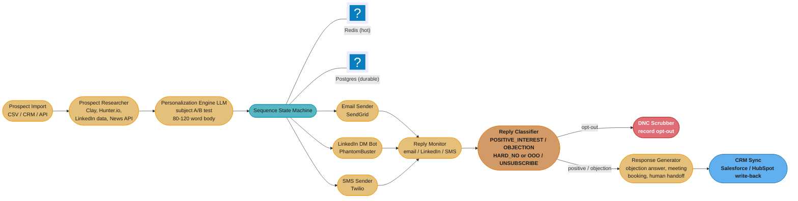

# Case Study: Design a Sales AI Agent Platform
## Intuition

> **Design intuition**: A sales AI agent is like a tireless junior SDR (Sales Development Representative) who never sleeps — it researches prospects, personalizes outreach emails, follows up six times over three weeks, handles objections via email and SMS, books calendar meetings, and updates Salesforce automatically. The engineering challenge is not conversation quality but durability and compliance: a sales sequence runs for 3-6 weeks with 8-12 touchpoints per prospect, must not spam the same prospect twice, must respect TCPA/GDPR do-not-contact laws, and must maintain coherent memory of every prior interaction across a months-long pipeline.

**Key insight for this design**: Sales AI agents operate on a fundamentally different time horizon than chat agents. A customer support bot resolves in under 10 minutes. A sales sequence plays out over weeks. The state machine (prospect contacted -> replied -> objection raised -> meeting booked -> ghosted -> follow-up 3) must be durable across process restarts, model version upgrades, and CRM sync failures — because a dropped sequence at week two means a lost deal. The hard problems are not LLM quality but operational: how do you guarantee that an opted-out prospect is never contacted again within 100ms of their opt-out, and how do you run 5 million simultaneous prospect sequences without losing a single state transition?

---

## 1. Requirements Clarification

### Functional Requirements

- Prospect research: ingest company info, recent news, LinkedIn profile data, and CRM history to generate personalized context per prospect
- Multi-channel outreach: email, LinkedIn DM, SMS, and cold call script prep
- Personalized email generation: LLM-generated prose tailored to each prospect, not mail-merge variable substitution
- Follow-up sequence management: 8-12 touchpoints over 3-6 weeks per prospect
- Reply handling and objection response: classify incoming replies, generate appropriate follow-up or objection response
- Meeting booking: propose calendar slots in prospect's timezone or deliver Calendly link on positive signal
- CRM read/write integration: Salesforce and HubSpot — read contact data, write back touchpoint history, meeting booked events, and sequence status
- Do-not-contact list enforcement: TCPA (SMS/phone), GDPR (EU data subjects), CAN-SPAM (commercial email) — zero tolerance
- Handoff to human rep: triggered at meeting booked stage or when opportunity value exceeds configured threshold

### Non-Functional Requirements

- Email deliverability greater than 98% (SPF/DKIM/DMARC configured, IP warming applied)
- Reply detection latency under 5 minutes from email receipt to reply classification
- Sequence state durability: survive process restart, model version upgrade, CRM sync failure
- Do-not-contact compliance: 100% — any lookup error defaults to BLOCK, never to allow
- Personalization throughput: 10,000 prospects per day per customer account
- CRM sync latency: under 60 seconds after every state change
- Opt-out honoring: immediate on receipt (CAN-SPAM requires within 10 business days; immediate is non-negotiable at production scale)

### Out of Scope

- Inbound lead qualification and routing
- Customer success and post-sale account management
- Voice call execution (call script prep is in scope; actual dialing is out of scope)

---

## 2. Scale Estimation

### Traffic Estimates

```
Enterprise customers:          500
Active prospects per customer: 10,000
Total active sequences:        500 x 10,000 = 5,000,000

Average touchpoints per sequence: 10 over 42 days
Average touchpoints per day:      10 / 42 = 0.238 touchpoints/prospect/day
Emails generated per day:         5,000,000 x 0.238 = 1,190,000 ~ 1.2M emails/day

Peak factor (Monday morning batch):  3x
Peak email generation rate:          3.6M emails / day

LLM token usage per email:
  Research context in prompt: ~600 tokens
  Generated email body:       ~120 tokens (target 80-120 words)
  Total per email:            ~720 tokens
Daily token generation:       1.2M emails x 120 output tokens = 144M output tokens/day
At GPT-6 Luna pricing ($0.50/M output tokens): $72/day output cost — platform-wide
Adding input (1.2M x 600 = 720M tokens/day at $0.10/M = $72/day): ~$144/day total LLM cost
(all 500 customers blended — matches the Section 10 capacity plan; LLM cost is negligible
 next to email infrastructure and CRM API budgets)
```

### CRM and API Estimates

```
CRM sync operations:
  A prospect generates ~12 CRM calls across a 42-day sequence (10 touchpoint activity
  logs + 2 state changes) = 12 / 42 = 0.286 calls/prospect/day
  5M prospects x 0.286 = 1.43M Salesforce/HubSpot API calls/day platform-wide
  Salesforce API limit: 100,000 calls/org/day (edition- and licence-dependent; 100K is
  the working assumption for a mid-size Enterprise Edition org)
  Max active prospects per Salesforce org: 100,000 / 0.286 = 350,000 (matches Section 10)
  Mitigation: batch CRM updates, coalesce multiple state changes per prospect per hour

Email sending:
  1.2M emails/day across 500 customers = 2,400 emails/customer/day
  Per sending domain limit (warmed): 5,000-10,000 emails/domain/day
  Required: 1 sending domain per customer (well within per-domain limits)

Reply volume (reply rate is measured against emails SENT, not against opens):
  1.2M emails/day x 5% reply rate = 60,000 replies/day
  Per customer: 60,000 / 500 = 120 replies/day = ~5 replies/hour
  (this is the "normal max is 5/hour" baseline the reply-flood runbook keys off)
  Peak reply rate: 60,000 / 86,400 seconds = 0.69 replies/sec (trivial)
```

### State Storage Estimates

```
Per-prospect sequence state:
  conversation_history (last 5 emails + replies):  2,000 bytes
  touchpoints_sent list + timestamps:               500 bytes
  CRM field snapshot (company, role, pain points):  1,000 bytes
  scheduling metadata:                              500 bytes
  Total per sequence:                               ~4,000 bytes = 4 KB

Active sequences in Redis (hot):
  5M sequences x 4 KB = 20 GB
  Redis cluster: 3 primary + 3 replica x 8 GB RAM = 48 GB raw, 24 GB usable
  (matches the Section 10 sizing; replication factor 2 halves usable capacity)

Cold archival in Postgres:
  5M active + 20M completed sequences (6-month retention)
  25M sequences x 4 KB = 100 GB Postgres storage
```

---

## 3. High-Level Architecture



### Supporting Systems

```
  +----------------------------+    +-----------------------------+
  | DNCScrubber (compliance)   |    | DeliverabilityManager       |
  | - Federal DNC Registry API |    | - SPF/DKIM/DMARC check      |
  | - State DNC lists          |    | - Domain warmup scheduler   |
  | - Internal opt-out Redis   |    | - Bounce rate monitor       |
  | - GDPR consent records     |    | - Domain rotation on degrad.|
  +----------------------------+    +-----------------------------+

  +----------------------------+    +-----------------------------+
  | Observability (OTel)       |    | Eval Pipeline               |
  | - Trace per touchpoint     |    | - Weekly reply rate bench   |
  | - dnc_check span           |    | - Open / reply rate tracking|
  | - send span                |    | - A/B subject line results  |
  | - delivery event spans     |    | - Alert on 2pp regression   |
  +----------------------------+    +-----------------------------+
```

See also: [Agent Durability Patterns](./cross_cutting/agent_durability_patterns.md) for sequence state durability patterns.
See also: [Tenant Isolation Patterns](./cross_cutting/tenant_isolation_patterns.md) for per-customer data isolation guarantees.

---

## 4. Component Deep Dives

### 4.1 Durable Sequence State Machine

A prospect sequence has 15+ states and runs for weeks. The naive implementation stores all in-flight sequence state in process memory.

```python
# BROKEN: state stored in process memory
# Any process restart, deploy, or crash loses ALL in-progress sequences.
# 5M active sequences disappear silently; prospects never receive follow-ups.

class BrokenSequenceRunner:
    def __init__(self) -> None:
        self._sequences: dict[str, dict] = {}  # lost on process restart

    def advance(self, prospect_id: str) -> None:
        seq = self._sequences.get(prospect_id)
        if seq is None:
            return  # silently drops sequence after restart
        seq["current_step"] += 1
        seq["last_contact"] = datetime.now()
        # changes never persisted — next restart rolls back to step 0

runner = BrokenSequenceRunner()
runner.advance("prospect_abc")  # works until process dies
```

```python
# FIX: durable state in Postgres (source of truth) + Redis (read cache, fast recovery)
from __future__ import annotations
import json
from dataclasses import dataclass, field, asdict
from datetime import datetime, timezone, timedelta
from enum import Enum
from typing import Optional
import redis
import psycopg2


class SequenceStatus(str, Enum):
    ACTIVE = "ACTIVE"; PAUSED = "PAUSED"; COMPLETED = "COMPLETED"
    OPTED_OUT = "OPTED_OUT"; MEETING_BOOKED = "MEETING_BOOKED"; HARD_NO = "HARD_NO"


class SequenceEvent(str, Enum):
    TOUCHPOINT_SENT = "TOUCHPOINT_SENT"; REPLY_RECEIVED = "REPLY_RECEIVED"
    MEETING_BOOKED = "MEETING_BOOKED"; OPT_OUT = "OPT_OUT"; HARD_NO = "HARD_NO"
    SEQUENCE_EXHAUSTED = "SEQUENCE_EXHAUSTED"; HUMAN_TAKEOVER = "HUMAN_TAKEOVER"


def _now() -> str:
    return datetime.now(timezone.utc).isoformat()


@dataclass
class ProspectSequence:
    prospect_id: str
    account_id: str
    sequence_template_id: str
    current_step: int = 0
    touchpoints_sent: int = 0
    replies_received: int = 0
    last_contact_datetime: Optional[str] = None
    next_scheduled_datetime: Optional[str] = None   # stored once; NEVER recomputed on resume
    status: SequenceStatus = SequenceStatus.ACTIVE
    updated_at: str = field(default_factory=_now)


_S, _E = SequenceStatus, SequenceEvent
_TRANSITIONS: dict[tuple[SequenceStatus, SequenceEvent], SequenceStatus] = {
    (_S.ACTIVE, _E.TOUCHPOINT_SENT): _S.ACTIVE,      (_S.ACTIVE, _E.REPLY_RECEIVED): _S.ACTIVE,
    (_S.ACTIVE, _E.MEETING_BOOKED): _S.MEETING_BOOKED, (_S.ACTIVE, _E.OPT_OUT): _S.OPTED_OUT,
    (_S.ACTIVE, _E.HARD_NO): _S.HARD_NO,             (_S.ACTIVE, _E.SEQUENCE_EXHAUSTED): _S.COMPLETED,
    (_S.ACTIVE, _E.HUMAN_TAKEOVER): _S.PAUSED,       (_S.PAUSED, _E.TOUCHPOINT_SENT): _S.ACTIVE,
}


class SequenceStateMachine:
    """Postgres commit first (authoritative), then best-effort Redis write.
    Reads: Redis hit ~2 ms; miss falls back to Postgres ~50 ms and re-warms the cache."""

    KEY = "seq:{}"
    TTL = 90 * 24 * 3600            # 90 days; exceeds the 42-day maximum sequence

    def __init__(self, r: redis.Redis, pg: psycopg2.extensions.connection) -> None:
        self._redis, self._pg = r, pg

    def load(self, prospect_id: str) -> Optional[ProspectSequence]:
        raw = self._redis.get(self.KEY.format(prospect_id))
        if raw:
            return ProspectSequence(**json.loads(raw))
        with self._pg.cursor() as cur:      # recovery path after restart or eviction
            cur.execute("SELECT state_json FROM prospect_sequences WHERE prospect_id = %s",
                        (prospect_id,))
            row = cur.fetchone()
        if row is None:
            return None
        seq = ProspectSequence(**json.loads(row[0]))
        self._cache(seq)
        return seq

    def advance(self, prospect_id: str, event: SequenceEvent) -> ProspectSequence:
        seq = self.load(prospect_id)
        if seq is None:
            raise ValueError(f"no sequence for {prospect_id}")
        nxt = _TRANSITIONS.get((seq.status, event))
        if nxt is None:
            raise ValueError(f"invalid transition {seq.status} + {event}")
        seq.status, seq.updated_at = nxt, _now()
        if event is _E.TOUCHPOINT_SENT:
            seq.touchpoints_sent += 1; seq.current_step += 1; seq.last_contact_datetime = _now()
        elif event is _E.REPLY_RECEIVED:
            seq.replies_received += 1
        self._persist(seq)                  # 1. source of truth
        self._cache(seq)                    # 2. best effort; Postgres is already correct
        return seq

    def schedule_next(self, seq: ProspectSequence, gap_days: int = 4) -> str:
        """3-7 day gap, weekdays only, 10:00 US/Eastern (15:00 UTC); production uses the
        prospect's inferred timezone. Stored once so a resume never drifts the schedule."""
        at = datetime.now(timezone.utc) + timedelta(days=max(3, min(gap_days, 7)))
        while at.weekday() >= 5:
            at += timedelta(days=1)
        seq.next_scheduled_datetime = at.replace(hour=15, minute=0, second=0, microsecond=0).isoformat()
        self._persist(seq); self._cache(seq)
        return seq.next_scheduled_datetime

    def pause_all_for_account(self, account_id: str) -> int:
        """Bulk-pause every ACTIVE sequence for an account (rep takeover, TCPA complaint)."""
        with self._pg.cursor() as cur:
            cur.execute("""UPDATE prospect_sequences SET status = 'PAUSED', updated_at = NOW()
                           WHERE account_id = %s AND status = 'ACTIVE' RETURNING prospect_id""",
                        (account_id,))
            paused = [row[0] for row in cur.fetchall()]
        self._pg.commit()
        if paused:
            self._redis.delete(*(self.KEY.format(p) for p in paused))   # drop stale cache
        return len(paused)

    def _persist(self, seq: ProspectSequence) -> None:
        with self._pg.cursor() as cur:
            cur.execute(
                """INSERT INTO prospect_sequences (prospect_id, account_id, state_json, updated_at)
                   VALUES (%s, %s, %s, NOW()) ON CONFLICT (prospect_id) DO UPDATE
                   SET state_json = EXCLUDED.state_json, updated_at = EXCLUDED.updated_at""",
                (seq.prospect_id, seq.account_id, json.dumps(asdict(seq))))
        self._pg.commit()

    def _cache(self, seq: ProspectSequence) -> None:
        try:
            self._redis.setex(self.KEY.format(seq.prospect_id), self.TTL, json.dumps(asdict(seq)))
        except redis.RedisError:
            pass                            # next load falls back to Postgres
```

Concrete numbers: Redis hit takes 2ms; Postgres fallback takes 50ms. Redis key TTL is 90 days (maximum sequence length). On a process restart with 5M active sequences, recovery is passive — sequences are reloaded from Postgres on first access, not eagerly. `next_scheduled_datetime` is always stored in durable state; it is never recalculated on resume. This prevents the temporal drift failure described in Section 9.

### 4.2 Compliance Enforcement: Do-Not-Contact

TCPA violations carry a statutory penalty of $500-$1,500 per unauthorized contact. Zero tolerance means blocking at the architecture level, not logging after the fact.

```python
# BROKEN: opt-out stored only in Postgres
# Replication lag creates a 50-200ms window where an opted-out prospect
# can be contacted by a second concurrent touchpoint worker.

class BrokenDNCScrubber:
    def is_contactable(self, phone: str) -> bool:
        # reads from Postgres replica — up to 200ms replication lag
        result = db_replica.query("SELECT opted_out FROM dnc WHERE phone = %s", phone)
        return result is None  # False if opted out
        # Race: if opt-out was written 100ms ago, replica hasn't replicated yet
        # Second concurrent send reads stale state -> contacts opted-out prospect
```

```python
# FIX: opt-out written to Redis immediately + checked from Redis before every send

from __future__ import annotations

import time
from dataclasses import dataclass
from enum import Enum
from typing import Optional
import redis


class Channel(str, Enum):
    EMAIL = "EMAIL"
    SMS = "SMS"
    LINKEDIN = "LINKEDIN"
    PHONE = "PHONE"


EU_COUNTRIES = frozenset(
    ["AT","BE","BG","HR","CY","CZ","DK","EE","FI","FR","DE","GR","HU",
     "IE","IT","LV","LT","LU","MT","NL","PL","PT","RO","SK","SI","ES","SE"]
)


@dataclass
class Prospect:
    prospect_id: str
    email: str
    phone: Optional[str]
    country: str   # ISO 3166-1 alpha-2
    gdpr_consent: bool   # explicit opt-in on record


class DNCScrubber:
    """
    Do-Not-Contact enforcement.
    All checks read from Redis (single-digit ms) to eliminate replication lag windows.
    Any lookup error or Redis unavailability defaults to BLOCK — never to allow.
    Opt-outs are written to Redis synchronously before Postgres to eliminate the lag window.
    """

    OPT_OUT_KEY_PREFIX = "dnc:optout:"
    EMAIL_SUPPRESSION_PREFIX = "dnc:email:"

    def __init__(self, redis_client: redis.Redis, pg_conn) -> None:
        self._redis = redis_client
        self._pg = pg_conn

    def is_contactable(self, prospect: Prospect, channel: Channel) -> bool:
        """
        Returns True only if ALL checks pass.
        Any exception or lookup failure returns False (block-on-error policy).
        """
        try:
            # 1. Check internal opt-out (Redis, no replication lag)
            opt_out_key = f"{self.OPT_OUT_KEY_PREFIX}{prospect.prospect_id}"
            if self._redis.exists(opt_out_key):
                return False

            # 2. Email suppression list (unsubscribes from any prior email)
            if channel == Channel.EMAIL:
                email_key = f"{self.EMAIL_SUPPRESSION_PREFIX}{prospect.email.lower()}"
                if self._redis.exists(email_key):
                    return False

            # 3. GDPR: EU data subjects require explicit consent
            if prospect.country in EU_COUNTRIES and not prospect.gdpr_consent:
                return False

            # 4. SMS / Phone: TCPA requires express written consent
            if channel in (Channel.SMS, Channel.PHONE) and prospect.phone:
                tcpa_key = f"dnc:tcpa_consent:{prospect.prospect_id}"
                if not self._redis.exists(tcpa_key):
                    return False  # no consent record = cannot contact via SMS/phone

            # 5. National DNC Registry (phone): external API call with local cache
            if channel in (Channel.SMS, Channel.PHONE) and prospect.phone:
                federal_key = f"dnc:federal:{prospect.phone}"
                federal_cached = self._redis.get(federal_key)
                if federal_cached == b"blocked":
                    return False
                elif federal_cached is None:
                    # Cache miss: call FTC DNC registry API (real: data.ftc.gov lookup)
                    on_federal_dnc = self._check_federal_dnc_registry(prospect.phone)
                    # Cache result for 24 hours (registry updates daily)
                    self._redis.setex(federal_key, 86400, b"blocked" if on_federal_dnc else b"ok")
                    if on_federal_dnc:
                        return False

            return True

        except Exception:
            # Block-on-error: if any check fails (Redis down, API timeout), default to BLOCK
            return False

    def record_opt_out(
        self,
        prospect_id: str,
        email: str,
        channel: Channel,
        reason: str,
        timestamp: float = None,
    ) -> None:
        """
        Immutable opt-out record.
        Redis write happens FIRST (synchronous) to eliminate the replication-lag window.
        Postgres write is the durable audit record.
        This method must complete in under 100ms — legally required for unsubscribe.
        """
        if timestamp is None:
            timestamp = time.time()

        # 1. Write to Redis immediately (eliminates lag window)
        opt_out_key = f"{self.OPT_OUT_KEY_PREFIX}{prospect_id}"
        self._redis.set(opt_out_key, b"1")  # no TTL — opt-outs are permanent

        if channel == Channel.EMAIL:
            email_key = f"{self.EMAIL_SUPPRESSION_PREFIX}{email.lower()}"
            self._redis.set(email_key, b"1")

        # 2. Write to Postgres for durable audit trail (async-safe — Redis already blocks sends)
        with self._pg.cursor() as cur:
            cur.execute(
                """INSERT INTO dnc_records
                   (prospect_id, email, channel, reason, opted_out_at)
                   VALUES (%s, %s, %s, %s, to_timestamp(%s))
                   ON CONFLICT (prospect_id, channel) DO NOTHING""",
                (prospect_id, email, channel.value, reason, timestamp)
            )
            self._pg.commit()

    def _check_federal_dnc_registry(self, phone: str) -> bool:
        # Production: call FTC DNC registry API or use a licensed DNC data provider
        # e.g., Neustar, Experian DNC registry data subscription
        raise NotImplementedError
```

Concrete numbers: the DNC check adds 5-15ms per send (Redis lookup with warm cache); the block-on-error policy means any Redis timeout (default 100ms) results in the send being blocked, not allowed. The federal DNC registry result is cached for 24 hours because the registry updates daily. For SMS and phone channels, the absence of a positive TCPA consent record is itself a block signal — not just the presence of an opt-out record.

### 4.3 Email Personalization with Prospect Research

Prospects ignore generic mail-merge emails. The personalization engine generates a completely bespoke email per prospect using enriched research context.

```python
from __future__ import annotations
import asyncio
import json
from dataclasses import dataclass, field

INDUSTRY_PAINS: dict[str, list[str]] = {
    "SaaS":       ["churn reduction", "trial-to-paid conversion", "expansion revenue"],
    "eCommerce":  ["cart abandonment", "customer LTV", "returns reduction"],
    "FinTech":    ["compliance overhead", "fraud detection latency", "KYC cost"],
    "HealthTech": ["HIPAA compliance cost", "clinician time wasted", "EHR integration"],
}


@dataclass
class ProspectContext:
    full_name: str
    title: str
    company_name: str
    company_size: str               # "11-50", "51-200", ...
    company_recent_news: list[str]  # top 3, refreshed at every touchpoint
    company_pain_points: list[str]  # inferred from vertical + size
    talking_points: list[str]
    past_interactions: list[str]    # prior CRM touchpoints


@dataclass
class Email:
    subject: str
    body: str
    subject_variants: list[str] = field(default_factory=list)   # A/B candidates


class ProspectResearcher:
    """Clay waterfall + CRM history + news in parallel: latency = slowest call, 0.8-1.5 s."""

    def __init__(self, clay, crm, news) -> None:
        self._clay, self._crm, self._news = clay, crm, news

    async def research(self, email: str, domain: str) -> ProspectContext:
        clay, history, news = await asyncio.gather(
            self._clay.enrich(email, domain), self._crm.history(email),
            self._news.recent(domain), return_exceptions=True)
        info = clay if isinstance(clay, dict) else {}           # degrade, never fail the send
        news = news if isinstance(news, list) else []
        points = [f"Saw {info.get('company_name', 'your company')} announced: {news[0]}"] if news else []
        return ProspectContext(
            info.get("full_name", ""), info.get("title", ""), info.get("company_name", ""),
            info.get("employee_count_range", ""), news[:3],
            INDUSTRY_PAINS.get(info.get("industry", ""), ["operational efficiency", "cost reduction"]),
            points, history if isinstance(history, list) else [])


class EmailPersonalizer:
    """Writes the whole email (not mail-merge): 80-120 word body, 3 subject variants."""

    SYSTEM = ("You are an expert B2B sales copywriter. Write a cold email with an 80-120 word "
              "body that references ONE specific, verifiable fact about the prospect, ends with "
              "a single low-friction question, and avoids buzzwords. Return JSON with keys "
              "subject, body, subject_variants (3 items).")

    def __init__(self, llm_client, model: str = "gpt-6-luna") -> None:
        self._llm, self._model = llm_client, model    # $0.10 / $0.50 per MTok

    async def generate(self, ctx: ProspectContext, touchpoint: int) -> Email:
        prompt = (f"Prospect: {ctx.full_name}, {ctx.title} at {ctx.company_name} "
                  f"({ctx.company_size} employees)\nNews: {'; '.join(ctx.company_recent_news[:2])}\n"
                  f"Likely challenges: {', '.join(ctx.company_pain_points[:2])}\n"
                  f"Talking point: {ctx.talking_points[0] if ctx.talking_points else 'growth stage'}\n"
                  f"Touchpoint {touchpoint}." + (" Acknowledge the follow-up without pressure." if touchpoint > 1 else ""))
        resp = await self._llm.chat.completions.create(
            model=self._model,
            messages=[{"role": "system", "content": self.SYSTEM}, {"role": "user", "content": prompt}],
            response_format={"type": "json_object"})
        data = json.loads(resp.choices[0].message.content)
        return Email(data.get("subject", ""), data.get("body", ""), data.get("subject_variants", []))
```

Concrete numbers: personalization generation takes 1.2s per email; at 10,000 prospects per account per day with sequential processing = 3.3 hours compute. With 50 parallel async workers: 10,000 / 50 = 200 batches x 1.2s = 4 minutes. Subject line A/B testing generates 3 variants per email and tracks open rate per variant over a 7-day window; the winning variant is promoted as the default for the next 1,000 sends to similar prospect profiles.

### 4.4 Reply Classification and Handoff

Every reply must be classified within 5 minutes of receipt. Misclassification has legal and reputational consequences.

```python
from __future__ import annotations
from dataclasses import dataclass
from enum import Enum
from typing import Optional


class ReplyCategory(str, Enum):
    POSITIVE_INTEREST = "POSITIVE_INTEREST"   # advance to meeting booking
    SOFT_NO = "SOFT_NO"                       # "not now": continue at reduced cadence
    HARD_NO = "HARD_NO"                       # stop immediately
    OBJECTION = "OBJECTION"; OOO = "OOO"; REFERRAL = "REFERRAL"; QUESTION = "QUESTION"
    UNSUBSCRIBE = "UNSUBSCRIBE"               # legal opt-out: honor within 100 ms


@dataclass
class ReplyClassification:
    category: ReplyCategory
    confidence: float
    requires_human_review: bool = False
    detail: Optional[str] = None              # objection type, OOO return date, or referral


class ReplyClassifier:
    """Compliance-critical labels never depend on the LLM alone: hard-coded patterns run
    first, and any LLM label that disagrees with an opt-out signal is overridden."""

    HARD_NO_PATTERNS = ("not interested", "no thanks", "please remove", "take me off",
                        "unsubscribe", "stop emailing", "do not contact", "not a fit",
                        "never contact", "remove me", "opt out", "leave me alone")

    def __init__(self, llm_client, dnc: "DNCScrubber") -> None:
        self._llm, self._dnc = llm_client, dnc

    async def classify(self, reply: str, prospect: "Prospect",
                       opportunity_value_usd: float = 0.0) -> ReplyClassification:
        lower = reply.lower()
        if any(p in lower for p in self.HARD_NO_PATTERNS):       # fast path, no LLM
            self._opt_out(prospect)
            return ReplyClassification(ReplyCategory.HARD_NO, 1.0)
        result = await self._llm_classify(reply)                  # structured-output call
        if result.category is ReplyCategory.SOFT_NO and "unsubscribe" in lower:
            result.category = ReplyCategory.HARD_NO               # never trust the LLM here
        if result.category in (ReplyCategory.HARD_NO, ReplyCategory.UNSUBSCRIBE):
            self._opt_out(prospect)                               # synchronous, before return
        result.requires_human_review = result.confidence < 0.75 or opportunity_value_usd > 50_000
        return result

    def _opt_out(self, prospect: "Prospect") -> None:
        self._dnc.record_opt_out(prospect_id=prospect.prospect_id, email=prospect.email,
                                 channel=Channel.EMAIL, reason="HARD_NO_OR_UNSUBSCRIBE")

    async def _llm_classify(self, reply: str) -> ReplyClassification:
        raise NotImplementedError   # GPT-6 Luna with a JSON schema of ReplyCategory


class MeetingBooker:
    """On POSITIVE_INTEREST: propose 3 x 30-minute slots from the rep's next 5 business
    days in the prospect's timezone, and alert the rep in Slack at the same moment."""

    def __init__(self, calendar, slack) -> None:
        self._calendar, self._slack = calendar, slack

    async def propose_times(self, prospect: "Prospect", rep_id: str) -> list[dict]:
        slots = (await self._calendar.get_free_slots(user_id=rep_id, duration_minutes=30,
                                                     days_ahead=5))[:3]
        await self._slack.post_message(
            channel=f"#rep-{rep_id}",
            text=f"MEETING SIGNAL: {prospect.full_name} at {prospect.company_name}; 3 slots proposed.")
        return slots
```

### 4.5 Email Deliverability Management

Email deliverability is the silent killer of outbound programs. A blacklisted sending domain renders an entire customer's sequence investment worthless.

```python
from __future__ import annotations

from dataclasses import dataclass
from enum import Enum
from typing import Optional


class WarmupStage(str, Enum):
    NEW = "NEW"               # Day 1-7: max 20 emails/day
    RAMPING = "RAMPING"       # Day 8-30: max 200 emails/day
    WARMED = "WARMED"         # Day 31+: max 5,000 emails/day


@dataclass
class DomainHealth:
    domain: str
    spf_valid: bool
    dkim_valid: bool
    dmarc_valid: bool
    domain_age_days: int
    bounce_rate_7d: float           # 0.0-1.0; alert above 0.05
    spam_complaint_rate_7d: float   # 0.0-1.0; alert above 0.001 (0.1%)
    blacklisted: bool               # MX Toolbox / Spamhaus check
    warmup_stage: WarmupStage
    health_score: float             # 0.0-1.0 composite


class DeliverabilityManager:
    """
    Manages sending domain health, warmup schedules, and domain rotation.
    Each customer account has a primary sending domain and 1-2 backup domains.
    Domain rotation is triggered automatically when bounce rate exceeds 5%.
    """

    BOUNCE_RATE_ALERT = 0.05       # 5%: rotate domain immediately
    SPAM_COMPLAINT_ALERT = 0.001   # 0.1%: pause and investigate

    WARMUP_LIMITS: dict[WarmupStage, int] = {
        WarmupStage.NEW:     20,
        WarmupStage.RAMPING: 200,
        WarmupStage.WARMED:  5000,
    }

    def __init__(self, redis_client, dns_checker, blacklist_checker) -> None:
        self._redis = redis_client
        self._dns = dns_checker
        self._blacklist = blacklist_checker

    async def check_domain_health(self, domain: str) -> DomainHealth:
        spf = await self._dns.check_spf(domain)
        dkim = await self._dns.check_dkim(domain)
        dmarc = await self._dns.check_dmarc(domain)
        blacklisted = await self._blacklist.check(domain)  # MX Toolbox / Spamhaus

        bounce_rate = float(self._redis.get(f"bounce:{domain}:7d") or 0)
        spam_rate = float(self._redis.get(f"spam:{domain}:7d") or 0)
        age_days = int(self._redis.get(f"domain_age:{domain}") or 0)

        stage = self._get_warmup_stage(age_days)
        health = self._compute_health_score(spf, dkim, dmarc, blacklisted, bounce_rate, spam_rate)

        return DomainHealth(
            domain=domain, spf_valid=spf, dkim_valid=dkim, dmarc_valid=dmarc,
            domain_age_days=age_days, bounce_rate_7d=bounce_rate,
            spam_complaint_rate_7d=spam_rate, blacklisted=blacklisted,
            warmup_stage=stage, health_score=health,
        )

    def get_send_limit(self, domain: str, warmup_stage: WarmupStage) -> int:
        """Returns max emails/day for this domain based on warmup stage."""
        return self.WARMUP_LIMITS[warmup_stage]

    async def rotate_sending_domain(self, account_id: str, degraded_domain: str) -> str:
        """
        Selects backup domain for account when primary is degraded.
        Backup domain must be WARMED and have health_score > 0.8.
        """
        backup_domains = await self._get_backup_domains(account_id)
        for domain in backup_domains:
            if domain == degraded_domain:
                continue
            health = await self.check_domain_health(domain)
            if health.warmup_stage == WarmupStage.WARMED and health.health_score > 0.8:
                await self._update_active_domain(account_id, domain)
                return domain
        raise RuntimeError(f"No healthy backup domain available for account {account_id}")

    def _get_warmup_stage(self, age_days: int) -> WarmupStage:
        if age_days <= 7:
            return WarmupStage.NEW
        elif age_days <= 30:
            return WarmupStage.RAMPING
        return WarmupStage.WARMED

    def _compute_health_score(self, spf, dkim, dmarc, blacklisted, bounce, spam) -> float:
        if blacklisted:
            return 0.0
        score = 1.0
        if not spf:   score -= 0.3
        if not dkim:  score -= 0.3
        if not dmarc: score -= 0.2
        score -= min(bounce / 0.05, 1.0) * 0.15    # up to -0.15 for bounce rate
        score -= min(spam / 0.001, 1.0) * 0.05     # up to -0.05 for spam complaints
        return max(0.0, score)

    async def _get_backup_domains(self, account_id: str) -> list[str]: raise NotImplementedError
    async def _update_active_domain(self, account_id: str, domain: str) -> None: raise NotImplementedError
```

Concrete numbers: a new sending domain is limited to 20 emails per day during the first 7 days of warmup to establish sender reputation with mailbox providers. A warmed domain (30+ days old) can safely send 5,000-10,000 emails per day. Bounce rate above 5% or spam complaint rate above 0.1% triggers immediate domain rotation. Working targets used throughout this design for AI-personalized outreach (this platform's own operating assumptions, not a published industry benchmark): 35-40% open rate against 20% for generic mail-merge, and 5-8% reply rate against 1-2% for generic.

---

## 5. Design Decisions & Tradeoffs

| Decision | Chosen Approach | Alternative | Rationale |
|----------|----------------|-------------|-----------|
| Sequence state storage | Redis (hot) + Postgres (durable) | Temporal workflow engine | Temporal provides superior durability and built-in versioning; chosen for >500K sequences. Redis+Postgres wins for simplicity at <500K sequences. At 5M sequences, Temporal is the right answer but adds 2-3 months of migration complexity |
| State recovery | Passive (load-on-first-access from Postgres) | Eager (replay all state into Redis on startup) | Eager replay of 5M sequences at startup takes 25 minutes (5M x 4KB / 50MB/s Postgres throughput); passive recovery adds 50ms to the first access per sequence post-restart but does not block startup |
| Email generation | Full LLM-generated body | Template + AI-personalized inserts | Full generation: most personalized, higher variance, harder to compliance-review; template + inserts: consistent structure, predictable length, easier legal review. Enterprise customers chose templates; SMB customers chose full generation |
| Sending domains | Multiple domains per account (primary + 2 backup) | Single domain per account | Single domain: simpler DNS management, reputation concentration risk; if primary domain is blacklisted, all sequences stop. Multiple domains: rotation on degradation, domain warmup management complexity. Multiple domains wins at scale |
| Reply classification | LLM with hard-coded HARD_NO pattern override | LLM only | Pure LLM: 97% accuracy on clear positives/negatives, 85% accuracy on ambiguous; but 3% HARD_NO miss rate means 3 out of 100 "stop emailing me" replies continue the sequence — unacceptable. Hard-coded patterns for opt-out signals guarantee zero misses |
| Research timing | Research at sequence start + news refresh per touchpoint | Research just-in-time before each touchpoint | JIT: freshest context, adds 1.5s latency before each scheduled touchpoint send during batch window; at-start + refresh: 1.2s only for news API at touchpoint time, core context stays current because LinkedIn and company info changes slowly |
| Human handoff threshold | POSITIVE_INTEREST OR opportunity value > $50K | Always AI until meeting confirmed | Enterprise deals above $50K need human nuance; AI can book a meeting but cannot negotiate contract terms or navigate political dynamics. Hard threshold at $50K triggers immediate rep notification |

---

## 6. Real-World Implementations

Funding rounds, valuations and self-reported performance figures for private companies change
constantly and are frequently mis-stated in secondary coverage. The descriptions below are
limited to publicly observable product architecture; specific round sizes, valuations and
vendor-reported uplift numbers are deliberately omitted rather than asserted unverified.

**Sierra AI**: enterprise conversational-AI platform, primarily customer service, with voice,
email, and chat on one agent runtime. Integrates with existing CRM workflows rather than
replacing them — positioned as augmentation, not replacement, which reduces enterprise sales
friction. Co-founded by Salesforce's former co-CEO Bret Taylor (also chair of OpenAI's board)
and Clay Bavor, a longtime Google executive.

**11x / Alice SDR**: AI SDR product where the "Alice" agent handles the outbound cycle from
research to meeting booking. Uses a proprietary research layer rather than Clay. Targets
mid-market SaaS companies where full-time SDR headcount is a significant cost center. Vendor
claims of uplift versus human SDRs are marketing figures with no published methodology.

**Artisan AI / Ava**: an AI sales persona ("Ava") marketed as a fully autonomous AI SDR
handling research, email drafting, LinkedIn outreach and follow-up sequences. Primary market
is SMB, where a full-time SDR salary is cost-prohibitive relative to a per-seat SaaS price.

**Clay**: a data enrichment and workflow platform rather than a full AI sales agent, but it
powers the research layer for many AI SDR products. Aggregates dozens of data sources with
waterfall enrichment — if source A does not have the email, try B, then C. Provides the data
layer that makes personalization possible at scale.

**Lindy**: general-purpose AI agent platform with strong sales workflow support. Trigger-based
architecture: new lead appears in CRM -> research -> draft outreach -> schedule follow-up.
No-code workflow builder with broad third-party integration coverage. Positioned as the
platform layer; sales automation is one of many supported use cases.

**AiSDR**: dedicated AI SDR platform. Focuses on reply personalization — the system tailors
follow-up content based on the specific language and tone of the prospect's reply, rather than
selecting from a fixed set of canned objection handlers.

---

## 7. Technologies & Tools

### Sequence State Storage Comparison

| Dimension | Redis + Postgres | Temporal Workflow Engine | LangGraph Persistence |
|-----------|-----------------|-------------------------|-----------------------|
| State durability | High (Postgres WAL) | Highest (Temporal DB) | Medium (depends on backend) |
| Recovery after restart | 50ms per sequence (Postgres query) | Automatic (Temporal replays history) | Manual re-hydration |
| Max sequence length | No limit (Postgres archival) | No limit (history compaction) | Limited by context window |
| Versioning support | Manual (state schema migrations) | Built-in (workflow versioning API) | None |
| Operational complexity | Low | High (requires Temporal cluster) | Low |
| Best at scale | Under 500K active sequences | Over 500K active sequences | Prototypes and small deployments |
| Cost | Low (Redis + Postgres managed) | High (Temporal Cloud or self-hosted) | Low |

### Email Sending Platform Comparison

| Dimension | SendGrid | Amazon SES | Postmark | Mailgun |
|-----------|----------|-----------|---------|---------|
| Deliverability reputation | High | Medium-High | Highest (transactional) | High |
| Dedicated IP warmup support | Yes | Yes | Yes (paid plan) | Yes |
| Bounce / complaint webhooks | Yes | Yes (SNS) | Yes | Yes |
| Analytics depth | Comprehensive | Basic | Good | Good |
| Cost per 1K emails (list, mid-tier plan) | ~$0.89 | $0.10 | ~$1.50 | ~$0.80 |
| DKIM / DMARC support | Yes | Yes | Yes | Yes |
| Best for outbound sales | Yes (SendGrid Marketing) | Cost-optimized high volume | Transactional; not ideal for outbound | Good alternative |
| Sending caps | Plan-based monthly quota | No hard cap; reputation- and quota-based | Plan-based monthly quota | Plan-based monthly quota |

### Prospect Enrichment Comparison

| Dimension | Clay | Apollo.io | Hunter.io | LinkedIn Sales Navigator |
|-----------|------|-----------|-----------|-------------------------|
| Data sources | 100+ (waterfall) | Proprietary DB | Email-focused | LinkedIn native |
| Email accuracy | 95% (waterfall verified) | 85-90% | 90%+ | N/A (no email) |
| Phone data | Yes (via providers) | Yes | No | Yes |
| Company news | Yes (via Clearbit + news APIs) | Limited | No | Some |
| GDPR compliance | Yes (data residency options) | Partial | Yes | Yes (LinkedIn ToS) |
| API rate limits | Generous (credit-based) | 10K records/export | 50 requests/month (free) | LinkedIn API restricted |
| Pricing model | Credit-based subscription | Per-seat subscription | Tiered by lookups/month | Per-seat subscription |
| Best for | AI SDR research layer | Full sales prospecting DB | Email verification | LinkedIn-first prospecting |

Match-rate and email-accuracy figures in this table are vendor-published marketing claims with
no shared benchmark or methodology; treat them as relative ordering, not measurements. List
prices for all four change frequently — check current plans before building a budget on them.

---

## 8. Operational Playbook

### Eval Pipeline

Weekly reply rate benchmark runs every Sunday at 02:00 UTC against 100 fixed A/B test sequences. Alert fires if reply rate drops more than 2 percentage points versus 30-day rolling average, or if open rate drops more than 5 percentage points. Personalization quality is evaluated by sampling 500 generated emails per week and scoring them on a 1-5 rubric (specificity of research reference, absence of generic phrases, word count compliance, call-to-action clarity) using an LLM judge with a validated rubric. Reference [LLM Eval Harness in Production](./cross_cutting/llm_eval_harness_in_production.md) for judge rubric design and anti-gaming guardrails.

A/B test infrastructure: each email send records `(subject_variant_id, email_id, account_id, prospect_segment)`. Open rate and reply rate are tracked per variant with a minimum of 500 sends per variant before a winner is declared. The winning subject line variant is promoted to the default template parameter for the next 30 days.

### Observability

Every prospect touchpoint produces a complete OpenTelemetry trace:

```
Trace: prospect_touchpoint (root span)
  attrs:
    prospect_id_hash: sha256(prospect_id)[:16]   # privacy-safe
    account_id: "acme_corp"
    touchpoint_number: 3
    channel: "EMAIL"
    sequence_template_id: "enterprise_saas_v2"
  |
  +-- Span: dnc_check (12ms)
  |     attrs: channel, decision=ALLOW, check_count=4
  |     events: [t=2ms] internal_optout_check=CLEAR
  |             [t=5ms] gdpr_check=CLEAR
  |             [t=12ms] federal_dnc_check=CLEAR
  |
  +-- Span: personalization (1450ms)
  |     attrs: research_ms=820, generation_ms=630
  |             word_count=97, subject_variant=B
  |     events: [t=820ms] research_complete
  |             [t=1450ms] email_generated
  |
  +-- Span: email_send (85ms)
  |     attrs: sending_domain="outreach.acmecorp.com"
  |             message_id="msg_xyz789", warmup_stage=WARMED
  |
  +-- Span: crm_sync (210ms)
  |     attrs: crm_type=SALESFORCE, operation=UPSERT
  |             activity_id="sfdc_act_001"
  |
  +-- Span: state_advance (8ms)
        attrs: previous_status=ACTIVE, new_status=ACTIVE
               new_step=3, next_scheduled=ISO8601
```

Reference [OpenTelemetry for LLM Apps](./cross_cutting/opentelemetry_for_llm_apps.md) for the full semantic convention mapping for `gen_ai.*` attributes in the personalization span.

### Incident Runbooks

**TCPA violation complaint received**: immediately halt all sequences for the affected account via `SequenceStateMachine.pause_all_for_account(account_id)`. Pull the full contact audit log for the complained prospect from Postgres. Place all records related to this prospect in legal hold (immutable, no deletion). Root cause investigation: was the DNCScrubber bypassed? Was TCPA consent record missing? Did an SMS channel send without a positive consent key in Redis? Cooperate with regulatory inquiry. Only resume sequences after a compliance review confirms the root cause is resolved and the fix is deployed and tested.

**Domain blacklisted**: detected when `DomainHealth.blacklisted = True` in the 15-minute health check or when bounce rate exceeds 10% (SendGrid webhook). Trigger `DeliverabilityManager.rotate_sending_domain(account_id, degraded_domain)`. Pause all sends from the blacklisted domain immediately. Audit the email content sent from the domain in the previous 72 hours for spam signals (excessive promotional language, missing unsubscribe links, high link density). Warm up a fresh backup domain. Re-engage affected prospects from the new domain starting at touchpoint N+1 — never replay touchpoints already sent.

**Salesforce API limit exhausted**: Salesforce enforces 100,000 API calls per organization per day. When the limit is hit, all CRM writes return 403. Queue all CRM updates in a Postgres buffer table with `(account_id, prospect_id, payload, created_at, synced_at nullable)`. Alert the customer's account manager. Prioritize the flush order on quota reset at midnight Pacific: meeting booked events first (revenue impact), opt-outs second (compliance), general state updates third. Do not pause sequences — sequences can run without CRM sync for up to 24 hours safely.

**Mass reply flood from viral exposure**: a cold email gets screenshotted and posted on LinkedIn as an example of AI spam, generating 10,000 replies per hour from non-prospects. Apply a circuit breaker on the reply classifier: if reply volume for a single account exceeds 500 per hour (normal max is 5), pause the reply classifier for that account and route all replies to a human review queue. Rate-limit the reply webhook ingestion to 100 per minute per account. Alert the customer's account manager and prepare a PR response template. Root cause: identify which email triggered the viral response and remove it from all active templates immediately.

---

## 9. Common Pitfalls & War Stories

The five incidents below are **illustrative composites**, not verified public record. The
failure mechanisms and the fixes are real and recurring in outbound tooling; the counts,
dollar figures and impression numbers are constructed to make the blast radius concrete and
should not be cited as data. Only the statutory penalty ranges (TCPA, CAN-SPAM) are drawn
from law rather than invented.

**Cross-tool opt-out list fragmentation**: a B2B SaaS company used three outbound tools simultaneously — an AI SDR platform for email, a separate LinkedIn automation tool, and a manual CRM for call follow-ups. When a prospect unsubscribed from the AI SDR email sequence, that opt-out was recorded in the AI SDR platform's database. It was not synchronized to the LinkedIn automation tool or the CRM. The LinkedIn tool sent two more DMs. The CRM triggered a call three days later. The prospect filed a formal complaint. Resolution: all three tools were configured to read from a shared suppression list endpoint — a simple API that any tool checks before any outreach. The suppression list was owned by the data team, not any individual tool vendor.

**TCPA SMS violation — consent record gap**: a sales AI platform added SMS as a channel to boost reply rates. The engineers correctly implemented the DNC federal registry check. They did not implement the TCPA express written consent requirement — which is separate from and additional to the DNC check. Being absent from the DNC registry does not authorize commercial SMS contact. Forty-seven prospects were sent SMS messages without verifiable express written consent records. TCPA statutory damages are $500 per violation under 47 U.S.C. 227(b)(3), trebled to $1,500 for a willful or knowing violation, so exposure would be $500-$1,500 per message x 47 = $23,500-$70,500. Resolution: SMS channel requires a positive TCPA consent key in Redis (`dnc:tcpa_consent:{prospect_id}`) before any send — not just the absence of a DNC entry. Consent records are ingested from the customer's lead capture forms via API.

**CRM data poisoning blocking sequences**: a sequence personalization step read `last_contact_date` from Salesforce to avoid re-contacting recently engaged prospects (skip if contacted within 14 days). A Salesforce data quality issue — a batch import job with a bug — overwrote 2,000 prospect records with `last_contact_date = today()` when the actual last contact was 2+ years ago. The sequence engine interpreted all 2,000 prospects as "recently contacted" and paused their sequences. No emails were sent for 14 days while the pause condition persisted. Lost pipeline: estimated 20 meetings that would have been booked in that window. Resolution: `last_contact_date` is used for pacing adjustments only, never as a hard block. Hard blocks require explicit status flags (`OPTED_OUT`, `HARD_NO`) set by the sequence state machine itself — never by raw CRM field values.

**Reply misclassification cascade causing negative PR**: a prospect replied "I'm not interested, please stop." The LLM classifier, given the polite phrasing and lack of aggressive language, classified this as `SOFT_NO` (continue with reduced cadence) instead of `HARD_NO` (stop immediately). Three more emails were sent over the following 10 days. The prospect forwarded the entire 5-email thread to their LinkedIn network with the caption "This AI will not take no for an answer." The post received 50,000 impressions. The customer's brand appeared in 12 news articles about AI spam. Resolution: any variation of "not interested" in the reply text — regardless of tone — is classified as `HARD_NO` by hard-coded pattern matching before the LLM is even consulted. The pattern list was expanded from 8 phrases to 47 phrases. Human review is required for any reply with ambiguous opt-out signal (confidence < 0.75) above a $10,000 opportunity value.

**Temporal sequence drift after process restart**: the sequence scheduler calculated `next_scheduled_datetime` at runtime by adding the configured gap (4 days) to `datetime.now()` each time a sequence was loaded. After a scheduled maintenance restart at 2am, 3,000 sequences were loaded and their `next_scheduled_datetime` was recalculated as `2am + 4 days`. Touchpoints 4 and 5 for these sequences were sent on the same calendar day — touchpoint 4 had been sent the previous evening, and touchpoint 5 was now scheduled for the following morning, a gap of only 12 hours instead of 4 days. Prospects received two emails within 12 hours. Bounce and spam complaint rates spiked. Resolution: `next_scheduled_datetime` is always stored as an absolute ISO8601 UTC timestamp in the durable state record. The sequence scheduler never recalculates it at load time. A sequence advances to the next touchpoint only via an explicit state machine transition, not by re-evaluating the gap formula. Reference [Agent Durability Patterns](./cross_cutting/agent_durability_patterns.md) for safe state recovery patterns.

Reference [Tenant Isolation Patterns](./cross_cutting/tenant_isolation_patterns.md) for how to prevent one customer's sequence operations from impacting another customer's throughput under shared infrastructure.

---

## 10. Capacity Planning

### Sequence Throughput Formula

```
daily_sends = active_sequences * touchpoints_per_sequence / sequence_duration_days
            = 5,000,000 * 10 / 42
            = 1,190,476 ~ 1.2M emails/day

peak_sends_per_day (3x Monday spike) = 3.6M emails/day
peak_sends_per_second                 = 3.6M / 86,400 = 41.7 sends/sec

SendGrid dedicated IP throughput:      100 emails/sec per IP
Required dedicated IPs:                41.7 / 100 = 0.42 -> 1 IP minimum
With burst headroom (2x):              2 dedicated IPs per region
```

### LLM Compute Sizing

```
Personalization generation:
  1.2M emails/day * 720 tokens (600 input + 120 output) = 864M tokens/day
  At gpt-6-luna: $0.10/M input tokens, $0.50/M output tokens
    Input cost:  1.2M * 600 / 1M * $0.10 = $72/day
    Output cost: 1.2M * 120 / 1M * $0.50 = $72/day
    Daily LLM cost: $144 (platform total, all customers blended)

  Latency budget per email:    1.2 seconds (gpt-6-luna, 120 output tokens)
  Parallel workers needed:     1.2M emails / 86,400s * 1.2s = 16.7 -> 20 workers
  With peak 3x factor:         60 workers (autoscale Kubernetes deployment)

Reply classification:
  60,000 replies/day * 400 tokens avg (mostly input) = 24M tokens/day
  Cost at gpt-6-luna ($0.10/M input): ~$2/day (negligible)
```

### State Storage Sizing

```
Active Redis cluster:
  5M sequences * 4 KB = 20 GB
  Redis nodes: 3 primary + 3 replica (6 total) * 8 GB = 48 GB capacity
  Replication factor: 2 (each key on primary + 1 replica)
  Eviction policy: noeviction (never evict sequence state — serve from Postgres on miss)

Postgres primary:
  25M sequences * 4 KB = 100 GB
  Indexes: (prospect_id PK), (account_id, status), (next_scheduled_datetime, status='ACTIVE')
  Index size estimated: 30 GB
  Total Postgres storage: 130 GB (fit on 256 GB RDS instance)

DNC Redis set:
  100M opted-out records * 50 bytes (key + value) = 5 GB
  Separate Redis cluster (6 GB) with noeviction and no TTL
```

### CRM API Budget per Customer

```
Salesforce API limit: 100,000 calls/org/day

Per-prospect operations:
  - Sequence start (write):    1 call
  - Each touchpoint sent:      1 call (activity log)
  - Each reply received:       1 call (update)
  - Meeting booked:            2 calls (contact + opportunity update)
  - Avg calls per prospect:    10 touchpoints * 1 + 2 state changes = 12 calls/sequence

Max active prospects within Salesforce limit:
  100,000 calls/day / (12 calls/42-day sequence / 42) = 100,000 / 0.286 = 350,000 prospects

Recommendation: customers with over 10,000 active prospects per day should
use batch CRM sync (hourly batches instead of real-time per-event writes).
Batch sync reduces CRM API calls by 8x through coalescing multiple state
changes per prospect into a single API call per sync window.
```

---

## 11. Interview Discussion Points

**Q: Why does sequence state durability matter more than LLM response quality for a sales agent?**
**Short:** Sequences run for weeks, so one lost transition sends duplicate touchpoints or, worse, emails a prospect who already said no, which is a legal problem, not a copy problem.

A sales sequence runs for 3-6 weeks. A single dropped state transition — failing to record that touchpoint 4 was sent — can result in the prospect receiving touchpoint 4 twice, which reads as "this AI has no memory." Worse, a lost HARD_NO state means a prospect who said "stop emailing me" receives more emails, which is a CAN-SPAM violation and a reputational disaster. LLM response quality affects reply rates marginally (the difference between a good and great email is 1-2 percentage points in reply rate). Lost state transitions affect legal compliance and brand reputation permanently. A sales AI agent that writes mediocre emails but never loses state is far more valuable than one that writes excellent emails and occasionally sends two touchpoints in one day.

**Q: How is TCPA compliance enforced at the architecture level, not just at the policy level?**
**Short:** The do-not-contact check blocks by default: any error or timeout means no send, opt-outs are written synchronously, and every channel passes the same scrubber.

TCPA compliance is enforced by a block-by-default architecture in the `DNCScrubber`. Three design decisions make this architectural: first, any exception or Redis timeout in the DNC check returns `False` (block), never `True` (allow) — the error handling itself enforces compliance. Second, for SMS and phone channels, the check requires a positive TCPA consent key to be present in Redis — the absence of an opt-out record is not sufficient. Third, opt-outs are written to Redis synchronously before the function returns, ensuring that a concurrent send that starts 50ms later will read the opt-out. Policy documents say "do not contact opted-out prospects"; architecture means the software cannot contact them even if a bug exists in the calling code.

**Q: Why must the opt-out be written to Redis before Postgres, rather than both simultaneously?**
**Short:** A replica-read Postgres write leaves a 50-200 ms replication window in which another worker can still send; writing Redis first closes that window for all workers.

The ordering matters because of replication lag. If the opt-out is written only to Postgres, a second concurrent send worker reading from a Postgres replica will not see the opt-out for 50-200ms (typical async replication lag). During that window, a second email or SMS can be dispatched. Redis is a single primary node; any value written to it is immediately visible to all readers (within the same data center). By writing to Redis first — synchronously before returning from `record_opt_out` — and then writing to Postgres for durability, the replication lag window is eliminated. Even if the Postgres write fails, the Redis write ensures no further contacts occur. The Postgres write can be retried asynchronously.

**Q: How is email deliverability maintained at scale when sending 1.2 million emails per day?**
**Short:** Warm each new domain over 30 days, cap 5,000-10,000 sends per domain per day, rotate domains when bounces pass 5%, and require SPF, DKIM and DMARC before sending.

Four mechanisms work together. Domain warmup: new sending domains start at 20 emails per day and ramp over 30 days to 5,000 per day, establishing reputation with Gmail, Outlook, and Yahoo mail servers. Per-domain volume limits: even warmed domains are capped at 5,000-10,000 emails per day, so 500 customer accounts each have their own sending domain rather than sharing one platform domain. Bounce rate monitoring: a 15-minute automated health check detects when bounce rate exceeds 5% and triggers automatic rotation to a backup domain before Gmail deprioritizes the domain. Authentication: SPF, DKIM, and DMARC records are required before any sending domain is activated — not optional. The platform provides a DNS verification step during customer onboarding.

**Q: What happens if a prospect who was classified as HARD_NO on touchpoint 1 sends a new inbound inquiry 3 months later?**
**Short:** The opt-out never expires, so the inbound inquiry goes to a human rep as a new conversation and automated sequences stay blocked for that prospect.

The HARD_NO classification and the opt-out record in Redis are permanent and have no TTL — they do not expire. However, an inbound inquiry is a new context: the prospect is proactively reaching out. The correct handling is to route the inbound inquiry to a human rep immediately, bypassing the AI agent entirely. The AI agent should never send outbound to this prospect again — the opt-out remains in effect. The human rep handles the inbound lead manually and can create a new CRM opportunity. The key distinction: the opt-out applies to outbound AI-initiated contact, not to the prospect's own inbound queries. This is why the handoff to human rep is triggered for inbound signals from HARD_NO prospects.

**Q: What is the difference between a CAN-SPAM opt-out legal requirement and production best practice?**
**Short:** CAN-SPAM allows 10 business days to honor an opt-out; production systems honor it within about 100 ms, because every later email in that gap damages trust and reputation.

CAN-SPAM requires honoring opt-out requests within 10 business days. This is the legal minimum. Production best practice is immediate — opt-outs are honored within 100ms of receipt, which is when `record_opt_out` writes to Redis. The gap between the legal requirement and best practice is significant: an organization that takes 9 business days to honor opt-outs is technically compliant but will face consumer complaints, poor deliverability reputation, and potential regulatory scrutiny. At scale (1.2M emails per day), even a 1-day opt-out processing delay can result in dozens of additional unwanted contacts. The architecture makes immediate opt-out the default behavior, not a compliance checkbox.

**Q: How are email subject lines A/B tested at the sequence platform level without contaminating the sequence state?**
**Short:** Record the variant ID with each send in a separate analytics table, so the sequence advances the same way whichever variant was sent and the test never touches state.

Each email send records the subject variant ID alongside the message ID and prospect ID in a separate analytics table. The send itself is independent of the A/B test outcome — the sequence advances to the next state regardless of which variant was sent. The A/B test evaluation happens in a separate analytics pipeline that joins the send records with delivery events (open webhooks from SendGrid). A winner is declared after a minimum of 500 sends per variant with a statistically significant difference (p < 0.05 using a two-proportion z-test). The winning variant is promoted by updating a feature flag in Redis that the email personalizer reads when selecting the subject template. The sequence state machine has no awareness of A/B testing — it only records that a touchpoint was sent, not which variant.

**Q: Why does multi-domain sending improve deliverability compared to a single platform-wide sending domain?**
**Short:** Mailbox providers score reputation per domain, so separate sending domains per customer stop one customer's bad list from damaging everyone else's delivery.

Mailbox providers (Gmail, Outlook) rate deliverability signals per domain. If a single platform domain sends 500,000 emails per day across all customers, a single customer with a low-quality prospect list (high bounce rate) degrades the reputation of that domain for all other customers. With per-customer sending domains, one customer's deliverability problems are isolated to their own domain. The customer's domain reputation reflects their own list quality and content quality, not the quality of 499 other customers. Additionally, per-customer domains allow customers to use their own company domain (e.g., `outreach.acmecorp.com`) in the From address, which increases open rates by 20-30% versus a generic platform domain.

**Q: How is the handoff from AI to human rep triggered, and what state is transferred?**
**Short:** Positive interest, a booked meeting or a high deal value pauses the sequence and hands the rep the full thread, research context and classification history.

Handoff is triggered by three signals: POSITIVE_INTEREST reply classification, a MEETING_BOOKED event, or the opportunity value exceeding the configured threshold (default $50K). When triggered, `SequenceStateMachine.advance(prospect_id, SequenceEvent.HUMAN_TAKEOVER)` transitions the sequence to `PAUSED` status, preventing any further automated touchpoints. Simultaneously, a Slack notification is sent to the assigned rep with a full context packet: prospect name, company, role, all prior touchpoints and their send dates, the prospect's reply verbatim, the reply classification and confidence, and a link to the Salesforce opportunity. The CRM is updated with a task assigned to the rep. The sequence remains in `PAUSED` status until the rep either marks it as won, lost, or explicitly restarts the AI sequence (which transitions back to `ACTIVE`).

**Q: How do you evaluate sequence effectiveness when the B2B sales cycle is 6+ months?**
**Short:** Use three horizons: open and reply rates weekly, meeting-booked rate monthly, and pipeline influence on closed-won deals quarterly, with alerts only on the weekly signals.

Three evaluation horizons with different metrics. Short term (weekly): open rate and reply rate per sequence template and touchpoint number — these are leading indicators available within days of sending. Open rate target: 35-40%; reply rate target: 5-8%. Medium term (monthly): meeting booked rate — the fraction of entered prospects that result in a calendar meeting. This lags sends by 3-6 weeks and is the primary business metric. Long term (quarterly): pipeline influence — the fraction of closed-won deals that had an AI SDR touchpoint in the first 90 days of the deal lifecycle. This requires CRM attribution and lags by 6+ months. The eval pipeline tracks all three but only the short-term metrics can trigger automated alerts. Medium and long-term metrics are reviewed in monthly business reviews. Reference [LLM Eval Harness in Production](./cross_cutting/llm_eval_harness_in_production.md) for multi-horizon eval pipeline design.

**Q: What architectural change would you make if the customer base grew from 500 to 5,000 enterprise customers?**
**Short:** Add PgBouncer for the Postgres connection pool, shard Redis with Redis Cluster, and at 50M active sequences move the state machine to Temporal.

Two bottlenecks become critical at 10x scale. First, the Postgres instance handling 50M active sequences (10x current 5M) at 500 bytes of writes per state transition x 1.2M transitions per day x 10 = 6 GB of writes per day; Postgres handles this comfortably, but the connection pool becomes the bottleneck at 5,000 customers each with connection pool workers. Solution: introduce PgBouncer connection pooling in transaction mode, reducing Postgres connections from 5,000 to 50-100. Second, the Redis cluster holding 200GB of active sequence state (10x current 20GB) needs horizontal sharding. Redis Cluster with hash slots across 10 shard nodes handles this transparently. The bigger architectural question: at 50M active sequences, migrate the sequence state machine to Temporal, which provides built-in history, versioning, and recovery that the Redis+Postgres combination emulates manually. Temporal's operational overhead (Cassandra backend, Temporal server cluster) becomes justified when the state management engineering cost exceeds the Temporal operational cost.
