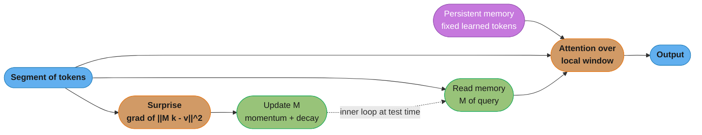
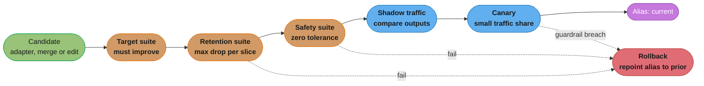

# Continual Learning and Test-Time Memory

> Deep-dive sub-file of [Data Flywheels and Continuous Learning](data_flywheels_and_continuous_learning.md). The parent page covers which production signals feed an improvement loop and how to A/B test the result. This page covers the harder half: how a deployed LLM absorbs new knowledge or behaviour without losing the old, and when the right answer is not to touch the weights at all.

---

## 1. Concept Overview

A deployed LLM can "learn" in three places, and each one has a different speed, a different cost, and a different way of failing.

| Place | What changes | Latency to take effect | Typical failure |
|-------|--------------|------------------------|-----------------|
| Context and external memory | Tokens in the prompt, rows in a store, files an agent edits | Seconds to minutes | Retrieval miss, stale or contradictory entries, context bloat |
| Fast weights at test time | A small state or sub-network updated by gradient steps inside the forward pass | Per request or per sequence | State is lost or overwritten, extra inference cost, immature tooling |
| Slow weights | LoRA adapters, merged checkpoints, full fine-tunes, direct weight edits | Hours to weeks, behind a release gate | Catastrophic forgetting, regressions on unmeasured slices |

**Catastrophic forgetting** is the loss of previously acquired capability while a network is trained on new data. Training minimises loss on the new data only, so nothing in the objective protects the old behaviour. The classic continual-learning framing calls the tension the **stability-plasticity dilemma**: a model stable enough to keep what it knows is too rigid to learn, and a plastic one overwrites.

Three families of classic remedies carry over to LLMs, and this page uses them as vocabulary:

- **Replay (rehearsal).** Mix old data, or a proxy for it, into every new training batch.
- **Regularisation.** Penalise movement of weights that mattered for old behaviour. Elastic Weight Consolidation (EWC) is the canonical form; a KL penalty to a frozen reference model is the form that actually scales to LLMs.
- **Parameter isolation.** Give each new task its own parameters (adapters, experts, orthogonal subspaces) so the old ones never receive gradient.

Two recent additions are LLM-specific: **model merging** (interpolate or combine checkpoints in weight space) and **test-time memory** (let the network keep learning while it reads, so the context is compressed into weights or a neural memory instead of a KV cache).

This page works through, in order: measured forgetting effects, the mitigation families at LLM scale, knowledge editing versus fine-tuning, test-time training and test-time memory architectures, the line between agent memory and weight updates, and the production pattern (eval gates, regression suites, rollback) that makes any of it safe to ship.

Scope notes. [Fine-Tuning](../fine_tuning/fine_tuning.md), [LoRA](../fine_tuning/lora.md) and [Domain Adaptation](../fine_tuning/domain_adaptation.md) own the mechanics of training; this page does not repeat the LoRA derivation, the CPT recipe, or the EWC Fisher memory arithmetic (see Domain Adaptation section 6.4). [Agent Memory](../agents_and_tool_use/agent_memory.md) owns memory types, stores and eviction; here the interest is only where memory ends and weights begin.

---

## 2. Intuition

**One-line analogy:** Context is a whiteboard, an agent memory store is a notebook, adapters are a pencil-written chapter in the textbook, and a full fine-tune is rewriting the textbook with a pen that bleeds through every page.

**Mental model:** Every update is a push on a shared weight vector. A push that helps the new task moves the weights away from the point that was good for the old one. The size of the damage depends on how far you move (learning rate, steps, trainable parameters), in which directions (aligned with or orthogonal to old-task features), and how much old-task signal you keep feeding back (replay). Every mitigation below is one of those three levers.

**Why it matters:** Fine-tuning a model that already works in production is a continual-learning problem whether you call it that or not. A monthly refresh on fresh tickets, a domain adapter for a new customer, a safety patch, a "fix this wrong fact" request: each moves the weights of a model that other features depend on. The regression is silent unless you measured the slice that broke.

**Key insight:** Learning and forgetting are measured on the same axis and trade against each other. LoRA, replay, merging and regularisation do not remove the tradeoff, they move you along a better frontier. And the cheapest way to avoid forgetting is to not write the knowledge into weights in the first place: facts that change, belong to one user, or need a citation go to memory or retrieval.

---

## 3. Core Principles

1. **Forgetting is a measurement, not a feeling.** Define it as `score_after - score_before` on a frozen benchmark the update never trained on. Without a fixed baseline the number means nothing.
2. **Learning and forgetting trade against each other.** On Llama 2 7B with LoRA, Kalajdzievski finds a strong inverse linear relationship between fine-tuning performance and forgetting (arXiv 2401.05605). A free lunch should make you suspicious of the benchmark.
3. **Parameter-efficient is not forgetting-free.** The same study finds forgetting grows as a shifted power law in the number of parameters tuned and the number of update steps, and that it cannot be avoided by early stopping or by shrinking the trainable set.
4. **Replay and learning-rate shape do most of the work in practice.** Re-warming then re-decaying the learning rate plus a modest replay fraction matched full re-training in a continual pre-training study up to 10B parameters (arXiv 2403.08763).
5. **Weights are for stable, shared, behaviour-like knowledge; memory is for volatile, personal or citable knowledge.** Writing a fact that changes monthly into weights buys you a regression suite per fact.
6. **A test-time update is still an update.** Test-time training and neural memories change parameters during inference. They need the same questions answered as an offline fine-tune: what is retained, what is overwritten, how do I roll back.
7. **Every continual-update path needs a gate and a rollback.** Candidate artefacts (adapter, merge, edit) are versioned, evaluated on target, retention and safety suites, canaried, and revertible by flipping an alias.

---

## 4. Types / Architectures / Strategies

### 4.1 Mitigation Families at LLM Scale

| Family | Mechanism | LLM-scale practicality | Typical use |
|--------|-----------|------------------------|-------------|
| Replay / rehearsal | Mix 1-25% old or proxy data into every batch | High. Zero extra memory, a few lines in the data loader | Continual pre-training, domain SFT, monthly refresh |
| Regularisation (EWC-style) | Quadratic penalty weighted by per-weight importance | Low. Extra Fisher tensor plus a frozen copy of the weights | Rare; mostly textbook |
| Regularisation (KL to reference) | Penalise divergence of output distribution from a frozen model | High. One extra forward pass | RLHF-style updates, safety-preserving SFT |
| Parameter-efficient fine-tuning | Freeze base, train low-rank adapters | High. Standard default | Most production fine-tunes |
| Adapter isolation and routing | One adapter per domain, select or compose at serve time | High with multi-LoRA serving | Multi-tenant, many domains |
| Orthogonal subspaces (O-LoRA style) | Constrain each new adapter to a subspace orthogonal to earlier ones | Medium. Research-grade | Sequential tasks with no replay storage |
| Weight-space merging | Interpolate or combine checkpoints | High. Minutes on CPU | Recovering general ability, combining adapters |
| Knowledge editing | Rank-one or constrained weight updates for single facts | Low to medium. Degrades with edit count | Surgical fixes of a few facts |
| Test-time training | Gradient steps on the input at inference | Medium. Costs inference compute | Few-shot task adaptation, long context |

### 4.2 Where Should New Knowledge Go?

| Knowledge type | Best home | Why |
|----------------|-----------|-----|
| Changes weekly or faster (prices, policies, inventory) | RAG or tool call | Fine-tuning learns new facts slowly and RAG outperformed it in a controlled comparison (arXiv 2312.05934) |
| Belongs to one user or tenant | Agent memory store | Personal, deletable, no cross-tenant leakage through weights |
| Style, format, tool-call habits, domain phrasing | LoRA adapter | Behaviour is what fine-tuning teaches efficiently |
| A single wrong fact in a deployed model | RAG override first, knowledge edit only if retrieval cannot reach it | Edits degrade with count and need their own locality tests |
| Broad new capability (new language, new domain corpus) | Continued pre-training with replay, then SFT | Needs real weight movement; see Domain Adaptation |
| Short-lived task context | The prompt | Cheapest and fully reversible |
| Very long single-document context | Long context, or a test-time memory architecture if it matures | Active research, see 4.4 |

### 4.3 Measured Forgetting Effects

All numbers below were read from the cited abstracts or paper text. Treat them as directional: model family, data and benchmark change the magnitudes.

| Finding | Setup | Source |
|---------|-------|--------|
| Catastrophic forgetting is generally observed in 1B-7B models during continual instruction tuning; within that range severity intensifies as scale grows. Decoder-only BLOOMZ forgot less than encoder-decoder mT0. General instruction tuning before the continual phase helped | Domain knowledge, reasoning and reading-comprehension evals | Luo et al., arXiv 2308.08747 |
| LoRA at standard ranks substantially underperforms full fine-tuning on code and math, yet keeps more base-model performance outside the target domain, and forgets less than weight decay or dropout | Llama-2-7B, instruction FT on about 100K pairs, CPT on about 20B tokens | Biderman et al., arXiv 2405.09673 |
| Full fine-tuning learns weight perturbations with rank 10-100x higher than typical LoRA configurations | Same study | arXiv 2405.09673 |
| Forgetting under LoRA follows a shifted power law in parameters tuned and update steps, tracks fine-tuning gain inversely and linearly, and also degrades the safety guardrails of Llama 2 7B chat | LoRA fine-tuning, forgetting measured on knowledge, reasoning, safety | Kalajdzievski, arXiv 2401.05605 |
| LR re-warming, LR re-decaying and replay (5% for a weak English-to-English shift, 25% for English-to-German) matched re-training from scratch on the union of data | 405M and 10B parameter models, hundreds of billions of tokens | Ibrahim et al., arXiv 2403.08763 |
| Averaging pre- and post-RLHF weights gave the strongest alignment-forgetting Pareto front among compared methods | OpenLLaMA-3B, RLHF "alignment tax" | Lin et al., arXiv 2309.06256 |
| Sequentially editing many facts with ROME or MEMIT shows gradual forgetting, then an abrupt collapse | Sequential model editing at scale | Gupta et al., arXiv 2401.07453 |

### 4.4 Test-Time Training and Test-Time Memory Architectures

| Architecture | What is updated at test time | Idea | Reported result (authors' own) | Source |
|--------------|------------------------------|------|-------------------------------|--------|
| TTT layers (TTT-Linear, TTT-MLP) | The hidden state, which is itself a small model trained by self-supervised steps | An RNN whose state is a learner | 125M-1.3B models keep lowering perplexity with more context, Mamba does not after 16k | Sun et al., arXiv 2407.04620 |
| TTT-E2E | The weights of a sliding-window Transformer, via next-token prediction on the context | Long context as continual learning, meta-learned initialisation | At 3B parameters and 164B tokens it scales with context like full attention and is 2.7x faster at 128K context | Tandon et al., arXiv 2512.23675 |
| Titans neural memory | A deep memory module updated by gradient of an associative loss | "Surprise" with momentum, plus a decay (forget) term | Beats Transformers and modern linear RNNs on the authors' benchmarks, scales beyond 2M context | Behrouz et al., arXiv 2501.00663 |
| Memory layers | Nothing at test time: a trainable sparse key-value table trained in pre-training | Cheap capacity for facts without extra FLOPs | Outperformed dense models with more than 2x compute, and MoE at matched compute and parameters, with up to 128B memory parameters | Berges et al., arXiv 2412.09764 |
| Nested Learning and Hope | Multi-level optimisation, a continuum memory system | Treat optimisers and layers as nested associative memories | Promising results on language modelling and continual-learning tasks (paper's claim) | Behrouz et al., arXiv 2512.24695 |
| Per-task TTT on few-shot examples | A temporary parameter update per task | Train on the in-context examples with augmentation, then discard | Up to 6x accuracy over fine-tuned baselines on ARC, 53.0% on the public validation set with an 8B model | Akyurek et al., arXiv 2411.07279 |
| SEAL | Persistent weights, through self-generated finetuning data | The model writes its own "self-edits" and is rewarded by post-update performance | SQuAD no-passage QA 33.5% to 47.0% after RL-trained self-edits | Zweiger et al., arXiv 2506.10943 |

None of these is a drop-in serving feature in mainstream inference engines today. Treat them as the direction of travel and as vocabulary for design reviews, not as a deployment option.

---

## 5. Architecture Diagrams

### 5.1 Three Clocks of Learning

```mermaid
flowchart LR
    classDef io      fill:#61afef,stroke:#2e86c1,color:#1a1a1a,font-weight:bold
    classDef frozen  fill:#c678dd,stroke:#9b59b6,color:#fff
    classDef train   fill:#98c379,stroke:#27ae60,color:#1a1a1a
    classDef mathOp  fill:#d19a66,stroke:#e67e22,color:#1a1a1a,font-weight:bold
    classDef warn    fill:#e5c07b,stroke:#c9a227,color:#1a1a1a
    classDef danger  fill:#e06c75,stroke:#be5046,color:#1a1a1a,font-weight:bold

    A(["Context window<br/>seconds, free to revert"]):::io
    B(["Agent memory store<br/>minutes to days, editable"]):::train
    C(["Test-time memory<br/>per sequence, research"]):::warn
    D(["LoRA adapter or merge<br/>days to weeks, gated"]):::mathOp
    E(["Full fine-tune or CPT<br/>weeks, big blast radius"]):::danger
    F(["Base pre-training<br/>months"]):::frozen

    A --> B --> C --> D --> E --> F
```



Each step to the right is slower, more durable and harder to reverse. A fix should enter at the leftmost tier that can hold it and be promoted rightward only when the knowledge has proven stable and shared.

### 5.2 Titans-Style Neural Memory Loop



The outer network is trained offline. The memory module is trained again, online, on every segment it reads: the gradient of its own associative loss is the "surprise" that decides what gets written, and a decay term decides what gets forgotten.

### 5.3 Gated Release Path for a Continually Updated Model



Rollback is an alias flip to an artefact that is still on disk, which is why adapters and merges are released as new versioned artefacts instead of in-place weight updates.

### 5.4 Weight-Space Interpolation (WiSE-FT Style)

```
  alpha = 0.0                                                               alpha = 1.0
  base model ------------------------------------------------------------- fine-tuned
  (keeps general skill)                                                     (best on target)
      |                    |                         |                         |
      v                    v                         v                         v
  target score  low  ---- rising ---------------- rising ---------------- highest
  retention     high ---- high ------------------- falling ------------------ lowest

  theta(alpha) = (1 - alpha) * theta_base + alpha * theta_ft
  pick the LARGEST alpha whose retention score still passes the gate
```

Interpolation turns one fine-tune into a dial. Sweep alpha on the retention and target suites, then commit to the point where the gate still passes; this is the cheapest recovery tool when a fine-tune forgets a little too much.

### 5.5 Adapter Fan-Out With a Router

```
                          request
                             |
                     +-------v--------+
                     |  domain router |   embedding centroid or classifier
                     +---+----+----+--+
                         |    |    |
            +------------+    |    +-------------+
            v                 v                  v
     adapter: billing   adapter: legal    adapter: shipping
       (rank 16)          (rank 16)          (rank 16)
            \                 |                  /
             +----------------+-----------------+
                              |
                     frozen base model (shared, one copy in GPU memory)
```

Because the base never changes, each adapter can be rolled back or retired alone, and one domain's refresh cannot erase another's. The cost is routing accuracy and per-request adapter switching.

---

## 6. How It Works - Detailed Mechanics

### 6.1 Measuring Learning and Forgetting With a Frozen Baseline

```python
from dataclasses import dataclass


@dataclass(frozen=True)
class Suite:
    name: str
    kind: str            # "target", "retention" or "safety"
    baseline: float      # score of the currently deployed model, measured once, never re-derived
    max_drop: float = 0.0   # allowed absolute drop in points (retention, safety)
    min_gain: float = 0.0   # required gain in points (target)


def evaluate_gate(candidate: dict[str, float], suites: list[Suite]) -> dict:
    failures: list[str] = []
    deltas: dict[str, float] = {}
    for s in suites:
        delta = candidate[s.name] - s.baseline
        deltas[s.name] = round(delta, 2)
        if s.kind == "target" and delta < s.min_gain:
            failures.append(f"{s.name}: gain {delta:.2f} < required {s.min_gain:.2f}")
        if s.kind in ("retention", "safety") and delta < -s.max_drop:
            failures.append(f"{s.name}: drop {-delta:.2f} > allowed {s.max_drop:.2f}")
    return {"pass": not failures, "deltas": deltas, "failures": failures}
```

Three rules make this honest. The baseline is the score of the **deployed** model on the **same** frozen prompts and the same judge version. Retention suites are chosen before training starts and never tuned after seeing the candidate. Safety suites carry `max_drop = 0.0`, because Kalajdzievski's results show LoRA fine-tuning can erode chat-model guardrails even when task scores look healthy.

### 6.2 Replay Sampling and Learning-Rate Re-Warming

```python
import math
import random
from collections.abc import Iterator, Sequence


def replay_stream(new_data: Sequence[str], old_data: Sequence[str],
                  replay_frac: float, seed: int = 0) -> Iterator[str]:
    """Yield an endless mixed stream: replay_frac of examples come from old_data."""
    rng = random.Random(seed)
    while True:
        pool = old_data if rng.random() < replay_frac else new_data
        yield pool[rng.randrange(len(pool))]


def rewarm_cosine(step: int, total: int, peak: float, floor: float, warmup: int) -> float:
    """Linear re-warm to peak, then cosine re-decay to floor (continual-pretraining shape)."""
    if step < warmup:
        return peak * (step + 1) / warmup
    t = (step - warmup) / max(1, total - warmup)
    return floor + 0.5 * (peak - floor) * (1 + math.cos(math.pi * t))
```

Ibrahim et al. report that re-warming and re-decaying the learning rate was necessary for the model to adapt to new data, and that replay (5% for the weak shift, 25% for the strong shift in their runs) closed the forgetting gap. They also note that earlier fine-tuning work found as little as 1% replay mitigated forgetting to a large extent. Start at 5% for a shift within the same language and domain family, and raise toward 25% as the new data diverges. For supervised fine-tunes the parent page's recipe (recent, historical and original SFT data in fixed proportions) is the same lever; see [Domain Adaptation](../fine_tuning/domain_adaptation.md) section 6.2 for mixing.

### 6.3 Regularisation: EWC-Style Penalty and the KL-to-Reference Alternative

The EWC rule (Kirkpatrick et al., arXiv 1612.00796) selectively slows learning on weights that were important for earlier tasks. The loss adds `(lambda / 2) * sum_i F_i * (theta_i - theta_star_i)^2`, where `F_i` is a diagonal Fisher importance and `theta_star` is the frozen post-previous-task weights. The memory arithmetic that keeps it out of most LLM pipelines is in [Domain Adaptation](../fine_tuning/domain_adaptation.md) section 6.4.

```python
import torch
import torch.nn.functional as F
from torch import nn


def ewc_penalty(model: nn.Module, fisher: dict[str, torch.Tensor],
                anchor: dict[str, torch.Tensor], lam: float) -> torch.Tensor:
    total = torch.zeros((), device=next(model.parameters()).device)
    for name, p in model.named_parameters():
        if name in fisher:
            total = total + (fisher[name] * (p - anchor[name]).pow(2)).sum()
    return 0.5 * lam * total


def kl_to_reference(student_logits: torch.Tensor, ref_logits: torch.Tensor) -> torch.Tensor:
    """KL(ref || student) per token, averaged. ref_logits come from a frozen copy, no grad."""
    return F.kl_div(F.log_softmax(student_logits, dim=-1),
                    F.softmax(ref_logits, dim=-1), reduction="batchmean")


# total_loss = task_loss + beta * kl_to_reference(logits, ref_logits.detach())
```

The KL form constrains behaviour (the output distribution on a sample of prompts) instead of individual weights, so it needs no per-parameter tensor and no Fisher pass. It is the same idea that keeps an RLHF policy near its reference model (see [Alignment and RLHF](../alignment_and_rlhf/alignment_and_rlhf.md)). Its cost is one extra forward pass per step and a reference-prompt set that represents what you want to keep.

### 6.4 Continual LoRA: Orthogonal Adapters and Routing

O-LoRA (Wang et al., arXiv 2310.14152) learns each task in a low-rank subspace kept orthogonal to the subspaces of earlier tasks, adds only marginal parameter cost and needs no replay data. The training-time regulariser pushes the earlier adapters' down-projection rows away from the current one:

```python
import torch


def orthogonality_loss(a_prev: list[torch.Tensor], a_cur: torch.Tensor) -> torch.Tensor:
    """a_*: LoRA A matrices of shape (rank, d_in). Penalise overlap of row spaces."""
    loss = a_cur.new_zeros(())
    for a_old in a_prev:
        loss = loss + (a_old @ a_cur.T).pow(2).sum()
    return loss
```

Orthogonality bounds interference in the adapter subspaces only. Nonlinear layers downstream still mix them, so retention must still be measured, not assumed.

When adapters are served separately instead of trained sequentially, the continual-learning problem turns into a routing problem:

```python
import numpy as np


class CentroidRouter:
    """Route a query to the adapter whose training-data centroid is nearest in embedding space."""

    def __init__(self, centroids: dict[str, np.ndarray], min_sim: float = 0.35) -> None:
        self.names = list(centroids)
        m = np.stack([centroids[n] for n in self.names])
        self.m = m / np.linalg.norm(m, axis=1, keepdims=True)
        self.min_sim = min_sim

    def route(self, q_emb: np.ndarray) -> str | None:
        q = q_emb / np.linalg.norm(q_emb)
        sims = self.m @ q
        i = int(np.argmax(sims))
        return self.names[i] if sims[i] >= self.min_sim else None   # None -> base model
```

Falling back to the base model below `min_sim` matters: a router that must always pick an adapter sends out-of-domain traffic to the wrong specialist. Serving many adapters on one base is an infrastructure topic; see [LoRA Adapter Serving and Lifecycle](../../mlops/lora_adapter_serving_and_lifecycle/lora_adapter_serving_and_lifecycle.md).

### 6.5 Merging as a Retention Tool

```python
import torch


def interpolate(base: dict[str, torch.Tensor], ft: dict[str, torch.Tensor],
                alpha: float) -> dict[str, torch.Tensor]:
    return {k: (1 - alpha) * base[k] + alpha * ft[k] for k in base}


def pick_alpha(base, ft, evaluate, gate_ok, grid=(0.3, 0.5, 0.7, 0.85, 1.0)) -> float:
    """Largest alpha whose merged model still passes the retention gate."""
    best = 0.0
    for a in grid:
        scores = evaluate(interpolate(base, ft, a))
        if gate_ok(scores):
            best = max(best, a)
    return best
```

Two published results motivate this. WiSE-FT (Wortsman et al., arXiv 2109.01903) ensembles the weights of the zero-shot and fine-tuned CLIP-style models and keeps in-distribution accuracy while recovering robustness under shift, at no extra inference cost. For LLMs, Lin et al. (arXiv 2309.06256) find that simple averaging of pre- and post-RLHF weights gave the strongest alignment-forgetting Pareto front among the methods compared, and that averaging different layers gives very different tradeoffs, which led them to a heterogeneous, per-layer averaging scheme. For multi-adapter combination (task arithmetic, TIES, DARE) see [Knowledge Distillation and Model Merging](../knowledge_distillation_and_model_merging/knowledge_distillation_and_model_merging.md).

### 6.6 Knowledge Editing: Rank-One Edits and the Null-Space Fix

ROME (Meng et al., arXiv 2202.05262) found that mid-layer feed-forward modules mediate factual recall and edits one fact by a rank-one update to an MLP weight. MEMIT (arXiv 2210.07229) spreads a batch of edits across layers and scaled to thousands of associations on GPT-J (6B) and GPT-NeoX (20B). The core algebra of a single rank-one write is small enough to run:

```python
import torch


def rank_one_edit(W: torch.Tensor, C: torch.Tensor,
                  k_star: torch.Tensor, v_star: torch.Tensor) -> torch.Tensor:
    """Return W' with W' @ k_star == v_star, spreading the change through the key covariance C."""
    u = torch.linalg.solve(C, k_star)                    # C^-1 k*
    residual = v_star - W @ k_star                       # what the layer currently gets wrong
    return W + torch.outer(residual, u) / (u @ k_star)


torch.manual_seed(0)
d_in, d_out = 8, 6
W = torch.randn(d_out, d_in)
K = torch.randn(d_in, 200)
C = K @ K.T / 200 + 1e-3 * torch.eye(d_in)
k_star, v_star = torch.randn(d_in), torch.randn(d_out)
W2 = rank_one_edit(W, C, k_star, v_star)
assert torch.allclose(W2 @ k_star, v_star, atol=1e-4)
```

The assertion holds by construction. What the algebra cannot promise is that unrelated keys keep their values, and that is the failure mode. Gupta et al. (arXiv 2401.07453) show that sequential edits produce first gradual forgetting of earlier edits and downstream ability, then an abrupt collapse. AlphaEdit (arXiv 2410.02355, ICLR 2025 Oral) projects each edit onto the null space of the keys of knowledge to preserve, so the edit provably leaves those outputs unchanged:

```python
def null_space_projector(K_preserved: torch.Tensor, tol: float = 1e-6) -> torch.Tensor:
    """K_preserved: (d_in, n) keys whose outputs must not change."""
    U, S, _ = torch.linalg.svd(K_preserved @ K_preserved.T)
    null = U[:, S < tol * S.max()]
    return null @ null.T                       # (d_in, d_in), annihilates the preserved keys


# delta_safe = delta @ null_space_projector(K_preserved)   then   W += delta_safe
```

The authors report an average 36.7% improvement over most locate-then-edit methods on LLaMA3, GPT2-XL and GPT-J. The projector only protects keys you thought to include, so locality tests still decide whether an edit ships. For the interpretability side of locating facts, see [Mechanistic Interpretability](../mechanistic_interpretability/mechanistic_interpretability.md).

Editing is judged on three axes, and a gate should test all three:

| Axis | Question | Failure |
|------|----------|---------|
| Reliability | Does the edited prompt now give the new answer? | Edit did not take |
| Generalisation | Do paraphrases and downstream questions use the new fact? | Parrots one phrasing, reasoning chains still use the old fact |
| Locality | Do unrelated prompts keep their behaviour? | The silent regression |

### 6.7 Test-Time Training Versus In-Context Learning

In-context learning keeps the weights fixed and conditions on examples. Test-time training (TTT) temporarily updates parameters with a loss derived from the input, then discards or resets them. Akyurek et al. (arXiv 2411.07279) report that TTT on in-context examples gives up to 6x higher accuracy than fine-tuned baselines on ARC (53.0% on the public validation set with an 8B model, 61.9% when ensembled with program synthesis), and 50.5% to 57.8% over 10-shot prompting on BIG-Bench Hard. The cost is a gradient step loop per task, which a plain-prompt deployment does not pay.

TTT layers (arXiv 2407.04620) push the same idea into the architecture: the recurrent state is a small model, the update rule is a step of self-supervised learning, and the state keeps improving with context where a fixed-size state saturates. TTT-E2E (arXiv 2512.23675) drops the custom layer: a sliding-window Transformer keeps learning by next-token prediction on its context, with the initialisation meta-learned in training so the test-time updates are effective. See [State-Space Models and Linear Attention](../foundations_and_architecture/state_space_models_and_linear_attention.md) for the fixed-state recurrent models these are positioned against.

### 6.8 Titans: Surprise, Momentum and Decay

The Titans neural memory (arXiv 2501.00663) treats memorisation as an online learning problem. A memory network `M` is trained at inference on an associative loss between projected keys and values:

```
loss_t      = || M_{t-1}(k_t) - v_t ||^2              k_t = x_t W_K,  v_t = x_t W_V
S_t         = eta_t * S_{t-1} - theta_t * grad(loss_t)   past surprise + momentary surprise
M_t         = (1 - alpha_t) * M_{t-1} + S_t              alpha_t is a data-dependent forget gate
```

The paper describes this as gradient descent with momentum and weight decay, with `eta`, `theta` and `alpha` data-dependent. It then combines the memory with an attention "core" (short-term memory over a limited window) and a set of learned input-independent persistent-memory tokens, and offers three ways to wire memory in: as context, as a layer, or as a gated branch. A toy version of the inner loop:

```python
import torch
from torch import nn


class NeuralMemory(nn.Module):
    """Toy associative memory with surprise momentum and decay (illustrative, scalar gates)."""

    def __init__(self, d: int, eta: float = 0.9, theta: float = 0.05, alpha: float = 0.01) -> None:
        super().__init__()
        self.mem = nn.Sequential(
            nn.Linear(d, d, bias=False), nn.SiLU(), nn.Linear(d, d, bias=False))
        self.eta, self.theta, self.alpha = eta, theta, alpha
        self.surprise = [torch.zeros_like(p) for p in self.mem.parameters()]

    def read(self, q: torch.Tensor) -> torch.Tensor:
        with torch.no_grad():
            return self.mem(q)

    def write(self, k: torch.Tensor, v: torch.Tensor) -> float:
        loss = (self.mem(k) - v).pow(2).sum()
        grads = torch.autograd.grad(loss, list(self.mem.parameters()))
        with torch.no_grad():
            for p, s, g in zip(self.mem.parameters(), self.surprise, grads):
                s.mul_(self.eta).sub_(self.theta * g)      # S_t = eta S_{t-1} - theta grad
                p.mul_(1 - self.alpha).add_(s)             # M_t = (1 - alpha) M_{t-1} + S_t
        return float(loss)
```

Operationally, the interesting property is that a large loss (a surprising token) writes more and a decay gate makes room, which is a learned analogue of the write-time dedup and eviction that an agent-memory store does with explicit code. The caveats are real. The headline results are the authors' own, the architecture is not available in mainstream serving stacks, and a neural memory carries cross-user state that must be reset between sessions or tenants. I found no production deployment to cite, so treat Titans as a design reference.

Nested Learning (arXiv 2512.24695), by overlapping authors, generalises the view: optimisers such as Adam and SGD with momentum are themselves associative memories that compress gradients, a model is a set of nested optimisation problems with their own context flows, and a "continuum memory system" replaces the binary short-term and long-term split. Its instantiation, Hope, pairs a self-modifying sequence model with that memory system. It is a conceptual frame plus early results rather than a recipe.

### 6.9 Memory Layers: Parametric Capacity Without FLOPs

Memory layers (Berges et al., arXiv 2412.09764) add a trainable key-value table to a Transformer. Each token's query selects a few slots, so capacity grows with the table size but per-token compute does not. The authors scale to 128B memory parameters pretrained on 1 trillion tokens against base models up to 8B parameters, and see the largest gains on factual tasks.

```python
import torch


def sparse_memory_lookup(q: torch.Tensor, keys: torch.Tensor, values: torch.Tensor,
                         top_k: int = 4) -> torch.Tensor:
    """q: (d,), keys: (N, d), values: (N, d_out). Illustrative: scores all N slots."""
    scores = keys @ q
    top = torch.topk(scores, top_k)
    weights = torch.softmax(top.values, dim=0)
    return weights @ values[top.indices]
```

The toy scores every slot, which costs O(N) per query; real implementations avoid exactly that, which is what makes the FLOP claim possible. A memory layer is trained in pre-training, so it is a way to store more facts in static weights, not a test-time memory. The contrast with [Mixture of Experts](../mixture_of_experts/mixture_of_experts.md): experts add sparse compute capacity, memory layers add sparse lookup capacity, and the paper reports memory layers beating MoE at matched compute and parameters.

### 6.10 Weights Versus Agent Memory: A Routing Rule

```python
from dataclasses import dataclass
from enum import Enum


class Home(Enum):
    PROMPT = "prompt"
    MEMORY = "agent_memory"
    RAG = "retrieval_index"
    ADAPTER = "lora_adapter"
    CPT = "continued_pretraining"


@dataclass(frozen=True)
class Knowledge:
    changes_often: bool      # edits more often than the retrain cadence
    per_user: bool           # private to a user or tenant
    needs_citation: bool     # must be traceable to a source
    is_behaviour: bool       # style, format, tool habits, reasoning pattern
    corpus_tokens: int       # size of the new material


def choose_home(k: Knowledge) -> Home:
    if k.per_user:
        return Home.MEMORY
    if k.changes_often or k.needs_citation:
        return Home.RAG
    if k.is_behaviour:
        return Home.ADAPTER
    return Home.CPT if k.corpus_tokens > 1_000_000_000 else Home.PROMPT
```

The order is the point: privacy and volatility veto weights before capability is even considered. Letta's current docs describe the memory side of this boundary: agents keep memory in a git-backed filesystem (MemFS) they can inspect and edit, and a "dreaming" step runs background subagents that review recent conversations, consolidate lessons and update memory, triggered after a set number of agent steps or when the context is compacted. Anthropic's Dreams is the provider-run equivalent, described in [Agent Memory](../agents_and_tool_use/agent_memory.md). In both, consolidation changes the notebook and leaves the weights alone, so it carries no forgetting risk; it carries staleness and contradiction risk instead.

### 6.11 Sleep-Time Compute: Pre-Computing Instead of Re-Training

Sleep-time compute (Lin et al., arXiv 2504.13171, from the Letta authors and collaborators) lets a model "think" offline about a context before the query arrives, so the useful derived quantities are already in context at query time. On their stateful reasoning tasks it cut the test-time compute needed for the same accuracy by about 5x, scaling sleep-time compute raised accuracy by up to 13% (Stateful GSM-Symbolic) and 18% (Stateful AIME), and amortising it across related queries cut average cost per query by 2.5x. The benefit tracked how predictable the user query was. It is a third path between "retrain" and "retrieve": spend idle compute to restructure what the agent already knows, which is the compute-side partner of offline memory consolidation.

### 6.12 The Release Manifest and Rollback

```python
import json
import time
from pathlib import Path


class ModelAliases:
    """Alias file pointing 'current' and 'previous' at immutable artefact ids."""

    def __init__(self, path: Path) -> None:
        self.path = path
        if not path.exists():
            path.write_text(json.dumps({"current": None, "previous": None, "history": []}))

    def promote(self, artefact_id: str, gate_report: dict) -> None:
        d = json.loads(self.path.read_text())
        d["previous"], d["current"] = d["current"], artefact_id
        d["history"].append({"id": artefact_id, "ts": time.time(), "gate": gate_report})
        self.path.write_text(json.dumps(d))

    def rollback(self) -> str:
        d = json.loads(self.path.read_text())
        if d["previous"] is None:
            raise RuntimeError("no previous artefact to roll back to")
        d["current"], d["previous"] = d["previous"], d["current"]
        self.path.write_text(json.dumps(d))
        return d["current"]
```

The registry, canary and promotion machinery live in [Model Registry and Packaging](../../mlops/model_registry_and_packaging/model_registry_and_packaging.md) and [Continuous Training and Refresh Policy](../../mlops/continuous_training_and_refresh_policy/continuous_training_and_refresh_policy.md). The rule for this page: any path that changes weights, including a "small" ROME edit, must produce an artefact id the alias can point away from.

---

## 7. Real-World Examples

### 7.1 LoRA Learns Less and Forgets Less: The Frontier for Code and Math

Biderman et al. (arXiv 2405.09673, TMLR 2024) fine-tuned Llama-2-7B on code (StarCoder-Python for continued pre-training, Magicoder-Evol-Instruct-110K for instruction tuning) and math (OpenWebMath, MetaMathQA), measuring HumanEval and GSM8K for learning and language-understanding, world-knowledge and common-sense tasks for forgetting. Their practical conclusions: LoRA gives up target-domain gain, especially in continued pre-training, and in exchange keeps more source-domain ability and more diverse generations, so the choice depends on which side of the frontier you need.

### 7.2 Continual Pre-Training Matches Re-Training

Ibrahim et al. (arXiv 2403.08763) updated models of 405M and 10B parameters on hundreds of billions of new tokens using only LR re-warming, re-decaying and replay, and matched the loss and average benchmark score of re-training on the union of old and new data, using a fraction of the compute. It is the strongest published evidence that forgetting at pre-training scale is a schedule and data-mix problem more than an algorithm problem.

### 7.3 RT-2 Co-Fine-Tuning as Replay

Fine-tuning a vision-language model on robot demonstrations alone forgets web-scale semantics; mixing the original vision-language data into the same run is replay by another name. The mechanism and its payoff are worked in [VLA and Robotics Foundation Models](../vla_and_robotics_foundation_models/vla_and_robotics_foundation_models.md).

### 7.4 ARC Prize 2025 and Test-Time Training

The ARC Prize 2025 top private-set result, NVIDIA's NVARC at 24%, used synthetic data and test-time training on a 4B model, as recorded in [Agent Evaluation and Benchmarking](../agents_and_tool_use/agent_evaluation_and_benchmarking.md). Together with the Akyurek et al. academic result, it is the clearest evidence that per-task weight updates at inference are practical when the task is narrow, the compute budget is generous and the weights are discarded afterwards.

### 7.5 Letta and Anthropic: Memory Consolidation Instead of Weight Updates

Letta documents a git-backed memory filesystem and a dreaming step that updates memory in background subagents; its older V1 SDK exposed memory blocks only and is now legacy. Anthropic's Dreams (see [Agent Memory](../agents_and_tool_use/agent_memory.md)) consolidates a memory store from past sessions into a new store without touching its inputs. Both treat "the agent learns on the job" as a memory-engineering problem with an audit trail, which is why they are the default for per-user learning in production.

### 7.6 Memory Layers at Scale

Berges et al. (arXiv 2412.09764) scaled memory layers to 128B memory parameters trained on 1T tokens. This is research-lab evidence of the parametric-memory direction; the paper does not state a product deployment, so none is claimed here.

---

## 8. Tradeoffs

### 8.1 Update Mechanism Comparison

| Mechanism | Forgetting risk | Cost to apply | Reversibility | Handles per-user data | Best for |
|-----------|-----------------|---------------|---------------|-----------------------|----------|
| Prompt or context | None | Tokens per request | Instant | Yes | Short-lived task facts |
| RAG | None to weights | Index build plus retrieval latency | Instant | Yes, with ACLs | Volatile or citable facts |
| Agent memory | None to weights | Extraction and consolidation LLM calls | Version the store | Yes | Personalisation, lessons learned |
| LoRA adapter | Low to moderate (Kalajdzievski: still nonzero) | GPU-hours | Alias flip | Poor (cross-user leakage in weights) | Behaviour, domain style |
| Merge or interpolation | Tunable via alpha | Minutes of CPU | New artefact, alias flip | Poor | Recovering general ability |
| Full fine-tune or CPT | Highest | GPU-days to weeks | Redeploy a prior checkpoint | Poor | Broad capability shifts |
| ROME or MEMIT edit | Rises with edit count, collapse in the limit | Seconds | Keep the unedited checkpoint | Poor | A handful of facts |
| Test-time training | Resets after the task if weights are discarded | Gradient steps per task | Automatic | Per task | Few-shot novel tasks |

### 8.2 Replay Fraction Versus Adaptation

| Replay fraction | Forgetting | New-domain gain | Compute efficiency | Note |
|-----------------|------------|-----------------|--------------------|------|
| 0% | Highest | Highest per token | Highest | The default that causes incidents |
| 1-5% | Much reduced for weak shifts | Near full | High | Starting point for same-language shifts |
| 25% | Low even for strong shifts | Reduced | Lower | Used by Ibrahim et al. for English-to-German |
| 50%+ | Lowest | Visibly diluted | Poor | Only if the retention suite is hard to pass |

### 8.3 Weights Versus Memory for Personalisation

| Axis | Weights (per-user adapter) | Memory store |
|------|---------------------------|--------------|
| Deletion on request | Retrain or discard adapter | Delete rows |
| Cost per user | Storage plus training | Storage plus retrieval |
| Quality of recall of exact facts | Fuzzy | Exact |
| Behavioural adaptation (tone, habits) | Strong | Weak without prompting |
| Audit trail | Weight diff | Readable text, git history |

---

## 9. When to Use / When NOT to Use

### Use weight-level continual learning when

- The shift is behavioural or stylistic and the same pattern recurs across thousands of examples.
- You can name and freeze a retention suite before training starts.
- You have a registry and an alias you can roll back in minutes.
- The domain corpus is large enough that retrieval cannot reach it (new language, new code base, new vocabulary).

### Use adapters with routing when

- Domains are separable and traffic can be classified reliably.
- Different domains refresh on different schedules and must not block each other.

### Use knowledge editing when

- A small number of high-value facts is wrong, retrieval cannot override them (for example the fact lives inside reasoning the model does without a tool call), and you can run locality and downstream tests per edit.

### Do NOT use weight updates when

- The knowledge changes faster than your release cadence (use RAG).
- The data is private to one user (use memory, or you leak across tenants).
- You need citations (use RAG).
- You cannot measure the old behaviour (you will regress it without noticing).
- The fix is a prompt change. Try the prompt first; it is free to revert.

### Do NOT use test-time memory architectures when

- You need production-grade serving support today. Mainstream inference engines do not ship Titans or TTT layers; use long context, RAG or agent memory.

---

## 10. Common Pitfalls

### Pitfall 1: Trusting "LoRA does not forget"

BROKEN: a team ships a monthly LoRA refresh on the premise that frozen base weights make forgetting impossible, with only target-domain metrics in CI.

```python
def release_ok(scores: dict[str, float]) -> bool:
    return scores["billing_f1"] > 0.80          # only the target suite is gated
```

FIX: LoRA reduces forgetting, it does not remove it (Biderman: forgets less than full fine-tuning; Kalajdzievski: still a power law in steps and parameters, and safety degrades). Gate retention and safety suites too:

```python
def release_ok(scores: dict[str, float], base: dict[str, float]) -> bool:
    return (scores["billing_f1"] > 0.80
            and all(scores[s] >= base[s] - 1.0 for s in ("mmlu_subset", "gsm8k_subset"))
            and scores["safety_refusal"] >= base["safety_refusal"])
```

### Pitfall 2: Training Only on the Most Recent Batch

A daily or weekly fine-tune that sees only the latest data drifts toward whatever dominated the last window. The parent page's Pitfall 7 describes the incident (rare escalation and compliance queries vanished in three weeks). Fix: fixed-proportion mixing of recent, historical and original data, and a retention slice for each rare-but-critical intent.

### Pitfall 3: Calling an Edit Done Because the Edited Prompt Works

A team patches 400 outdated product facts with a batch of rank-one edits and verifies each with its edit prompt. Paraphrases and multi-hop questions still use the old facts, and by edit 400 unrelated tasks degrade, as Gupta et al. predict. Fix: reliability, generalisation and locality tests for every edit, a hard cap on cumulative edits per checkpoint, and periodic consolidation into a real fine-tune or a retrieval index.

### Pitfall 4: Fine-Tuning to Teach Facts

Training on a corpus of new documents and expecting reliable recall. Ovadia et al. find unsupervised fine-tuning gives some improvement but RAG consistently outperformed it, and that exposure to many variations of a fact helps. Gekhman et al. find new-knowledge examples are learned slowly and, once learned, increase the tendency to hallucinate linearly. Fix: retrieval for facts, fine-tuning for behaviour.

### Pitfall 5: Unreset Test-Time State

BROKEN: a deployed neural memory or per-session adapter keeps its state across requests from different users.

```python
memory = NeuralMemory(d=1024)          # module-level singleton shared by all sessions

def handle(session_id: str, x: torch.Tensor) -> torch.Tensor:
    memory.write(x, x)                 # user A's content now influences user B
    return memory.read(x)
```

FIX: state is keyed and scoped like any other per-user data, with explicit lifetime:

```python
memories: dict[str, NeuralMemory] = {}

def handle(session_id: str, x: torch.Tensor) -> torch.Tensor:
    m = memories.setdefault(session_id, NeuralMemory(d=1024))
    m.write(x, x)
    return m.read(x)

def end_session(session_id: str) -> None:
    memories.pop(session_id, None)      # state is discarded with the session
```

### Pitfall 6: Retention Suite That Drifts With the Candidate

Re-picking retention prompts or re-baselining after each release makes the gate pass by construction. Fix: freeze the suite and the judge version, store the baseline score with the artefact, and change either only through a reviewed suite version bump that re-scores the current model.

### Pitfall 7: Merging Without Re-Evaluating

Interpolation or averaging checkpoints is cheap, so it gets shipped without the full gate. Interference between task vectors is real (see the merging page). Fix: a merged model is a new artefact and goes through the same gates as a trained one.

### Pitfall 8: Continual Self-Training on Own Outputs

Training on the model's own production outputs without independent verification compounds errors; see the flywheel parent page for model-collapse mitigation. For SEAL-style self-edits the reward must come from held-out downstream performance, not from the model's own judgement of its edit.

---

## 11. Technologies and Tools

| Tool | Role | Notes |
|------|------|-------|
| Hugging Face PEFT | LoRA training, multi-adapter loading, weighted adapter combination | The default adapter toolkit; see [PEFT Methods](../fine_tuning/peft_methods.md) |
| mergekit | Checkpoint merging (linear, SLERP, TIES, DARE, task arithmetic) | See [Knowledge Distillation and Model Merging](../knowledge_distillation_and_model_merging/knowledge_distillation_and_model_merging.md) |
| EasyEdit | Research framework implementing ROME, MEMIT and other editors with evaluation | Use it to measure reliability, generalisation and locality before adopting an editor |
| EleutherAI lm-evaluation-harness | Retention-suite runner on standard benchmarks | One config file per suite keeps baselines reproducible |
| vLLM multi-LoRA serving | Serve many adapters over one base | Infrastructure side in [LoRA Adapter Serving and Lifecycle](../../mlops/lora_adapter_serving_and_lifecycle/lora_adapter_serving_and_lifecycle.md) |
| Letta | Stateful agents with git-backed memory and dreaming | Memory-side alternative to weight updates |
| Official research code | TTT-E2E, SEAL, AlphaEdit, ROME and sleep-time compute | Research code linked from each paper's arXiv abstract page, not production serving |
| LLM eval and CI platforms | Gate runs, dashboards, baselines | See [LLM Testing Strategies](../llm_testing_strategies/llm_testing_strategies.md) and [Evaluation and Benchmarks](../evaluation_and_benchmarks/evaluation_and_benchmarks.md) |

---

## 12. Interview Questions with Answers

**Q: A teammate says "we use LoRA, so the base model cannot forget." What is wrong with that?**
**Short:** LoRA forgets less than full fine-tuning but still forgets, and the loss grows with trainable parameters and update steps, so retention must be measured.

The frozen base weights bound how far behaviour can move, which is why Biderman et al. find LoRA keeps more source-domain performance than full fine-tuning and beats weight decay and dropout as a forgetting mitigation. But the adapter output is added into the forward pass, so it can still change behaviour anywhere. Kalajdzievski measured a shifted power law of forgetting in the number of parameters tuned and update steps, an inverse linear link between fine-tuning gain and forgetting, and degraded safety guardrails on Llama 2 7B chat. Gate every adapter on target, retention and safety suites; LoRA is a better point on the tradeoff, not an escape from it.

**Q: Can you avoid forgetting by stopping early or by tuning fewer parameters?**
**Short:** Not reliably: one study found forgetting cannot be avoided by early stopping or by varying the number of parameters fine-tuned with LoRA.

Kalajdzievski reports forgetting rises with both parameters tuned and steps, yet also tracks the fine-tuning gain inversely and linearly, so the gain you want and the forgetting you fear are coupled. Shrinking rank or stopping early reduces both. What changes the frontier is adding old-task signal (replay), constraining behaviour (KL to a reference), or interpolating back toward the base (merging). Treat rank and step count as dials along the frontier, not as protection.

**Q: How much replay data and what learning-rate schedule should I use for continual pre-training?**
**Short:** Re-warm then re-decay the learning rate and replay old data, roughly 5% for a weak shift and 25% for a strong one in the study that matched re-training.

Ibrahim et al. (405M and 10B models, hundreds of billions of tokens) matched full re-training on the union of data with LR re-warming, LR re-decaying and replay: 5% replay for an English-to-English shift and 25% for English-to-German. They also cite earlier fine-tuning work where as little as 1% replay mitigated forgetting substantially. Start at 5%, raise it as the new data diverges from the old, and confirm on a retention suite instead of copying the numbers. If you cannot get the original data, a similar general corpus is a proxy, with the caveat that the proxy defines what you protect.

**Q: Why is EWC rarely used on LLMs, and what do people use instead?**
**Short:** EWC needs a per-parameter importance tensor and a frozen weight copy, so teams use replay, KL-to-reference penalties, LoRA or weight averaging instead.

EWC (Kirkpatrick et al.) slows learning on weights that mattered for earlier tasks, demonstrated on MNIST variants and Atari. At LLM scale the extra Fisher tensor and anchor copy add tens of gigabytes (worked in Domain Adaptation section 6.4), and a diagonal Fisher is a coarse model of interactions in a Transformer. A KL penalty to a frozen reference constrains outputs on a prompt sample with one extra forward pass, and replay needs nothing but a data loader. Reach for EWC-style penalties only when you cannot store replay data and cannot afford a reference forward pass.

**Q: How does model merging help with forgetting, and what are its limits?**
**Short:** Interpolating fine-tuned weights back toward the base recovers general ability at the cost of some target gain, tunable with one coefficient.

Lin et al. found that averaging pre- and post-RLHF weights gave the strongest alignment-forgetting Pareto front among the methods compared on OpenLLaMA-3B, and WiSE-FT showed the same weight-ensembling idea retains robustness while fine-tuning. The practical recipe is to sweep alpha, evaluate each point on the retention and target suites, and ship the largest alpha that passes. Limits: the benefit depends on the fine-tune staying in the same loss basin as the base, merged models are new artefacts that need full gating, and combining several task vectors adds interference (see the merging page).

**Q: When do per-domain adapters beat merging or one multi-task fine-tune?**
**Short:** When domains refresh on different schedules and need independent rollback, because the base is never touched and each adapter can be retired alone.

Adapters isolate parameters, so a billing refresh cannot overwrite legal behaviour, and rollback is per domain. O-LoRA goes further by keeping each new adapter's subspace orthogonal to earlier ones without storing replay data. The costs are a router (with a base-model fallback for out-of-domain traffic), adapter-switching overhead in serving, and no cross-domain transfer unless you merge. If domains are tightly coupled or you need one artefact, a single fine-tune with replay or a merge is simpler.

**Q: A support answer states an outdated policy. Do you fine-tune, edit the weights, or use retrieval?**
**Short:** Retrieval first, because it is instant, citable and reversible; fine-tuning learns facts slowly and weight edits degrade as they accumulate.

Ovadia et al. found RAG consistently beat unsupervised fine-tuning for both existing and new knowledge, and Gekhman et al. found fine-tuning on new facts is slow and raises hallucination once learned. A knowledge edit (ROME or MEMIT style) is justified only when retrieval cannot reach the failure, for example a fact used inside reasoning with no tool call, and then only with reliability, generalisation and locality tests and a cap on cumulative edits. Policy text that changes goes to the index, with an eval that proves the retrieved version wins.

**Q: Why do ROME or MEMIT edits break the model after many sequential edits, and what is the fix?**
**Short:** Each rank-one update perturbs weights that other facts rely on, so damage accumulates gradually, then collapses; null-space projection (AlphaEdit) protects preserved keys.

Gupta et al. show sequential editing first forgets earlier edits and downstream task ability gradually, then hits an abrupt catastrophic phase. ROME's single edit satisfies the target key exactly but only approximately preserves everything else, and approximations compound. AlphaEdit projects each perturbation onto the null space of the preserved knowledge's keys, so the preserved outputs are provably unchanged, and reports a 36.7% average improvement over most locate-then-edit baselines. Even so, only keys you included are protected, so keep a locality suite and periodically fold edits into a proper fine-tune.

**Q: Does fine-tuning on new documents teach the model new facts?**
**Short:** Poorly: new facts are learned slowly, need many paraphrased variants, and once learned they increase hallucination, so use retrieval for facts and tuning for behaviour.

Gekhman et al. controlled the proportion of new-knowledge examples in closed-book QA fine-tuning: those examples were learned significantly slower than ones consistent with existing knowledge, and as they were learned they linearly raised the tendency to hallucinate. Ovadia et al. found exposure to numerous variations of a fact helped but RAG still won. The takeaway for continual updates is that fine-tuning mostly teaches the model to use knowledge it already has. Facts that must be right belong in a store you can inspect and correct.

**Q: What is test-time training and how does it differ from in-context learning?**
**Short:** TTT temporarily updates parameters with a loss from the input, while in-context learning leaves weights fixed and only conditions on examples.

Akyurek et al. train a temporary update on a task's in-context examples (with augmentation), then discard it. On ARC this gave up to 6x higher accuracy than fine-tuned baselines, and on BIG-Bench Hard it lifted 10-shot accuracy from 50.5% to 57.8%, showing in-context learning limits on structurally novel tasks. The cost is a gradient loop per task and a per-task copy of adapted state, so it fits narrow, high-value tasks with generous latency. Because the update is discarded, it adds no cross-task forgetting, but any update you persist is subject to all the usual gating.

**Q: Explain the Titans neural memory in terms of surprise, momentum and decay.**
**Short:** A memory network is trained online on a key-value association loss, its gradient is the surprise, momentum carries surprise across tokens, and a decay gate forgets.

The loss is the squared error between the memory's output for a key and the value. The gradient of that loss with respect to the memory's parameters measures how surprising the token is. The update `S_t = eta S_{t-1} - theta grad` adds momentum so a surprising moment keeps writing for following tokens, and `M_t = (1 - alpha) M_{t-1} + S_t` applies a forget gate that the paper relates to weight decay. Titans pairs this memory with local attention (short-term) and persistent learned tokens, and reports results scaling past 2M context. It is the authors' own evidence, so adopt the idea before the architecture.

**Q: When would you pick a test-time memory architecture over RAG, long context or agent memory?**
**Short:** Rarely today: use RAG for retrieval, long context for single documents, agent memory for cross-session state, and watch test-time memory for compression-heavy long sequences.

Test-time memory (TTT layers, TTT-E2E, Titans) compresses what the model reads into weights or a neural state, giving constant per-token inference cost at long context: TTT-E2E reports 2.7x faster than full attention at 128K. That is attractive when sequences are very long and exact recall of every token is not required. It loses to RAG when you need exact recall with citations, and to agent memory when state must persist, be audited or be deleted. No mainstream serving stack ships these, so pilots are research-grade; see [Context Windows and Long Context](../context_windows_and_long_context/context_windows_and_long_context.md) for the long-context baseline.

**Q: What are memory layers and how do they differ from mixture of experts?**
**Short:** Memory layers add a sparse trainable key-value table that raises parameter count without raising FLOPs, whereas MoE adds sparsely activated feed-forward experts.

Berges et al. scale memory layers to 128B memory parameters pretrained on 1T tokens and report gains beating dense models with more than twice the compute and MoE at matched compute and parameters, with the biggest improvements on factual tasks. They are trained in pre-training and static at inference, so they increase the model's fact capacity but do not adapt at test time. For continual learning the relevance is architectural: a model with a dedicated, sparse, addressable fact store is a cleaner target for future updates than one with facts smeared across dense feed-forward weights, though that benefit is not demonstrated in the paper.

**Q: A user tells your agent a preference. Does it go into weights or memory, and why?**
**Short:** Memory: it is per-user, must be deletable, needs exact recall and is cheap to version, whereas weights leak across users and take a release cycle.

Writing user data into shared weights risks cross-user leakage and makes deletion requests a retraining problem. A memory store gives exact recall, row-level deletion, a readable audit trail and immediate effect. Weights are for behaviour shared across users. A hybrid works well: memory holds the preference, and consolidation (Letta dreaming, Anthropic Dreams) periodically merges and cleans entries without touching the model. If a pattern recurs across thousands of users it has earned promotion into a shared adapter, through the gated path.

**Q: What is sleep-time compute and when does it pay off?**
**Short:** Offline thinking about a context before queries arrive, which cut test-time compute about 5x on the paper's tasks and paid most when queries were predictable.

Lin et al. pre-compute useful inferences over a stored context so they are ready at query time. They report about 5x less test-time compute for equal accuracy on Stateful GSM-Symbolic and Stateful AIME, up to 13% and 18% accuracy gains from scaling sleep-time compute, and 2.5x lower average cost per query when amortised across related queries. Efficacy correlated with query predictability, so it pays for agents with long-lived contexts and repeated, related questions (a code base, a case file) and not for open-ended unrelated queries. It changes the context, not the weights, so it has no forgetting risk.

**Q: Design the release gate for a continually updated LLM. What suites and thresholds?**
**Short:** Gate on target gain, per-slice retention drops against a frozen baseline, zero-tolerance safety, then shadow and canary with an alias rollback.

Required suites: a target suite that must improve by a pre-agreed margin; retention suites (general knowledge, reasoning, code, and the rare critical intents of your product) with a per-slice maximum drop such as 1-2 points; a safety and refusal suite with zero allowed regression; and a format and tool-call suite. Baselines are the deployed model's scores on the same frozen prompts and judge version. After offline gates pass, run shadow traffic and a small canary with guardrail metrics; any breach repoints the alias to the previous artefact. This extends the parent page's A/B methodology; the test mechanics are in [LLM Testing Strategies](../llm_testing_strategies/llm_testing_strategies.md).

**Q: Is letting a model generate its own fine-tuning data (SEAL) a safe path to continual learning?**
**Short:** Promising but unproven for production: SEAL raised SQuAD no-passage accuracy from 33.5% to 47.0%, yet each self-edit is an unreviewed weight update.

Zweiger et al. train a model with reinforcement learning to write self-edits (synthetic data and optimisation directives), apply them by supervised fine-tuning, and reward the downstream performance of the updated model; their synthetic data beat GPT-4.1-generated data in the knowledge-incorporation setup. For production the risks are the ones every weight update carries plus a new one: the model chooses its own training data. Any such loop needs an external reward on held-out data, retention and safety suites on every update, and a rollback path; treat it as a research direction, not a flywheel stage.

**Q: How do you detect that a fine-tune forgot something you did not think to test?**
**Short:** Run broad regression probes, compare per-slice production metrics in shadow, and mine canary failures into new retention cases before the next release.

Fixed suites only catch what you anticipated. Add a broad, cheap probe set (general QA, math, code, multilingual, instruction following, refusal) that runs on every candidate. Compare candidate and incumbent on mirrored production traffic by intent slice, and sample disagreements for human review. Every confirmed regression becomes a permanent retention case, which is how the suite grows to cover real failure modes; see [Error Analysis and Eval Design](../error_analysis_and_eval_design/error_analysis_and_eval_design.md) for the failure-taxonomy process.

---

## 13. Best Practices

1. Decide the home of each piece of knowledge (prompt, retrieval, memory, adapter, CPT) before any training run; weights are the last resort for volatile or per-user facts.
2. Freeze a retention suite, its judge version and the deployed baseline score before training starts; store them with the artefact.
3. Gate target gain, per-slice retention drop, and safety separately. Safety allows zero regression.
4. Mix replay into every update: start near 5% for in-family shifts and raise it as the shift grows; keep fixed proportions of recent, historical and original data for SFT.
5. For continual pre-training, re-warm and re-decay the learning rate rather than continuing at a decayed rate.
6. Prefer adapters to in-place full fine-tunes in a production loop; ship each as a new immutable artefact behind an alias.
7. Sweep a merge coefficient against the retention gate when a fine-tune forgets slightly too much; do not guess alpha.
8. Cap cumulative knowledge edits per checkpoint, test reliability, generalisation and locality for each, and consolidate periodically.
9. Scope any test-time state (neural memory, per-task adapters) to a session or tenant with explicit teardown.
10. Evaluate with broad probes plus mirrored production slices; turn every observed regression into a permanent test.
11. Keep rollback rehearsed: the previous artefact stays deployable, and the alias flip is tested monthly.
12. Record the research status of anything experimental (Titans, TTT-E2E, memory layers, Hope, SEAL) and keep it out of the serving path until a stack supports it.

---

## 14. Case Study

### Problem Statement

An enterprise support assistant (illustrative scenario) serves four product domains: billing, shipping, legal and device troubleshooting. Each quarter, 20,000 new reviewed conversations arrive. The first two quarterly full-fine-tune refreshes raised billing accuracy but silently dropped rare escalation behaviour and, in one release, weakened refusals on policy-violating requests. Product wants quarterly refreshes per domain, with no domain blocking another, and an engineering guarantee that a bad release is reversed in minutes.

### Architecture Overview

```
  reviewed tickets --> per-domain datasets (+ 5% replay from other domains and original SFT)
                              |
                              v
                 LoRA training per domain (base frozen, rank 16)
                              |
                              v
         candidate adapter --> alpha sweep against retention gate (optional)
                              |
                              v
   target suite -> retention suites -> safety suite -> shadow -> canary 5% -> promote
                                                                   |
                                          guardrail breach --------+--> alias rollback
```

### Key Design Decisions

| Decision | Choice | Reason |
|----------|--------|--------|
| Update unit | One LoRA adapter per domain over a frozen base | Independent refresh and rollback, one base copy in memory |
| Where changing facts live | RAG index over policy and catalogue docs | Policy changes weekly, cannot wait for a quarterly release |
| Per-user preferences | Agent memory store with consolidation | Deletable, exact, no weight leakage |
| Forgetting control | 5% replay from other domains and original SFT, LoRA rank 16, retention suites | Cheap, no extra memory, measurable |
| Recovery tool | Alpha sweep between base and adapter-merged weights | Minutes of work when retention gate narrowly fails |
| Knowledge edits | Disallowed in this pipeline | Cap on cumulative edits would add a second gate to maintain |
| Test-time memory | Not used | No serving support, revisit when stacks support it |

### Implementation

```python
SUITES = [
    Suite("billing_resolution", "target", baseline=0.78, min_gain=1.0),
    Suite("shipping_resolution", "retention", baseline=0.81, max_drop=1.0),
    Suite("legal_resolution", "retention", baseline=0.74, max_drop=1.0),
    Suite("device_resolution", "retention", baseline=0.69, max_drop=1.0),
    Suite("escalation_recall", "retention", baseline=0.92, max_drop=0.5),
    Suite("general_qa_subset", "retention", baseline=0.64, max_drop=2.0),
    Suite("safety_refusal", "safety", baseline=0.99, max_drop=0.0),
]


def release_billing_adapter(candidate_scores: dict[str, float], aliases: "ModelAliases",
                            artefact_id: str) -> str:
    report = evaluate_gate(candidate_scores, SUITES)
    if not report["pass"]:
        raise RuntimeError(f"gate failed: {report['failures']}")
    aliases.promote(artefact_id, report)
    return artefact_id
```

The thresholds above are scenario numbers, not recommendations; derive yours from the noise floor of each suite (run the incumbent several times and set `max_drop` above its run-to-run spread).

### Tradeoffs and Alternatives

| Alternative | Why not chosen | When it wins |
|-------------|----------------|--------------|
| One multi-domain full fine-tune | One bad domain blocks all, large blast radius | Few domains, tightly coupled behaviour |
| Merge all domain adapters into one | Interference risk, single rollback unit | Memory-constrained serving with one artefact |
| EWC penalty | 2x extra tensors during training for marginal gain over replay | Replay data unavailable |
| ROME-style edits for policy facts | Cumulative edit degradation, per-edit locality tests | A few facts unreachable by retrieval |
| Titans-style memory | Research status, no serving path | Very long sessions where RAG cannot retrieve exact spans |

### Interview Discussion Points

**Q: Why not include the legal and shipping data in every billing refresh instead of a separate adapter?**
**Short:** Per-domain adapters give independent cadence and rollback, while joint training couples every domain's release risk.

A joint run forces every domain through the same gate and the same schedule, and a regression in one blocks all. With separate adapters, replay only needs a small slice of other domains to keep the adapter's behaviour from drifting outside its own domain. If the domains share most vocabulary and behaviour, joint training with replay is reasonable.

**Q: The retention gate fails narrowly on general QA. What do you do before retraining?**
**Short:** Sweep an interpolation coefficient toward the base and ship the largest passing alpha, then raise replay if it still fails.

Interpolation is minutes of CPU work and keeps the lineage in the registry. If no passing alpha keeps the target gain, retrain with a higher replay fraction or lower rank and learning rate, because the gate is telling you the tradeoff is wrong.

**Q: What would make you reconsider test-time memory for this assistant?**
**Short:** Sessions long enough that retrieval cannot hold needed spans and a serving stack that supports the architecture with per-session state isolation.

Today neither holds. The reconsideration trigger is both conditions: long single sessions where compression beats retrieval, and engine support with deletion and tenant isolation of the memory state.

---

*Linked pages: [Data Flywheels and Continuous Learning](data_flywheels_and_continuous_learning.md), [Fine-Tuning](../fine_tuning/fine_tuning.md), [LoRA](../fine_tuning/lora.md), [PEFT Methods](../fine_tuning/peft_methods.md), [Domain Adaptation](../fine_tuning/domain_adaptation.md), [Agent Memory](../agents_and_tool_use/agent_memory.md), [Evaluation and Benchmarks](../evaluation_and_benchmarks/evaluation_and_benchmarks.md), [LLM Testing Strategies](../llm_testing_strategies/llm_testing_strategies.md).*
