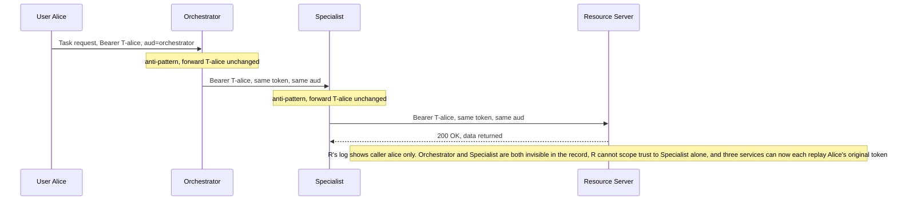
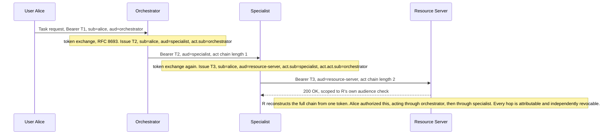
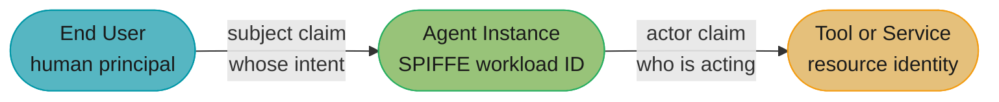

# Agent Identity and Authorization — Deep Dive

## 1. Concept Overview

Three sibling files in this repo already teach three separate answers to "how does an agent
authenticate": [MCP Security](../mcp_model_context_protocol/mcp_security.md) covers OAuth 2.1
with mandatory PKCE, RFC 9728 protected-resource discovery, RFC 8707 audience binding, and the
token-passthrough ban for an LLM client calling a tool server. [Agent-to-Agent
Protocols](../multi_agent_systems/agent_to_agent_protocols.md) covers A2A's self-issued JWTs, the
audience-scoping mechanics, and the confused-deputy fix where an orchestrator mints its own token
instead of forwarding the caller's. [Agentic Commerce and
Payments](../multi_agent_systems/agentic_commerce_and_payments.md) covers AP2 mandates — a
cryptographically bound, user-signed proof of payment authorization. [Multi-Agent
Security](../multi_agent_systems/multi_agent_security.md) covers message authentication,
capability-scoped tokens for tool calls, and trust-zone segmentation.

None of the four asks the question this file asks: **across a *chain* of trust boundaries — not
one hop, three or more — how does a system prove who an agent is as a workload distinct from the
user and the tool it calls, and reconstruct after the fact exactly which identity authorized
which action on whose behalf?** That is a distinct, unfilled gap, verified by grep across all
four files: none mentions SPIFFE, SVID, mTLS between agent services, OAuth 2.0 Token Exchange
(RFC 8693), an `act`/`may_act` claim, just-in-time elevation, or agent registration in an
identity provider as a first-class principal. AP2 explicitly puts agent-to-agent mandate
delegation **out of scope** for its own v0.2 spec.

This file has two jobs. First, a **unifying frame**: one comparison table across MCP, A2A, and
the payment-rail case, on the same four axes, so the pattern each shares — and the gap each
leaves — is visible in one place (§8). Second, the **genuinely new mechanism** that fills the
gap: RFC 8693 OAuth 2.0 Token Exchange as the general-purpose way to mint a fresh,
audience-bound, chain-preserving credential at every hop; SPIFFE/SPIRE as the workload-identity
layer underneath it; and the enterprise pattern — Microsoft Entra Agent ID, Okta for AI Agents —
that registers an agent instance as a principal distinct from both the human it serves and the
service account its code runs under.

---

## 2. Intuition

**One-line analogy**: an OAuth access token is a boarding pass for one flight; RFC 8693 token
exchange is what happens at each connecting gate — you don't hand your original boarding pass to
the next airline, the counter issues you a new one, stamped with the flight you're now on and a
record of the itinerary that got you there.

**Mental model**: think of a chain of authorized-signatory letters, not a single ID card. When
Alice asks her orchestrator to run a task, and the orchestrator delegates part of it to a
specialist, and the specialist calls a resource server, the resource server should be able to
open one credential and read "Alice authorized this, acting through the orchestrator, acting
through the specialist" — the way a power-of-attorney chain names every hand it passed through,
rather than a blank check that says only "Alice" no matter who is currently holding it.

**Why it matters**: a system that conflates "the user," "the agent instance," and "the tool" into
one bearer credential cannot answer the three questions a post-incident review will ask: which
*agent instance* made this call (not just which user it was working for), was it authorized to
make it at the time, and can that authority be revoked in seconds without waiting for a 30-day
key to expire. Collapsing the identities is what makes all three unanswerable at once.

**Key insight**: the recurring root cause across every incident case in this repo's agent-auth
material — the token-forwarding pitfall in `agent_to_agent_protocols.md`, the shared-key problem
below, service-account sprawl in production fleets — is the same mistake in different clothes:
treating a **credential** as if it were an **identity**. A credential is disposable, short-lived,
and scoped to one hop. An identity — a SPIFFE ID, an Entra agent identity's object ID — is stable
across the credentials minted under it, and it is the thing an audit trail should actually name.

---

## 3. Core Principles

- **An agent instance is a principal, not a shared secret.** It gets its own identity — issued by
  a workload identity system or registered in an IdP — distinct from the human it serves and the
  service account its container runs under. See §4.6 for what happens when a system skips this.
- **Authority is proven by a chain, not asserted by a bearer token.** Every hop that acts on
  someone else's behalf records *whose* authority it is exercising, not just its own claimed
  identity. RFC 8693's `act`/`may_act` claims are the mechanism (§6).
- **Never forward, always re-mint.** A token received at one hop is never presented unmodified at
  the next. Each hop exchanges it for a new one scoped to the next audience — the same rule
  `agent_to_agent_protocols.md` Pitfall 5 states for a single hop, generalized to N hops.
- **Least privilege is per-instance and per-task, not per-agent-type.** Two instances of the same
  agent code doing different jobs should not share one scope grant, and a scope granted for one
  task should not persist once the task ends (§4.4).
- **Short-lived and revocable beat long-lived and rotated.** A credential's blast radius is
  bounded by its TTL; revocation should not require waiting out that TTL (§4.4).
- **The audit trail lives in the token, not beside it.** A reviewer must be able to reconstruct
  who authorized what from the claims a token actually carried at the time — not from a
  separately-maintained log that can drift out of sync (§6.4).

---

## 4. Types / Architectures / Strategies

### 4.1 Three identities, routinely conflated

A naive agent deployment has exactly one bearer credential doing three jobs at once, and each
conflation has a distinct failure mode:

| Identity | What it should answer | Failure when collapsed into another |
|---|---|---|
| **End user** | Whose intent, whose data, whose budget is this? | An agent acting with the user's raw OAuth token can do anything the user could — no scoping to what *this task* needs |
| **Agent instance** | Which running process, which deployment, which version made this specific call? | If the agent has no identity of its own, every call in the log attributes to the user or to a shared app credential — you cannot tell agent instance #4,812 apart from #4,813 |
| **Tool / service** | What is the call actually allowed to touch on the far end? | If the tool trusts "whoever holds a valid bearer token" rather than checking the specific caller, any compromised upstream identity becomes access to everything the tool exposes |

Microsoft's own agent-identity documentation states this distinction directly: an Entra agent
identity, once granted a user token, "the subject of the token is a user, while the actor is the
agent identity" — subject and actor are two different claims in the same token, not one blended
identity ([Microsoft Learn, *Overview of agent identities in Microsoft Entra*](https://learn.microsoft.com/en-us/entra/agent-id/agent-identities)).
That `subject` / `actor` split is the RFC 8693 `sub`/`act` pattern, applied at the platform level.

### 4.2 Workload identity for the agent process itself

A user has a login; an application has a client ID; an **agent instance running as a workload**
needs a comparable identity independent of both, because it is neither — it is a process that
runs continuously, calls other services on its own initiative, and needs to prove *it is that
process* without a human present to type a password.

[SPIFFE](https://spiffe.io/) (Secure Production Identity Framework for Everyone) defines this
layer. A **SPIFFE ID** is a URI of the form `spiffe://<trust-domain>/<workload-identifier>` — for
example `spiffe://acme.com/agents/report-orchestrator`. An **SVID** (SPIFFE Verifiable Identity
Document) is the cryptographic proof of that ID, in one of two forms: an **X.509-SVID** (a
short-lived certificate usable for mTLS) or a **JWT-SVID** (a signed token, used where mTLS isn't
available, e.g. through an L7 proxy). A **trust domain** is the root of verification — the
equivalent of a certificate authority's scope. Workloads never handle long-lived secrets to get
one: a local **Workload API** (typically a Unix domain socket) attests the calling process by
platform-native signals (container ID, Kubernetes service account, process attributes) and hands
back a fresh SVID with no bootstrap credential required.

SPIRE (the SPIFFE runtime) defaults `default_x509_svid_ttl` to **one hour**, and the SPIRE agent
renews at roughly 50% of that window — every ~30 minutes — continuously and without human
involvement ([spiffe.io, *SPIRE Server Configuration
Reference*](https://spiffe.io/docs/latest/deploying/spire_server/)). This is the workload-identity
half of the picture: it proves *which process* is calling, over mTLS, before any OAuth token
enters the conversation at all. It answers a different question than the delegation chain in
§4.3 — "is this really agent-instance #4,812's process" versus "did #4,812 have the right to act
for Alice" — and production deployments need both.

### 4.3 Delegation via OAuth 2.0 Token Exchange (RFC 8693)

[RFC 8693](https://datatracker.ietf.org/doc/html/rfc8693), "OAuth 2.0 Token Exchange" (Standards
Track, January 2020), defines a token-request grant type,
`urn:ietf:params:oauth:grant-type:token-exchange`, for exactly this problem: a party holding one
security token exchanges it for a different one, scoped to a different audience, while optionally
recording who is doing the exchanging. Three fields carry the delegation semantics:

- **`subject_token`** — the token representing the party on whose behalf the request is made
  (Alice's token, in the running example).
- **`actor_token`** (optional) — a token representing the identity of the party requesting the
  exchange (the orchestrator, proving its own identity for this call).
- **`act` claim** on the *issued* token — a JSON object naming the acting party, and nestable to
  represent a chain: `"act": {"sub": "specialist-agent", "act": {"sub": "orchestrator-agent"}}`
  reads as "specialist-agent, acting for orchestrator-agent, acting for the subject." A separate
  **`may_act` claim** can appear on a token to pre-authorize a specific party to act on it later,
  before that party has actually exercised the delegation.
- **`audience`** — an optional request parameter naming the logical target service; RFC 8707's
  `resource` parameter (already covered in `mcp_security.md`) does the same audience-binding job
  via an absolute URI instead of a logical name, and either is a legitimate way to make the
  *issued* token's `aud` claim match exactly one downstream recipient.

This is the mechanism none of the three sibling protocols builds in natively. MCP's OAuth flow
and A2A's self-signed JWTs each solve the *single*-hop version of "get a fresh, audience-bound
token" — MCP by having the client run a full OAuth flow per server, A2A by having each agent sign
its own JWT per call. Neither defines what a *chain* of N such hops should carry so that hop N
can prove the whole lineage back to the user. RFC 8693's nested `act` claim is the general answer,
and it is why enterprise agent-identity platforms build on token-exchange-shaped flows rather
than reinventing one: Entra Agent ID's own documentation describes a two-stage pattern where a
short-lived "proof of authority" token is exchanged for the token an agent identity actually uses,
and separately states that for an interactive agent, "the subject of the token is a user, while
the actor is the agent identity" — the RFC 8693 pattern, under Microsoft's own names.

### 4.4 Least privilege for a non-human principal

A human's access review runs annually and asks "does this person still need this role." An agent
instance is created, does a burst of work, and may be destroyed within the hour — annual review
cadence is meaningless. The controls that fit instead:

- **Per-agent, per-task scoping.** A token minted for "summarize Q3 filings" carries only the
  scopes that task needs, not the union of everything the agent has ever been asked to do. §10
  Pitfall 2 shows what happens when this is skipped.
- **Short TTLs as the default control, not the backstop.** 5-minute task tokens
  (`agent_to_agent_protocols.md`'s convention) and 1-hour workload SVIDs (§4.2) both work because
  the *default* lifetime is already short — nobody has to remember to shorten it later.
- **Just-in-time elevation with a human approval gate.** For an action outside an agent's normal
  scope — a refund above a threshold, a production database write — the agent requests elevation,
  a human approves or denies in-band, and the elevated token is minted scoped to *that one action*
  and expires immediately after. This is the non-human-principal equivalent of a human's
  break-glass access request, compressed to the timescale an agent operates at.
- **Revocation measured in seconds, not TTL expiry.** A 5-minute token limits exposure to five
  minutes *if nothing else happens* — but a compromised agent identity needs to be killable
  immediately: revoke the identity (or its blueprint, in Entra's model — revoking a blueprint
  credential invalidates every agent identity minted under it at once) at the IdP, and every
  *future* token-exchange request for that identity fails at the next hop, without waiting for
  currently-issued tokens to naturally expire.

### 4.5 The audit surface

After an incident, a reviewer needs to reconstruct one sentence: *"agent instance X, acting for
user Y, invoked by service Z, touched resource W, at time T, under scope S."* Which claim carries
which word:

| Question | Claim / source |
|---|---|
| Whose intent was this? | `sub` on the token (or the innermost `act.sub` in a chain) |
| Which agent instance acted? | The outermost `act.sub`, or the SPIFFE ID on the mTLS connection that presented the token |
| Was it authorized at the time? | `iat`/`exp` window, cross-checked against the IdP's revocation log for that identity |
| What was it allowed to touch? | `scope` (or Entra's equivalent permission grant) |
| Who invoked it — direct or delegated? | The full `act` chain, read outside-in |

A system that only logs "bearer token accepted" outside the token itself cannot answer any of
these after the fact if the log and the token ever drift — which is why the rule in §3 is that
the claims *are* the record, not a paraphrase of it.

### 4.6 Enterprise reality: registration vs. sprawl

The failure mode teams actually hit is not a sophisticated attack — it's **service-account
sprawl**: every new agent gets `agent-svc-42@corp.iam` with a static key checked into a config
file, nobody remembers which of 200 such accounts is still in use, and a security review can't
tell an agent apart from a forgotten integration test. The fix live in production today is
**registering the agent as a first-class principal** rather than as a generic service account:

- **Microsoft Entra Agent ID** (general availability 2026) makes an agent identity a distinct
  service-principal object type — not a repurposed app registration — with **no credentials of
  its own**; it authenticates only via federated identity credentials issued by a reusable
  **blueprint**, and carries a mandatory **sponsor** field naming the accountable human
  ([Microsoft Learn](https://learn.microsoft.com/en-us/entra/agent-id/agent-identities)).
- **Okta for AI Agents** (general availability April 30, 2026) registers agents "as first-class
  identities in Universal Directory with clear ownership mapping for human accountability," and
  replaces static API keys with dynamic, context-evaluated credentials through its API Access
  Management product ([Okta blog, *Introducing Okta for AI
  Agents*](https://www.okta.com/blog/ai/okta-ai-agents-early-access-announcement/)).

Both converge on the same shape: an agent identity that (a) is distinct from any human or app
account, (b) is created from a template so a fleet of instances can be governed together, and (c)
carries a named human owner. That third property is the one plain service-account sprawl always
lacks.

---

## 5. Architecture Diagrams

### 5.1 Broken — forwarding the same token across three hops



### 5.2 Fixed — a new, audience-bound token minted at every hop



### 5.3 The three-identity model



Three separate identities, three separate claims. A system that has only one box here — because
the agent authenticates *as* the user, or *as* a shared app credential — has collapsed the middle
node into one of the outer two, which is exactly the conflation §4.1 names.

---

## 6. How It Works — Detailed Mechanics

### 6.1 An RFC 8693 token-exchange request and its response

The orchestrator in §5.2 makes this call to exchange its own subject token for one scoped to the
specialist agent. Field names below — `grant_type`, `subject_token`, `subject_token_type`,
`actor_token`, `audience`, `issued_token_type` — are taken directly from RFC 8693 §2.1.

```python
import httpx

TOKEN_EXCHANGE_GRANT = "urn:ietf:params:oauth:grant-type:token-exchange"
JWT_TOKEN_TYPE = "urn:ietf:params:oauth:token-type:jwt"


async def exchange_token(
    token_endpoint: str,
    subject_token: str,
    actor_token: str,
    target_audience: str,
    client_id: str,
    client_secret: str,
) -> dict:
    """RFC 8693 token exchange: trade a subject token for one scoped to the
    next hop, recording the caller as the actor.
    """
    async with httpx.AsyncClient() as client:
        response = await client.post(
            token_endpoint,
            data={
                "grant_type": TOKEN_EXCHANGE_GRANT,
                "subject_token": subject_token,
                "subject_token_type": JWT_TOKEN_TYPE,
                "actor_token": actor_token,
                "actor_token_type": JWT_TOKEN_TYPE,
                "audience": target_audience,
            },
            auth=(client_id, client_secret),
        )
        response.raise_for_status()
        return response.json()
        # {
        #   "access_token": "<new JWT, aud=target_audience, act.sub=this client>",
        #   "issued_token_type": "urn:ietf:params:oauth:token-type:jwt",
        #   "token_type": "Bearer",
        #   "expires_in": 300,
        # }
```

The issued token's payload — not the HTTP response envelope above, the JWT itself once decoded —
carries the delegation chain:

```json
{
  "sub": "alice@example.com",
  "aud": "specialist-agent",
  "iss": "corp-idp",
  "iat": 1787770272,
  "exp": 1787770572,
  "jti": "3f9a2e...",
  "scope": "reports:read",
  "act": { "sub": "orchestrator-agent" }
}
```

A third hop exchanges this again; the new token's `act` nests one level deeper —
`"act": {"sub": "specialist-agent", "act": {"sub": "orchestrator-agent"}}` — and that nesting is
what lets §4.5's audit query walk the whole chain from one token, outside-in.

### 6.2 A verifier that rejects a forwarded token — runnable

The check below is what a receiving hop runs on every inbound token: signature, expiry,
**audience match**, and (past the first hop) **presence of an actor chain**. It uses only the
standard library — `hmac`/`hashlib` HS256 instead of RS256 — purely so the whole thing runs with
no dependency; production code uses PyJWT or python-jose with RS256 and real key management, the
same as the sibling files' examples.

```python
import base64, hashlib, hmac, json, time


def _b64url(data: bytes) -> str:
    return base64.urlsafe_b64encode(data).rstrip(b"=").decode("ascii")


def _b64url_decode(s: str) -> bytes:
    return base64.urlsafe_b64decode(s + "=" * (-len(s) % 4))


def mint(claims: dict, secret: bytes) -> str:
    header = {"alg": "HS256", "typ": "JWT"}
    signing_input = f"{_b64url(json.dumps(header).encode())}.{_b64url(json.dumps(claims).encode())}"
    sig = hmac.new(secret, signing_input.encode(), hashlib.sha256).digest()
    return f"{signing_input}.{_b64url(sig)}"


class TokenRejected(Exception):
    pass


def verify(token: str, secret: bytes, expected_audience: str, require_actor_chain: bool = True) -> dict:
    header_b64, payload_b64, sig_b64 = token.split(".")
    signing_input = f"{header_b64}.{payload_b64}"
    expected_sig = hmac.new(secret, signing_input.encode(), hashlib.sha256).digest()
    if not hmac.compare_digest(expected_sig, _b64url_decode(sig_b64)):
        raise TokenRejected("bad signature")

    claims = json.loads(_b64url_decode(payload_b64))
    if claims.get("exp", 0) < int(time.time()):
        raise TokenRejected(f"expired at {claims.get('exp')}")
    if claims.get("aud") != expected_audience:
        # This is the check that catches a forwarded token: it was minted for
        # a different hop, so its aud never matches the one presenting it here.
        raise TokenRejected(
            f"audience mismatch: token is for {claims.get('aud')!r}, "
            f"this resource is {expected_audience!r} -- looks like a forwarded token"
        )
    if require_actor_chain and "act" not in claims:
        raise TokenRejected("no actor chain -- cannot attribute this call to a delegate")
    return claims
```

Run against the three-hop chain from §6.1 plus two attack attempts — forwarding the hop-1 token
straight to the resource server, and forwarding the hop-2 token past the specialist instead of
exchanging it — this is the **actual output**:

```text
=== Scenario 1: properly exchanged token at each hop (RFC 8693 shape) ===
hop 1 (orchestrator) accepted: alice@example.com aud= orchestrator
hop 2 (specialist) accepted: alice@example.com aud= specialist-agent
  delegation chain (subject -> ... -> acting party): alice@example.com -> orchestrator-agent
hop 3 (resource server) accepted: alice@example.com aud= resource-server
  delegation chain (subject -> ... -> actor): alice@example.com -> specialist-agent -> orchestrator-agent

=== Scenario 2: orchestrator forwards its OWN hop-1 token to the resource server ===
REJECTED as expected: audience mismatch: token is for 'orchestrator', this resource is 'resource-server' -- looks like a forwarded token

=== Scenario 3: specialist forwards the hop-2 token onward instead of exchanging it ===
REJECTED as expected: audience mismatch: token is for 'specialist-agent', this resource is 'resource-server' -- looks like a forwarded token

=== Scenario 4: expired token ===
REJECTED as expected: expired at 1787770472, now 1787770572
```

The audience check alone is what stops both forwarding attempts — neither attacker token was
tampered with or forged, they are perfectly valid tokens for a *different* hop, and that is
precisely the property RFC 8707/8693 audience binding is designed to make unforgeable.

### 6.3 SPIFFE mTLS handshake, in shape

A workload never sees a long-lived credential to bootstrap this. The sequence is: local Workload
API attestation (the platform vouches for which process is asking, via container/pod metadata) →
short-lived X.509-SVID issued over that attested channel → standard mTLS handshake using that SVID
as the client (and server) certificate, verified against the trust domain's root — no OAuth
token, no shared secret, involved at this layer at all. This is the layer §4.2 describes; it
authenticates the *process*, and the RFC 8693 chain in §6.1–6.2 authorizes the *action* that
process is asking to take on someone's behalf. A production deployment checks both: the mTLS
handshake proves "this really is agent instance #4,812's process," and the token's `act` chain
proves "and #4,812 was entitled to make this specific call for Alice."

### 6.4 Reconstructing the audit sentence

Given only the final hop's token from §6.1, an auditor runs exactly the query §4.5 names:

```python
def audit_sentence(claims: dict) -> str:
    chain = []
    node = claims.get("act")
    while node:
        chain.append(node["sub"])
        node = node.get("act")
    delegates = " -> ".join(reversed(chain)) if chain else "(direct, no delegation)"
    return (
        f"{claims['sub']} authorized this action, scope={claims['scope']}, "
        f"delegated through: {delegates}, "
        f"at resource={claims['aud']}, issued={claims['iat']}, expires={claims['exp']}"
    )
```

No separate log lookup is required — every field the sentence needs was already inside the token
that was presented at the point of action.

---

## 7. Real-World Examples

- **Microsoft Entra Agent ID** (general availability 2026) implements the subject/actor split of
  §4.1 at the platform level: an agent identity is "a special service principal... it doesn't
  have credentials on its own," authenticating only through federated identity credentials issued
  by a reusable **blueprint**, with a mandatory human **sponsor** on every identity for incident
  accountability ([Microsoft Learn, *Overview of agent identities in Microsoft
  Entra*](https://learn.microsoft.com/en-us/entra/agent-id/agent-identities), dated 2026-03-30,
  updated 2026-06-15). Revoking a blueprint's credential invalidates every agent identity minted
  from it at once — the JIT-elevation-adjacent "kill the whole fleet in one action" control
  described in §4.4.
- **Okta for AI Agents** (general availability 2026-04-30) registers agents "as first-class
  identities in Universal Directory with clear ownership mapping for human accountability," and
  moves agents off static API keys onto dynamic, context-evaluated credentials through its API
  Access Management product ([Okta blog](https://www.okta.com/blog/ai/okta-ai-agents-early-access-announcement/)).
  The product's existence is itself the signal worth reading: an IdP vendor shipping a dedicated
  agent-registration surface means agents were already running in enterprises under borrowed
  human accounts and shared service-account keys, which is service-account sprawl at scale.
- **SPIFFE/SPIRE in production**: the project's own `ADOPTERS.md` names Anthem, Bloomberg,
  ByteDance, Duke Energy, GitHub, Netflix, Niantic, Pinterest, Square, Twilio, Uber, Unity
  Technologies and Z Lab Corporation as end users, plus Amazon, Anthropic, Cisco, Google, HashiCorp,
  IBM, Intel, SAP and VMware among contributing/adjacent companies
  ([spiffe/spire, `ADOPTERS.md`](https://github.com/spiffe/spire/blob/main/ADOPTERS.md)). Uber's
  own engineering blog documents adopting SPIRE specifically to give internal service-to-service
  calls verifiable workload identity without static credentials, the same problem an agent fleet
  has one layer up.

---

## 8. Tradeoffs

### Cross-protocol comparison — the same four axes, three trust boundaries

| Axis | MCP (client → tool server) | A2A (agent → agent) | Payment rail (AP2 mandate) |
|---|---|---|---|
| **Identity asserted** | OAuth 2.1 access token identifying the calling client | Self-issued JWT, `iss` = calling agent's own identity ([`agent_to_agent_protocols.md` §6.2](../multi_agent_systems/agent_to_agent_protocols.md)) | SD-JWT mandate; subject = the human who authorized the spend, `cnf` claim pins the agent's key ([`agentic_commerce_and_payments.md` §3.1](../multi_agent_systems/agentic_commerce_and_payments.md)) |
| **Who issues the credential** | Authorization server, discovered via RFC 9728 protected-resource metadata ([`mcp_security.md` §6](../mcp_model_context_protocol/mcp_security.md)) | Each agent, self-signed with its own private key | The user/wallet signs the mandate; a Credentials Provider counter-verifies |
| **What binds it to one audience** | RFC 8707 `resource` parameter, bound to one MCP server | `aud` claim = target agent's URL, checked on receipt | Cryptographic hash binding the mandate to the merchant's signed Checkout JWT |
| **Delegation chain across hops** | Not defined — a client either holds a valid token for that server or it doesn't; token passthrough is explicitly banned | Not defined in the base spec — each hop mints its own fresh token (the Pitfall 5 fix); no formal nested-actor claim | Explicitly **out of scope** for agent-to-agent re-delegation in AP2 v0.2 |
| **What breaks without the control** | A server that reuses the client's token instead of getting its own becomes a confused deputy toward whatever it calls next | A downstream agent inherits the original caller's full privilege; no hop is individually attributable | A rogue delegate could authorize spend beyond what the sponsor intended; today mitigated only by a short mandate `exp`, not by chain-of-custody |

Every row in "what breaks" is the single-hop version of the same gap: each protocol solves "get a
fresh, audience-bound credential for *this* hop" and stops there. None specifies what an N-hop
chain should carry so the last hop can prove the whole lineage — which is exactly what RFC 8693's
nested `act` claim is a general-purpose fix for, independent of which of the three transports
carries the call.

### SPIFFE workload identity vs. OAuth delegation tokens

| | SPIFFE / mTLS | OAuth 2.0 / RFC 8693 |
|---|---|---|
| Answers | "Is this really the process it claims to be?" | "Was this process entitled to act, and on whose behalf?" |
| Credential lifetime | ~1 hour default, auto-rotated at 50% | Minutes (5-minute task tokens is a common default) |
| Where it lives | Transport layer (mTLS handshake) | Application layer (Bearer token, one per call) |
| Needs a human-readable audit trail | No — it proves the connection, not the business action | Yes — `act` chain is the audit trail |
| Replaces the other | No | No — production systems run both, per §6.3 |

### Cost of running both layers

| Control | Operational cost | What it buys |
|---|---|---|
| SPIRE deployment | One dedicated platform engineer at moderate scale, two to three at large scale; 6-month rollout for a simple environment, 12-24 months for a complex one | Cryptographic proof of process identity with zero long-lived secrets on disk |
| RFC 8693 token exchange at every hop | One extra network round trip per hop (sub-100ms for a local IdP) | An audit-reconstructable delegation chain instead of a flat bearer token |
| JIT elevation with human gate | Adds human latency (seconds to minutes) to the specific actions gated | Bounds the blast radius of the highest-risk actions to exactly the approved instance |

---

## 9. When to Use / When NOT to Use

**Build the full stack (workload identity + token exchange + IdP-registered agents) when:**
- The agent fleet spans more than a handful of instances and a security review needs to tell them
  apart
- Any delegation chain is longer than one hop (orchestrator-to-specialist alone is covered by the
  single-hop fix already in `agent_to_agent_protocols.md`)
- The system must produce an auditable "who authorized this" answer for compliance, incident
  response, or a regulator
- Agents cross an organizational trust boundary where a shared IdP cannot mint every hop's token

**A lighter version is enough when:**
- A single agent instance, single organization, single hop — the A2A JWT pattern already covers
  it; adding SPIFFE and token exchange on top is two extra systems for a chain that is already
  one hop long
- Prototype or internal tooling with no external trust boundary and no compliance requirement

**Do NOT skip workload identity and reach only for OAuth scoping when:**
- Agents run as long-lived processes calling each other on a private network — mTLS via SPIFFE
  gives you connection-level proof that OAuth tokens alone cannot, since a stolen bearer token is
  usable from anywhere but a stolen SVID still requires the attacker to be the attested workload

---

## 10. Common Pitfalls

### Pitfall 1: One long-lived service-account key shared by every agent instance

`agent_to_agent_protocols.md`'s Pitfall 5 already covers forwarding a *caller's* token downstream
— see that file for the confused-deputy fix. This is a different mistake: every instance of the
same agent type authenticating with **the same static credential**, minted once and checked into
config.

BROKEN:

```python
# One key for every "report-generator" instance, ever deployed
AGENT_API_KEY = "sk-report-agent-prod-8f2a91..."  # shared across all 40 instances

def call_downstream(payload: dict) -> dict:
    return httpx.post(DOWNSTREAM_URL, json=payload, headers={"Authorization": f"Bearer {AGENT_API_KEY}"})
```

When one instance is compromised, every request from every instance is now suspect — there is no
way to revoke #17 without killing #1 through #40, and no way to tell which instance's logs to
even start reviewing.

FIXED — a distinct identity per instance, minted through a workload identity system, exchanged
for a scoped task token per call:

```python
async def call_downstream(payload: dict, spire_client: "WorkloadApiClient") -> dict:
    # Each process fetches its OWN SVID from the local Workload API -- the SVID
    # identifies THIS instance, not "report-generator" as a category.
    svid = await spire_client.fetch_x509_svid()
    task_token = await exchange_token(
        token_endpoint=IDP_TOKEN_ENDPOINT,
        subject_token=svid.as_jwt_assertion(),
        actor_token=svid.as_jwt_assertion(),
        target_audience="downstream-service",
        client_id=svid.spiffe_id,           # e.g. spiffe://acme.com/agents/report-generator/17
        client_secret=None,                  # mTLS via the SVID replaces the shared secret
    )
    return httpx.post(
        DOWNSTREAM_URL, json=payload,
        headers={"Authorization": f"Bearer {task_token['access_token']}"},
    )
```

Revoking instance #17 alone — say, its SVID's certificate signing request is denied at the next
rotation, or its agent identity is disabled at the IdP — stops only #17's future token exchanges;
#1 through #40 are unaffected.

### Pitfall 2: An agent granted the union of every scope it has ever needed

BROKEN — the easy path during development, that never gets revisited:

```python
# Every scope this agent type has EVER needed, accumulated over a year of feature work
AGENT_SCOPES = [
    "reports:read", "reports:write", "billing:read", "billing:refund",
    "users:read", "users:write", "admin:impersonate",  # added for a debugging session, never removed
]
token = mint_token(agent_id="report-agent", scopes=AGENT_SCOPES, ttl_seconds=3600)
```

`admin:impersonate` was granted for a one-off debugging task eight months ago and never revoked;
every task this agent runs since — including ones that only read reports — carries it.

FIXED — scope resolved per task, not accumulated on the agent:

```python
TASK_SCOPES = {
    "generate_report": ["reports:read"],
    "issue_refund": ["billing:read", "billing:refund"],
}

def mint_task_token(agent_id: str, task_type: str) -> str:
    scopes = TASK_SCOPES[task_type]  # exactly what THIS task needs, nothing accumulated
    return mint_token(agent_id=agent_id, scopes=scopes, ttl_seconds=300)
```

A compromised token from the fixed version can do exactly what the task it was minted for could
do — a report-generation task's stolen token cannot issue a refund, because that token never
carried `billing:refund` in the first place.

---

## 11. Technologies & Tools

| Tool / Platform | Role | Notes |
|---|---|---|
| **SPIFFE / SPIRE** | Workload identity issuance (SVIDs), mTLS between agent processes | Open source, CNCF graduated; `default_x509_svid_ttl` defaults to 1h, auto-rotated |
| **Microsoft Entra Agent ID** | IdP-native agent identity registration | Distinct service-principal type; blueprint-issued federated credentials; sponsor field |
| **Okta for AI Agents** | IdP-native agent identity registration | GA 2026-04-30; Universal Directory registration + dynamic credential rotation |
| **Keycloak, Auth0, Okta (as OAuth AS)** | RFC 8693 token exchange endpoint | Any spec-compliant OAuth 2.0 authorization server supporting the token-exchange grant type |
| **HashiCorp Vault** | Private key / signing key storage for token minting | Also referenced in `agent_to_agent_protocols.md` §11 for the same role |
| **PyJWT / python-jose** | Production JWT mint and verify (RS256) | The §6.2 verifier uses stdlib HMAC only to stay dependency-free for the demo; use one of these in real code |
| **OpenTelemetry** | Propagate `traceparent` alongside the delegation chain | Ties the audit sentence in §6.4 to a distributed trace, same convention as `agent_to_agent_protocols.md` §11 |
| **cert-manager + SPIRE (Istio integration)** | mTLS certificate issuance in a service mesh | One of several ecosystem integrations listed in SPIRE's own `ADOPTERS.md` |

---

## 12. Interview Questions with Answers

**Q: Why is a valid, correctly-verified bearer token still a security failure if it was forwarded unmodified from an earlier hop?**
**Short:** A forwarded token proves the original caller's identity, not the forwarding hop's, breaking per-hop attribution and scoping.
Signature and expiry checks passing does not mean the *right* thing was proven — a forwarded token proves who authenticated at the very first hop, not which intermediate service actually made this specific call. The resource server's log attributes the action to the original user, the intermediate hops are invisible, and no hop can be individually revoked without also revoking the original token. This is the general form of the confused-deputy fix in [`agent_to_agent_protocols.md` Pitfall 5](../multi_agent_systems/agent_to_agent_protocols.md), extended past one hop.

**Q: What goes wrong when every instance of the same agent type shares one long-lived API key?**
**Short:** A shared key makes a compromise of one instance unattributable and forces revoking every instance to stop it.
Compromising any single instance is indistinguishable from compromising all of them, because the credential does not identify *which* instance is calling — only that some holder of the key is. Revocation then has only one lever: kill the shared key, which takes down every legitimate instance along with the compromised one. The fix is a distinct workload identity per instance (§10 Pitfall 1), so revoking #17 leaves #1-40 untouched.

**Q: Why is granting an agent the union of every scope it has ever needed worse than it looks?**
**Short:** Accumulated scopes mean a stolen token can act far beyond the task it was actually minted for.
Scopes added for a one-off debugging session or an old feature rarely get removed once the feature ships, so the agent's standing grant grows monotonically. A token minted from that standing grant carries all of it regardless of what the current task needs, so a compromise of a low-risk task's token exposes every high-risk scope the agent ever accumulated. The fix is resolving scope per task type at mint time (§10 Pitfall 2), not per agent.

**Q: What are the three identities that get conflated in a naive agent deployment, and what breaks when two of them collapse into one?**
**Short:** End user, agent instance, and tool identity are distinct; collapsing any two erases either scoping or attribution.
The end user (whose intent this is), the agent instance (which running process acted), and the tool/service (what it touched) each answer a different audit question. Collapsing agent instance into end user means the agent can do anything the user could, with no task-level scoping; collapsing it into a shared app credential means no individual instance is attributable in the logs. Microsoft's own Entra Agent ID model keeps them separate at the claim level: subject is the user, actor is the agent identity.

**Q: What is a SPIFFE ID and what does it identify that an OAuth client_id does not?**
**Short:** A SPIFFE ID names a running workload process cryptographically, independent of any application-layer credential.
A SPIFFE ID is a URI (`spiffe://trust-domain/workload-identifier`) naming a specific workload, proven by an SVID issued through the local Workload API with no bootstrap secret. An OAuth `client_id` identifies an application registration at the authorization-server level — it says nothing about which running process is currently making the call, and a leaked client secret can be used from anywhere. A SPIFFE ID proves process-level identity at the transport layer (mTLS), a layer below where OAuth operates at all.

**Q: What is the difference between an SVID and an ordinary X.509 certificate?**
**Short:** An SVID is a certificate encoding a SPIFFE ID and issued by SPIRE with a short, auto-rotated TTL, not a generic cert.
An X.509-SVID is structurally an X.509 certificate, but the SPIFFE ID is embedded in a specific field (the URI SAN), it is issued by a trust-domain-scoped authority (SPIRE server) after workload attestation rather than a manual CSR, and it defaults to a one-hour TTL with automatic rotation at roughly 50% of that window — no human ever requests a renewal. A generic internal CA certificate typically has none of the attestation-driven issuance or short-TTL rotation built in by default.

**Q: What does the RFC 8693 `act` claim look like for a three-hop delegation chain, and how do you read it?**
**Short:** `act` nests one level per hop, and you read it outside-in to see who acted most recently.
For orchestrator delegating to specialist delegating to a resource server, the final token's `act` claim is `{"sub": "specialist-agent", "act": {"sub": "orchestrator-agent"}}`. Reading outside-in: specialist-agent is the most recent actor, acting for orchestrator-agent, acting for the token's own `sub` (the original user). Each hop that exchanges the token adds one more layer of nesting rather than replacing the previous actor.

**Q: What's the difference between the `act` claim and the `may_act` claim in RFC 8693?**
**Short:** `act` records who already exercised a delegation; `may_act` pre-authorizes a specific party to exercise one later.
`act` appears on an *issued* token after an exchange has happened, naming the party that just acted. `may_act` appears on a token *before* any exchange, naming a party that is pre-authorized to request an exchange on this token's behalf — it is a standing grant of delegation rights, checked by the authorization server when that named party later shows up asking to exchange it. `act` is a historical record; `may_act` is a forward-looking permission.

**Q: Why must the audience be re-bound at every hop instead of reusing the audience from the previous one?**
**Short:** Reusing the previous audience is exactly what lets a forwarded token pass verification at the wrong recipient.
If a token minted with `aud=orchestrator` were accepted at the resource server without a fresh audience check, any hop between them could pass it through unmodified and it would still verify — this is precisely the forwarded-token attack in §5.1. Re-binding the audience at every hop, via a fresh RFC 8693 exchange or an RFC 8707 `resource` parameter, means a token is cryptographically useless anywhere except the one recipient it was minted for, so the §6.2 verifier's audience check rejects a forwarded token outright.

**Q: How does just-in-time elevation with a human approval gate differ from assigning an agent a static high-privilege role?**
**Short:** JIT elevation grants the high-privilege scope only for one approved action and expires it immediately after.
A static high-privilege role is a standing grant — the agent carries `billing:refund` on every token it mints, whether or not the current task needs it, which is exactly the accumulation problem in §10 Pitfall 2. JIT elevation instead has the agent request elevation only when an action needs it, a human approves or denies in-band, and the resulting token is minted scoped to that one action with a TTL that expires as soon as the action completes — so the high-privilege window is measured in the seconds the action actually takes, not the agent's entire operating lifetime.

**Q: Why is a 5-minute TTL not sufficient on its own to "instantly" revoke a compromised agent?**
**Short:** A short TTL only bounds exposure to unused time left on already-issued tokens, not to future re-issuance.
A 5-minute token that was minted 4 minutes ago is still valid for one more minute regardless of what you do at the IdP — TTL alone cannot make an already-issued token disappear early. What makes revocation immediate is disabling the *identity* (or its blueprint credential) at the IdP, so every subsequent token-exchange request for that identity is rejected at the next hop; the short TTL bounds how long any single already-issued token can still be used, and identity revocation bounds how many more tokens can ever be minted for it.

**Q: Which claim in a token lets an auditor reconstruct "who authorized this" after an incident, without a separate log lookup?**
**Short:** The token's own `sub`, `aud`, `scope`, and nested `act` chain together carry the full authorization story.
`sub` names whose intent the action serves, the outermost `act.sub` names the agent instance that most recently acted, `scope` names what it was allowed to touch, and the full nested `act` chain — walked outside-in — names every intermediate delegate in order. Because all of this lives inside the token that was actually presented at the point of action, an auditor reconstructs the full sentence from the token alone, without cross-referencing a separately maintained access log that could have drifted.

**Q: How does Microsoft Entra Agent ID's subject/actor distinction map onto RFC 8693?**
**Short:** Entra's documented subject-is-user, actor-is-agent split is the platform implementation of RFC 8693's `sub`/`act` pair.
Microsoft's own documentation states that when an agent identity requests a user token, "the subject of the token is a user, while the actor is the agent identity" — which is the RFC 8693 pattern (`sub` names the delegated party, `act.sub` names the one currently acting) implemented as a platform primitive rather than something each application has to build by hand. The blueprint mechanism adds a fleet-management layer on top: every agent identity created from one blueprint can be revoked, audited, or policy-scoped together.

**Q: A specialist agent needs to call a tool with a scope the orchestrator's own token doesn't carry. What's the correct pattern?**
**Short:** The specialist requests its own scoped grant for that tool rather than inheriting or widening the orchestrator's token.
The orchestrator should never be granted a broader scope than it itself needs just so a downstream specialist can borrow it — that recreates the union-of-scopes problem in §10 Pitfall 2 one level up. Instead, the specialist's own identity requests the additional scope directly from the authorization server (or via JIT elevation with human approval if the scope is sensitive), and the resulting token carries that scope under the specialist's own `act` entry, not the orchestrator's.

**Q: An agent instance's SPIFFE SVID and its OAuth-issued task token disagree about identity. Which one governs the authorization decision, and why keep both systems at all?**
**Short:** The SVID authenticates the process at the transport layer, and the token authorizes the action, so both must independently agree.
They answer different questions and neither substitutes for the other: the mTLS handshake using the SVID proves *this process* is who it claims to be, before any application-layer request is even read; the OAuth token then proves *this call* was authorized for *this subject*, independent of which process happens to be presenting it. A correct verifier checks both — reject if the SVID's SPIFFE ID doesn't match the expected caller for that channel, and separately reject if the token's audience or actor chain doesn't check out — rather than treating either check as sufficient on its own.

**Q: How do you handle delegation across an organizational boundary, where the receiving agent belongs to a different company and you have no shared token-issuing authority?**
**Short:** Use a federated or cross-domain trust relationship at the IdP layer rather than trying to mint a token in the other org's namespace.
You cannot exchange a token into another organization's `aud` namespace without their authorization server trusting yours — the RFC 8693 pattern assumes one issuer, or issuers in a federation relationship. Cross-org delegation instead relies on the receiving agent's own IdP trusting an external identity (via OIDC federation, a cross-domain SPIFFE trust bundle exchange, or the specific protocol's own cross-org identity layer — Skyfire's KYA in the payments case, covered in [`multi_agent_security.md`](../multi_agent_systems/multi_agent_security.md) and [`agentic_commerce_and_payments.md`](../multi_agent_systems/agentic_commerce_and_payments.md)) rather than a shared token-exchange endpoint.

**Q: A three-hop delegation chain is mid-flight when the middle agent's identity is revoked. What happens to the in-flight request, and what should?**
**Short:** Already-issued tokens for that hop remain technically valid until they expire; only new exchanges for that identity should fail.
Revoking an identity at the IdP stops *future* token-exchange requests from succeeding for it — it does not retroactively invalidate a token already issued and now sitting in the resource server's hands, unless the resource server also checks a revocation list per request (a real cost most systems accept only for high-sensitivity scopes). This is exactly why the short TTL in §4.4 matters as a backstop: the compromised window is bounded by whatever time is left on that one token, not by how quickly the revocation propagates.

**Q: Why doesn't mTLS between agent services replace OAuth-based delegation tokens, even though both provide cryptographic identity?**
**Short:** mTLS proves which process is on the connection; OAuth tokens prove what that process is authorized to do for whom.
mTLS via SPIFFE SVIDs authenticates the transport-layer connection — it tells the receiving service which specific workload is on the other end, cryptographically, with no bearer secret involved. It says nothing about *why* that workload is calling, on whose behalf, or under what scope — that is exactly what the OAuth token's `sub`, `aud`, `scope` and `act` chain carry. A system that has only mTLS can authenticate the caller but cannot answer "was this specific action authorized," which is why production deployments run both layers rather than treating either as a substitute for the other.

---

## 13. Best Practices

1. **Give every agent instance its own workload identity**, not a role-shared or agent-type-shared credential — a SPIFFE ID (§4.2) or an IdP-registered agent identity (§4.6), never a static key in config.
2. **Never forward a token past the hop it was minted for.** Exchange it via RFC 8693 (or the equivalent platform mechanism) for a new token scoped to the next audience, every time — the single-hop version of this rule already lives in [`agent_to_agent_protocols.md`](../multi_agent_systems/agent_to_agent_protocols.md).
3. **Resolve scope per task, not per agent.** A token should carry exactly what the current task needs, never the accumulated union of every scope the agent type has ever used.
4. **Default to short TTLs everywhere** — minutes for task tokens, about an hour for workload SVIDs (SPIRE's own default) — and treat that as the primary control, not a backstop behind a manual review process.
5. **Gate sensitive elevation on a human, just-in-time**, scoped to the one action and expiring immediately after, rather than granting the underlying scope as a standing role.
6. **Make revocation an identity-level operation**, not a wait-for-expiry operation — disabling an agent identity (or its issuing blueprint) at the IdP should stop all future token issuance for it within the IdP's normal propagation time, typically seconds.
7. **Name a human sponsor/owner on every registered agent identity**, so an incident has a person to contact, not just a machine principal to disable.
8. **Verify audience and actor chain on every inbound token, every hop** — the check in §6.2 is cheap (no network call) and it is the entire defense against a forwarded token.
9. **Treat the token's own claims as the audit record.** Don't rely solely on a separately maintained access log that can drift from what the token actually said at the time of the call.
10. **Run workload identity (mTLS/SPIFFE) and delegation tokens (OAuth) together, not as alternatives** — they authenticate different things, and a system with only one has a gap the other exists to close.

---

## 14. Case Study

### Registering a 40-agent internal fleet as first-class identities

**Context.** A mid-size fintech runs 40 internal agent instances (report generation, reconciliation, customer-support triage, and a fraud-review assistant) across two teams. All 40 originally authenticated with one of four shared API keys — one per agent *type* — checked into a secrets manager and referenced by every instance of that type. A security review flagged this ahead of a SOC 2 audit: none of the 40 instances was individually attributable in logs, and the fraud-review assistant's key, if leaked, would grant every instance of that type standing access to case data with no way to revoke just one.

**What changed.**

1. **Workload identity, one per instance.** The platform team stood up SPIRE with a trust domain `spiffe://fintech.internal`, and every agent instance now authenticates to the local Workload API on startup to fetch its own X.509-SVID — `spiffe://fintech.internal/agents/fraud-review/{instance-id}`. Default `default_x509_svid_ttl` was left at SPIRE's 1-hour default, auto-rotated at 30 minutes.
2. **IdP registration, one identity per instance.** Each SVID is federated into the corporate IdP as a distinct agent identity, created from one of four blueprints (one per agent type), each blueprint carrying a named human sponsor from the owning team.
3. **Token exchange at every hop.** Any agent calling another agent, or calling a shared internal API, now exchanges its own SVID-backed assertion for a task-scoped, audience-bound token via RFC 8693 against the corporate authorization server, TTL 300 seconds, scope resolved per task type from a fixed table (§10 Pitfall 2's fix).
4. **JIT elevation for the fraud-review assistant only.** That agent type's normal scope is read-only case access; escalating to a case-freeze action requires an in-band Slack approval from a human reviewer, and the elevated token is scoped to that one case ID with a 60-second TTL.

**Results, measured over the first quarter after rollout.**

| Metric | Before | After |
|---|---|---|
| Distinct authenticated identities in logs | 4 (one per agent type) | 40 (one per instance) |
| Time to revoke a single compromised instance | Not possible without disabling the whole type (all instances of that type down) | Single-instance revocation at the IdP, next token-exchange request fails within the IdP's normal propagation window (single-digit seconds) |
| Standing scope on the fraud-review agent type | Full case read/write, always | Read-only by default; write/freeze only via JIT elevation, 60-second window |
| Fraud-review JIT elevation requests, first quarter | — | 214 requested, 201 approved, 13 denied by the reviewing human |
| SOC 2 finding on this control | Open (shared credential, no per-instance attribution) | Closed |

**What it means.** Two hundred and one approvals against thirteen denials is not a rubber stamp — a
99.5%-plus fraud-review agent whose actions are correct almost every time still means the 13
blocked actions were 13 opportunities for an over-broad standing grant to have done real damage
without ever being reviewed. The JIT gate's value is not measured by its approval rate; it is
measured by what those 13 denials would have cost had they instead been silently permitted under
the old shared-key, no-elevation model — a question the old system had no mechanism to even ask.

**Lessons.**
1. The hardest part was not the cryptography — it was migrating 40 running instances off a shared
   key without a coordinated outage, done by running both auth paths in parallel behind a feature
   flag per instance for two weeks before removing the shared key.
2. SPIRE's operational cost (one dedicated platform engineer, roughly matching the "moderate
   scale" estimate in §8) was the single largest line item, and was judged worth it specifically
   because the SOC 2 finding could not be closed any other way.
3. The JIT elevation gate on the fraud-review agent — the smallest piece of this rollout by lines
   of code — produced the most legible audit story for the compliance team: every sensitive action
   now has a named human approver attached, which the pre-rollout system could not produce at all.
