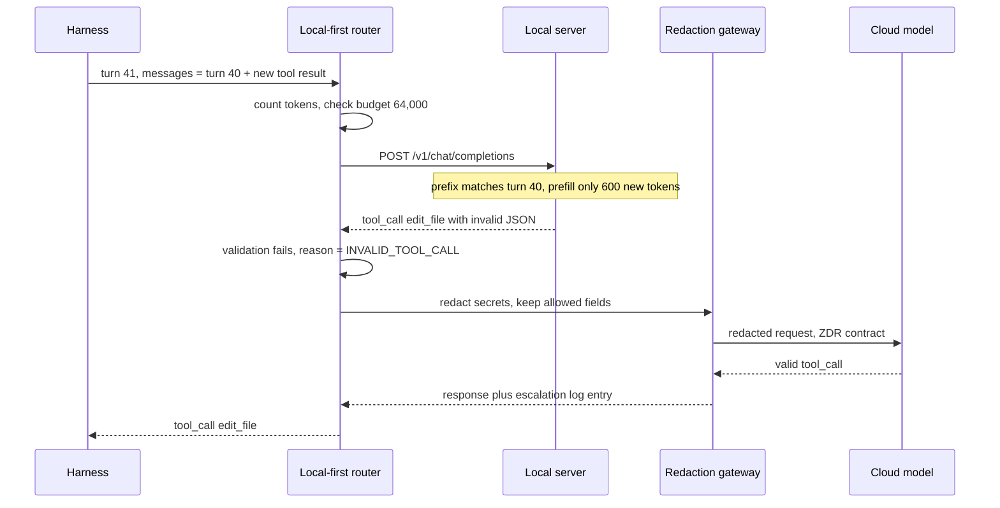
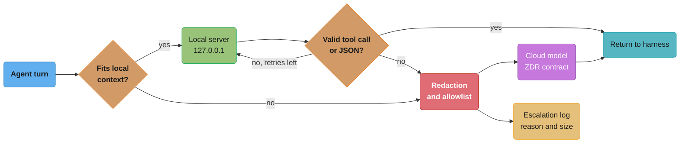
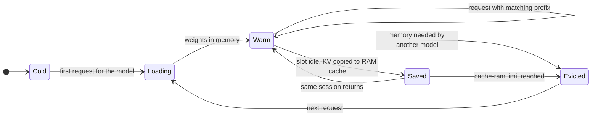

# Local Agents and Hybrid Routing

Deep-dive sub-file of [Local AI](local_ai.md). Covers how agent harnesses (Claude Code, Codex,
OpenCode, Cline, LM Studio Bionic) drive a model on your own hardware, why agent turns are
mostly prefill and how a harness keeps the prefix cache alive, the context-length trap, how
small a model can be and still drive multi-step tool use, MCP and built-in tools on local
servers, the local RAG stack, local-first and cloud-burst routing, the OS-level any-provider
APIs, and how to keep a local inference server from becoming the softest target on the network.

> **Facts checked 2026-11-25:** Ollama v0.40.18 (2026-11-24); llama.cpp v1.0.0 (2026-11-13),
> rolling build b12726; LM Studio 0.4.28, LM Studio Bionic 1.2.2 (2026-11-20); MCP specification
> revision 2026-07-28; BFCL V4 leaderboard last updated 2026-04-12; Ollama and Together AI
> prefix-caching post 2026-11-16.

---

## 1. Concept Overview

A **local agent** is an agent harness (the loop that sends the transcript to a model, parses
tool calls, runs tools and appends results) pointed at an inference server running on hardware
you own: a laptop, a desk-side box, or a team server on the office network. The harness and
the model are separate pieces. In 2025 that separation was mostly theory, because each harness
spoke one vendor's API. In 2026 it became practical, for three reasons:

1. **Local servers speak the cloud APIs.** `llama-server` exposes OpenAI chat completions,
   OpenAI Responses and an Anthropic-compatible `/v1/messages` endpoint. Ollama added an
   Anthropic-compatible Messages API on 2026-01-16 next to its OpenAI chat and Responses
   routes. LM Studio added an Anthropic-compatible API on 2026-01-30 ("Use your LM Studio
   Models in Claude Code"). A harness written for a cloud model now runs against a local one
   with a `base_url` change.
2. **Wrappers wire harnesses for you.** `ollama launch` (2026-01-23) configures Claude Code,
   Codex, OpenCode, Pi and OpenClaw against local or Ollama cloud models, and Ollama's
   2026-08-10 Muse Glimmer post adds GitHub Copilot and Hermes to that list.
3. **Local runtimes became agent platforms.** LM Studio Bionic (2026-07-16) is a separate agent
   app for open models with skills, an Auto Review mode for shell commands, and Agent Remote
   Control over LM Link. `llama-server` ships experimental built-in tools and an MCP client.

The hard parts are not the wiring. They are (a) **prefill cost**: an agent resends the whole
session every turn, so a harness that changes one early byte forces the server to re-read
everything; (b) **context size**: a local server that silently truncates the prompt removes
the instructions or the repo map without an error; (c) **model capability**: small models
handle one tool call well and fall apart over many turns; and (d) **security**: a local
server with file and shell tools is a remote-code-execution endpoint the moment it listens
on a non-loopback address.

**Hybrid routing** is the other half of this file: a local-first agent that escalates some
turns to a cloud model (on purpose, through a redaction step, with the reason logged), and
the OS-level APIs (Apple's Language Model protocol, Firebase AI Logic hybrid inference, Edge's
Prompt API backed by Aion Instruct) that make "on-device first, cloud when needed" a platform
feature instead of something each app re-implements.

**Not here.** Coding-agent architecture in general (SWE-agent ACI, edit formats, repo maps):
[Coding Agents](../coding_agents/coding_agents.md). The MCP protocol itself:
[MCP](../mcp_model_context_protocol/mcp_model_context_protocol.md). Prompt and prefix caching
in general and on cloud APIs: [LLM Caching](../llm_caching/llm_caching.md) and
[Context Engineering](../context_engineering/context_engineering.md). Router design in general
(cascades, confidence thresholds): [LLM Routing and Model Selection](../llm_routing_and_model_selection/llm_routing_and_model_selection.md).
Model supply-chain security and signing: [LLM Security](../llm_security/llm_security.md). The
hardware numbers used below: [Local AI Hardware and Sizing](local_ai_hardware_and_sizing.md).

See also: [Agent Harness Engineering](../agent_harness_engineering/agent_harness_engineering.md) for the same discipline applied to local models, and [Personal and Ambient Agents](../personal_and_ambient_agents/personal_and_ambient_agents.md) with [Design a Personal AI Agent](../case_studies/design_personal_ai_agent.md) for always-on agents on local or hybrid execution.

---

## 2. Intuition

> **One-line analogy**: A local agent is a translator who must re-read the whole document
> before writing each new sentence. A good assistant keeps a bookmark (the prefix cache) so the
> translator only reads what was added. If anyone edits page one, the bookmark is worthless and
> the translator starts again from the top.

**Mental model.** Every agent step sends the model the system prompt, every tool definition,
the task, every file the agent has read and every command it has run, and gets back a tool
call that is a few dozen tokens long. Input grows each turn. Output stays small. Ollama and
Together AI put it plainly in their 2026-11-16 post: an agent turn is mostly prefill. On cloud
APIs the provider absorbs that cost and bills you for cached tokens at a discount. On your own
box you pay it in seconds of wall-clock time, on one GPU, for every engineer sharing it.

**Why it matters.** The local experience people complain about ("fast on turn 1, unusable by
turn 40") is almost never the model getting slower. It is the cache being thrown away. With
caching, ten equal turns cost 10 units of prefill work. Without it, they cost
1 + 2 + ... + 10 = 55 units. At 100 turns it is 100 versus 5,050. On a DGX Spark, where
llama.cpp's own bench measured gpt-oss-120b prefill at 2,443.9 tokens/s (pp2048, depth 0), a
30,000-token session re-read from scratch costs at least 12 s before the first new token. An
appended 600-token turn costs about 0.25 s.

**Key insight.** For a local agent, "how fast is this model" means "how fast can it get through
the history it has already seen", and the answer is decided by the harness, not the model.
Keep everything before the newest message byte-identical, size the context window for the
agent and not for chat, pick a model that was post-trained for tool use at the quantization you
will actually run, and treat the server port like an SSH port.

---

## 3. Core Principles

1. **Append-only prompts.** A prefix cache matches from the first token up to the first token
   that differs and stops there. Anything that changes early (a timestamp in the system prompt,
   the git status, a reordered tool list, a raised reasoning effort written into the first
   system block) re-processes everything after it. Dynamic information goes at the end, once.
2. **Size the context for the agent.** Ollama's default context depends on VRAM: under 24 GiB
   it is 4k, 24-48 GiB gives 32k, 48 GiB or more gives 256k. Ollama's own docs say agents and
   coding tools need at least 64,000 tokens. Set `OLLAMA_CONTEXT_LENGTH` (or `-c` on
   `llama-server`), then check the `CONTEXT` column of `ollama ps`. Never assume a constant.
3. **Pick the model for the harness.** Tool-call formats, thinking-history handling and
   late-loaded tools all depend on the model's chat template. Models now ship post-trained for
   named harnesses (Muse Glimmer lists OpenClaw and Hermes Agent; LFM3-1.7B names Hermes Agent
   and OpenClaw). Evaluate the model inside the harness you will ship, at the quant you will ship.
4. **Tools off by default, loopback by default.** `llama-server` ships tools disabled and binds
   127.0.0.1; Ollama binds 127.0.0.1:11434. Every exposure is a deliberate decision with an API
   key, TLS and a firewall rule in front of it.
5. **Treat model files and templates as untrusted input.** A GGUF carries a Jinja chat template
   that runs on every request. Pin by digest, diff the template, override it from a reviewed file.
6. **Local-first, cloud-burst, one eval set.** When a turn escalates to a cloud model, the same
   eval set must score both paths, or you cannot tell whether escalation helps. Every escalation
   carries a logged reason and passes a redaction step.
7. **Silent truncation is the enemy.** Every layer that cuts content (server context, tool
   output, retrieved chunks) must say it cut, in band, so the model knows something is missing.

---

## 4. Types / Architectures / Strategies

### 4.1 How a harness reaches a local model

| Wiring option | What it does | Example |
|---|---|---|
| `ollama launch <harness>` | Writes the harness config to point at Ollama and starts it | `ollama launch claude --model muse-glimmer`, also `codex`, `opencode`, `pi`, `openclaw`, `hermes` |
| Anthropic Messages compatibility | The server accepts `POST /v1/messages`, so Anthropic-API harnesses run unchanged | Ollama (since 2026-01-16), `llama-server` (`/v1/messages`, tool use needs `--jinja`), LM Studio (since 2026-01-30) |
| OpenAI Responses compatibility | The server accepts `POST /v1/responses` | Ollama, `llama-server`, LM Studio |
| OpenAI chat completions | The lowest common denominator, `POST /v1/chat/completions` | Every local server, plus `litert-lm serve` and `mlx_lm.server` |
| Desktop gateway | A desktop app routes its model calls to a local server | Claude Desktop through Ollama (Ollama v0.33.0 release notes) |
| Embedded app agent | The agent app and the runtime ship together | LM Studio Bionic on the LM Studio runtime, Open WebUI 0.13.5 folder workspaces |

`llama-server` defaults to port 9931 (it was 8080 before the v0.7.0 notes), binds 127.0.0.1,
runs continuous batching by default and sets `--parallel` to auto. Ollama listens on
127.0.0.1:11434. A harness that hard-codes `localhost:8080` for llama.cpp is out of date.

### 4.2 Agent apps that run on local models

| App | Version (date) | What matters for agents |
|---|---|---|
| LM Studio Bionic | 1.2.2 (2026-11-20) | Separate agent app; skills (2026-08-17); Auto Review for shell commands (2026-08-27); Agent Remote Control over LM Link (2026-11-16); optional Secure Cloud models with Zero Data Retention |
| LM Studio | 0.4.28 | `llmster` headless daemon and continuous batching since 0.4.0 (2026-01-28); stateful `/v1/chat` with MCP; MCP host since 0.3.17 (2025-06-25); mlx-engine v1.8.5 KV-cache checkpointing for agentic workloads (2026-06-05) |
| Open WebUI | 0.13.5 (2026-11-25) | Folder workspaces with terminal and browser; reads AGENTS.md and CLAUDE.md project instructions; skills. Token-theft security advisories in September 2026, so stay current |
| AnythingLLM | 1.20.0 | Desktop RAG and agent app over a local or remote model server |
| Jan | 0.8.8 | Local API server enforces Trusted Hosts; MCP tool execution is opt-in |
| Cline | current | Ollama and LM Studio providers; recommends "Use Compact Prompt" for local models; RAM guidance 16-32 GB small or quantized, 32-64 GB mid-size, 64 GB or more large |

### 4.3 Tools and MCP hosted by the local server itself

`llama-server` can run the agent's tools, not just the model:

- `--tools TOOL1,TOOL2,...` (experimental, default none, `all` enables every tool) exposes
  `read_file`, `file_glob_search`, `grep_search`, `exec_shell_command`, `write_file`,
  `edit_file` and `get_info`. The help text says "do not enable in untrusted environments".
- `--tools-runtime docker:<image>`, `podman:<image>`, an existing container, or `ssh:<target>`
  runs those tools outside the host process.
- `--mcp-servers-config PATH` or `--mcp-servers-json JSON` declares MCP servers in the
  Cursor-compatible format. Only the stdio transport is supported, each server is spawned on
  demand with the server's own privileges, and its tools appear as `<server>_<tool>`.
- Enabling tools or MCP servers limits `--cors-origins` to `localhost` by default.
- On a non-loopback address, tools, MCP servers and the MCP proxy require an API key unless
  you pass `--allow-unauthenticated-tools`, which the docs reserve for trusted networks.

The MCP specification's current revision is 2026-07-28. Local hosting does not change the
protocol; it changes who holds the privileges. A stdio MCP server spawned by `llama-server` runs
as the user that runs `llama-server`.

### 4.4 Hybrid local-cloud patterns

| Pattern | Who decides | When it fits | Example |
|---|---|---|---|
| Device-first, cloud fallback | Runtime or SDK, per request | Feature must work offline, quality floor met on device | Firebase AI Logic hybrid inference ("on-device when available", cloud fallback) |
| Cloud-first, device fallback | SDK | Quality first, offline degraded mode | Firebase AI Logic hybrid, the "vice versa" mode |
| Cascade with validator | Your router | Local model solves most turns, a checker catches failures | The `LocalFirstRouter` in §6.3 |
| Split by data class | Your router plus redaction | Some inputs may never leave the device | Source code stays local, redacted summaries may go to cloud |
| OS any-provider protocol | The OS framework | One API across on-device, private cloud and third-party models | Apple Foundation Models Language Model protocol with Dynamic Profiles |
| Runtime with a cloud tier | The local runtime | Same CLI and API for local and hosted models | Ollama cloud models, LM Studio Secure Cloud (ZDR) |
| Browser hybrid | The browser | Web app wants on-device first | Edge Prompt API origin trial backed by Aion Instruct 2.3B (2026-11-19), Chrome Prompt API stable on web from Chrome 148 |

### 4.5 OS-level any-provider APIs

- **Apple Foundation Models (OS 27).** The Language Model protocol fronts the on-device model,
  `PrivateCloudComputeLanguageModel` (32,000-token context), Claude, Gemini, Core AI models and
  MLX models behind one session API. **Dynamic Profiles** swap model, tools and instructions
  inside one session. Apple ships an **Evaluations framework**, an `fm` CLI and the
  `apple-fm-sdk` 0.2.2 Python SDK. Custom adapters for the system model ended: adapter toolkit
  26.0.0 is the last release and is not compatible with OS 27 and later.
- **Android ML Kit GenAI.** The Prompt API takes typed structured output and tool
  declarations, `AgentRunner` runs multi-step tool-calling loops on Gemini Nano, and device
  tiers are Gemini Nano 2, 3 and 4. Cloud fallback goes through Firebase AI Logic hybrid.
- **Windows.** Foundry Local installs with `winget install Microsoft.FoundryLocal` and also runs
  in-process from a NuGet package; Windows ML is the Microsoft-maintained ONNX Runtime with
  vendor execution providers on Windows 11 24H2 and later.
- **Browsers.** Chrome's Prompt API is stable on the web from Chrome 148. Edge's Prompt API is
  in an origin trial backed by Aion Instruct (2.3B, open weights), which replaced Phi-4-mini as
  Edge's built-in model on 2026-11-19.

### 4.6 The local RAG stack

| Layer | 2026 default | Why |
|---|---|---|
| Embedder | EmbeddingGemma 2 (740M, Apache-2.0, text, image, video and audio in one 768-d space, 8K context) | Matryoshka dimensions 768/512/256/128 let you trade recall for a 6x smaller index |
| Reranker | A GGUF reranker on `llama-server`'s reranking endpoint | Same server, same auth, no extra process |
| Store | SQLite or Postgres with a vector extension on the same box | One file or one service to back up; no network hop |
| Generator | The agent model, through the same local server | One cache, one context budget |

Long native context (128K-262K on current small models) reduces chunking pressure, but every
retrieved token is prefill on every later turn of the session. Retrieve less, and say what was
left out.

### 4.7 Model shape for local agents

| Need | Shape | Examples (from [Local AI](local_ai.md) §4.4) |
|---|---|---|
| Laptop coding agent, 32-64 GB | 25-35B MoE, 3-4B active, 4-bit | Qwen3.6-35B-A3B, Gemma 4 26B-A4B, Nemotron 3.5 Lightning 30B-A3B |
| Dense quality on a big desk box | 27-31B dense, 8-bit or BF16 | Qwen3.8-27B, Gemma 4 31B, Muse Glimmer 30B |
| Team server, 128 GB | 80-120B MoE, 3-5B active | gpt-oss-120b (MXFP4), Qwen3-Coder-Next 80B-A3B |
| Phone or browser helper | 1-4B, single tool call per turn | Gemma 4 E2B/E4B, LFM3-1.7B, Aion Instruct 2.3B |

Thinking-history handling is part of the shape. Qwen3.8 retains thinking blocks from all
historical messages by default (`preserve_thinking`), and the card says this "is especially
beneficial for agent scenarios". A harness that strips thinking from history changes what the
model sees and, if the template renders thinking into earlier turns, also changes the prefix.

---

## 5. Architecture Diagrams

### 5.1 One agent turn with a prefix hit and an escalation



The local server did the cheap part (600 new tokens of prefill thanks to the unchanged prefix).
The router caught an invalid tool call, logged why it escalated, and sent only redacted content
off the machine.

### 5.2 Prefix-cache work over 10 equal turns

```
Prefill units per turn (each turn appends one equal block of new tokens)

Turn:                     1   2   3   4   5   6   7   8   9  10   total
No cache:                 1   2   3   4   5   6   7   8   9  10     55
With cache:               1   1   1   1   1   1   1   1   1   1     10
One early edit, turn 6:   1   1   1   1   1   6   1   1   1   1     15
                                              ^ re-reads blocks 1..6
Early edit every turn:    1   2   3   4   5   6   7   8   9  10     55
```

The cache turns quadratic work into linear work, and one early edit per turn turns it back.
At 100 turns the gap is 100 versus 5,050 units (Ollama and Together AI, 2026-11-16).

### 5.3 Local-first router



Two triggers leave the machine: the prompt does not fit, or the local answer fails validation
after its retries. Both pass the redaction step and both are logged with a reason.

### 5.4 Lifecycle of a model slot on a shared local server



`llama-server` saves idle slots to the host-RAM prompt cache (`--cache-ram`, default 8192 MiB)
and loads at most `--models-max` models at once (default 4) in router mode. Every transition to
`Evicted` turns the next agent turn into a full re-read.

---

## 6. How It Works — Detailed Mechanics

### 6.1 A byte-stable prefix

The harness owns the prefix. The rules: the system prompt is a constant with a version string,
the tool list is sorted and frozen at session start, nothing time-dependent appears before the
newest message, and tool output is truncated with an explicit notice. The class below enforces
the append-only invariant and fails loudly when something would rewrite history.

```python
from __future__ import annotations

import hashlib
import json
from dataclasses import dataclass, field
from typing import Any

SYSTEM_PROMPT_VERSION = "coding-agent-system/v7"
SYSTEM_PROMPT = (
    f"[{SYSTEM_PROMPT_VERSION}]\n"
    "You are a coding agent working inside the user's repository.\n"
    "Call exactly one tool per turn. Never invent file contents you have not read.\n"
    "If a tool result says it was truncated, request the range you need."
)


@dataclass(frozen=True)
class ToolSpec:
    name: str
    description: str
    parameters: dict[str, Any]

    def as_openai(self) -> dict[str, Any]:
        return {
            "type": "function",
            "function": {
                "name": self.name,
                "description": self.description,
                "parameters": self.parameters,
            },
        }


def canonical(obj: Any) -> str:
    """One serialization for hashing: sorted keys, no whitespace variation."""
    return json.dumps(obj, sort_keys=True, separators=(",", ":"), ensure_ascii=False)


def truncate_tool_output(text: str, path: str, max_lines: int = 200) -> str:
    """Cut long output and say so in band, so the model knows what it did not see."""
    lines = text.splitlines()
    if len(lines) <= max_lines:
        return text
    head = "\n".join(lines[:max_lines])
    return (
        f"{head}\n[truncated: showed lines 1-{max_lines} of {len(lines)} in {path}. "
        f"Use grep_search or read_file with a line range to see the rest.]"
    )


@dataclass
class AgentSession:
    tools: tuple[ToolSpec, ...]
    messages: list[dict[str, Any]] = field(default_factory=list)
    prefix_hash: str = ""

    @classmethod
    def start(cls, tools: list[ToolSpec], task: str, session_facts: dict[str, str]) -> "AgentSession":
        frozen = tuple(sorted(tools, key=lambda t: t.name))
        # Session-specific facts (cwd, branch, start date) go in the FIRST USER message, never
        # in the system prompt, so every session on this box shares one cacheable prefix.
        facts = "\n".join(f"{k}: {v}" for k, v in sorted(session_facts.items()))
        session = cls(tools=frozen)
        session.messages = [
            {"role": "system", "content": SYSTEM_PROMPT},
            {"role": "user", "content": f"{task}\n\nSession facts:\n{facts}"},
        ]
        session.prefix_hash = session._hash_prefix()
        return session

    def _hash_prefix(self) -> str:
        blob = canonical({"system": SYSTEM_PROMPT, "tools": [t.as_openai() for t in self.tools]})
        return hashlib.sha256(blob.encode("utf-8")).hexdigest()[:16]

    def request_body(self, model: str, max_tokens: int = 1024) -> dict[str, Any]:
        if self._hash_prefix() != self.prefix_hash:
            raise RuntimeError("system prompt or tool list changed mid-session: prefix cache lost")
        return {
            "model": model,
            "messages": list(self.messages),
            "tools": [t.as_openai() for t in self.tools],
            "max_tokens": max_tokens,
        }

    def append_assistant(self, message: dict[str, Any]) -> None:
        self.messages.append(message)

    def append_tool_result(self, tool_call_id: str, path: str, output: str) -> None:
        self.messages.append(
            {"role": "tool", "tool_call_id": tool_call_id, "content": truncate_tool_output(output, path)}
        )


def assert_append_only(previous: list[dict[str, Any]], current: list[dict[str, Any]]) -> None:
    """Regression test for harness changes: turn N+1 must start with turn N byte for byte."""
    if len(current) < len(previous):
        raise AssertionError("history shrank: compaction must be an explicit, logged event")
    for i, (old, new) in enumerate(zip(previous, current)):
        if canonical(old) != canonical(new):
            raise AssertionError(f"message {i} was rewritten: everything after it re-prefills")
```

`assert_append_only` belongs in the harness's test suite. Run a recorded 40-turn session
through every harness change and assert that each request starts with the previous one. It
catches the regressions that cost the most: a tool list built from a `set`, a timestamp added
"for context", a thinking block stripped from turn 3.

Compaction is the one legitimate early rewrite. When it happens, it happens once, on purpose,
and the session continues append-only from the compacted state. If a raised reasoning effort is
needed, Ollama's advice is to compact first or start a fresh session at the new level, because
in templates such as GLM-5.3-Flash's the effort is written into the first system block.

### 6.2 Size the context and verify it

```bash
# Ollama: the default depends on VRAM (under 24 GiB: 4k, 24-48 GiB: 32k, 48 GiB or more: 256k).
# Agents need at least 64000 per Ollama's context-length docs.
OLLAMA_CONTEXT_LENGTH=64000 ollama serve

# Verify what was actually allocated and whether layers spilled to CPU.
ollama ps
# NAME             ID              SIZE      PROCESSOR    CONTEXT    UNTIL
# gemma4:latest    c6eb396dbd59    9.6 GB    100% GPU     131072     2 minutes from now

# llama-server: context, tool-call template, prompt cache, checkpoints, auth.
llama-server -m qwen3.6-35b-a3b-q4_k_m.gguf \
  --host 127.0.0.1 --port 9931 \
  -c 65536 --jinja \
  --cache-ram 8192 --ctx-checkpoints 32 \
  --api-key-file /etc/llama/keys.txt
```

The `PROCESSOR` column matters as much as `CONTEXT`. Raising the context grows the KV cache;
if the KV cache no longer fits, layers move to the CPU and decode slows by an order of
magnitude. Size context and model together, using the arithmetic in
[Local AI Hardware and Sizing](local_ai_hardware_and_sizing.md).

The client must also refuse to send a prompt that does not fit. Aider's Ollama docs describe
the failure exactly: Ollama "silently discards context that exceeds the window", which is why
Aider sizes `num_ctx` per request.

### 6.3 A local-first router with validation and escalation

```python
from __future__ import annotations

import json
import logging
import re
import time
from dataclasses import dataclass, field
from enum import Enum
from typing import Any, Callable

import httpx

log = logging.getLogger("local_first_router")


class Escalation(str, Enum):
    CONTEXT_OVERFLOW = "context_overflow"
    INVALID_TOOL_CALL = "invalid_tool_call"
    LOCAL_UNAVAILABLE = "local_unavailable"


@dataclass(frozen=True)
class Backend:
    name: str
    base_url: str              # e.g. http://127.0.0.1:9931/v1 or http://127.0.0.1:11434/v1
    model: str
    context_tokens: int        # what the server actually allocated, not the model card maximum
    api_key: str | None = None
    timeout_s: float = 180.0

    def chat(self, body: dict[str, Any]) -> dict[str, Any]:
        headers = {"Authorization": f"Bearer {self.api_key}"} if self.api_key else {}
        resp = httpx.post(
            f"{self.base_url}/chat/completions",
            json={**body, "model": self.model},
            headers=headers,
            timeout=self.timeout_s,
        )
        resp.raise_for_status()
        return resp.json()


SECRET_PATTERNS = [
    re.compile(r"(?i)(api[_-]?key|secret|token|password)\s*[:=]\s*\S+"),
    re.compile(r"AKIA[0-9A-Z]{16}"),
    re.compile(r"-----BEGIN [A-Z ]*PRIVATE KEY-----.*?-----END [A-Z ]*PRIVATE KEY-----", re.S),
]


def redact(messages: list[dict[str, Any]], allowed_roles: frozenset[str]) -> list[dict[str, Any]]:
    """Drop roles that may not leave the machine, mask secrets in what remains."""
    out: list[dict[str, Any]] = []
    for m in messages:
        if m["role"] not in allowed_roles:
            out.append({"role": m["role"], "content": "[withheld by policy]"})
            continue
        text = m.get("content") or ""
        for pat in SECRET_PATTERNS:
            text = pat.sub("[redacted]", text)
        out.append({**m, "content": text})
    return out


def valid_tool_call(message: dict[str, Any], tools: list[dict[str, Any]]) -> bool:
    """Name must exist, arguments must be JSON, required parameters must be present."""
    calls = message.get("tool_calls") or []
    if not calls:
        return bool(message.get("content"))
    by_name = {t["function"]["name"]: t["function"]["parameters"] for t in tools}
    for call in calls:
        fn = call.get("function", {})
        schema = by_name.get(fn.get("name"))
        if schema is None:
            return False
        try:
            args = json.loads(fn.get("arguments") or "{}")
        except json.JSONDecodeError:
            return False
        if not isinstance(args, dict) or any(k not in args for k in schema.get("required", [])):
            return False
    return True


@dataclass
class LocalFirstRouter:
    local: Backend
    cloud: Backend
    count_tokens: Callable[[list[dict[str, Any]]], int]
    cloud_allowed_roles: frozenset[str] = frozenset({"system", "user", "assistant"})
    local_retries: int = 1
    reserve_output_tokens: int = 4096
    escalations: list[dict[str, Any]] = field(default_factory=list)

    def complete(self, body: dict[str, Any]) -> dict[str, Any]:
        prompt_tokens = self.count_tokens(body["messages"])
        if prompt_tokens + self.reserve_output_tokens > self.local.context_tokens:
            return self._escalate(body, Escalation.CONTEXT_OVERFLOW, prompt_tokens)
        for attempt in range(1 + self.local_retries):
            started = time.monotonic()
            try:
                out = self.local.chat(body)
            except (httpx.HTTPError, httpx.TimeoutException):
                return self._escalate(body, Escalation.LOCAL_UNAVAILABLE, prompt_tokens)
            msg = out["choices"][0]["message"]
            log.info("local turn attempt=%d tokens=%d secs=%.2f", attempt, prompt_tokens,
                     time.monotonic() - started)
            if valid_tool_call(msg, body.get("tools", [])):
                return out
        return self._escalate(body, Escalation.INVALID_TOOL_CALL, prompt_tokens)

    def _escalate(self, body: dict[str, Any], reason: Escalation, prompt_tokens: int) -> dict[str, Any]:
        safe = {**body, "messages": redact(body["messages"], self.cloud_allowed_roles)}
        withheld = sum(1 for m in safe["messages"] if m["content"] == "[withheld by policy]")
        record = {"reason": reason.value, "prompt_tokens": prompt_tokens,
                  "messages": len(safe["messages"]), "withheld": withheld, "ts": time.time()}
        self.escalations.append(record)
        log.warning("escalating to %s: %s", self.cloud.name, record)
        return self.cloud.chat(safe)
```

Three design choices carry the weight. **The context check uses the allocated context**, read
from `ollama ps` or the server's own config, not the model card's 262K. **Tool-role messages
are withheld by default** (`cloud_allowed_roles` excludes `tool`), because tool results are
where file contents and command output live; a team that wants to send them must add the role
on purpose. **Every escalation is a record**, so "how often do we leave the machine, and why"
is a query, not a guess.

What the router does not do: it does not make the cloud answer better by itself. If the
redaction removed the file the model needed, the cloud model fails too. Measure both paths on
the same eval set ([LLM Testing Strategies](../llm_testing_strategies/llm_testing_strategies.md)).

### 6.4 Two engines behind one client

Every local server in this file speaks OpenAI chat completions, so the interchangeable part is
the `Backend` row, not the code:

```python
from __future__ import annotations

import time

BACKENDS: dict[str, Backend] = {
    "ollama": Backend("ollama", "http://127.0.0.1:11434/v1", "gemma4", context_tokens=64_000),
    "llama-server": Backend("llama-server", "http://127.0.0.1:9931/v1", "qwen3.6-35b-a3b",
                            context_tokens=65_536, api_key="read-from-keychain"),
}


def smoke_test(backend: Backend) -> dict[str, float]:
    """Same tiny agent turn on any backend: checks tool-call format and reports latency."""
    tool = {"type": "function", "function": {
        "name": "read_file", "description": "Read a file",
        "parameters": {"type": "object", "properties": {"path": {"type": "string"}},
                       "required": ["path"]}}}
    body = {"messages": [{"role": "user", "content": "Open README.md"}], "tools": [tool],
            "max_tokens": 128}
    started = time.monotonic()
    out = backend.chat(body)
    ok = valid_tool_call(out["choices"][0]["message"], [tool])
    return {"ok": float(ok), "seconds": time.monotonic() - started}
```

The parts that differ between engines are the parts the smoke test exposes: how each one
renders tools into the chat template, whether thinking is returned, and what context was
really allocated.

### 6.5 BROKEN -> FIX pairs

**Prefix busting.**

```python
# BROKEN: a timestamp and the git status in the system prompt, tools from an unordered set.
import datetime, subprocess

def system_prompt() -> str:
    status = subprocess.run(["git", "status", "--short"], capture_output=True, text=True).stdout
    return f"Now: {datetime.datetime.now().isoformat()}\nRepo status:\n{status}\n{SYSTEM_PROMPT}"

tools = list({read_file_spec, grep_spec, edit_spec})   # set order varies between processes
# Effect: the first ~40 tokens differ on every turn, so every turn re-reads the whole session.
```

```python
# FIX: constant system prompt, sorted frozen tools, dynamic facts appended as a new message.
session = AgentSession.start([read_file_spec, grep_spec, edit_spec], task, {"cwd": "/repo"})
session.messages.append({"role": "user", "content": f"git status now:\n{status}"})
```

**Exposed server.**

```bash
# BROKEN: anyone on the office Wi-Fi can call the model, and with RPC exposed, worse.
OLLAMA_HOST=0.0.0.0 ollama serve
llama-server -m model.gguf --host 0.0.0.0 --tools all --allow-unauthenticated-tools
# ...plus a llama.cpp RPC worker listening on all interfaces "to share the GPU" (CVE-2026-34159)
```

```bash
# FIX: loopback only, a TLS reverse proxy with auth in front, keys from a file,
# tools in a container, no RPC port reachable from any network you do not control.
llama-server -m model.gguf --host 127.0.0.1 --port 9931 \
  --api-key-file /etc/llama/keys.txt --tools read_file,grep_search \
  --tools-runtime podman:agent-tools:2026-11
```

CVE-2026-34159 (2026-03-26) is a critical unauthenticated remote code execution in the
llama.cpp RPC backend. The RPC backend exists to spread one model across machines; it was
never designed as an internet-facing service. Keep it on a private link between the boxes that
need it, and keep llama.cpp current.

**Poisoned chat template.**

```bash
# BROKEN: pull an unpinned community GGUF and let its embedded Jinja template run.
llama-server -hf someone/cool-model-GGUF --jinja
```

```bash
# FIX: pin the file by digest, dump and diff its template, override from a reviewed file.
sha256sum cool-model-Q4_K_M.gguf          # compare with the digest recorded at review time
python -c "import gguf,sys; r=gguf.GGUFReader(sys.argv[1]); \
f=r.fields['tokenizer.chat_template']; print(bytes(f.parts[f.data[0]]).decode())" \
  cool-model-Q4_K_M.gguf > template.dumped.jinja
diff template.dumped.jinja templates/reviewed/cool-model.jinja
llama-server -m cool-model-Q4_K_M.gguf --jinja --chat-template-file templates/reviewed/cool-model.jinja
```

Pillar Security showed in 2025 that a GGUF's chat-template metadata can carry persistent
instructions that bypass input and output guardrails, and that the repository page can display
a clean template while the downloaded file carries a different one. Review the file you run,
not the page you read.

**Escalation without redaction.**

```python
# BROKEN: on any local failure, forward the exact request to a cloud API.
def complete(body):
    try:
        return local.chat(body)
    except Exception:
        return cloud.chat(body)    # every file the agent read leaves the machine, unlogged
```

```python
# FIX: the LocalFirstRouter above. Escalation has a reason, a redaction step, an allowlist
# of roles, and a log record with sizes. Tool output is withheld unless a policy allows it.
router = LocalFirstRouter(local=BACKENDS["llama-server"], cloud=cloud_backend,
                          count_tokens=count_tokens)
```

### 6.6 Testing a local agent before a model or quant upgrade

A model or quant change is a release. Gate it on three numbers computed on the same recorded
sessions: tool-call validity rate (parse and schema), task success on a fixed agent eval set,
and **agreement with the current model's next tool call** on replayed turns. Unsloth's
Divergence-300 metric is the same idea at the token level, and their published data shows the
cliff: below UD-Q2_K_XL agreement collapses, and Unsloth states that 1-bit quants should not be
used for agentic work (vendor claim).

```python
from __future__ import annotations

from dataclasses import dataclass


@dataclass(frozen=True)
class ReplayResult:
    valid_rate: float
    same_tool_rate: float
    success_rate: float


def replay_gate(candidate: Backend, sessions: list[list[dict]], expected_calls: list[str],
                tools: list[dict], success: list[bool], floor: ReplayResult) -> bool:
    valid = same = 0
    for msgs, expected in zip(sessions, expected_calls):
        msg = candidate.chat({"messages": msgs, "tools": tools, "max_tokens": 512})["choices"][0]["message"]
        if valid_tool_call(msg, tools):
            valid += 1
            calls = msg.get("tool_calls") or []
            if calls and calls[0]["function"]["name"] == expected:
                same += 1
    n = len(sessions)
    got = ReplayResult(valid / n, same / n, sum(success) / len(success))
    return (got.valid_rate >= floor.valid_rate and got.same_tool_rate >= floor.same_tool_rate
            and got.success_rate >= floor.success_rate)
```

---

## 7. Real-World Examples

**Ollama and Together AI, "Making open models work for long-horizon agentic workloads"
(2026-11-16).** Written from both ends: Ollama owns harness integration (`ollama launch`
connecting Claude Code, Codex and Pi to open models), Together AI owns an inference engine.
The post gives the 55-versus-10 and 5,050-versus-100 prefill arithmetic and names the cache
breakers it hit in practice: a timestamp, git status or working directory re-rendered into the
system prompt; a late-discovered tool inserted into the tool list near the top; and reasoning
effort raised mid-session in GLM-5.3-Flash, whose template writes the effort into the first
system block. It also shows a silent-truncation failure: a tool returned lines 1-100 of a
640-line `calendar.py` without saying so, and the model edited code around a `convert_timezone`
function at line 420 that it never saw. The fix was one line of output stating the range.

**LM Studio Bionic (2026-07-16, 1.2.2 on 2026-11-20).** An agent app for open models that runs
local models on the LM Studio runtime, with optional Secure Cloud models under Zero Data
Retention (DeepSeek V4 Flash on US-hosted servers from 2026-08-02). Its Auto Review mode
(2026-08-27) sends every shell command first to a deterministic Shell Judge that parses
`sh`, `bash`, `zsh` or PowerShell into an AST, extracts capabilities and matches known-safe
command and argument combinations; only commands it cannot approve go to a reviewer subagent
that reads the session transcript. LM Studio reports, as an anecdote, that the Shell Judge
approves up to 82% of one developer's commands without an LLM call. Agent Remote Control
(2026-11-16) runs Bionic agents on laptops, dev boxes and cloud VMs and controls them from other
devices over LM Link.

**LM Studio mlx-engine v1.8.5 (2026-06-05).** KV-cache checkpointing for repeated long-context
agent workflows on Apple silicon: the engine-side counterpart to a stable harness prefix.

**Apple Foundation Models on OS 27.** The Language Model protocol lets one app session use the
on-device model, the Private Cloud Compute model (32,000-token context), Claude, Gemini, Core AI
models or MLX models, and Dynamic Profiles swap model, tools and instructions mid-session. Hybrid
routing becomes a property of the OS framework, with Apple's Evaluations framework to compare
providers on the same cases. PCC access is free of cloud API cost for Small Business Program
apps with fewer than 2M first-time downloads.

**Microsoft Edge, "Hybrid intelligence on the web" (2026-11-19).** Aion Instruct, a 2.3B
open-weights model, is GA as Edge's built-in model (replacing Phi-4-mini), with a Prompt API
origin trial and an experimental Decisions API. Web apps get an on-device model without
shipping weights.

**Google Firebase AI Logic hybrid inference.** Runs on-device when the device can, falls back
to the cloud otherwise, "and vice versa"; on the web it uses Chrome's Prompt API.

**Cline local-model guidance.** Cline's docs tell local users to enable "Use Compact Prompt"
and size RAM by model tier (16-32 GB small or quantized, 32-64 GB mid-size, 64 GB or more for
large models): a harness admitting that its full prompt is too large for many local setups.

---

## 8. Tradeoffs

### 8.1 Local vs cloud per agent step

| Step | Local | Cloud | Usual choice |
|---|---|---|---|
| Read, search, small edit on code that must not leave | Free per token, prefix cache on your box, data stays | Better planning, data leaves | Local |
| Plan a 30-file refactor | Small models drift over long plans | Frontier planning | Cloud with redacted context, or a larger local MoE |
| Long-horizon task, 100+ turns | Prefill grows, box memory caps the cache | Provider caching, larger context | Local if the prefix is stable and context fits |
| Summarize a failure for a human | Good enough on 25-35B MoE | Better prose | Local |
| Multi-user team assistant | One box serves a handful of concurrent sessions | Elastic | Depends on concurrency; see the hardware sub-file |

### 8.2 Small dense model vs larger MoE for tool use

BFCL V4 (last updated 2026-04-12) shows the shape of the problem, though most entries are
2025-era models:

| Model | BFCL V4 overall | Multi-turn |
|---|---|---|
| GLM-4.6 (best open entry) | 72.4% | - |
| Qwen3-8B | 42.6% | 41.8% |
| Qwen3-4B-Instruct-2507 | 35.7% | 22.1% |
| Llama-3.2-3B | 22.0% | - |

Small models handle a single call; they collapse on multi-turn, missing-parameter and
long-context cases. A 25-35B MoE with 3-4B active decodes about as fast as a 4B dense model
(bandwidth reads only the active experts) while carrying the knowledge of a far larger model,
which is why it is the default local agent shape. No neutral 2026 leaderboard covers the
newest small models, so evaluate in your own harness.

### 8.3 Hybrid patterns

| Pattern | Strength | Weakness |
|---|---|---|
| Device-first fallback | Works offline, cheapest | Quality varies by device; two code paths to test |
| Validator cascade | Escalates only real failures | The validator must be cheap and correct; slow failures cost a round trip |
| Split by data class | Strongest privacy story | Needs a data classifier and a redaction step you trust |
| OS any-provider API | One API, OS-managed models | Platform lock-in; behavior changes with OS releases |
| Runtime cloud tier | One CLI for both | Easy to send data off-box without noticing |

---

## 9. When to Use / When NOT to Use

**Run the agent locally when:**
- Source code, documents or data may not leave company hardware (contract, regulation,
  customer requirement).
- Sessions are long and repetitive enough that a stable prefix keeps most turns cheap.
- The work is offline or on a flaky network (travel, air-gapped labs).
- Token volume is high and steady enough that owned hardware beats per-token billing (see
  [Token Economics](../token_economics_and_cost_optimization/token_economics_and_cost_optimization.md)).

**Do not run it locally, or add escalation, when:**
- The task needs frontier-grade planning over dozens of files and you have no escalation path.
- Many engineers share one box and sessions are concurrent: a desk-side box serves a handful
  of streams, not a department.
- You cannot size the devices (unknown laptops, unknown RAM), so you cannot guarantee context.
- The machine is shared by untrusted users: a local server with tools is a shell for whoever
  can reach it.

---

## 10. Common Pitfalls

**The 4k agent.** A team rolled out a coding agent on laptops with 16 GB GPUs using Ollama
defaults. Under 24 GiB of VRAM the default context is 4k; the harness sent a 30K-token repo
map and instructions, and the server kept the most recent part. The agent "ignored" its rules
for two weeks before anyone ran `ollama ps` and read the CONTEXT column. Fix: set
`OLLAMA_CONTEXT_LENGTH=64000` (or `num_ctx` per request), verify `ollama ps`, and assert in
the client that prompt tokens plus reserved output fit the allocated context.

**One-bit quants for an agent.** To fit a 27B model in less memory, a team switched to a 1-bit
dynamic quant. Chat still read well; tool-call JSON broke on a large share of turns. Unsloth's
own data shows agreement with BF16 falls off a cliff between UD-Q2_K_XL and UD-IQ2_S, and its
guidance is not to use 1-bit for agents (vendor claim). Gate quants on a tool-call eval.

**The open port.** A developer set `OLLAMA_HOST=0.0.0.0` to use a desktop GPU from a laptop.
The office network now had an unauthenticated model API. The worse version is the llama.cpp RPC
backend left on an open port: CVE-2026-34159 is a critical unauthenticated RCE there. Bind
loopback, put a TLS proxy with auth in front, firewall the RPC link.

**`--allow-unauthenticated-tools` in production.** Someone copied a demo command line with
`--tools all` and `--allow-unauthenticated-tools` onto a team server. `exec_shell_command` was
now reachable without a key from the LAN. The flag exists for trusted networks; a shared team
server is not one.

**Poisoned template.** A community GGUF shipped a chat template with hidden instructions in the
metadata. The model page showed a clean template. Pin by digest, dump and diff, override with
`--chat-template-file`.

**Timestamp in the system prompt.** A helpful change added "Current time:" to the system prompt.
p50 turn latency on the team box tripled because every turn now re-read the full session.
`assert_append_only` in CI would have caught it.

**Thinking-mode mismatch.** A harness stripped thinking blocks from history to save tokens
while the model's template expected preserved thinking (Qwen3.8's `preserve_thinking` is on by
default). Tool-use quality dropped on long tasks, and because the template renders earlier
turns, the prefix changed too.

**Open WebUI behind a public tunnel.** Open WebUI had session-token theft advisories in
September 2026. An instance exposed through a tunnel without updates is a credential leak
waiting to happen. Keep it patched and behind the same auth as the model server.

---

## 11. Technologies & Tools

| Tool | Version / date | Role for local agents |
|---|---|---|
| Ollama | v0.40.18 (2026-11-24) | Model wrapper with MLX on Apple silicon and llama.cpp elsewhere; OpenAI chat and Responses, Anthropic Messages; `ollama launch` for harnesses |
| llama-server (llama.cpp) | v1.0.0 (2026-11-13), b12726 | OpenAI and Anthropic APIs, continuous batching, `--cache-ram`, `--ctx-checkpoints`, experimental `--tools`, stdio MCP servers |
| LM Studio | 0.4.28 | `llmster` headless daemon, OpenAI and Anthropic compatible APIs, MCP host |
| LM Studio Bionic | 1.2.2 (2026-11-20) | Agent app: skills, Auto Review, Agent Remote Control over LM Link, Secure Cloud with ZDR |
| Open WebUI | 0.13.5 (2026-11-25) | Self-hosted chat and agent UI with folder workspaces |
| Jan | 0.8.8 | Desktop app with Trusted Hosts and opt-in MCP |
| AnythingLLM | 1.20.0 | Desktop RAG and agent app |
| Cline | current | IDE agent with Ollama and LM Studio providers, Compact Prompt |
| Apple Foundation Models | OS 27, `apple-fm-sdk` 0.2.2 | Language Model protocol across on-device, PCC and third-party models |
| Firebase AI Logic | current | Hybrid on-device and cloud inference for Android, Apple and web |
| EmbeddingGemma 2 | 2026-09-14 | 740M multimodal embedder for local RAG |
| MCP | spec 2026-07-28 | Tool protocol used by local hosts and clients |

---

## 12. Interview Questions with Answers

**Q: Why do coding agents feel fast on turn 1 and slow by turn 40 on a local model?**
**Short:** Each turn resends the whole session, so prefill grows every turn; only an intact prefix cache keeps per-turn work equal to the new tokens.

Each agent turn sends the system prompt, tools, task and every earlier tool result, and gets
back a short tool call, so the turn is mostly prefill. With a prefix cache, the server only
processes the newly appended tokens: ten equal turns cost 10 units instead of 55, a hundred
cost 100 instead of 5,050 (Ollama and Together AI, 2026-11-16). On a DGX Spark, where llama.cpp
measured gpt-oss-120b prefill at about 2,444 tokens/s at depth 0, a 30,000-token session read
from scratch costs at least 12 s, while an appended 600-token turn costs about 0.25 s. When
turn 40 is slow, check for cache loss (an early edit, an evicted slot, a request routed to a
different box) before blaming the model or the hardware.

**Q: Which harness changes silently destroy the prefix cache?**
**Short:** Anything before the newest message that changes: a timestamp or git status in the system prompt, a reordered or extended tool list, or a changed reasoning effort.

A prefix cache matches up to the first differing token and re-processes everything after it.
The common breakers are a current time, git status or working directory re-rendered into the
system prompt each turn; a tool list built from an unordered collection or extended when a tool
is discovered late; a reasoning-effort change in templates that write it into the first system
block (GLM-5.3-Flash is the documented case); stripping or reformatting earlier thinking blocks;
and session-unique identifiers in the system prompt, which also stop new sessions from reusing a
shared cached setup. Put dynamic facts in a new message at the end, freeze and sort the tools,
pick an effort level at the start, and run an append-only assertion over recorded sessions in CI.

**Q: How do Claude Code or Codex talk to a local model in 2026?**
**Short:** Through API compatibility: local servers expose Anthropic Messages and OpenAI Responses routes, and `ollama launch` writes the harness config for you.

`llama-server` serves OpenAI chat completions and Responses plus an Anthropic-compatible
`/v1/messages` (tool use needs `--jinja`). Ollama added Anthropic Messages compatibility on
2026-01-16 next to its OpenAI routes, and `ollama launch claude --model <model>` configures
Claude Code; the same command handles Codex, OpenCode, Pi, OpenClaw and Hermes. LM Studio added
an Anthropic-compatible API on 2026-01-30. The wiring is a `base_url` and a model name; what
still differs between engines is how each renders tools into the chat template and how much
context it actually allocated, so run a smoke test per engine before trusting it.

**Q: How small can a model be and still drive multi-step tool use?**
**Short:** Single calls work at 4-8B, but multi-turn tool use collapses there; BFCL V4 shows Qwen3-4B at 22.1% multi-turn, so agents start at 25-35B MoE.

BFCL V4 (last updated 2026-04-12) has Qwen3-8B at 42.6% overall and 41.8% multi-turn,
Qwen3-4B-Instruct-2507 at 35.7% overall but 22.1% multi-turn, and Llama-3.2-3B at 22.0%, against
72.4% for the best open entry (GLM-4.6). Small models handle simple single calls and fall apart
on multi-turn, missing-parameter and long-context cases. A 25-35B MoE with 3-4B active
parameters decodes at small-model speed because only the active experts are read per token, so
it is the default local agent. Keep 1-4B models for one-shot helpers (classify, extract,
single tool), and re-check with your own harness because no neutral 2026 leaderboard covers the
newest small models.

**Q: Why is exposing Ollama or the llama.cpp RPC backend on 0.0.0.0 dangerous, and what do you do instead?**
**Short:** It gives everyone on the network an unauthenticated model API, and the RPC backend had a critical unauthenticated RCE (CVE-2026-34159); bind loopback and proxy with auth.

Ollama binds 127.0.0.1:11434 by default and `llama-server` binds 127.0.0.1; both become open
APIs when moved to 0.0.0.0, and with `llama-server` tools enabled that API can read files and
run shell commands. The llama.cpp RPC backend, meant to spread one model across machines,
carried CVE-2026-34159 (2026-03-26), a critical unauthenticated remote code execution. Keep
servers on loopback, front them with a TLS reverse proxy that authenticates, use
`--api-key-file`, never pass `--allow-unauthenticated-tools` outside a trusted lab, firewall the
RPC link to the boxes that need it, and keep llama.cpp current.

**Q: Design a local-first, cloud-burst router. What triggers escalation and how do you keep quality comparable?**
**Short:** Escalate on context overflow, failed validation after retries, or unavailability, through a redaction step, and score both paths on one eval set.

The router checks prompt tokens plus reserved output against the context the server actually
allocated, calls the local server, validates the result (tool exists, arguments parse as JSON,
required parameters present), retries once, and escalates with a logged reason. Escalation
passes a redaction step with a role allowlist (tool output withheld by default) and a secret
mask. Quality stays comparable only if the same eval set runs through both paths and through
the redaction, because a redacted cloud call can fail for lack of the file the local model had.
Track escalation rate by reason: a rising INVALID_TOOL_CALL rate after a quant change is a
regression, not a cloud-usage problem.

**Q: How does Apple's Language Model protocol change hybrid design on Apple platforms?**
**Short:** It puts on-device, Private Cloud Compute, Claude, Gemini, Core AI and MLX models behind one session API, so routing becomes configuration instead of app code.

On OS 27 the Foundation Models framework's Language Model protocol fronts the on-device model,
`PrivateCloudComputeLanguageModel` with a 32,000-token context, third-party providers such as
Claude and Gemini, and Core AI or MLX models. Dynamic Profiles swap model, tools and
instructions inside one session, and the Evaluations framework compares providers on the same
cases. Two consequences: the app no longer owns the fallback plumbing, and custom adapters are
gone (adapter toolkit 26.0.0 is not compatible with OS 27), so specialization means shipping
your own model through Core AI or MLX behind the same protocol.

**Q: What does LM Studio Bionic's Auto Review do, and why do local agents need command review?**
**Short:** It approves shell commands mechanically through AST parsing and capability matching, and sends only unclear ones to a reviewer subagent before they run.

A local agent runs commands on the user's own machine, so a bad command has full user
privileges. Auto Review (2026-08-27) first sends each command to a deterministic Shell Judge
that parses `sh`, `bash`, `zsh` or PowerShell into an AST, extracts what the command can do in
the worst case, and matches known-safe command and argument combinations; the same `echo` is
safe into `notes.txt` and unsafe into `/etc/passwd`. Commands the judge cannot approve go to a
reviewer subagent that reads the session transcript. LM Studio reports up to 82% of one
developer's commands approved without an LLM call (anecdotal), which is what makes review
cheap enough to leave on.

**Q: How do you run MCP servers with a local model safely?**
**Short:** Treat each MCP server as code running with the host's privileges: declare only trusted stdio servers, keep CORS on localhost, require an API key, and sandbox tools.

`llama-server` reads MCP servers from `--mcp-servers-config` or `--mcp-servers-json` (stdio
only), spawns each on demand with the server's own privileges, and exposes their tools as
`<server>_<tool>`; enabling them limits `--cors-origins` to localhost, and on a non-loopback
address it requires an API key unless `--allow-unauthenticated-tools` is passed. So the safe
setup is a short allowlist of reviewed servers, loopback or authenticated access, built-in tools
in a container through `--tools-runtime`, and the same review you would give a dependency. Jan
makes MCP tool execution opt-in for the same reason. The MCP protocol itself (spec revision
2026-07-28) does not make a server safe; its privileges do.

**Q: What is thinking preservation, and what breaks if the harness strips thinking?**
**Short:** It keeps reasoning blocks from earlier turns in context; stripping them changes what the model sees on agent tasks and can also change the cached prefix.

Qwen3.8 retains thinking blocks from all historical messages by default (`preserve_thinking`),
and its card says this suits agent scenarios because the model keeps its earlier reasoning in
view. A harness that drops thinking to save tokens gives the model a history it was not trained
on in that mode, and long-task tool use degrades. Because templates render earlier turns into
the prompt, stripping also rewrites early tokens, so the prefix cache is lost on every turn.
Pick one policy per model (preserve, or disable through the documented
`chat_template_kwargs` switch) and keep it for the whole session.

**Q: What is a good local RAG stack in 2026?**
**Short:** A small local embedder such as EmbeddingGemma 2, a GGUF reranker on the same llama-server, a SQLite or Postgres vector store on the box, and the agent model on one server.

EmbeddingGemma 2 (740M, Apache-2.0) embeds text, image, video and audio into one 768-d space
with an 8K context, and its Matryoshka dimensions (768/512/256/128) let you shrink the index up
to 6x for a measured recall cost. `llama-server` serves embeddings and reranking next to chat,
so one process, one auth layer and one port cover the stack. A local SQLite or Postgres vector
store keeps retrieval off the network. Long native context reduces chunking pressure but does
not make retrieval free: every retrieved token is prefill on every later turn, so retrieve
less and state what was left out.

**Q: How do you make two local engines interchangeable behind one client?**
**Short:** Use the OpenAI-compatible chat route on both, keep base URL, model and allocated context in config, and run the same tool-call smoke test against each.

Ollama (`http://127.0.0.1:11434/v1`) and `llama-server` (`http://127.0.0.1:9931/v1`) both serve
OpenAI chat completions, so the client code is shared and the backend is a config row. The
parts that differ are hidden in each engine: how the chat template renders tools, whether
thinking comes back, which context was allocated, and how idle sessions are cached. A smoke
test with one tool and one turn, plus the replay gate on recorded sessions, catches those
before users do. Store the allocated context per backend; never derive it from the model card.

**Q: How do you test a local agent before a model or quant upgrade?**
**Short:** Replay recorded sessions and gate on tool-call validity, agreement with the current model's next call, and task success, all at the quant you will ship.

A quant or model change is a release, so it gets a gate. Replay a fixed set of recorded agent
turns against the candidate and measure the share of valid tool calls, the share that pick the
same tool as the current model, and task success on an agent eval set. Unsloth's Divergence-300
metric applies the same agreement idea per token and shows a cliff below UD-Q2_K_XL (vendor
data), which a chat-only eval misses entirely. Run the gate with the harness, template and
context you ship, because a template or context change breaks agents as often as a weight change.

**Q: What does Zero Data Retention on a local tool's cloud tier promise, and what does it not?**
**Short:** ZDR means the provider does not keep prompts and outputs after serving them; it does not mean the data never left your machine or was never processed elsewhere.

LM Studio Bionic's Secure Cloud models and similar tiers process your request on a provider's
servers and promise not to retain it. That is a retention promise. The data still crossed the
network, was decrypted and processed on hardware you do not control, under that provider's
jurisdiction (LM Studio names US-hosted servers for DeepSeek V4 Flash), and your own logs may
still keep it. For code that must not leave company hardware, ZDR is not enough; for content
that may leave but must not be stored, it may be. Make the escalation decision explicit,
redact first, and log what left.

**Q: When should an agent NOT run locally?**
**Short:** When the task needs frontier planning and there is no escalation path, when many users share one box concurrently, or when the machine is reachable by untrusted users.

Local models handle reading, searching and small edits well, but long plans across many files
still favor frontier models, so a local-only agent with no escalation stalls on exactly the
tasks people most want automated. A desk-side box serves a handful of concurrent sessions, not
a department, so heavy concurrent use needs a server-class engine or a cloud tier. Unknown
devices make context sizing impossible. And a server with file and shell tools on a shared or
untrusted machine is a remote shell. Use local for data that must stay and work that fits;
route the rest deliberately.

---

## 13. Best Practices

- Keep the system prompt constant and versioned; put session facts in the first user message
  and turn facts at the end.
- Sort and freeze the tool list per session; add a late tool only if the model's template
  supports mid-conversation tool definitions.
- Set context explicitly (`OLLAMA_CONTEXT_LENGTH=64000`, `-c 65536`) and verify the CONTEXT and
  PROCESSOR columns of `ollama ps`.
- Refuse, in the client, any prompt that does not fit the allocated context; never rely on the
  server to truncate.
- Truncate tool output with an in-band notice of the range shown and the total size.
- Bind loopback; expose only through a TLS proxy with auth; never expose the RPC backend.
- Keep `llama-server` tools off unless needed; when on, use `--tools-runtime` with a container
  and an allowlist of tools.
- Pin GGUF files by digest and override chat templates from a reviewed file.
- Gate model and quant upgrades on a replay of recorded agent sessions.
- Escalate to cloud only with a reason, a redaction step and a log record; measure both paths
  on one eval set.
- Choose one thinking-history policy per model and keep it for the whole session.

---

## 14. Case Study

### Wiring Claude Code to a team DGX Spark through Ollama, with a redaction gateway

**Situation.** A 12-person platform team wants a coding agent on a private monorepo. Laptops
are a mix of 16 GB and 32 GB machines, too small for a 30B-class model with a 64K context
alongside an IDE. The team buys one DGX Spark (128 GB unified memory at 273 GB/s) and runs
Ollama on it. Engineers use Claude Code through Ollama's Anthropic-compatible API.

**Model and sizing.** gpt-oss-120b in MXFP4 (59.02 GiB on disk) fits with room for KV cache;
llama.cpp's own DGX Spark bench measured 58.7 tokens/s decode and about 2,444 tokens/s prefill
(pp2048, depth 0). Qwen3-Coder-30B-A3B at Q8_0 (61.1 tokens/s decode on the same bench) is the
fallback for faster turns. Context is set to 64,000 tokens.

**Wiring.**

```bash
# On the Spark: Ollama on loopback only, context sized for agents.
OLLAMA_CONTEXT_LENGTH=64000 OLLAMA_HOST=127.0.0.1:11434 ollama serve

# A TLS reverse proxy on the Spark terminates HTTPS on 443, checks a per-engineer token,
# and forwards to 127.0.0.1:11434. Engineers point Claude Code at the proxy, not at Ollama.
```

**What went wrong first.** Week 1: turn latency rose from 2 s to 25 s over long sessions.
The team's wrapper script injected `date` and `git status` into the system prompt. Moving
those into an appended message restored sub-3 s turns for appended content. Week 2: two
engineers' sessions evicted each other's cached state when both were active; the team accepted
a re-read on contention rather than buying a second box, because contention happened a few
times a day.

**Escalation.** Large cross-repo refactors go to a cloud model through a small gateway built
on the `LocalFirstRouter`: tool-role messages withheld, secrets masked, every escalation logged
with reason and size. Escalations ran at about 6% of turns in the first month, almost all for
planning prompts, and the log made the security review a query instead of an argument.

**Lessons.** The model was never the bottleneck. The cache, the context setting and the
network exposure were. The full fleet-scale version of this design (400 engineers, laptops plus
team boxes, a redaction gateway with ZDR) is
[Design a Local-First Coding Agent](../case_studies/design_local_first_coding_agent.md).

