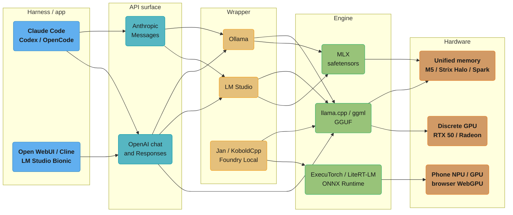
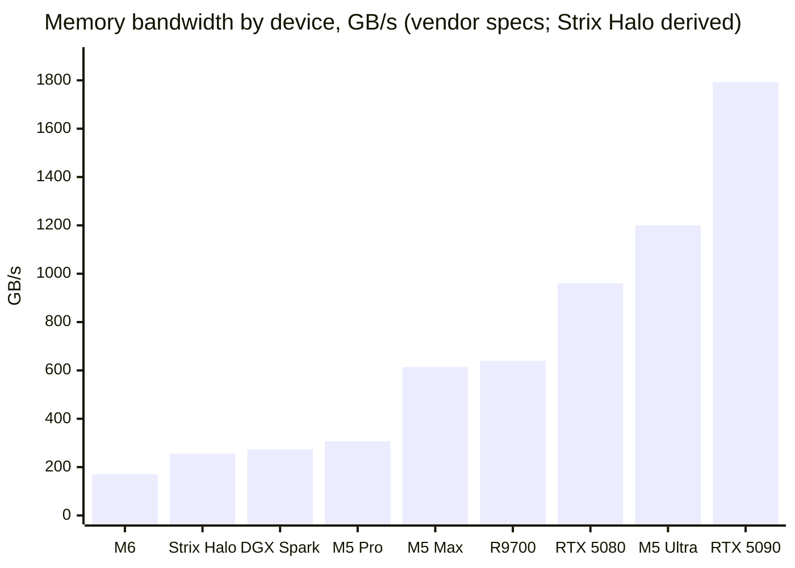
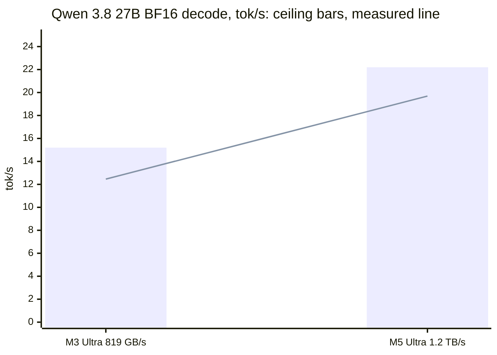
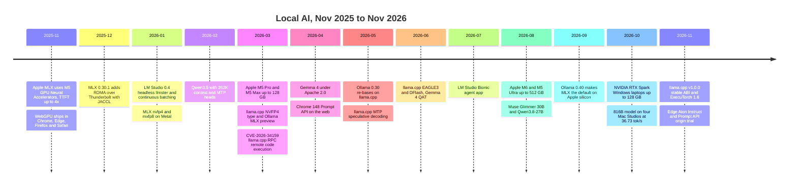

# Local AI: Running Models on Your Own Hardware

> **Version anchor (fetched 2026-11-25).** llama.cpp / ggml v1.0.0 (2026-11-13; rolling build
> b12726 on 2026-11-25), Ollama v0.40.18 (2026-11-24), LM Studio 0.4.28 with LM Studio Bionic 1.2.2
> (2026-11-20), MLX 0.32.5 / mlx-lm 0.32.2, ExecuTorch 1.6.0, LiteRT-LM 0.20.0, ONNX Runtime 1.32.0 /
> ONNX Runtime GenAI 0.20.0, vLLM 0.34.0. Every version, flag and benchmark below is pinned to these
> releases; re-check them before you quote a number in a design review.

## Deep Dive Files

| File | Topic | Q&As |
|------|-------|------|
| [local_ai_hardware_and_sizing.md](local_ai_hardware_and_sizing.md) | Hardware ladder (Apple M5/M6/Ultra, Strix Halo, DGX Spark, RTX Spark, RTX 50, NPUs, phones), decode = bandwidth / active bytes, prefill = compute, KV budgets, MoE offload, multi-box clusters, measured benchmark tables, buying guide | 15 |
| [local_agents_and_hybrid_routing.md](local_agents_and_hybrid_routing.md) | Coding and personal agents on local models, harness wiring, Anthropic/OpenAI API compatibility, prefix-cache discipline, the context-length trap, MCP with local runtimes, local RAG, local-first cloud-burst routing, local server security | 15+ |

---

## 1. Concept Overview

**Local AI** is model inference on hardware the user or the organisation owns: a laptop, a desktop,
a desk-side box, a phone, or a browser tab. The weights sit on that device, the prompt never crosses
a network you do not control, and the cost is the hardware and the electricity instead of a per-token
bill. In November 2026 the range is wide. At one end a 2.58 GB Gemma 4 E2B build decodes at 52 tok/s
on a Galaxy S26 Ultra GPU. At the other end Apple ran Muse Spark Open, an 816B-total / 42B-active
mixture-of-experts model in NVFP4, at 36.73 tok/s across four Mac Studios with M5 Ultra.

Six shifts in the last twelve months changed what "local" means:

1. **Unified-memory desktops became the workhorse.** Apple M5 Max (up to 128 GB at 614 GB/s), M5
   Ultra (up to 512 GB at 1.2 TB/s), AMD Ryzen AI Max+ 395 (up to 128 GB), NVIDIA DGX Spark (128 GB at
   273 GB/s) and, from 2026-10-16, NVIDIA RTX Spark Windows laptops (up to 128 GB) put 100B-class
   models on a desk.
2. **GPUs gained prefill accelerators.** Apple's M5-family GPU Neural Accelerators cut time to first
   token by 3.3-4.6x. Decode still tracks memory bandwidth, so it gained only 1.2-1.6x.
3. **Speculative decoding became a shipped feature.** Models ship MTP heads or drafters (Gemma 4,
   Qwen3.5 and later), llama.cpp gained MTP, EAGLE3 and DFlash between May and June 2026, and Ollama
   turns MTP on by default on its MLX engine.
4. **The runtimes consolidated.** Ollama re-based its non-Apple path on upstream llama.cpp (v0.30.0)
   and made MLX the default on Apple silicon (v0.40.0). MediaPipe LLM Inference folded into
   LiteRT-LM. llama.cpp declared a stable C API/ABI with v1.0.0. Microsoft is replacing Phi Silica
   with Aion Instruct.
5. **Operating systems expose model-agnostic LLM APIs.** Apple's Foundation Models framework now
   fronts any provider through its Language Model protocol; Windows ships Windows ML and Foundry
   Local; Android ships the ML Kit Prompt API and AgentRunner; Chrome ships the Prompt API on the web
   from Chrome 148.
6. **Local runtimes became agent platforms with cloud tiers.** `ollama launch` wires Claude Code,
   Codex and OpenCode to local models; llama-server, Ollama and LM Studio speak the Anthropic Messages
   API; LM Studio Bionic and Ollama's cloud models add an optional hosted tier. That brought new
   attack surface: GGUF parser CVEs, a critical RPC remote-code-execution bug, and poisoned chat
   templates.

This page teaches the decisions: which hardware class, which engine and wrapper, which model shape,
which quantization format, when to speculate, and what "local" does and does not guarantee.

**Not here.** SLM training, distillation, phone NPU arithmetic, GGUF block layout and the OS-provided
mobile and browser API table live in
[Small Language Models and Edge AI](../small_language_models_and_edge_ai/small_language_models_and_edge_ai.md).
Shipping models to fleets (OTA, manifests, cohorts, kill switch) lives in
[Edge and On-Device Deployment](../../mlops/edge_and_on_device_deployment/edge_and_on_device_deployment.md);
`llama-server` slot tuning and benchmark method in
[Inference Engine Operations and Benchmarking](../../mlops/inference_engine_operations_and_benchmarking/inference_engine_operations_and_benchmarking.md).
Server engines: [Inference Engines](../inference_engines/inference_engines.md) and
[vLLM Deep Dive](../vllm_deep_dive/vllm_deep_dive.md). Quantization internals:
[Optimization and Quantization](../optimization_and_quantization/optimization_and_quantization.md).
Speculative decoding mechanics: [Speculative Decoding](../inference_and_decoding/speculative_decoding.md).
KV cache formula: [KV Cache Optimization](../inference_and_decoding/kv_cache_optimization.md).
Roofline: [GPU Architecture and Roofline](../optimization_and_quantization/gpu_architecture_and_roofline.md).
MoE routing: [Mixture of Experts](../mixture_of_experts/mixture_of_experts.md). Model families and
licences: [LLM Ecosystem and Landscape](../llm_ecosystem_and_landscape/llm_ecosystem_and_landscape.md).
Self-hosting break-even: [Token Economics](../token_economics_and_cost_optimization/token_economics_and_cost_optimization.md).
Metal kernels and Apple GPU families:
[Apple Silicon GPU Architecture](../../cuda/apple_silicon_gpu_architecture/apple_silicon_gpu_architecture.md) and
[Run LLM Inference on Apple Silicon](../../cuda/case_studies/run_llm_inference_on_apple_silicon.md).
Intel NPUs: [Intel OpenVINO](../../technologies/intel_openvino/intel_openvino.md).

---

## 2. Intuition

> **One-line analogy**: Running a model locally is cooking at home instead of eating at a
> restaurant. You own the stove, the pantry is your RAM, and the tap's flow rate is your memory
> bandwidth.

**Mental model**: Every token you generate means carrying every *active* ingredient from the pantry
to the stove once. A bigger pantry (more memory) lets you keep a bigger recipe at home; it does not
make you cook faster. A faster tap (more bandwidth) does. A recipe that uses only a few ingredients
per dish (a mixture-of-experts model with 3-4B active parameters) is fast even if the pantry holds
35B parameters of stock. A food processor (TOPS, tensor cores, Neural Accelerators) speeds up the
prep work for a large order (prefill), but for one dish at a time the tap is still the limit.

**Why it matters**: People buy local hardware by the wrong number. A "50 TOPS" NPU and a "1 PFLOP"
box both sound fast, but single-user decode speed is set by memory bandwidth divided by the bytes
read per token. Getting this wrong costs thousands of dollars and months of disappointment.

**Key insight**: Two formulas decide almost every local deployment. **Fit** = total weight bytes +
KV cache bytes + runtime overhead must be below usable memory. **Speed** = usable bandwidth / bytes
of active weights read per token. Mixture-of-experts models pay the first bill in full and the second
bill only for the active slice, which is why 25-35B MoE models with 3-4B active parameters became the
2026 local sweet spot.

---

## 3. Core Principles

- **Memory decides what fits.** Total weights at the chosen bits per weight, plus the KV cache for
  your context, plus runtime overhead, must be below the memory the GPU can actually use. On a 128 GB
  Ryzen AI Max+ 395 under Windows, AMD's own guide sets 96 GB as Variable Graphics Memory; the rest
  stays with the OS.
- **Bandwidth decides speed.** Apple says it directly: "Generating subsequent tokens is bounded by
  memory bandwidth, rather than by compute ability." Dense models reach 80-90% of the
  bandwidth / bytes ceiling in published runs.
- **Count active parameters, not total.** gpt-oss-120b has 117B parameters but 5.1B active, which is
  why it decodes at 58.7 tok/s on a 273 GB/s DGX Spark in llama.cpp's own benchmark.
- **4-5 bits per weight is the default.** Q4_K_M (4.89 bpw), IQ4_XS (4.46 bpw), MLX 4-bit, AWQ/GPTQ
  INT4 and NVFP4 all sit in that band. Go lower only on very large MoE models, and never below about
  2 bits for agentic tool use.
- **Speculate when the model ships a drafter.** MTP heads and DFlash/EAGLE3 drafters verify several
  tokens per weight read, which is how 2026 runtimes beat the naive bandwidth ceiling. Turn it off for
  creative text if the acceptance rate collapses.
- **Keep the prompt prefix stable.** Agent turns are mostly prefill. Any change early in the prompt
  forces the runtime to re-process everything after it; a timestamp in the system prompt can make a
  40-turn session quadratic.
- **Treat model files as untrusted input.** llama.cpp has had four GGUF-parsing CVEs and a critical RPC bug since June 2025, and a
  GGUF's embedded Jinja chat template can carry hidden instructions.
- **Local does not mean private by default.** Ollama and LM Studio both offer cloud tiers, web UIs
  have had token-theft CVEs, and a server bound to `0.0.0.0` is reachable by anyone on the network.

---

## 4. Types / Architectures / Strategies

### 4.1 Hardware classes

| Class | Examples (Nov 2026) | Memory for models | Bandwidth | Best at |
|-------|---------------------|-------------------|-----------|---------|
| Phone / tablet | iPhone 18 Pro (A20 Pro), Pixel 11 (Tensor G6, 12-16 GB), Galaxy S26 Ultra | a few GB after the OS | not published | 1-4B models, always-on features via OS APIs |
| Thin laptop / mini PC | M6 (up to 32 GB, 170 GB/s), Snapdragon X2 Elite, Panther Lake | 16-32 GB | 135-228 GB/s | 4-9B dense, 20-30B MoE at 4-bit |
| Unified-memory workstation | M5 Max (128 GB, 614 GB/s), Ryzen AI Max+ 395 (128 GB, 256 GB/s derived), DGX Spark (128 GB, 273 GB/s), RTX Spark N1X (up to 128 GB) | 64-128 GB | 256-614 GB/s | 30-120B MoE, 27-32B dense at 8-bit |
| Discrete GPU desktop | RTX 5090 (32 GB, 1,792 GB/s), RTX 5080 (16 GB, 960 GB/s), Radeon AI PRO R9700 (32 GB, 640 GB/s) | 12-32 GB VRAM plus system RAM for offload | 448-1,792 GB/s | fastest decode for models that fit; MoE with expert offload |
| Large unified box / cluster | Mac Studio M5 Ultra (up to 512 GB, 1.2 TB/s), up to four DGX Sparks, DGX Station (748 GB) | 256 GB-2 TB | 1.2 TB/s per Mac; 7.1 TB/s HBM on DGX Station | 120B-816B models, small-team serving |

Every number above is from a vendor spec page or a first-party benchmark; the hardware sub-file
[local_ai_hardware_and_sizing.md](local_ai_hardware_and_sizing.md) owns the full table, the measured
benchmarks and the buying guide.

### 4.2 The local stack, layer by layer

A local deployment is five layers. Most confusion comes from comparing items from different layers
("Ollama vs MLX" compares a wrapper with an engine).

| Layer | What it does | 2026 options |
|-------|--------------|--------------|
| **Engine** | Loads weights, runs kernels, manages the KV cache | llama.cpp / ggml (GGUF; CPU, Metal, CUDA, HIP, Vulkan, SYCL, OpenCL, OpenVINO, Hexagon, WebGPU backends), MLX (Apple GPU plus a CUDA backend), ExecuTorch (`.pte`), LiteRT-LM (`.litertlm`), ONNX Runtime / Windows ML, OpenVINO GenAI, vLLM and SGLang on desk-side GPUs |
| **Wrapper** | Model library, download, lifecycle, a local server | Ollama (MLX on Apple silicon, llama.cpp elsewhere), LM Studio (llama.cpp and MLX engines, headless `llmster`), Jan, KoboldCpp, llamafile, Foundry Local |
| **API surface** | The protocol a client speaks | OpenAI chat completions and Responses, Anthropic Messages, native APIs (Ollama `/api/*`, LM Studio `/v1/chat`) |
| **Harness / app** | The agent or UI the user touches | Claude Code, Codex, OpenCode via `ollama launch`; LM Studio Bionic; Cline; Open WebUI; AnythingLLM |
| **Hardware** | Memory capacity, bandwidth, compute | Section 4.1 |

The API layer is the 2026 story. Because llama-server, Ollama and LM Studio all speak both the
OpenAI and the Anthropic protocols, a harness built for a hosted model can point at a local endpoint
without code changes. The agents sub-file
[local_agents_and_hybrid_routing.md](local_agents_and_hybrid_routing.md) covers that wiring.

### 4.3 Runtime choice matrix

| Runtime | Pick it when | Avoid it when | Notes (Nov 2026) |
|---------|--------------|---------------|------------------|
| **llama.cpp / llama-server** | You need every knob: GGUF quant choice, MoE offload, spec-decoding type, multi-model router, embedding a C library | You want a curated model library and zero configuration | v1.0.0 stable C API; continuous batching on, `--parallel` auto, default port 9931, OpenAI + Anthropic APIs |
| **Ollama** | One command per model, a stable local API for apps, `ollama launch` for coding agents | You need a GGUF flag Ollama does not expose | v0.40.18; MLX default on Apple silicon (v0.40.0), llama.cpp elsewhere (v0.30.0); concurrent requests on Apple silicon since v0.40.17 |
| **LM Studio** | Non-developers and developers on one machine, MLX and GGUF side by side, a headless daemon for servers | You need a fully open-source stack | 0.4.28; `llmster` headless daemon and continuous batching since 0.4.0; MCP host; Bionic agent app |
| **MLX / mlx-lm** | Apple silicon, Python research, distributed inference across Macs | Non-Apple hardware in production | 0.32.5 / 0.32.2; nvfp4 and mxfp8 on Metal; RDMA over Thunderbolt with JACCL |
| **vLLM / SGLang** | A desk-side NVIDIA GPU serving several users with high batch throughput | One user on a laptop | vLLM 0.34.0 (SM120 NVFP4 since v0.10.1); SGLang 0.5.23 Paged Experts runs MoE larger than VRAM on one consumer GPU |
| **ExecuTorch** | A PyTorch model you compile ahead of time for mobile or embedded | Fast iteration on new GGUF releases | 1.6.0: TensorRT backend beta, DFlash on CUDA and MLX, prefix caching |
| **LiteRT-LM** | Android, iOS and web with Google models; NPU on Android | Arbitrary community checkpoints | 0.20.0; replaces MediaPipe LLM Inference; `litert-lm serve` is OpenAI-compatible |
| **Foundry Local / Windows ML** | Windows apps that want CPU/GPU/NPU selection handled for them | macOS or Linux | Foundry Local runs in-process via NuGet; Windows ML is Microsoft's maintained ONNX Runtime on Windows 11 24H2+ |
| **WebLLM / Transformers.js** | Inference inside a browser tab on WebGPU | Models larger than a few GB | WebLLM 0.2.89, Transformers.js 4.3.2; WebGPU ships in Chrome, Edge, Firefox and Safari |
| **OS models** | You want a model you do not ship or update | You need a specific model or full control | Apple Foundation Models, Android AICore / ML Kit GenAI, Chrome and Edge Prompt API |

### 4.4 Model shortlist by memory tier

All entries are open-weight; "active" is the parameters read per token. Licences are from the model
cards; check them before commercial use.

| Usable memory | Models | Shape | Context | Licence |
|---------------|--------|-------|---------|---------|
| 8-16 GB | Gemma 4 E2B / E4B | 2.3B / 4.5B effective | 128K | Apache 2.0 |
| | Qwen3.5 0.8B-9B | dense, natively multimodal, MTP heads | 262,144 | Apache-2.0 |
| | Ministral 3 3B / 8B (8B fits 12 GB VRAM in FP8) | dense, vision | 256K | Apache-2.0 |
| | LFM3-1.7B (about 1 GB at 4-bit) | tri-hybrid | 256K | LFM 1.0 (not OSI) |
| | Granite 4.2 3B / 8B | dense, thinking modes | 128K native, 512K extended | Apache-2.0 |
| | gpt-oss-20b (runs in 16 GB) | 21B / 3.6B active, MXFP4 | - | Apache-2.0 |
| 24-32 GB | Gemma 4 26B-A4B | 25.2B / 3.8B active | 256K | Apache 2.0 |
| | Qwen3.6-35B-A3B, Qwen3.6-27B, Qwen3.8-27B | MoE 3B active; dense 27B | 262K native (3.8: to 1M) | Apache-2.0 |
| | Muse Glimmer 30B (Meta Superintelligence Labs) | dense 29.6B, vision | 131K+ | Apache-2.0 |
| | Nemotron 3.5 Lightning 30B-A3B | Mamba-2 + MoE hybrid | up to 1M | NVIDIA Open Model License |
| | GLM-4.7-Flash 30B-A3B, Devstral Small 2 24B | MoE; dense coding model | -; 256K | MIT; Apache-2.0 |
| 64-128 GB | gpt-oss-120b | 117B / 5.1B active, MXFP4 | - | Apache-2.0 |
| | Qwen3-Coder-Next | 80B / 3B active | 256K | Apache-2.0 |
| | Mistral Small 4 | 119B / 6.5B active | 256K | Apache-2.0 |
| | Qwen3.5-122B-A10B | MoE | 262,144 | Apache-2.0 |
| | Qwen3.8-Flash-Next | 125B / 6B active | - | qwen-community-1.0 (not Apache) |
| 256-512 GB, or clusters | Qwen3.5-397B-A17B | MoE | 262,144 | Apache-2.0 |
| | Muse Spark Open 816B-A42B in NVFP4 (about 493 GB of weights) | MoE | - | check the model card; Apple names it, the terms were not verified |

Meta's newest weights under the `meta-llama` organisation are still Llama 4 Scout and Maverick
(2025-04); its 2026 open model for local use is Muse Glimmer 30B, published under `meta-models`.

### 4.5 Quantization format choice

| Format | Engine | Use it for | 2026 notes |
|--------|--------|------------|------------|
| GGUF k-quants (Q4_K_M, Q5_K_M, Q6_K) | llama.cpp, Ollama, LM Studio | The default on every platform | Q4_K_M = 4.89 bpw; `llama-quantize --target-bpw` picks per-tensor types to hit a budget |
| GGUF i-quants (IQ4_XS ... IQ1_S) with an imatrix | llama.cpp | Squeezing a large MoE into a fixed RAM budget | Unsloth Dynamic v3.1 reports a cliff between UD-Q2_K_XL and UD-IQ2_S |
| NVFP4 / MXFP4 in GGUF | llama.cpp (types 40 / 39) | FP4 checkpoints published by NVIDIA, IBM, Mistral; gpt-oss | NVFP4 type added 2026-03-11; Metal NVFP4 2026-11-23; Hexagon NVFP4 2026-11-14 |
| MLX affine, mxfp4, nvfp4, mxfp8 | MLX, Ollama on Mac, LM Studio MLX engine | Apple silicon | `mlx_lm.convert --q-mode`; learned DWQ, AWQ, GPTQ and dynamic quants in mlx-lm |
| AWQ / GPTQ / FP8 / NVFP4 compressed-tensors | vLLM, SGLang | Desk-side NVIDIA serving | AutoAWQ is archived; AWQ lives in llm-compressor; SM120 (RTX 50) NVFP4 since vLLM v0.10.1 |
| EXL3 | exllamav3 / TabbyAPI | Single-user NVIDIA with very low bpw | QTIP-based; CPU offload for large MoE |
| QAT / QAD checkpoints | all of the above | When the publisher ships one, take it | Gemma 4 QAT: Q4_0 GGUF, mobile wNa8o8 (E2B in about 1 GB), w4a16 for vLLM; NVIDIA NVFP4-QAD builds |
| Ternary (BitNet b1.58) | bitnet.cpp, llama.cpp TQ1_0/TQ2_0 | CPU-only niches | 2.37-6.17x speedup on x86; no frontier-quality native 1.58-bit LLM exists |

The internals (block layouts, scale formats, GPTQ and AWQ maths) are in
[Optimization and Quantization](../optimization_and_quantization/optimization_and_quantization.md).

### 4.6 Speculative decoding in local runtimes

| Method | Where the draft comes from | Local support |
|--------|----------------------------|---------------|
| **MTP heads** | Extra heads trained with the model (Qwen3.5/3.6/3.8, Gemma 4 "assistant" drafters) | llama.cpp since 2026-05-16 (`--spec-type draft-mtp`); Ollama on MLX, on by default with an auto-tuned draft length |
| **EAGLE3** | A small head trained on the target's hidden states | llama.cpp since 2026-06-12; EAGLE3 for Qwen3.5/3.6 2026-06-19; for gpt-oss 2026-07-28 |
| **DFlash** | A block-diffusion drafter that proposes a block in parallel | llama.cpp since 2026-06-28; sidecar drafter auto-download 2026-07-17; ExecuTorch 1.6.0 on CUDA and MLX; Ollama MLX for Muse Glimmer |
| **Separate draft model** | A smaller model from the same family | `--spec-draft-hf <repo>`; `--spec-draft-n-max` defaults to 3 |

In llama-server, speculation is opt-in: `--spec-type` defaults to `none`. Ollama is the runtime that
turns MTP on by itself. Speculation is exact: the target model verifies every drafted token, so
output matches plain decoding (Google's Gemma 4 MTP drafters claim "up to 3x" with identical output).
The mechanics and the acceptance-rate proof are in
[Speculative Decoding](../inference_and_decoding/speculative_decoding.md).

### 4.7 Local multimodal

| Modality | Models and runtimes (Nov 2026) |
|----------|--------------------------------|
| Speech to text | whisper.cpp 1.9.6 (Metal, Core ML, Vulkan, OpenVINO, AMD Ryzen AI NPU backends; built-in VAD); NVIDIA parakeet-tdt-0.6b-v3 (25 European languages); Qwen3-ASR 0.6B / 1.7B (Apache-2.0); Voxtral Mini 4B Realtime (240 ms to 2.4 s configurable delay) |
| Text to speech | Kokoro-82M (Apache-2.0); Gradium Phonon 31M / 40M (Apache-2.0), shipped in Ollama on 2026-10-24 at "over 100 times faster than real time on Apple Silicon" (vendor); Voxtral-4B-TTS is CC-BY-NC-4.0, so not for commercial use |
| Vision-language | Natively multimodal general models (Gemma 4, Qwen3.5+, Ministral 3, Muse Glimmer); llama.cpp `--mmproj` (auto-downloaded with `-hf`); mlx-vlm 0.8.1 |
| Image generation | FLUX 3 Image Klein 5.6B (INT8 build on 8 GB RTX GPUs, about 4 s per 1 MP image on an RTX 5090, NVIDIA-measured, non-OSI licence); FLUX.2 [klein] 4B (Apache-2.0, about 13 GB VRAM); ComfyUI 0.46.0 |
| Embeddings for local RAG | EmbeddingGemma 2 (740M, Apache-2.0, multimodal, Matryoshka 768/512/256/128, 8K context); Qwen3-Embedding 0.6B/4B/8B with official GGUF |

For the voice pipeline itself see [Voice Agents](../voice_agents/voice_agents.md); for local RAG
wiring see the agents sub-file.

### 4.8 OS and browser models: local you do not ship

The cheapest local model is one the operating system already installed. Apple's Foundation Models
framework on OS 27 rebuilt its on-device model with vision input and adds a Private Cloud Compute
model with a 32,000-token context behind the same API. Android's ML Kit GenAI Prompt API supports
typed output and tool declarations on Gemini Nano 2, 3 and 4 device tiers. Chrome's Prompt API is
stable on the web from Chrome 148, and Edge put its Prompt API into an origin trial on 2026-11-19,
backed by the 2.3B Aion Instruct model. You trade model choice and version control for zero download
size. The per-platform table is in
[Small Language Models and Edge AI](../small_language_models_and_edge_ai/small_language_models_and_edge_ai.md)
section 4.7.

---

## 5. Architecture Diagrams

### The local stack



Read it right to left to see where performance comes from (hardware and engine) and left to right to
see where portability comes from (the API layer). The edge from the OpenAI API straight to llama.cpp
is llama-server, which speaks both protocols without a wrapper.

### The bandwidth ladder



Decode ceilings scale with these bars, not with TOPS. The Strix Halo value is 256-bit LPDDR5x-8000
arithmetic; AMD does not publish a bandwidth figure. The RTX 5090 is the fastest bar but holds only
32 GB; the M5 Ultra is second and holds up to 512 GB.

### Ceiling vs measured decode: Qwen 3.8 27B BF16 at 8,192 context



The ceiling is bandwidth divided by about 54 GB of BF16 weights. Apple's measured MLX numbers
(2026-10-15) land at about 82% and 89% of it. Dense models are this predictable; small-active MoE
models land further below their ceiling (see the hardware sub-file).

### Twelve months of local AI



### Why MoE feels fast at home: bytes held vs bytes read

```
Same Mac: M5 Pro, 48 GB, 307 GB/s. Both models at about 4.5 bits per weight.

Qwen3.8-27B (dense)                         Qwen3.6-35B-A3B (MoE, about 3B active)

Held in memory                              Held in memory
[###############.....] 15.2 GB              [###################.] 19.7 GB    (+4.5 GB)

Read per generated token                    Read per generated token
[###############.....] 15.2 GB              [##..................]  1.7 GB    (9x less)

Naive decode ceiling                        Naive decode ceiling
307 / 15.2 = about 20 tok/s                 307 / 1.7 = about 180 tok/s
Plan at 80-90% = 16-18 tok/s                Plan at 30-70% = 55-125 tok/s
```

The MoE model costs more memory and far less bandwidth per token. Dense models reach 80-90% of the
ceiling in published runs; small-active MoE models reach 30-70% because routing, attention and
per-token overheads no longer hide behind one large weight read. The efficiency bands come from
llama.cpp's DGX Spark and M2 Ultra benchmarks, worked through in the hardware sub-file.

---

## 6. How It Works — Detailed Mechanics

### 6.1 Sizing a model to a machine in ten lines

Two numbers answer "will it run, and how fast": the bytes that must fit, and the bytes read per
token. The code below is the same arithmetic the hardware sub-file extends with prefill time and
multi-box estimates.

```python
from dataclasses import dataclass

GB = 1e9


@dataclass(frozen=True)
class Device:
    name: str
    memory_gb: float        # unified memory or VRAM
    usable_fraction: float  # share the GPU may really use; measure it on your OS
    bandwidth_gbs: float    # vendor peak memory bandwidth


@dataclass(frozen=True)
class ModelSpec:
    name: str
    total_params_b: float
    active_params_b: float  # equals total for a dense model
    bits_per_weight: float

    def weight_gb(self) -> float:
        return self.total_params_b * self.bits_per_weight / 8

    def active_gb(self) -> float:
        return self.active_params_b * self.bits_per_weight / 8


def kv_cache_gb(layers: int, kv_heads: int, head_dim: int, context: int,
                bytes_per_elem: float = 2.0) -> float:
    """K and V for every full-attention layer; f16 is 2 bytes per element."""
    return 2 * layers * kv_heads * head_dim * bytes_per_elem * context / GB


def fits_in_memory(model: ModelSpec, device: Device, kv_gb: float,
                   overhead_gb: float = 2.0) -> tuple[bool, float]:
    need = model.weight_gb() + kv_gb + overhead_gb
    have = device.memory_gb * device.usable_fraction
    return need <= have, round(have - need, 1)


def decode_ceiling_tps(model: ModelSpec, bandwidth_gbs: float) -> float:
    return bandwidth_gbs / model.active_gb()


def estimate_decode_tps(model: ModelSpec, device: Device, efficiency: float) -> float:
    """Plan with 0.8-0.9 for dense models and 0.3-0.7 for small-active MoE models."""
    return decode_ceiling_tps(model, device.bandwidth_gbs) * efficiency


if __name__ == "__main__":
    # Check the formula against Apple's measured MLX numbers (2026-10-15, 8,192 context).
    qwen38_bf16 = ModelSpec("Qwen 3.8 27B BF16", 27, 27, 16)
    for label, bw, measured in [("M3 Ultra", 819, 12.46), ("M5 Ultra", 1200, 19.69)]:
        ceiling = decode_ceiling_tps(qwen38_bf16, bw)
        print(f"{label}: ceiling {ceiling:.1f} tok/s, measured {measured}, "
              f"efficiency {measured / ceiling:.0%}")

    # Plan a 48 GB M5 Pro (307 GB/s). 0.75 mirrors AMD's 96-of-128 GB VGM default on Windows.
    m5_pro = Device("MacBook Pro M5 Pro 48 GB", 48, 0.75, 307)
    dense = ModelSpec("Qwen3.8-27B 4-bit", 27, 27, 4.5)
    moe = ModelSpec("Qwen3.6-35B-A3B 4-bit", 35, 3, 4.5)
    kv = kv_cache_gb(layers=48, kv_heads=8, head_dim=128, context=32_768)  # illustrative config
    for model, eff in [(dense, 0.85), (moe, 0.5)]:
        print(model.name, fits_in_memory(model, m5_pro, kv),
              f"~{estimate_decode_tps(model, m5_pro, eff):.0f} tok/s")
```

Output, worked by hand:

| Line | Value | Reading |
|------|-------|---------|
| M3 Ultra | ceiling 15.2, measured 12.46, efficiency 82% | dense BF16 hits most of the ceiling |
| M5 Ultra | ceiling 22.2, measured 19.69, efficiency 89% | 1.2 TB/s, 54 GB of weights |
| KV at 32K (illustrative 48-layer, 8 KV-head, 128-dim config) | 6.4 GB | adds to both models equally |
| Qwen3.8-27B 4-bit on 48 GB | fits, 15.2 GB weights; about 17 tok/s | dense: plan 80-90% of 20 tok/s |
| Qwen3.6-35B-A3B 4-bit on 48 GB | fits, 19.7 GB weights; about 90 tok/s | MoE: half of a 180 tok/s ceiling |

The `kv_cache_gb()` config is illustrative, not a real model card; read `num_hidden_layers`,
`num_key_value_heads` and `head_dim` from the model's `config.json`, and count only full-attention
layers for hybrid models (sliding-window, Gated DeltaNet and Mamba layers hold far less). The KV
formula itself is derived in [KV Cache Optimization](../inference_and_decoding/kv_cache_optimization.md).

### 6.2 Picking a quant: measure divergence, then measure the task

Perplexity alone hides damage. llama.cpp's `llama-perplexity` can record the full-precision logits
once and then score each quant by KL divergence and "same top p" (how often both models pick the
same top token):

```bash
# 1. Record BF16 logits once. The file is large: the README cites 37 GiB for Llama 3 on Wikitext-2.
llama-perplexity -m model-BF16.gguf -f eval.txt --kl-divergence-base model-BF16.kld

# 2. Score every candidate against that file.
llama-perplexity -m model-Q4_K_M.gguf --kl-divergence-base model-BF16.kld --kl-divergence
llama-perplexity -m model-UD-Q2_K_XL.gguf --kl-divergence-base model-BF16.kld --kl-divergence
```

Divergence tells you how far the quant drifted; it does not tell you whether your agent still emits
valid tool calls. Unsloth's own Dynamic v3.1 data (vendor-reported) shows why both are needed: on
Qwen3.8-27B its UD-IQ1_S build is 6.2 GB and keeps about 72% top-1 agreement with BF16, yet a
32-token greedy agreement metric falls from about 25% to under 10% between UD-Q2_K_XL and UD-IQ2_S,
and Unsloth states that 1-bit "should not be used for agentic use-cases". So the second gate is a
task eval at the exact quant you ship, run through the same OpenAI-compatible endpoint the app uses:

```python
import json
from dataclasses import dataclass

from openai import OpenAI

TOOLS = [{
    "type": "function",
    "function": {
        "name": "read_file",
        "description": "Read a file from the repository.",
        "parameters": {
            "type": "object",
            "properties": {"path": {"type": "string"}},
            "required": ["path"],
        },
    },
}]


@dataclass(frozen=True)
class ToolCase:
    prompt: str
    expected_tool: str
    expected_args: dict[str, str]


def tool_call_accuracy(base_url: str, model: str, cases: list[ToolCase]) -> float:
    client = OpenAI(base_url=base_url, api_key="local")
    correct = 0
    for case in cases:
        resp = client.chat.completions.create(
            model=model,
            messages=[{"role": "user", "content": case.prompt}],
            tools=TOOLS,
            temperature=0,
        )
        calls = resp.choices[0].message.tool_calls or []
        if not calls:
            continue
        try:
            args = json.loads(calls[0].function.arguments)
        except json.JSONDecodeError:
            continue
        if calls[0].function.name == case.expected_tool and args == case.expected_args:
            correct += 1
    return correct / len(cases)


if __name__ == "__main__":
    cases = [ToolCase("Open src/app.py and summarise it.", "read_file", {"path": "src/app.py"})]
    # Two llama-server instances, one per quant: ports 9931 (default) and 9932.
    baseline = tool_call_accuracy("http://127.0.0.1:9931/v1", "q8", cases)
    candidate = tool_call_accuracy("http://127.0.0.1:9932/v1", "q2", cases)
    print(f"Q8_0 {baseline:.0%}  UD-Q2_K_XL {candidate:.0%}  ship={candidate >= baseline - 0.02}")
```

Use a few hundred real cases from your own traces, not one; the gate (here, at most 2 points below
the 8-bit baseline) is a product decision. Run it again whenever the runtime, the chat template or
the quant changes.

### 6.3 Turning speculative decoding on, and off

Speculation trades a little extra compute for fewer full weight reads: the draft proposes `k`
tokens and the target checks all of them in one forward pass. On a bandwidth-bound machine that
pass costs about the same as generating one token, so accepted drafts are almost free.

```bash
# llama-server: speculation is opt-in (--spec-type defaults to none).

# The GGUF carries the model's own MTP heads (for example an "-MTP-GGUF" build).
llama-server -m Qwen3.6-35B-A3B-MTP-Q4_K_M.gguf --spec-type draft-mtp

# A separate drafter from Hugging Face; draft up to 4 tokens (default 3).
llama-server -m target-Q4_K_M.gguf --spec-type draft-dflash \
  --spec-draft-hf <org>/<dflash-drafter-repo> --spec-draft-n-max 4
```

Ollama needs no flag: on its MLX engine MTP is on by default for supported models, the draft length
is tuned at runtime, and Ollama falls back to plain decoding when drafting stops paying. Its
2026-06-29 post reports Gemma 4 12B (nvfp4) on an M5 Max running "nearly 90% faster" on Aider
polyglot (vendor claim). On Muse Glimmer, Ollama reports DFlash at 1.5-1.8x on Apple silicon.

Turn it off, or shorten the draft, when acceptance falls. Code is highly predictable and gains the
most; open-ended creative text gains least, and a fixed long draft can run slower than plain decode.
Two traps: a QAT target needs the matching QAT drafter (Google's Gemma 4 QAT note), and quants at or
below UD-Q2_K_XL from Unsloth strip the MTP modules to save about 500 MB, so `draft-mtp` has nothing
to use. Measure on your own prompts:

```python
import time

from openai import OpenAI


def decode_tps(base_url: str, model: str, prompt: str, max_tokens: int = 512) -> float:
    """Completion tokens per wall-clock second for a short prompt (prefill is negligible)."""
    client = OpenAI(base_url=base_url, api_key="local")
    start = time.perf_counter()
    resp = client.chat.completions.create(
        model=model,
        messages=[{"role": "user", "content": prompt}],
        max_tokens=max_tokens,
        temperature=0,
    )
    elapsed = time.perf_counter() - start
    return resp.usage.completion_tokens / elapsed


if __name__ == "__main__":
    for task in ["Write a Python LRU cache with tests.", "Write a short ghost story."]:
        plain = decode_tps("http://127.0.0.1:9932/v1", "plain", task)
        spec = decode_tps("http://127.0.0.1:9931/v1", "mtp", task)
        print(f"{task[:30]:30s} plain {plain:5.1f}  spec {spec:5.1f}  gain {spec / plain:.2f}x")
```

### 6.4 Running an MoE larger than VRAM: expert offload

A mixture-of-experts layer splits into a small always-used part (attention, router, shared experts)
and a large rarely-used part (the routed experts). llama.cpp can keep the routed experts in system
RAM and run them on the CPU while the GPU runs everything else:

```bash
# gpt-oss-120b MXFP4 is a 59.02 GiB file; an RTX 5080 has 16 GB of VRAM.
# -ngl auto (default) puts layers on the GPU; --n-cpu-moe N keeps the experts of the first N layers
# in system RAM. Start with N = the model's layer count (same as --cpu-moe), lower it until VRAM
# is nearly full.
llama-server -m gpt-oss-120b-mxfp4.gguf -ngl auto --n-cpu-moe 30 -c 32768

# Or let --fit (on by default) size the unset arguments, keeping a 1024 MiB margin per device.
llama-server -m gpt-oss-120b-mxfp4.gguf --fit on --fit-target 1024
```

The cost is that the experts each token touches are read from system RAM at system-RAM bandwidth
and computed by the CPU. With 5.1B active parameters that slice is small, which is why this works at
all; it is still slower than keeping everything in VRAM. SGLang 0.5.23 adds an opt-in Paged Experts
mode it reports as "up to 30x faster than CPU offload" on a single consumer GPU, and exllamav3 offers
CPU offload for large MoE. The trade-off table is in the hardware sub-file.

### 6.5 Serving one box to a small team

A single local server can serve several people because decode is bandwidth-bound: one weight read
per step can serve several sequences at once, so aggregate tokens per second rises with the number
of active requests until compute or KV memory runs out.

```bash
# Six slots, 32K context each from a shared KV pool, keys required, Prometheus metrics on.
llama-server -m Qwen3.6-35B-A3B-Q4_K_M.gguf \
  --host 127.0.0.1 --port 9931 \
  -np 6 --kv-unified-per-slot 32768 \
  --api-key-file /etc/llama/keys.txt --metrics
```

Continuous batching is on by default in llama-server and `--parallel` is auto when you do not set
it. Ollama on Apple silicon serves multiple requests at once from v0.40.17, and LM Studio's headless
`llmster` daemon does continuous batching since 0.4.0. Inco's Splash engine in LM Studio reports
74 tok/s for one Qwen3.8-27B stream on a 48 GB M5 Pro and 170 tok/s combined across four (vendor
claim, with DFlash 2 speculation). Put a TLS reverse proxy in front instead of binding to
`0.0.0.0`; slot tuning, `--cache-ram` sizing and benchmark method are in
[Inference Engine Operations and Benchmarking](../../mlops/inference_engine_operations_and_benchmarking/inference_engine_operations_and_benchmarking.md).

### 6.6 Three broken deployments and their fixes

**BROKEN 1: the silent 4k context.** An agent on a 16 GB GPU calls Ollama with defaults and sends a
30K-token repository map. Ollama's default context depends on VRAM: under 24 GiB it is 4k, from 24 to
48 GiB it is 32k, and from 48 GiB it is 256k. On the 16 GB card the map is cut to the last 4k tokens
with no error, and the agent "ignores" instructions that were dropped before the model saw them.

```python
import httpx

MODEL = "your-coding-model"  # any tag from `ollama list`

resp = httpx.post("http://127.0.0.1:11434/api/chat", json={
    "model": MODEL,
    "messages": [{"role": "system", "content": repo_map}, {"role": "user", "content": task}],
    "stream": False,
}, timeout=600).json()
# No error. resp["prompt_eval_count"] is about 4,096, not about 30,000.
```

**FIX 1:** size the context for the agent (Ollama's docs ask for at least 64,000 tokens for agents and
coding tools), check it, and assert it in the client.

```python
import httpx

AGENT_CONTEXT = 65_536  # or start the server with OLLAMA_CONTEXT_LENGTH=64000 ollama serve


def chat_checked(model: str, messages: list[dict[str, str]]) -> dict:
    resp = httpx.post("http://127.0.0.1:11434/api/chat", json={
        "model": model,
        "messages": messages,
        "options": {"num_ctx": AGENT_CONTEXT},
        "stream": False,
    }, timeout=600).json()
    sent_chars = sum(len(m["content"]) for m in messages)
    seen_tokens = resp["prompt_eval_count"]
    if seen_tokens < sent_chars / 8:  # well under the usual 3-4 chars per token
        raise RuntimeError(f"prompt truncated: {seen_tokens} tokens for {sent_chars} chars")
    return resp
```

Then run `ollama ps` and read the CONTEXT column for the loaded model; it shows the context the
runner actually allocated.

**BROKEN 2: sizing by TOPS.**

```python
def tokens_per_second(npu_tops: float, params_b: float) -> float:
    return npu_tops * 1e12 / (2 * params_b * 1e9)

print(tokens_per_second(80, 8))  # 5000.0 "tok/s" for an 8B model on an 80 TOPS NPU
```

**FIX 2:** take the minimum of the bandwidth bound and the compute bound, with a realistic efficiency.

```python
def tokens_per_second(bandwidth_gbs: float, active_params_b: float, bits_per_weight: float,
                      effective_tops: float, efficiency: float = 0.8) -> float:
    bytes_per_token_gb = active_params_b * bits_per_weight / 8
    bandwidth_bound = bandwidth_gbs / bytes_per_token_gb
    compute_bound = effective_tops * 1e12 / (2 * active_params_b * 1e9)
    return min(bandwidth_bound, compute_bound) * efficiency

# Snapdragon X2 Elite: 80 NPU TOPS, 135 GB/s on the base memory tier. 8B dense at 4.5 bpw.
print(round(tokens_per_second(135, 8, 4.5, 80)))  # 24 tok/s: bandwidth, not TOPS, is the limit
```

**BROKEN 3: the 1-bit agent.** A team squeezes Qwen3.8-27B into 6.2 GB with UD-IQ1_S so it fits a
laptop beside an IDE. Chat looks fine; tool-call arguments start arriving as malformed JSON and the
agent loops on retries.

**FIX 3:** choose the smallest quant that passes the tool-call gate from 6.2, never below the
publisher's agentic floor.

```python
def choose_quant(scores: dict[str, float], sizes_gb: dict[str, float], baseline: float,
                 max_drop: float = 0.02, banned: frozenset[str] = frozenset({"UD-IQ1_S", "UD-IQ1_M"})
                 ) -> str:
    passing = [q for q, s in scores.items() if s >= baseline - max_drop and q not in banned]
    if not passing:
        raise ValueError("no quant passes the tool-call gate; buy memory or pick a smaller model")
    return min(passing, key=lambda q: sizes_gb[q])
```

For a model this size the usual answer is a Q4-class quant, or a smaller MoE model at Q4, rather
than a 1-bit build of the bigger one.

---

## 7. Real-World Examples

### Apple: an 816B model on four Mac Studios (2026-10-15)
Apple's machine-learning team benchmarked MLX on Mac Studio M5 Ultra (512 GB) against M3 Ultra with
`mlx_lm.benchmark` at 8,192 tokens of context. Qwen 3.8 27B in BF16 decoded at 12.46 tok/s on M3
Ultra, 19.69 on one M5 Ultra and 50.89 on four M5 Ultras in tensor parallel. Mistral Medium 3.5 128B
in FP8 went 4.95, 7.70 and 23.37. Muse Spark Open, 816B total and 42B active in NVFP4 (about 493 GB
of weights), ran at 15.74 tok/s on two machines in pipeline parallel and 36.73 tok/s on four in
tensor parallel. The Macs talk over RDMA on Thunderbolt 5 (macOS 26.2) through MLX's JACCL backend.
Time to first token for Qwen 3.8 27B fell from 18.2 s to 4.1 s to 1.7 s. The cost is power: Apple
reports about 300 W peak for M5 Ultra against about 200 W for M3 Ultra.

### llama.cpp: DGX Spark vs M2 Ultra on identical flags
llama.cpp keeps benchmark files in its repo (`benches/dgx-spark`, `benches/mac-m2-ultra`, both at
commit 3795cc1, 2026-02-05) run with `llama-bench -fa 1 -p 2048 -n 32 -ub 2048`. The M2 Ultra
(800 GB/s) won every decode row: gpt-oss-120b 85.6 vs 58.7 tok/s, Qwen2.5-Coder-7B Q8_0 79.7 vs
29.4. The DGX Spark (273 GB/s, Blackwell tensor cores) won every prefill row: gpt-oss-20b 4,505.8 vs
2,713.4 tok/s at 2,048 tokens. Same software, same models, opposite winners, and both results follow
from bandwidth vs compute.

### Ollama: from wrapper to dual-engine platform
Ollama spent 2026 replacing its own engine. v0.19.0 (2026-03-27) previewed MLX on Apple silicon with
NVFP4 and cache reuse across conversations; v0.30.0 (2026-05-13) re-based everything else on upstream
llama.cpp; v0.40.0 (2026-09-25) made MLX the default on Apple silicon; v0.40.17 (2026-11-10) let a Mac
serve several requests at once. On top it added Anthropic Messages compatibility (2026-01-16),
`ollama launch` for Claude Code, Codex, OpenCode, Pi and OpenClaw (2026-01-23), speech models
(2026-10-24) and cloud models. Its MLX blog reports Qwen3.5-35B-A3B int4 at 1,851 tok/s prefill and
134 tok/s decode, without naming the Mac (vendor claim).

### LM Studio: headless server and agent app
LM Studio 0.4.0 (2026-01-28) split out `llmster`, a headless daemon with continuous batching, and a
stateful `/v1/chat` endpoint with local MCP. Its MLX engine added KV-cache checkpointing for agentic
workloads (mlx-engine v1.8.5, 2026-06-05). LM Studio Bionic (2026-07-16) is a separate agent app that
runs local models on the LM Studio runtime, with an optional "Secure Cloud" tier under zero data
retention; LM Link lets a phone or another machine use those local models remotely.

### Microsoft: Windows and Edge
Microsoft groups Windows AI APIs, Windows ML and Foundry Local as "Microsoft Foundry on Windows".
Foundry Local installs with `winget install Microsoft.FoundryLocal` or runs in-process from a NuGet
package that picks a CPU, GPU or NPU variant per device. Phi Silica, the inbox SLM on Copilot+ PCs,
is being replaced by Aion Instruct: Insider rollout in December 2026, retail in January 2027. On
2026-11-19 Edge made the 2.3B Aion Instruct (open weights, MIT) its built-in model in place of
Phi-4-mini and opened a Prompt API origin trial.

### Google: one model from phone to Raspberry Pi
LiteRT-LM's published table for Gemma-4-E2B (2.58 GB) gives decode of 52 tok/s on a Galaxy S26 Ultra
GPU, 56 on an iPhone 17 Pro GPU, 48 on an Intel Lunar Lake GPU, 160 on an M4 Max, 143 on an RTX 4090
and 8 on a Raspberry Pi 5 CPU. Prefill spans 133 to 11,234 tok/s across the same devices. LiteRT-LM
replaced MediaPipe LLM Inference, whose documentation now redirects to it.

### NVIDIA: desk-side and laptop unified memory
DGX Spark (GB10, 128 GB at 273 GB/s, 240 W power supply) is marketed as "a complete platform for local
autonomous agents"; up to four can be clustered over ConnectX-7 at 200 Gbps. RTX Spark (N1X) Windows
laptops from ASUS, Dell, HP, Lenovo, Microsoft and MSI arrived on 2026-10-16 with up to 128 GB of
unified memory; NVIDIA has not published their memory bandwidth.

---

## 8. Tradeoffs

### Local vs hosted API

| Dimension | Local | Hosted API |
|-----------|-------|------------|
| Quality ceiling | Open-weight models; the best runnable ones are 25-35B MoE on laptops and 120B-816B on large boxes | Frontier models |
| Data path | Prompt stays on hardware you control, if you also control the app's cloud features and network exposure | Provider terms, retention settings, region |
| Latency | No network; time to first token is bound by local prefill (seconds for long prompts on laptops) | Network plus queueing; fast prefill on datacenter GPUs |
| Cost shape | Capital cost plus power; marginal token is nearly free; idle hardware still costs | Per token; zero when idle |
| Throughput | One box serves one to a handful of users well | Elastic |
| Operations | You patch runtimes (four GGUF-parsing CVEs and an RPC RCE in llama.cpp since 2025-06), pin models, manage drivers | Provider patches |
| Offline | Works | Fails |

### Dense vs MoE at home

| Property | Dense (Qwen3.8-27B) | MoE (Qwen3.6-35B-A3B) |
|----------|---------------------|-----------------------|
| Memory at about 4.5 bpw | 15.2 GB | 19.7 GB |
| Bytes read per token | 15.2 GB | about 1.7 GB |
| Decode on a 307 GB/s M5 Pro (estimate) | about 17 tok/s | about 55-125 tok/s |
| Fraction of ceiling reached | 80-90% | 30-70% |
| Prefill cost per token | all 27B parameters | the active slice plus attention |
| Fit with expert offload on a 16 GB GPU | no clean split | yes (`--n-cpu-moe`) |

### 128 GB-class machines (numbers live in the hardware sub-file)

| Machine | Strength | Weakness |
|---------|----------|----------|
| MacBook Pro / Mac Studio M5 Max | 614 GB/s: highest bandwidth in the class; MLX and Ollama MLX default | macOS only; no CUDA |
| Ryzen AI Max+ 395 | x86, Windows or Linux, Vulkan and ROCm | about 256 GB/s; 96 GB GPU share by default on Windows |
| DGX Spark | CUDA, FP4 tensor cores, best prefill in class, clusters up to four | 273 GB/s decode; Linux box, not a laptop |
| RTX Spark laptop | CUDA on a Windows laptop with up to 128 GB | bandwidth unpublished; new platform |
| RTX 5090 desktop (not 128 GB) | 1,792 GB/s: the fastest decode for anything in 32 GB | 32 GB; large models need offload |

### GGUF vs MLX vs FP4 checkpoints

| Choice | Pick it when | Watch out for |
|--------|--------------|---------------|
| GGUF k/i-quants | Any hardware; the widest model coverage and tooling | Low-bit i-quants break tool calling |
| MLX 4/8-bit, DWQ | Apple silicon, especially M5-family Neural Accelerators | Apple-only in practice; check the engine your wrapper uses |
| NVFP4 / MXFP4 checkpoints | The publisher shipped one (gpt-oss, NVIDIA, IBM, Mistral) or you run Blackwell tensor cores | Tensor-core speed only on Blackwell; elsewhere the runtime dequantizes in software |

---

## 9. When to Use / When NOT to Use

### Use local inference when:
- **Data must not leave your hardware.** Source code under a regulator's rules, patient notes,
  legal privilege, export-controlled designs.
- **The device is offline or intermittently connected.** Field tools, aircraft, factories, laptops on
  travel.
- **Token volume is high and steady.** A box running all day amortises; see
  [Token Economics](../token_economics_and_cost_optimization/token_economics_and_cost_optimization.md)
  for the break-even arithmetic.
- **Latency on short tasks matters more than peak quality.** Autocomplete, classification,
  extraction, redaction, embeddings.
- **You are experimenting.** Swapping models, quants and prompts costs nothing per token.

### Do NOT use local inference when:
- **The task needs frontier reasoning** and no open model at your memory tier passes your eval.
- **You must serve many users at high request rates.** Use a GPU server and
  [vLLM](../vllm_deep_dive/vllm_deep_dive.md) instead of a desk box.
- **You cannot size the devices.** A consumer app whose users run 8 GB laptops cannot assume a 30B
  model; use the OS model or a hosted fallback.
- **The machine is shared and untrusted.** A multi-tenant host with an exposed local server is a
  remote-code-execution risk, not a privacy win.
- **Usage is bursty.** A few hours a month is cheaper on rented GPUs or an API.

---

## 10. Common Pitfalls

### Pitfall 1: The 4k context nobody noticed
A team piloted a coding agent on Ollama on 16 GB GPUs. The agent kept ignoring the repository
conventions in its system prompt. The cause was Ollama's VRAM-based default context: under 24 GiB it
is 4k, so the 30K-token prompt was cut and the conventions never reached the model. No error was
raised. Fix: `OLLAMA_CONTEXT_LENGTH=64000` (Ollama's own minimum for agents), check `ollama ps`, and
assert `prompt_eval_count` in the client (section 6.6).

### Pitfall 2: A quant too small for tools
To fit a 27B model beside an IDE on a 16 GB laptop, a team took a 1-bit dynamic quant. Chat demos
passed; in production the agent emitted malformed tool-call JSON and looped. Unsloth's own guidance
is that 1-bit should not be used for agentic work. Fix: gate quants on a tool-call eval and choose a
smaller MoE model at Q4 instead.

### Pitfall 3: The exposed port
Someone set `OLLAMA_HOST=0.0.0.0` so a colleague could try the model, and port 11434 sat open on
the office network with no authentication. Worse variants expose the llama.cpp RPC backend, which
had a critical unauthenticated remote-code-execution bug (CVE-2026-34159, 2026-03-26). Fix: bind to
127.0.0.1, put a TLS reverse proxy with authentication in front, never expose RPC, and keep
llama.cpp current.

### Pitfall 4: The poisoned chat template
A GGUF downloaded from an unofficial repo carried extra instructions inside its Jinja chat-template
metadata. Pillar Security showed in 2025 that such a template bypasses input and output guardrails
and that the repo page can display a clean template while the file differs. Fix: pin models by
digest, dump and diff the template metadata, and override with `--chat-template-file` from a
reviewed source.

### Pitfall 5: Buying by TOPS
A team bought NPU laptops on an "80 TOPS" headline to run a 30B model for every engineer. Decode
was bandwidth-bound at 135-228 GB/s and the NPU was idle for that workload. Fix: size with
bandwidth / active bytes and pick an MoE model, or buy memory bandwidth (section 6.6, FIX 2).

### Pitfall 6: Speculation slower than plain decode
A writing assistant turned on a fixed long draft for every request. Code completions sped up, but
fiction generation ran slower than plain decode because most drafted tokens were rejected. Fix: let
the runtime tune the draft length (Ollama does), cap `--spec-draft-n-max`, or disable speculation per
task, and track measured tok/s per task type.

### Pitfall 7: An Apple adapter that stopped loading
An iOS app shipped a LoRA adapter trained with Apple's adapter toolkit 26.0.0. Apple states that
release is the last one and is not compatible with OS 27 and later, so on OS 27 the feature had no
adapter. Fix: check model availability at runtime, fall back to the base system model or another
provider through the Foundation Models Language Model protocol, or ship your own model through Core
AI or MLX.

### Pitfall 8: A timestamp that busted the prefix cache
An agent's system prompt began with the current date and time. Every turn changed the first tokens,
so the runtime re-processed the whole conversation each turn; by turn 40 time to first token was
tens of seconds. Ollama's 2026-11-16 post puts the arithmetic plainly: over 10 turns, prefill work is
55 units without prefix reuse vs 10 with it; over 100 turns, 5,050 vs 100. Fix: freeze the system
prompt and append dynamic data at the end (see the agents sub-file).

---

## 11. Technologies & Tools

### Engines and servers

| Tool | Version (date) | Purpose | Notes |
|------|----------------|---------|-------|
| llama.cpp / ggml | v1.0.0 (2026-11-13); b12726 (2026-11-25) | GGUF engine, `llama-server`, `llama-bench`, `llama-quantize`, `llama-perplexity` | Semver C API/ABI; prebuilt CUDA 12.8/13.5, ROCm 10.0, Vulkan, SYCL, OpenVINO, Hexagon builds |
| MLX / mlx-lm / mlx-vlm | 0.32.5 / 0.32.2 / 0.8.1 | Apple array framework, LLM and VLM tooling | `mlx_lm.server` OpenAI-compatible; `mlx_lm.benchmark`; JACCL distributed |
| ExecuTorch | 1.6.0 (2026-11-12) | PyTorch on-device runtime | TensorRT backend beta; DFlash on CUDA and MLX |
| LiteRT-LM | 0.20.0 (2026-11-23) | Google on-device LLM runtime | Kotlin, C++, Python stable; Swift and JS preview; NPU on Android |
| ONNX Runtime / ORT GenAI | 1.32.0 / 0.20.0 | Cross-platform runtime | `generate()` API still labelled preview |
| OpenVINO GenAI | 2026.4.1 | Intel CPU, GPU and NPU | Intel ipex-llm is archived |
| vLLM | 0.34.0 (2026-11-16) | Desk-side multi-user serving | macOS CPU wheels; DGX Spark cache fix |
| SGLang | 0.5.23 (2026-11-02) | Desk-side serving | Paged Experts for MoE larger than VRAM |
| exllamav3 / TabbyAPI | 1.6.7 (2026-11-13) | EXL3 single-user NVIDIA serving | QTIP-based quants |
| whisper.cpp | 1.9.6 (2026-11-23) | Local speech to text | Ryzen AI NPU backend |

### Wrappers and apps

| Tool | Version (date) | Notes |
|------|----------------|-------|
| Ollama | v0.40.18 (2026-11-24) | MLX on Apple silicon, llama.cpp b12651 elsewhere; OpenAI, Anthropic and native APIs; `ollama launch` |
| LM Studio | 0.4.28 | llama.cpp and MLX engines; `llmster` headless; OpenAI and Anthropic APIs; MCP host |
| LM Studio Bionic | 1.2.2 (2026-11-20) | Agent app; Auto Review; LM Link; optional Secure Cloud |
| Foundry Local | foundry-local-sdk 2.5.0 (2026-11-17) | Windows in-process runtime; `winget install Microsoft.FoundryLocal` |
| Jan | 0.8.8 | Trusted Hosts checks; MCP tool execution opt-in |
| KoboldCpp | 1.125.1 | llama.cpp-based; TTS and ASR |
| llamafile | 0.10.6 | Single-file executables |
| Open WebUI | 0.13.5 (2026-11-25) | Web UI; patch promptly (token-theft advisories, Sep 2026) |
| AnythingLLM | 1.20.0 | Desktop RAG and agents |
| WebLLM / Transformers.js | 0.2.89 / 4.3.2 | In-browser inference on WebGPU |
| ComfyUI | 0.46.0 | Local image and video generation |

### Quantization tools

| Tool | Notes |
|------|-------|
| `llama-quantize` | k-quants, i-quants, MXFP4, NVFP4; `--target-bpw` and `--target-size` for automatic mixed precision |
| `mlx_lm.convert` | `--q-mode` takes affine, mxfp4, nvfp4 or mxfp8; mixed-bit recipes; DWQ, AWQ, GPTQ in mlx-lm |
| llm-compressor | v0.10.0.5; GPTQ, AWQ, FP8, NVFP4, MXFP4 for vLLM (AutoAWQ is archived) |
| Unsloth Dynamic v3.1 | Per-layer GGUF quants with an agentic imatrix (vendor-measured quality) |

---

## 12. Interview Questions with Answers

**Q: Why does a local model's decode speed track memory bandwidth and not TOPS or FLOPS?**
**Short:** Each generated token streams every active weight from memory once, so single-user decode is capped at bandwidth divided by active bytes; TOPS mainly speed up prefill.

At batch size 1, generating a token is a chain of matrix-vector products: each weight is loaded once
and used for about two floating-point operations. The arithmetic units finish long before the next
weights arrive, so the ceiling is usable bandwidth / bytes of active weights. Apple's own MLX papers
say it directly ("bounded by memory bandwidth, rather than by compute ability"). The check works in
practice: Qwen 3.8 27B in BF16 is about 54 GB, so a 1.2 TB/s M5 Ultra caps at about 22 tok/s, and
Apple measured 19.69. Compute does matter for prefill, where a long prompt is a matrix-matrix product:
that is why Apple's GPU Neural Accelerators cut time to first token 3.3-4.6x but decode only
1.2-1.6x, and why a DGX Spark beats an M2 Ultra on prefill and loses on decode. When someone quotes
TOPS for a chat or agent workload, ask for memory bandwidth and the model's active bytes instead.

**Q: Why does Qwen3.6-35B-A3B decode faster than Qwen3.8-27B on the same Mac even though it is larger?**
**Short:** The MoE reads only about 3B active parameters per token (about 1.7 GB at 4-bit) while the dense 27B reads all 15 GB, so the larger file decodes several times faster.

Decode cost follows bytes read per token, not file size. At about 4.5 bits per weight, the dense
Qwen3.8-27B is 15.2 GB and every byte is read for every token; on a 307 GB/s M5 Pro that caps at about
20 tok/s. Qwen3.6-35B-A3B holds 19.7 GB but routes each token through about 3B parameters, about
1.7 GB, for a naive ceiling near 180 tok/s. Small-active MoE models reach a smaller fraction of that
ceiling (30-70% in llama.cpp's benchmarks, against 80-90% for dense) because routing, attention and
per-token fixed costs stop hiding behind one big read, but the MoE still wins by several times. The
cost is memory: you must hold all 35B parameters. Quality is a separate question; run your eval,
because the two models are not interchangeable on every task.

**Q: My coding agent ignores half its instructions on Ollama. What is the first thing you check?**
**Short:** The context length: Ollama's default depends on VRAM (4k under 24 GiB), longer prompts are cut silently, so set OLLAMA_CONTEXT_LENGTH to 64000 or more and verify it in ollama ps.

Ollama picks a default context from available VRAM: 4k under 24 GiB, 32k from 24 to 48 GiB and 256k
at 48 GiB or more. A coding agent's system prompt, tool schemas and repository map easily pass 30K
tokens, so on a 16 GB GPU the start of the prompt is dropped and no error is raised. Ollama's
documentation asks for at least 64,000 tokens for agents and coding tools. Set it server-wide with
`OLLAMA_CONTEXT_LENGTH=64000 ollama serve` or per request with `num_ctx`, then confirm the CONTEXT
column in `ollama ps` for the loaded model. In the client, compare `prompt_eval_count` with the size
of what you sent and fail loudly on a mismatch. Remember the KV cache for 64K tokens must also fit, so
a bigger context can push a model off the GPU.

**Q: Is NVFP4 a Blackwell-only format in 2026?**
**Short:** No: Blackwell tensor cores run NVFP4 natively, but llama.cpp, MLX and Ollama on Mac now load NVFP4 checkpoints on other hardware by dequantizing in software, at lower speed than native.

NVFP4 is a storage format (4-bit E2M1 values with an FP8 scale per 16-value block) and a tensor-core
instruction set. Native FP4 tensor-core execution needs Blackwell: datacenter SM100, consumer RTX 50
(SM120, supported for NVFP4 in vLLM since v0.10.1) and GB10 in DGX Spark. Loading the format does not.
llama.cpp added an NVFP4 GGUF type on 2026-03-11, a Hexagon NPU path on 2026-11-14 and Metal support
on 2026-11-23; MLX added nvfp4 on Metal in v0.30.3; Ollama's MLX engine runs NVFP4 on Macs since its
2026-03-30 preview. On those paths the runtime unpacks the weights to a wider type before the math,
so you keep the memory saving and lose the tensor-core speedup. The practical rule: an NVFP4
checkpoint published by NVIDIA, IBM or Mistral is a valid 4-bit choice on any modern runtime, and the
FP4 throughput claims apply only to Blackwell.

**Q: What changed under Ollama's hood in 2026, and why does it matter for performance tuning?**
**Short:** Ollama now runs MLX by default on Apple silicon (v0.40.0) and upstream llama.cpp elsewhere (v0.30.0), so tuning means tuning the engine underneath, not a private Ollama engine.

Before 2026 Ollama ran its own engine on GGML. v0.19.0 (2026-03-27) previewed an MLX engine on Apple
silicon that uses the M5-family GPU Neural Accelerators and adds NVFP4 and cache reuse; v0.30.0
(2026-05-13) re-based the non-MLX path on upstream llama.cpp; v0.40.0 (2026-09-25) made MLX the
default for supported architectures on Apple silicon; v0.40.17 added concurrent requests on Macs.
v0.40.18 bundles llama.cpp build b12651. Three consequences. First, the same model can behave
differently on a Mac (MLX weights, MTP on by default) and on a PC (GGUF on llama.cpp), so benchmark
on the target platform. Second, llama.cpp fixes and CVE patches arrive in Ollama only when it bumps
its bundled build, so track both release notes. Third, flags you know from llama-server are not all
exposed; when you need `--n-cpu-moe` or a specific spec-decoding type, run llama-server directly.

**Q: How do you choose between llama.cpp, Ollama, LM Studio, MLX and vLLM for a local deployment?**
**Short:** Pick by need: llama.cpp for full control, Ollama for one-command models and agent wiring, LM Studio for a GUI plus headless server, MLX for Apple research, vLLM for multi-user GPU serving.

First separate layers: llama.cpp and MLX are engines; Ollama and LM Studio are wrappers that run
those engines; vLLM is a server engine built for batching. Then match the need. Use llama-server when
you need every knob (quant type, `--n-cpu-moe`, `--spec-type`, a multi-model router) or want to embed
a stable C library (v1.0.0). Use Ollama when developers or apps need a one-line pull-and-run and
`ollama launch` for Claude Code or Codex. Use LM Studio when the same machine serves a GUI user and,
through `llmster`, a headless API. Use MLX directly for Python research on Macs and for multi-Mac
distributed inference. Use vLLM or SGLang only on a desk-side NVIDIA GPU that serves several users,
where continuous batching and paged KV pay off. On phones and Windows apps the answer is usually the
platform runtime (LiteRT-LM, ExecuTorch, Foundry Local) or the OS model.

**Q: Which quantization level do you pick for agentic coding versus chat, and why does 1-2 bit break tool calling?**
**Short:** Use 4-5 bits per weight for agents and go lower only for chat on large MoE models; at 1-2 bits tool-call JSON and multi-step plans break before chat quality does.

The default is 4-5 bits per weight: Q4_K_M (4.89 bpw), IQ4_XS (4.46), MLX 4-bit, NVFP4, or a
publisher's QAT checkpoint. Chat tolerates more damage because a slightly different word is still a
good answer. Agents do not: a tool call must match a schema exactly, and an agent chains dozens of
dependent steps, so a small per-token error rate compounds. Unsloth's Dynamic v3.1 data on
Qwen3.8-27B (vendor-reported) shows the cliff: greedy 32-token agreement with BF16 drops from about
25% to under 10% between UD-Q2_K_XL and UD-IQ2_S, and Unsloth says 1-bit "should not be used for
agentic use-cases". Large MoE models survive lower bits better than dense ones because most of their
bytes are rarely used experts. In practice: Q4-class for agents, UD-Q2_K_XL as the floor on very
large MoE, and always gate the choice on a tool-call eval at the exact quant.

**Q: How do MTP heads, EAGLE3 and DFlash let 2026 runtimes exceed the bandwidth ceiling, and when do they hurt?**
**Short:** They draft several tokens that the target verifies in one weight read, so accepted tokens are nearly free; they hurt when acceptance is low, as on creative text, or with mismatched drafters.

The bandwidth ceiling limits weight reads per second, not tokens per weight read. A drafter (MTP
heads trained with the model, an EAGLE3 head, or a DFlash block-diffusion drafter) proposes `k`
tokens; the target runs one forward pass over all of them, which costs about one weight read on a
bandwidth-bound machine, and keeps the longest correct prefix. Output is identical to plain
decoding. That is how Inco's Splash engine reports 74 tok/s for Qwen3.8-27B on a 48 GB M5 Pro, where
plain 4-bit decode caps near 20 (vendor claim, DFlash 2). It hurts when the draft is usually wrong:
open-ended creative text has low acceptance, and a fixed long draft then costs more than it saves.
It also fails silently with mismatched pieces: a QAT target needs the QAT drafter, and quants at or
below UD-Q2_K_XL from Unsloth strip the MTP modules. Ollama auto-tunes draft length and falls back to
plain decoding; in llama-server set `--spec-type` explicitly and measure per task.

**Q: Why should a GGUF file be treated as untrusted input?**
**Short:** GGUF loaders have had memory-safety CVEs, the llama.cpp RPC backend had a critical unauthenticated RCE, and a GGUF's embedded Jinja chat template can carry hidden instructions.

A GGUF is a binary container parsed by C and C++ code. llama.cpp's advisories list
CVE-2025-49847 (vocabulary buffer overflow), CVE-2025-53630 (integer overflow leading to heap
out-of-bounds access), CVE-2026-27940 (a bypass of that fix) and CVE-2026-33298 (heap overflow in
tensor parsing); a malicious file can corrupt memory in the process that loads it. CVE-2026-34159
(2026-03-26) was a critical unauthenticated remote-code-execution bug in the RPC backend, which is a
network service and must never be exposed. The file also carries its own Jinja chat template;
Pillar Security showed that a poisoned template can inject persistent instructions that bypass
guardrails, while the repository page shows a clean one. Controls: download from the publisher or a
trusted mirror, pin by digest, run current llama.cpp builds, diff template metadata against a
reviewed copy, and run the server as an unprivileged user. Supply-chain signing is covered in
[LLM Security](../llm_security/llm_security.md).

**Q: Are NPUs useful for local LLMs in 2026?**
**Short:** Yes for small always-on and vendor-compiled models such as OS SLMs, ASR and embeddings; large-model decode on PCs stays on the GPU because the NPU shares the same memory bandwidth.

NPUs are efficient matrix engines with good performance per watt, and every 2026 PC platform clears
Microsoft's Copilot+ bar of more than 40 TOPS (AMD 50-60, Intel Panther Lake 50, Snapdragon X2
80-85). They run the inbox models: Phi Silica on Copilot+ PCs, soon Aion Instruct; Gemini Nano
through AICore on Android; Apple's on-device model through the Neural Engine. Runtimes have caught
up: LiteRT-LM's NPU path is stable on Android and in preview on Windows, llama.cpp has Hexagon and
OpenVINO backends, and whisper.cpp runs on Ryzen AI NPUs. Google lists EmbeddingGemma 2 at 13.3 ms
per text on an Intel Core Ultra Series 3 NPU. But the NPU reads weights from the same system memory
as the GPU, so for a 30B model the bandwidth ceiling is unchanged and the GPU is easier to program.
Use NPUs for small, always-on, battery-sensitive work, and the GPU or unified memory for big models.

**Q: What does llama.cpp v1.0.0 change for teams embedding libllama?**
**Short:** It adopts semantic versioning: a MAJOR bump now means a breaking change to the public C API/ABI in include/, so teams embedding libllama can pin a major version instead of a build number.

Until 2026-11-13 llama.cpp shipped only rolling builds (b12726 on 2026-11-25), and any build could
change the C API. v1.0.0 declares a stable public API and ABI for the headers in `./include`: MAJOR
means a breaking change there, MINOR covers backend updates, model support and API additions. For
an app that links `libllama` (a desktop app, a mobile app using the iOS XCFramework, a language
binding such as `llama-cpp-python` 0.3.38), you can now depend on "1.x" and take backend and model
updates without code changes. The rolling `bNNNNN` builds continue, so security fixes still land
there first. llama.cpp is also distributed through Docker, Debian, Homebrew, conda-forge, MacPorts
and Winget. Pin a MAJOR version in your build, track the security advisories, and rebuild promptly
when a CVE lands.

**Q: When is local cheaper than an API, and when is it not?**
**Short:** Local wins on cost only when the hardware stays busy: capital and power are fixed costs, so a box near full utilization beats per-token prices while a mostly idle one loses.

A local box converts a per-token price into a fixed monthly cost: hardware amortised over its life,
power, and the engineering time to run it. An illustrative calculation: a Mac Studio with M5 Ultra
starts at $5,499; over 36 months that is about $153 per month before power. If it decodes a dense
27B model at about 20 tok/s for one user eight hours a day, 22 days a month, that is about 12.7M
output tokens, or about $12 per million tokens of hardware cost alone; compare that with the
per-million output price of the hosted model you would otherwise use. Push utilization up (continuous batching across a team, an MoE model at several
times the speed, overnight batch jobs) and the cost per token falls proportionally. The true
justifications for local are usually privacy, offline operation and latency, with cost a bonus at
steady high volume. Do the break-even with your provider's real prices using
[Token Economics](../token_economics_and_cost_optimization/token_economics_and_cost_optimization.md).

**Q: What makes 256K-1M context practical on a laptop now, and what still limits it?**
**Short:** Hybrid architectures keep little or no KV cache in most layers (sliding-window, Gated DeltaNet, Mamba), so long contexts fit; KV memory in the remaining layers and prefill time still limit it.

Small open models now ship with 128K-262K native context: Gemma 4 (128K on E2B/E4B, 256K above),
Qwen3.5 and later (262,144 native, about 1.01M with YaRN), Ministral 3 and LFM3 (256K), Granite 4.2
(128K native, 512K extended). Two architecture changes make that fit. Interleaved sliding-window
layers (Gemma 4 uses 512 or 1,024-token windows) cap KV for most layers, and linear-attention or
state-space layers (Gated DeltaNet in Qwen3.5+, Mamba-2 in Nemotron, the tri-hybrid in LFM) keep a
fixed-size state instead of a growing cache. The remaining full-attention layers still grow linearly
with context, and prefill of a 200K-token prompt on a laptop takes minutes. Qwen's cards warn to
reduce context on out-of-memory but keep at least 128K to preserve thinking. Quantize the KV cache
(`-ctk q8_0 -ctv q8_0` in llama-server) and prefer retrieval over stuffing when the task allows; see
[Context Windows and Long Context](../context_windows_and_long_context/context_windows_and_long_context.md).

**Q: How do OS-level LLM APIs change what "local" means?**
**Short:** They make local a platform service: an app calls one API that can route to the on-device model, a private cloud model or a third-party provider, without shipping or updating weights.

In 2026 every major platform exposes a model API. Apple's Foundation Models framework on OS 27 fronts
any provider through a Language Model protocol: the rebuilt on-device model (now with vision input),
the Private Cloud Compute model with a 32,000-token context, Claude, Gemini, Core AI models and MLX
models, with Dynamic Profiles to switch mid-session. Windows has Windows ML and Foundry Local, which
picks a CPU, GPU or NPU variant per device. Android's ML Kit Prompt API adds typed output, tool
declarations and AgentRunner on Gemini Nano 2/3/4 tiers, with Firebase AI Logic for cloud fallback.
Chrome's Prompt API is stable on the web from Chrome 148, and Edge's origin trial uses the 2.3B Aion
Instruct. The design consequence: "local" becomes a routing decision inside an API, so you must log
which backend served each request, evaluate each backend separately, and decide which data may take
the cloud path.

**Q: What does "local" not guarantee about privacy?**
**Short:** Local guarantees only that inference can run on your hardware; cloud tiers, telemetry, web-UI bugs, extensions and a server bound to 0.0.0.0 can still move data off the machine.

Privacy is a property of the whole data path, not of where the matrix multiply happens. Local
runtimes now have cloud tiers: Ollama offers cloud models, LM Studio Bionic an optional Secure Cloud
with zero data retention, and OS APIs fall back to private or third-party cloud models. Web front
ends add attack surface: Open WebUI published session-token-theft advisories in September 2026, and
ComfyUI had path-traversal and stored-XSS CVEs in July 2026. Ollama binds to 127.0.0.1:11434 by
default, but its docs show how to bind to 0.0.0.0, and people do. MCP servers and agent tools can
send data anywhere the tool reaches. Treat a local deployment like any service: inventory every
outbound path, disable cloud fallbacks or route them through a redaction gateway, patch the UI, keep
the server on loopback behind an authenticating proxy, and log escalations. Legal obligations are in
[AI Regulations and Compliance](../ai_regulations_and_compliance/ai_regulations_and_compliance.md).

**Q: How do you evaluate a quantized local model before shipping it?**
**Short:** Compare the quant with full precision by KL divergence and same-top-token rate, then run your real task eval, including tool calls, at the exact quant and runtime you will ship.

Use three layers. First, distribution drift: `llama-perplexity` records BF16 logits once with
`--kl-divergence-base`, then reports KL divergence, the "same top p" rate and percentile changes in
the correct-token probability for each quant. Second, multi-token agreement on prompts like yours;
Unsloth's Divergence-300 metric (greedy 32-token agreement) exposed a cliff that single-token
numbers hid. Third, and decisive, your task eval at the shipped quant through the shipped runtime and
chat template: tool-call validity, schema adherence, pass rate on real traces, and long-context
cases. Vendor numbers from model cards are usually measured at BF16 with the vendor's own harness,
so they do not transfer to a 4-bit build in Ollama. Repeat the eval when any of the model, quant,
runtime version or template changes, and keep the eval set in version control; the method is in
[Evaluation and Benchmarks](../evaluation_and_benchmarks/evaluation_and_benchmarks.md).

**Q: What is the 2026 "local sweet spot" model shape, and why?**
**Short:** 25-35B MoE models with 3-4B active parameters: they fit a 24-32 GB machine at 4-bit, decode at the speed of a 3-4B model, and hold far more knowledge than a 3-4B dense model.

The shortlist converged on one shape: Gemma 4 26B-A4B (25.2B total, 3.8B active), Qwen3.6-35B-A3B,
Nemotron 3.5 Lightning 30B-A3B, GLM-4.7-Flash 30B-A3B, gpt-oss-20b (21B, 3.6B active) and LFM2.5-24B-A2B
(2.45B active). At 4-5 bits they occupy about 12-20 GB, so they fit a 32 GB Mac, a 24 GB GPU, or a
16 GB GPU with expert offload. Their bytes read per token are about 2 GB, so even a 273-307 GB/s
machine decodes them quickly. Their total parameter count carries knowledge a 3-4B dense model cannot
hold. Most ship with 256K-class context, thinking modes and tool-call training, and several ship MTP
heads or drafters. Dense 27-31B models (Qwen3.8-27B, Gemma 4 31B, Muse Glimmer 30B) remain the choice
when you have bandwidth to spare and want the strongest single model per byte.

**Q: How do you run a model larger than one machine's memory at home?**
**Short:** Split it across machines: four Mac Studios over RDMA on Thunderbolt 5 ran an 816B MoE at 36.73 tok/s in tensor parallel, and up to four DGX Sparks cluster over 200 Gbps ConnectX-7.

Pick the split by goal. Pipeline parallelism places consecutive layers on different machines; it adds
capacity but a single request still visits every stage in turn, so batch-1 speed does not improve
(Apple: Muse Spark Open 816B on two M5 Ultras in pipeline mode, 15.74 tok/s). Tensor parallelism
splits every layer across machines and all-reduces after each, so each machine reads only its share
of the weights per token and speed rises; it needs a low-latency link. Apple measured four M5 Ultras
in tensor parallel at 50.89 tok/s on Qwen 3.8 27B against 19.69 on one, and 36.73 tok/s on the 816B
model, using RDMA over Thunderbolt 5 (macOS 26.2) and MLX's JACCL backend. NVIDIA supports up to four
DGX Sparks over ConnectX-7 at 200 Gbps. Before clustering, check whether expert offload or a smaller
MoE fits on one box; the multi-box mechanics are in the hardware sub-file.

---

## 13. Best Practices

- **Size with two formulas before buying anything.** Fit = weights + KV + overhead under usable
  memory; speed = bandwidth / active bytes, times 0.8-0.9 for dense and 0.3-0.7 for small-active MoE.
- **Start from the 2026 sweet spot.** Try a 25-35B MoE with 3-4B active parameters at 4-bit before a
  bigger dense model or a lower-bit build.
- **Take the publisher's QAT or FP4 checkpoint when one exists** (Gemma 4 QAT, NVIDIA NVFP4-QAD,
  gpt-oss MXFP4) instead of quantizing yourself.
- **Gate every quant on your own task eval,** including tool calls, at the exact quant, runtime and
  chat template you ship.
- **Set the context explicitly.** Never rely on a wrapper default; for agents use at least 64,000
  tokens and assert in the client that the prompt was not truncated.
- **Turn on speculative decoding when the model ships a drafter,** and measure per task type; turn it
  off where acceptance collapses.
- **Keep prompts append-only.** Freeze the system prompt and tool list; put dynamic data at the end.
- **Bind to 127.0.0.1.** Expose a local server only through an authenticating TLS proxy; never expose
  the llama.cpp RPC backend.
- **Pin models by digest and diff the chat template** before a new GGUF reaches users.
- **Track two release streams.** If you run Ollama or LM Studio, follow both their notes and the
  llama.cpp or MLX releases they bundle; patch GGUF parser CVEs promptly.
- **Log the backend for every request** when OS APIs or a router can send work to a cloud model.
- **Benchmark on the target hardware with your prompts** using `llama-bench` or `mlx_lm.benchmark`,
  not vendor tok/s figures.

---

## 14. Case Study

### Pick the box and the stack for a six-person analytics team that cannot send data out

**Context.** Six analysts work on customer data that contract terms forbid sending to any external
API. They want a chat assistant for SQL and Python, document Q&A over about 2,000 internal PDFs, and
a coding agent in their IDE. Budget: one shared machine, not six new laptops. Peak load: all six
during the morning, typically two or three concurrent requests.

**Step 1: model shape.** The workload is mixed chat, SQL generation and tool use. Start from the
sweet spot: Qwen3.6-35B-A3B (Apache-2.0, 262K context, tool-call training) at 4-bit, about 19.7 GB,
with Gemma 4 26B-A4B as the alternative to evaluate. For embeddings, EmbeddingGemma 2 (740M,
Apache-2.0) at 768 dimensions, or 256 to cut vector storage.

**Step 2: memory budget.**

| Item | Size |
|------|------|
| Qwen3.6-35B-A3B at about 4.5 bpw | 19.7 GB |
| KV for 6 slots x 32K tokens (illustrative 48-layer, 8 KV-head config, f16) | 6 x 6.4 = 38.6 GB |
| KV with `-ctk q8_0 -ctv q8_0` | about 20 GB |
| EmbeddingGemma 2 and the vector index | under 3 GB |
| Runtime overhead and margin | 4 GB |
| **Total with q8_0 KV** | **about 47 GB** |

A 64 GB machine is tight once the OS takes its share; a 128 GB class machine leaves room for a second
model. Read the real KV numbers from the chosen model's `config.json` before ordering hardware.

**Step 3: the box.** Three candidates hold 128 GB. A Mac Studio with M5 Max (614 GB/s) gives the
best decode in the class and runs Ollama's MLX engine with concurrent requests (v0.40.17). A DGX
Spark (273 GB/s) gives CUDA, the strongest prefill, which matters for long PDF prompts, and vLLM if
the team grows. A Ryzen AI Max+ 395 box gives Windows or Linux on x86 at about 256 GB/s. For six
analysts whose prompts are short questions plus retrieved chunks, decode speed dominates, so the Mac
Studio M5 Max wins; if most traffic were 50K-token document prompts, the DGX Spark's prefill would
tip it. Expected single-stream decode for the MoE at 50% of a 614 GB/s ceiling: about 180 tok/s
(estimate; benchmark before committing).

**Step 4: the stack.**

```bash
# Headless server on loopback; the reverse proxy terminates TLS and checks SSO tokens.
OLLAMA_HOST=127.0.0.1:11434 OLLAMA_CONTEXT_LENGTH=32768 ollama serve
```

- Ollama on the MLX engine for chat and the agent (`ollama launch` for the coding harness).
- An authenticating TLS reverse proxy is the only network listener; analysts reach it over the
  office network or VPN.
- Open WebUI (0.13.5, patched) for chat and document Q&A; local vector store; EmbeddingGemma 2.
- Cloud models disabled in every component; outbound traffic from the box blocked at the firewall
  except for update mirrors.

**Step 5: verification.** A 200-case eval built from the team's past questions (SQL correctness by
execution, tool-call validity, retrieval hit rate) runs on every model, quant or runtime upgrade.
`ollama ps` confirms the context; the proxy logs per-user latency; a weekly job checks llama.cpp and
Ollama advisories.

**What would change the design.** More than about 15 concurrent users, or a need for a 120B-class
model, moves the answer to a DGX Spark pair or a Mac Studio M5 Ultra and possibly vLLM. A requirement
to escalate hard questions to a hosted model adds a redaction gateway and a router, which is the
subject of the principal case study
[Design a Local-First Coding Agent](../case_studies/design_local_first_coding_agent.md) and of the
agents sub-file [local_agents_and_hybrid_routing.md](local_agents_and_hybrid_routing.md).
