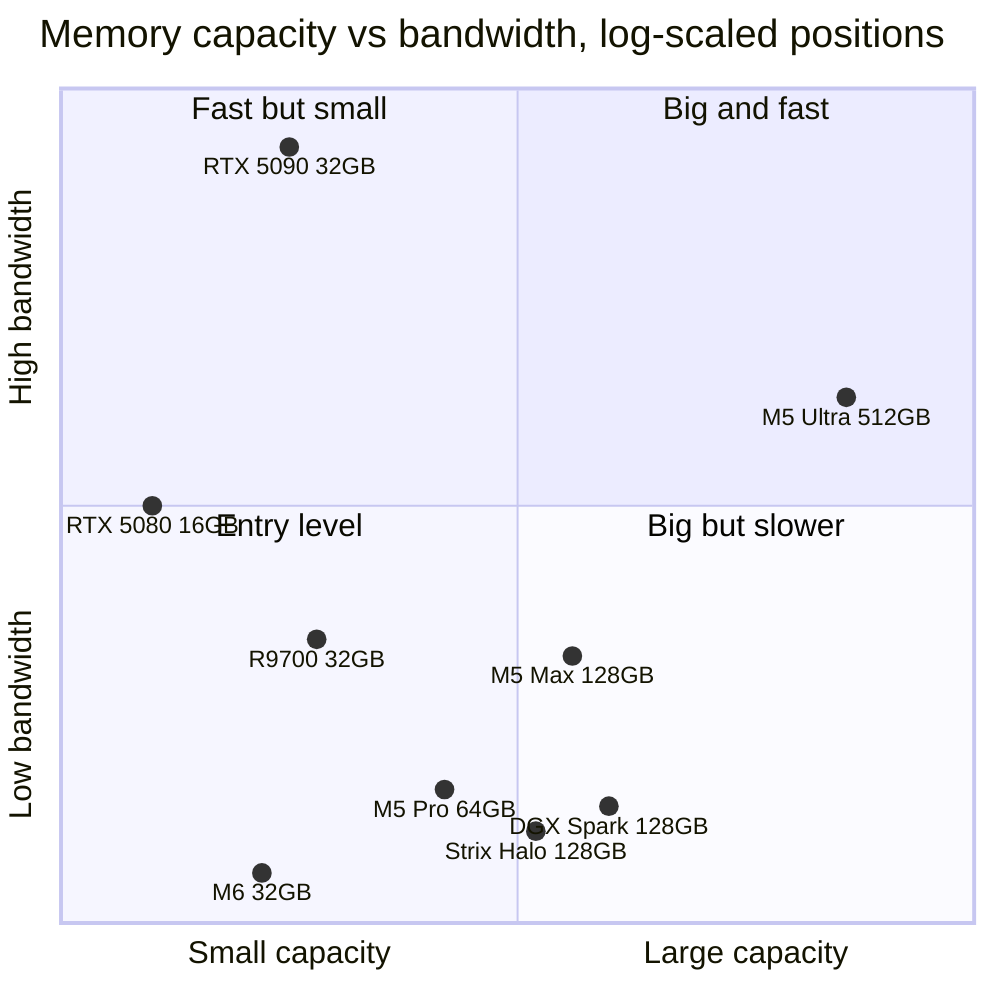
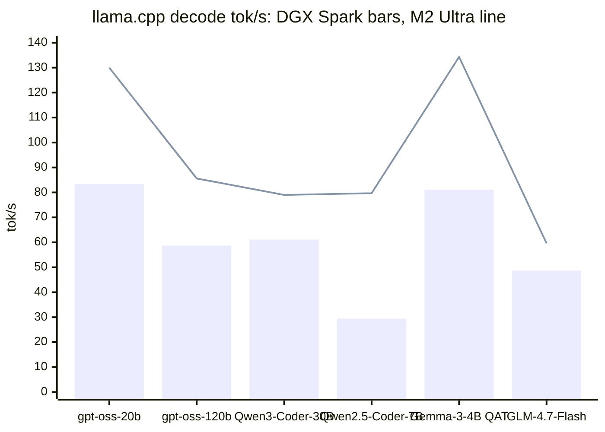
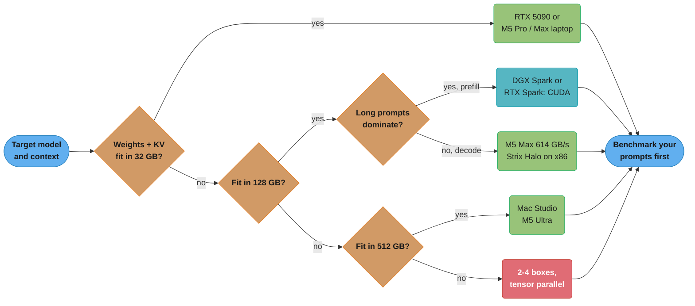

# Local AI Hardware and Sizing

> **Version anchor (fetched 2026-11-25).** Hardware specs are from vendor spec pages and newsrooms
> read on 2026-11-25; measured numbers are from llama.cpp's `benches/` files (commit 3795cc1,
> 2026-02-05), Apple's MLX research posts (2025-11-19 and 2026-10-15) and Google's LiteRT-LM table.
> Anything marked "vendor claim" was published by the company selling the product. Anything marked
> "derived" is arithmetic on published figures, not a published figure.

Parent module: [Local AI](local_ai.md).

---

## 1. Concept Overview

Three numbers decide what a machine can do with a local language model:

1. **Memory capacity** decides what fits: total weights, the KV cache for your context, and runtime
   overhead.
2. **Memory bandwidth** decides single-user decode speed: every generated token reads every active
   weight once.
3. **Prefill compute** (tensor cores, GPU Neural Accelerators, matrix units) decides how fast a long
   prompt is processed, which is time to first token.

Marketing usually leads with a fourth number, TOPS, which is peak integer or low-precision
throughput. TOPS feeds only the third item. A Snapdragon X2 Elite NPU at 80-85 TOPS still sits on
135-228 GB/s of memory; a DGX Spark at "1 PFLOP FP4" still decodes at 273 GB/s. This file teaches how
to turn those three numbers into a fit check, a decode estimate and a time-to-first-token estimate,
checks every formula against measured 2026 benchmarks, and ends with a buying guide.

**Not here.** Phone NPU arithmetic, thermal budgets on phones and GGUF block layout:
[Small Language Models and Edge AI](../small_language_models_and_edge_ai/small_language_models_and_edge_ai.md).
Apple GPU families, Metal kernels and the MLX internals:
[Apple Silicon GPU Architecture](../../cuda/apple_silicon_gpu_architecture/apple_silicon_gpu_architecture.md)
and [Metal Performance Shaders, MLX and PyTorch MPS](../../cuda/metal_performance_shaders_mlx_and_pytorch_mps/metal_performance_shaders_mlx_and_pytorch_mps.md).
Roofline theory: [GPU Architecture and Roofline](../optimization_and_quantization/gpu_architecture_and_roofline.md).
Intel NPUs through OpenVINO: [Intel OpenVINO](../../technologies/intel_openvino/intel_openvino.md).
Runtimes, models and formats: the parent page [Local AI](local_ai.md).

---

## 2. Intuition

> **One-line analogy**: Memory is the pantry, bandwidth is the tap, compute is the food processor.
> The pantry decides which recipes you can keep at home; the tap decides how fast you serve one
> plate; the food processor decides how fast you prep a big order.

**Mental model**: Decode is a delivery problem. For each token the chip must pull every active weight
across the memory bus. If the bus moves 273 GB per second and the model's active weights are 8 GB,
you get at most about 34 deliveries per second, no matter how fast the cooks are. Prefill is a
cooking problem: a 30,000-token prompt reuses every weight 30,000 times, so the chip finally has
enough arithmetic per byte to keep the cooks busy, and compute decides the time.

**Why it matters**: The wrong number leads to the wrong purchase. In llama.cpp's own benchmarks an
M2 Ultra from 2023 decodes a dense 7B model 2.7x faster than a 2025 DGX Spark, because it has 800 GB/s
against 273 GB/s. The same DGX Spark processes prompts up to 2x faster, because it has Blackwell
tensor cores. Neither machine is "faster"; each is faster at one phase.

**Key insight**: A mixture-of-experts model spends memory capacity to save bandwidth. You must hold
every expert, but you read only the active ones per token. So capacity-rich, bandwidth-modest
machines (128 GB at 256-307 GB/s) became good local machines exactly when 3-6B-active MoE models
became good.

---

## 3. Core Principles

- **Decode ceiling = usable bandwidth / bytes read per token.** Bytes read per token is active
  parameters times bits per weight / 8, plus the KV cache read for the current context.
- **Plan below the ceiling.** Dense models reach 80-90% of it in published runs (Apple: 82% on M3
  Ultra, 89% on M5 Ultra; llama.cpp on DGX Spark: about 87% for a dense 7B Q8_0). Small-active MoE
  models reach about 30-70% (section 6.3). Use 0.85 and 0.5 as starting factors.
- **Prefill scales with compute.** Apple's M5 GPU Neural Accelerators raised time-to-first-token
  speed 3.3-4.6x across Apple's tests, while decode rose 1.19-1.27x on M5 vs M4 and tracked the
  bandwidth gain from 120 to 153 GB/s.
- **Usable memory is below total memory.** The OS, apps and the GPU allocation policy take a share;
  on a 128 GB Ryzen AI Max+ 395 under Windows, AMD's configuration gives 96 GB to the GPU as Variable
  Graphics Memory. llama.cpp's `--fit` keeps a 1,024 MiB margin per device by default.
- **KV cache is a second model at long context.** At 128K tokens it can rival the weights; budget it
  before you buy.
- **More boxes add capacity first and speed only with tensor parallelism.** Pipeline splits let a
  model fit; tensor-parallel splits make it faster, if the link is fast enough.
- **Read every vendor tokens-per-second figure for its conditions.** Quant, context length, batch
  size, speculative decoding, and which machine.

---

## 4. Types / Architectures / Strategies

### 4.1 Hardware classes with specs

| Device | Max memory for models | Bandwidth | AI compute figure | Source and date |
|--------|-----------------------|-----------|-------------------|-----------------|
| Apple M6 (MacBook Pro 14, Mac mini) | 32 GB | 153 GB/s (16 GB) / 170 GB/s (24-32 GB) | Dual 16-core Neural Engine; GPU Neural Accelerators; no TOPS published | Apple, 2026-08-25 |
| Apple M5 | 32 GB | 153 GB/s | GPU Neural Accelerator in every GPU core | Apple, 2025-10-15 |
| Apple M5 Pro | 64 GB | 307 GB/s | GPU Neural Accelerators | Apple, 2026-03-03 |
| Apple M5 Max | 128 GB | 460 GB/s (32-core GPU) / 614 GB/s (40-core GPU) | GPU Neural Accelerators | Apple, 2026-03-03 |
| Apple M5 Ultra (Mac Studio) | 512 GB | 1.2 TB/s | up to 80-core GPU with Neural Accelerators, 32-core Neural Engine | Apple, 2026-08-25 |
| AMD Ryzen AI Max+ 395 | 128 GB (96 GB VGM default on Windows) | 256 GB/s (derived: 256-bit x 8,000 MT/s) | NPU 50 TOPS; 126 total TOPS; Radeon 8060S, 40 CUs | AMD product page |
| NVIDIA DGX Spark (GB10) | 128 GB (a 64 GB OEM-only option exists) | 273 GB/s | up to 1 PFLOP FP4 (sparse); 240 W supply | NVIDIA, read 2026-11-25 |
| NVIDIA RTX Spark (N1X) laptops and desktops | up to 128 GB (cut-down N1X: up to 64 GB) | not published | up to 1 PFLOP FP4; laptop 45-80 W, desktop 140 W | NVIDIA, 2026-10-16 |
| NVIDIA DGX Station (GB300) | 748 GB coherent (252 GB HBM3e + 496 GB LPDDR5X) | 7.1 TB/s HBM3e; 396 GB/s LPDDR5X | 20 PFLOPS FP4; 1,600 W | NVIDIA |
| NVIDIA Jetson Thor T5000 | 128 GB | 273 GB/s | 2,070 FP4 TFLOPS (sparse); 40-130 W | NVIDIA |
| RTX 5090 | 32 GB GDDR7 | 1,792 GB/s | 3,352 AI TOPS (FP4, sparse) | NVIDIA compare page |
| RTX 5080 / 5070 Ti | 16 GB | 960 / 896 GB/s | 1,801 / 1,406 AI TOPS | NVIDIA compare page |
| RTX 5070 / 5060 Ti | 12 GB / 16 or 8 GB | 672 / 448 GB/s | 988 / 759 AI TOPS | NVIDIA compare page |
| Radeon AI PRO R9700 / RX 9070 XT | 32 GB / 16 GB | 640 GB/s | - | AMD |
| Intel Arc B580 | 12 GB | 456 GB/s | - | Intel spec page |
| Snapdragon X2 Elite / Extreme | system RAM | up to 135 / 152 / 228 GB/s by SKU | NPU 80-85 TOPS | Qualcomm |
| Intel Core Ultra Series 3 (Panther Lake) | system RAM | - | NPU 50 TOPS; 12 Xe3 GPU cores | Intel, CES 2026-01-05 |
| AMD Ryzen AI 400 | system RAM | - | NPU up to 60 TOPS | AMD, 2026-01-05 |

Apple publishes no TOPS figure for M5, M6 or A20, and NVIDIA publishes no memory bandwidth for RTX
Spark. Do not fill those cells from forum posts; benchmark the machine.

### 4.2 NPUs

Microsoft's Copilot+ PC bar is an NPU above 40 TOPS, and every 2026 PC platform clears it: AMD
Ryzen AI 400 up to 60, Ryzen AI Max+ 50, Intel Panther Lake 50, Snapdragon X2 Elite 80-85. NPUs run
small always-on models (Phi Silica, being replaced by Aion Instruct on Windows; Gemini Nano on
Android), speech (whisper.cpp has a Ryzen AI NPU backend) and embeddings (Google lists EmbeddingGemma
2 at 13.3 ms per text on a Core Ultra Series 3 NPU). They share system memory with the CPU and GPU,
so they do not raise the decode ceiling for large models.

### 4.3 Phones

Google's LiteRT-LM table is the best neutral cross-device reference: one 2.58 GB Gemma-4-E2B build
measured on phones, laptops, a desktop GPU and a Raspberry Pi (section 7.3). Phones now reach about
50 tok/s decode on their GPUs for a 2B-effective model. Apple and Google do not publish phone memory
bandwidth or Neural Engine TOPS for A20 or Tensor G6; the Pixel 11 ships with 12-16 GB of RAM.

### 4.4 Multi-box

| Option | Link | Measured or stated |
|--------|------|--------------------|
| Mac Studio M5 Ultra x2 or x4 | RDMA over Thunderbolt 5, macOS 26.2+, MLX JACCL backend (MLX 0.30.1+) | 4x tensor parallel: Qwen 3.8 27B 50.89 tok/s vs 19.69 on one; Muse Spark Open 816B 36.73 tok/s; 2x pipeline on the 816B model 15.74 tok/s |
| DGX Spark x2 to x4 | ConnectX-7 at 200 Gbps | NVIDIA: two Sparks ran Qwen3 235B at 11.73 tok/s (vendor, 2025-10-24); vLLM 0.34.0 cites GLM-5.3-Flash on 2x Spark |
| llama.cpp RPC backend | TCP | Works across mixed machines, but had CVE-2026-34159 (critical unauthenticated RCE, 2026-03-26); never expose it beyond a trusted, isolated link |

---

## 5. Architecture Diagrams

### Capacity vs bandwidth



Positions are scaled from the spec table: x roughly on a log scale of capacity, y as bandwidth out of
1,900 GB/s. The empty top-right corner is the point: in November 2026 only the M5 Ultra (and the
1,600 W DGX Station, off this chart) combine hundreds of gigabytes with more than 1 TB/s.

### Same models, opposite winners



Decode follows bandwidth: the 800 GB/s M2 Ultra wins every model, by the widest margin (2.7x) on the
dense 7B Q8_0, which is the purest bandwidth test. On prefill (pp2048) the result flips: the DGX Spark
wins every row, from 1.2x on Qwen3-Coder-30B to 2x on Gemma-3-4B.

### Where a token's bytes come from with expert offload

```
gpt-oss-120b MXFP4 (59.02 GiB file) on a 16 GB GPU + system RAM, llama.cpp --n-cpu-moe

                       GPU VRAM (fast bus)              System RAM (slow bus)
Held in memory    [attention, router, shared,  ]   [routed experts of the first N layers  ]
                  [experts of the last layers  ]   [most of the 59 GiB                    ]

Read per token    [small: dense parts of every ]   [the 4 routed experts each token picks ]
                  [layer + KV cache            ]   [in each offloaded layer               ]

Time per token  =  bytes_on_gpu / gpu_bandwidth  +  bytes_on_cpu / ram_bandwidth  +  overhead
                   (few ms on 960 GB/s)             (dominates: tens of GB/s, CPU compute)
```

The slow side dominates, so lower N until VRAM is full: every expert layer moved onto the GPU leaves
the slow bus. gpt-oss-120b's `config.json` sets `experts_per_token` to 4 of 128 experts in each of
36 layers; other models name the field `num_experts_per_tok`.

### A buying decision



The first question is always fit, the second is which phase dominates your traffic. A fit at 32 GB
on the RTX 5090 gets the fastest decode of any single device; the 128 GB tier splits by workload.

---

## 6. How It Works — Detailed Mechanics

### 6.1 A sizing toolkit

```python
from dataclasses import dataclass

GB = 1e9


@dataclass(frozen=True)
class HardwareSpec:
    name: str
    memory_gb: float
    usable_gb: float            # what the GPU can really allocate; measure on the target OS
    bandwidth_gbs: float        # vendor peak
    overhead_ms: float = 4.0    # fixed per-token cost, fitted from benchmarks (section 6.3)


@dataclass(frozen=True)
class Workload:
    name: str
    total_params_b: float
    active_params_b: float
    bits_per_weight: float
    kv_bytes_per_token: int     # from config.json, full-attention layers only

    def weights_gb(self) -> float:
        return self.total_params_b * self.bits_per_weight / 8

    def active_gb(self) -> float:
        return self.active_params_b * self.bits_per_weight / 8


def decode_ceiling(hw: HardwareSpec, wl: Workload) -> float:
    """Pure bandwidth bound in tokens per second."""
    return hw.bandwidth_gbs / wl.active_gb()


def decode_estimate(hw: HardwareSpec, wl: Workload, context: int = 0) -> float:
    """Bytes over bandwidth plus a fixed per-token overhead; KV read grows with context."""
    bytes_per_token = wl.active_gb() * GB + wl.kv_bytes_per_token * context
    seconds = bytes_per_token / (hw.bandwidth_gbs * GB) + hw.overhead_ms / 1000
    return 1 / seconds


def prefill_time_s(prompt_tokens: int, measured_prefill_tps: float) -> float:
    """Use a measured pp figure for the same model and quant; prefill is compute-bound."""
    return prompt_tokens / measured_prefill_tps


def max_context_for_kv(hw: HardwareSpec, wl: Workload, slots: int = 1,
                       runtime_overhead_gb: float = 2.0) -> int:
    free_bytes = (hw.usable_gb - wl.weights_gb() - runtime_overhead_gb) * GB
    if free_bytes <= 0:
        return 0
    return int(free_bytes / (wl.kv_bytes_per_token * slots))


def tensor_parallel_estimate(single_box_tps: float, boxes: int, scaling: float = 0.65) -> float:
    """Apple's 4x M5 Ultra runs scaled 2.58x (27B BF16) and 3.04x (128B FP8): 65-76% of linear."""
    return single_box_tps * (1 + (boxes - 1) * scaling)


if __name__ == "__main__":
    spark = HardwareSpec("DGX Spark", 128, 120, 273, overhead_ms=6.9)
    # gpt-oss-120b: 117B / 5.1B active; the 59.02 GiB file implies about 4.33 bits per weight.
    # config.json: 18 full-attention layers x 8 KV heads x 64 dims x 2 (K, V) x 2 bytes.
    gpt_oss_120b = Workload("gpt-oss-120b MXFP4", 117, 5.1, 4.33, 18 * 8 * 64 * 2 * 2)
    print(f"ceiling {decode_ceiling(spark, gpt_oss_120b):.0f} tok/s")          # about 99
    print(f"estimate {decode_estimate(spark, gpt_oss_120b):.0f} tok/s")        # about 59
    print(f"32K prompt prefill {prefill_time_s(32_768, 2443.9):.1f} s")       # about 13.4
    print(f"max context, 1 slot {max_context_for_kv(spark, gpt_oss_120b):,}")  # about 1.48M:
    # KV is not the binding limit here; the model's trained context length is.
```

`usable_gb = 120` for the DGX Spark is an assumption to replace with a measured value; the
`overhead_ms` of 6.9 is fitted from llama.cpp's own gpt-oss-120b run (section 6.3), so the estimate
reproducing 58.7 tok/s is a check of the fit, not an independent prediction. The prefill estimate
uses the measured pp2048 figure and is optimistic for 32K prompts, because prefill slows as the KV
cache grows; benchmark at your real depth with `llama-bench -d`.

### 6.2 Worked example: a 48 GB M5 Pro, dense vs MoE

| Model at about 4.5 bpw | Weights | Active bytes per token | Ceiling at 307 GB/s | Estimate with 4 ms overhead |
|------------------------|---------|------------------------|---------------------|-----------------------------|
| Qwen3.8-27B (dense) | 15.2 GB | 15.2 GB | 20 tok/s | 19 tok/s |
| Qwen3.6-35B-A3B (MoE) | 19.7 GB | about 1.7 GB | 181 tok/s | 104 tok/s |

Both fit in 48 GB with room for a long KV cache. The dense model is bandwidth-bound almost
perfectly; the MoE model loses more than a third of its ceiling to fixed per-token cost but still
decodes about 5x faster. These are derived estimates; Apple's M5 post reports Qwen3-30B-A3B in 4-bit
at 17.31 GB of memory in MLX, which confirms the footprint side of the arithmetic.

### 6.3 Checking the formula against llama.cpp's own benchmarks

llama.cpp's `benches/dgx-spark` and `benches/mac-m2-ultra` files run six models with
`llama-bench -fa 1 -p 2048 -n 32 -ub 2048`. Dividing each file size by bandwidth gives the time the
weight read must take; the gap to the measured time is the fixed per-token overhead. Apple's 2023
spec gives the M2 Ultra 800 GB/s.

| Model (GGUF) | Bytes read per token (derived) | DGX Spark: measured / ceiling | M2 Ultra: measured / ceiling |
|--------------|-------------------------------|-------------------------------|------------------------------|
| Qwen2.5-Coder-7B Q8_0 (dense) | 8.1 GB | 29.4 / 33.7 = 87% | 79.7 / 98.8 = 81% |
| Gemma-3-4B QAT Q4_0 (dense) | 2.5 GB | 81.1 / 108 = 75% | 134.3 / 317 = 42% |
| gpt-oss-20b MXFP4 (3.6B active) | about 2.1 GB | 83.4 / 132 = 63% | 130.0 / 386 = 34% |
| gpt-oss-120b MXFP4 (5.1B active) | about 2.8 GB | 58.7 / 99 = 59% | 85.6 / 290 = 30% |
| Qwen3-Coder-30B-A3B Q8_0 (about 3B active) | about 3.2 GB | 61.1 / 86 = 71% | 79.0 / 251 = 31% |
| GLM-4.7-Flash Q8_0 (about 3B active) | about 3.2 GB | 48.7 / 86 = 57% | 59.6 / 251 = 24% |

Two lessons. First, efficiency falls as bytes per token fall: a fixed cost of a few milliseconds per
token (kernel launches, routing, sampling, attention over the KV cache, synchronisation) is
invisible behind a 8 GB read and dominant behind a 2 GB read. Fitting `time = bytes / bandwidth +
overhead` gives about 3-4 ms for the dense rows on both machines and 5-13 ms for the MoE rows (about
7 ms for gpt-oss-120b on the DGX Spark); Apple's Qwen 3.8 27B BF16 run on M5 Ultra implies about
6 ms. Second, the
faster the memory, the bigger the share the overhead takes, so a high-bandwidth machine gains less
from small-active MoE models than the raw bandwidth ratio suggests. Plan dense models at 80-90% of
the ceiling and small-active MoE models at 30-70%, or use the overhead form directly.

### 6.4 Worked example: gpt-oss-120b on one consumer GPU with expert offload

gpt-oss-120b's `config.json` gives 36 layers, 128 experts per layer, 4 experts per token, and a
hidden and intermediate size of 2,880. Each expert is three 2,880 x 2,880 matrices, about 24.9M
parameters, so the experts hold about 115B of the 117B parameters, and the 4 x 36 active experts are
about 3.6B of the 5.1B active parameters (derived). At MXFP4 (about 4.25 bpw) one layer's experts are
about 1.7 GB, and one token reads about 53 MB of experts per layer.

| Setup | Expert layers in VRAM | Expert bytes per token from system RAM | Time at 96 GB/s RAM | Rough ceiling |
|-------|----------------------|------------------------------------------|---------------------|---------------|
| RTX 5090 32 GB | about 14 of 36 | 22 x 53 MB = 1.16 GB | 12 ms | about 70 tok/s |
| RTX 5080 16 GB | about 5 of 36 | 31 x 53 MB = 1.64 GB | 17 ms | about 50 tok/s |
| Everything in RAM (`--cpu-moe`) | 0 | 36 x 53 MB = 1.9 GB | 20 ms | about 45 tok/s |

The VRAM column assumes about 2.5 GB for the non-expert weights, 2 GB of KV, 2 GB of compute buffers
and the 1 GiB `--fit` margin. The 96 GB/s is dual-channel DDR5-6000 bus arithmetic
(2 x 64-bit x 6,000 MT/s), not a measured figure, and the CPU must also do the expert math, which
often costs more than the read. Treat the last column as an upper bound and sweep
`llama-bench --n-cpu-moe` (supported since 2025-09-16) on the real machine:

```bash
llama-bench -m gpt-oss-120b-mxfp4.gguf -fa 1 -p 2048 -n 64 --n-cpu-moe 20,22,24,26
```

### 6.5 Budgeting the KV cache

KV bytes per token = 2 (K and V) x full-attention layers x KV heads x head dimension x bytes per
element. Sliding-window and linear-attention layers hold a bounded cache, so count them separately.

| Config | KV bytes per token (f16) | KV at 131,072 tokens | With `-ctk q8_0 -ctv q8_0` |
|--------|--------------------------|----------------------|----------------------------|
| gpt-oss-120b: 18 full-attention layers x 8 x 64 (the other 18 slide over 128 tokens) | 36,864 B | 4.8 GB | about 2.6 GB |
| Illustrative dense model: 64 layers x 8 KV heads x 128 | 262,144 B | 34.4 GB | about 18.3 GB |

The illustrative row is not a specific model; it shows why hybrid attention matters. A 128K context
on a classic dense 64-layer GQA model costs more than its 4-bit weights; on gpt-oss-120b it costs 8%
of them. For several users multiply by the slot count, or cap each slot with
`--kv-unified-per-slot` in llama-server.

### 6.6 Reading a 74 tok/s claim on a 307 GB/s laptop

Inco's Splash engine in LM Studio reports Qwen3.8-27B at 74 tok/s on short prompts and 54 tok/s at
32K on a 48 GB M5 Pro, and 170 tok/s combined across four concurrent requests (vendor claim,
2026-09-18). The post does not state the quantization. At 4-bit the 27B dense model is about 15 GB,
so plain decode caps near 20 tok/s on 307 GB/s. The difference is speculative decoding: the engine
uses a DFlash 2 drafter, so each weight read verifies several tokens. That is legitimate, but it
means the number measures draft acceptance on Inco's prompts as much as hardware, and the 54 tok/s
at 32K shows the KV read eating into it. Ask for the same run with speculation off before comparing
machines.

### 6.7 Two boxes or four

Apple's runs give the only first-party multi-machine scaling data for local hardware:

| Model | One M5 Ultra | Four M5 Ultras, tensor parallel | Scaling vs linear |
|-------|--------------|---------------------------------|-------------------|
| Qwen 3.8 27B BF16 | 19.69 tok/s | 50.89 tok/s | 2.58x of 4x = 65% |
| Mistral Medium 3.5 128B FP8 | 7.70 tok/s | 23.37 tok/s | 3.04x of 4x = 76% |
| Muse Spark Open 816B-A42B NVFP4 | does not fit | 36.73 tok/s (2x pipeline: 15.74) | - |

Larger models scale better because each per-layer all-reduce is amortised over more weight bytes per
machine. Pipeline parallelism makes the 816B model fit on two machines but does not speed up a single
stream; tensor parallelism across four more than doubles it. The link matters: Apple uses RDMA over
Thunderbolt 5 through JACCL; NVIDIA clusters up to four DGX Sparks over 200 Gbps ConnectX-7.

---

## 7. Real-World Examples

### 7.1 Apple first-party MLX numbers

| Run | Result | Source |
|-----|--------|--------|
| MacBook Pro M5 24 GB vs M4, 4,096-token prompt | TTFT 3.33-4.06x faster; decode 1.19-1.27x; Neural Accelerators need macOS 26.2+ | Apple ML research, 2025-11-19 |
| Memory footprints in MLX | Qwen3-8B BF16 17.46 GB; Qwen3-30B-A3B 4-bit 17.31 GB; gpt-oss-20b MXFP4 12.08 GB | same |
| Mac Studio M5 Ultra vs M3 Ultra, 8,192 context, decode | Qwen 3.8 27B BF16 19.69 vs 12.46; Mistral Medium 3.5 128B FP8 7.70 vs 4.95 | Apple ML research, 2026-10-15 |
| TTFT, Qwen 3.8 27B at 8,192 | 18.2 s (M3 Ultra), 4.1 s (M5 Ultra), 1.7 s (4x M5 Ultra); up to 4.6x faster TTFT overall | same |
| Power | about 300 W peak (M5 Ultra) vs about 200 W (M3 Ultra) | same |

### 7.2 llama.cpp: DGX Spark vs M2 Ultra (commit 3795cc1, 2026-02-05)

| Model (GGUF) | Size | Spark pp2048 | Spark tg32 | M2 Ultra pp2048 | M2 Ultra tg32 |
|--------------|------|--------------|------------|-----------------|---------------|
| gpt-oss-20b MXFP4 | 11.27 GiB | 4,505.8 | 83.4 | 2,713.4 | 130.0 |
| gpt-oss-120b MXFP4 | 59.02 GiB | 2,443.9 | 58.7 | 1,648.7 | 85.6 |
| Qwen3-Coder-30B-A3B Q8_0 | 30.25 GiB | 2,987.0 | 61.1 | 2,453.1 | 79.0 |
| Qwen2.5-Coder-7B Q8_0 | 7.54 GiB | 2,250.3 | 29.4 | 1,565.9 | 79.7 |
| Gemma-3-4B QAT Q4_0 | 2.35 GiB | 5,948.7 | 81.1 | 2,923.6 | 134.3 |
| GLM-4.7-Flash Q8_0 | 29.65 GiB | 2,364.2 | 48.7 | 1,629.3 | 59.6 |

### 7.3 Google LiteRT-LM: Gemma-4-E2B (2.58 GB) across devices

| Device | Backend | Prefill tok/s | Decode tok/s | TTFT |
|--------|---------|---------------|--------------|------|
| Galaxy S26 Ultra | CPU | 557 | 47 | 1.8 s |
| Galaxy S26 Ultra | GPU | 3,808 | 52 | 0.3 s |
| iPhone 17 Pro | CPU | 532 | 25 | 1.9 s |
| iPhone 17 Pro | GPU | 2,878 | 56 | 0.3 s |
| Linux + RTX 4090 | GPU | 11,234 | 143 | 0.1 s |
| MacBook Pro M4 Max | GPU | 7,835 | 160 | 0.1 s |
| Windows, Intel Lunar Lake | GPU | 3,751 | 48 | 0.3 s |
| Raspberry Pi 5 16 GB | CPU | 133 | 8 | 7.8 s |

The phone GPU rows decode about as fast as the Lunar Lake laptop; the desktop rows are 3x faster on
decode and 3-4x on prefill.

### 7.4 Dated and vendor numbers (label them when you quote them)

| Claim | Conditions | Source |
|-------|------------|--------|
| DGX Spark, gpt-oss-120b MXFP4: 1,169 tok/s prefill, 41.14 tok/s decode; Llama 3.1 70B q4_K_M 4.42 tok/s decode | Ollama 0.12.6 on firmware 580.95.05; older than the llama.cpp benches above | Ollama blog, 2025-10-23 |
| Two DGX Sparks: Qwen3 235B at 11.73 tok/s | NVIDIA's own test | NVIDIA developer blog, 2025-10-24 (vendor) |
| Ryzen AI Max+ 395: Llama 4 Scout 109B-A17B up to 15 tok/s | 96 GB VGM, LM Studio, Vulkan llama.cpp | AMD blog, 2025 (vendor) |
| Ollama MLX: Qwen3.5-35B-A3B int4 1,851 / 134 tok/s | Mac model not named | Ollama blog, 2026-03-30 (vendor) |
| Splash: Qwen3.8-27B 74 tok/s short, 54 at 32K | 48 GB M5 Pro, DFlash 2, quant not stated | LM Studio blog, 2026-09-18 (vendor) |

The Ollama DGX Spark decode for gpt-oss-120b (41.14) is below llama.cpp's later 58.7 on the same
hardware; firmware and runtime versions move these numbers by tens of percent. The 70B row checks the
dense rule: about 43 GB at 4.89 bpw gives a 6.4 tok/s ceiling, and 4.42 is 69% of it on that older
stack.

---

## 8. Tradeoffs

| Device | Capacity | Bandwidth | Prefill strength | Power | OS and software | Price (verified) |
|--------|----------|-----------|------------------|-------|-----------------|------------------|
| Mac mini M6 | up to 32 GB | 153-170 GB/s | GPU Neural Accelerators | low | macOS; MLX, Ollama, LM Studio | from $899 |
| MacBook Pro M5 Pro | up to 64 GB | 307 GB/s | GPU Neural Accelerators | laptop | macOS | - |
| M5 Max (MacBook Pro, Mac Studio) | up to 128 GB | 614 GB/s (40-core GPU) | strong | laptop or desk | macOS | - |
| Mac Studio M5 Ultra | up to 512 GB | 1.2 TB/s | strongest Apple | about 300 W peak | macOS; RDMA clustering | from $5,499 |
| Ryzen AI Max+ 395 systems | 128 GB (96 GB VGM) | about 256 GB/s (derived) | moderate | cTDP 45-120 W | Windows or Linux; Vulkan, ROCm 7.2 | - |
| DGX Spark | 128 GB | 273 GB/s | strong (Blackwell FP4) | 240 W supply | DGX OS Linux; CUDA; vLLM | - |
| RTX Spark laptops | up to 128 GB | not published | strong (Blackwell FP4) | 45-80 W laptop | Windows; CUDA | - |
| RTX 5090 desktop | 32 GB VRAM | 1,792 GB/s | strongest consumer | desktop GPU | Windows or Linux; CUDA | - |
| Radeon AI PRO R9700 | 32 GB VRAM | 640 GB/s | moderate | desktop GPU | Linux ECC; ROCm, Vulkan | - |
| Arc B580 | 12 GB VRAM | 456 GB/s | modest | desktop GPU | OpenVINO, SYCL, Vulkan | launched at $249 (2024) |

| Choice | Wins | Loses |
|--------|------|-------|
| Unified memory vs discrete GPU | Capacity: 128-512 GB in one address space | Bandwidth per GB: an RTX 5090 is 3x an M5 Max on 1/4 the memory |
| Mac vs DGX Spark at 128 GB | Mac M5 Max: 2.2x the bandwidth, so faster decode | DGX Spark: CUDA ecosystem, faster prefill, clustering over ConnectX-7 |
| One big box vs several small ones | Simplicity, no interconnect | Several boxes: more total bandwidth with tensor parallelism, but 65-76% scaling and more failure points |
| Buy vs rent | Fixed cost, data stays home | Renting wins for bursty or experimental use |

---

## 9. When to Use / When NOT to Use

### Buy by tier

- **16-32 GB (Mac mini M6, M5 laptops, RTX 5080 or 5070 Ti desktops):** 4-9B dense models, 20-35B MoE
  at 4-bit (gpt-oss-20b runs in 16 GB; Qwen3.6-35B-A3B needs about 20 GB plus KV), with expert offload
  on 16 GB GPUs.
- **48-64 GB (M5 Pro 48/64 GB, RTX 5090 desktop with 64 GB RAM):** the 25-35B MoE sweet spot with long
  context, or dense 27-32B at 4-8 bit; on the RTX 5090, 120B MoE with offload.
- **128 GB (M5 Max, Ryzen AI Max+ 395, DGX Spark, RTX Spark):** 80-120B MoE (gpt-oss-120b,
  Qwen3-Coder-Next, Mistral Small 4) at 4-bit, or several smaller models at once for a team.
- **256-512 GB (Mac Studio M5 Ultra) or a 2-4 box cluster:** 400B-class MoE at 4-bit; 800B-class
  across machines.

### Do NOT buy when

- **Use is bursty.** A few hours a month is cheaper on a rented GPU or an API.
- **You need a model your memory tier cannot hold** at 4-bit with your context. Buying 64 GB for a
  model that needs 70 GB with KV leaves you on a 1-2 bit quant that breaks tool calling.
- **The decision rests on TOPS or a vendor tok/s figure** you cannot reproduce with your prompts.
- **You cannot patch and operate it.** A desk box serving a team is a server; it needs updates,
  authentication and monitoring.

---

## 10. Common Pitfalls

1. **Buying by TOPS.** An "80 TOPS" laptop decodes a dense 8B model at 4.5 bpw at about 24 tok/s on
   135 GB/s; the NPU's TOPS never enter the calculation. Size with bandwidth / active bytes.
2. **Forgetting the KV cache at 128K.** A team sized a 64 GB machine for a dense model's 4-bit weights
   and then enabled 128K context; on a classic 64-layer GQA config that is another 34 GB in f16, and
   the runtime silently reduced the context or offloaded layers to the CPU.
3. **Ordering the 64 GB DGX Spark.** The 64 GB configuration is OEM-only and halves the capacity that
   makes the box worth buying; confirm the configuration on the order.
4. **Assuming all unified memory is GPU memory.** On Windows the Ryzen AI Max+ 395 gives 96 GB of 128
   GB to the GPU by default; macOS also reserves a share for the system. Measure the real allocatable
   size with the runtime before planning.
5. **Benchmarking a thin laptop for 30 seconds.** Sustained decode on a laptop under a 45-80 W budget
   can fall once the chassis heats. Run `llama-bench` or `mlx_lm.benchmark` in a loop for ten minutes
   on battery and on power before you sign off.
6. **Comparing vendor tok/s with speculation hidden.** A 74 tok/s figure on a 307 GB/s machine is
   speculative decoding; comparing it with another vendor's plain-decode number compares two
   different things.
7. **Clustering over a slow link.** Tensor parallelism all-reduces at every layer; over ordinary
   Ethernet the link, not the memory, becomes the bottleneck. Use RDMA over Thunderbolt 5 for Macs,
   ConnectX-7 for DGX Spark, and pipeline mode only when you need capacity, not speed.
8. **Exposing the llama.cpp RPC backend to build a cluster.** CVE-2026-34159 was a critical
   unauthenticated remote-code-execution bug in that backend; keep it on an isolated link or use the
   vendor's clustering path.

---

## 11. Technologies & Tools

| Tool | Purpose | Notes |
|------|---------|-------|
| `llama-bench` | Prefill and decode benchmarks for GGUF models | `-fa 1 -p 2048 -n 32 -ub 2048` reproduces llama.cpp's published benches; `-d` sets KV depth; `--n-cpu-moe` sweeps offload |
| `mlx_lm.benchmark` | MLX prefill and decode benchmarks | Used by Apple for the M5 Ultra numbers |
| `llama-server --metrics` | Prometheus metrics from a running server | Watch throughput under real concurrency |
| `ollama ps` | Loaded models, memory split between GPU and CPU, allocated context | First check when Ollama feels slow |
| `nvidia-smi` | VRAM use and power on NVIDIA GPUs and DGX Spark | Confirms whether layers spilled to the CPU |
| LiteRT-LM benchmark table | Cross-device reference for Gemma 4 E2B | Google publishes it in the LiteRT-LM overview |
| `config.json` on the model card | Layers, KV heads, head dimension, experts per token | The input to every KV and offload calculation |

---

## 12. Interview Questions with Answers

**Q: A vendor says its laptop NPU does 80 TOPS. How many tokens per second will a 30B model decode?**
**Short:** TOPS does not answer it: decode is memory-bound, so divide bandwidth by active bytes; a dense 30B at 4-bit (17 GB) on 135-228 GB/s gets about 8-13 tok/s regardless of the NPU.

At batch 1 every token reads every active weight once and does about two operations per weight, so
the arithmetic units wait on memory. A Snapdragon X2 Elite has an 80-85 TOPS NPU and 135-228 GB/s of
memory depending on SKU. A dense 30B model at 4.5 bpw is about 17 GB, so the ceiling is 135/17 = 8
to 228/17 = 13 tok/s, and you plan at 80-90% of that. A 30B MoE with 3B active is about 1.7 GB per
token, so the same machine's ceiling rises to 80-134 tok/s, of which small-active MoE runs realise
30-70%. The 80 TOPS would matter only for prefill, and only if the runtime actually uses the NPU for
that model. The right questions are: memory bandwidth, usable memory, active bytes, and a measured
benchmark on the model you plan to run.

**Q: Compute the decode ceiling for gpt-oss-120b on a DGX Spark and compare it with the measured 58.7 tok/s.**
**Short:** About 5.1B active parameters at about 4.33 bits is 2.8 GB per token; 273 GB/s / 2.8 GB is about 99 tok/s, so the measured 58.7 is about 59%, typical for a small-active MoE.

The 59.02 GiB file holds 117B parameters, which implies about 4.33 bits per weight on average
(MXFP4 experts plus higher-precision attention). The active slice is 5.1B parameters, about 2.76 GB
per token. 273 GB/s divided by 2.76 GB is about 99 tok/s. llama.cpp measured 58.7 tok/s, about 59%.
A dense model on the same box reaches 87% (Qwen2.5-Coder-7B Q8_0: 29.4 of 33.7), so the gap is not
bandwidth. Fitting `time = bytes / bandwidth + overhead` gives about 7 ms per token of fixed cost for
gpt-oss-120b against about 4 ms for the dense models: routing, many small expert matmuls, attention
over the KV cache and synchronisation. With only 10 ms of weight reading per token, that overhead
is 40% of the time. Plan small-active MoE models at 30-70% of the ceiling, or model the overhead
directly.

**Q: Why did the M2 Ultra beat the DGX Spark on decode but lose on prefill in llama.cpp's own benchmarks?**
**Short:** Decode is bandwidth-bound and the M2 Ultra has 800 GB/s against 273 GB/s; prefill is compute-bound and the Spark's Blackwell tensor cores win, by 1.2-2x across the six models.

With identical flags (`llama-bench -fa 1 -p 2048 -n 32 -ub 2048`), the 2023 M2 Ultra decoded every
model faster: Qwen2.5-Coder-7B Q8_0 79.7 vs 29.4 tok/s, a 2.7x gap close to the 2.9x bandwidth ratio.
Prefill of a 2,048-token prompt is a large matrix-matrix workload with enough arithmetic per byte to
keep compute busy, and there the DGX Spark won every row, from 2,987 vs 2,453 tok/s on
Qwen3-Coder-30B-A3B to 5,949 vs 2,924 on Gemma-3-4B. The lesson is to profile your traffic: an agent
that sends 30K-token prompts and gets 500-token answers spends most of its time in prefill and
favours the Spark; a chat app with short prompts and long answers favours bandwidth. Neither machine
is faster in general.

**Q: What did Apple's GPU Neural Accelerators change, and what did they not?**
**Short:** They multiplied prefill throughput, cutting time to first token 3.3-4.6x, but decode rose only about 1.2-1.6x because it is still bound by memory bandwidth.

Starting with M5 (2025-10-15), every GPU core has a Neural Accelerator for matrix math, and MLX uses
them from macOS 26.2. Apple's own M5-vs-M4 test showed time to first token 3.33-4.06x faster, while
decode improved 1.19-1.27x, tracking the bandwidth increase from 120 to 153 GB/s. On Mac Studio,
M5 Ultra vs M3 Ultra improved TTFT up to 4.6x (Qwen 3.8 27B at 8,192 tokens: 18.2 s to 4.1 s) and
decode about 1.6x (12.46 to 19.69 tok/s), again close to the bandwidth gain from 819 GB/s to
1.2 TB/s. Ollama's MLX engine and LM Studio's MLX engine use the accelerators. For agents and RAG,
where prompts are long, this was the biggest Mac improvement in years; for long-form generation it
was a normal generational step.

**Q: In the 128 GB class, how do you choose between an M5 Max, a Ryzen AI Max+ 395, a DGX Spark and an RTX Spark laptop?**
**Short:** Pick by phase and platform: the M5 Max has 614 GB/s for the fastest decode, the DGX Spark has CUDA and the best prefill, Strix Halo gives x86 Windows or Linux, RTX Spark gives CUDA on a laptop.

All four hold 128 GB, so they all fit 80-120B MoE models at 4-bit. Decode differs by bandwidth:
M5 Max at 614 GB/s (40-core GPU) is 2.2x the DGX Spark's 273 GB/s and 2.4x Strix Halo's derived
256 GB/s; NVIDIA has not published RTX Spark bandwidth. Prefill favours the Blackwell parts (DGX
Spark, RTX Spark) with FP4 tensor cores. The platform often decides: DGX Spark runs Linux with CUDA,
vLLM and clustering of up to four boxes; Strix Halo runs Windows or Linux on x86 with Vulkan and
ROCm, but gives only 96 GB to the GPU by default on Windows; the M5 Max runs macOS with MLX; RTX
Spark brings CUDA to a Windows laptop. Choose the M5 Max for decode-heavy single users, the DGX Spark
for prefill-heavy agents or a CUDA toolchain, and benchmark before standardising.

**Q: When is an RTX 5090 with 32 GB better than a 128 GB unified-memory box?**
**Short:** When the model plus KV fits in 32 GB: its 1,792 GB/s is about 3x an M5 Max and 6.5x a DGX Spark, so a 4-bit 27-32B dense model or a 30B MoE decodes far faster.

The RTX 5090 has the highest bandwidth of any consumer device and the strongest consumer tensor
cores. A dense 27B at 4.5 bpw (15 GB) has a ceiling near 118 tok/s on it, against 20 on an M5 Pro
and 40 on an M5 Max. It also prefills fastest. It loses as soon as the working set exceeds 32 GB:
the weights of a 120B MoE must spill to system RAM with `--n-cpu-moe`, and decode then depends on
DDR5 bandwidth (about 96 GB/s for dual-channel DDR5-6000 by bus arithmetic) and CPU compute. Expert
offload keeps that usable, at an estimated 45-70 tok/s ceiling for gpt-oss-120b, but a 128 GB box
avoids the cliff entirely and runs several models at once. Pick the RTX 5090 for speed on models up
to about 30B, unified memory for capacity.

**Q: How does --n-cpu-moe let a 16 GB GPU run a 120B MoE, and what is the cost?**
**Short:** It keeps the routed experts of the first N layers in system RAM and runs them on the CPU while attention and shared weights stay on the GPU; the cost is that those expert reads use slow RAM bandwidth.

An MoE layer has a small dense part used by every token and a large set of experts of which each
token uses a few. gpt-oss-120b has 128 experts per layer and uses 4, so experts are about 115B of the
117B parameters, but only about 53 MB of them are read per layer per token at MXFP4 (derived from
its `config.json`). `--n-cpu-moe N` leaves the experts of the first N layers in RAM and computes
them on the CPU; `--cpu-moe` moves all of them. On a 16 GB RTX 5080 about 31 of 36 expert layers
stay in RAM, about 1.6 GB per token, which on 96 GB/s of DDR5 is a ceiling near 50 tok/s before CPU
compute. Lower N until VRAM is full, sweep it with `llama-bench --n-cpu-moe`, and remember that
prefill also slows because the CPU computes those experts for every prompt token. SGLang's Paged
Experts mode (0.5.23) is an alternative it reports as up to 30x faster than CPU offload.

**Q: How much memory does a 128K-token context add, and how do you budget it?**
**Short:** KV per token is 2 x full-attention layers x KV heads x head dim x bytes; at 131,072 tokens that is 4.8 GB for gpt-oss-120b but 34 GB for a classic 64-layer dense GQA model in f16.

Read the numbers from `config.json` and count only full-attention layers. gpt-oss-120b alternates
sliding-window (128 tokens) and full attention, so 18 layers x 8 KV heads x 64 dims x 2 x 2 bytes is
36,864 bytes per token, or 4.8 GB at 131,072 tokens. An illustrative dense model with 64 layers, 8
KV heads and 128 dims needs 262,144 bytes per token, 34.4 GB at the same length, which is more than
its 4-bit weights. Halve it with `-ctk q8_0 -ctv q8_0` in llama-server (f16 is the default; f8_e4m3,
q8_0, q4_0 and others are allowed), multiply by the number of concurrent slots, and add it to the
weights before choosing hardware. Hybrid models with linear-attention or Mamba layers (Qwen3.5+,
Nemotron, LFM) cut it further.

**Q: Why is "128 GB unified memory" not 128 GB for the model?**
**Short:** The OS, other apps and the GPU allocation policy take a share: Windows on a 128 GB Ryzen AI Max+ 395 gives the GPU 96 GB by default, and macOS keeps memory for the system.

Unified memory is shared by the CPU, GPU and every running process. On a Ryzen AI Max+ 395 under
Windows, the GPU sees Variable Graphics Memory, 96 GB of 128 GB in AMD's own configuration. On
macOS the system caps how much the GPU may wire and keeps memory for the OS and apps. On DGX Spark the
Linux system and its services share the 128 GB. Runtimes need room too: compute buffers, the KV cache
and llama.cpp's default 1,024 MiB `--fit` margin. And an IDE, a browser and a container runtime on
the same laptop can take another 10-20 GB. Plan with a measured usable figure (load a model and read
what the runtime reports), not the spec-sheet total, and leave headroom for the KV cache at your real
context.

**Q: How do you read a vendor tokens-per-second claim?**
**Short:** Ask for the hardware, quant, context length, batch size, whether speculative decoding was on, and the prompt type; without those, a tok/s number cannot be compared with anything.

Each condition moves the number by multiples. Quant: Q8_0 vs Q4_K_M on Llama-3.1-8B is 50.9 vs 71.9
tok/s in llama.cpp's own table. Context: Splash reports 74 tok/s on short prompts and 54 at 32K.
Batch: the same engine reports 170 tok/s combined across four requests. Speculation: 74 tok/s on a
307 GB/s M5 Pro is only possible with a drafter, since plain 4-bit decode caps near 20. Hardware:
Ollama's 134 tok/s MLX figure does not name the Mac. Runtime and firmware: Ollama's October 2025 DGX
Spark result for gpt-oss-120b (41.14 tok/s) is well below llama.cpp's later 58.7 on the same box.
Reproduce the claim with `llama-bench` or `mlx_lm.benchmark` on your prompts, with speculation
reported separately, before it enters a purchase decision.

**Q: When do two or four machines help, and what link do they need?**
**Short:** They help when one box cannot hold the model or tensor parallelism can split each layer; Apple's four M5 Ultras over RDMA on Thunderbolt 5 scaled 2.58-3.04x, and DGX Sparks cluster over 200 Gbps.

Pipeline parallelism puts consecutive layers on different machines. It lets a model fit, but a
single request still visits each stage in turn, so batch-1 speed does not rise: Apple's two-machine
pipeline run of the 816B model gave 15.74 tok/s. Tensor parallelism splits every layer across
machines and all-reduces after each, so each machine reads only its share of the weights per token:
four M5 Ultras ran Qwen 3.8 27B at 50.89 tok/s (2.58x one box) and Mistral Medium 3.5 128B at 23.37
(3.04x), and the 816B model at 36.73. That needs a low-latency link: Apple uses RDMA over Thunderbolt
5 with MLX's JACCL backend (macOS 26.2+), and NVIDIA clusters up to four DGX Sparks over ConnectX-7 at
200 Gbps. Plan tensor-parallel scaling at 65-75% of linear, and do not expose llama.cpp's RPC backend
to build one.

**Q: Where do phones stand for local LLMs in 2026?**
**Short:** A 2B-effective model now decodes at about 50 tok/s on flagship phone GPUs: LiteRT-LM measured Gemma-4-E2B at 52 tok/s on a Galaxy S26 Ultra and 56 on an iPhone 17 Pro.

Google's LiteRT-LM table for the 2.58 GB Gemma-4-E2B build gives the Galaxy S26 Ultra GPU 3,808
tok/s prefill and 52 tok/s decode with 0.3 s to first token, and the iPhone 17 Pro GPU 2,878 and 56.
The CPU paths are much slower on prefill (557 and 532 tok/s). For scale, an M4 Max decodes the same
model at 160 tok/s and a Raspberry Pi 5 at 8. The 2026 phone models (iPhone 18 Pro with A20 Pro GPU
Neural Accelerators, Pixel 11 with Tensor G6 and 12-16 GB) have no published bandwidth or TOPS, so
benchmark them yourself. On phones the OS models (Apple Foundation Models, Gemini Nano through
AICore) are usually the first choice because they cost no download; Gemma 4 QAT mobile builds run E2B
in about 1 GB when you need your own model.

**Q: Copilot+ PCs: what does the 40 TOPS bar buy a developer?**
**Short:** It guarantees an NPU that runs Windows' inbox models and NPU-compiled small models efficiently; it does not make large-model decode faster, which still depends on memory bandwidth.

Microsoft defines Copilot+ PCs by an NPU above 40 TOPS, and every 2026 platform exceeds it (AMD
50-60, Intel Panther Lake 50, Snapdragon X2 80-85). That buys three things: the Windows AI APIs and
their inbox SLM (Phi Silica, being replaced by Aion Instruct from December 2026 for Insiders and
January 2027 at retail); Windows ML, which acquires vendor execution providers for the NPU on
Windows 11 24H2+; and Foundry Local, which picks an NPU variant when one exists. Good NPU workloads
are small, always-on and battery-sensitive: embeddings, speech, classification, a 2-4B assistant.
For a 30B coding model the NPU shares the same 135-228 GB/s (Snapdragon) memory as the GPU and gives
no decode advantage. Buy a Copilot+ PC for the platform features, and buy memory bandwidth for big
local models.

**Q: For a team of six, is it better to give everyone a laptop or share one desk-side box?**
**Short:** Usually a shared box for the big model plus ordinary laptops: batching serves several users per weight read, so one 128 GB machine can carry a team that six 32 GB laptops could not run at all.

Do the capacity plan both ways. Six laptops each need the whole model plus KV: a 120B MoE at 4-bit
needs about 64 GB, which rules out most laptops, so the team falls back to a 30B-class model. One
128 GB box holds the 120B model once and serves everyone, because decode reads the weights once per
step for all active sequences: llama-server's continuous batching is on by default, LM Studio's
`llmster` batches since 0.4.0, and Ollama on Apple silicon serves concurrent requests since v0.40.17.
Aggregate throughput rises with concurrency (Splash reports 74 tok/s for one stream and 170 combined
for four, vendor claim), and per-user speed falls. Budget KV per slot (for example 6 x 32K with
`--kv-unified-per-slot`), put an authenticating proxy in front, and keep laptop models for offline
work.

**Q: What sustained throughput can a thin laptop hold, and how do you find out?**
**Short:** Less than a short benchmark shows: a laptop runs a 45-80 W class chip in a small chassis, so measure decode over ten minutes on battery and on power instead of trusting a 30-second run.

Vendor figures are peak numbers. NVIDIA rates the RTX Spark N1X at 45-80 W in laptops and 140 W in
desktops; AMD's Ryzen AI Max+ 395 has a 45-120 W configurable TDP; Apple reports about 300 W peak for
a Mac Studio M5 Ultra. The same chip in a thinner chassis or on battery may run at a lower power
limit, and memory clocks and GPU clocks can fall as the machine heats. Since decode is
bandwidth-bound, it often degrades less than prefill, but agents run long sessions where both
matter. Measure: loop `llama-bench` or `mlx_lm.benchmark` for ten minutes, on battery and on power,
and log tok/s per minute alongside temperature and power (`nvidia-smi` on NVIDIA). Size for the
sustained figure, and prefer a desk-side box when an agent must run all day.

---

## 13. Best Practices

- **Write down the three numbers** (usable memory, bandwidth, measured prefill) for every candidate
  machine before comparing anything else.
- **Fit first:** weights at your quant + KV for your context and concurrency + 2-4 GB overhead must
  sit below measured usable memory.
- **Estimate decode with `bytes / bandwidth + overhead`,** with about 3-6 ms of overhead for dense
  models and 5-13 ms for small-active MoE, and check it against one published benchmark on similar
  hardware.
- **Estimate time to first token from a measured prefill rate** at your prompt length and KV depth.
- **Prefer MoE models on capacity-rich, bandwidth-modest machines;** prefer dense models when you have
  more bandwidth than capacity (RTX 5090).
- **Quantize the KV cache** to q8_0 when context is long, and count only full-attention layers.
- **Sweep `--n-cpu-moe`** with `llama-bench` instead of guessing the split.
- **Label every vendor number** as vendor, with its conditions, in design documents.
- **Benchmark sustained, not peak,** on laptops; ten minutes, battery and mains.
- **Cluster only with tensor parallelism over RDMA or ConnectX-7,** and plan 65-75% scaling.

---

## 14. Case Study

### Sizing a desk-side cluster for a 400B-class MoE

**Goal.** A research group wants Qwen3.5-397B-A17B (Apache-2.0, 262,144-token native context) on
its own hardware for four concurrent users with up to 32K tokens each, at a target of at least 25
tok/s per stream. Candidates: one Mac Studio M5 Ultra 512 GB, two of them, or four DGX Sparks.

**Fit.**

| Item | Size |
|------|------|
| Weights at about 4.5 bpw (397B x 4.5 / 8) | about 223 GB |
| KV, 4 slots x 32K, using the illustrative 34.4 GB-per-128K dense-GQA rate | about 34 GB f16; about 18 GB q8_0 |
| Runtime overhead | about 4 GB |
| **Total** | **about 245-261 GB** |

Read the real KV layout from the model's `config.json` before ordering; Qwen3.5 uses Gated DeltaNet
layers that hold no growing cache, so the true figure is lower than this conservative estimate.

| Option | Capacity | Fits? |
|--------|----------|-------|
| 1x Mac Studio M5 Ultra 512 GB | 512 GB | yes, with room for a second model |
| 4x DGX Spark | 4 x 128 GB = 512 GB | yes, split by tensor or pipeline parallelism |
| 2x DGX Spark | 256 GB | no margin once the OS takes its share |

**Speed.** Active bytes per token: 17B x 4.5 / 8, about 9.6 GB.

| Option | Ceiling | Estimate | Reasoning |
|--------|---------|----------|-----------|
| 1x M5 Ultra | 1,200 / 9.6 = 125 tok/s | about 70 tok/s with 6 ms overhead | Apple's 27B run implies about 6 ms per token |
| 4x DGX Spark, tensor parallel | each reads a quarter: 273 / 2.4 = 114 tok/s | under 60 tok/s: 8.8 ms read + about 7 ms overhead + all-reduce | ConnectX-7 at 200 Gbps |
| 2x M5 Ultra, tensor parallel | 2,400 / 9.6 = 250 tok/s | under 100 tok/s: 4 ms read + 6 ms overhead + all-reduce | only if one box is not enough |

All three estimates are derived; benchmark the real model with `mlx_lm.benchmark` or `llama-bench`
before buying more than one unit. With four concurrent streams, aggregate throughput rises and
per-stream speed falls; both options clear 25 tok/s per stream on paper.

**Prefill.** For 32K-token prompts time to first token matters as much as decode. Apple's measured
TTFT for a dense 27B BF16 at 8,192 tokens was 4.1 s on one M5 Ultra; the DGX Spark's Blackwell
tensor cores won every prefill row in llama.cpp's benches against an M2 Ultra. Measure prefill at
32K depth on both candidates; if TTFT on the single Mac exceeds the group's tolerance, the Spark
cluster's compute advantage may decide it.

**Decision.** One Mac Studio M5 Ultra 512 GB (from $5,499 for the base configuration; the 512 GB
price must be quoted separately) wins on simplicity: one box, no interconnect, no tensor-parallel
scaling loss, and room for a second model. The four-Spark cluster wins if the group needs CUDA,
vLLM for heavier concurrency, or the fastest prefill. Either way: llama.cpp or MLX current builds,
the server on loopback behind an authenticating proxy, no exposed RPC backend, and a sustained
ten-minute benchmark before acceptance. The runtime and model choices behind this are on the parent
page [Local AI](local_ai.md).
