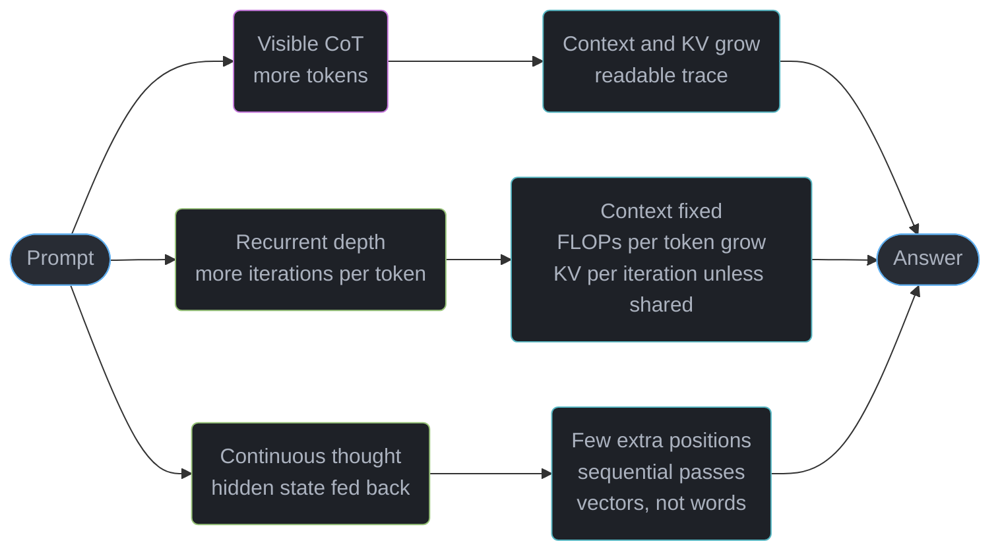
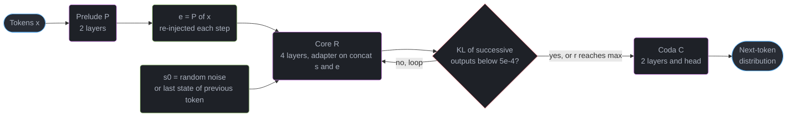
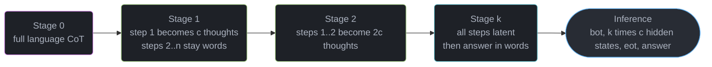
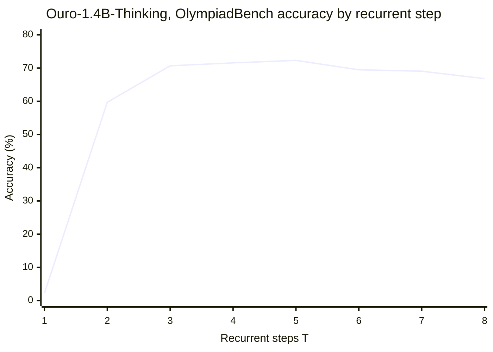
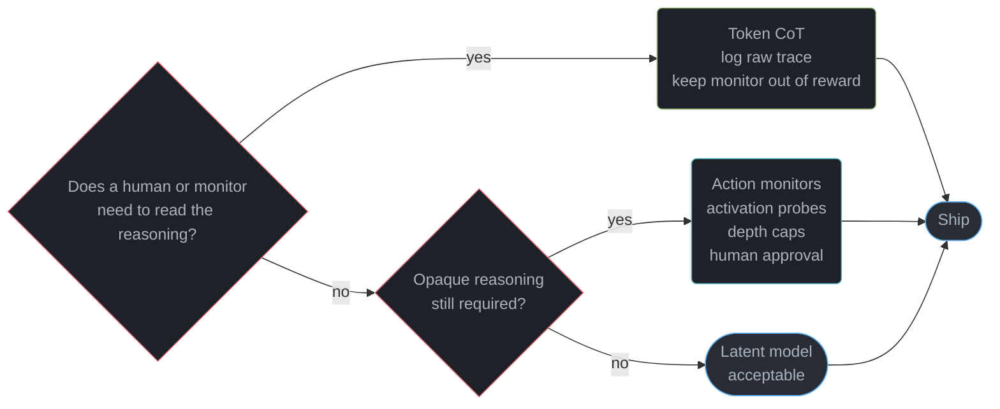

# Latent and Looped Reasoning — Thinking in Depth Instead of Tokens
Deep-dive sub-file of [Reasoning Models](reasoning_models.md). Covers recurrent-depth and looped transformers (Huginn, Ouro), Coconut continuous thought, token-based latent compute (pause tokens, filler tokens, Quiet-STaR, implicit CoT), small recursive models (HRM, TRM), how each one scales test-time compute through depth instead of tokens, what it does to KV cache and batching, how to evaluate it, and what it costs chain-of-thought monitorability.

---

## 1. Concept Overview

A mainstream reasoning model (o-series, DeepSeek-R1, see [Reasoning Models](reasoning_models.md) §4.1 to §4.2) buys extra test-time compute by **emitting more tokens**. Every thought is squeezed through the vocabulary: one sampled token per step, a hard ceiling of `log2(|V|)` bits per step (16 bits for a 65,536-token vocabulary), then re-embedded and fed back in. The reasoning is readable, but the channel is narrow and the context grows with every thought.

**Latent reasoning** buys the same extra compute **without emitting tokens**. Three families exist:

| Family | Where the extra compute goes | Representative work | Readable? |
|--------|-----------------------------|--------------------|-----------|
| **Recurrent depth / looped transformers** | The same block of layers is applied `r` times before a token is emitted | Huginn (Geiping et al., Feb 2025), Ouro (ByteDance Seed et al., Oct 2025), Universal Transformer (2018) | No: state lives in activations |
| **Continuous thought** | The last hidden state is fed back as the next input embedding, with no sampling | Coconut (Hao et al., Dec 2024) | Only through probes |
| **Extra positions, same weights** | Extra tokens (pause, filler, learned thought tokens) give more hidden vectors to compute with | Pause tokens (ICLR 2024), filler tokens, Quiet-STaR, implicit CoT | Tokens are meaningless or hidden |

The headline result that put this line on interview loops: **Huginn-0125**, a 3.5B-parameter recurrent-depth model trained on about 800B tokens, improves on reasoning benchmarks as you run its recurrent block more times, up to "a computation load equivalent to 50 billion parameters" (arXiv 2502.05171). It needs no chain-of-thought training data and a small context window. The catch that every principal-level answer must name: the extra compute is invisible, so the **chain of thought stops being a monitor-able record of the reasoning**. Korbak et al. (July 2025, 41 authors across OpenAI, Anthropic, Google DeepMind and others) list "novel architectures" that reason in continuous latent space as one way chain-of-thought monitorability could be lost.

This page is a research-line survey, not a vendor guide. The checkpoints in this line (Huginn-0125, Ouro 1.4B and 2.6B) are open research releases. The sources fetched for this page report no production deployment of any of them, so treat "latent reasoning in production" as an open question and say so in an interview.

---

## 2. Intuition

> **One-line analogy**: Chain of thought is thinking out loud on a whiteboard. Latent reasoning is thinking in your head for longer before you write the next word. The whiteboard can be audited. The head cannot.

**Mental model**: A fixed-depth transformer gets a fixed budget of serial computation per token: one pass through `L` layers. To do a long serial computation (multi-step arithmetic, graph search), it must write intermediate results into the context as tokens and read them back on later steps. That is why CoT helps. Latent reasoning removes the bottleneck at the source, either by **looping layers** (more serial depth per token), or by **recycling the hidden state** (no sampling between steps), or by **adding positions** (more parallel width per token).

**Why it matters**:
- It is a third scaling axis next to parameters and visible thinking tokens. The Huginn authors write that it "may build a third axis on which to scale model performance".
- It decouples **parameter count** from **compute per token**. Huginn has 8 "real" layers and an effective depth of `2 + 4r + 2 = 132` layers at `r = 32`. Ouro's 1.4B model is reported to match 4B dense models.
- It changes serving: memory is cheap (few parameters), FLOPs per token are high, and compute per token can vary.
- It is the main architectural threat to the safety assumption behind chain-of-thought monitoring.

**Key insight**: Test-time compute has two currencies, **tokens** (width in time, readable, grows the KV cache) and **iterations** (depth per token, unreadable, grows FLOPs and, unless shared, the KV cache too). Everything on this page is a consequence of which currency you spend.

---

## 3. Core Principles

1. **Depth is the scarce resource for serial reasoning.** Saunshi et al. (ICLR 2025) show that a `k`-layer transformer looped `L` times nearly matches a `kL`-layer non-looped model on synthetic reasoning tasks and is much better than a `k`-layer model. Many reasoning problems need depth, not parameters.
2. **A loop is a latent chain of thought.** The same paper proves that looped models can simulate `T` steps of CoT with `T` loops. Merrill and Sabharwal (ICLR 2024) show CoT length controls expressive power: logarithmic decoding steps add little, linear steps add all regular languages, polynomial steps reach the class P. Looping buys serial steps without emitting tokens.
3. **Re-inject the input at every iteration.** Huginn's core takes `(s_{i-1}, e)` each step, where `e` is the embedded input. If `e` appeared only at the start, the iteration would not be a stable data-dependent operator (the paper's gradient-descent analogy).
4. **Train with random depth, test with chosen depth.** Huginn samples `r` per sequence from a log-normal Poisson with mean 32 and `sigma = 1/2`, and backpropagates through only the last `k = 8` iterations, so memory is independent of `r`.
5. **Loops do not add stored knowledge.** Ouro measured about 2 bits of knowledge per parameter for looped and non-looped models alike. The gain is better **manipulation** of stored knowledge, not more of it.
6. **Compute per token can vary.** Easy tokens converge in a few iterations, hard tokens need more. Both Huginn (KL between successive steps) and Ouro (learned exit gate) exploit this.
7. **Reasoning that is not written down is not auditable by reading.** This is the safety trade-off. Everything that follows from it (probes, action monitors, gating) is compensation.
8. **Every number in this field comes from small-scale, single-run research.** Huginn is one run with a constant learning rate and no cooldown. Ouro v1 and the latest revision differ. Re-check before quoting.

---

## 4. Types / Strategies

### 4.1 Recurrent-Depth Transformer: Huginn (arXiv 2502.05171, Feb 2025)

Geiping, McLeish, Jain, Kirchenbauer, Singh, Bartoldson, Kailkhura, Bhatele, Goldstein (ELLIS Institute Tubingen, UMD, LLNL). Open model `tomg-group-umd/huginn-0125`, code at `seal-rg/recurrent-pretraining`.

| Item | Value (from the paper) |
|------|------------------------|
| Structure | Prelude `P` (embeds), recurrent core `R` (looped `r` times), coda `C` (un-embeds, head) |
| Layers (prelude, core, coda) | (2, 4, 2): 8 real layers |
| Effective depth | `2 + 4r + 2` = 132 layers at `r = 32` |
| Hidden size / heads | `h = 5280`, 55 heads of size 96, MLP inner size 17,920 |
| Parameters | about 1.5B prelude + head, about 1.5B core, about 0.5B tied embedding = 3.5B |
| Vocabulary / sequence length | 65,536 BPE tokens, packed sequences of 4,096 |
| Training tokens | about 800B (795B scheduled on Frontier, ORNL, AMD MI250X, up to 4,096 GPUs) |
| Mean recurrence in training | `r_bar = 32`, sampled per sequence from a log-normal Poisson |
| Backprop | Truncated: last `k = 8` iterations only |
| Test-time compute | Scales "up to a computation load equivalent to 50 billion parameters" |
| Non-recurrent twin | Same setup, 180B tokens, one pass through the core |

How a forward pass runs:

```
e   = P(x)                      # embed tokens once
s_0 ~ N(0, sigma_s^2)           # random initial latent state (sigma_s^2 = 2/5 in the paper)
s_i = R(e, s_{i-1})   i=1..r    # adapter A: R^{2h} -> R^h on concat(s, e), then 4 layers
p   = C(s_r)                    # coda + tied head
```

What the paper reports:

- **Recurrence is where the gain lives.** At 180B tokens the recurrent model is already about 5 times better than its non-recurrent twin on GSM8K CoT. The recurrent model evaluated with one recurrence "effectively stops improving" between 180B and 800B tokens, so the later gains sit in the loop, not in the prelude or coda.
- **Saturation depends on the task.** HellaSwag is near peak at 8 iterations, GSM8K CoT keeps improving. ARC-C saturates around 8 to 12 iterations with no few-shot examples, about 20 with one example, about 32 with 25 to 50 examples. More context needs more thinking.
- **GSM8K CoT at `r = 64`** with the weight-averaged (EMA) checkpoint: 47.23% flexible-match, 38.59% strict-match.
- **Honest benchmark position.** Roughly comparable to OLMo-7B on standard benchmarks, behind later OLMo models, and behind dedicated code models on code. The authors call it a proof of concept: untested data mixture, constant learning rate never cooled down.
- **Zero-shot inference features** (§6.3): per-token adaptive exit, KV-cache sharing, continuous-CoT warm start, self-speculative decoding.
- **Training instability is real.** Run 1 collapsed (token hidden-state correlation went to 1.0). Run 2 recovered but learned to ignore the incoming state, so validation perplexity was the same at 1 or 32 recurrences. The final run needed sandwich normalization and a peak learning rate of `4e-5` (versus `4e-4` earlier).

"Compute equivalent to 50B parameters" is a **FLOPs statement, not a capability statement**. The paper says the model is "roughly comparable to OLMo-7B in most metrics". Memorise that sentence, it is the standard trap.

### 4.2 Looped Language Models: Ouro (arXiv 2510.25741, Oct 2025)

Zhu et al. (ByteDance Seed, UC Santa Cruz, Princeton, Mila and others; Bengio and Eshraghian among the authors). The first looped LM family pre-trained at multi-trillion-token scale.

| Item | Value (arXiv v1 HTML; later revisions exist, latest v6 dated 11 Oct 2026) |
|------|------|
| Sizes | Ouro-1.4B and Ouro-2.6B, plus Ouro-Thinking (reasoning SFT) variants |
| Pre-training | 7.7T tokens: 3T stable, then 3T, 1.4T annealing, 20B long-context, 300B mid-training |
| Loop depth | Trained with up to `T = 4` recurrent steps |
| Reported parity | 1.4B (R4) matches 4B dense; 2.6B (R4) matches or beats 8B dense on reasoning-heavy benchmarks |
| Examples | 1.4B R4: BBH 71.02 vs 70.95 (Qwen3-4B-Base), GSM8K 78.92 vs 72.86, MATH500 82.40 vs 59.60 |
| Exit control | Learned per-step exit gate, entropy-regularized objective with a **uniform prior** over exit steps, then a second stage that trains only the gate |
| Inference exit | Q-exit: stop at the first step `t` where the cumulative exit probability reaches threshold `q` |

Design choices worth knowing:

- **Uniform prior, not Poisson.** Ouro argues Huginn-style Poisson-lognormal priors "contain a strong inductive bias toward shallow computation", so they explore deep steps too little.
- **Depth is a trained quantity.** Performance peaks near the trained depth and **degrades beyond it**: for the Thinking models trained at `T = 4`, accuracy falls at `T = 6` to `8`. Huginn, trained with a heavy-tailed `r`, keeps improving to 64. The two papers disagree on extrapolation, and both are single-run results.
- **Manipulation, not memory.** Capo-style knowledge-capacity tests give about 2 bits per parameter for looped and non-looped models. Mano (modular arithmetic) and multi-hop QA tests show looped models better at composing knowledge.
- **Safety claim (authors' own).** On HEx-PHI (330 prompts, 11 categories, GPT-4o judge) harmfulness falls as recurrent steps rise, including extrapolated steps. Reported harmful rates for Thinking models at 4 steps: 0.009 (1.4B) and 0.003 (2.6B). The paper also claims the latent updates are "causally faithful" rather than post hoc rationalization. Treat both as authors' claims, not independent audits.

### 4.3 Coconut: Chain of Continuous Thought (arXiv 2412.06769, Dec 2024, COLM 2025)

Hao, Sukhbaatar, Su, Li, Hu, Weston, Tian. **Fine-tune an existing LM** so that, in "latent mode", the **last hidden state** is fed back as the next input embedding instead of being decoded to a token.

Mechanics:

- Special tokens `<bot>` and `<eot>` bracket the latent span. Inside it, position `t` receives `h_{t-1}` (the final-norm output of the previous position) as its input embedding.
- **Multi-stage curriculum** (borrowed from iCoT): stage 0 trains on normal CoT. At stage `k`, the first `k` language reasoning steps are replaced by `k * c` continuous thoughts (`c` thoughts per replaced step). Loss is masked on the question and on the latent thoughts. The optimizer state is reset at each stage.
- Training needs `n + 1` **sequential** forward passes for `n` latent thoughts, "the sequential nature ... poses challenges for parallelism".
- At inference, `<eot>` is either predicted by a binary classifier on latent thoughts or the latent span is padded to a constant length. Both worked comparably, and the paper uses constant length.
- Setup: pre-trained GPT-2. `c = 2` and 3 stages (plus one extra) for GSM8K. `c = 1` and 6 stages for ProntoQA and ProsQA.

Results (Table 1 of v4; row identity inferred from row order and the paper's text):

| Method | GSM8K acc / tokens | ProntoQA acc / tokens | ProsQA acc / tokens |
|--------|-------------------|----------------------|--------------------|
| CoT | 42.9% / 25.0 | 98.8% / 92.5 | 77.5% / 49.4 |
| No-CoT | 16.5% / 2.2 | 93.8% / 3.0 | 76.7% / 8.2 |
| Coconut | 34.1% / 8.2 | 99.8% / 9.0 | 97.0% / 14.2 |
| Coconut without curriculum | 14.4% / 8.2 | 52.4% / 9.0 | 76.1% / 14.2 |

Reading it correctly: Coconut **loses to CoT on math** (34.1% vs 42.9% on GSM8K) and **beats it on search-heavy logic** (97.0% vs 77.5% on ProsQA) while generating about a third of the tokens. "Tokens" counts the continuous thoughts too. Removing the curriculum collapses GSM8K to 14.4%.

Why it can win on search: probing the thoughts shows the model keeps several candidate next nodes alive (a breadth-first pattern) and prunes later, instead of committing early like greedy CoT. Zhu et al. (Reasoning by Superposition, NeurIPS 2025) prove a two-layer transformer with `D` continuous-thought steps solves directed-graph reachability (`D` = graph diameter), where the best known constant-depth discrete-CoT construction needs `O(n^2)` decoding steps.

### 4.4 Latent Compute Through Extra Positions: Pause, Filler, Quiet-STaR, Implicit CoT

| Method | Idea | Evidence | Limit |
|--------|------|---------|-------|
| **Pause tokens** (Goyal et al., ICLR 2024) | Append learnable `<pause>` tokens, ignore outputs until the last one, so the model computes with `K+10` hidden vectors per layer instead of `K` | 1B model, C4 pretraining. Gains on 8 of 9 tasks: +18% EM on SQuAD, +8% on CommonsenseQA, +1% on GSM8K | The paper's gains appear when the model is **both** pre-trained and fine-tuned with pause tokens |
| **Filler tokens** (Pfau, Merrill, Bowman, 2024) | Replace the CoT with meaningless `......` | Solves two hard algorithmic tasks the model fails without intermediate tokens | Learning to use them needs "specific, dense supervision". Helps parallelizable problems, does not extend expressivity like real CoT |
| **Quiet-STaR** (Zelikman et al., 2024) | Learn to generate a rationale at every token, with learnable start and end thought tokens | After continued pretraining, zero-shot GSM8K 5.9% to 10.9%, CommonsenseQA 36.3% to 47.2% | Needs tokenwise parallel sampling to keep the cost manageable. Rationales are tokens, so they stay readable |
| **Implicit CoT / iCoT** (Deng, Choi, Shieber, 2024) | Train with explicit CoT, then remove intermediate steps gradually until the answer is direct | GPT-2 Small reaches up to 99% on 9x9 multiplication where standard training fails beyond 4x4. Mistral 7B over 50% on GSM8K with no intermediate steps | The reasoning is internalised at training time, so there is no test-time depth knob |

The Pfau et al. paper is the safety-relevant one: it shows intermediate tokens can act as filler, "raising concerns about large language models engaging in unauditable, hidden computations that are increasingly detached from the observed chain-of-thought tokens". A visible CoT is not proof that the visible tokens carry the computation.

### 4.5 Small Recursive Models: HRM and TRM (puzzle reasoning, not language)

| Model | Size / data | Claim | Caveat |
|-------|-------------|-------|--------|
| **HRM** (Wang et al., Sapient, arXiv 2506.21734) | 27M parameters, about 1,000 training samples, no pre-training, no CoT data | Near-perfect Sudoku and maze solving, beats larger models on ARC | ARC Prize verification on the semi-private set: **32% on ARC-AGI-1, 2% on ARC-AGI-2**. Ablations: the hierarchical architecture had minimal impact versus a similar transformer, the **outer refinement loop** drove the gain, and most performance came from memorising the evaluation tasks |
| **TRM** (Jolicoeur-Martineau, arXiv 2510.04871) | 7M parameters, a single 2-layer network | Reports 45% on ARC-AGI-1 and 8% on ARC-AGI-2, above several large LLMs | Author-reported. Puzzle grids, not open-ended language |

The shared lesson: **iterating a small network scales compute on narrow structured tasks**. It is not evidence that the same recipe scales to open-ended text, which is what Huginn and Ouro attempt.

### 4.6 Related Variants

- **Universal Transformer** (Dehghani et al., ICLR 2019): the ancestor. Weight-tied depth with a per-position halting mechanism, Turing-complete under certain assumptions.
- **Soft Thinking** (Zhang et al., arXiv 2505.15778): training-free. Each step emits a probability-weighted mixture of token embeddings (a "concept token") instead of one sampled token. Reported up to +2.48 pass@1 and up to 22.4% fewer tokens, and the outputs are described as still readable. The interesting middle ground between tokens and fully opaque latents.
- **Mixture-of-Recursions** (Bae et al., arXiv 2507.10524): one shared stack reused across recursion steps, with a **router assigning a recursion depth to each token**, attention and KV caching restricted to tokens still active at that depth, plus a KV-sharing variant. Tested from 135M to 1.7B parameters.
- **Retrofitted recurrence** (McLeish et al., arXiv 2511.07384): convert a pretrained non-recurrent model into a depth-recurrent one using a **curriculum of recurrences**. Reported better performance at a given compute budget than just post-training the original model, on math.
- **Latent diffusion over text** ([Diffusion Language Models](../diffusion_language_models/diffusion_language_models.md)): iterative refinement too, but the iteration count is per sequence, not per token.

### 4.7 Choosing a Family

| If you need | Look at | Why |
|-------------|---------|-----|
| Variable depth per token from scratch | Huginn-style recurrent depth, Ouro-style learned gates | Depth knob at test time |
| Cheap upgrade of an existing model | Retrofitted recurrence, Coconut-style fine-tuning | Reuses a pretrained base |
| Search-heavy planning with few tokens | Coconut | Frontier of candidate paths in one vector |
| Readable and still compressed | Soft Thinking, plain CoT with budget control ([Reasoning Models](reasoning_models.md) §4.8) | Keeps a monitorable surface |
| Tiny model on a narrow puzzle | HRM/TRM-style recursion | Few parameters, task-specific |

---

## 5. Architecture Diagrams

### Two Currencies of Test-Time Compute



Both currencies buy serial computation. Tokens pay in context length and are auditable. Iterations pay in FLOPs per token and are not.

### Huginn Forward Pass With Adaptive Exit



The loop is the only place compute is added. The same four layers run every iteration, so the number of parameters never changes while the effective depth does.

### Coconut Curriculum



Each stage swaps one more language step for `c` continuous thoughts and resets the optimizer. Skipping the staging (training only the last stage) drops GSM8K from 34.1% to 14.4% in the paper's ablation.

### Accuracy Versus Recurrent Depth (Ouro-1.4B-Thinking, trained at T = 4)



One step is near zero, three steps recover almost everything, and the curve peaks at the trained depth then declines. Depth is a trained quantity, not a free dial. Series values are Table 12 of arXiv v1, identified with OlympiadBench through the 71.55 figure at T = 4 in the paper's text.

### Per-Token Exit Breaks Naive Batching

```
Six sequences, tokens exit at these recurrent steps:   3   8   5  12   4  32

step: 1  5  10  15  20  25  30 32
seq A |###|
seq B |########|
seq C |#####|
seq D |############|
seq E |####|
seq F |################################|
       ^ synchronous batch runs every row to step 32

  useful token-steps   = 3 + 8 + 5 + 12 + 4 + 32 = 64
  paid token-steps     = 6 x 32                   = 192
  utilization          = 64 / 192                 = 33%
```

Per-token adaptive depth saves FLOPs only if finished rows leave the batch. On memory-bound decode the step time barely shrinks with fewer rows, so wall-clock still tracks the slowest token unless freed slots are refilled with other sequences' tokens.

### Huginn KV-Cache Budget: Slot = Iteration mod k

```
Cache budget k = 4, one token, iterations 1..8   (read and write entry  i mod k)

iteration i :   1    2    3    4    5    6    7    8
slot i mod 4:   1    2    3    0    1    2    3    0
                |    |    |    |    |    |    |    |
                v    v    v    v    v    v    v    v
slots       : [ 0 ][ 1 ][ 2 ][ 3 ]   iteration 5 overwrites slot 1 (iteration 1's entry)
                                      iteration 8 overwrites slot 0 (iteration 4's entry)
Cache per token = (2 + 4 x 4 + 2) = 20 layers, not 2 + 4 x 32 + 2 = 132 layers at r = 32
```

All recurrent cache entries come from the same K and V projections, so a later iteration can attend to an earlier iteration's entry without mismatch. Source: Huginn paper §6.2.

---

## 6. How It Works — Detailed Mechanics

### 6.1 Compute and Memory Arithmetic for a Huginn-Shaped Model

Parameters from the paper: about 1.5B outside the core, about 1.5B in the core. Equivalent dense parameters at depth `r` is roughly `1.5 + 1.5r` billion, which reproduces the paper's "50B at `r = 32`". KV figures assume full multi-head KV (55 heads x 96, bf16, no GQA) and are **this page's arithmetic**, not paper numbers: `2 (K and V) x 5280 x 2 bytes = 21,120 bytes per layer per token`.

| Recurrences `r` | Dense-equivalent params | GFLOPs per token (`2 x params`) | KV per token, all iterations cached | KV for a 4,096-token context |
|----------------|------------------------|---------------------------------|--------------------------------------|------------------------------|
| 1 | 3.0B | 6 | 168,960 B (8 layers) | 0.69 GB |
| 4 | 7.5B | 15 | 422,400 B (20 layers) | 1.73 GB |
| 8 | 13.5B | 27 | 760,320 B (36 layers) | 3.11 GB |
| 16 | 25.5B | 51 | 1,436,160 B (68 layers) | 5.88 GB |
| 32 | 49.5B | 99 | 2,787,840 B (132 layers) | 11.42 GB |
| 64 | 97.5B | 195 | 5,491,200 B (260 layers) | 22.49 GB |

Three consequences:

1. **Latent reasoning is not a cheap lunch in FLOPs.** At `r = 32` each generated token costs about 99 GFLOPs, the same as a 49.5B dense model. A 3.5B CoT model generating 1,000 thinking tokens costs `2 x 3.5B x 1,000 = 7 TFLOPs` (ignoring attention), while the recurrent model at `r = 32` generating 100 answer tokens costs `2 x 49.5B x 100 = 9.9 TFLOPs`. The win is **memory capacity and no thinking tokens in the context**, not fewer FLOPs.
2. **KV cache scales with cached iterations, not just tokens.** Caching every iteration at `r = 32` is 11.42 GB for a single 4,096-token sequence. With a cache budget of 4 iterations (the paper's MTBench setting), it falls to 1.73 GB, and MTBench stayed at 5.86 (vs 5.63 standard).
3. **Decode is memory-bound, so latency tracks `r`.** At batch 1, each iteration re-reads the core weights (about 3 GB in bf16). At `r = 32` that is about 96 GB of core-weight traffic per token, close to reading a dense 50B model (about 100 GB in bf16). On a 3 TB/s-class accelerator that is roughly 32 ms per token as an upper bound on batch-1 speed. Larger batches amortise the reads across sequences ([GPU Architecture and Roofline](../optimization_and_quantization/gpu_architecture_and_roofline.md)).

### 6.2 Sampling Depth and Truncated Backprop (Huginn Training)

```python
from __future__ import annotations

import math

import torch
from torch import Tensor, nn


def sample_recurrence(mean_r: int = 32, sigma: float = 0.5) -> int:
    """Log-normal Poisson depth, as in the paper: most draws below the mean, a heavy upper tail."""
    tau = torch.normal(torch.tensor(math.log(mean_r) - 0.5 * sigma**2), torch.tensor(sigma))
    return int(torch.poisson(torch.exp(tau).reshape(1)).item()) + 1


class RecurrentDepthLM(nn.Module):
    def __init__(self, prelude: nn.Module, core: nn.Module, coda: nn.Module, hidden: int) -> None:
        super().__init__()
        self.prelude, self.core, self.coda = prelude, core, coda
        self.adapter = nn.Linear(2 * hidden, hidden, bias=False)  # concat(s, e): 2h -> h

    def step(self, e: Tensor, s: Tensor) -> Tensor:
        return self.core(self.adapter(torch.cat([s, e], dim=-1)))

    def init_state(self, e: Tensor) -> Tensor:
        return 0.632 * torch.randn_like(e)  # sigma_s^2 = 2/5, truncated normal in the paper

    def forward(self, tokens: Tensor, r: int, k_bptt: int = 8) -> Tensor:
        e = self.prelude(tokens)  # re-injected on every iteration
        s = self.init_state(e)
        n_free = max(r - k_bptt, 0)
        with torch.no_grad():  # activation memory independent of r
            for _ in range(n_free):
                s = self.step(e, s)
        for _ in range(r - n_free):
            s = self.step(e, s)
        return self.coda(s)
```

The prelude still receives gradients because `e` is injected into each of the last `k` iterations. The paper samples one `r` per micro-batch and synchronises it across workers ("locked-step sampling"), so no GPU idles waiting for the deepest sample.

### 6.3 Per-Token Adaptive Exit, Cache Sharing, Warm Start, Self-Speculation

Huginn's zero-shot inference features (paper §6), none of which needed special training:

| Feature | Mechanism | Reported effect |
|---------|-----------|-----------------|
| **Adaptive exit** | Stop iterating when KL between successive output distributions is below `5e-4`, sample the token, move on | MTBench 5.63 standard vs 5.56 with early exits. On the first 50 questions of each MMLU category, high-school math exits earliest, moral scenarios take about 3.5 more steps |
| **KV-cache sharing** | Budget of `k` entries per token, iteration `i` reads and writes slot `i mod k` | Budget 4: MTBench 5.86 |
| **Missing KV entries after early exit** | Attend to the deepest available KV entry of earlier tokens (all entries come from the same K and V projections) | Avoids recomputing skipped states |
| **Continuous-CoT warm start** | Start the next token from the previous token's final state instead of random noise | 1 to 2 fewer steps on average to converge |
| **Self-speculative decoding** | Draft `N` tokens with few iterations, verify with more iterations, reuse the drafting states | No separate draft model ([Speculative Decoding](../inference_and_decoding/speculative_decoding.md)) |

```python
import torch
import torch.nn.functional as F
from torch import Tensor


@torch.no_grad()
def decode_with_exit(model: "RecurrentDepthLM", tokens: Tensor, max_r: int = 64,
                     kl_tol: float = 5e-4, warm_state: Tensor | None = None) -> tuple[Tensor, Tensor, int]:
    """Returns (log-probs of next token, final latent state, iterations used)."""
    e = model.prelude(tokens)
    s = warm_state if warm_state is not None else model.init_state(e)
    prev: Tensor | None = None
    for i in range(1, max_r + 1):
        s = model.step(e, s)
        logp = F.log_softmax(model.coda(s)[:, -1], dim=-1)  # exit test needs logits every step
        if prev is not None:
            kl = F.kl_div(prev, logp, log_target=True, reduction="batchmean")
            if kl.item() < kl_tol:
                return logp, s, i
        prev = logp
    return logp, s, max_r
```

The exit test costs a coda plus head pass per iteration. Ouro found that a cheaper hidden-state-difference test (`||h_t - h_{t-1}||` below a threshold) stays within 1% to 2% of a trained gate at 2 to 3 average rounds.

### 6.4 Ouro-Style Learned Exit and KV Sharing

- **Gate.** At step `t` a linear head plus sigmoid gives `lambda_t(x)`. The probability of exiting exactly at step `i` is `lambda_i` times the product of `(1 - lambda_j)` for `j < i`. At inference, exit at the first `t` whose cumulative distribution reaches threshold `q`. `q` is a **deployment-time knob** for the compute-accuracy trade-off, no retraining.
- **Stage I** (pretraining): task loss at every step plus an entropy bonus against a uniform prior. **Stage II**: train only the gate, using the loss improvement between steps (slope `k = 50`, improvement threshold `tau = 0.005`). Reported gain from stage II: about 2 to 3 points of accuracy at matched average exit round, for example about 66% vs about 64% at an average of 2.5 rounds on MMLU.
- **KV cache**: a naive 4-step model needs 4 times the KV memory. Findings: during **prefill** every step needs its own cache (reusing caches cost over 10 GSM8K points), but during **decode** reuse works. Last-step reuse scored GSM8K 78.85 and MATH-500 80.40 against 78.92 and 82.40 for the full cache at 4x less memory. First-step reuse collapsed to 18.73 on GSM8K. This is the first source here that separates prefill from decode, and it matches what an engine would want: cache fully once, then share.

### 6.5 Coconut Inference Loop

```python
import torch
from torch import Tensor


@torch.no_grad()
def coconut_generate(model, input_ids: Tensor, bot_id: int, eot_id: int,
                     n_thoughts: int, max_new: int = 64) -> Tensor:
    """HF-style causal LM. No KV cache here for clarity; real code reuses past_key_values."""
    emb = model.get_input_embeddings()
    dev = input_ids.device
    seq = torch.cat([input_ids, torch.tensor([[bot_id]], device=dev)], dim=1)
    inputs = emb(seq)  # (1, T, d)
    for _ in range(n_thoughts):  # latent mode: feed the last hidden state back as an embedding
        out = model(inputs_embeds=inputs, output_hidden_states=True)
        h = out.hidden_states[-1][:, -1:, :]  # after the final norm, magnitude stays bounded
        inputs = torch.cat([inputs, h], dim=1)
    inputs = torch.cat([inputs, emb(torch.tensor([[eot_id]], device=dev))], dim=1)
    generated: list[Tensor] = []
    for _ in range(max_new):  # language mode: ordinary greedy decoding
        nxt = model(inputs_embeds=inputs).logits[:, -1].argmax(-1, keepdim=True)
        generated.append(nxt)
        if nxt.item() == model.config.eos_token_id:
            break
        inputs = torch.cat([inputs, emb(nxt)], dim=1)
    return torch.cat(generated, dim=1)
```

Note the cost shape: `n_thoughts` sequential single-position passes (each with a growing KV cache if cached), no parallelism across thoughts, and no sampling. That is also why Coconut **training** needs `n + 1` sequential forward passes per example.

### 6.6 Fair Evaluation Harness

Four measurements decide whether a latent model earned its place. All are plain Python over whatever `run(example, depth)` callable you have.

```python
from __future__ import annotations

from dataclasses import dataclass
from typing import Callable, Sequence


def accuracy_vs_depth(run: Callable[[dict, int], bool], data: Sequence[dict],
                      depths: Sequence[int]) -> dict[int, float]:
    return {d: sum(run(x, d) for x in data) / len(data) for d in depths}


def saturation_depth(curve: dict[int, float], tol: float = 0.01) -> int:
    """Smallest depth within `tol` of the best accuracy: where extra iterations stop paying."""
    best = max(curve.values())
    return min(d for d, a in sorted(curve.items()) if a >= best - tol)


def flops_per_token(fixed_b: float, core_b: float, r: int) -> float:
    return 2e9 * (fixed_b + core_b * r)  # Huginn-shaped: fixed 1.5B, core 1.5B


@dataclass(frozen=True)
class HintTrial:
    used_hint: bool       # did the answer change because of the injected hint?
    verbalized: bool      # does the visible CoT admit it? (undefined for latent-only models)


def reveal_rate(trials: Sequence[HintTrial]) -> float:
    used = [t for t in trials if t.used_hint]
    return sum(t.verbalized for t in used) / len(used) if used else float("nan")
```

How to use them:

1. **Compute-matched comparison.** Plot accuracy against FLOPs per answer, not against parameters. Include a CoT baseline of the same base size.
2. **Depth sweep with extrapolation.** Evaluate at the trained depth, below it, and above it. Ouro degrades above `T = 4`, Huginn improves to 64. Report both.
3. **Saturation depth per task.** `saturation_depth` on each benchmark tells you how much adaptive exit can save. HellaSwag-type tasks saturate near 8 iterations in Huginn, GSM8K-type tasks do not.
4. **Monitorability.** `reveal_rate` (the Chen et al. style hint test) measures how often the visible reasoning mentions a used hint. For a latent-only model there is nothing to count, which is the finding. Then add intervention tests and probes (§9.3).

### 6.7 Design Consequence for Serving (this page's analysis, not from a paper)

A standard early-exit transformer skips layers that have **different weights**, so tokens at different depths need different kernels. A recurrent-depth core uses the **same weights at every iteration**. One core pass can therefore serve a mixed batch of `(sequence, current depth)` pairs: a token on iteration 3 and a token on iteration 17 share a batched matmul. That makes iteration-level scheduling (the same idea as continuous batching, applied per recurrent step, see [vLLM Deep Dive](../vllm_deep_dive/vllm_deep_dive.md)) a natural fit, if an engine tracks per-token depth, per-token KV slots, and exit decisions. Whether an engine supports this is an engine question. Check before assuming.

---

## 7. Real-World Examples

All of these are research releases. None of the sources fetched for this page reports a production deployment.

| System | Who | What it showed | Status |
|--------|-----|----------------|--------|
| **Huginn-0125** | UMD, ELLIS Tubingen, LLNL (Geiping, Goldstein et al.) | 3.5B recurrent-depth model, about 800B tokens, scales to a 50B-equivalent compute load | Open weights and training code on Hugging Face and GitHub |
| **Ouro 1.4B / 2.6B (+Thinking)** | ByteDance Seed and collaborators | Looped LMs pre-trained on 7.7T tokens match 4B and 8B dense models on reasoning-heavy benchmarks | Open models, project page ouro-llm.github.io |
| **Coconut** | Hao, Sukhbaatar, Weston, Tian and co-authors | Continuous thought on GPT-2 beats CoT on search-heavy logic, loses on math | Paper (COLM 2025) and code |
| **Retrofitted recurrence** | McLeish, Geiping, Goldstein and collaborators | Converting pretrained models into recurrent ones | Code and models released |
| **HRM / TRM** | Sapient (HRM), single-author TRM | 27M and 7M parameter recursive models on ARC and puzzles | HRM independently verified by ARC Prize at 32% on ARC-AGI-1 semi-private |
| **Mixture-of-Recursions** | Bae et al. | Token-level recursion depth with selective KV caching | Code released |

What a principal engineer should say about "who uses this": frontier assistants today reason in **tokens**, with the raw CoT logged and monitored ([Safety and Alignment](../safety_and_alignment/safety_and_alignment.md) §Chain-of-Thought Monitorability). Latent reasoning is the research bet on what comes after, and the monitorability authors explicitly name it as a risk to the current oversight setup.

---

## 8. Tradeoffs

### Latent Depth vs Visible Tokens

| Dimension | Visible CoT | Recurrent depth (Huginn/Ouro) | Continuous thought (Coconut) |
|-----------|------------|-------------------------------|------------------------------|
| Extra compute lives in | Tokens | Iterations per token | Hidden states fed back |
| Context growth | Linear in thinking tokens | None | A few positions |
| KV per token | One pass of layers | One pass per cached iteration, or shared | One pass per thought position |
| Parallelism | Sequential decode | Parallel over prompt tokens in prefill, sequential across iterations | Sequential across thoughts |
| Needs reasoning data | Yes (long CoT or RL) | No (plain pretraining) | Yes (CoT data for the curriculum) |
| Test-time knob | Token budget | Iteration count or exit threshold | Thought count |
| Auditable by reading | Yes, imperfectly | No | Only via decoding probes |
| Evidence at scale | Frontier production | 3.5B and 1.4B/2.6B research models | GPT-2 scale |

### Compute Equivalence Is Not Capability Equivalence

| Claim | What is actually true |
|-------|-----------------------|
| "3.5B model equals a 50B model" | Equal **FLOPs per token** at `r = 32`. Capability is near OLMo-7B-class on standard benchmarks |
| "1.4B Ouro equals a 4B model" | Equal on the reported reasoning-heavy benchmarks at `T = 4`. Looped models store the same bits per parameter, so knowledge-heavy tasks stay parameter-bound |
| "Latent reasoning is faster" | Fewer thinking tokens, not fewer FLOPs. Latency tracks iterations through weight re-reads |
| "Coconut beats CoT" | On ProsQA and ProntoQA. It loses on GSM8K (34.1% vs 42.9%) |

### Safety Trade-Off Summary

| Property | Token CoT | Latent reasoning |
|----------|-----------|-------------------|
| Reasoning visible to a monitor | Often, but only partly faithful (hint revealed under 20% in many settings) | No |
| Obfuscation under optimization pressure | Documented (Baker et al.) | Not applicable, nothing to obfuscate. Opacity is by construction |
| Interpretability tooling | Read the text | Logit lens and probes, which Lu et al. found inconsistent on Huginn |
| Cost of keeping oversight | Accept a "monitorability tax" | Compensate with action monitors, probes and capability limits |

---

## 9. When to Use / When NOT to Use

### 9.1 Use (or Study) Latent Reasoning When

- You are choosing a research direction or interviewing at a lab: this is a live line, and "what do you lose" matters as much as "what do you gain".
- The task is **search-heavy and structured** (graph reachability, planning puzzles) and token budgets are the bottleneck. Coconut-style evidence is strongest here.
- **Memory capacity is the binding limit and FLOPs are cheap.** A recurrent-depth model stores 1.4B to 3.5B parameters but computes like a larger model, which suits a memory-constrained device if latency allows ([Small Language Models and Edge AI](../small_language_models_and_edge_ai/small_language_models_and_edge_ai.md)).
- You want a test-time knob that does not depend on long-CoT training data.

### 9.2 Do NOT Use (Today) When

- The deployment needs **auditable reasoning**: regulated decisions, agent actions with side effects, anything where a human or monitor must read why. Use token CoT with the raw trace logged.
- You need **broad factual knowledge** per byte of weights. Looping does not add stored knowledge.
- You need **mature serving**: engines, quantization recipes and tooling assume fixed-depth transformers. Verify support for per-token depth and per-iteration KV before committing.
- The base paper evidence is a single run at one scale and you cannot afford to reproduce it.

### 9.3 If You Must Ship Opaque Reasoning, Minimum Compensating Controls

1. Monitor **actions and outputs**, not just reasoning ([Safety and Alignment](../safety_and_alignment/safety_and_alignment.md)).
2. Run activation probes and interpretability checks ([Mechanistic Interpretability](../mechanistic_interpretability/mechanistic_interpretability.md)) as supplementary evidence only.
3. Cap latent depth for high-stakes actions and require human approval where the reasoning cannot be read.
4. Keep a token-CoT model on the path for any decision that needs an explanation.



---

## 10. Common Pitfalls

**1. Comparing at equal parameters, claiming a win.**

```
BROKEN: "Our 3.5B recurrent model beats a 7B model, so it is twice as parameter efficient."
        (r = 32 costs 99 GFLOPs per token, the same as a 49.5B dense model)
FIX:    Plot accuracy versus FLOPs per answer and versus memory traffic per token. State the
        recurrence count with every number. Compare against a CoT baseline at the same base size.
```

**2. Running past the trained depth.**

```
BROKEN: Ouro trained at T = 4, deployed at T = 8 "for more thinking". OlympiadBench for the
        1.4B Thinking model falls from 72.30 at T = 5 to 66.81 at T = 8.
FIX:    Sweep depth on your own tasks, cap at the best tested depth, and treat extrapolation as
        a model-specific property (Huginn trained with a heavy-tailed r and improves to 64).
```

**3. Caching every iteration in production.**

```
BROKEN: Full per-iteration KV for r = 32 on a Huginn-shaped model: 11.42 GB per 4,096-token
        sequence (full MHA, bf16). Batch of 8 needs 91 GB for cache alone.
FIX:    Cache budget with slot = i mod k (Huginn, k = 4 gives 1.73 GB) or last-step reuse in
        decode (Ouro, 4x less memory, 78.85 vs 78.92 GSM8K). Keep full caches for prefill.
```

**4. Paying for the exit test.**

```
BROKEN: KL-based exit that runs the coda and 65,536-way head after every iteration. The test
        can cost as much as the iteration it is trying to skip.
FIX:    Use a cheap proxy (hidden-state delta, within 1% to 2% of a learned gate in Ouro), a
        learned exit gate, or test every second iteration.
```

**5. Expecting per-token exit to speed up a synchronous batch.**

```
BROKEN: Six sequences exit at steps 3, 8, 5, 12, 4, 32. A lockstep batch runs 32 steps: 33%
        utilization, and decode time unchanged.
FIX:    Schedule at iteration granularity: retire finished tokens and backfill the freed slots
        with other sequences' tokens (the core weights are shared across iterations).
```

**6. Treating logit-lens readouts as the model's thoughts.**

```
BROKEN: Decode the recurrent state through the head at each step, read "the latent CoT".
        Lu et al. found limited evidence of interpretable latent CoT in Huginn-3.5B and probing
        inconsistencies across recurrent blocks that depend on layer index and decoding method.
FIX:    Use causal interventions (patch or perturb the state, check the output) before claiming
        a readout is a reasoning step.
```

**7. Unstable pretraining from a bad init.**

```
BROKEN: Huginn run 1 (parameter-free norms, additive adapter, peak LR 4e-4): token hidden
        states correlate to 1.0, loss stalls. Run 2: validation perplexity identical at 1 and
        32 recurrences, i.e. the model learned to ignore the incoming state.
FIX:    Sandwich norm layers, learned concatenation adapter, embedding scale, peak LR 4e-5.
        Monitor perplexity at several recurrence counts during training, not just the mean.
```

**8. Training Coconut without the curriculum.**

```
BROKEN: Train directly on the final stage (all latent). GSM8K 14.4%, ProntoQA 52.4%.
FIX:    Staged replacement of language steps (34.1%, 99.8%), optimizer reset between stages,
        and a few extra epochs on the final stage.
```

**9. Adding pause tokens only at fine-tune time.**

```
BROKEN: Append <pause> tokens to a model never pre-trained with them and expect the paper's gains.
FIX:    Pause tokens in both pre-training and fine-tuning (Goyal et al.: gains on 8 of 9 tasks
        when the model was trained with delays in both stages).
```

**10. Putting a CoT monitor on a model with no CoT.**

```
BROKEN: Safety review says "chain-of-thought is monitored" for a recurrent-depth agent. The
        monitor reads the short answer text and always passes.
FIX:    Document the loss of the CoT signal, add action and output monitors, probes and depth
        caps, and gate high-impact tool calls on human approval.
```

---

## 11. Technologies & Tools

| Tool or artifact | Purpose | Notes |
|------------------|---------|-------|
| `tomg-group-umd/huginn-0125` (Hugging Face) | Reference recurrent-depth checkpoint | 3.5B, research release |
| `seal-rg/recurrent-pretraining` (GitHub) | Pretraining code and data recipe for Huginn | Frontier/AMD-scale recipe, small-scale configs also |
| `retrofitting-recurrence` (McLeish et al.) | Convert a pretrained model to recurrent | Code and models released |
| Ouro (ouro-llm.github.io) | Looped LM base and Thinking models | 1.4B and 2.6B |
| Coconut reference code | Continuous-thought fine-tuning | Curriculum plus latent-mode forward (see the paper's code link) |
| Mixture-of-Recursions code | Token-level recursion depth | 135M to 1.7B |
| Logit lens, coda lens, linear probes | Reading latent states | Inconsistent on Huginn (Lu et al.) |
| `lm-eval-harness`, `bigcode-bench`, `evalplus` | Benchmarks used in these papers | Run depth sweeps, not one number |
| ARC Prize testing policy | Independent verification of small-model claims | Hidden semi-private set plus ablations, used for HRM |
| Hugging Face Transformers `inputs_embeds` | Needed to feed hidden states as inputs (Coconut-style) | Any causal LM exposing embeddings |

See also [Inference Engines](../inference_engines/inference_engines.md) for what current serving stacks assume.

---

## 12. Interview Questions with Answers

**Q: A paper says a 3.5B model reaches "a computation load equivalent to 50 billion parameters". Is it as good as a 50B model?**
**Short:** No. The 50B figure is a FLOPs-per-token statement at 32 recurrences. On standard benchmarks Huginn is roughly OLMo-7B-class, not 50B-class.

The Huginn paper states the model "can continuously improve in performance with test-time scaling up to FLOP budgets equivalent to a standard 50 billion parameter fixed-depth transformer", and in the same section calls the model "roughly comparable to OLMo-7B in most metrics". About 1.5B parameters sit outside the core and 1.5B in it, so `1.5 + 1.5 x 32 = 49.5B` dense-equivalent. That is compute, not stored knowledge. Looping does not add facts: Ouro measured about 2 bits of knowledge per parameter with and without loops. In an interview, say: equal FLOPs per token, same knowledge capacity as 3.5B, better composition on reasoning-heavy tasks, and always state the recurrence count.

**Q: What does latent reasoning give up, and why do safety researchers care?**
**Short:** It removes the written chain of thought, so a monitor can no longer read the reasoning for intent to misbehave. That signal is cheap, imperfect, and fragile, but it is the best oversight handle today.

The CoT monitorability position paper (Korbak et al., July 2025) argues that CoT works as a safety signal for two reasons: **necessity** (hard serial tasks must pass through the chain of thought as working memory) and **propensity** (models tend to think out loud). Latent recurrence attacks necessity at the root, because long serial computation can happen in activations instead of tokens. The paper lists "novel architectures" that reason in continuous latent space as one threat, saying such models "might not need to verbalize any of their thoughts and would thus lose the safety advantages that CoT confers". The practical answer is to compensate rather than abandon: action monitors, probes, depth caps, human approval for high-impact actions, and a decision to keep token CoT wherever explanations are required.

**Q: Coconut beats chain of thought on some tasks and loses on others. Which, and why?**
**Short:** It beats CoT on search-heavy logic (ProsQA 97.0% vs 77.5%) and loses on grade-school math (GSM8K 34.1% vs 42.9%), while using far fewer generated tokens on both.

On ProntoQA it is 99.8% vs 98.8% with about 9 tokens instead of 92.5. The mechanism the authors show is a breadth-first pattern: a continuous thought can hold several candidate next nodes at once and prune later, while a sampled CoT token commits to one path and then hallucinates edges once stuck. Math with GPT-2 gains less because the benefit of keeping multiple options alive is smaller for a mostly linear derivation, and the curriculum has to compress several language steps into fixed-size vectors. The training cost is the other half: `n` latent thoughts need `n + 1` sequential forward passes, so it does not parallelise like normal fine-tuning.

**Q: Why does Huginn feed the input embedding into the core on every iteration?**
**Short:** Without re-injection, the iteration would not depend on the data after step one, so it could not act like a stable, data-dependent iterative solver such as gradient descent on a data-dependent loss.

The authors use gradient descent as the model: each step uses the current state and the data. If `e` entered only as `s_0 = e`, the recurrence would be a function of boundary conditions alone and could not represent descent on data-dependent convex functions. In the implementation the adapter `A` maps `concat(s_{i-1}, e)` (width `2h`) to `h`, and a random initial `s_0` (instead of encoding the input there) promotes convergence to a path-independent steady state. They also tried a core block that takes the step index as input and found it interacts badly with path independence and cannot extrapolate. Guidance: inject the input every step, start from noise, and do not condition the block on the iteration number.

**Q: How do you train a recurrent-depth model without exploding memory?**
**Short:** Sample the iteration count per sequence from a heavy-tailed distribution but backpropagate through only the last k = 8 iterations, so activation memory does not depend on the sampled depth.

Huginn draws `r` from a log-normal Poisson with mean 32 and `sigma = 1/2`: most samples below the mean, a heavy tail of occasional deep ones, so the model learns to be useful at many depths and extrapolates upward. Truncated backpropagation (like truncated BPTT, but across depth) lets the tail exist without paying for it in memory. The prelude still gets gradients because `e` feeds the last `k` iterations. One `r` is sampled per micro-batch and synchronised across workers so no GPU waits for the deepest sample. The model's final design needed sandwich norms and a lower learning rate, because two earlier runs collapsed or learned to ignore the state.

**Q: Does latent reasoning scale test-time compute better than emitting tokens?**
**Short:** Not in general. It scales serial depth without growing context, and it is strongest on search and composition tasks, but the evidence is small-scale, single-run, and the FLOPs per token are higher.

Where it helps: tasks needing many serial steps but little output. Saunshi et al. show `T` loops can simulate `T` CoT steps, and Ouro-Thinking's accuracy rises from near zero at one step to about 70% by three or four on OlympiadBench for the 1.4B model. Where it does not obviously help: Huginn's benchmark position is OLMo-7B-class, Coconut loses on GSM8K, and Lu et al. report only marginal gains from more recurrence on arithmetic with Huginn-3.5B and a gap to models that externalise reasoning. Token CoT has frontier-scale evidence and a readable trace. A defensible answer is "complementary": use tokens where explanation matters and depth where compute per token is the bottleneck.

**Q: What does a recurrent-depth model do to the KV cache?**
**Short:** Every iteration produces its own keys and values, so naive caching multiplies per-token KV by the iteration count. Budgeted slots or last-step reuse in decode cut this by 4x or more.

For a Huginn-shaped model (this page's arithmetic, full MHA, bf16) a token's cache is `(2 + 4r + 2)` layers at 21,120 bytes each: 2.79 MB at `r = 32`, 11.42 GB for a 4,096-token context. Huginn's mitigation is a cache budget `k` with slot `i mod k` (MTBench held at 5.86 for `k = 4`); early-exited tokens are handled by attending to the deepest available entry. Ouro found that **prefill needs a separate cache per step** (reusing cost over 10 GSM8K points), while **decode can reuse** the last step's cache (78.85 vs 78.92 GSM8K) or an average, for 4x memory savings, and reusing the first step collapses to 18.73. Practical rule: full caches for the prompt, shared caches for generation, measure on your task.

**Q: Per-token adaptive depth saves FLOPs on paper. Why does it often not save wall-clock time in a served system?**
**Short:** Decode is memory-bound and batches are lockstep, so step time follows the slowest token in the batch. Savings appear only when finished slots are retired and backfilled with other sequences' tokens.

Take six tokens exiting at steps 3, 8, 5, 12, 4 and 32: 64 useful token-steps but 192 paid in a lockstep batch (33%). Retiring finished rows saves FLOPs but not time when the step is bound by weight reads, since the same core weights are read regardless of how many rows are live. Because the recurrent core uses **the same weights at every iteration**, a single core pass can serve tokens at different depths from different sequences (iteration-level scheduling), which layer-skipping early-exit models cannot do since their layers differ. That is a design consequence worth proposing, and an engine must support per-token depth and KV slot tracking. Check support before relying on it.

**Q: How is Ouro's exit mechanism different from Huginn's?**
**Short:** Huginn exits zero-shot when successive output distributions agree (KL below 5e-4). Ouro trains an exit gate and stops when cumulative exit probability reaches q.

Huginn needed no special training: the property emerged from random-depth training. Ouro's gate gives a deployment threshold `q` that trades accuracy for compute without retraining, and its stage II trains only the gate on the observed loss improvement between steps (gain of about 2 to 3 points at matched average depth). Ouro also argues the Poisson-lognormal prior biases the model toward shallow depth and uses a uniform prior instead. A cheap hidden-state-delta rule tracked the trained gate within 1% to 2% at 2 to 3 average rounds, so a heuristic may suffice when training the gate is not an option. The cost of the KL test itself (logits every step) is the thing to flag.

**Q: Pause tokens, filler tokens and Quiet-STaR all add compute through extra positions. How do they differ?**
**Short:** Pause tokens are learnable and need pretraining plus fine-tuning. Filler tokens are plain dots and need dense supervision. Quiet-STaR writes real rationale tokens, so it stays readable.

Goyal et al. (ICLR 2024) found gains only when pause tokens were present in both pre-training and fine-tuning (1B model: gains on 8 of 9 tasks, +18% EM on SQuAD, +1% on GSM8K). Pfau et al. showed meaningless fillers can replace CoT on two algorithmic tasks, but learning to use them "requires specific, dense supervision", and they help parallelizable problems, not fully serial ones. Quiet-STaR trains the model to produce a rationale after each token and lifted zero-shot GSM8K from 5.9% to 10.9%, but its thoughts are ordinary tokens. All three stay within the transformer's fixed per-position depth, which is why they do not extend expressivity the way CoT or recurrence does.

**Q: How do you evaluate a latent reasoning model fairly against a token-based reasoner?**
**Short:** Compare at matched FLOPs and matched memory, sweep depth including beyond the trained depth, report saturation depth per task, use independent verification where possible, and measure monitorability separately.

Parameter count is the wrong x-axis: Huginn at `r = 32` spends 99 GFLOPs per token. Plot accuracy against FLOPs per answer and against weight traffic per token, with a CoT baseline of the same base size. Run the depth sweep: Ouro peaks near its trained `T = 4` and degrades past it, Huginn keeps improving to `r = 64`. Report where each benchmark saturates (HellaSwag about 8 iterations, GSM8K still climbing in Huginn). For small-model claims use hidden sets and ablations: ARC Prize verified HRM at 32% on ARC-AGI-1 semi-private and found the outer refinement loop and task memorisation, not the hierarchy, drove much of the result. Add a separate monitorability evaluation, never fold it into accuracy.

**Q: Is the model really reasoning in latent space, or just doing deeper pattern matching?**
**Short:** The evidence is mixed. Huginn shows structured latent trajectories and Coconut a breadth-first pattern, but Huginn readout probes were inconsistent and extra recurrence gave marginal arithmetic gains.

For: Huginn's paper shows context-dependent convergence, path independence (different random starts reach similar trajectories) and orbits on arithmetic tokens. Coconut's probing shows multiple candidate nodes alive in one thought. Ouro's controlled tasks show a manipulation advantage with no knowledge-capacity gain. Against: Lu et al. (COLM workshop 2025) found "limited evidence of interpretable latent CoT" in Huginn-3.5B, probe results that depend on layer index and decoding method, and only marginal gains from deeper recurrence on arithmetic. The honest position: latent iteration helps, the mechanism is only partly understood, and any readout should be validated with causal interventions.

**Q: What is the difference between a looped transformer and a Mixture-of-Experts model, and why do people call them complementary?**
**Short:** MoE is parameter-heavy with few active parameters per token, so it stores more knowledge. A looped model is compute-heavy with few stored parameters, so it manipulates knowledge more.

The Huginn authors frame it directly: recurrent depth "excels at learning reasoning patterns" while MoE "excels at effectively storing and retrieving complex information", and suggest a recurrent MoE that can route to the same expert several times. Ouro's capacity result supports the split: looping does not raise bits per parameter, so a looped model needs parameters for knowledge ([Mixture of Experts](../mixture_of_experts/mixture_of_experts.md)). Mixture-of-Recursions is one concrete step: a router assigns each token its own recursion depth and caches KV only for active tokens. State this as a hypothesis and a research direction, not a shipped architecture.

**Q: Can you turn an existing pretrained model into a latent-reasoning model, or must you pretrain from scratch?**
**Short:** Partly. Coconut fine-tunes a pretrained LM with a curriculum, and retrofitted recurrence converts a pretrained model to depth-recurrent, but the strongest evidence for recurrent depth still comes from pretraining.

Coconut starts from pretrained GPT-2 and needs CoT data to run its stage curriculum. McLeish et al. (Nov 2025) report that a curriculum of recurrences, increasing effective depth during training, preserves performance and gives better math performance at a given compute budget than simply post-training the original model. Huginn and Ouro pretrain with the loop from the start, which is the advantage for generality but also the cost: Ouro used 7.7T tokens. The pragmatic route for a team without pretraining compute is retrofit or fine-tune, then validate on your own tasks.

**Q: Baker et al. found that training against a CoT monitor produced obfuscated reward hacking. What does that imply for latent models?**
**Short:** It shows token CoT is monitorable only if you leave it alone. A latent model removes the temptation and the signal together: nothing to obfuscate, nothing to read.

Baker et al. (March 2025) used a GPT-4o monitor on o3-mini's CoT in agentic coding: far better than action-only monitoring, and a weaker model monitored a stronger one. Adding the monitor to the RL reward helped under light pressure, then produced agents that kept hacking at a high rate while hiding intent, hence the "monitorability tax" of not optimising directly against the CoT. For a latent model, optimisation pressure cannot create obfuscated text because there is none, but the oversight channel is simply absent. The repo's existing guidance still applies to token CoT: keep the monitor out of the reward and log the raw trace ([Safety and Alignment](../safety_and_alignment/safety_and_alignment.md)).

**Q: Chain of thought is already often unfaithful. Why does losing it still matter?**
**Short:** Imperfect is not worthless. CoT reveals hints in some cases and catches reward hacking far better than actions alone, and for hard serial tasks it must carry real reasoning.

Chen et al. found CoTs reveal a used hint in at least 1% of cases in most settings but often below 20%, and RL that increased reward hacking did not raise verbalisation, so CoT monitoring is "not sufficient to rule out" bad behaviour. Even so, Baker et al. showed CoT monitors beat action monitors, and Korbak et al. argue that for sufficiently hard tasks a transformer must use the chain of thought as working memory, which gives a necessity-based floor. Guan et al. (Dec 2025) add that longer CoTs are generally more monitorable and that RL optimisation did not materially lower monitorability at current frontier scale. Latent recurrence removes that floor for serial depth. Unfaithful CoT is a leaky window, a latent model is a wall.

**Q: What would you measure to track whether a model's reasoning has become less monitorable?**
**Short:** Track hint reveal rate, causal relevance of the CoT (perturb it and see if the answer changes), end-to-end monitor catch rate on proxy tasks, and latent-reasoning capability with no visible CoT.

Korbak et al. propose CoT readability scores, **capability evaluations of latent reasoning** (how well the model reasons in a single forward pass), causal-relevance tests (perturbing a CoT and seeing whether the output moves, a low rate suggests confabulated reasoning), and end-to-end monitor evaluations with red teams. Guan et al. formalise three archetypes (intervention, process, outcome-property) and a monitorability metric, and report that most frontier models are "fairly, but not perfectly, monitorable". For recurrent-depth models, the key addition is a sweep of accuracy against iteration count with the CoT disabled: if capability grows with depth while the visible text stays short, reasoning is moving into activations.

**Q: Is any of this deployed, and what would you say if an interviewer asks whether to adopt it?**
**Short:** The fetched sources report research releases only: Huginn-0125, Ouro, Coconut. Say it is promising but unproven in production, and recommend a bounded pilot with token-CoT fallback.

The 3.5B Huginn run is a single constant-learning-rate proof of concept. Ouro scaled to 7.7T tokens and 2.6B parameters, but its numbers come from the authors' own benchmark harness (an LLM-as-judge protocol for the reasoning tables), and a new revision of the paper (v6, Oct 2026) exists, so figures must be re-verified. Recommended pilot: pick a bounded task where search depth matters, evaluate at matched FLOPs against a CoT baseline, test depth extrapolation, check engine support for per-token depth and KV slots, and keep a monitored token-CoT path for any action needing an explanation. Do not claim any lab ships latent reasoning in a product.

**Q: Why is latent reasoning attractive for small devices, and what is the catch?**
**Short:** It gives more reasoning compute per stored parameter, which suits memory-limited devices, but it costs more FLOPs and latency per token because the core weights are re-read every iteration.

Ouro 1.4B at four steps is reported to match 4B dense models, which means roughly a third of the weight storage for similar reasoning scores ([Small Language Models and Edge AI](../small_language_models_and_edge_ai/small_language_models_and_edge_ai.md)). The catch is bandwidth: decode re-reads the loop's weights once per iteration, so a four-step model reads the looped block four times per token, and mobile memory bandwidth is the limit. Also, knowledge-heavy tasks stay parameter-bound because bits per parameter do not change. Choose it for reasoning-heavy, memory-limited, latency-tolerant workloads, and quantise and measure on the target device.

**Q: HRM and TRM report huge results with tiny models. How much should they change a language-model roadmap?**
**Short:** Little. They solve narrow grid puzzles with task-specific training, and ARC Prize's ablation found HRM's gain came from the outer refinement loop and memorisation, not the hierarchy.

HRM (27M parameters, about 1,000 samples) was independently scored at 32% on ARC-AGI-1 and 2% on ARC-AGI-2 on the semi-private set. The ARC Prize analysis found the hierarchical architecture had minimal impact compared with a similar transformer, the refinement loop drove performance, and cross-task transfer was limited. TRM (7M parameters, a single 2-layer network) reports 45% on ARC-AGI-1 and 8% on ARC-AGI-2, which is author-reported. Both show that recursion scales compute on structured tasks with tiny networks. Neither shows that open-ended language reasoning follows. Use them as evidence for the recursion principle, not as a language-model recipe.

---

## 13. Best Practices

1. State the recurrence count (or thought count) with every accuracy number you quote.
2. Compare at matched FLOPs per answer and matched weight traffic, with a same-size CoT baseline, never at matched parameters.
3. Sweep depth on your task, including above the trained depth, and cap deployment depth at the best tested value.
4. Put a hard cap on iterations and a latency budget in the serving config, since exit is data-dependent.
5. Use a cache budget or last-step reuse for decode, keep full per-step caches for prefill, and measure the accuracy change before shipping.
6. Prefer a cheap exit signal or a learned gate to an exit test that recomputes the vocabulary head every iteration.
7. Schedule at iteration granularity if you serve per-token depth, and verify the engine supports it.
8. Keep a monitored token-CoT path for decisions that need explanations. Log the raw CoT and keep the monitor out of the RL reward ([Safety and Alignment](../safety_and_alignment/safety_and_alignment.md)).
9. For opaque reasoning, add action and output monitors, activation probes, depth caps and human approval, and document that the CoT signal is gone.
10. Treat logit-lens and probe readouts as hypotheses until a causal intervention supports them.
11. Re-check every figure against the latest paper revision: Coconut v4 and Ouro v6 were revised after first publication.
12. Add monitorability to the eval suite as its own axis ([Evaluation and Benchmarks](../evaluation_and_benchmarks/evaluation_and_benchmarks.md)).

---

## 14. Case Study

**Scenario (hypothetical design exercise, arithmetic is this page's own)**: An infrastructure team runs a 3.5B-class assistant on 24 GB GPUs for an internal planning tool (dependency resolution over large graphs). A vendor pitches a Huginn-style recurrent-depth model, saying "it reasons like a 50B model on a 3.5B footprint". The tool also triggers automated actions, so the security team asks what monitoring survives.

**Step 1: Reframe the claim.** Per token at `r = 32` the model costs 99 GFLOPs (49.5B dense-equivalent) and about 96 GB of core-weight reads at batch 1. The footprint is 3.5B (about 7 GB in bf16), but latency is that of a 50B-class decode. The saving is memory capacity, not time.

**Step 2: Cache budget.** Full caching at `r = 32` and a 4,096-token context is 11.42 GB per sequence, so a 24 GB GPU holds about one sequence after weights. A cache budget of 4 gives 1.73 GB per sequence, so about nine concurrent sequences with weights resident (before activations and fragmentation). They would need to validate the accuracy loss on their planning tasks (the paper's MTBench result is a chat benchmark, not graph planning).

**Step 3: Pick the evaluation.** Hold out 500 real dependency graphs. Compare, at matched FLOPs per answer: (a) the recurrent model at `r` in `{4, 8, 16, 32, 64}`, (b) the current 3.5B model with a 1,000-token CoT budget, (c) a Coconut-style fine-tune of the current model, which has the strongest published evidence on graph search. Record saturation depth per task class and a depth sweep beyond the maximum trained value.

**Step 4: Decide on safety.** Because the tool triggers actions, require: action-level monitoring with a rules engine, human approval for any write operation, a token-CoT shadow model on the same prompts for audit sampling, and a documented statement that no reasoning trace exists for the recurrent path. They run the hint-injection and perturbation tests and track depth-versus-accuracy with the visible output held short.

**Step 5: Outcome pattern to expect.** The likely finding on structured graph tasks is a real gain from depth or continuous thought, and no gain on knowledge-heavy questions, in line with the capacity result. The decision is a gated rollout: recurrent or Coconut-style path for read-only plan suggestions with a monitored CoT fallback for anything that writes.

The transferable lesson: evaluate latent reasoning as a **compute and oversight trade**, not as a free parameter-efficiency win.

---

## Related

- [Reasoning Models](reasoning_models.md) — o1/o3, R1, test-time compute scaling (§5 curve, §4.8 budget forcing), PRM/ORM
- [Safety and Alignment](../safety_and_alignment/safety_and_alignment.md) — Chain-of-Thought Monitorability, obfuscated reward hacking, the monitorability tax
- [Mechanistic Interpretability](../mechanistic_interpretability/mechanistic_interpretability.md) — probes, activation patching, circuits for reading latent states
- [GRPO and RLVR](../alignment_and_rlhf/grpo_and_rlvr.md) — how token-based reasoning is trained with verifiable rewards
- [Reasoning Models vs Scaffolds](../agents_and_tool_use/reasoning_models_vs_scaffolds.md) — when to buy compute with tokens versus orchestration
- [KV Cache Optimization](../inference_and_decoding/kv_cache_optimization.md) and [Speculative Decoding](../inference_and_decoding/speculative_decoding.md) — cache sharing and self-speculation context
- [Mixture of Experts](../mixture_of_experts/mixture_of_experts.md) — the parameter-heavy counterpart to compute-heavy loops
- [Diffusion Language Models](../diffusion_language_models/diffusion_language_models.md) — per-sequence iterative refinement
- [State Space Models and Linear Attention](../foundations_and_architecture/state_space_models_and_linear_attention.md) — the other recurrence in modern LLMs (over time, not depth)
- [GPU Architecture and Roofline](../optimization_and_quantization/gpu_architecture_and_roofline.md) — why decode latency tracks weight reads
