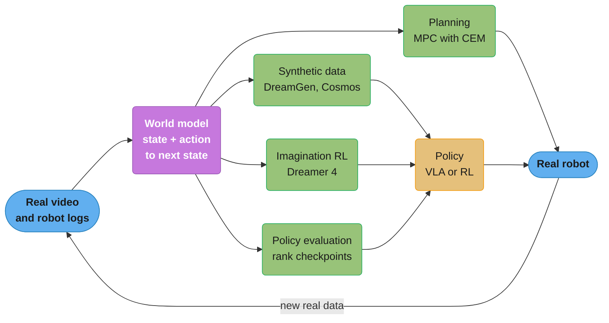
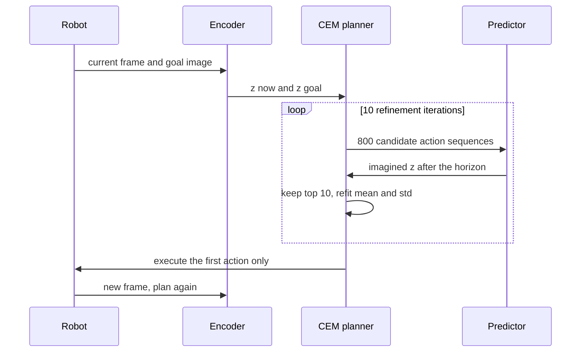
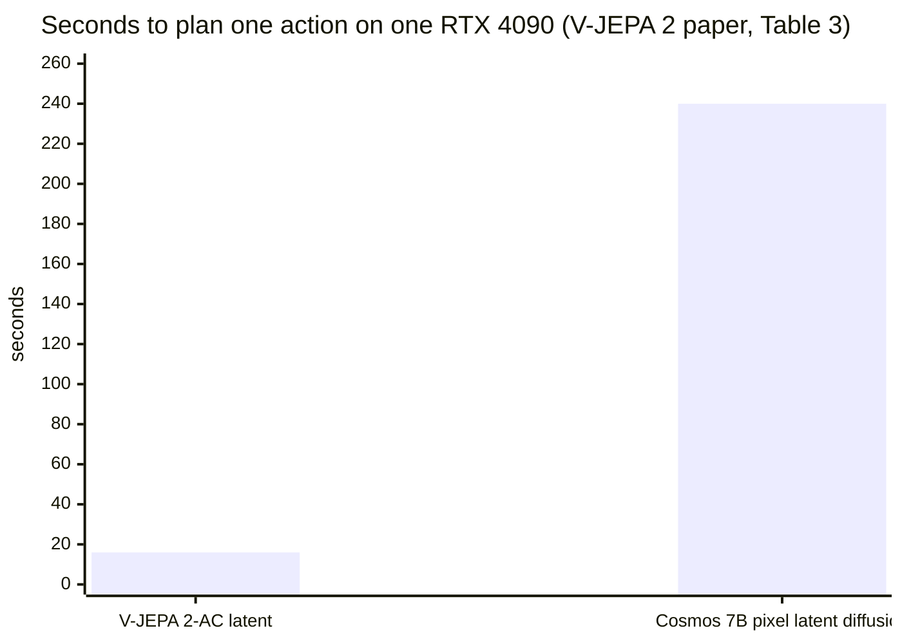

# World Models for Robotics and Embodied AI: Deep Dive

> Sub-file of [VLA and Robotics Foundation Models](vla_and_robotics_foundation_models.md). The parent page
> carries a short V-JEPA 2 versus Cosmos comparison in its §4.2. This file goes deeper: the lineage from
> Ha and Schmidhuber to Genie 4 and Cosmos 3, action conditioning, latent versus pixel prediction, the
> generative versus predictive debate, world models as simulators and data engines for robot policies,
> evaluation, and cost. Video generation serving lives in
> [Design a Video Generation Platform](../case_studies/design_video_generation_platform.md); the self-supervised
> mechanics of JEPA live in [Self-Supervised Vision](../../ml/computer_vision/self_supervised_vision.md).

---

## 1. Concept Overview

A **world model** is a learned function that predicts how the world changes: given the current state
(or a history of observations) and an **action**, it outputs the next state. In symbols,
`s[t+1] ~ p(s[t+1] | s[<=t], a[t])`. A policy answers "what should I do now?"; a world model answers
"what happens if I do this?". The second question is what lets an agent plan, imagine, and be tested
without touching the real world.

Four jobs follow from that one interface, and the rest of this file is organized around them:

| Job | What the world model does | Example in this file |
|-----|---------------------------|----------------------|
| **Planning** | Roll out candidate actions, score the imagined outcomes, pick the best (model-predictive control) | V-JEPA 2-AC on Franka arms (§6.2) |
| **Imagination training** | Train a policy with RL inside the model's dreams, not in the environment | Dreamer 4 mining diamonds from offline data (§4.1) |
| **Synthetic data** | Generate video of a robot doing tasks, label the actions, add it to the training set | DreamGen and Cosmos (§6.4) |
| **Evaluation** | Run a policy checkpoint inside the model instead of on hardware, to rank checkpoints | Gemini Robotics policies in a Veo world simulator (§6.5, §14) |

Two design axes cut across every system:

- **What is predicted.** Pixels (a video you can watch: Genie, Cosmos, GAIA, Veo) or embeddings (a
  latent you cannot watch: V-JEPA 2, Dreamer). See §3.3.
- **How actions enter.** Learned from unlabeled video as latent actions (Genie 1), post-trained from a
  small amount of labeled robot data (V-JEPA 2-AC, 62 hours), or supplied by a controller as tokens,
  trajectories or text (GAIA, Genie 3 and 4, Cosmos). See §3.4.

**Where this sits relative to VLAs.** A VLA maps observation to action (a policy). A world model maps
observation plus action to the next observation (a dynamics model). They are complements:
the world model supplies data, evaluation and planning; the VLA supplies the deployed policy. NVIDIA now
also ships "world action models" that emit both, discussed in Q17.

---

## 2. Intuition

> **One-line analogy**: A world model is a chess player's ability to see the board three moves ahead with
> their eyes closed. A policy is knowing which move to play; the world model is the imagined board that
> tells you what each move leads to.

**Mental model**: Think of the real world as an expensive, slow, one-shot simulator. Every robot trial
costs minutes, wears hardware, and cannot be undone. A world model is a cheap, fast, forkable copy: you
can try 800 action sequences in a few seconds, throw away the bad ones, and only then touch the robot.
The price is that the copy is imperfect, and a smart policy will find the imperfections and exploit them.

**Why it matters**:

- **Robot data is scarce; video is not.** Open X-Embodiment has about 1M trajectories (parent §11).
  Cosmos accumulated about 20M hours of raw video for its first release. A world model is the bridge:
  learn physics-flavored dynamics from video, then add a thin layer of action data.
- **Evaluating a generalist robot policy on hardware does not scale.** A single policy comparison in the
  Gemini Robotics work took 1,600+ real-world trials across 8 checkpoints and 5 tasks. A world model can
  pre-screen checkpoints and leave hardware for the finalists.
- **Rare events are the whole point of safety work.** You cannot crash a car on purpose a thousand times.
  Wayve's GAIA-3 re-drives a real recorded scene with a changed ego trajectory to create a collision
  while the other agents stay on rails.

**Key insight**: A world model is only as good as its worst region of state space, because a downstream
optimizer (a planner, an RL policy, a data filter) will steer toward whatever the model gets wrong in its
favor. Every technique in this file is either a way to make the model more accurate where it matters or a
way to stop the optimizer from exploiting it.

---

## 3. Core Principles

### 3.1 The interface: state, action, next state

Every world model in this file fits one signature, though the "state" differs:

| System | State representation | Action | Output |
|--------|----------------------|--------|--------|
| Ha and Schmidhuber (2018) | 32-d VAE latent `z` plus RNN hidden `h` | Car or Doom control | Distribution over next `z` (mixture density) |
| Dreamer family | Learned compact latent (recurrent state space model) | Environment action | Next latent, reward, continue flag |
| Genie 1 | Discrete video tokens | One of 8 learned latent actions | Next frame tokens |
| V-JEPA 2-AC | Encoder embeddings of frames | 7-d end-effector delta plus gripper | Next-frame embedding |
| GAIA-1 | Discrete image tokens | Speed and curvature tokens | Next image tokens (6.5B model) |
| Cosmos-Predict | Continuous or discrete video latents | Camera, text or action conditioning | Future video |
| Genie 3, Genie 4 | Frames, generated autoregressively | Navigation keys plus text events | Next frame at 24 fps (Genie 3) |

### 3.2 Lineage: from a toy dream to a foundation model

1. **2018, Ha and Schmidhuber, "World Models".** Three parts: V (a VAE compressing each frame to a
   32-d `z`), M (an MDN-RNN predicting the next `z`) and C (a linear controller). The VAE has 4,348,547
   parameters, the MDN-RNN 422,368, and the controller **867**, so a gradient-free optimizer (CMA-ES) can
   train it. The agent was trained **inside its own dream** in a VizDoom task and transferred back to the real environment.
2. **2019-2023, Dreamer (Hafner et al.).** Dreamer learns behaviors by propagating analytic gradients of
   value estimates back through trajectories imagined in latent space. DreamerV2 was the first agent to
   reach human-level on the 55-game Atari benchmark by learning inside a separately trained world model.
   DreamerV3 solved 150+ tasks with one configuration and was the first algorithm to collect diamonds in
   Minecraft from scratch without human data.
3. **2023-2024, generative video as simulator.** GAIA-1 (driving), UniSim (real-world interaction), Genie 1
   (interactive 2D worlds from unlabeled video), DIAMOND (diffusion world model for Atari), GameNGen (DOOM at
   20 fps on one TPU).
4. **2025-2026, foundation world models.** Genie 2, 3 and 4; NVIDIA Cosmos 1 to 3; V-JEPA 2; Dreamer 4;
   domain adaptations such as the Waymo World Model built on Genie 3.

### 3.3 Latent versus pixel prediction

| Axis | Pixel (or video-token) prediction | Latent (embedding) prediction |
|------|-----------------------------------|-------------------------------|
| Output | A video a human can inspect | A vector no human can read |
| Capacity spent on | Texture, lighting, background (unpredictable detail) | Whatever the encoder keeps |
| Cost per step | High (diffusion steps or many tokens) | Low (one predictor pass) |
| Useful for | Synthetic training data, human review, simulation UIs | Planning loops that must run every step |
| Failure mode | Beautiful but physically wrong frames | Collapse or encoder drops task-relevant detail |
| Examples | Cosmos, Genie, GAIA, Veo | V-JEPA 2-AC, Dreamer |

The practical rule from the parent page stands: use latent prediction when a planner must call the model
hundreds of times per action, and pixel prediction when the artifact is data or something a person reviews.
§8 gives the measured gap (16 s versus 4 min per planned action).

### 3.4 Action conditioning, three ways

1. **Learned from unlabeled video (Genie 1).** A latent action model infers, from consecutive frames, a
   code from a small VQ vocabulary (**8 codes**) that explains the change. The codes are not "move left";
   a human maps them to controls after the fact.
2. **Post-trained on a little action data (V-JEPA 2-AC).** The encoder is frozen after 1M+ hours of
   action-free pretraining. A 300M-parameter block-causal transformer predictor is then trained on
   **under 62 hours** of DROID robot video with end-effector actions, using a teacher-forcing loss and a
   multi-step rollout loss.
3. **Supplied as conditioning at generation time (GAIA, Genie 3 and 4, Cosmos, Veo robotics).** The action
   is a token, a trajectory, a camera path, keyboard input, or text ("promptable world events" in Genie 3).

### 3.5 Generative versus predictive, stated fairly

The debate is not "which is real". It is about what to spend capacity on:

- **Predictive (JEPA) camp.** Predicting every pixel wastes capacity on unpredictable detail. I-JEPA is
  explicitly "a non-generative approach": from one context block it predicts the *representations* of
  target blocks. V-JEPA 2 applies this to video and plans in that space.
- **Generative camp.** Pixel models give you data, a human-checkable output, and a unified interface with
  text and audio. OpenAI's 2024 Sora report argued that scaling video generation is "a promising path"
  to general-purpose simulators of the physical world, while listing that Sora did not accurately model the
  physics of many basic interactions.
- **The evidence is mixed in both directions.** Physics-IQ found that visual realism does not imply physical
  understanding across Sora, Runway, Pika, Lumiere, SVD and VideoPoet. Meta's IntPhys 2 found video models
  at or near chance at spotting physics-violating clips, while humans are near perfect. Against that,
  Google's Veo 3 paper reports emergent zero-shot abilities (segmentation, edge detection, early visual
  reasoning), and Gemini Robotics evaluation shows a video model ranking real policies well.
- **Convergence.** Cosmos 3 is a mixture-of-transformers with a reasoning block and a generation block and
  native action output; Genie 4 incorporates Gemini for reasoning. Both are pixel generators that borrow
  from the predictive camp's insistence on understanding.

### 3.6 Error accumulation is the central technical problem

An autoregressive model feeds its own output back as input, so small errors compound. Genie 3's blog
says this directly: generating an environment autoregressively is "generally a harder technical problem
than generating an entire video, since inaccuracies tend to accumulate over time". The V-JEPA 2 paper says
the same for latent rollouts: prediction accuracy decreases with longer autoregressive rollouts. This is
why systems re-plan after executing only the first action (receding horizon) and why interactive models
cap session length.

### 3.7 The exploit problem

Ha and Schmidhuber's VizDoom section is titled "Cheating the World Model". Their agent found a policy
that moved so the model's monsters never fired a single fireball: it looked excellent under the
dynamics model and would fail in the real game. The paper's own diagnosis: the agent visits states away
from the training distribution where the model is wrong. Their mitigation was an iterative procedure
that collects fresh real rollouts with the current policy and retrains the model, plus raising the
sampling temperature `tau` to make the dream harder.

### 3.8 Evaluation has three separate questions

1. **Does it look real?** (FVD, human raters). Necessary, nowhere near sufficient.
2. **Is it physically plausible?** (Physics-IQ, IntPhys 2, PAI-Bench-style suites.)
3. **Does it follow my action, and does it predict the right policy outcome?** (WorldScore
   controllability, DreamGen Bench correlation with policy success, rank agreement with real trials.)

A model can pass the first and fail the other two, which is the central lesson of §10.1.

---

## 4. Types / Architectures / Strategies

### 4.1 Imagination-trained agents (the RL lineage)

| Model | Year | Key idea | Verified numbers |
|-------|------|----------|------------------|
| World Models (Ha, Schmidhuber) | 2018 | V (VAE) plus M (MDN-RNN) plus tiny C | 867-parameter controller; 10,000 random rollouts for Car Racing |
| Dreamer | 2019 | Behaviors from latent imagination with analytic gradients | 20 visual control tasks |
| DreamerV2 | 2020 | Discrete latents, trained separately from the policy | Human-level on 55 Atari tasks |
| DreamerV3 | 2023 | One configuration, robustness tricks | 150+ tasks, Minecraft diamonds from scratch |
| DIAMOND | 2024 | Diffusion world model for RL | Mean human-normalized score 1.46 on Atari 100k |
| Dreamer 4 | 2025 | Shortcut-forcing objective, efficient transformer | 2B parameters (400M tokenizer, 1.6B dynamics), real-time on one GPU, diamonds from offline data, 100x less data than OpenAI's VPT offline agent |

Dreamer 4 matters for robotics because its task ("diamonds from offline data only") mirrors a robotics
constraint: interaction is unsafe and slow. It learned from the VPT dataset (2,541 hours of contractor
gameplay at 20 fps) and its authors report it nearly tripled the success rate of a VLA baseline
built on a Gemma 3 vision-language model.

### 4.2 Interactive and video world models

| Model | Date | What it is | Verified facts |
|-------|------|-----------|----------------|
| Genie 1 | Feb 2024 | Unsupervised interactive 2D worlds from unlabeled video | 11B parameters; spatiotemporal video tokenizer, MaskGIT dynamics model, latent action model with 8 codes; 30,000 hours of platformer video (filtered from 200,000+ hours); 160x90 at 10 fps; 16 frames of memory; about 1 fps at inference |
| GameNGen | Aug 2024 | DOOM as a diffusion model | 20 fps on one TPU; 4 DDIM steps; PSNR 29.4; raters only slightly above chance on short clips; about 3 seconds of context |
| Genie 2 | Dec 2024 | 3D worlds from one prompt image, keyboard and mouse | Consistent for up to a minute; most examples 10 to 20 s |
| Genie 3 | Aug 2025 | Real-time text-to-world | 24 fps, 720p, consistent for a few minutes, visual memory back about 1 minute; promptable world events; limited research preview |
| Genie 4 | After Genie 3 (undated on the product page) | "Most realistic and interactive world model yet" | Built on Gemini capabilities; native audio; around a minute of continuous interaction; in Project Genie for eligible Google AI Ultra subscribers and via the Gemini API and AI Studio; SynthID watermark |
| Cosmos 1 | Jan 2025 | World foundation model platform | Diffusion and autoregressive families (7B, 14B Predict1), video tokenizers, curation pipeline, NVIDIA Open Model License |
| Cosmos-Predict2.5 and Transfer2.5 | Late 2025 | Flow-based Text2World, Image2World, Video2World in one model | 2B and 14B; 200M curated clips; Transfer2.5 for Sim2Real and Real2Real, 3.5x smaller than Transfer1 |
| Cosmos 3 | May 31, 2026 | Open "omnimodel": reasoning, world simulation and action | Mixture-of-transformers; Super 64B, Nano 16B, Edge 4B; text, image, video, ambient sound and action |
| UniSim | 2023 | Universal simulator from orchestrated datasets | Simulates high-level instructions ("open the drawer") and low-level controls; trained VL policies and RL policies |
| Veo (robotics variant) | Dec 2025 | Gemini Robotics team's evaluation system on a Veo base | Action-conditioned, multi-view consistent; see §6.4 |

### 4.3 JEPA-style latent models

| Model | Date | What it predicts | Verified facts |
|-------|------|------------------|----------------|
| I-JEPA | 2023 | Embeddings of masked image blocks from one context block | ViT-H/14 trained on ImageNet with 16 A100s in under 72 hours |
| V-JEPA 2 | Jun 11, 2025 | Embeddings of masked video regions | 1.2B parameters; 1M+ hours of video plus 1M images; Something-Something v2 top-1 77.3; Epic-Kitchens-100 action anticipation recall@5 39.7; 84.0 PerceptionTest and 76.9 TempCompass when aligned to an 8B LLM |
| V-JEPA 2-AC | Jun 2025 | Next-frame embedding given an action | 300M-parameter predictor; under 62 hours of DROID; zero-shot on Franka arms in two labs |

V-JEPA 2-AC results (success out of 10 trials, averaged over two labs): Reach 100%; Grasp cup 65%, box
25%; Reach-with-object cup 75%, box 75%; Pick-and-place cup 80%, box 65%. The Octo baseline averaged
15% and 0% on the two grasp tasks and 10% to 15% on pick-and-place. The paper stresses this was done
without collecting any data in those labs.

### 4.4 Driving world models

| Model | Date | Verified facts |
|-------|------|----------------|
| GAIA-1 (Wayve) | Sep 2023 | 4,700 hours of London driving at 25 Hz; 6.5B-parameter autoregressive world model on video, text and action tokens; diffusion video decoder; world model runs on 4 s clips at 6.25 Hz |
| GAIA-3 (Wayve) | Dec 2, 2025 | Pitched as a foundation for autonomy evaluation: re-drive real scenes with changed ego trajectory, other agents on rails; NCAP-style scenarios generated virtually; consistency checked against LiDAR |
| Waymo World Model | Feb 6, 2026 | Built on Genie 3 and post-trained for driving; outputs camera and lidar; controlled by driving actions, scene layout and language |
| Cosmos for AV | 2025-2026 | Weather, lighting and geolocation augmentation of existing data; Li Auto named as an AV adopter in the Cosmos 3 release |

For the perception stack these models sit beside, see
[Design Autonomous Driving Perception](../../ml/case_studies/design_autonomous_driving_perception.md).

---

## 5. Architecture Diagrams

### 5.1 One model, four jobs



The loop on the right is what keeps the model honest: the robot's new real data flows back into the
model's training set, which is the iterative procedure Ha and Schmidhuber used to fight the exploit in §3.7.

### 5.2 Latent MPC step (V-JEPA 2-AC)



The sample and iteration counts match §6.2. V-JEPA 2 reports 16 seconds per action on one RTX 4090
with 10x more samples per refinement step than the Cosmos baseline's 80.

### 5.3 Planning time per action



The pixel model took 4 minutes per action with 80 samples, 10 iterations and horizon 1, which the paper
translates to over an hour for one pick-and-place trajectory.

### 5.4 Latent versus pixel rollout, side by side

```
 PIXEL WORLD MODEL (Cosmos, Genie, GAIA)         LATENT WORLD MODEL (V-JEPA 2-AC, Dreamer)

 frame t  --> [ denoise or decode ] --> frame t+1   frame t --> [encoder] --> z t
              many steps, full pixels                            |
                                                                 v
 action a --> conditioning                          action a --> [predictor, 300M] --> z t+1
                                                                 |
 output: video a human can watch                    output: vector, scored by L1 to goal z

 cost per candidate: high (seconds)                 cost per candidate: low (milliseconds)
 good for: data, review, simulation UI              good for: calling the model 800 x 10 times
 risk: pretty but physically wrong                  risk: encoder discards what the task needs
```

Both columns answer "what happens if I do a?". The right column never renders a pixel, which is
why it can sit inside a per-step planning loop.

### 5.5 DreamGen-style synthetic data pipeline

```mermaid
flowchart LR
    tele(["Small teleop set<br/>one task, one scene"]):::io --> ft("Fine-tune video<br/>world model on<br/>this embodiment"):::core
    ft --> gen("Generate videos<br/>new tasks, new scenes"):::core
    gen --> idm("Recover pseudo-actions<br/>latent action model<br/>or inverse dynamics"):::use
    idm --> filt("Filter clips<br/>feasibility and quality"):::use
    filt --> nt("Neural trajectories"):::train
    nt --> pol("Train policy"):::train
    pol --> real(["Real-robot test"]):::io

    classDef io    fill:#61afef,stroke:#2e86c1,color:#1a1a1a,font-weight:bold
    classDef core  fill:#c678dd,stroke:#9b59b6,color:#fff,font-weight:bold
    classDef use   fill:#98c379,stroke:#27ae60,color:#1a1a1a
    classDef train fill:#e5c07b,stroke:#f39c12,color:#1a1a1a
```



The paper's four stages are fine-tune, generate, label actions and train. The filter stage is our
addition (§6.4), because the video model emits no actions and an unfiltered pseudo-label set carries every
labeling error into the policy.

---

## 6. How It Works: Detailed Mechanics

### 6.1 The interface every planner needs

```python
from __future__ import annotations

from typing import Callable

import numpy as np

StepFn = Callable[[np.ndarray, np.ndarray], np.ndarray]


def project_l1(a: np.ndarray, radius: float) -> np.ndarray:
    norm = np.abs(a).sum(axis=-1, keepdims=True)
    scale = np.minimum(1.0, radius / np.maximum(norm, 1e-9))
    return a * scale
```

`StepFn` is the whole world model as far as a planner is concerned: a batch of latents and a batch of
actions in, a batch of next latents out. `project_l1` is the safety rail from the V-JEPA 2 paper: every
sampled action is constrained to an L1 ball of radius 0.075, about 13 cm of maximum end-effector
displacement per action.

### 6.2 Latent MPC with the cross-entropy method

```python
def cem_plan(
    step: StepFn,
    z0: np.ndarray,
    z_goal: np.ndarray,
    horizon: int = 1,
    samples: int = 800,
    elites: int = 10,
    iters: int = 10,
    action_dim: int = 7,
    radius: float = 0.075,
    seed: int = 0,
) -> np.ndarray:
    rng = np.random.default_rng(seed)
    mu = np.zeros((horizon, action_dim))
    sigma = np.full((horizon, action_dim), radius / 2)
    for _ in range(iters):
        acts = project_l1(rng.normal(mu, sigma, (samples, horizon, action_dim)), radius)
        z = np.repeat(z0[None], samples, axis=0)
        for t in range(horizon):
            z = step(z, acts[:, t])
        cost = np.abs(z - z_goal).sum(axis=-1)
        best = acts[np.argsort(cost)[:elites]]
        mu, sigma = best.mean(axis=0), best.std(axis=0) + 1e-4
    return mu[0]
```

The cost is the L1 distance between the imagined latent after `horizon` steps and the goal latent, which is
what the V-JEPA 2 paper minimizes with CEM (800 samples, 10 iterations and a horizon of 1 in its Lab 2
table, against 80, 10 and 1 for the Cosmos baseline). The robot executes only `mu[0]` and re-plans, so
rollout error never compounds beyond the horizon. On a toy linear latent model (`z' = z + a @ B`), 12
replans shrink the L1 distance to the goal to under 0.1% of its starting value. That toy proves the loop,
not the accuracy of any real model.

### 6.3 Training an action-conditioned predictor: two losses

V-JEPA 2-AC trains with a **teacher-forcing loss** (predict the next latent from the true current latent
and action) and a **rollout loss** (feed the model's own prediction back and score the multi-step result).
The second loss is what teaches the model to survive its own errors.

```python
def teacher_forcing_loss(step: StepFn, z_seq: np.ndarray, acts: np.ndarray) -> float:
    pred = step(z_seq[:-1], acts)
    return float(np.abs(pred - z_seq[1:]).mean())


def rollout_loss(step: StepFn, z_seq: np.ndarray, acts: np.ndarray, horizon: int = 2) -> float:
    z = z_seq[:1]
    loss = 0.0
    for t in range(horizon):
        z = step(z, acts[t : t + 1])
        loss += float(np.abs(z - z_seq[t + 1 : t + 2]).mean())
    return loss / horizon
```

The paper's loss is an L1 distance on embeddings from a frozen encoder with a block-causal predictor; this
sketch keeps the structure and drops the transformer. A model that is accurate one step ahead but
unrolled blindly still drifts, which is exactly the failure the rollout term penalizes.

### 6.4 Neural trajectories for policy training

```python
from dataclasses import dataclass


@dataclass(frozen=True)
class NeuralTrajectory:
    frames: np.ndarray
    actions: np.ndarray
    prompt: str


def is_feasible(actions: np.ndarray, limit: float, max_jerk: float) -> bool:
    if np.abs(actions).max() > limit:
        return False
    jerk = np.abs(np.diff(actions, n=2, axis=0)).max() if len(actions) > 2 else 0.0
    return bool(jerk <= max_jerk)


def build_neural_trajectories(
    generate: Callable[[str, np.ndarray], np.ndarray],
    idm: Callable[[np.ndarray, np.ndarray], np.ndarray],
    first_frames: list[np.ndarray],
    prompts: list[str],
    limit: float = 0.075,
    max_jerk: float = 0.05,
) -> list[NeuralTrajectory]:
    kept: list[NeuralTrajectory] = []
    for frame in first_frames:
        for prompt in prompts:
            frames = generate(prompt, frame)
            actions = idm(frames[:-1], frames[1:])
            if is_feasible(actions, limit, max_jerk):
                kept.append(NeuralTrajectory(frames, actions, prompt))
    return kept
```

`generate` is the fine-tuned video world model, and `idm` is an inverse-dynamics model that maps two
consecutive frames to the action between them (DreamGen uses either an inverse-dynamics model or a latent
action model). The feasibility filter (joint-style limits and a jerk bound) is a design choice of ours, not a
step from the paper, and its thresholds must come from your robot's real limits. DreamGen reports that this
recipe let a humanoid perform 22 new behaviors in seen and unseen environments from teleoperation data of a
single pick-and-place task in one environment, and that its DreamGen Bench score correlates with downstream
policy success.

### 6.5 Evaluating policies inside a world model

The Gemini Robotics evaluation reports two numbers: the mean maximum rank violation (MMRV, lower is better)
and the Pearson correlation between predicted and real success rates. MMRV is defined as the mean over
policies `i` of the worst rank violation against any policy `j`, where a violation is the real success-rate
gap `|R_i - R_j|` counted only when the predicted order disagrees with the real order.

```python
def mmrv(real: list[float], pred: list[float]) -> float:
    n = len(real)
    total = 0.0
    for i in range(n):
        worst = 0.0
        for j in range(n):
            flipped = (pred[i] < pred[j]) != (real[i] < real[j])
            worst = max(worst, abs(real[i] - real[j]) * flipped)
        total += worst
    return total / n


def pearson(real: list[float], pred: list[float]) -> float:
    return float(np.corrcoef(real, pred)[0, 1])
```

Worked example with five checkpoints, real success `[0.20, 0.35, 0.55, 0.70, 0.85]`:

| Predicted success | MMRV | Pearson | Reading |
|-------------------|------|---------|---------|
| `[0.10, 0.30, 0.40, 0.62, 0.70]` | 0.000 | 0.988 | Every absolute number is too low, yet the ranking is perfect |
| `[0.30, 0.10, 0.40, 0.62, 0.70]` | 0.060 | 0.869 | The two weakest checkpoints swap, costing 0.15 of real gap for each |

The first row mirrors what the Veo evaluation paper reports: predicted success rates were lower than real
ones, but the ranking and linear correlation held. Absolute calibration and ranking are different properties.
Choose the one your decision needs.

### 6.6 Token and latency budgets, worked arithmetic

These are derived numbers, not benchmark results. Cosmos-Tokenize1-DV8x16x16 at 720p compresses 8x in time
and 16x16 in space, with the first frame kept as its own temporal token.

| Quantity | Calculation | Result |
|----------|-------------|--------|
| Spatial tokens per latent frame | (720 / 16) x (1280 / 16) = 45 x 80 | 3,600 |
| Latent frames for a 5 s clip at 24 fps | 1 + 120 / 8 | 16 |
| Tokens for the clip | 3,600 x 16 | 57,600 |
| Frame budget for a real-time model at 24 fps | 1000 ms / 24 | about 41.7 ms |
| Frame budget at GameNGen's 20 fps | 1000 ms / 20 | 50 ms |
| Planning speedup, V-JEPA 2-AC over Cosmos | 240 s / 16 s | 15x |
| Per-sample speedup (10x more samples in V-JEPA 2-AC) | 15 x (800 / 80) | 150x |

The last row compares a 300M-parameter predictor plus encoder with a fine-tuned 7B latent diffusion model,
so it is a cost ratio for two specific systems and not a law about latent versus pixel models.

---

## 7. Real-World Examples

| Organization | What they built | Why a world model | Verified detail |
|--------------|-----------------|-------------------|-----------------|
| Meta FAIR | V-JEPA 2 and V-JEPA 2-AC | Zero-shot robot planning with image goals | Deployed on Franka arms in two labs, no robot data collected in those labs; open code and checkpoints; released IntPhys 2, MVPBench and CausalVQA |
| Google DeepMind | Genie 1 to 4, SIMA agents in Genie 3 worlds | Unlimited training environments and agent evaluation | Genie 3 worlds used to instruct a SIMA agent toward goals; Genie 4 page shows Gemini planning steps fed as captions into the running simulation |
| Google DeepMind (Gemini Robotics) | Veo-based policy evaluation system | Rank and red-team policies without hardware | 1,600+ real trials over 8 checkpoints and 5 tasks used to validate it |
| NVIDIA | Cosmos 1 to 3, GR00T-Dreams, DreamGen | Open world foundation models plus synthetic robot data | Cosmos 3 launched May 31, 2026 with a Cosmos Coalition (Agile Robots, Black Forest Labs, Generalist, LTX, Runway, Skild AI) |
| Wayve | GAIA-1, GAIA-2, GAIA-3 | Scalable, reproducible safety evaluation | GAIA-3 holds other agents on rails while changing the ego trajectory |
| Waymo | Waymo World Model on Genie 3 | Long-tail scenarios (tornado, elephant) in camera and lidar | Announced Feb 6, 2026; Waymo cites nearly 200 million fully autonomous miles |
| Danijar Hafner and collaborators | Dreamer 1 to 4 | Sample-efficient RL and offline imagination | Dreamer 4 learns diamonds in Minecraft from offline data only |
| Cosmos adopters | Robot and AV teams | Post-train for embodiment, augment AV data | Agile Robots, Doosan Robotics, LG, Samsung, Skild AI (robotics) and Li Auto (AV) named at launch |

### 7.1 Genie 3 versus its predecessors, in one table

| Property | Genie 2 (Dec 2024) | Genie 3 (Aug 2025) | Genie 4 |
|----------|--------------------|--------------------|---------|
| Input | One prompt image plus keyboard and mouse | Text prompt plus navigation, plus text events | Text or image, live prompts for events, camera and sound |
| Real time | No (Genie 3 is the first Genie to allow real-time interaction) | 24 fps at 720p | Real-time interaction, native audio |
| Consistency | Up to a minute (most examples 10 to 20 s) | A few minutes, visual memory about 1 minute back | Around a minute of continuous interaction |
| Access | Research | Limited research preview | Project Genie (eligible Google AI Ultra), Gemini API, AI Studio |

The stated session length goes from "a few minutes" in the Genie 3 blog to "around a minute" on the Genie 4
page, with a new list of limitations (object permanence drift, audio accuracy). Treat session length as
a product knob and a drift limit, not a monotone benchmark.

---

## 8. Tradeoffs

### 8.1 Choosing a world model for the job

| Job | Best fit | Why | Cost to know |
|-----|----------|-----|--------------|
| Per-step planning | Latent predictor (V-JEPA 2-AC) | 16 s per planned action on one RTX 4090 at 800 samples | Needs a goal image or goal latent, camera pose sensitivity |
| RL in imagination | Dreamer-style latent model | Compact state, fast rollouts, Dreamer 4 real-time on one GPU | Policy can exploit model errors |
| Synthetic demos | Video world model plus inverse dynamics | Unlimited scene and task variety | Pseudo-action noise, domain gap |
| Policy ranking | Action-conditioned video model | Ranking matched real trials in the Veo study | Absolute success rates came out lower than real |
| Human review, simulation UI | Interactive pixel model (Genie 3 or 4) | Watchable, steerable by text | Minutes of coherence at best |
| Long-tail driving scenarios | Domain-adapted generative model (GAIA-3, Waymo World Model) | Counterfactual variants of real scenes | Needs sensor-specific post-training |

### 8.2 World model versus physics simulator

| Dimension | Learned world model | Physics simulator (Isaac Sim, MuJoCo) |
|-----------|---------------------|----------------------------------------|
| Visual realism | High, learned from real video | Needs rendering and domain randomization |
| Contact and force accuracy | Weak: Physics-IQ shows realism does not imply physics | Explicit rigid-body and contact models (still approximate) |
| Scene authoring | A prompt or an image | Assets, materials, scene graph |
| Determinism and debuggability | Stochastic, opaque failure | Reproducible, inspectable state |
| Ground-truth state | None, only pixels or latents | Full: poses, forces, contacts |
| Cost to scale | GPU inference per frame | CPU or GPU physics, cheap per step |
| Best at | Visual diversity, rare scenes, policy evaluation by perception | Dynamics-critical tasks, reward computation, regression tests |

The two are complements. Cosmos Transfer is positioned as a Sim2Real and Real2Real translator: a simulator
supplies the structure and ground truth, and the world model supplies photoreal appearance.

### 8.3 Predictive versus generative at a glance

| Question | JEPA-style (predictive) | Video generator (generative) |
|----------|-------------------------|------------------------------|
| Can a human check the output? | No, embeddings only | Yes, watch the video |
| Compute per rollout step | Low | High |
| Produces synthetic training data? | No | Yes |
| Evidence of physical understanding | Planning success on real arms (65 to 80% pick-and-place) | Physics-IQ and IntPhys 2 are mixed, Veo evaluation ranking is strong |
| Open weights | V-JEPA 2 (commercial and research use) | Cosmos (open weights), Genie (hosted access only) |

---

## 9. When to Use / When NOT to Use

### 9.1 Use a world model when

- Real trials are the bottleneck: robot hours, crash tests, or checkpoints to compare.
- The decision you need is a ranking or a screening step, not an absolute success-rate guarantee.
- You have goal images or a reward model, and you can accept re-planning every step.
- You need rare scenes (weather, hazards, unusual objects) that real fleets seldom see.
- You already have an action-labeled slice of real data to ground the model (62 hours was enough for
  V-JEPA 2-AC, but only for short-horizon, single-camera manipulation).

### 9.2 Do NOT use one when

- **The task is contact-rich and force-sensitive** (insertion, tight-tolerance assembly). A pixel model
  cannot tell you whether the peg will jam.
- **You need a safety certificate.** A world-model rollout is evidence for prioritizing hardware tests,
  not proof. Waymo and Wayve both position theirs as one pillar next to real driving.
- **You have no way to validate it against reality.** Without a held-out set of real outcomes, you cannot
  tell a useful simulator from a convincing one.
- **A cheap physics simulator already captures your task** and gives ground-truth state and reward.
- **Horizon is long and open loop.** Error accumulation limits how far any of these models can be trusted
  without re-grounding in real observations.
- **The model is a research preview you cannot depend on.** Genie 3 launched as a limited research preview.

---

## 10. Common Pitfalls

### 10.1 Equating visual realism with physical understanding

**BROKEN**: A team gates synthetic robot video on "does it look real" (human raters, FVD) and trains on
everything that passes. The Physics-IQ study tested Sora, Runway, Pika, Lumiere, Stable Video Diffusion and
VideoPoet and found physical understanding "severely limited, and unrelated to visual realism". Meta's
IntPhys 2 found current video models at or close to chance at picking the physics-breaking clip, where humans
score near perfect.

**FIX**: Add a physics gate that probes the phenomena your task depends on (object permanence, containment,
collision, deformation) with violation-of-expectation pairs, and add an outcome gate: the model must rank
real policies the way real trials do (§6.5) before its output trains or judges anything.

### 10.2 Letting the policy exploit the dream

**BROKEN**: Run RL to convergence inside a frozen world model. Ha and Schmidhuber's VizDoom agent found a
policy that stood so the model's monsters never fired a fireball. It scored well in the dream and would
fail in the real game, because it visited states away from the training distribution where the model
was wrong.

**FIX**: Alternate. Collect fresh real rollouts with the current policy, retrain the model on them, and
only then continue policy learning (the paper's iterative procedure). Track real-environment return, not
dream return. Train the controller in a harder dream by raising the sampling temperature `tau`.

### 10.3 Long open-loop rollouts

**BROKEN**: Plan 60 steps ahead once and execute them blind. Autoregressive prediction error accumulates,
and the V-JEPA 2 paper states that representation-space accuracy decreases with longer rollouts.

**FIX**: Use a short horizon (V-JEPA 2-AC's reported planning used a horizon of 1) and execute only the
first action before re-planning, as in receding-horizon control. For longer tasks, give a sequence of
visual subgoals, which is how the 65% to 80% pick-and-place results were obtained.

### 10.4 Moving the camera after validation

**BROKEN**: A V-JEPA 2-AC style model is validated, then the camera is remounted two centimeters
off. The model has no camera calibration and infers the action coordinate axes from the image alone, and
when the robot base is not visible this inference is ill-defined. The authors report manually trying camera
positions until one worked.

**FIX**: Treat camera pose as part of the model's contract. Fix the mount, record its pose, run the
camera-sensitivity check from the paper's appendix on your setup, and re-validate after any change.

### 10.5 Training on unfiltered pseudo-labeled video

**BROKEN**: Generate 100,000 clips, run an inverse-dynamics model, and train the policy on everything. The
video model emits no actions. Every IDM error becomes a wrong label, and clips with impossible motion teach
impossible actions.

**FIX**: Filter with robot-specific feasibility (§6.4), keep real demonstrations in the mix, and judge the
resulting policy on real held-out trials. DreamGen validated its recipe on a humanoid with real-world tests,
not on generated video alone.

### 10.6 Reading absolute success rates from the world model

**BROKEN**: "The simulator says checkpoint C succeeds 62% of the time, so we expect 62% on the floor." In the
Veo evaluation study the absolute predicted success rates were lower than the real ones, even though the
ordering and linear correlation held.

**FIX**: Use the world model for ranking and screening, and calibrate any absolute claim on a small set of
real trials. Report MMRV and Pearson next to every prediction.

### 10.7 Putting a pixel world model inside a control loop

**BROKEN**: Use a 7B latent-diffusion video model as the planner's dynamics function. On one RTX 4090 with
80 samples and 10 iterations it took 4 minutes per action, over an hour for one pick-and-place trajectory.

**FIX**: Plan in latent space (16 seconds per action at 800 samples), or keep the pixel model offline for
data generation and evaluation where seconds per frame do not matter.

### 10.8 Designing around a session length that will move

**BROKEN**: A product assumes the interactive world stays coherent for "a few minutes" because one blog said
so. Genie 3's blog says a few minutes, the Genie 4 page says around a minute and lists object-permanence drift
after many prompt edits.

**FIX**: Put session length in configuration, reset or re-ground the world at a fixed interval, and re-measure
after every model upgrade. Genie 3 also launched as a limited research preview, so confirm access terms
before it sits on a critical path.

### 10.9 Ignoring license drift between model versions

**BROKEN**: Cosmos 1 and Cosmos-Predict2.5 are released under the NVIDIA Open Model License, and the Cosmos 3
launch blog describes the OpenMDW 1.1 license from the Linux Foundation. A team copies the first license
review forward and assumes the terms are identical.

**FIX**: Record the license per model version in your model registry and re-review on every upgrade.

---

## 11. Technologies & Tools

| Tool or resource | Role |
|------------------|------|
| **V-JEPA 2 and V-JEPA 2-AC** (`facebookresearch/vjepa2`) | Open 1.2B video encoder and action-conditioned predictor, code and checkpoints for commercial and research use |
| **IntPhys 2, MVPBench, CausalVQA** (Meta) | Benchmarks for intuitive physics, minimal-pair physical video QA, and counterfactual and anticipation questions |
| **NVIDIA Cosmos** (`NVIDIA/Cosmos`, Hugging Face `nvidia/cosmos3`) | Open world foundation models: Cosmos 3 Super 64B, Nano 16B, Edge 4B |
| **Cosmos-Predict2.5 and Transfer2.5** | 2B and 14B flow-based video world models and a Sim2Real or Real2Real translator |
| **Cosmos Curator, Data Factory, Evaluator** | Curate and filter video, generate data with agentic blueprints, score generated video |
| **NVIDIA Isaac Sim, Isaac Lab, Omniverse NuRec** | Physics simulation, policy training, and real-scene neural reconstruction that pair with Cosmos |
| **GR00T-Dreams** (`NVIDIA/GR00T-Dreams`) | Code for the DreamGen pipeline |
| **Project Genie, Gemini API, Google AI Studio** | Hosted access to Genie 4 |
| **DreamerV3** (`danijar.com/dreamerv3`) | Reference single-configuration latent world-model agent |
| **Physics-IQ** (`google-deepmind/physics-IQ-benchmark`) | Physical-understanding benchmark for video models |
| **WorldScore** | 3,000 test examples scored on controllability, quality and dynamics across 19 models |
| **PAI-Bench, R-Bench, RoboLab, RoboArena** | Leaderboards cited in the Cosmos 3 launch for world generation and action policy quality |
| **LeRobot, MuJoCo, ROS2, MoveIt** | Policy training library, physics simulation, robot middleware and motion planning, see the parent page |

---

## 12. Interview Questions with Answers

**Q: A video model produces beautiful, photoreal robot footage. Why is that not enough to call it a world model you can train on?**
**Short:** Visual realism measures appearance, not dynamics: Physics-IQ found physical understanding unrelated to realism, so physics and action-following must be tested separately.

The Physics-IQ benchmark tested Sora, Runway, Pika, Lumiere, Stable Video Diffusion and VideoPoet and concluded that "visual realism does not imply physical understanding". Meta's IntPhys 2 shows video models near chance at identifying a physics-breaking clip, where humans are near perfect. A frame that looks right can still have an object pass through a gripper or a liquid defy gravity, and a policy trained on it learns the wrong contact behavior. Gate generated data on a physics probe tied to your task and on rank agreement with real outcomes, not on FVD or rater scores alone.

**Q: A policy trained entirely inside a world model scores well in the dream and fails on the real robot. What happened?**
**Short:** The policy exploited world-model errors in states the model never saw, finding behavior that looks good in the dream and fails in reality.

Ha and Schmidhuber named this "cheating the world model": their VizDoom agent learned to move so that the model's monsters never fired, which the real game would not allow. An optimizer is an adversary to its own simulator, because it seeks out the states where the model is most wrong in its favor. The fixes are structural: periodically collect real rollouts with the current policy and retrain the model on them, evaluate on the real environment, and make the dream harder (higher sampling temperature). Never report dream return as a result.

**Q: What is the difference between a world model, a policy and a VLA?**
**Short:** A world model predicts the next state given state and action, a policy chooses the action, and a VLA is a policy built on a vision-language backbone.

A policy or VLA maps observation to action. A world model maps observation plus action to the next observation (or latent). Because the second answers "what happens if I do this?", it can plan by rolling out candidates, train a policy in imagination, generate labeled data, and score checkpoints without hardware. The parent page's VLA stack runs at deployment; the world model usually runs offline or in a planner. If you can afford one of the two, ship the policy, and add a world model when data or evaluation is the bottleneck.

**Q: When should a world model predict latents instead of pixels?**
**Short:** Predict latents when a planner calls the model hundreds of times per action, and pixels when the output is training data or a video a person must review.

On one RTX 4090, V-JEPA 2-AC planned an action in 16 seconds using 800 samples, while a fine-tuned 7B Cosmos latent-diffusion model needed 4 minutes with only 80 samples: about 15x faster overall and 150x per sample. Latent models skip unpredictable detail such as texture and lighting. The tradeoff is that nobody can watch a latent, and the encoder may drop something the task needs. Pixel models are the right choice for synthetic data, human inspection and anything that must match a camera feed.

**Q: Walk through how V-JEPA 2-AC plans a pick-and-place.**
**Short:** It encodes current and goal frames, samples action sequences with CEM, rolls them out in latent space, scores L1 distance to the goal, executes the first action, then re-plans.

Pretraining on 1M+ hours of video and 1M images gives a frozen encoder. A 300M-parameter block-causal predictor is then trained on under 62 hours of DROID robot video with a teacher-forcing loss and a rollout loss. At run time the encoder produces `z_now` and `z_goal`, CEM samples 800 action sequences per iteration for 10 iterations, each action constrained to an L1 ball of radius 0.075 (about 13 cm), and the planner minimizes the L1 gap between the imagined final latent and `z_goal`. Only the first action is executed. For longer tasks the system is given a sequence of image subgoals, which produced 65% to 80% pick-and-place success on new objects in unseen environments.

**Q: What is the real disagreement between the JEPA and generative-video camps?**
**Short:** JEPA argues predicting pixels wastes capacity on unpredictable detail, while generative camps value pixels for data and checkability; evidence supports each on different jobs.

I-JEPA is explicitly non-generative: it predicts the representations of masked blocks from a context block and trains ViT-H/14 on ImageNet with 16 A100s in under 72 hours. V-JEPA 2 plans on real arms with no pixels rendered. The generative side points to Sora's report that scaling video models is a promising path, to Veo 3's zero-shot segmentation and visual reasoning, and to the fact that only pixel models create trainable synthetic video. Against it, Physics-IQ and IntPhys 2 show physics gaps. The practical answer is job-dependent, and systems like Cosmos 3 (reasoning block plus generation block) are blending both.

**Q: Why does long-horizon consistency break, and what do real systems do about it?**
**Short:** Autoregressive generation feeds its own errors back as input, so drift compounds; systems add memory, noise augmentation, rollout losses and re-planning.

Genie 3's authors state that generating an environment autoregressively is harder than generating a whole video because inaccuracies accumulate, and they report visual memory reaching back about a minute. GameNGen uses conditioning augmentations to stabilize rollouts and still has only about 3 seconds of context. V-JEPA 2-AC trains a rollout loss and re-plans after every action. Genie 1 had 16 frames of memory. Genie 4's page lists object-permanence drift as a known limit. Design around it: short horizons, receding-horizon control, periodic re-grounding in real observations.

**Q: Can a world model be trusted to rank robot policy checkpoints?**
**Short:** It ranked Gemini Robotics checkpoints well (Pearson 0.86 in out-of-distribution tests) but predicted success below real, so use it for ranking and screening.

The Gemini Robotics team built an action-conditioned, multi-view Veo system and validated it with 1,600+ real trials over 8 checkpoints and 5 tasks. Policy ranking and linear correlation held, and the system could also red-team policies for physical and semantic safety violations. Absolute predicted success rates were lower than real ones. Use MMRV (rank violation weighted by real gap) and Pearson as acceptance metrics, calibrate absolute numbers on a few real trials, and spend scarce hardware time on finalists.

**Q: How would you train a robot policy on generated video?**
**Short:** Fine-tune a video world model on your robot, generate videos of new tasks, recover pseudo-actions with an inverse-dynamics or latent action model, filter, then train.

That is DreamGen's four stages, which let a humanoid perform 22 new behaviors in seen and unseen environments from teleoperation data on a single pick-and-place task in one environment. Because a video model emits no actions, label quality is the risk: filter clips for feasibility against your robot's limits, keep real demonstrations in the mix, and validate on real held-out trials. The paper's DreamGen Bench shows generation benchmark scores correlate with policy success, which gives you a cheap way to choose between candidate video models.

**Q: How do you learn action conditioning when the training video has no action labels?**
**Short:** Genie 1 learns a small discrete latent action code (8 values) that explains each frame change, but those codes are not robot controls until mapped.

Genie's latent action model encodes consecutive frames into one of 8 VQ codes. Its decoder reconstructs the next frame from the history and the code, so the code must carry "what changed". At inference the model is discarded and a user supplies the code. The alternative used by V-JEPA 2-AC is to freeze an action-free encoder and train a predictor on a small labeled slice (under 62 hours). For robots the second approach grounds actions in real end-effector deltas, while the first scales to unlabeled internet video but needs a mapping to real controls.

**Q: Beyond FVD, how do you evaluate a world model?**
**Short:** Test appearance, physical plausibility and action-following separately: FVD or raters, then Physics-IQ or IntPhys 2, then controllability and rank agreement with real policy outcomes.

WorldScore decomposes world generation into next-scene tasks with camera-trajectory layouts and scores controllability, quality and dynamics (3,000 test examples, 19 models). Physics-IQ and IntPhys 2 test physical principles and violation-of-expectation. DreamGen Bench tests whether benchmark rank predicts downstream policy success. The Cosmos 3 launch cites Physics-IQ, PAI-Bench, R-Bench, RoboLab and RoboArena. The decisive test is closing the loop: does the model's ranking of policies match real trials.

**Q: What is the deployment risk of camera pose for V-JEPA 2-AC-style models?**
**Short:** The model infers action coordinate axes from the image without calibration, so a moved camera changes what an action means; fix the mount and re-validate.

The paper explains that predicting the next frame given a Cartesian end-effector action forces the model to infer the action axes from a monocular image, and when the robot base is not visible the axes are ill-defined. The authors manually tried camera positions before finding one that worked across experiments and include an analysis of sensitivity. Treat the camera extrinsics as part of the model contract and rerun your acceptance test after remounting.

**Q: What does it cost to run a world model in real time?**
**Short:** Genie 3 runs 24 fps at 720p, a budget of about 41.7 ms per frame; GameNGen runs 20 fps with 4 DDIM steps; Dreamer 4 is real-time on one GPU.

Real-time interaction means each frame must be produced within 1000/fps milliseconds while attending to a growing history, which Genie 3's authors say required significant technical breakthroughs. GameNGen found no quality loss with 4 sampling steps versus 20 or more. Dreamer 4's shortcut-forcing objective plus an efficient transformer gets a 2B-parameter model real-time on a single GPU. Tokens add up: a 5 s, 720p clip is 57,600 tokens under the Cosmos DV8x16x16 tokenizer by our arithmetic (§6.6). Cosmos 3 offers three sizes (64B, 16B, 4B) so teams pick quality or latency.

**Q: When do you use a learned world model instead of a physics simulator like Isaac Sim?**
**Short:** Use a physics simulator when contact dynamics, ground-truth state and reward matter, and a world model when visual diversity and rare scenes matter; many pipelines use both.

Simulators give poses, forces, contact events and exact rewards, and are reproducible and cheap per step. World models give photoreal appearance and a prompt-driven way to author scenes, but have no ground-truth state and weak contact physics. Cosmos Transfer is positioned exactly at the boundary: take simulator structure, output photoreal video. Use the simulator for dynamics-critical regression tests and the world model for appearance variation and policy screening.

**Q: How are world models used in autonomous driving, and what is "world on rails"?**
**Short:** Driving world models generate counterfactual scenes for evaluation and rare-event data; "world on rails" changes the ego trajectory while other agents keep their recorded motion.

GAIA-1 (4,700 hours of London driving, 6.5B-parameter world model) showed video, text and action tokens could drive generation. GAIA-3 (Dec 2025) aims at evaluation: re-drive a real scene with an altered ego path to create a collision while other agents remain unmodified, generate NCAP-style scenarios, and check consistency against LiDAR. The Waymo World Model, built on Genie 3 and post-trained for camera and lidar, simulates tornadoes and elephants. For perception side context see [Design Autonomous Driving Perception](../../ml/case_studies/design_autonomous_driving_perception.md). These models are one pillar of validation next to real miles.

**Q: How do Dreamer-style and Genie-style world models differ?**
**Short:** Dreamer learns a compact latent state with reward prediction to train a policy by imagination, while Genie generates frames from actions for interaction and as an environment.

Dreamer's world model predicts latent states, rewards and episode continuation so a policy can be optimized on imagined trajectories (DreamerV3 used one configuration across 150+ tasks). Genie generates pixels and has no reward by default: "Like any other environment, Genie 3 is not aware of the agent's goal", per its blog. Dreamer 4 shows the two styles merging: a 2B-parameter video world model whose action conditioning is learned from a small amount of data on top of 2,541 hours of Minecraft video, running real-time on one GPU.

**Q: What is a "world action model" and how does it relate to a VLA?**
**Short:** NVIDIA's world action models are policies post-trained from a world foundation model like Cosmos 3, inheriting video prediction where a VLA inherits a vision-language backbone.

Cosmos 3 is described as an omnimodel with native action generation (joint angles, gripper positions and trajectory points) alongside video, sound and text, and as the backbone for world action models. Developers post-train it for a specific embodiment and camera layout. A VLA starts from a language-vision model and learns to emit actions (parent page §3). The open question is which prior helps more for a given task: linguistic and semantic knowledge, or learned dynamics. A reasonable design is to evaluate both on your own tasks.

**Q: What did GameNGen and DIAMOND show, and what is missing?**
**Short:** They showed diffusion can act as a real-time environment (DOOM at 20 fps, Atari at 1.46 human-normalized score) but with short context and approximate state.

GameNGen runs DOOM at 20 fps on one TPU, with PSNR 29.4, 4 DDIM steps and raters near chance on short clips, but only about 3 seconds of context and imperfect state (the paper has a limitations section). DIAMOND scored 1.46 mean human-normalized on Atari 100k, a best for agents trained entirely within a world model, and ran as a CS:GO engine. Neither handles open-ended long-term memory or arbitrary physics, which is where Genie 3's visual memory and Dreamer 4's object-interaction accuracy aim.

**Q: How do you decide whether a robotics team should adopt a world model?**
**Short:** Adopt it where the bottleneck is real trials or data diversity and you can validate against real outcomes; skip it for contact-critical tasks and when you cannot validate.

Ask five questions. Is the bottleneck real robot time or scene diversity? Do you need ranking or screening rather than a safety certificate? Do you have goal images or other specification the planner needs? Can you collect a small set of real trials to measure rank agreement (MMRV, Pearson)? Is a simple physics simulator already adequate? If the first four are yes and the last is no, build a pilot: one task, one checkpoint family, a pre-registered acceptance metric. Otherwise invest in more demonstrations.

---

## 13. Best Practices

- **Name the job first.** Planning, imagination RL, data or evaluation each want a different model (§8.1).
- **Make acceptance metrics outcome-based.** Rank agreement (MMRV) and correlation against real trials,
  not FVD alone.
- **Keep a real-data loop.** Retrain the model on rollouts from the current policy so it covers the states
  the policy now visits (§10.2).
- **Short horizons, always re-plan.** Execute the first action and re-plan (§10.3).
- **Constrain actions.** Project candidates into a safe action set (the V-JEPA 2 paper uses an L1 ball).
- **Filter generated data against your robot.** Joint limits, jerk, workspace and IDM sanity (§6.4).
- **Record camera, model version and license** in your registry (§10.4, §10.9).
- **Spend hardware time on finalists.** Screen in the model, confirm on the robot.
- **Do not claim safety from a rollout.** Treat it as prioritization evidence.
- **Re-measure on every model upgrade.** Session length, drift and license have all changed between
  Genie and Cosmos generations.

---

## 14. Case Study: Pre-Screening Policy Checkpoints for a Bimanual Manipulator

This worked scenario is illustrative; only the Veo evaluation figures it borrows (8 checkpoints, 5 tasks,
80 scene-instruction pairs for nominal evaluation) are from the Gemini Robotics report.

**Situation.** A team has 8 fine-tuned VLA checkpoints for a bimanual arm and wants to pick one for
a pilot. Hardware evaluation at 80 scene-instruction pairs per checkpoint means 640 trials. At an assumed
3 minutes per trial (reset included), that is 32 robot-hours, and the lab has two shifts a week.

**Plan.**

1. **Build the evaluator.** Post-train an action-conditioned video model on the team's own robot logs
   (multi-view, since the policies consume several cameras).
2. **Calibrate on reality.** Pick 3 checkpoints that span weak, middle and strong. Run 80 pairs each on
   hardware (240 trials, 12 robot-hours). Compute MMRV and Pearson between world-model and real success.
3. **Gate.** Proceed only if rank agreement is acceptable. The acceptance thresholds are the team's choice
   and should be fixed before looking at the numbers. If a pair swaps, check whether the real gap is within
   the noise of 80 trials.
4. **Screen.** Run the remaining 5 checkpoints through the world model only. Keep the top 3.
5. **Confirm.** Run the top 3 on hardware. Calibration checkpoints already have 80 real pairs each, so only
   the top-3 members outside the calibration set need new trials: between 0 and 240 more. Total hardware
   is 240 to 480 trials (12 to 24 robot-hours) versus 640 (32 robot-hours).
6. **Red-team.** Use scene edits (novel objects, backgrounds, distractors) in the world model to find
   physical or semantic safety violations, then verify the worst ones on hardware.

**What can go wrong.** The world model ranks well in-distribution and breaks on edited scenes; the real gap
between two finalists is smaller than trial noise; absolute success is lower in the model than real (expected,
§10.6). Treat each as a documented limitation of the study, not a reason to extend the model's claims.

**Discussion prompts (not part of the quiz bank).**

**Q: Why calibrate with checkpoints that span weak to strong rather than three strong ones?**
**Short:** A calibration set that spans the range tests whether the model orders checkpoints correctly; three near-identical strong ones cannot distinguish a good ranker from a flat one.

MMRV only penalizes swaps weighted by the real gap, so checkpoints with large real gaps are what expose a bad ranker. Three near-identical checkpoints produce small gaps and a deceptively low MMRV.

**Q: What would make you stop trusting the world model mid-project?**
**Short:** A real-trial result that contradicts the predicted ranking by more than trial noise, or any camera, embodiment or model-version change, forces a recalibration.

Pre-register the recalibration triggers: new camera layout, new gripper, new base video model, or an observed rank flip among finalists. Without triggers, teams keep using a model whose conditions have silently changed.

**Q: How does this differ from using a world model for imagination RL?**
**Short:** Evaluation only reads the model's predictions and cannot be gamed by a policy it is optimizing, while imagination RL optimizes against it and invites exploitation.

In evaluation the policies are fixed, so they cannot adapt to the model's errors, but a model error can still mis-rank them. In imagination RL the optimizer actively seeks model errors (§10.2), which needs real-data refresh.

---

## Related

- [VLA and Robotics Foundation Models](vla_and_robotics_foundation_models.md): parent module, VLA architectures, action tokenization, safety layers, and the shorter V-JEPA 2 versus Cosmos table in §4.2
- [Multimodal Models](../multimodal_models/multimodal_models.md): video understanding and video generation context (Veo, DiT) that these world models build on
- [Design a Video Generation Platform](../case_studies/design_video_generation_platform.md): serving cost, DiT scaling and GPU economics for pixel-space video models
- [Vision-Language Models](../vision_language_models/vision_language_models.md): the vision encoders (DINOv2, SigLIP) and VLM backbones that VLAs and some world models share
- [Self-Supervised Vision](../../ml/computer_vision/self_supervised_vision.md): I-JEPA, V-JEPA 2 and the mechanics of joint-embedding prediction
- [Design Autonomous Driving Perception](../../ml/case_studies/design_autonomous_driving_perception.md): the perception stack that driving world models simulate and evaluate
- [Reinforcement Learning](../../ml/reinforcement_learning/reinforcement_learning.md): model-based RL foundations behind Dreamer-style imagination training
- [Diffusion Language Models](../diffusion_language_models/diffusion_language_models.md): diffusion and flow machinery shared with pixel world models

