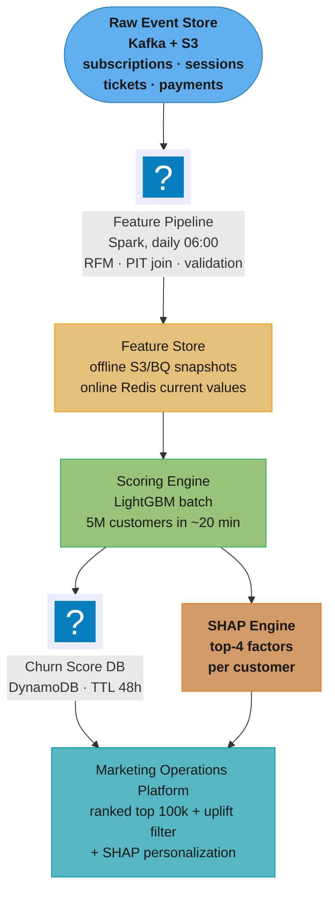
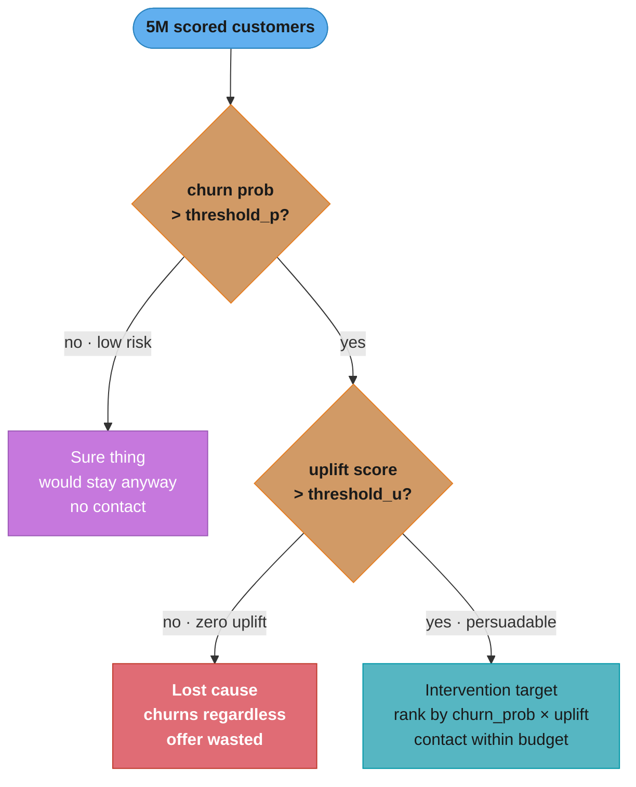
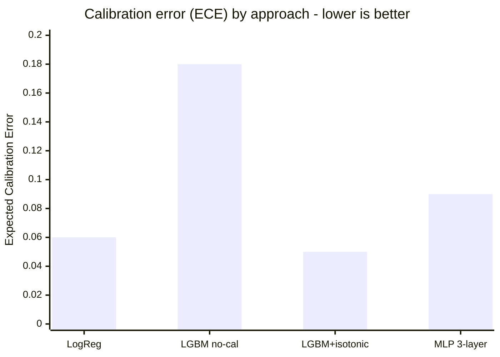

# Design a Customer Churn Prediction System
## Intuition

> A churn prediction system is like a hospital triage unit: the goal is not to predict who will get sick — it is to identify who is sick *right now* and route them to the most cost-effective intervention before they leave.

**Key insight:** churn prediction without a downstream intervention model is a science project. The real value is in the combination: who is at risk, what intervention is appropriate for them, and is the expected value of the intervention positive given its cost? A model that classifies churn accurately but allocates the intervention budget to customers who would have stayed anyway wastes money; one that identifies customers who are at risk *and* respond to intervention (uplift modeling) converts model accuracy into business value.

Mental model: think of churn as a funnel — many customers are at mild risk (churn probability 10-30%), few are at severe risk (>70%). The intervention budget can only cover 5-10% of the user base. The model's job is to rank customers by *expected intervention ROI*, which requires combining churn probability, intervention response probability, and intervention cost — not just churn probability alone.

Why this system exists: a subscription business with 8% monthly churn replaces its whole customer base roughly every year, so a single point of retained churn is worth more than most acquisition campaigns. The trap is that the obvious system (score everyone, contact the riskiest) can do *worse than random* — §4.5 shows a runnable simulation where risk-ranked targeting saves 105 customers from a 10,000-contact budget and random targeting saves 222, because the riskiest customers are mostly people no offer can move. This study therefore treats churn as a two-model decision system (risk plus response), not a classifier.

**Sibling study, not duplicated here:** [Customer LTV Prediction](design_customer_ltv_prediction.md) owns the *value* side (how much a customer is worth over a horizon). This file owns *who leaves, who can be moved, and how to spend a fixed contact budget*; it consumes an LTV estimate as an input and does not re-derive it.

**Vocabulary used throughout:**

| Term | Meaning here |
|---|---|
| Churn label | Cancellation (or 30 days of no activity for non-contract products) inside `(snapshot, snapshot + 30d]` |
| Snapshot / as-of date | The instant features are frozen; nothing after it may enter a feature (§4.6) |
| Uplift (CATE) | `P(churn | no offer) − P(churn | offer)` for one customer: the churn the offer *removes* |
| Persuadable / sure thing / lost cause / sleeping dog | Positive uplift / low risk, ~0 uplift / high risk, ~0 uplift / *negative* uplift (the offer triggers the cancel) |
| Qini curve | Cumulative incremental retained customers vs fraction of the base contacted, ranked by a model's score |
| Holdout | A randomized slice that never receives an offer; the only source of unbiased uplift labels |
| Hazard | `P(cancel in week t | still subscribed at the start of week t)` (§4.7) |

---

## 1. Requirements Clarification

**Functional requirements:**
- Predict the probability of churn for each active customer over a 30-day forward window.
- Score all active customers daily; support on-demand scoring for triggered campaigns.
- Provide a ranked list of high-risk customers for the marketing operations team.
- Provide per-customer SHAP explanations for the top 4 churn risk factors (for personalized messaging).
- Optionally: produce an uplift score (probability that a customer responds to a retention offer) alongside the churn score.

**Non-functional requirements:**
- Latency: daily batch scoring pipeline must complete within 4 hours of data cutoff (06:00 AM → results available by 10:00 AM for marketing team).
- Throughput: score up to 5M active customers per daily run.
- Accuracy: AUC ≥ 0.82 on time-based holdout; ECE ≤ 0.08 (calibration required for budget allocation).
- Freshness: RFM features updated daily; session-level features updated hourly for high-risk alerts.
- Availability: 99.5% daily pipeline SLO (maximum 1 failed run per week).

**Out of scope:**
- Real-time (sub-second) churn scoring for reactive chat interventions (separate system).
- Long-term (90-day) survival analysis (separate model).
- Pricing or offer optimization (downstream system consumes churn scores).

---

## 2. Scale Estimation

**Customer base:** 5M active subscribers; 500k new subscribers per month; 8% monthly churn rate = 400k churning customers per month.

**Daily scoring volume:** 5M customers × 150 features = 750M feature values to compute and join daily. At 1KB per customer's feature vector: 5GB of feature data per daily run.

**Training data:** 24 months of history × 5M customers per month = ~120M customer-month records. At 100 features per record and ~0.7KB/row (the same ~7 bytes/feature as the daily scoring vector above): ~85GB raw, materially less after Parquet compression.

**Label distribution:** 8% churn = 400k positive labels per month → significant class imbalance (1:11.5 ratio). Handle with class weighting (`scale_pos_weight`) plus threshold tuning — not synthetic oversampling, which does not help strong GBDTs (see §11).

**Intervention budget:** marketing contacts up to 100k customers per day. Delivery cost for an email + SMS touch is cents, not dollars — budget ~$0.05/contact → $5k/day, ~$150k/month (the retention *offer* itself is the expensive part and is capped separately, see §4.3). Business case: of the ~400k customers who churn each month, a 5% incremental retention lift among those the campaign reaches saves ~20k customers/month; at $150 LTV that is ~$3M/month of avoided LTV loss against ~$150k/month of contact spend. (Note the units: multiply *customers* by LTV, never dollars by dollars.)

**Feature computation:** RFM features (recency, frequency, monetary) require rolling 30-day and 90-day aggregations. At 5M customers × 90-day window from raw event tables = 450M row-scan per feature. On a 50-node Spark cluster: ~45 minutes for full feature computation.

**Infrastructure sizing:** 
- Feature pipeline: 50-node Spark cluster (m5.4xlarge), runs 45 min/day.
- Scoring: LightGBM on 16-core CPU: 5M customers in ~20 minutes.
- Total daily pipeline: ~2.5 hours end-to-end (within 4-hour SLO).
- Storage: 60GB/month for prediction logs + SHAP values (S3).

**Worked scale math the interviewer will probe:**

| Quantity | Derivation | Result |
|---|---|---|
| Positives per training month | 5M × 8% | 400k |
| Rows in a 24-month training table | 24 snapshots × ~5M at-risk customers | ~120M |
| Usable rows after the label lag | the newest snapshot needs 30 days of future, so it is always ~1 month behind | 23 labelled months at any time |
| Minimum detectable uplift in a holdout | `n per arm ≈ 16·p(1−p)/δ²`; p = 0.40 churn among targets, δ = 0.02 | ~9,600 per arm, so a 10% holdout of the 100k/day contact list fills it in ~1 day |
| Contacts per month | 100k/day × 30 | 3M touches, but only ~500k distinct customers (6 touches each) |
| Offer liability if every target redeems | 500k × $5 offer cap | $2.5M/month ceiling, which is why the offer budget is capped separately from the contact budget |

Two numbers in that table drive most of the design. First, the 1-month label lag means the freshest model is always trained on behaviour at least 30 days old, so any feature whose meaning changes faster than that (a new pricing page, a new plan tier) is invisible to the model until the next cycle. Second, the holdout sizing shows that measuring uplift is cheap at this scale: one day of holdout traffic powers a 2-point detection, so there is no excuse for running retention campaigns without one.

---

## 3. High-Level Architecture



*The daily batch spine: raw events become PIT-safe features, a single LightGBM pass scores all 5M customers, and the SHAP engine attaches per-customer reasons before both feed the marketing platform.*

**Component inventory:**
- **Feature pipeline:** Spark DAG on EMR; computes 150 features from raw event tables; enforces PIT join (see [Feature Store](./cross_cutting/feature_store_and_point_in_time_correctness.md)).
- **Feature store (offline):** S3 Parquet with timestamp partitioning; training data assembled via PIT join.
- **Scoring engine:** LightGBM model loaded into a Python scoring process on a 16-core CPU instance.
- **SHAP engine:** TreeExplainer on LightGBM; computes per-customer SHAP values in the same batch run.
- **Churn score DB:** DynamoDB with TTL-48h entries; marketing platform queries by customer_id.
- **Uplift model:** separate T-learner (LightGBM) estimating treatment effect; runs after churn scoring.

**Data flow:** raw events → Spark feature pipeline → PIT join with feature store → LightGBM scoring → calibrated probability → DynamoDB → marketing platform.

---

## 4. Component Deep Dives

### 4.1 Feature Engineering

```python
import pandas as pd
import numpy as np
from datetime import datetime, timedelta

def compute_rfm_features(
    events: pd.DataFrame,
    as_of_date: datetime,
    customer_col: str = "customer_id",
) -> pd.DataFrame:
    """
    RFM features computed as of a specific date (PIT-safe).
    Recency: days since last purchase.
    Frequency: number of purchases in the last 30 days.
    Monetary: total spend in last 30 days.
    """
    cutoff_30d = as_of_date - timedelta(days=30)
    cutoff_90d = as_of_date - timedelta(days=90)

    # Only look at events BEFORE as_of_date (PIT correctness)
    hist = events[events["event_time"] < as_of_date].copy()

    recency = (
        hist.groupby(customer_col)["event_time"]
        .max()
        .reset_index()
        .rename(columns={"event_time": "last_purchase_time"})
    )
    recency["recency_days"] = (as_of_date - recency["last_purchase_time"]).dt.days

    freq_30d = (
        hist[hist["event_time"] >= cutoff_30d]
        .groupby(customer_col)
        .size()
        .reset_index(name="purchase_count_30d")
    )

    monetary_30d = (
        hist[hist["event_time"] >= cutoff_30d]
        .groupby(customer_col)["amount_usd"]
        .sum()
        .reset_index(name="spend_30d_usd")
    )

    return (
        recency[[customer_col, "recency_days"]]
        .merge(freq_30d, on=customer_col, how="left")
        .merge(monetary_30d, on=customer_col, how="left")
        .fillna({"purchase_count_30d": 0, "spend_30d_usd": 0.0})
    )
```

Full feature set (150 features across 6 groups):
- **RFM (15 features):** recency_days, frequency (7/14/30/60/90d), monetary (7/14/30/60/90d).
- **Engagement (30 features):** login_count, session_duration, pages_viewed, feature_usage flags.
- **Support (10 features):** ticket_count_30d, CSAT score, resolution_time, escalation_flag.
- **Billing (20 features):** payment_failure_count, days_to_payment, plan_type, discount_active.
- **Social (15 features):** referral_activity, social_share_count, community_posts.
- **Derived (60 features):** trend ratios (30d/90d frequency), rolling delta (this month vs last month spend), interaction terms.

### 4.2 Model Training — Broken Then Fixed

```python
import lightgbm as lgb
from sklearn.model_selection import TimeSeriesSplit
from sklearn.metrics import roc_auc_score
import numpy as np

# WRONG: random k-fold cross-validation on temporal data
from sklearn.model_selection import cross_val_score
lgbm_wrong = lgb.LGBMClassifier(n_estimators=300, random_state=42)
scores_wrong = cross_val_score(lgbm_wrong, X, y, cv=5, scoring="roc_auc")
# Result: 0.91 AUC — inflated because future months leak into training folds
# A customer who churned in March may appear in a training fold that includes April data
```

```python
# CORRECT: temporal cross-validation with expanding window
from sklearn.model_selection import TimeSeriesSplit

def train_with_temporal_cv(
    X: np.ndarray,
    y: np.ndarray,
    timestamps: np.ndarray,    # observation dates, sorted ascending
    n_splits: int = 5,
) -> tuple[lgb.LGBMClassifier, list[float]]:
    """Walk-forward validation: each fold trains on past months, tests on next month."""
    # sklearn's `gap` counts SAMPLES, not seconds — it drops that many rows from the
    # end of each train split. Sort rows by `timestamps` first, then convert the
    # desired 30-day purge into a row count for this dataset.
    rows_per_day = len(X) / max((timestamps.max() - timestamps.min()).days, 1)
    gap_rows = int(30 * rows_per_day)
    tscv = TimeSeriesSplit(n_splits=n_splits, gap=gap_rows)  # ~30-day purge
    auc_scores = []

    for train_idx, val_idx in tscv.split(X):
        model = lgb.LGBMClassifier(
            n_estimators=500,
            learning_rate=0.03,
            num_leaves=63,
            min_child_samples=30,
            colsample_bytree=0.8,
            subsample=0.8,
            scale_pos_weight=11.5,   # 1:11.5 class ratio
            random_state=42,
        )
        model.fit(X[train_idx], y[train_idx])
        preds = model.predict_proba(X[val_idx])[:, 1]
        auc_scores.append(roc_auc_score(y[val_idx], preds))

    print(f"Temporal CV AUC: {np.mean(auc_scores):.3f} ± {np.std(auc_scores):.3f}")
    # Result: 0.84 AUC — honest estimate matching production performance
    return model, auc_scores
```

### 4.3 Calibration for Budget Allocation

The churn model's raw LightGBM output is not calibrated. Marketing uses the predicted probability directly for budget allocation: "spend at most $5 on customers with p(churn) > 0.70." If p=0.70 actually corresponds to 0.45 actual churn rate (overconfident model), the budget is wasted on moderate-risk customers.

See [Calibration and Thresholding](./cross_cutting/model_calibration_and_thresholding.md) for full implementation. ECE target: < 0.08.

### 4.4 Uplift Model for Intervention ROI

```python
from sklearn.base import BaseEstimator
import lightgbm as lgb
import numpy as np

class TLearner:
    """
    T-Learner uplift model.
    Train separate models for treatment (received offer) and control (no offer).
    Uplift = P(retained | treatment) - P(retained | control) for each customer.
    """
    def __init__(self) -> None:
        self.model_t = lgb.LGBMClassifier(n_estimators=200, random_state=42)
        self.model_c = lgb.LGBMClassifier(n_estimators=200, random_state=42)

    def fit(
        self,
        X: np.ndarray,
        y: np.ndarray,           # outcome (retained = 1)
        treatment: np.ndarray,   # 1 = received offer, 0 = did not
    ) -> "TLearner":
        self.model_t.fit(X[treatment == 1], y[treatment == 1])
        self.model_c.fit(X[treatment == 0], y[treatment == 0])
        return self

    def predict_uplift(self, X: np.ndarray) -> np.ndarray:
        """Positive uplift = intervention helps; negative = intervention hurts."""
        return (
            self.model_t.predict_proba(X)[:, 1] -
            self.model_c.predict_proba(X)[:, 1]
        )

# Intervention strategy: rank customers by (churn_prob × uplift) — expected intervention ROI
# This prioritizes customers who are both at risk AND responsive to intervention
```

The two-step targeting filter turns model scores into a budgeted contact list:



*Churn probability alone cannot separate the red "lost cause" set from the teal "persuadable" set — only the uplift gate does. Spending the fixed 100k/day budget on the teal path is what converts AUC into retained revenue.*

### 4.5 Budgeted Targeting: Churn Risk vs Uplift — Broken Then Fixed (runnable)

The snippets above assume `X`, `y` and a trained model already exist. This one is self-contained: it simulates a population whose *true* response to an offer is known, runs a randomized historical campaign, then spends a 10,000-contact budget two ways and scores both against ground truth. Run it with `numpy` and `scikit-learn` only.

```python
from __future__ import annotations

import numpy as np
from numpy.typing import NDArray
from sklearn.ensemble import HistGradientBoostingClassifier

FloatArr = NDArray[np.float64]
IntArr = NDArray[np.int64]
BoolArr = NDArray[np.bool_]


def simulate(n: int, rng: np.random.Generator) -> tuple[FloatArr, FloatArr, FloatArr]:
    """Features plus the TRUE churn probability without (p0) and with (p1) an offer."""
    x = rng.normal(size=(n, 5))
    base_logit = -2.4 + 1.3 * x[:, 0] + 0.6 * x[:, 1]          # x0 = disengagement
    p0 = 1.0 / (1.0 + np.exp(-base_logit))
    effect = np.where(x[:, 2] > 0.0, -1.2, -0.1)               # price-sensitive respond
    effect = np.where(x[:, 0] > 1.5, 0.0, effect)              # lost causes: no effect
    effect = np.where(x[:, 3] > 1.2, 0.8, effect)              # sleeping dogs: backfire
    p1 = 1.0 / (1.0 + np.exp(-(base_logit + effect)))
    return x, p0, p1


def run_randomized_campaign(
    x: FloatArr, p0: FloatArr, p1: FloatArr, rng: np.random.Generator
) -> tuple[BoolArr, BoolArr]:
    """Historical campaign with a 50/50 RANDOMIZED offer: the only data uplift can learn from."""
    treated = rng.random(len(x)) < 0.5
    churned = rng.random(len(x)) < np.where(treated, p1, p0)
    return treated, churned


def _gbdt() -> HistGradientBoostingClassifier:
    return HistGradientBoostingClassifier(max_iter=200, learning_rate=0.05, random_state=0)


# BROKEN: spend the budget on the riskiest customers.
def target_by_churn_risk(
    x_hist: FloatArr, churned: BoolArr, treated: BoolArr, x_new: FloatArr, k: int
) -> IntArr:
    model = _gbdt().fit(x_hist[~treated], churned[~treated])
    risk = model.predict_proba(x_new)[:, 1]
    return np.argsort(-risk)[:k]


# FIX: spend the budget where the offer CHANGES the outcome (T-learner uplift).
def target_by_uplift(
    x_hist: FloatArr, churned: BoolArr, treated: BoolArr, x_new: FloatArr, k: int
) -> IntArr:
    m_treat = _gbdt().fit(x_hist[treated], churned[treated])
    m_ctrl = _gbdt().fit(x_hist[~treated], churned[~treated])
    churn_reduction = m_ctrl.predict_proba(x_new)[:, 1] - m_treat.predict_proba(x_new)[:, 1]
    return np.argsort(-churn_reduction)[:k]


def incremental_saves(idx: IntArr, p0: FloatArr, p1: FloatArr) -> float:
    """Expected customers retained BECAUSE of the offer (ground truth, simulation only)."""
    return float((p0[idx] - p1[idx]).sum())


if __name__ == "__main__":
    rng = np.random.default_rng(7)
    x_hist, p0_hist, p1_hist = simulate(200_000, rng)
    treated, churned = run_randomized_campaign(x_hist, p0_hist, p1_hist, rng)

    x_new, p0_new, p1_new = simulate(200_000, rng)
    budget = 10_000                                            # 5% of the base
    by_risk = target_by_churn_risk(x_hist, churned, treated, x_new, budget)
    by_uplift = target_by_uplift(x_hist, churned, treated, x_new, budget)
    at_random = rng.choice(len(x_new), size=budget, replace=False)

    for name, idx in [("random", at_random), ("churn-risk", by_risk), ("uplift", by_uplift)]:
        harmed = int((p1_new[idx] > p0_new[idx]).sum())
        print(f"{name:>10}: saves={incremental_saves(idx, p0_new, p1_new):7.0f}  "
              f"mean p0={p0_new[idx].mean():.2f}  sleeping dogs contacted={harmed}")
```

Output on scikit-learn 1.9.1 (seed 7):

```
    random: saves=    222  mean p0=0.14  sleeping dogs contacted=1216
churn-risk: saves=    105  mean p0=0.62  sleeping dogs contacted=1267
    uplift: saves=   2044  mean p0=0.35  sleeping dogs contacted=1
```

Read the three lines slowly, because each one is an interview answer:

- **Risk targeting finds the riskiest people (mean p0 = 0.62) and still loses to random.** The top of the risk ranking is dominated by the deeply disengaged (`x0 > 1.5`), for whom the offer does nothing. Being right about *who will churn* is not being right about *who to contact*.
- **Uplift targeting contacts moderate-risk customers (mean p0 = 0.35) and saves ~9x more than random, ~19x more than risk.** That is the persuadable segment, and it is invisible to any model that only predicts churn.
- **Sleeping dogs.** Random and risk targeting each contact ~1,200 customers for whom the offer *raises* churn (a reminder that they are paying for something unused). The uplift model avoids almost all of them, because it learned the backfire from the randomized treated arm.

The fix only works because the historical campaign was randomized. Train the same T-learner on a history where offers went only to high-risk customers and the treated and control arms differ in risk as well as treatment, so the "uplift" it learns is mostly selection bias. That is why the 5-10% randomized holdout in §8 is a permanent part of the system, not an experiment that ends. The full CUPED-and-holdout methodology lives in [Experimentation and Online Evaluation](./cross_cutting/experimentation_and_online_evaluation.md).

**Choosing the budget, not just the ranking.** Sort by predicted uplift, then walk down the list while `uplift × LTV − offer_cost × redemption_rate − contact_cost > 0`. With LTV $150, a $5 offer redeemed by 40% of contacts and $0.05 per contact, the break-even uplift is `(5 × 0.4 + 0.05) / 150 ≈ 1.4` percentage points. Every customer below that line costs more to contact than they return, however risky they look.

### 4.6 Point-in-Time Training Rows — Broken Then Fixed (runnable)

The most common way a churn model reaches 0.97 offline AUC and 0.61 in production (§9 Pitfall 1) is a feature window that overlaps the label window. The toy below gives 1,000 customers one session a day; every fifth customer cancels on 2026-02-10 and stops logging in. Nothing in the data *predicts* the cancel, so an honest feature should show no difference.

```python
from __future__ import annotations

import pandas as pd

LABEL_WINDOW = pd.Timedelta(days=30)


def build_training_rows_broken(
    sessions: pd.DataFrame, cancels: pd.DataFrame, snapshot: pd.Timestamp, assembled_at: pd.Timestamp
) -> pd.DataFrame:
    # BROKEN: features use every session up to the day the table is ASSEMBLED, so a
    # customer who cancelled inside the label window shows "0 sessions since cancel".
    recent = sessions[sessions["ts"] >= assembled_at - pd.Timedelta(days=14)]
    feats = recent.groupby("customer_id").size().rename("sessions_14d")
    churned = cancels[(cancels["ts"] > snapshot) & (cancels["ts"] <= snapshot + LABEL_WINDOW)]
    out = pd.DataFrame(index=sessions["customer_id"].unique()).join(feats).fillna(0)
    out["churned_30d"] = out.index.isin(churned["customer_id"]).astype(int)
    return out


def build_training_rows(
    sessions: pd.DataFrame, cancels: pd.DataFrame, snapshot: pd.Timestamp
) -> pd.DataFrame:
    # FIX: features see only (snapshot - 14d, snapshot]; the label sees only
    # (snapshot, snapshot + 30d]. The two windows never overlap.
    window = sessions[(sessions["ts"] > snapshot - pd.Timedelta(days=14)) & (sessions["ts"] <= snapshot)]
    feats = window.groupby("customer_id").size().rename("sessions_14d")
    already_gone = cancels.loc[cancels["ts"] <= snapshot, "customer_id"]
    churned = cancels[(cancels["ts"] > snapshot) & (cancels["ts"] <= snapshot + LABEL_WINDOW)]
    out = pd.DataFrame(index=sessions["customer_id"].unique()).join(feats).fillna(0)
    out = out[~out.index.isin(already_gone)]                  # not at risk any more
    out["churned_30d"] = out.index.isin(churned["customer_id"]).astype(int)
    return out


if __name__ == "__main__":
    days = pd.date_range("2026-01-01", "2026-03-31", freq="D")
    sessions = pd.DataFrame(
        [(c, d) for c in range(1_000) for d in days if not (c % 5 == 0 and d > pd.Timestamp("2026-02-10"))],
        columns=["customer_id", "ts"],
    )
    cancels = pd.DataFrame({"customer_id": range(0, 1_000, 5), "ts": pd.Timestamp("2026-02-10")})
    snap = pd.Timestamp("2026-02-01")

    leaky = build_training_rows_broken(sessions, cancels, snap, pd.Timestamp("2026-03-31"))
    clean = build_training_rows(sessions, cancels, snap)
    for name, df in [("broken", leaky), ("fixed", clean)]:
        g = df.groupby("churned_30d")["sessions_14d"].mean()
        print(f"{name}: mean sessions_14d churners={g[1]:.1f} stayers={g[0]:.1f}")
```

```
broken: mean sessions_14d churners=0.0 stayers=15.0
fixed: mean sessions_14d churners=14.0 stayers=14.0
```

The broken table hands the model a perfect separator (0 vs 15 sessions) that cannot exist at scoring time, because at 06:00 on the scoring day the future cancel has not happened. The fixed table shows the truth for this toy: before the snapshot, churners and stayers behaved identically. Two details carry the fix: the feature window ends *at* the snapshot, and customers who already cancelled before the snapshot are removed rather than labelled 0 (they are not at risk, and keeping them teaches "inactive means safe"). The general machinery, including as-of joins against slowly changing dimensions, is in [Feature Store and Point-in-Time Correctness](./cross_cutting/feature_store_and_point_in_time_correctness.md).

### 4.7 Discrete-Time Hazard Model for Timing (runnable)

A 30-day binary label answers "will they leave this month" and discards every subscriber who joined less than 30 days before the snapshot, because their label is not yet observable (right-censored). A discrete-time hazard model keeps them: expand each subscriber into one row per week at risk, fit a classifier on "cancelled this week", and multiply out the survival curve.

```python
from __future__ import annotations

import numpy as np
import pandas as pd
from sklearn.linear_model import LogisticRegression


def to_person_period(subs: pd.DataFrame, horizon_weeks: int) -> pd.DataFrame:
    """One row per subscriber per week AT RISK. A censored subscriber contributes rows
    up to the last week observed with event=0."""
    rows = []
    for r in subs.itertuples(index=False):
        last = min(r.duration_weeks, horizon_weeks)
        for week in range(1, last + 1):
            event = int(week == r.duration_weeks and r.cancelled == 1)
            rows.append((r.customer_id, week, r.engagement, event))
    return pd.DataFrame(rows, columns=["customer_id", "week", "engagement", "event"])


def fit_hazard(pp: pd.DataFrame) -> LogisticRegression:
    x = np.column_stack([np.log(pp["week"]), pp["engagement"]])
    return LogisticRegression().fit(x, pp["event"])


def survival_curve(model: LogisticRegression, engagement: float, weeks: int) -> np.ndarray:
    w = np.arange(1, weeks + 1)
    x = np.column_stack([np.log(w), np.full(weeks, engagement)])
    hazard = model.predict_proba(x)[:, 1]
    return np.cumprod(1.0 - hazard)                      # S(t) = prod (1 - h(k)), k <= t


if __name__ == "__main__":
    rng = np.random.default_rng(1)
    n = 20_000
    engagement = rng.normal(size=n)
    weekly_hazard = 1.0 / (1.0 + np.exp(-(-3.5 - 0.9 * engagement)))
    duration = rng.geometric(weekly_hazard)
    observed = rng.integers(4, 27, size=n)                # staggered signup: 4-26 weeks seen
    subs = pd.DataFrame({
        "customer_id": np.arange(n),
        "engagement": engagement,
        "duration_weeks": np.minimum(duration, observed),
        "cancelled": (duration <= observed).astype(int),
    })
    model = fit_hazard(to_person_period(subs, horizon_weeks=26))
    for e in (-1.5, 0.0, 1.5):
        s = survival_curve(model, e, 26)
        print(f"engagement={e:+.1f}: P(still subscribed) wk4={s[3]:.2f} wk13={s[12]:.2f} wk26={s[25]:.2f}")
```

```
engagement=-1.5: P(still subscribed) wk4=0.64 wk13=0.23 wk26=0.06
engagement=+0.0: P(still subscribed) wk4=0.89 wk13=0.68 wk26=0.47
engagement=+1.5: P(still subscribed) wk4=0.97 wk13=0.91 wk26=0.82
```

The simulated true weekly hazard at engagement 0 is `1 / (1 + e^3.5) ≈ 0.029`, so the true 26-week survival is `0.971^26 ≈ 0.46`; the model recovers 0.47 even though no subscriber was observed for all 26 weeks with certainty. Cost: the person-period table is ~13x the subscriber count at a 26-week horizon (5M subscribers become ~65M rows), which is why production systems keep the GBDT binary model for the daily ranking and run the hazard model weekly for *timing* decisions (when to send the save offer, not whether).

### 4.8 Scoring an Uplift Model Without Ground Truth: the Qini Curve (runnable)

§4.5 cheated: it scored targeting against the true `p0 − p1`, which production never has. What production has is a *randomized* test set: some customers got the offer, some did not, assigned by coin flip. The Qini curve ranks that test set by a model's score and, at each cut, estimates incremental saves as "control churners scaled to the treated count, minus treated churners". Save the §4.5 block as `churn_uplift.py`; this reuses its `simulate`, `run_randomized_campaign` and `_gbdt`.

```python
from __future__ import annotations

import numpy as np
from numpy.typing import NDArray

from churn_uplift import _gbdt, run_randomized_campaign, simulate


def qini_points(
    score: NDArray[np.float64], treated: NDArray[np.bool_], churned: NDArray[np.bool_], n_bins: int = 10
) -> list[tuple[float, float]]:
    """Incremental saves at each cut of the ranking, from OBSERVED outcomes only."""
    order = np.argsort(-score)
    t, c = treated[order], churned[order]
    points = [(0.0, 0.0)]
    n = len(score)
    for k in np.linspace(n / n_bins, n, n_bins).astype(int):
        nt, nc = t[:k].sum(), (~t[:k]).sum()
        churn_t, churn_c = c[:k][t[:k]].sum(), c[:k][~t[:k]].sum()
        saves = churn_c * nt / max(nc, 1) - churn_t
        points.append((k / n, float(saves)))
    return points


def qini_coefficient(points: list[tuple[float, float]]) -> float:
    """Area between the model's curve and the straight random-targeting line."""
    xs, ys = np.array(points).T
    random_line = ys[-1] * xs
    return float(np.trapezoid(ys - random_line, xs))


if __name__ == "__main__":
    rng = np.random.default_rng(7)
    x_hist, p0, p1 = simulate(200_000, rng)
    t_hist, c_hist = run_randomized_campaign(x_hist, p0, p1, rng)
    x_test, q0, q1 = simulate(100_000, rng)
    t_test, c_test = run_randomized_campaign(x_test, q0, q1, rng)   # randomized test set

    risk = _gbdt().fit(x_hist[~t_hist], c_hist[~t_hist]).predict_proba(x_test)[:, 1]
    m_t = _gbdt().fit(x_hist[t_hist], c_hist[t_hist])
    m_c = _gbdt().fit(x_hist[~t_hist], c_hist[~t_hist])
    uplift = m_c.predict_proba(x_test)[:, 1] - m_t.predict_proba(x_test)[:, 1]

    for name, s in [("churn-risk", risk), ("uplift", uplift)]:
        pts = qini_points(s, t_test, c_test)
        print(f"{name:>10}: saves@10%={pts[1][1]:6.0f}  saves@30%={pts[3][1]:6.0f}  "
              f"qini={qini_coefficient(pts):7.1f}")
```

```
churn-risk: saves@10%=   248  saves@30%=   801  qini=  293.2
    uplift: saves@10%=   856  saves@30%=  1436  qini=  774.4
```

The observed-outcome Qini tells the same story as the ground-truth comparison: uplift ranking captures ~3.5x the incremental saves of risk ranking in the top decile and has a Qini coefficient 2.6x larger. Two operational rules follow. First, the Qini is noisy: with 50k customers per arm a decile holds only ~5k treated, so compare models on the same randomized test set and bootstrap the coefficient before declaring a winner (this is why the §8 gate is "≥ 80% of champion", not "≥ champion"). Second, a Qini computed on non-randomized data is meaningless, because the treated and control groups differ in more than the treatment; the randomized holdout is again the thing that makes the metric exist. [Experimentation and Online Evaluation](./cross_cutting/experimentation_and_online_evaluation.md) covers the variance-reduction tricks (CUPED on pre-period engagement) that tighten it.

---

## 5. Design Decisions & Tradeoffs

**Decision 1: LightGBM over logistic regression or neural network.**
Alternatives considered: (a) logistic regression with L2 regularization — too weak for 150-feature non-linear interactions (5pp lower AUC in CV); (b) neural network (3-layer MLP) — 0.5pp higher AUC than GBDT but 8x longer training time, no native SHAP support, and requires careful hyperparameter tuning that the team lacks infra for. GBDT wins: best accuracy/latency/interpretability balance for 5M-row tabular dataset. See [Algorithm Selection](../model_selection_and_algorithm_choice/model_selection_and_algorithm_choice.md).

**Decision 2: T-learner uplift model over direct churn score ranking.**
Using only churn probability to rank intervention targets wastes budget on "sure churners" who will churn regardless of the offer, and on "sure retainers" who would stay anyway. T-learner identifies "persuadable" customers — those whose retention probability meaningfully increases when offered an incentive. The design target is that a holdback A/B test shows materially better intervention ROI than churn-score-only targeting at the same budget (fewer contacts, more retained customers); the size of that gain is specific to each business and must be measured, not assumed.

**Decision 3: Temporal cross-validation over random k-fold.**
Random k-fold inflated AUC to 0.91 vs temporal CV's 0.84. The 7pp inflation comes from future data leaking into training folds. All model selection and hyperparameter tuning is done on temporal CV. The final model is trained on all data up to T-90d and evaluated on the most recent 90-day holdout.

**Decision 4: Batch scoring over real-time API.**
Real-time scoring would add < 5ms per prediction but requires: a feature serving layer (Redis), a low-latency model server, and operational complexity for 24/7 availability. The marketing use case (daily email/SMS campaigns) does not require real-time scoring — daily batch with DynamoDB lookup is sufficient. Reserve real-time for triggered flows (customer cancels subscription → score immediately and trigger a save attempt within 60 seconds).

**Decision 5: Isotonic regression calibration, re-fit monthly.**
Calibration is re-fitted monthly on the prior 30-day labeled cohort (30-day churn label lag). Monthly recalibration tracks seasonal churn rate shifts without overfitting to short-term anomalies. See [Calibration](./cross_cutting/model_calibration_and_thresholding.md).

**Decision 6: Keep a permanent randomized holdout, even though it "wastes" offers.**
A 5% slice of each day's target list is randomly withheld from contact. At 100k targets/day that is 5k customers who would have been contacted, and at the §4.5 break-even of ~1.4pp uplift the holdout forgoes on the order of 70 saves/day (~2,100/month, ~$315k of LTV at $150). The return is the only unbiased uplift label the system ever sees: without it, the T-learner in §4.4 is trained on a treated population chosen by the previous model, and each retrain inherits the last one's targeting bias. Price the holdout as the cost of keeping the uplift model honest; a smaller holdout (2%) is defensible once a stable model exists, zero is not.

**Comparison table:**

| Approach | AUC | ECE | Training time | Serving latency | Explainability |
|---|---|---|---|---|---|
| Logistic regression | 0.79 | 0.06 | 2 min | 0.1ms/customer | High (coeff) |
| LightGBM (no calibration) | 0.84 | 0.18 | 12 min | 0.3ms/customer | Medium (SHAP) |
| LightGBM + isotonic | 0.84 | 0.05 | 13 min | 0.3ms/customer | Medium (SHAP) |
| Neural net (MLP 3-layer) | 0.845 | 0.09 | 95 min | 2ms/customer | Low |



*AUC across these models is nearly flat (0.79–0.845), but raw LightGBM is badly miscalibrated (ECE 0.18) — far above the 0.08 budget-allocation ceiling. Isotonic regression fixes calibration (0.05) at no AUC cost, which is why the shipped model is LightGBM + isotonic rather than the marginally more accurate MLP.*

---

## 6. Real-World Implementations

*The Duolingo, Braze and Uber entries rest on what each company has published (cited inline). The streaming and B2B entries describe the general industry pattern this case study builds on and are labelled as such; they are not disclosures of any company's internal stack.*

**Subscription streaming (two-stage churn + offer selection):** the widely used pattern is a two-stage model — first stage predicts churn probability using RFM + engagement features; second stage predicts which discount (3-month trial, 20% off, 1 free month) maximizes retention probability per customer. The second stage is naturally a contextual bandit (LinUCB is the canonical starting point, from Li et al. 2010) that learns offer effectiveness from live outcomes, so the scoring job can run nightly and hand the ranked list to the campaign tool.

**Survival framing instead of a binary label:** for subscription businesses where cancellation timing matters, a discrete-time hazard (survival) model outputs a weekly hazard rate per subscriber — the probability of cancellation in the next 7 days given they have not yet cancelled — rather than a single 30-day binary label. This enables intervention *timing* optimization (intervene when the hazard rate spikes) and handles right-censoring correctly, which a binary classifier cannot. This is a well-established churn-modelling technique in the marketing-analytics literature; the major streaming services have not published their internal churn architectures.

**Duolingo (a retention model before a churn model):** Jorge Mazal, Duolingo's former CPO, described the work in "How Duolingo reignited user growth" (Lenny's Newsletter, 2023-02-28). The team segmented every user who had ever used the app into mutually exclusive states (new, current, reactivated, resurrected and so on), borrowed from Zynga and MyFitnessPal, and modelled the weekly (later daily) transition rates between them: CURR, NURR, RURR, SURR. Simulating a 2% move on each rate showed that current-user retention (CURR) moved DAU about 5x more than the next-best lever, because retained current users return to the same bucket and compound. Duolingo created a Retention Team with CURR as its North Star. Mazal reports that over four years CURR rose 21%, which he equates to cutting the daily churn of their best users by more than 40%, and that together with other bets DAU grew 4.5x. Two lessons carry straight into this design: pick the churn *segment* whose retention compounds before building a model, and measure the lever (streak notifications, streak freezes) by its effect on a transition rate, not by model AUC. Duolingo has not published an uplift-targeted version of this work.

**Braze (GBDT churn scoring as a product):** Braze's Predictive Churn feature lets a customer define what churn means for its own business and the population to retain, and then, per the Braze documentation, trains a gradient-boosted decision tree model to recognise at-risk users. That the default commercial tool is a GBDT over behavioural aggregates is a useful sanity check on §5 Decision 1: the industry default for tabular churn is trees, not deep nets. What a packaged tool cannot know is your offer economics, which is why the uplift and budget layer in §4.5 stays in-house.

**Uber (uplift tooling in the open):** Uber open-sourced CausalML on GitHub (`uber/causalml`), described as "uplift modeling and causal inference with machine learning algorithms." It ships meta-learners (S-, T-, X- and R-learner), uplift trees and Qini and AUUC evaluation, which makes it the shortest path from the hand-written T-learner in §4.4 to a production-grade one, alongside Microsoft's EconML listed in §7. The design point to take from its existence: uplift is mature enough to have standard libraries, so a retention team that still ranks by risk alone is choosing not to use it.

**B2B SaaS health scores (pattern, not a disclosed system):** customer-success platforms expose a 0-100 account health score built from weighted criteria such as product usage, support tickets and survey scores, which CSMs sort on. The ML version in this case study replaces hand-set weights with model-derived factors (mean absolute SHAP for global drivers, per-account SHAP for the top risk factors), rescaled to the same 0-100 range so it stays legible to non-technical users, and adds the uplift gate so CSM time goes to accounts a call can actually save.

---

## 7. Technologies & Tools

| Component | Technology | Alternative | Rationale |
|---|---|---|---|
| Feature computation | PySpark on EMR | dbt + BigQuery | Spark handles 450M row-scans in 45min; dbt is too slow for this volume |
| Feature store (offline) | S3 Parquet + DeltaLake | Feast | DeltaLake provides ACID, time-travel for PIT joins; Feast adds operational complexity |
| Feature store (online) | Redis Cluster | DynamoDB | Redis p99 < 1ms for feature lookup; DynamoDB ~5ms |
| Model training | LightGBM | XGBoost, sklearn | LightGBM's histogram + leaf-wise growth trains fast on wide tabular data; XGBoost's `hist` tree method has largely closed the old gap, so benchmark both rather than assuming a fixed multiple |
| Calibration | scikit-learn IsotonicRegression | netcal | sklearn sufficient; isotonic > platt for our distribution |
| Uplift model | EconML T-Learner | CausalML DoublyRobust | T-learner simpler; sufficient data for separate models per treatment arm |
| Serving/storage | DynamoDB (TTL 48h) | Redis | DynamoDB managed, cheaper for daily batch results; Redis reserved for real-time serving |
| Explainability | SHAP TreeExplainer | LIME | TreeExplainer exact for LightGBM; 1000x faster than KernelSHAP |

---

## 8. Operational Playbook

**(a) Model Evaluation Pipeline:**
- Daily: temporal holdout AUC on the last 30-day cohort (labels available after 30-day lag).
- Daily: score distribution PSI vs training baseline (no label lag).
- Monthly: ECE calibration report on the labeled 30-day cohort.
- Quarterly: full backtesting on 12-month historical data with temporal CV.

See [Experimentation and Online Evaluation](./cross_cutting/experimentation_and_online_evaluation.md) for holdback experiment design.

**(b) Observability:**
- Pipeline SLO alert: if daily scoring does not complete by 10:00 AM, page on-call.
- Score distribution alert: KS p-value < 0.001 vs training baseline → P2 investigation.
- Feature PSI alert: any of top-10 SHAP features PSI > 0.2 → P2, trigger investigation.
- AUC alert: if 30-day holdout AUC < 0.80 (2pp below the 0.82 target, 4pp below the 0.84 the shipped model actually achieves) → P1, trigger emergency retrain.

See [Drift Monitoring and Retraining](./cross_cutting/drift_monitoring_and_retraining.md) for full PSI/KS implementation.

**(b2) Release gates and their numbers:** every gate below is automated in the Airflow DAG; a failed gate blocks promotion and pages the model owner, it never "warns and continues".

| Gate | Check | Threshold | Why this number |
|---|---|---|---|
| Data | label rate of the newest labelled snapshot | 6%-10% (baseline 8%) | a label rate outside the band means the cancellation join broke, not that churn changed |
| Data | null rate per top-20 SHAP feature | < 2% absolute increase vs last run | a silently dead session log looks like "everyone is inactive" |
| Ranking | temporal-holdout AUC | ≥ champion − 0.005 | 0.005 is roughly one standard deviation of fold-to-fold AUC on 5M rows |
| Calibration | ECE after isotonic | ≤ 0.08 | budget allocation multiplies by the probability, so an ECE of 0.10 misstates the average contacted customer's risk by 10 points and moves the §4.5 break-even line |
| Uplift | Qini coefficient on the latest randomized holdout | ≥ 80% of champion | uplift is noisier than AUC; a hard ≥ champion gate would block every retrain |
| Shadow | KS distance between challenger and champion score distributions over 7 days | < 0.10 | a larger shift means marketing's thresholds no longer mean what they meant yesterday |

**(c) Incident Runbooks:**

**Runbook 1 — Pipeline failure (scoring not complete by 10 AM):**
Symptom: Airflow DAG failed; marketing platform shows stale scores (yesterday's).
Diagnosis: check Spark job logs for OOM or data schema error; check upstream S3 data availability.
Mitigation: use yesterday's scores for marketing (TTL-48h in DynamoDB); alert marketing team.
Resolution: fix data pipeline issue; re-run Spark job; validate output row count.

**Runbook 2 — Score distribution shift (KS alert):**
Symptom: today's predicted score mean shifted by > 0.08 vs training baseline.
Diagnosis: check feature PSI report; identify which feature(s) shifted most; check upstream data pipeline for anomalies.
Mitigation: if feature shift is confirmed data pipeline issue (e.g., broken session log), fix pipeline and rescore. If genuine distribution shift, run CUPED-adjusted analysis.
Resolution: investigate root cause; retrain challenger if drift is persistent.

**Runbook 3 — Calibration degradation (ECE > 0.12):**
Symptom: monthly calibration report shows ECE = 0.15 (above 0.08 target).
Diagnosis: check if churn rate has shifted (base rate change); check if new user cohorts are underrepresented.
Mitigation: refit isotonic calibrator on the most recent 60-day labeled cohort.
Resolution: deploy updated calibrator (no model retrain needed unless AUC also degraded).

**Runbook 4 — Uplift model producing negative net lift in A/B test:**
Symptom: holdback experiment shows intervention group has equal or lower 90-day retention than control.
Diagnosis: check T-learner data balance (were treatment/control training labels correctly assigned?); check for confounding (did customers in the treatment group receive offers outside the model's scope?).
Mitigation: pause uplift-targeted campaigns; revert to churn-score-only targeting while investigating.
Resolution: retrain T-learner with corrected treatment assignment labels; validate with 30-day A/B test before re-enabling.

**Runbook 5 — Holdout contamination (the holdout got the offer anyway):**
Symptom: the holdout's 30-day churn rate drops toward the treated group's, so measured uplift collapses to ~0 while the campaign tool reports normal sends.
Diagnosis: join the holdout customer list against the campaign tool's send log; the usual cause is a second campaign (win-back, billing reminder with a discount) that does not read the holdout flag.
Mitigation: freeze uplift-model retraining on the contaminated cohort; exclude those customers from both arms of the next analysis.
Resolution: make holdout membership a suppression list enforced by the messaging platform for *every* campaign that carries an offer, not a flag one team remembers to check.

---

## 9. Common Pitfalls & War Stories

*These five are illustrative composites — failure modes that recur across churn programs, written up with representative numbers so the mechanics are concrete. They are not reports of specific, publicly documented incidents, and the company labels and years are scene-setting only. Where a figure is given, treat it as a teaching magnitude, not a measured result.*

**Pitfall 1 — Training on future data (PIT violation), subscription business.**
Engineering team built churn model using "current" RFM features — the features were computed as of today, not as of the label date. A customer who churned on March 15 had March 16-31 purchase data in their feature vector (because the feature was computed on April 1 when training data was assembled). The model learned "customers who churned have 0 March purchases *after* they churned." AUC was 0.97 offline, 0.61 in production. Root cause discovered 3 months and 2 retrains later via a careful PIT audit. Impact, at this study's scale: 3 months of targeting on a model whose real AUC was 0.61 meant the 100k/day contact list was little better than random. The §4.5 simulation shows ~1,800 more saves per 10,000 contacts for uplift ranking than for random; assume a real gap only a tenth that size (180 per 10k) and the quarter still forgoes ~1,800 saves/day × 90 days ≈ 160k customers, ~$24M of LTV at $150. See [Feature Store](./cross_cutting/feature_store_and_point_in_time_correctness.md), and §4.6 for the runnable version of the bug.

**Pitfall 2 — Optimizing AUC, ignoring calibration, B2B SaaS customer-success program.**
A churn model with 0.90 AUC was deployed to drive customer success outreach. CSMs were told to prioritize accounts with > 60% churn probability. The model was miscalibrated: the 60% threshold corresponded to 85% actual churn risk. 40% of genuinely high-risk accounts were scored below the threshold and missed. The health score product had only 0.62 real-world recall at the operational threshold. Resolution: isotonic calibration, threshold re-derivation at 40% calibrated probability to maintain 80% recall. Impact: for a book of 2,000 enterprise accounts at $60k ARR with 10% annual churn, missing 40% of the at-risk accounts leaves ~80 accounts (~$4.8M ARR) without a CSM touch each year. See [Calibration](./cross_cutting/model_calibration_and_thresholding.md).

**Pitfall 3 — Sending retention offers to "sure churners," telecom subscription business.**
Marketing team ranked customers by churn probability and sent offers to the top 10% (highest risk). Post-campaign analysis showed that a large share of the targeted customers had already decided to churn before the offer arrived and were unaffected. The offer was effectively free money for customers who would have churned regardless. The missing piece was uplift: the model identified who was at risk but not who was responsive. Switching to T-learner uplift targeting at the same budget shifts spend onto the persuadable segment; the size of the improvement is entirely business-specific and only a holdback experiment can quantify it, so do not carry a headline percentage or dollar figure from someone else's campaign into your own business case.

**Pitfall 4 — Random k-fold cross-validation inflates AUC by 7pp, free-to-play games publisher.**
Data science team reported 0.91 AUC for a player churn model. Production performance after deployment: 0.84 AUC. The gap was traced to random k-fold CV: players who churned in January appeared in both February training folds and January test folds (because random shuffle doesn't respect time). The model learned future behavioral signals. Re-evaluation with temporal CV showed 0.84 AUC — matching production. All subsequent models at the company now use `TimeSeriesSplit` as default.

**Pitfall 5 — Feedback loop degradation, e-commerce platform.**
The churn model drove suppression of marketing emails: customers with p(churn) > 0.6 received no marketing. Six months later, the model's AUC dropped from 0.84 to 0.77. Root cause: high-risk customers stopped receiving emails → reduced email engagement signals in future training data → the model lost one of its most predictive features (email open rate in last 30 days). The feedback loop silently degraded the model's feature set. Resolution: maintain a holdout group of high-risk customers who receive emails regardless of model score; use this group to preserve feature signal integrity. Impact: a 7-point AUC drop (0.84 to 0.77) on a 100k/day list moves several thousand true churners a day below the contact line; on the §4.5 economics that is a six-figure monthly LTV loss that no dashboard attributed to the suppression rule for six months. See [Drift Monitoring](./cross_cutting/drift_monitoring_and_retraining.md).

**Pitfall 6 — Discount fatigue: the offer that taught customers to threaten cancellation, streaming subscription.**
A save flow offered 50% off for 3 months to anyone who clicked "cancel". Within two quarters the cancel-click rate among long-tenure subscribers doubled, and the share of revenue on discounted plans rose from 4% to 11%. The model's uplift estimates were right for the *first* offer and wrong for the *policy*, because customers learned the policy: a lever that changes future behaviour is not a one-shot treatment. Impact: on $100M of annual subscription revenue, 7 extra points of revenue at 50% off is ~$3.5M/year of margin given away, mostly to customers who would have stayed. Fix: cap offers per customer per 12 months, randomize offer *eligibility* (not just offer content) so the holdout measures the policy effect, and track the cancel-click rate of non-offered cohorts as a guardrail metric.

---

## 10. Capacity Planning

**Primary bottleneck: Spark feature computation.**

Feature computation scales linearly with customer base (N) and linearly with lookback window (W in days) for rolling aggregates — each additional day of window is one more day of events to touch, not a pairwise comparison:

```
Compute time ≈ N × W × (aggregate passes) / (cluster throughput)
= 5M customers × 90 days × 1.5 passes = 675M row-touches
÷ (50 nodes × 0.3M row-touches/node-minute = 15M/minute)
≈ 45 minutes
```

The 0.3M row-touches/node-minute figure is a measured shuffle-and-aggregate rate for this
job on m5.4xlarge, not a raw scan rate — a narrow columnar scan is one to two orders of
magnitude faster, so always calibrate this constant against your own job before sizing.

**Scaling formula:**
- If N doubles to 10M: compute time ≈ 90 minutes (add 25 nodes to stay within 45-minute budget, or use columnar format with predicate pushdown to reduce effective scan by 40%).
- If daily run SLO tightens to 2 hours: current infra sufficient up to 15M customers.
- If feature count grows from 150 to 300: compute time ~doubles; add 50 nodes or move to incremental (delta) feature computation.

**Cost model:**

| Component | Configuration | Cost/day |
|---|---|---|
| Spark cluster (EMR) | 50 × m5.4xlarge, 45 min. EC2 $0.768/hr + EMR surcharge $0.192/hr = $0.960/hr all-in (AWS Price List, us-east-1) | 50 × 0.960 × 0.75 = ~$36/day |
| LightGBM scoring | 1 × c5.4xlarge ($0.68/hr), 20 min | ~$0.25/day |
| SHAP computation | 1 × c5.4xlarge ($0.68/hr), 40 min | ~$0.45/day |
| DynamoDB (5M writes/day, 48h TTL) | On-demand: $0.625 per million writes + $0.25/GB-month | ~$3/day |
| S3 storage (prediction logs) | 60GB/month | ~$1.40/month |
| **Total** | | **~$40/day (~$1,200/month)** |

At 400k churners/month and 5% intervention conversion rate, the model prevents 20k churns/month. At $150 average LTV: $3M retained value / month. The ML pipeline itself costs about $1.2k/month — a roughly 2,500:1 ratio on that line alone, but that is the wrong denominator to quote to finance. Add the ~$150k/month of contact delivery from §2 and the retention offers themselves (capped at $5 per high-risk customer, §4.3) and the campaign-level return lands around 15-20:1. Quote the campaign number, not the infrastructure number.

**Sizing the parts that are not Spark:**

```
SHAP (TreeExplainer): cost ~ O(T * L * D^2) per row
  T = 500 trees, L = 63 leaves, D = depth ~ 10   -> ~3.2M ops/row
  5M rows x 3.2M = 1.6e13 ops; at ~1e10 simple ops/s/core on 16 cores -> ~100 s
  Measured job is ~40 min because SHAP is computed in Python batches and written
  out row by row; compute only the top-4 per customer for the 100k contacted rows
  (2% of the base) and the job drops to < 1 min.

DynamoDB writes: 5M items/day in a 30-minute load window
  5,000,000 / 1,800 s = ~2,800 writes/s (1 KB items -> 2,800 WCU-equivalent)
  On-demand absorbs it; provisioned would need autoscaling or a 2-hour window.

Scoring memory: 5M rows x 150 float32 features = 3 GB; a c5.4xlarge (32 GB)
  scores in 5 chunks of 1M rows without spilling.

Person-period hazard table (§4.7): 5M subscribers x ~13 weeks at risk = ~65M rows
  x 20 features x 4 B = ~5 GB; weekly logistic fit on one r5.4xlarge in ~10 min.
```

**What breaks at 10x (50M customers):**

| Component | At 5M | At 50M | Change required |
|---|---|---|---|
| Feature pipeline | 45 min on 50 nodes | ~7.5 h on 50 nodes | switch rolling aggregates to incremental daily deltas (each day touches 1 day of events, not 90): ~90x less scan |
| Scoring | 20 min on 1 node | ~3.3 h on 1 node | 10 parallel workers; scoring is embarrassingly parallel |
| SHAP | top-4 for 100k contacted | top-4 for 1M contacted | still < 10 min if limited to contacted rows |
| Training table | ~120M rows | ~1.2B rows | sample negatives 1:5 and reweight; AUC moves < 0.002 at this size |
| Holdout | 10k/day | 100k/day | shrink holdout % to 2%; the power calculation in §2 needs only ~10k/arm |

The cost line that grows fastest is not compute: contact delivery and offers scale linearly with the target list. At 50M customers and the same 2% daily contact rate the campaign spend is ~$1.5M/month of delivery before offers, so the uplift gate's job of keeping persuadables-only on the list matters ten times more.

---

## 11. Interview Discussion Points

**Q: Why use LightGBM instead of a neural network for churn prediction on 5M customers?**
**Short:** GBDT fits wide tabular features better below ~100M rows, scores 5M customers in 20 minutes on CPU, and gives exact TreeSHAP reasons; a 0.5pp AUC gain from an MLP does not pay for that.
LightGBM wins on three dimensions for this problem: (1) tabular data with engineered features — GBDT's tree-based inductive bias matches tabular data better than DNN's at <100M rows; (2) inference latency — LightGBM scores 5M customers in 20 minutes; a 3-layer MLP would take 2+ hours on CPU; (3) native SHAP support via TreeExplainer — exact SHAP values in O(TL) vs hours for KernelSHAP on a DNN. The 0.5pp AUC advantage of the DNN does not justify the tradeoffs. See [Model Selection](../model_selection_and_algorithm_choice/model_selection_and_algorithm_choice.md).

**Q: How do you validate the churn model before deploying it?**
**Short:** Three layers: temporal cross-validation for AUC, a calibration check (ECE at most 0.08) after isotonic fitting, and a 12-week online holdback measured on 90-day renewal rate.
Three-layer validation: (1) offline temporal CV — 5-fold TimeSeriesSplit, no data leak, target AUC ≥ 0.82; (2) calibration check — ECE ≤ 0.08 on time-based holdout after isotonic calibration; (3) online holdback experiment — 90% of users get the new model, 10% holdback stays on the previous model; OEC is 90-day subscription renewal rate; run for 12 weeks to capture full renewal cycle. See [Experimentation](./cross_cutting/experimentation_and_online_evaluation.md).

**Q: How does a customer move from "churn risk" to "intervention target"?**
**Short:** Two gates: churn probability above a per-channel threshold, then predicted uplift above a minimum, so the list keeps only customers who are at risk and whom an offer can move.
The system applies a two-step filter. First filter: churn probability > threshold_p (e.g., p > 0.40 for email, p > 0.65 for phone outreach — higher probability justifies higher intervention cost). Second filter: uplift score > threshold_u (e.g., T-learner uplift > 0.05 — customer is responsive to retention offers). The intersection of high churn risk and positive uplift is the intervention target set. This avoids wasting budget on the two failure modes: customers who won't churn regardless (low churn risk, positive uplift → offer unnecessary) and customers who will churn regardless of intervention (high churn risk, zero uplift → offer wasted).

**Q: What happens to the model when the churn rate changes seasonally?**
**Short:** Calibration breaks first because probabilities were fitted to the old base rate; recalibrate monthly, retrain quarterly on a rolling 12-month window, and watch ECE and PSI.
Two things degrade: (a) calibration — the model's predicted probabilities are calibrated for the training-period churn rate; if the churn rate doubles in Q4 (high attrition season), predicted probabilities will systematically underestimate actual risk; (b) feature importance may shift (e.g., holiday-season subscription holders have different engagement patterns). Mitigation: recalibrate monthly using the most recent 30-day labeled cohort; retrain quarterly using a rolling 12-month window that includes seasonal data. Monitor ECE monthly and PSI weekly. See [Drift Monitoring](./cross_cutting/drift_monitoring_and_retraining.md) and [Calibration](./cross_cutting/model_calibration_and_thresholding.md).

**Q: How do you measure the business impact of the churn model?**
**Short:** A randomized holdback: compare renewal rate between model-targeted and holdback customers, then convert the delta into retained customers times LTV and cost per retained customer.
Holdback A/B experiment: 10% of high-risk customers continue to receive the previous model's interventions; 90% receive the new model's interventions. Measure 90-day renewal rate delta (treatment - holdback). Multiply by: (high_risk_customers_count × avg_subscription_revenue × retention_probability_delta) to get monthly revenue impact. This converts model AUC into a dollar figure. Secondary measurement: cost per retained customer (intervention spend / retained customers) — the new model should reduce this.

**Q: How do you handle class imbalance in churn prediction (8% positive rate)?**
**Short:** Use scale_pos_weight (about 11.5) plus threshold tuning and post-hoc isotonic calibration; skip SMOTE, which does not help strong boosted trees and distorts the probabilities.
Scale_pos_weight = negative_count / positive_count = 11.5 in LightGBM (equivalent to class-weighted cross-entropy). This is the simplest and most effective approach for GBDT — it adjusts the leaf weight update to penalize FN more than FP. Do not reach for SMOTE here: the systematic benchmark by Elor and Averbuch-Elor, "To SMOTE, or not to SMOTE?" (arXiv:2201.08528), found that oversampling improves weak learners (MLP, SVM, decision tree) but gives no meaningful gain over strong boosted-tree classifiers, and that simply tuning the decision threshold matches balancing at lower compute cost. It also inflates the training set, and the synthetic positives distort calibration — which this system depends on. Do not undersample either — it discards most negative examples and wastes data. After training with scale_pos_weight, check calibration (ECE) — scale_pos_weight affects the raw output scale, so isotonic calibration is always needed post-training.

**Q: Walk me through how SHAP is used in this system beyond model debugging.**
**Short:** Three jobs: global validation that top drivers make business sense, per-customer reason codes that pick the retention message, and a per-group fairness audit for proxy features.
SHAP serves three roles: (1) model validation — mean absolute SHAP confirms that the top features (recency, frequency, CSAT score) are business-sensible and that the model has not learned spurious signals; (2) personalized messaging — the top 2 SHAP features for each customer drive the retention message copy: "We noticed you haven't logged in recently (recency=45 days)" vs "We saw you had a recent billing issue (payment_failure=2)"; (3) fairness audit — SHAP values by demographic group ensure no protected attribute is implicitly encoded (e.g., if zip_code SHAP is high, it may be a proxy for ethnicity in markets with residential segregation). See [Responsible AI](./cross_cutting/responsible_ai_fairness_and_explainability.md).

**Q: What does T-learner uplift modeling add over churn scoring alone, and what are its limitations?**
**Short:** It estimates how much an offer changes each customer's outcome, separating persuadables from lost causes; it is only unbiased if trained on randomized offer history.
T-learner uplift adds an estimate of treatment effect: P(retained|offer) - P(retained|no offer) for each customer. The three customer segments it identifies: (a) "sure thing" — low churn risk, will stay regardless; (b) "lost cause" — high churn risk, won't respond to any offer; (c) "persuadable" — moderate churn risk, responds to the right offer. Churn scoring alone cannot distinguish (b) from (c). Limitation of T-learner: it requires randomized historical data (customers who did and did not receive offers); if offers were given only to high-risk customers in the past (selection bias), the T-learner is trained on a biased treatment population. Fix: ensure a randomized holdout (5% of high-risk customers receive no offer) exists in the training data.

**Q: How do you retrain the churn model without introducing the past's mistakes?**
**Short:** A four-gate champion/challenger pipeline: data-quality checks, temporal holdout AUC within 0.005 of champion, ECE at most 0.10, then a 7-day shadow comparison of score distributions.
Four-gate champion/challenger pipeline: (1) data quality gate — validate training data with Great Expectations (schema, value ranges, label rate within expected bounds); fail pipeline if any check fails. (2) Temporal holdout gate — challenger AUC on the most recent 90-day holdout must be ≥ champion AUC - 0.005. (3) Calibration gate — challenger ECE ≤ 0.10 after isotonic calibration. (4) Shadow period — 7-day shadow scoring where challenger and champion both score production customers; compare score distributions (KS test); promote only if distributions are consistent. See [Drift Monitoring](./cross_cutting/drift_monitoring_and_retraining.md).

**Q: What would you change if churn label latency was 90 days instead of 30 days?**
**Short:** Retrain quarterly, prefer a survival or hazard model that uses censored customers, lengthen feature windows to 90 days, and rely on input drift monitoring between label refreshes.
Three things change: (1) retraining cadence drops to quarterly (minimum label lag for fresh labels = 90 days); (2) survival analysis becomes more attractive — a Cox Proportional Hazards model over a 90-day time-to-event is more informative than a 90-day binary label, and can produce weekly hazard rates that enable earlier intervention; (3) feature window alignment changes — features computed for 90-day labels should use a 90-day lookback (RFM over 90 days, not 30 days) to capture the full behavioral arc leading to the longer-horizon churn event. Monitoring becomes label-lagged: input PSI and score distribution remain real-time; AUC is only computable quarterly.

**Q: How do you present the churn model to a business stakeholder who doesn't understand ML?**
**Short:** Talk in outcomes: who is likely to cancel, why, and the dollars the holdout test saved; translate AUC into a capture rate read off the lift curve, never into a made-up percentage.
Focus on business outcomes, not model mechanics. Present: (1) "The model identifies customers who are likely to cancel in the next 30 days, ranked by risk level." (2) "It explains the top 3 reasons for each customer — so marketing can send a personalized message rather than a generic offer." (3) "In our A/B test, using the model for targeting saved $X in churn losses vs using no model." Avoid: AUC, feature importance charts, cross-validation splits. If they ask how it works: "The model learns from 24 months of behavioral patterns — how often customers log in, whether they've had billing issues, how their usage has changed — to predict who is most at risk." Frame every metric in business terms — but translate it correctly. AUC 0.84 does *not* mean "84% of churners are in the top 15% of the score"; it means that given one churner and one non-churner, the model ranks the churner as riskier 84% of the time. The business-legible number is the capture rate read off the lift curve: "if you contact the riskiest 15% of customers, you reach roughly N% of everyone who will actually cancel" — compute N from your own holdout rather than inferring it from AUC.

**Q: How can targeting the highest-risk customers do worse than contacting customers at random?**
**Short:** The riskiest customers are mostly lost causes the offer cannot move, plus some sleeping dogs it pushes out, so risk ranking spends the budget where uplift is near zero or negative.

In the §4.5 simulation a 10,000-contact budget saves 222 customers at random, 105 when ranked by churn risk and 2,044 when ranked by T-learner uplift. The risk-ranked list has the highest mean churn probability (0.62) and the lowest incremental effect, because the deeply disengaged top of the ranking does not respond to a discount. High risk is a necessary condition for a save, not a sufficient one. In an interview, state the three-way split (persuadable, lost cause, sleeping dog) and say which model estimates which part.

**Q: What is a "sleeping dog" in uplift modelling, and how do you find them in production?**
**Short:** A customer whose churn probability rises when contacted, often because the offer reminds them they pay for something unused; only randomized holdout data reveals them.

Sleeping dogs have negative uplift: the contact itself triggers the cancel. A churn model cannot see them, because it never observes the counterfactual. A T-learner trained on a randomized campaign estimates `P(churn | offer) > P(churn | no offer)` for them, and the §4.5 run shows the uplift ranking contacts 1 sleeping dog where random and risk targeting each contact ~1,200. In production, check the treated-minus-holdout churn difference per decile of predicted uplift: the bottom decile should show *higher* churn in the treated arm. If it does not, the model is not finding them and the bottom of the list is noise.

**Q: How do you decide how many customers to contact, not just who to contact?**
**Short:** Walk down the uplift ranking while uplift times LTV exceeds offer cost times redemption plus contact cost; the budget is where that marginal value reaches zero, not a fixed percentage.

With LTV $150, a $5 offer redeemed by 40% of contacts and $0.05 per contact, the break-even uplift is `(5 × 0.4 + 0.05) / 150 ≈ 1.4` percentage points. Every customer above that line returns more than they cost; every one below costs money however risky they look. The daily 100k contact cap is then a ceiling on top of this rule, not the rule itself. Recompute the break-even whenever LTV, offer size or redemption rate changes, because each moves the line directly.

**Q: How do you build churn training rows so the features cannot see the label?**
**Short:** Freeze features at the snapshot, define the label only in the window after it, and drop customers who already cancelled before the snapshot instead of labelling them as stayers.

The snapshot is the instant features stop accumulating; the label window is `(snapshot, snapshot + 30d]`; the two never overlap. Assembling features "as of today" for historical snapshots is the classic leak: a churner's post-cancel inactivity becomes a feature, and the §4.6 toy shows the broken table separating churners (0 sessions) from stayers (15 sessions) perfectly while the honest table shows no difference. Also remove already-cancelled customers: they are not at risk, and labelling them 0 teaches the model that inactive means safe. Enforce this in the feature store's as-of join, not in a notebook convention.

**Q: When would you use a hazard model instead of a 30-day binary classifier?**
**Short:** When timing matters or many customers are too new to have a full label window; a discrete-time hazard model uses censored customers and outputs a survival curve per subscriber.

A 30-day binary label discards every subscriber who joined less than 30 days before the snapshot and says nothing about *when* in the month the risk peaks. The person-period expansion in §4.7 turns each subscriber into one row per week at risk, fits a classifier on "cancelled this week", and multiplies `(1 − hazard)` into a survival curve; on the simulation it recovers a true 26-week survival of 0.46 as 0.47. The cost is a table ~13x larger, so keep the binary GBDT for the daily ranking and run the hazard model weekly to time the save offer.

**Q: How large should the randomized holdout be, and why keep it after the model is stable?**
**Short:** Size it by power, about 10k per arm to detect a 2-point uplift at 40% churn, and keep it forever because it is the only unbiased source of uplift labels for every retrain.

The rule `n ≈ 16·p(1−p)/δ²` with p = 0.40 and δ = 0.02 gives ~9,600 customers per arm, which a 10% holdout of a 100k/day list fills in one day. Its cost is the saves the holdout forgoes (§5 Decision 6), on the order of $300k of LTV a month here. Dropping it to zero makes the next uplift model learn from a treated population chosen by the last model, so targeting bias compounds across retrains with no metric that can detect it. Shrink it to 2% once the model is stable; never remove it.