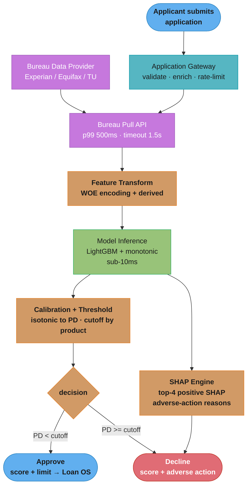
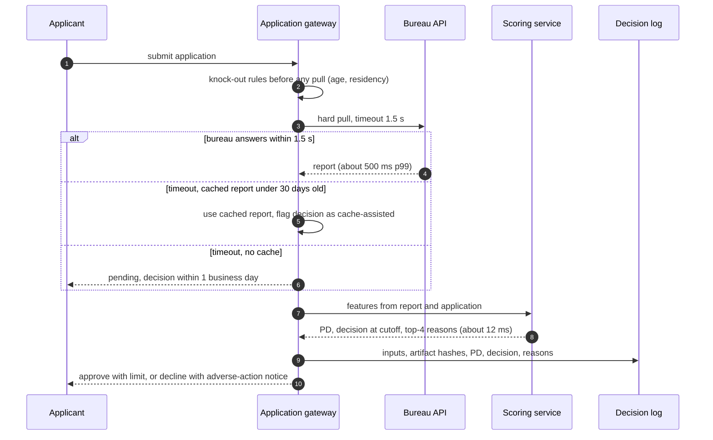
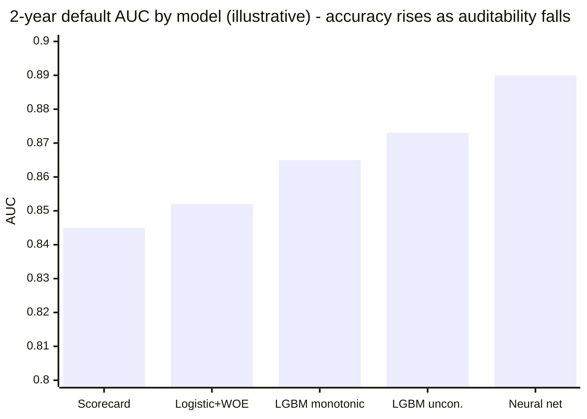
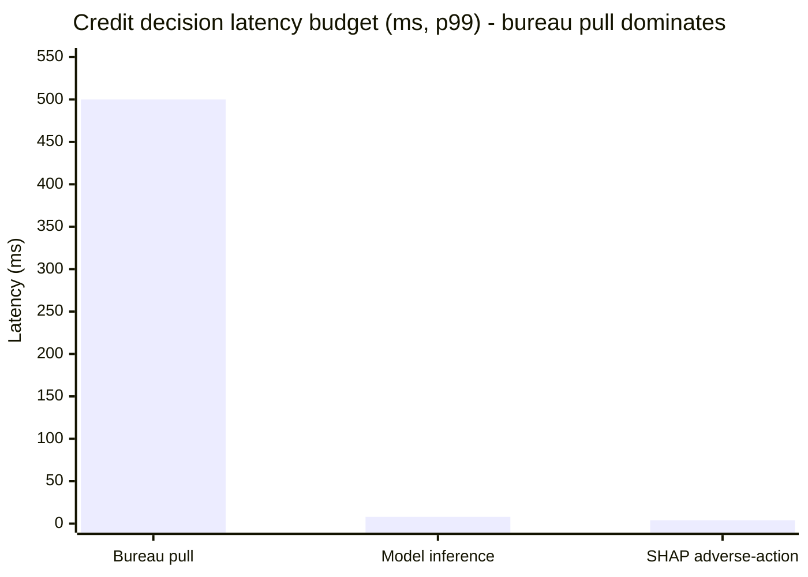

# Design a Credit Risk Scoring System
## Intuition

> A credit risk model is like a judge who must explain every ruling in plain language and whose decisions are reviewed by regulators who can overturn them. Accuracy matters, but so does the ability to articulate the reasoning — even when the reasoning is uncomfortable.

**Key insight:** credit risk is the canonical example where the algorithm selection decision is NOT made by the data scientist. In the US, ECOA (implemented by Regulation B) and FCRA require that declined applicants receive a statement of the *specific principal reasons* for the denial, drawn from the applicant's own characteristics. Basel III is a separate regime — it governs capital adequacy and the validation of internal-ratings-based models, not adverse-action notices — so do not cite it as the source of the explanation duty. Crucially, the law does not ban black-box models outright: CFPB Circular 2022-03 (May 2022) states that model complexity is no excuse, so a creditor whose model cannot yield accurate specific reasons simply cannot lawfully use it for that decision. The practical effect is the same, and the engineering challenge is extracting maximum accuracy from models that can defend every denial, not choosing the most accurate model regardless of interpretability.

Mental model: think of credit risk as a constrained optimization problem: maximize predictive accuracy subject to (a) the model produces interpretable, auditable scores; (b) no feature has disparate impact on protected classes without business justification; (c) the decision threshold corresponds to a documented default probability; (d) adverse-action reasons can be generated for any declined applicant.

Why the model's value is measured in swaps, not AUC: a new model changes money only through the applicants it treats *differently* from the old one. §4.6 runs a swap-set analysis where a challenger with the same 35% approval rate swaps ~6,000 of 100,000 applicants and cuts expected loss on the book from $6.4M to $5.2M; the AUC gain behind that is small, and it is the swap set, not the AUC, that a credit committee approves.

**Sibling studies, not duplicated here:** [Fraud Detection](design_fraud_detection.md) owns "is this applicant who they say they are" and runs in parallel; this file owns "will a genuine applicant repay". The payments-side risk decision lives in `fintech/`, which explicitly leaves lending and credit underwriting to this study.

**Vocabulary used throughout:**

| Term | Meaning here |
|---|---|
| PD | Probability of default: here, 90+ days past due within 24 months of origination |
| LGD / EAD | Loss given default (share of exposure lost) / exposure at default (balance owed when it happens) |
| Expected loss | `PD × LGD × EAD`, summed over the approved book |
| Cutoff | The PD (or score) above which applications are declined; a credit-policy decision, not an ML one |
| Swap-in / swap-out | Applicants a new model approves that the old one declined / declines that the old one approved |
| Reject inference | Estimating outcomes for declined applicants, who generate no repayment data |
| WOE / IV | Weight of Evidence binning and Information Value, the scorecard's feature encoding and screening statistic |
| Adverse-action reasons | The specific principal reasons a declined applicant must be given under ECOA/Regulation B |
| MRM | Model risk management: independent validation, monitoring, documentation and governance (SR 26-2) |

---

## 1. Requirements Clarification

**Functional requirements:**
- Score every new loan application within 2 seconds of submission (real-time, synchronous).
- Output: (a) a risk score on a bureau-style scale (FICO and VantageScore 3.0/4.0 both run 300-850; pick one and document it) or a predicted default probability; (b) approve/decline decision at a pre-specified threshold; (c) adverse-action reasons (top 4 factors) for all declined applicants.
- Support three product lines: personal loans ($2k-$50k), credit cards (revolving), and buy-now-pay-later (BNPL).
- Bureau data refresh: pull fresh bureau report for each application; use application-time snapshot only (PIT).
- Underwriter review: flag borderline applications (score within ±30 points of the cutoff) for human review.

**Non-functional requirements:**
- Latency: p99 < 2 seconds end-to-end (including bureau pull).
- Throughput: 50k applications/day peak (Black Friday for BNPL); 5k applications/day average.
- Availability: 99.95% (max 4.4h downtime/year); credit decisions cannot be "eventually consistent."
- Regulatory: model must pass model risk management (MRM) review under the interagency guidance (SR 26-2, April 2026). Supervisory examination is on the OCC's statutory cycle, not a schedule we choose: 12 CFR 4.6 requires a full-scope on-site examination of each national bank at least once every 12 months (18 months for well-capitalized banks under $3B in assets). Our *internal* MRM re-validation is the bi-annual item.
- Fairness: demographic parity difference ≤ 0.05 by race/ethnicity for approval rate at any given income band; equalized odds must be documented and justified if violated.
- Explainability: adverse-action reasons auto-generated for 100% of declined applications; ECOA/FCRA compliant reason codes.

**Out of scope:**
- Pricing (interest rate optimization): separate model.
- Collections: separate recovery model.
- Application fraud detection: runs in parallel (separate system).

**Clarify with the interviewer (each answer changes the design):**
- Bank, fintech lender with a partner bank, or marketplace lender? It decides who runs MRM and which supervisor examines the model.
- Which products and tenors? The label window (24 months for personal loans, ~90 days for BNPL) sets how stale the newest labelled data is.
- Approve/decline only, or also limit and price? Limits and pricing need expected loss, not just PD.
- Is any randomized approval below the cutoff allowed? Without it, reject inference stays imputation and swap-in performance stays a guess (§4.6).
- Which data is permitted? Alternative data (cash flow, education, employment) raises approval rates for thin files but adds fair-lending review.
- What is the explanation bar: reason codes only, or a model a validator can read end to end? A readable scorecard may beat a better GBDT on that bar.

---

## 2. Scale Estimation

**Application volume:** 5k avg/day, 50k peak/day. Annual: ~2M applications. Approval rate ~35% → 700k loans originated per year.

**Bureau data:** each application triggers 1 bureau pull from Experian/Equifax/TransUnion (~500ms, external API). Bureau report: ~200 attributes (trade lines, inquiries, delinquencies, public records). Bureau cost: $0.50-$1.50 per pull → $1M-$3M/year bureau costs.

**Model serving:** LightGBM with monotonic constraints OR logistic regression on WOE-encoded features. p99 inference: <10ms (not the bottleneck; bureau pull is the bottleneck at 500ms p99).

**Training data:** 7 years of origination history (regulatory requirement for model validation backtesting). 2M applications/year × 7 years = 14M training examples. 24-month performance window (2-year default rate is the standard label). 14M × 200 features = 2.8B feature values: ~28GB of training data in Parquet.

**Adverse-action generation:** 100% of declined applications (~65% of applications) receive adverse-action notice. At 5k applications/day: 3,250 adverse-action notices generated per day. Each requires SHAP computation: 3,250 × 200 features × TreeSHAP: ~15 seconds total (trivial).

**Infrastructure:**
- Serving: 2 redundant API servers (c5.2xlarge, 4 cores each); stateless, horizontally scalable.
- Model size: LightGBM with monotonic constraints, 500 trees: ~50MB model file.
- No GPU required: all serving is CPU-based; sub-10ms per inference on a single CPU core.

**Worked scale math the interviewer will probe:**

| Quantity | Derivation | Result |
|---|---|---|
| Book size | 700k loans/year × assumed $1,000 average funded balance | ~$700M originated per year (the portfolio figure §10 uses) |
| Expected loss at a 4% 24-month PD | 700k × 4% × 50% LGD × $1,000 | ~$14M per vintage |
| Value of 0.1pp of PD on the book | 700k × 0.1% × 50% × $1,000 | ~$350k per vintage, which is why a 0.5pp AUC gain is worth a quarter of MRM work |
| Label latency | 24-month default window | the newest *fully* labelled vintage is 2 years old; monitoring leans on 6-month delinquency proxies |
| Swap set per release | at a fixed approval rate, the share of approvals that change depends on how different the models are; 17% in the §4.6 simulation | at 700k approvals/year, a 10% swap set is ~70k loans/year whose outcome the release actually changes |
| Randomized below-cutoff approvals for reject inference | assume 1% of declines | ~13k loans/year at a higher PD; at a 15% PD, $1,000 and 50% LGD, ~$1M/year of deliberate expected loss |

The last row is the price of learning about the rejected region; it is a credit-policy budget line, approved like any other, not a side effect of the model.

---

## 3. High-Level Architecture



*The bureau pull (frozen, external) dominates the 2s latency budget; everything after it — WOE transform, constrained inference, calibration, and the SHAP branch that manufactures the legally required adverse-action reasons — is sub-20ms.*

**Component inventory:**
- **Application Gateway:** validates input, rate-limits, enriches with internal application data (employment, stated income).
- **Bureau Pull API:** async call to bureau data provider; p99 500ms; timeout 1.5s with retry.
- **Feature Transform:** computes WOE encodings and derived features from bureau attributes + application data.
- **Model Inference:** LightGBM with monotonic constraints loaded from model registry; sub-10ms inference.
- **Calibration + Threshold:** isotonic calibration layer converts score to default probability; threshold lookup by product line.
- **SHAP Engine:** TreeExplainer on the LightGBM model; top-4 *positive* SHAP features (those that pushed predicted default risk up) → adverse-action reason codes, matching the diagram and the §4.4 code.
- **Decision API:** synchronous response to application gateway; p99 < 2s (dominated by bureau pull).

**Reject inference path:** declined applicants are a biased sample (we observe no performance for them). Reject inference models are trained separately to impute likely outcomes for historical declines, correcting selection bias in the training data.

The synchronous decision path, including what happens when the bureau is slow:



*The model is the smallest box on the path. The bureau call dominates latency and cost, and the decision log is the step that makes every later dispute answerable (§4.7, Runbook 5).*

---

## 4. Component Deep Dives

### 4.1 WOE Encoding and Scorecard Construction

```python
import numpy as np
import pandas as pd
from dataclasses import dataclass

@dataclass
class WOEBin:
    feature: str
    bin_range: tuple[float, float]
    woe: float
    iv_contribution: float
    n_events: int
    n_non_events: int
    event_rate: float

def compute_woe_bins(
    df: pd.DataFrame,
    feature: str,
    target: str,
    n_bins: int = 10,
) -> list[WOEBin]:
    """
    Weight of Evidence (WOE) encoding for credit scorecard.
    WOE = ln(P(X in bin | Bad) / P(X in bin | Good))
    IV (Information Value) = sum((P_bad - P_good) * WOE)
    Siddiqi's conventional bands: <0.02 unpredictive; 0.02-0.1 weak; 0.1-0.3 medium;
    0.3-0.5 strong; >0.5 is NOT "stronger still" — it is the standard leakage smell,
    so investigate the feature before using it.
    """
    df = df.copy()
    df["bin"] = pd.qcut(df[feature], q=n_bins, duplicates="drop")

    total_events = int(df[target].sum())
    total_non_events = int((df[target] == 0).sum())
    bins = []

    for bin_val, grp in df.groupby("bin"):
        events = int(grp[target].sum())
        non_events = int((grp[target] == 0).sum())
        dist_e = (events + 1e-9) / total_events
        dist_ne = (non_events + 1e-9) / total_non_events
        woe = float(np.log(dist_e / dist_ne))
        iv_contrib = float((dist_e - dist_ne) * woe)
        bins.append(WOEBin(
            feature=feature,
            bin_range=(float(bin_val.left), float(bin_val.right)),
            woe=woe,
            iv_contribution=iv_contrib,
            n_events=events,
            n_non_events=non_events,
            event_rate=events / (events + non_events + 1e-9),
        ))
    return bins

def scorecard_points(
    log_odds_offset: float,   # ln(base_odds) at which the score equals base_score
    pdo: int,           # Points to Double Odds (standard: 20 or 25)
    base_score: int,    # typically 600 or 700
) -> dict[str, float]:
    """
    Converts log-odds to a scorecard point scale (Siddiqi convention).
    Score  = Offset + Factor × ln(odds)      # odds = good:bad, so score rises with
    Factor = PDO / ln(2)                     # creditworthiness and each doubling of
    Offset = base_score - Factor × ln(base_odds)   # the odds adds exactly PDO points
    Mirror the signs throughout if you define odds as bad:good instead.
    """
    factor = pdo / np.log(2)
    offset = base_score - factor * log_odds_offset
    return {"factor": factor, "offset": offset}
```

### 4.2 LightGBM with Monotonic Constraints — Broken Then Fixed

```python
import lightgbm as lgb
import numpy as np

# WRONG: unconstrained GBDT — may learn spurious inversions
lgbm_wrong = lgb.LGBMClassifier(
    n_estimators=500,
    learning_rate=0.03,
    random_state=42,
)
lgbm_wrong.fit(X_train, y_train)
# Problem: model may learn "higher income → higher default risk" in a narrow income band
# due to correlation with debt-to-income ratio or sparse data.
# This is legally indefensible and intuitively wrong.
# Regulator: "Why does your model penalize applicants with income $80k-$90k?"
# Answer: "The data said so" → not acceptable.
```

```python
# CORRECT: monotonic constraints enforce business-rational direction
# +1 = monotone increasing (feature ↑ → default risk ↑)
# -1 = monotone decreasing (feature ↑ → default risk ↓)
#  0 = unconstrained

feature_names = [
    "income_annual",             # ↑ income → ↓ risk = -1
    "debt_to_income_ratio",      # ↑ DTI → ↑ risk = +1
    "credit_score",              # ↑ score → ↓ risk = -1
    "delinquency_count_24m",     # ↑ delinquencies → ↑ risk = +1
    "credit_utilization_pct",    # ↑ utilization → ↑ risk = +1
    "employment_years",          # ↑ tenure → ↓ risk = -1
    "inquiry_count_6m",          # ↑ inquiries → ↑ risk = +1
    "open_accounts",             # unconstrained (U-shaped relationship)
]

monotone_constraints = [-1, +1, -1, +1, +1, -1, +1, 0]

lgbm_constrained = lgb.LGBMClassifier(
    n_estimators=500,
    learning_rate=0.03,
    num_leaves=31,
    min_child_samples=100,    # conservative for regulatory model
    monotone_constraints=monotone_constraints,
    monotone_constraints_method="advanced",  # tighter enforcement
    random_state=42,
)
lgbm_constrained.fit(X_train, y_train)
# AUC cost: typically 0.5-1.5pp vs unconstrained
# Legal benefit: every monotone feature is auditable and defensible
```

### 4.3 Reject Inference

```python
import numpy as np
from sklearn.linear_model import LogisticRegression
import lightgbm as lgb

def augment_with_reject_inference(
    X_accepted: np.ndarray,   # feature matrix for accepted applicants
    y_accepted: np.ndarray,   # observed outcomes (1=default, 0=no default)
    X_rejected: np.ndarray,   # feature matrix for rejected applicants (no labels)
    model_type: str = "augmentation",  # "augmentation" or "parceling"
    n_iter: int = 3,
) -> tuple[np.ndarray, np.ndarray]:
    """
    Reject inference: impute likely outcomes for rejected applicants
    to correct selection bias in training data.

    Augmentation method:
    1. Train model on accepted only
    2. Score rejected applicants
    3. Assign "soft" labels: rejected score as probability
    4. Augment training data with high-confidence rejects
    """
    model = lgb.LGBMClassifier(n_estimators=200, random_state=42)
    model.fit(X_accepted, y_accepted)

    reject_probs = model.predict_proba(X_rejected)[:, 1]

    # Include rejects where model is confident they would have defaulted (>0.7)
    # or confident they would not have defaulted (<0.2)
    high_confidence_mask = (reject_probs > 0.70) | (reject_probs < 0.20)

    X_augmented = np.vstack([X_accepted, X_rejected[high_confidence_mask]])
    y_augmented = np.concatenate([
        y_accepted,
        (reject_probs[high_confidence_mask] > 0.5).astype(int),
    ])

    return X_augmented, y_augmented
```

### 4.4 Adverse-Action Notice Generation

```python
import shap
import lightgbm as lgb
import numpy as np

REASON_CODE_MAP = {
    "debt_to_income_ratio": "High ratio of debt payments to income",
    "delinquency_count_24m": "Delinquent accounts in the past 24 months",
    "inquiry_count_6m": "Too many recent credit inquiries",
    "credit_score": "Credit score does not meet minimum requirement",
    "credit_utilization_pct": "High proportion of credit limit being used",
    "employment_years": "Insufficient length of employment",
    "income_annual": "Insufficient income for requested loan amount",
    "open_accounts": "Insufficient credit history depth",
}

def generate_adverse_action_notice(
    model: lgb.LGBMClassifier,
    X_instance: np.ndarray,
    feature_names: list[str],
    n_reasons: int = 4,
) -> list[str]:
    """
    ECOA/FCRA-compliant adverse-action notice.
    Returns top N factors that most increased default risk (most negative to approval).
    """
    explainer = shap.TreeExplainer(model)
    shap_values = explainer.shap_values(X_instance.reshape(1, -1))[0]

    # Positive SHAP = increased default risk = adverse factors for the applicant
    feature_shap = sorted(
        zip(feature_names, shap_values),
        key=lambda x: x[1],
        reverse=True,
    )

    adverse_factors = []
    for feat_name, shap_val in feature_shap:
        if shap_val > 0 and feat_name in REASON_CODE_MAP:
            adverse_factors.append(REASON_CODE_MAP[feat_name])
        if len(adverse_factors) == n_reasons:
            break

    return adverse_factors
```

### 4.5 Monotonic Constraints, Verified — Broken Then Fixed (runnable)

The §4.2 snippets assume `X_train` exists and never *check* that the constraint holds. This version runs with `numpy` and `scikit-learn` only (scikit-learn's `HistGradientBoostingClassifier` takes the same `monotonic_cst` idea as LightGBM's `monotone_constraints`), and adds the test that would have caught §9 Pitfall 3: sweep each constrained feature for a sample of real applicants, hold everything else fixed, and count wrong-way moves in predicted PD.

```python
from __future__ import annotations

import numpy as np
from numpy.typing import NDArray
from sklearn.ensemble import HistGradientBoostingClassifier
from sklearn.metrics import roc_auc_score

FloatArr = NDArray[np.float64]
FEATURES = ["income_k", "dti", "utilization", "inquiries_6m"]
DIRECTION = [-1, +1, +1, +1]          # expected sign of d(PD)/d(feature)


def applicants(n: int, rng: np.random.Generator) -> tuple[FloatArr, NDArray[np.int64]]:
    income = rng.lognormal(np.log(60), 0.5, n)
    dti = rng.beta(2, 5, n)
    util = rng.beta(2, 3, n)
    inq = rng.poisson(1.0, n).astype(float)
    logit = -3.0 - 0.012 * (income - 60) + 3.0 * dti + 1.5 * util + 0.25 * inq
    y = (rng.random(n) < 1 / (1 + np.exp(-logit))).astype(np.int64)
    return np.column_stack([income, dti, util, inq]), y


# BROKEN when monotone=False: nothing stops the trees from learning wrong-way bumps.
# FIX when monotone=True: every split must respect DIRECTION.
def fit(x: FloatArr, y: NDArray[np.int64], monotone: bool) -> HistGradientBoostingClassifier:
    return HistGradientBoostingClassifier(
        max_iter=400, learning_rate=0.1, max_leaf_nodes=63, min_samples_leaf=5,
        monotonic_cst=DIRECTION if monotone else None, random_state=0,
    ).fit(x, y)


def monotonicity_violations(model: HistGradientBoostingClassifier, x: FloatArr,
                            n_rows: int = 300, n_grid: int = 25) -> dict[str, tuple[float, float]]:
    """Share of sampled applicants whose PD moves the WRONG way somewhere along a sweep of
    one feature (others held fixed), and the worst such move in PD points."""
    rng = np.random.default_rng(0)
    rows = x[rng.choice(len(x), n_rows, replace=False)]
    out: dict[str, tuple[float, float]] = {}
    for j, (name, sign) in enumerate(zip(FEATURES, DIRECTION)):
        grid = np.quantile(x[:, j], np.linspace(0.01, 0.99, n_grid))
        swept = np.repeat(rows, n_grid, axis=0)
        swept[:, j] = np.tile(grid, n_rows)
        pd_ = model.predict_proba(swept)[:, 1].reshape(n_rows, n_grid)
        step = np.diff(pd_, axis=1) * sign            # should never be negative
        wrong = (step < -1e-9).any(axis=1)
        out[name] = (float(wrong.mean()), max(0.0, float(-step.min() * 100)))
    return out


if __name__ == "__main__":
    rng = np.random.default_rng(42)
    x_tr, y_tr = applicants(20_000, rng)
    x_te, y_te = applicants(100_000, rng)
    for label, mono in (("unconstrained", False), ("monotone", True)):
        m = fit(x_tr, y_tr, mono)
        auc = roc_auc_score(y_te, m.predict_proba(x_te)[:, 1])
        viol = monotonicity_violations(m, x_te)
        print(f"{label:>13}: AUC={auc:.3f}  rows with a wrong-way move: "
              + ", ".join(f"{k}={s:.0%} (worst {w:.1f}pp)" for k, (s, w) in viol.items()))
```

```
unconstrained: AUC=0.674  rows with a wrong-way move: income_k=100% (worst 18.5pp), dti=100% (worst 26.5pp), utilization=100% (worst 21.3pp), inquiries_6m=66% (worst 32.4pp)
     monotone: AUC=0.686  rows with a wrong-way move: income_k=0% (worst 0.0pp), dti=0% (worst 0.0pp), utilization=0% (worst 0.0pp), inquiries_6m=0% (worst 0.0pp)
```

Three lessons, in the order a regulator would raise them. First, the unconstrained model is wrong-way somewhere for *every* sampled applicant, with single steps of up to 18-32 PD points; any of those applicants could receive "insufficient income" as a reason code in one band and be scored as *less* risky for lower income in another. Second, the constraint did not cost accuracy here; it *gained* 1.2 AUC points on held-out data, because on 20,000 rows with small leaves it acts as a regulariser against noise. The usual 0.5-2pp cost quoted in §11 shows up when the true relationship is genuinely non-monotone, so measure it on your data rather than assume it. Third, the check is cheap (300 applicants × 25 grid points × 4 features = 30,000 predictions) and belongs in CI as a hard gate: a sign typo in `DIRECTION` produces 100% violations on that feature immediately, which is the eight-month bug in §9 caught in one build.

### 4.6 Swap-Set Analysis: Turning AUC Into Dollars (runnable)

A credit committee does not approve an AUC; it approves a change in who gets credit. Hold the approval rate fixed, compare which applicants each model approves, and price only the difference. The simulation knows every applicant's true PD, which production never does (see the note below the output).

```python
from __future__ import annotations

import numpy as np
from numpy.typing import NDArray
from sklearn.ensemble import HistGradientBoostingClassifier
from sklearn.linear_model import LogisticRegression

FloatArr = NDArray[np.float64]
BoolArr = NDArray[np.bool_]


def book(n: int, rng: np.random.Generator) -> tuple[FloatArr, FloatArr]:
    """Applicants and their TRUE 24-month PD (known only because this is a simulation)."""
    x = rng.normal(size=(n, 6))
    logit = (-2.6 + 0.9 * x[:, 0] + 0.6 * x[:, 1] + 0.5 * x[:, 2] * x[:, 3]
             + 0.4 * np.maximum(x[:, 4], 0.0) ** 2)
    return x, 1.0 / (1.0 + np.exp(-logit))


def approve_top(pd_hat: FloatArr, rate: float) -> BoolArr:
    return pd_hat <= np.quantile(pd_hat, rate)


def swap_set_report(champ: BoolArr, chall: BoolArr, true_pd: FloatArr,
                    ead: float = 10_000.0, lgd: float = 0.5) -> None:
    groups = {"kept by both": champ & chall, "swap-in (new approves)": chall & ~champ,
              "swap-out (new declines)": champ & ~chall}
    for name, g in groups.items():
        print(f"{name:>24}: n={g.sum():>6,}  true bad rate={true_pd[g].mean():.1%}")
    for name, a in (("champion", champ), ("challenger", chall)):
        print(f"{name:>10} book: approvals={a.sum():,}  expected loss="
              f"${(true_pd[a] * ead * lgd).sum() / 1e6:,.1f}M")


if __name__ == "__main__":
    rng = np.random.default_rng(1)
    x_tr, pd_tr = book(100_000, rng)
    y_tr = (rng.random(len(pd_tr)) < pd_tr).astype(int)
    x_new, pd_new = book(100_000, rng)

    scorecard = LogisticRegression(max_iter=1_000).fit(x_tr, y_tr)        # champion
    gbdt = HistGradientBoostingClassifier(max_iter=300, learning_rate=0.05,
                                          random_state=0).fit(x_tr, y_tr)   # challenger
    champ = approve_top(scorecard.predict_proba(x_new)[:, 1], 0.35)
    chall = approve_top(gbdt.predict_proba(x_new)[:, 1], 0.35)
    swap_set_report(champ, chall, pd_new)
```

```
            kept by both: n=29,001  true bad rate=2.7%
  swap-in (new approves): n= 5,999  true bad rate=4.3%
 swap-out (new declines): n= 5,999  true bad rate=8.3%
  champion book: approvals=35,000  expected loss=$6.4M
challenger book: approvals=35,000  expected loss=$5.2M
```

At the same 35% approval rate the two models disagree on 17% of the applicants each one approves (5,999 of 35,000 swap each way). The challenger's swap-ins default at 4.3%, its swap-outs at 8.3%: it replaces bad approvals with less-bad ones, and expected loss on the book falls ~19% ($6.4M to $5.2M at a $10k exposure and 50% LGD). That single comparison is the credit memo. The catch is the swap-in row: in production those applicants were *declined* by the champion, so their bad rate is not observed. It has to be estimated, from reject inference (§4.3), from bureau performance on loans they took elsewhere, or best of all from the small randomized below-cutoff approvals priced in §2. A swap-set analysis that quietly assumes swap-ins perform like the approved population is the most common way a model change overstates its benefit.

### 4.7 From Calibrated PD to a Cutoff

The cutoff is set where the marginal approved loan stops paying for itself. For a loan with annual margin `m` (APR minus cost of funds minus servicing), term `T` years and exposure `E`, approve while

```
expected margin  >  expected loss
m × T × E × (1 − PD)  >  PD × LGD × E      →     PD*  =  m·T / (m·T + LGD)
```

With m = 8%, T = 2 years and LGD = 50%, `PD* = 0.16 / (0.16 + 0.50) ≈ 24%` before operating costs and target return; a credit policy that also demands a return on capital lands well below that, typically in single digits. Two engineering consequences: the threshold is only as good as the calibration underneath it (a model that says 6% when the observed rate is 9% silently approves a riskier book, §9 Pitfall 5), so calibration is refitted monthly per product per [Model Calibration and Thresholding](./cross_cutting/model_calibration_and_thresholding.md); and the cutoff lives in configuration owned by credit policy, versioned and logged with every decision, so a regulator can reconstruct which cutoff applied to which applicant on which day.

### 4.8 The Scorecard Baseline and Its Reason Codes (runnable)

Every GBDT in this file is measured against a WOE scorecard, and the scorecard's reason-code method is what SHAP replaced, so it is worth having in runnable form. Bin each characteristic, encode bins by WOE, fit a logistic regression on the WOE columns, then scale log-odds to points with `score = offset + factor × ln(odds)` (600 points at 50:1 good:bad, 20 points to double the odds). Reason codes come from the points an applicant *lost* against each characteristic's best bin.

```python
from __future__ import annotations

import numpy as np
import pandas as pd
from sklearn.linear_model import LogisticRegression

PDO, BASE_SCORE, BASE_ODDS = 20.0, 600.0, 50.0        # 600 points at 50:1 good:bad
FACTOR = PDO / np.log(2)
OFFSET = BASE_SCORE - FACTOR * np.log(BASE_ODDS)


def woe_table(x: pd.Series, bad: pd.Series, bins: int = 5) -> pd.DataFrame:
    b = pd.qcut(x, q=bins, duplicates="drop")
    g = pd.DataFrame({"bin": b, "bad": bad}).groupby("bin", observed=True)["bad"].agg(["sum", "count"])
    goods, bads = g["count"] - g["sum"], g["sum"]
    g["woe"] = np.log((goods / goods.sum() + 1e-9) / (bads / bads.sum() + 1e-9))   # + = safer
    return g


def bin_index(table_index: pd.IntervalIndex, value: float) -> int:
    rights = np.array([iv.right for iv in table_index])
    return int(np.clip(np.searchsorted(rights, value), 0, len(rights) - 1))


def scorecard(df: pd.DataFrame, bad: pd.Series, features: list[str]) -> dict[str, pd.Series]:
    """Points per bin per characteristic (Siddiqi scaling: score = offset + factor x ln(odds))."""
    tables = {f: woe_table(df[f], bad) for f in features}
    xw = pd.DataFrame({f: [tables[f]["woe"].iloc[bin_index(tables[f].index, v)] for v in df[f]]
                       for f in features})
    lr = LogisticRegression().fit(xw, 1 - bad)                  # log-odds of GOOD
    n = len(features)
    return {f: (beta * tables[f]["woe"] + lr.intercept_[0] / n) * FACTOR + OFFSET / n
            for f, beta in zip(features, lr.coef_[0])}


def score_and_reasons(points: dict[str, pd.Series], applicant: dict[str, float],
                      k: int = 2) -> tuple[float, list[str]]:
    """Score = sum of bin points. Reasons = characteristics with the most points LOST
    against that characteristic's best bin (the classic scorecard reason-code method)."""
    got = {f: float(p.iloc[bin_index(p.index, applicant[f])]) for f, p in points.items()}
    lost = {f: float(points[f].max()) - got[f] for f in points}
    return sum(got.values()), [f for f, _ in sorted(lost.items(), key=lambda kv: -kv[1])[:k]]


if __name__ == "__main__":
    rng = np.random.default_rng(8)
    n = 50_000
    df = pd.DataFrame({"util": rng.beta(2, 3, n), "dti": rng.beta(2, 5, n),
                       "months_on_file": rng.gamma(4, 24, n)})
    logit = -3.0 + 2.0 * df["util"] + 3.0 * df["dti"] - 0.01 * df["months_on_file"]
    bad = pd.Series((rng.random(n) < 1 / (1 + np.exp(-logit))).astype(int))
    points = scorecard(df, bad, ["util", "dti", "months_on_file"])
    for f, p in points.items():
        print(f"{f:>15}: points by bin {[round(v) for v in p]}")
    s, why = score_and_reasons(points, {"util": 0.85, "dti": 0.15, "months_on_file": 20.0})
    print(f"applicant score={s:.0f}  reasons={why}")
```

```
           util: points by bin [200, 191, 187, 178, 165]
            dti: points by bin [202, 192, 186, 178, 164]
 months_on_file: points by bin [168, 176, 182, 190, 205]
applicant score=526  reasons=['months_on_file', 'util']
```

The points table *is* the model: a reviewer can read that the highest-utilisation bin costs 35 points against the lowest, and that every characteristic moves in the expected direction, which is monotonicity by construction. The applicant scores 526, which on this scale is odds of `50 × 2^((526 − 600)/20) ≈ 3.8:1`, a PD near 21%, and the two reasons are a thin file (37 points lost on months on file) and high utilisation (35 lost). The constrained GBDT in §4.2-4.5 replaces the points table with trees and the points-lost ranking with per-applicant SHAP; the regulatory obligation (specific, accurate principal reasons) does not change, and this scorecard is the champion every challenger's swap-set memo is written against.

---

## 5. Design Decisions & Tradeoffs

**Decision 1: LightGBM with monotonic constraints over scorecard/logistic regression.**
Alternatives considered: (a) traditional scorecard (logistic regression + WOE + points table) — fully interpretable, regulator-familiar, but 4pp lower AUC than constrained GBDT; (b) unconstrained GBDT — 2pp higher AUC than constrained GBDT but cannot satisfy monotonicity requirement and cannot generate reliable adverse-action reasons per applicant; (c) neural network — 2.5pp higher AUC but zero interpretability path. Decision: constrained LightGBM offers the best accuracy-interpretability balance — it exceeds the traditional scorecard in accuracy while satisfying monotonicity constraints that make its decisions auditable. AUC improvement vs scorecard: 0.865 vs 0.845, a 2pp gain. Do not translate AUC points into loss points by rule of thumb — the conversion depends entirely on where your cutoff sits on the score distribution. Here the assumed 0.8pp absolute reduction in expected loss rate at the current cutoff is a planning assumption carried into §10, and it has to be re-derived from the swap-set analysis (which applications does the new model approve that the old one declined, and how do they perform) before anyone books the benefit. See [Algorithm Selection](../model_selection_and_algorithm_choice/model_selection_and_algorithm_choice.md).

**Decision 2: SHAP-based adverse-action over coefficient-based reason codes.**
Traditional scorecards use scorecard coefficient rankings as reason codes (the features with the most negative points = the adverse factors). LightGBM's per-instance SHAP provides the same semantic: for this specific application, which features most increased the predicted default probability? TreeSHAP is exact for the tree ensemble (it computes Shapley values in polynomial time rather than sampling, so the same input always yields the same attribution) and produces the same ordering as the scorecard coefficient approach for the dominant features. Be careful how you state the regulatory position: no US regulator has endorsed SHAP, or any other named technique, as a sanctioned adverse-action method. What exists is CFPB Circular 2022-03 (May 2022), which says algorithmic complexity does not excuse failure to give specific principal reasons, and Circular 2023-03, which says creditors may not fall back on a generic checklist of reasons when the real reason is not on it. SHAP is one defensible way to meet that bar because it is per-applicant, deterministic, and reproducible — the burden of proof stays with the creditor either way. Implementation: TreeExplainer generates SHAP values in < 5ms per application — trivial relative to the bureau pull latency.

**Decision 3: Reject inference for training data correction.**
Without reject inference, the training dataset contains only accepted applicants (selection bias). The model learns "what predicts default among people who were creditworthy enough to be approved" — not "what predicts default among all applicants." This biases the model toward applicants who look similar to historical approvals. Reject inference (augmentation method) adds high-confidence rejected cases back to the training set. Impact: +1.2pp AUC on the full applicant population (accepted + rejected) vs training on accepted only.

**Decision 4: Bi-annual model updates over continuous retraining.**
Automated retraining is not permitted without MRM (model risk management) review. Note the current guidance is explicitly risk-based: SR 26-2 (April 2026) asks that MRM effort be tailored to the model's risk profile and the institution's size and complexity, so a consumer-credit decision model at a large bank sits at the demanding end of that scale — the constraint below is what that tier looks like, not a uniform rule for every model in every institution. Instead: quarterly monitoring report; bi-annual full model retrain + MRM review; ad-hoc off-cycle update if the quarterly report shows AUC degradation > 3pp. This means the model may be up to 6 months old in normal operation — acceptable because credit bureau data changes slowly and the model is re-calibrated monthly without requiring MRM review. See [Drift Monitoring](./cross_cutting/drift_monitoring_and_retraining.md).

**Decision 5: Bureau data PIT correctness for training.**
Every historical training example uses the bureau report that was available at the time of that application — not today's bureau data. Bureau reports are pulled at application time and archived. Training data is assembled by joining archived bureau reports to origination records using the application date as the as-of timestamp. See [Feature Store and PIT Correctness](./cross_cutting/feature_store_and_point_in_time_correctness.md). Without this, the model would learn from bureau data that includes post-origination account changes — pure future leakage.

**Decision 6: Serving runtime — in-process, reproducible, boring.**
At ~5 requests/second peak the serving question is not throughput; it is reproducibility. Every decision must be re-creatable years later for an examiner or a dispute: same model artifact, same feature transform code, same cutoff, same reason-code map. That favours an in-process LightGBM model behind FastAPI with the model file, the WOE bin table, the cutoff and the reason-code map all pinned by hash in the decision log. A model server (NVIDIA Triton with the FIL backend, BentoML or KServe) is reasonable when the bank already runs one for its other models, and adds packaging and rollout tooling rather than speed. TorchServe, still named in older reference architectures, was archived on 2025-08-07 and is read-only, so it is not a candidate for a model that must be supported for its whole validation life. Whatever the runtime, run a parity test (identical PD to 1e-6 on 10,000 archived applications) before promotion, because MRM validated the *model*, and a serving change that alters outputs is a model change.

**Comparison table.** No lender publishes underwriting AUCs, so read the AUC column as an *illustrative ordering*, not measured results — the defensible content is the ranking and the size of the gaps (single percentage points, not tens), and every downstream figure in this file that leans on it is flagged as a planning assumption. Re-derive the column on your own book before quoting any of it.

| Model | AUC (2yr default, illustrative) | Adverse-action | Monotonic | Regulatory acceptance |
|---|---|---|---|---|
| Traditional scorecard | 0.845 | Yes (points) | Yes (design) | High |
| Logistic + WOE | 0.852 | Yes (coeff) | Yes (WOE) | High |
| LightGBM + monotonic | 0.865 | Yes (SHAP) | Yes (constrained) | Medium-High |
| LightGBM unconstrained | 0.873 | Approximate (SHAP) | No | Medium |
| Neural network | 0.890 | No | No | Low |



*The neural net is the most accurate model on the chart yet is un-shippable: ECOA/FCRA demand per-applicant adverse-action reasons and monotonic, defensible relationships. The chosen LightGBM-monotonic gives up ~2.5pp AUC versus the neural net to keep every decision auditable — the interpretability, not the accuracy, is the binding constraint.*

---

## 6. Real-World Implementations

*Large banks do not publish their underwriting model architectures, so the first three entries describe what the industry pattern looks like at that type of institution rather than a disclosed internal design. The Upstart and Apple Card entries rest on figures a regulator has published.*

**Large-bank credit card underwriting:** the standard shape is a constrained gradient-boosted model whose adverse-action notices are generated from per-applicant attributions mapped into an FCRA-compliant reason code library, re-validated by an independent model risk team on the institution's MRM cycle under the interagency guidance (SR 26-2). That independent validation typically includes building a challenger model and comparing it to production on a recent cohort — this is the "effective challenge" the guidance asks for, and it is why the champion/challenger machinery in §8 is not optional.

**Marketplace lending:** platforms that lend from investor capital have been running GBDT underwriting for over a decade and publish more about their models than banks do, because investors need to price the loans — top model features by importance are a common disclosure. Long training histories (7+ years of originations) and a 24-month default outcome are typical. The strongest form of reject inference is to deliberately approve a small randomized slice of applications that policy would decline, generating true outcomes for the rejected region; treat the exact slice percentage as a design parameter you set, not an industry constant.

**BNPL:** default rates run far lower than personal loans (roughly 1-3%), so the class imbalance is more extreme and the per-application loss is small while volume is enormous. The design consequence is that a binary default probability is not enough: modelling *expected loss* (probability times exposure, e.g. via quantile regression on the loss amount) supports the decision BNPL actually makes, which is a limit ("approve $500, not $2,000"), not a yes/no. The same attributions then serve double duty — adverse-action reasons for declines, and limit-increase guidance for approvals.

**Upstart:** uses an AI-native underwriting model that includes non-traditional features (educational institution, area of study, job history) alongside bureau data. The sourceable comparison against a traditional lending model comes from the CFPB itself: in an August 2019 blog post reporting results under Upstart's No-Action Letter, the CFPB said the tested model "approves 27% more applicants than the traditional model" and "yields 16% lower average APRs for approved loans," with acceptance-rate gains of 23-29% across the tested demographic segments. Higher figures circulate (Upstart has since self-reported far larger approval lifts) but those are company-reported, not regulator-verified — cite the source with the number. Regulatory timeline: CFPB issued the No-Action Letter in September 2017 and renewed it in November 2020; on June 8, 2022 the CFPB terminated it *at Upstart's own request*, after Upstart proposed adding a significant number of new model variables that the Bureau would have needed time to evaluate. A No-Action Letter is also not an approval of the model — it is a statement that the Bureau does not intend to take supervisory action, and it can end, as this one did. The same CFPB post adds a segment-level detail worth remembering: "near prime" consumers with FICO scores from 620 to 660 were approved approximately twice as frequently under the tested model. The CFPB also notes that the results were provided by Upstart and not separately replicated by the Bureau — which is exactly the caveat to attach when citing them.

**Apple Card / Goldman Sachs (NYDFS investigation):** after consumer complaints that spouses with shared finances received different Apple Card terms, the New York State Department of Financial Services investigated and published its findings on 2021-03-23. Its review covered several thousand pages of records, interviews with witnesses and applicants, and analysis of underwriting data for approximately 400,000 New York applicants, and it "did not produce evidence of unlawful discrimination against applicants under fair lending law." On gender specifically, DFS found that applications from women and men with similar credit characteristics generally had similar outcomes, and that the decisions consumers complained about were explainable and lawful; much of the perceived unfairness came from authorized users on a spouse's card assuming they shared the spouse's credit profile. The engineering lesson is the opposite of what the headlines suggested: the lender could defend itself because it could reproduce each decision and show which credit factors drove it. A model without per-applicant reasons and archived inputs (§8, Decision 6) would have had no way to answer the question.

---

## 7. Technologies & Tools

| Component | Technology | Alternative | Rationale |
|---|---|---|---|
| Model training | LightGBM (monotonic) | XGBoost, scikit-learn LogisticRegression | LightGBM faster; XGBoost also supports monotonic constraints |
| WOE encoding | custom Python (optbinning) | sklearn KBinsDiscretizer | optbinning supports monotonicity in WOE bins |
| Explainability | SHAP TreeExplainer | LIME, Integrated Gradients | TreeExplainer exact for GBDT; <5ms per instance |
| Calibration | sklearn IsotonicRegression | Platt scaling | Isotonic handles complex miscalibration; large calibration set (100k+) |
| Model registry | MLflow | SageMaker Model Registry | MLflow integrates with MRM documentation workflow |
| Model serving | FastAPI + uvicorn (in-process LightGBM) | NVIDIA Triton (FIL backend), BentoML, KServe | at ~5 req/s peak an in-process model is simplest and easiest to validate; a model server only pays off when the bank standardises serving across many models (Decision 6) |
| Fairness audit | Fairlearn, AIF360 | Custom | Fairlearn for disparate impact; AIF360 for reweighing |
| Bureau API | REST (Experian API) | Equifax Interconnect, TU | Multi-bureau for production; single bureau for development |

---

## 8. Operational Playbook

**(a) Model Evaluation Pipeline:**
- Monthly: AUC and calibration (ECE) on the prior month's originated cohort (24-month outcomes not yet available, so use 6-month delinquency as a proxy).
- Quarterly: full model health report — AUC trend, PSI per feature, Gini by product line, fairness metrics (disparate impact by race/ethnicity proxy).
- Bi-annual: MRM review — full model validation by an independent model risk team; challenger model comparison; regulatory compliance documentation update.

See [Experimentation and Online Evaluation](./cross_cutting/experimentation_and_online_evaluation.md) for shadow scoring methodology.

**(b) Observability:**
- Real-time: application latency p99 (alert if > 2.5s); bureau API availability (alert if 5xx rate > 0.5%).
- Hourly: application volume and approval rate (alert if approval rate deviates > 15% from baseline — may indicate data pipeline issue or model serving issue).
- Daily: score distribution PSI vs training baseline (alert if KS p < 0.001).
- Monthly: fairness dashboard — demographic parity difference by protected class proxy.

See [Drift Monitoring and Retraining](./cross_cutting/drift_monitoring_and_retraining.md).

**(b2) Promotion gates for a new credit model (all must pass, and MRM signs the record):**

| Gate | Check | Threshold (example) |
|---|---|---|
| Discrimination | out-of-time Gini on the latest 6-month-delinquency cohort | ≥ champion |
| Monotonicity | §4.5 sweep on 300 archived applicants per constrained feature | 0 wrong-way moves |
| Calibration | observed vs predicted PD per decile on the out-of-time cohort | every decile within ±20% relative |
| Swap set | §4.6 report at the current approval rate, swap-in bad rate estimated from randomized approvals or bureau outcomes | expected loss ≤ champion; swap-in bad rate ≤ the cutoff PD |
| Fair lending | approval-rate ratio by BISG-estimated group at matched credit profiles | ≥ 0.80 (four-fifths), and no worse than champion |
| Adverse action | reason codes generated for 100% of a 10,000-decline sample; every code maps to the approved reason list | 100% |
| Parity | PD from the production runtime vs the validated artifact on 10,000 archived applications | max difference < 1e-6 |
| Shadow | 30-60 days scoring live applications without deciding | approval-rate and score-distribution shifts explained in the memo |

**(c) Incident Runbooks:**

**Runbook 1 — Bureau API outage:**
Symptom: bureau API 5xx rate > 5%; applications failing.
Mitigation: switch to cached bureau data (if applicant has a recent bureau pull < 30 days old in cache); flag decision as "bureau-assisted with cached data."
Resolution: monitor bureau API recovery; re-pull bureau data for applications decided on cache once API recovers.

**Runbook 2 — Approval rate anomaly (sudden spike or drop):**
Symptom: approval rate changes > 15% vs prior-day average within 1 hour.
Diagnosis: check input feature distributions (are all bureau fields present? is income being passed correctly?); check model serving version (did a deployment occur?); check for upstream schema change.
Mitigation: if deployment related, roll back to previous model version.
Resolution: identify root cause; document in model change log.

**Runbook 3 — Adverse-action generation failure:**
Symptom: SHAP engine returns error; adverse-action notice cannot be generated.
Mitigation: fall back to WOE-based reason codes (the top-4 WOE features for the applicant's bureau profile) — this is a legally compliant fallback.
Resolution: fix SHAP engine bug; reprocess affected applications retroactively.

**Runbook 4 — Fairness audit alert (disparate impact > 0.05):**
Symptom: quarterly report shows approval rate for minority group is < 80% of majority group rate at the same income band.
Mitigation: do not immediately change the model; notify legal and compliance.
Resolution: root-cause analysis (is the disparity due to a legitimate risk predictor, a proxy variable, or historical bias?); engage legal for business necessity justification or model remediation.

**Runbook 5 — A decision cannot be reproduced for a dispute or an examiner:**
Symptom: re-scoring an archived application gives a different PD or different reason codes than the notice the applicant received.
Diagnosis: compare the decision log's pinned hashes (model file, WOE table, cutoff config, reason-code map, feature code version) against what was loaded; the usual cause is a hot-fixed reason-code map or a feature transform changed without a model version bump.
Mitigation: freeze further changes to the drifted component; re-derive affected decisions from the archived artifacts.
Resolution: make every artifact that touches a decision immutable and hash-pinned in the log, and add the §8 parity gate to every deploy, not only to model releases.

---

## 9. Common Pitfalls & War Stories

*These five are illustrative composites, written up with representative numbers so the failure mechanics are concrete. They are not accounts of specific public enforcement actions or disclosed incidents, and the institution labels and years are scene-setting only. Real fair-lending enforcement actions are public record — cite those by name if you need one; do not cite the dollar figures below as if they were.*

**Pitfall 1 — Reject inference ignored, consumer lender.**
Lender trained the credit risk model on accepted applicants only. When the economy tightened and default rates rose, the model performed poorly on new applicants who looked different from historical approvals (lower income, thinner credit files — previously not approved). AUC dropped from 0.86 to 0.79 within 6 months of the economic shift. Root cause: training data was not representative of the population the model would score during economic stress. Reject inference built on a randomized holdout — a small slice of would-be declines approved deliberately — would have given the model exposure to these borrower profiles. The loss is the compounding kind: every retrain inherits the previous generation's blind spot. Impact at this study's scale: a 7-point AUC drop during a downturn, on a book where 0.1pp of PD is worth ~$350k per vintage (§2), is plausibly a multi-million-dollar vintage before the quarterly report even flags it.

**Pitfall 2 — Proxy feature causing disparate impact, credit card portfolio.**
Bank included "home ownership" and "zip code median income" as features. Both are correlated with race and ethnicity due to historical redlining and residential segregation. Quantitative fair-lending analysis post-deployment showed minority applicants approved at roughly 65% the rate of white applicants with comparable bureau profiles — below the four-fifths (80%) threshold that federal enforcement agencies generally treat as evidence of adverse impact, and the kind of finding a supervisory examination will pursue. (For mortgage products the analysis would run off HMDA data collected under the Home Mortgage Disclosure Act; for a credit card there is no HMDA file, so race must be estimated with a proxy method such as BISG — see the Q&A in §11.) Remediation: remove zip-code and home-ownership features; retrain; AUC reduction of 1.2pp; but disparate impact difference dropped from 0.28 to 0.04. The real exposure in cases like this is remediation, restitution to affected applicants, and a consent order, not a single headline penalty number. See [Responsible AI](./cross_cutting/responsible_ai_fairness_and_explainability.md).

**Pitfall 3 — Monotonic constraint violation undiscovered for 8 months, fintech lender.**
Lender deployed LightGBM with self-reported monotonic constraints but did not validate them post-training. A bug in the monotone_constraints parameter (wrong sign for credit_utilization_pct: set to -1 instead of +1) caused the model to treat higher credit utilization as lower risk. The bug went undetected for 8 months because average AUC remained high (0.87). Detection: a model auditor ran a partial dependence plot on credit_utilization — the relationship was clearly decreasing (higher utilization → lower predicted risk), opposite to expectation. Impact: mispriced risk for ~12k high-utilization applicants; estimated additional losses of $8M. Root cause: no monotonicity validation in the model deployment checklist. Fix: automated test that checks `predict_proba(X_high_utilization) > predict_proba(X_low_utilization)` for all constrained features — the §4.5 sweep is that test, and it flags a sign typo as 100% violations on the affected feature in one build.

**Pitfall 4 — Stale bureau data used in training, online lender.**
Engineering team assembled training data by joining the most recent bureau snapshot to historical application records — not the bureau snapshot that was available at the time of application. A customer who applied in 2018 with a credit score of 680 but had a score of 720 in the 2020 snapshot was trained with score=720. The model learned from misleadingly favorable bureau data for historical applications. Offline AUC: 0.89 (inflated). Production AUC: 0.81. Gap traced to PIT violation in training data assembly. Fix: archive bureau report at application time; use application-date bureau snapshot for all training. See [Feature Store and PIT Correctness](./cross_cutting/feature_store_and_point_in_time_correctness.md). Remediation cost: 3 months of data re-collection + model rebuild.

**Pitfall 5 — Threshold drift causing approval rate creep, personal loan lender.**
A model calibrated on a 3% default rate base was deployed with a threshold corresponding to "approve if p(default) < 0.08" (500 bp above the 3% base rate). Over 18 months, the actual default rate in the market fell to 1.8% (favorable economic conditions). Without recalibrating, the same threshold now corresponded to p(default) < 0.08 against a 1.8% base — approving a much riskier population than intended. Approval rate crept up from 36% to 48%. When economic conditions reversed, defaults spiked. Fix: monthly calibration using recent origination cohort; threshold re-expressed as "approve if 24-month default probability < 8% by actuarial estimate" with the actuarial estimate recalibrated monthly. See [Calibration and Thresholding](./cross_cutting/model_calibration_and_thresholding.md).

**Pitfall 6 — The swap-in assumption that booked a benefit twice, personal-loan lender.**
A challenger was approved on a swap-set analysis that priced swap-ins at the approved population's bad rate, because their real outcomes were unobserved. The memo showed a 15% expected-loss reduction. In the first two vintages the swap-ins defaulted at roughly double the assumed rate, and the realised reduction was under a third of the memo's. Impact, illustrative: on a $700M annual book with ~$14M expected loss per vintage (§2), the gap between a 15% and a 5% reduction is ~$1.4M per vintage that was budgeted and never arrived. Fix: estimate swap-in performance from randomized below-cutoff approvals or from bureau outcomes on credit the applicants obtained elsewhere, and report the swap-in bad rate with its interval in the memo (§4.6, §8 gates).

---

## 10. Capacity Planning

**Primary bottleneck: bureau API latency.**

The bureau API is the binding constraint at 500ms p99 per call. Credit decision p99 = bureau_p99 + model_inference + SHAP = 500ms + 8ms + 4ms = 512ms (well within 2s SLO). The bottleneck shifts to application volume:



*The external bureau call is ~40x the combined model + SHAP cost, so decision latency is governed entirely by the bureau, not the ML. Optimization effort belongs in bureau caching/pre-fetch, not in shaving model milliseconds.*

```
At 50k applications/day (Black Friday peak):
Requests/second = 50k / (8h peak window × 3600s) ≈ 1.7 req/s average
At 3x peak burst: 5 req/s
Bureau API concurrency: 5 simultaneous calls → 5 connections to bureau API needed

Application server sizing:
Each server: 4 cores × 2 threads = 8 concurrent requests
At 512ms avg latency: 8 / 0.512 = 15.6 req/s per server
Peak: 5 req/s → 1 server sufficient; deploy 2 for redundancy
```

**Scaling formula:**
- Applications scale: add 1 server per 15 req/s peak requirement.
- Bureau API scale: add connection pool size proportionally; negotiate with bureau provider for rate limit increase.
- If bureau p99 rises to 1.5s (SLA violation): implement async bureau pre-fetch (cache bureau data for returning applicants) to remove the blocking call from the critical path for ~30% of applicants.

**Cost model:**

| Component | Cost/month |
|---|---|
| Bureau pulls (2M/year × $1.00 avg) | $167k/month |
| Application servers (2 × c5.2xlarge) | $500/month |
| Model hosting + storage | $200/month |
| Monitoring + logging | $300/month |
| **Total infrastructure** | **~$168k/month** |
| Revenue (700k loans × $200 avg net interest income) | **$140M/year** |
| Model ROI (0.8pp lower expected loss rate vs scorecard baseline — the figure from Decision 1, not the 2pp AUC gain — × $700M portfolio × 50% LGD) | **~$2.8M/year avoided losses** |

The cost table makes one thing obvious: **bureau pulls are 99% of the run cost**, so capacity planning here is mostly bureau planning.

```
Bureau spend levers (2M applications/year at ~$1.00):
  Prequalification with a soft pull (cheaper tier, no score impact for the applicant)
    lets (assume) ~40% of applicants self-select out before the full pull -> ~$0.8M/year saved
  Reuse a pull within its validity window for re-applications (assume 10%) -> ~$0.2M/year
  Knock-out rules BEFORE the pull (age, residency, stated income floor):
    every 1% of applications rejected pre-pull saves ~$20k/year
Decision-log storage (must be kept for audit):
  2M decisions/year x (~200 bureau attributes + features + PD + 4 reasons + hashes)
  ~ 4 KB each, plus the raw bureau report ~20 KB -> ~48 GB/year; trivial to keep
  every decision for 7+ years in object storage with immutability enabled.
Peak scaling (BNPL at 100x volume, 5M applications/day):
  ~60 req/s average, ~500 req/s at checkout peaks; bureau concurrency at 500 ms
  latency = 250 open connections; model CPU is still < 1 core-second per second.
  The binding constraint becomes the bureau contract (rate limits, per-pull price),
  which is why BNPL leans on cheaper alternative data and lighter models (§11).
```

---

## 11. Interview Discussion Points

**Q: Why can't you use a neural network for consumer credit underwriting?**
**Short:** No law bans it, but ECOA and Regulation B require accurate, specific reasons for every denial; a constrained GBDT with exact TreeSHAP delivers that reproducibly, a deep net does not easily.
Nothing in the law bans neural networks; the binding constraint is that ECOA and Regulation B require specific principal reasons for every denial, and CFPB Circular 2022-03 says complexity is no defense. So the real question is whether you can produce accurate, reproducible per-applicant reasons, and for a deep model that is hard: LIME and KernelSHAP are sampling approximations, and an explanation that shifts between runs of the same input is a weak thing to hand a regulator or a plaintiff. LightGBM with TreeExplainer computes exact Shapley values for the ensemble deterministically, which is why it is the common choice — but note that no regulator has blessed SHAP or any other named method, so the burden of demonstrating the reasons are accurate stays with the creditor either way. The 2-3pp accuracy cost of using an interpretable constrained model over a neural network translates to an acceptable increase in expected losses — the regulatory, legal, and reputational risk of deploying an unexplainable model is larger than the accuracy-driven loss reduction a neural network would provide.

**Q: What is reject inference and why does it matter?**
**Short:** It estimates outcomes for declined applicants, who generate no repayment data, so the next model is not trained only on people the last model approved; randomized approvals are the strongest form.
Reject inference is the process of imputing likely outcomes (default/no default) for declined applicants, who by definition have no observed performance history, to correct selection bias in the training data. Without reject inference, the model trains only on the accepted population — which is systematically different from the full applicant population (they were already screened by the prior model's criteria). This selection bias causes the model to underestimate default risk for applicants who were previously borderline (the ones most likely to be affected by a model change). Over time, without reject inference, each generation of models inherits the biases of the prior generation. Reject inference uses the model itself (or a separate propensity model) to impute likely outcomes for historical rejects with high confidence, adding them to the training data. The strongest available evidence is randomized: deliberately approving a small slice of applications that policy would decline produces genuine outcomes for the rejected region instead of imputed ones, which is why it is worth its loss cost. Treat the size of that slice as a policy decision priced against expected losses, not a fixed industry constant — and note that all imputation-based reject inference (augmentation, parceling, fuzzy) is contested in the credit literature precisely because it infers labels from the model whose bias you are trying to correct.

**Q: How do monotonic constraints work in LightGBM and what do they cost?**
**Short:** Splits that would make predicted risk move the wrong way in a constrained feature are rejected during tree building; the cost is usually 0.5-2pp AUC and can be zero when it regularises.
Monotonic constraints restrict the learned function to be monotonically increasing or decreasing with respect to specified features — the model can only learn trees whose prediction increases (or decreases) as the constrained feature increases, across all possible combinations of other feature values. Implementation: LightGBM enforces this during tree construction by rejecting any split that would violate the monotonicity constraint on the candidate feature. The cost is typically 0.5-2pp AUC on held-out data — some real relationships in the data are non-monotone (e.g., very high income and very low income may both correlate with higher risk via different mechanisms), and constraining to monotone prevents the model from capturing these. The regulatory benefit: every prediction is defensible as "higher income → lower risk" without exceptions that would confuse regulators or applicants.

**Q: Walk me through how an adverse-action notice is generated.**
**Short:** Compute per-applicant SHAP values, take the top features that raised predicted default risk, map them to approved plain-language reason codes, and send them within 30 days of a complete application.
For a declined application, TreeExplainer computes per-feature SHAP values that show how much each feature increased (positive SHAP) or decreased (negative SHAP) the predicted default probability relative to the population baseline. The top 4 features with positive SHAP values are the adverse factors — the features that most increased the predicted default risk for this specific applicant. These feature names are mapped to FCRA-compliant plain-language reason codes (e.g., "debt_to_income_ratio" → "High ratio of monthly debt payments to gross monthly income"). The top 4 reasons are included in the adverse-action notice, which Regulation B requires be sent within 30 days of receiving a *completed* application — the clock starts at completeness, not at the moment the model returns a score, and incomplete-application and counteroffer cases have their own timing rules. The generation is deterministic and reproducible — given the same model and application, the same reasons are always generated. This reproducibility is a regulatory requirement.

**Q: How do you detect and handle disparate impact in a credit model?**
**Short:** Estimate race with BISG where it is not collected, compare approval rates with the four-fifths rule, control for legitimate credit factors, then remove proxies or justify and document the gap.
Compute approval rates segmented by race and ethnicity, then test the gaps against the four-fifths rule and control for legitimate credit factors. Getting the race data is the first problem: for non-mortgage products, creditors generally may not collect applicant race under Regulation B, so it must be estimated. The standard method is BISG (Bayesian Improved Surname Geocoding), which combines surname with census-tract composition and is the approach the CFPB itself uses in fair-lending examinations of non-mortgage credit; mortgage products instead have actual reported race in the HMDA data. Check the 4/5ths rule: if any minority group's approval rate is < 80% of the majority group's rate, investigate. Next: run a regression controlling for credit-risk-related factors (FICO score, DTI, income relative to loan amount) — if the racial disparity persists after controlling for legitimate credit factors, there is evidence of a proxy or discriminatory feature. Remove candidate proxies (zip code, home ownership) and re-measure. If the disparity disappears, the proxy was the cause. If it persists, it may reflect genuine differences in credit file composition — document this as a business necessity justification or implement a fairness-aware reweighing. See [Responsible AI, Fairness, and Explainability](./cross_cutting/responsible_ai_fairness_and_explainability.md).

**Q: What is the threshold setting process for a new credit product?**
**Short:** Credit policy picks a target PD the product's margin can carry, the cutoff is applied to calibrated probabilities, and observed default rates near the cutoff are checked and re-reviewed quarterly.
The threshold is a risk policy decision, not a model decision. The model outputs a 2-year default probability. Risk policy translates this to a threshold: "We will approve applicants with predicted 24-month PD < 8%." This target PD corresponds to an expected loss rate that the product's APR can sustain profitably (the spread between loan APR and cost of funds must exceed expected losses + operating costs + target return). After threshold setting, validate calibration: at the chosen threshold, is the observed default rate in a recent holdout cohort actually close to 8%? If not, recalibrate. The threshold is re-evaluated quarterly against actual performance and may be adjusted (tightened in economic downturns, loosened in expansions) as part of the regular credit policy review. This re-evaluation does NOT require a model retrain — it is a threshold shift on the existing calibrated probabilities. See [Calibration and Thresholding](./cross_cutting/model_calibration_and_thresholding.md).

**Q: How do you validate a credit model before deployment?**
**Short:** Out-of-time backtests, a recent-cohort check on delinquency proxies, independent MRM validation with a challenger model, then 30-60 days of shadow scoring before promotion.
Four validation layers: (1) offline backtesting — evaluate model on 2+ years of historical originations using temporal holdout (train on data before date T, test on data after T); measure AUC, Gini, KS statistic, and PSI vs prior model; (2) out-of-time validation — test on the most recent 6-month cohort where 6-month delinquency proxy is available; (3) model risk management review — independent team validates methodology, data, assumptions, and regulatory compliance; they train a challenger model and compare; (4) shadow scoring — new model scores production applications alongside the live model for 30-60 days; approval rate, score distribution, and feature distribution are compared; if consistent, promote to production. The interagency model risk guidance — SR 26-2 since April 2026, SR 11-7 before it — does not prescribe these four layers by name; what it requires is independent validation, ongoing monitoring and full documentation before a material model change goes live, and these four layers are how a consumer-credit team typically discharges that.

**Q: What happens to the model during an economic recession?**
**Short:** Base rates rise and feature relationships shift; recalibrate monthly for label shift, watch early delinquency proxies for concept drift, and tighten the cutoff by policy while the model is updated.
Two types of drift occur simultaneously: (a) concept drift — the relationship between features and default changes (customers with DTI=0.35 who were low-risk in 2019 may be high-risk in 2023 due to wage stagnation and rising interest rates); (b) label shift — the overall default rate increases (the prior shifts). Both require response: (a) for label shift, recalibrate the model monthly to adjust the predicted probability to match the new base rate; (b) for concept drift, track AUC on recent cohorts using short-term proxy labels (30-day delinquency, 60-day delinquency) rather than waiting for 24-month outcomes. If AUC on 60-day proxy degrades > 3pp, trigger an emergency MRM review and off-cycle model retrain. In a recession: also tighten the approval threshold immediately (credit policy decision) while the model is being updated, because the model's 24-month PD estimates were calibrated for the pre-recession distribution.

**Q: How would you extend this system to support BNPL (Buy Now Pay Later)?**
**Short:** Add alternative data for thin files, use a lighter model for a checkout latency under 500ms, label on a 90-day default window and make limits depend on purchase size.
BNPL differs from personal loans in three ways: (1) much smaller loan amounts ($50-$2,000) → default impact per application is small, but volume is very high (100x personal loan volume); (2) very thin credit files — many BNPL applicants have limited bureau history; (3) decision latency requirement is harsher (<500ms from checkout to decision). Changes to the model: (a) alternative data sources — bank transaction data (via Plaid/open banking), device fingerprint, merchant category, and purchase behavior complement thin bureau files; (b) lighter model for latency — logistic regression on WOE features rather than GBDT (p99 inference < 1ms vs 10ms for GBDT); (c) different label — 90-day default (not 24-month) due to shorter BNPL tenor; (d) dynamic threshold — BNPL approval decisions may be made differently at checkout of a $50 item vs a $1,500 item, with a higher threshold (lower risk tolerance) for larger amounts.

**Q: How do you handle the case where two models for the same product disagree on an application?**
**Short:** The champion decides in production; the disagreement rate and the later performance of the swap sets are evidence for or against promoting the challenger.
During champion/challenger shadow scoring, the challenger may approve an application that the champion declines (or vice versa). In production, the champion's decision always governs. But the disagreement pattern is an important diagnostic: (a) compute the fraction of applications where the two models disagree; high disagreement rate (> 10%) means the models have materially different decision boundaries, warranting investigation; (b) for applications where the challenger approves and the champion declines, track 6-month delinquency rates if these are eventually approved by underwriters — this gives a signal of whether the challenger's approvals would have performed well; (c) disagreement cases are fed into the model review process as evidence for or against promotion.

**Q: What is the US model risk management guidance and how does it affect your ML system design?**
**Short:** SR 26-2 (April 2026) replaced SR 11-7 and keeps its pillars: independent validation, monitoring, documentation and governance, now scaled to model risk; it forces registries and gated releases.
The controlling document is now SR 26-2, "Revised Guidance on Model Risk Management," issued April 17, 2026 by the Federal Reserve, OCC and FDIC, which superseded the long-standing SR 11-7 (April 2011) and SR 21-8. Know both names: SR 11-7 is what most existing literature, tooling and job descriptions still say, and its four pillars carry straight over — (1) independent model validation by a team separate from the developers, (2) ongoing monitoring with defined thresholds that trigger re-validation, (3) comprehensive documentation of purpose, assumptions, data, methodology, validation results and limitations, and (4) governance with clear ownership, approval and change management. What SR 26-2 changes is emphasis rather than architecture: it is explicitly risk-based, asking that the intensity of model risk management be proportionate to the model's risk profile and to the institution's size and complexity (the agencies flag it as most relevant to banking organizations above $30B in assets), it narrows the definition of a "model" to exclude simple arithmetic calculations such as ordinary spreadsheet formulas, and it deliberately carves generative and agentic AI out of scope as too novel and fast-moving to cover — so do not assume it answers your LLM governance questions. The system-design consequences are unchanged: an immutable model registry with full provenance (who trained it, when, on what data, with what validation results), a champion/challenger framework for every model change, periodic monitoring reports reviewed by model risk management, and no automated retraining that reaches production without MRM review. A consumer-credit decision model sits at the high-risk end of the proportionality scale, so it gets the full treatment.

**Q: How do you translate a challenger's AUC gain into a number a credit committee will approve?**
**Short:** Run a swap-set analysis at a fixed approval rate: price only the applicants the two models treat differently, using estimated bad rates for swap-ins, and report the change in expected loss.

AUC summarises ranking over all thresholds; the business runs at one cutoff. In §4.6 two models at a 35% approval rate swap ~6,000 of 35,000 approvals each way, the swap-ins default at 4.3% against 8.3% for the swap-outs, and expected loss on the book falls ~19%. The honest version of this memo states how the swap-in bad rate was estimated (randomized approvals, bureau outcomes elsewhere, reject inference) and its interval, because those applicants were declined by the champion and have no observed outcome.

**Q: How do you prove a deployed model's monotonic constraints actually hold?**
**Short:** Sweep each constrained feature over its range for a sample of real applicants with everything else fixed, and fail the build on any wrong-way move in predicted PD.

Declaring constraints in the training config is not evidence; a sign typo or a feature-order mismatch silently inverts one. The §4.5 test sweeps 300 archived applicants across 25 grid points per feature, 30,000 predictions in total, and reports the share of applicants with any wrong-way step and the worst step in PD points. An unconstrained model there shows wrong-way moves for every sampled applicant, up to 32 points; the constrained one shows none. Run it in CI on every candidate and again on the production runtime as part of the parity gate.

**Q: How do you choose the PD cutoff from first principles?**
**Short:** Approve while expected margin exceeds expected loss: with margin m over T years and loss given default L, the break-even PD is mT/(mT + L), then tighten for operating cost and required return.

At an 8% annual margin over 2 years with 50% LGD the break-even PD is about 24%; operating costs and a return on capital pull the policy cutoff far lower. The ML system's job is to make the PD calibrated so the cutoff means what credit policy thinks it means, per product and per month, and to log which cutoff version applied to each decision. The cutoff itself is a credit-policy decision owned outside the ML team.

**Q: What must you log for every credit decision, and why?**
**Short:** The inputs as received, the model, feature-code, WOE-table, cutoff and reason-map versions by hash, the PD, the decision and the reasons, so any decision can be reproduced exactly for a dispute or an examiner.

Disputes and examinations arrive months or years later, after several model releases. If you cannot re-create a specific decision bit for bit, you cannot show the reasons were accurate, which is the core ECOA obligation. Keep the raw bureau report as pulled at application time (it is also the point-in-time training record), pin every artifact by hash, and store the log immutably; at ~2M decisions a year it is tens of gigabytes. The Apple Card investigation in §6 is the positive example of this paying off: the lender could show the factors behind each complained-about decision.

**Q: Why is serving runtime a model-risk question in credit, and what would you pick?**
**Short:** MRM validated a specific artifact and its outputs, so any runtime change that alters predictions is a model change and must pass a parity test before promotion.

At ~5 requests a second, throughput is irrelevant and reproducibility is everything. An in-process LightGBM behind FastAPI with hash-pinned artifacts is the simplest thing to validate. A shared model server is fine when the bank already runs one, provided every promotion passes a parity test against the validated artifact on archived applications. TorchServe is not a candidate: its repository was archived on 2025-08-07, and a credit model must be supportable for its entire validation life.
**Q: Why does a WOE scorecard still matter when a constrained GBDT is more accurate?**
**Short:** It is the transparent champion every challenger is measured against, its points table is readable end to end by a validator, and its points-lost reason codes are the baseline SHAP must match.

The scorecard in §4.8 makes every relationship visible: each bin's points, each characteristic's direction, and the exact points an applicant lost. That makes it the fallback model when SHAP generation fails (Runbook 3), the benchmark in every swap-set memo, and sometimes the right production model outright when the explanation bar is "a validator can read the whole model". A GBDT has to beat it on expected loss at the cutoff, not on AUC alone, and has to produce reasons at least as specific.