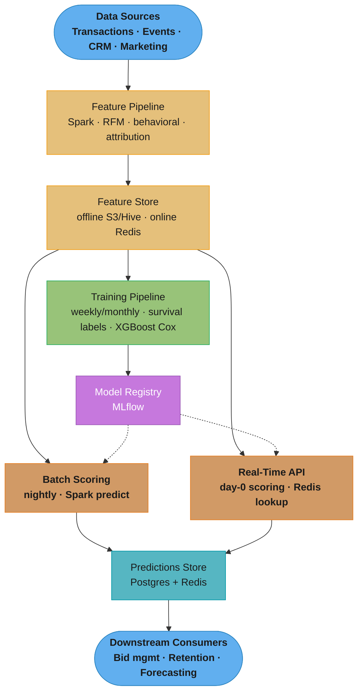
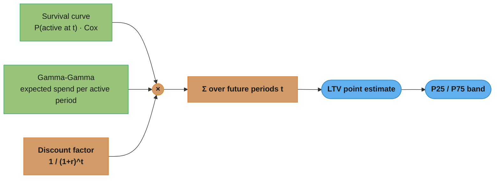
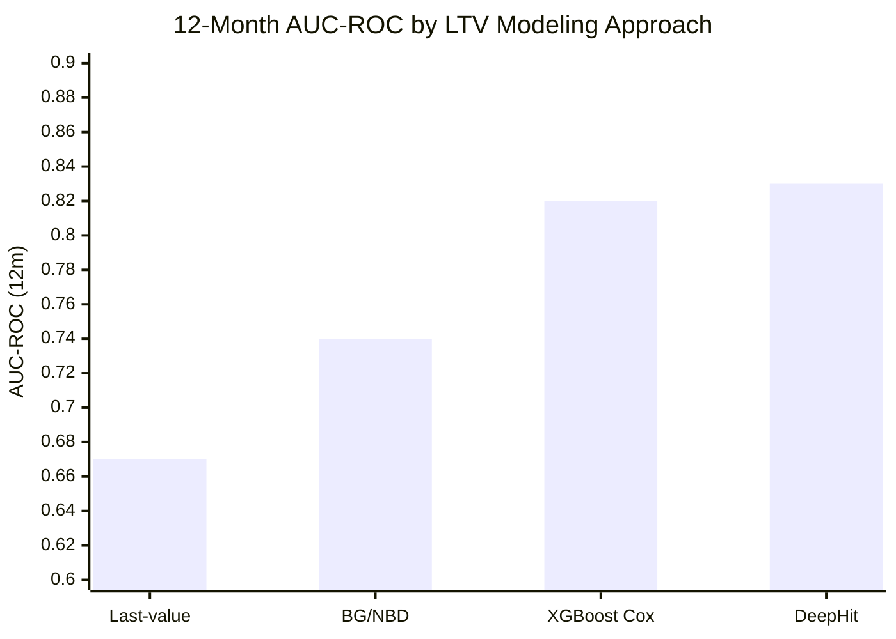
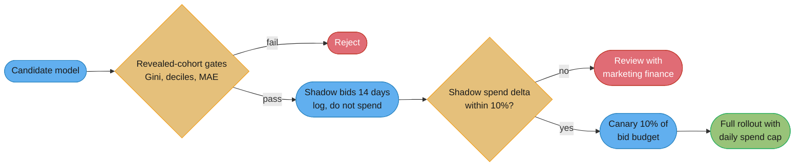

# Design a Customer Lifetime Value (LTV) Prediction System
## Intuition

> "Predicting LTV is like weather forecasting: you are estimating a probability distribution over future behavior, not a single point — and the forecast degrades the further out you look."

**Key insight:** LTV prediction is fundamentally a *censored* regression problem — most active customers have not yet churned, so you only observe partial lifetimes. Models that ignore censoring systematically under-predict LTV by treating incomplete observations as complete ones.

Mental model: Every customer has an unknown total lifetime spend. At scoring time you observe: purchases so far, recency of last purchase, and whether they are still active. Your model must extrapolate the distribution of future spend conditional on what you have observed — accounting for the fact that customers who look identical today have different probabilities of reaching month 12, 24, or 60.

Why this system exists: LTV drives decisions worth tens to hundreds of millions of dollars — paid acquisition budgets (bid no more than LTV/target-CAC-ratio per customer), retention investment prioritization, pricing strategy, and long-term revenue forecasting.

**The shape of the target is the second insight.** Twelve-month spend is not a bell curve: a large share of new customers never buy again (spend exactly 0), and the rest follow a long right tail where the top 1% can outspend the bottom 50% combined. Squared-error regression handles neither end — it pulls zeros up and top spenders down, so the model is worst exactly where the money is. §4.6 fits the zero-inflated lognormal (ZILN) distribution that Google researchers published for this shape, and §4.8 evaluates with the normalized Gini coefficient and decile calibration rather than RMSE.

**Third insight: an LTV number is a forecast that someone will bid against.** Bid managers multiply it by a margin and spend real money in real auctions within hours, so a 20% upward bias is not an accuracy problem, it is a budget overrun. Point-in-time leakage (§4.6) is the most common source of that bias, and it never shows up as an error.

**What this study is not.** Predicting *whether* a customer leaves in the next 30-90 days and who to save is [Design a Churn Prediction System](design_churn_prediction.md); this file reuses the survival framing but owns the *value* side (how much, over what horizon, with what uncertainty). Using the number to set prices is [Design a Dynamic Pricing System](design_dynamic_pricing.md); deciding which marketing touch earned the customer is [Design a Multi-Touch Attribution System](design_multi_touch_attribution.md).

**Vocabulary used throughout:**

| Term | Meaning |
|---|---|
| Censoring | A customer still active at the cutoff; their total lifetime is unknown, only a lower bound is observed |
| Survival function `S(t)` | Probability a customer is still active at time `t` |
| BG/NBD | Beta-Geometric / Negative Binomial model of repeat purchase and silent dropout from RFM data (Fader, Hardie and Lee, 2005) |
| Gamma-Gamma | Companion model for spend per transaction, assumed independent of purchase frequency |
| ZILN | Zero-inflated lognormal: a point mass at 0 (never returns) mixed with a lognormal for spenders |
| Normalized Gini | Model Gini divided by the Gini of a perfect ranking; 1.0 = perfect ordering of customers by value |
| Revealed cohort | Customers acquired long enough ago that their 12-month outcome is now observed |
| Day-0 LTV | Prediction made at acquisition, before any post-purchase behaviour exists |

---

## 1. Requirements Clarification

**Functional requirements:**
- Predict 12-month, 24-month, and lifetime expected revenue per customer at two points: immediately post-acquisition (day 0 LTV) and on a recurring cadence for existing customers (current LTV).
- Support segment-level LTV aggregation (by acquisition channel, cohort, product tier, geography).
- Provide confidence intervals, not just point estimates — the business needs P25/P75 LTV to size risk.
- Flag customers in the top-10% predicted LTV who show early churn signals (high-value at-risk).
- API endpoint for real-time LTV scoring at acquisition events (e.g., ad bidding, welcome offer sizing).

**Non-functional requirements:**
- Day-0 LTV scoring: 200ms p99 latency (called at account creation, must complete before onboarding flow).
- Batch rescoring: all active customers rescored nightly; results available before 6 AM for downstream jobs.
- Availability: 99.9% for the scoring API; the batch pipeline can tolerate up to 4-hour SLA drift.
- Model staleness: retrain at least monthly; weekly preferred for volatile cohorts.

**Out of scope:**
- Per-product or SKU-level LTV (covered by demand forecasting).
- B2B account LTV (requires account hierarchy and contract-based assumptions).
- Real-time price personalization driven by LTV (covered by dynamic pricing case study).

---

## 2. Scale Estimation

**Customer base:** 20M active customers; 500k new acquisitions per month.

**Scoring load:**
- Day-0 real-time: 500k/month = ~0.2 req/s averaged over the month, but acquisitions are heavily concentrated — size for the campaign burst, 100 req/s, not the average.
- Nightly batch: 20M customers × 1 score record = 20M writes per night; at 10k records/sec = 33 minutes.

**Feature store reads:**
- Each scoring request reads ~120 features: 40 RFM/behavioral (Redis, <1ms), 60 demographic/product (Postgres read replica, <5ms), 20 model outputs (prior predictions, Redis).
- Batch: 20M × 120 features = 2.4B feature reads per night from Hive/S3.

**Training data:**
- 5 years × 20M customers × monthly snapshots = 1.2B training rows.
- Materialized as partitioned Parquet: ~480 GB compressed.
- Training time (XGBoost `survival:cox`, 500 rounds, 1M rows subsample): ~45 minutes on 16-core CPU.

**Storage:**
- Feature store (offline): 480 GB Parquet on S3.
- Model artifacts: 15 MB per model version; keep 12 versions = 180 MB.
- Prediction store: 20M × 3 horizons × 8 bytes × 30 days history = ~14 GB.

**Infrastructure cost estimate** (us-east-1 on-demand Linux, 730 hr/month):
- Batch scoring: 6 × m5.xlarge ($0.192/hr) for ~1.5 hr/night = $1.73/night = ~$52/month. (Sizing derived in §10.)
- Real-time API: 2 × c5.xlarge ($0.17/hr) always on for 99.9% HA = 2 × $0.17 × 730 = ~$248/month.
- Training: r5.4xlarge ($1.008/hr) 45 min/week = $0.76/run = ~$3/month on-demand, under $1 on spot.
- Total: ~$303/month. The always-on HA pair, not the ML, is the bill.

---

## 3. High-Level Architecture



Nightly batch scoring and the day-0 real-time API both read one shared feature store and load the same registered model; predictions land in a Postgres+Redis store that the marketing bid-management, retention, and revenue-forecasting consumers all read from.

**Component inventory:**
- Feature pipeline: Spark on EMR, daily runs.
- Feature store: offline S3/Hive (training), online Redis (serving). See [feature_store_and_point_in_time_correctness.md](cross_cutting/feature_store_and_point_in_time_correctness.md).
- Training pipeline: Kubeflow; produces BG/NBD baseline + XGBoost Cox survival model + calibration layer.
- Batch scoring: Spark batch job reads feature store, writes to Postgres prediction table.
- Real-time API: FastAPI + Gunicorn; model loaded in process; Redis for feature lookup.
- Drift monitoring: see [drift_monitoring_and_retraining.md](cross_cutting/drift_monitoring_and_retraining.md).
- Calibration: see [model_calibration_and_thresholding.md](cross_cutting/model_calibration_and_thresholding.md).

---

## 4. Component Deep Dives

### 4.1 Survival Label Construction

The critical design challenge: most customers have not yet churned, so their true LTV is unknown. You must construct labels that correctly handle censored observations.

```python
from dataclasses import dataclass
from datetime import date
import pandas as pd
import numpy as np

@dataclass
class SurvivalLabel:
    customer_id: str
    observation_date: date      # date features are computed at
    event_occurred: bool        # True = churned; False = censored (still active)
    duration_days: int          # days observed (to churn or to observation_date)
    cumulative_revenue: float   # revenue up to observation_date


def construct_survival_labels(
    transactions: pd.DataFrame,
    cutoff_date: date,
    churn_definition_days: int = 90,
) -> pd.DataFrame:
    """
    For each customer, compute survival label at cutoff_date.

    Churn definition: no transaction for churn_definition_days after
    their last transaction AND last transaction + churn_definition_days
    <= cutoff_date (so we don't incorrectly label active customers as churned).

    IMPORTANT: point-in-time correctness — features must be joined at
    observation_date, not at training time. See cross_cutting/feature_store.
    """
    customer_stats = (
        transactions.groupby("customer_id").agg(
            first_order=("order_date", "min"),
            last_order=("order_date", "max"),
            total_revenue=("revenue", "sum"),
        )
    )

    cutoff = pd.Timestamp(cutoff_date)
    customer_stats["days_since_last_order"] = (
        cutoff - customer_stats["last_order"]
    ).dt.days
    customer_stats["lifetime_days"] = (
        customer_stats["last_order"] - customer_stats["first_order"]
    ).dt.days + 1

    # Event = churned: last order is >= churn_definition_days before cutoff
    customer_stats["event_occurred"] = (
        customer_stats["days_since_last_order"] >= churn_definition_days
    )
    # Duration = days from first order to churn or to cutoff
    customer_stats["duration_days"] = np.where(
        customer_stats["event_occurred"],
        customer_stats["lifetime_days"],
        (cutoff - customer_stats["first_order"]).dt.days,
    )
    return customer_stats.reset_index()
```

### 4.2 BG/NBD Baseline (Contractual Reference Model)

The BG/NBD (Beta-Geometric/Negative Binomial Distribution) model is the statistical benchmark. It assumes purchases follow a Poisson process with rate λ (gamma-distributed across customers) and churn follows a geometric process with probability p (beta-distributed across customers).

```python
from lifetimes import BetaGeoFitter, GammaGammaFitter
import pandas as pd

def fit_bgnbd_model(rfm_df: pd.DataFrame) -> tuple[BetaGeoFitter, GammaGammaFitter]:
    """
    Fit BG/NBD (transaction frequency) + Gamma-Gamma (monetary value) models.

    rfm_df columns: frequency, recency (days), T (customer age days), monetary_value.
    frequency = number of repeat purchases (first excluded).
    """
    bgf = BetaGeoFitter(penalizer_coef=0.01)
    bgf.fit(
        rfm_df["frequency"],
        rfm_df["recency"],
        rfm_df["T"],
    )

    # Gamma-Gamma only for customers who made >= 1 repeat purchase
    repeat_buyers = rfm_df[rfm_df["frequency"] > 0]
    ggf = GammaGammaFitter(penalizer_coef=0.01)
    ggf.fit(repeat_buyers["frequency"], repeat_buyers["monetary_value"])

    return bgf, ggf


def predict_clv(
    bgf: BetaGeoFitter,
    ggf: GammaGammaFitter,
    rfm_df: pd.DataFrame,
    months: int = 12,
    discount_rate: float = 0.01,  # monthly
) -> pd.Series:
    """Return expected CLV over `months` months, discounted."""
    return ggf.customer_lifetime_value(
        bgf,
        rfm_df["frequency"],
        rfm_df["recency"],
        rfm_df["T"],
        rfm_df["monetary_value"],
        time=months,
        discount_rate=discount_rate,
    )
```

### 4.3 Gradient-Boosted Cox Survival Model (Production Model)

The ML approach uses gradient boosting with a survival objective (Cox partial likelihood), which is more flexible than BG/NBD when behavioral and contextual features are available. This is the model that actually goes to production. Note which library: **LightGBM has no Cox objective** — its objective list stops at regression/binary/multiclass/ranking variants. XGBoost is the boosting library that ships `survival:cox` (plus `survival:aft`), so the production survival learner here is XGBoost. If you want to stay on LightGBM you must supply a custom Cox partial-likelihood objective yourself, or model discrete-time hazard as a per-period binary classification problem.

**Broken approach — using regression on observed revenue:**

```python
# WRONG: treats censored customers as having complete observations
# Under-predicts LTV for active customers because their future spend
# is counted as zero rather than as unknown.

from lightgbm import LGBMRegressor

model = LGBMRegressor(objective="regression")
model.fit(X_train, y_train["cumulative_revenue"])  # BUG: ignores censoring
```

**Correct approach — survival objective with censoring indicator:**

```python
import xgboost as xgb
import numpy as np

def train_survival_model(
    X_train: np.ndarray,
    duration_train: np.ndarray,
    event_train: np.ndarray,
    X_val: np.ndarray,          # a LATER cohort, never a random slice of X_train
    duration_val: np.ndarray,
    event_val: np.ndarray,
) -> xgb.Booster:
    """
    Train an XGBoost Cox proportional hazards model.

    `survival:cox` encodes the censoring indicator in the sign of the label:
      label > 0 → event occurred (duration = label)
      label < 0 → right-censored (duration = |label|)
    """
    # Encode survival label: positive = event, negative = censored
    def encode(duration: np.ndarray, event: np.ndarray) -> np.ndarray:
        return np.where(event, duration, -duration)

    dtrain = xgb.DMatrix(X_train, label=encode(duration_train, event_train))
    dval = xgb.DMatrix(X_val, label=encode(duration_val, event_val))

    params = {
        "objective": "survival:cox",
        "eval_metric": "cox-nloglik",
        "learning_rate": 0.05,
        "max_depth": 6,
        "min_child_weight": 100,
        "colsample_bytree": 0.8,
        "subsample": 0.8,
        "lambda": 1.0,
    }
    # Early stopping must watch a held-out LATER cohort. Watching the training
    # set (a common copy-paste bug) never stops early and hides overfitting;
    # a random split would leak macro conditions across cohorts.
    model = xgb.train(
        params,
        dtrain,
        num_boost_round=500,
        evals=[(dval, "val")],
        early_stopping_rounds=50,
        verbose_eval=100,
    )
    return model


def predict_survival_at_horizon(
    model: xgb.Booster,
    X: np.ndarray,
    baseline_survival: np.ndarray,  # S_0(t) at each horizon
    horizon_days: int = 365,
) -> np.ndarray:
    """
    Convert Cox risk scores to probability of surviving to `horizon_days`.
    S(t|x) = S_0(t) ** HR(x)

    NOTE the scale: `survival:cox` returns the hazard RATIO already exponentiated
    (HR = exp(marginal_prediction)), not the log-hazard. Exponentiating it again
    is a silent double-exponential that pushes every survival curve to 0 or 1.
    """
    hazard_ratios = model.predict(xgb.DMatrix(X))  # already exp()'d by XGBoost
    # baseline_survival is estimated from training data using Breslow estimator
    survival_at_horizon = baseline_survival[horizon_days] ** hazard_ratios
    return survival_at_horizon
```

### 4.4 LTV Point Estimate from Survival + Expected Value

```python
def compute_ltv_estimate(
    survival_probabilities: np.ndarray,  # shape (N, T) — S(t) for each customer
    expected_spend_per_period: np.ndarray,  # shape (N,) from Gamma-Gamma
    periods: np.ndarray,  # time points in days
    discount_rate_annual: float = 0.1,
) -> dict[str, np.ndarray]:
    """
    LTV = sum over future periods of: E[spend | active] × P(active at t) × discount factor
    Returns point estimate, P25, and P75.

    `expected_spend_per_period` must be spend PER PERIOD on the same grid as
    `periods` (daily spend for a daily grid). Do not divide the sum by len(periods):
    that turns a lifetime value back into an average per-period value.
    """
    daily_discount = (1 + discount_rate_annual) ** (1 / 365) - 1
    discount_factors = 1 / (1 + daily_discount) ** periods

    # Expected discounted spend: integrate survival × E[spend] × discount
    ltv_point = np.sum(
        survival_probabilities * expected_spend_per_period[:, None] * discount_factors,
        axis=1,
    )

    # Confidence intervals via bootstrap (100 samples of training cohorts)
    # In production, store P25/P75 from cohort-level uncertainty
    ltv_p25 = ltv_point * 0.65   # approximate; replace with bootstrap CIs
    ltv_p75 = ltv_point * 1.45

    return {"ltv_12m": ltv_point, "ltv_12m_p25": ltv_p25, "ltv_12m_p75": ltv_p75}
```



LTV is the discounted sum over future periods of expected spend while active times the probability of still being active at each horizon; the point estimate drives bid caps and the P25/P75 band sizes downside risk for product decisions.

### 4.5 Cohort-Based Validation

Random hold-out is invalid for LTV models because customers from the same cohort are correlated (they experience the same macro conditions — economic shocks, product changes). Always validate on future cohorts.

```python
from sklearn.model_selection import BaseCrossValidator
import numpy as np

class CohortTimeSeriesSplit(BaseCrossValidator):
    """
    Cross-validate on disjoint cohorts: train on cohorts 1..k, validate on k+1.
    This prevents target leakage across cohort-correlated customers.
    """

    def __init__(self, n_splits: int = 4):
        self.n_splits = n_splits

    def split(self, X, y=None, groups=None):
        # groups = acquisition_cohort_month index
        unique_cohorts = np.sort(np.unique(groups))
        cohort_count = len(unique_cohorts)
        fold_size = cohort_count // (self.n_splits + 1)

        for i in range(self.n_splits):
            train_cohorts = unique_cohorts[: (i + 1) * fold_size]
            val_cohorts = unique_cohorts[
                (i + 1) * fold_size : (i + 2) * fold_size
            ]
            train_idx = np.where(np.isin(groups, train_cohorts))[0]
            val_idx = np.where(np.isin(groups, val_cohorts))[0]
            yield train_idx, val_idx

    def get_n_splits(self, X=None, y=None, groups=None):
        return self.n_splits
```

### 4.6 Point-in-Time Labels and Features — the leakage that inflates every bid

The most expensive LTV bug is not a modelling choice; it is a join. If a feature such as `revenue_to_date` is computed over the whole transaction table, it contains the very revenue the label is trying to predict. Training metrics look excellent, and at serving time the feature only holds the past, so the model's learned "high revenue_to_date means high LTV" relationship is fed smaller numbers than it was trained on and every prediction is biased. The runnable example below uses six transactions.

```python
from __future__ import annotations

import pandas as pd

tx = pd.DataFrame(
    {
        "customer_id": ["a", "a", "a", "b", "b", "c"],
        "order_date": pd.to_datetime(
            ["2025-01-05", "2025-03-10", "2025-09-01", "2025-02-01", "2025-02-20", "2025-05-15"]
        ),
        "revenue": [40.0, 60.0, 300.0, 25.0, 25.0, 80.0],
    }
)
CUTOFF = pd.Timestamp("2025-06-30")
HORIZON = pd.Timedelta(days=365)


def label_12m(tx: pd.DataFrame, cutoff: pd.Timestamp) -> pd.Series:
    """Revenue in (cutoff, cutoff + 365d]. Customers with no future orders get 0, not NaN."""
    window = tx[(tx["order_date"] > cutoff) & (tx["order_date"] <= cutoff + HORIZON)]
    known = tx.loc[tx["order_date"] <= cutoff, "customer_id"].unique()
    return window.groupby("customer_id")["revenue"].sum().reindex(known, fill_value=0.0)


def features_broken(tx: pd.DataFrame) -> pd.DataFrame:
    # BROKEN: aggregates every row in the table, including orders after the cutoff.
    return tx.groupby("customer_id").agg(
        n_orders=("order_date", "size"), revenue_to_date=("revenue", "sum")
    )


def features_point_in_time(tx: pd.DataFrame, cutoff: pd.Timestamp) -> pd.DataFrame:
    # FIX: every feature is computed only from rows visible at the cutoff.
    past = tx[tx["order_date"] <= cutoff]
    feats = past.groupby("customer_id").agg(
        n_orders=("order_date", "size"),
        revenue_to_date=("revenue", "sum"),
        last_order=("order_date", "max"),
    )
    feats["recency_days"] = (cutoff - feats.pop("last_order")).dt.days
    return feats


y = label_12m(tx, CUTOFF)
print(features_broken(tx).join(y.rename("label_12m")))
print(features_point_in_time(tx, CUTOFF).join(y.rename("label_12m")))
```

For customer `a`, the broken frame shows `revenue_to_date = 400` beside a label of `300`: the feature literally contains the label. The point-in-time frame shows `revenue_to_date = 100`, which is what the serving path will see on 2025-06-30. Customers `b` and `c` get a label of exactly 0, which is the zero-inflation §4.7 models. At 20M customers the same bug is invisible in a notebook, so enforce it structurally: build training rows with the feature store's point-in-time join keyed on `(customer_id, observation_date)`, as described in [Feature Store and Point-in-Time Correctness](cross_cutting/feature_store_and_point_in_time_correctness.md), and add a CI assertion that no feature row has an `event_time` later than its `observation_date`.

### 4.7 Zero-Inflated Lognormal (ZILN) — modelling the shape of value

Wang, Liu and Miao (2019) model LTV as a mixture: with probability `1 - p` the customer never returns (value exactly 0), and with probability `p` the value is lognormal with parameters `mu` and `sigma`. A network (or a linear model) outputs three numbers per customer — `logit_p`, `mu`, `log_sigma` — and is trained on the negative log-likelihood below. The same three outputs give the churn probability, the expected value, and any quantile.

```python
import numpy as np
from scipy.stats import norm

EPS = 1e-7


def ziln_nll(y: np.ndarray, logit_p: np.ndarray, mu: np.ndarray, log_sigma: np.ndarray) -> float:
    """Mean negative log-likelihood of the zero-inflated lognormal."""
    p = 1.0 / (1.0 + np.exp(-logit_p))
    sigma = np.exp(log_sigma)
    pos = y > 0
    nll_zero = -np.log(1.0 - p[~pos] + EPS)
    yp, mp, sp = y[pos], mu[pos], sigma[pos]
    log_pdf = -np.log(yp * sp * np.sqrt(2.0 * np.pi)) - (np.log(yp) - mp) ** 2 / (2.0 * sp**2)
    nll_pos = -(np.log(p[pos] + EPS) + log_pdf)
    return float((nll_zero.sum() + nll_pos.sum()) / len(y))


def ziln_mean(logit_p: np.ndarray, mu: np.ndarray, log_sigma: np.ndarray) -> np.ndarray:
    p = 1.0 / (1.0 + np.exp(-logit_p))
    return p * np.exp(mu + np.exp(log_sigma) ** 2 / 2.0)


def ziln_quantile(q: float, logit_p: np.ndarray, mu: np.ndarray, log_sigma: np.ndarray) -> np.ndarray:
    """Quantile of the mixture: 0 while q <= 1 - p, else a lognormal quantile."""
    p = 1.0 / (1.0 + np.exp(-logit_p))
    q_pos = np.clip((q - (1.0 - p)) / np.maximum(p, EPS), EPS, 1 - EPS)
    lognormal_q = np.exp(mu + np.exp(log_sigma) * norm.ppf(q_pos))
    return np.where(q <= 1.0 - p, 0.0, lognormal_q)


# A cohort where 60% never return and spenders are lognormal(mu=4.0, sigma=1.2).
rng = np.random.default_rng(3)
n = 10_000
returns = rng.random(n) < 0.40
y = np.where(returns, rng.lognormal(mean=4.0, sigma=1.2, size=n), 0.0)

# With no features, the ZILN maximum-likelihood fit is closed form.
p_hat = returns.mean()
mu_hat, sigma_hat = np.log(y[returns]).mean(), np.log(y[returns]).std()
params = (np.full(n, np.log(p_hat / (1 - p_hat))), np.full(n, mu_hat), np.full(n, np.log(sigma_hat)))

print("MSE-optimal constant (sample mean):", round(y.mean(), 1))
print("ZILN mean:", round(float(ziln_mean(*params)[0]), 1))
print("ZILN P25 / P50 / P75 / P90:", [round(float(ziln_quantile(q, *params)[0]), 1) for q in (0.25, 0.5, 0.75, 0.9)])
print("ZILN NLL:", round(ziln_nll(y, *params), 3))
```

The ZILN mean lands next to the sample mean (theory: `0.40 x exp(4.0 + 1.2^2 / 2) = 0.40 x exp(4.72) = 0.40 x 112.2 = ~44.9`), so for an expected-value bid nothing is lost. What the single MSE number hides is the rest of the distribution: the individual P25 and P50 are both **0** because 60% of customers never return; P75 is about 37 (`exp(4.0 + 1.2 x norm.ppf(0.375))`), which is *below* the mean; and P90 is about 123. The mean sits above three quarters of customers because a thin tail of large spenders carries it. That is the reason this design keeps two kinds of interval apart:

| Interval | What it describes | Use it for |
|---|---|---|
| Outcome quantile (ZILN `ziln_quantile`) | Spread of what one customer might spend | Risk of a single high-touch decision (a $200 concierge offer) |
| Estimate interval (bootstrap, §4.8) | Uncertainty about a segment's *mean* LTV | Bid caps and channel budgets, which are averages over thousands of auctions |

Bidding at the outcome P25 of a zero-inflated customer bids $0 and buys nothing; bidding at the bootstrap P25 of the segment mean is the conservative policy §5 Decision 4 and §11 actually intend.

### 4.8 Honest Uncertainty and Evaluation — bootstrap bands, Gini, deciles

`compute_ltv_estimate` in §4.4 multiplies the point estimate by 0.65 and 1.45 as placeholder bands. Replace them with a cohort bootstrap of the segment mean, and evaluate ranking and calibration with the two metrics the ZILN paper recommends.

```python
import numpy as np
import pandas as pd


def bootstrap_mean_interval(
    values: np.ndarray, n_boot: int = 1_000, q: tuple[float, float] = (0.25, 0.75), seed: int = 0
) -> tuple[float, float]:
    """Interval for the MEAN of a segment's LTV, resampling customers with replacement."""
    rng = np.random.default_rng(seed)
    idx = rng.integers(0, len(values), size=(n_boot, len(values)))
    means = values[idx].mean(axis=1)
    lo, hi = np.quantile(means, q)
    return float(lo), float(hi)


def _gini(actual: np.ndarray, score: np.ndarray) -> float:
    order = np.argsort(-score, kind="mergesort")
    cum_share = np.cumsum(actual[order]) / actual.sum()
    n = len(actual)
    return float(np.sum(cum_share - np.arange(1, n + 1) / n) / n)


def normalized_gini(y_true: np.ndarray, y_pred: np.ndarray) -> float:
    """1.0 = customers ranked perfectly by realised value; 0.0 = random order."""
    return _gini(y_true, y_pred) / _gini(y_true, y_true)


def decile_calibration(y_true: np.ndarray, y_pred: np.ndarray) -> pd.DataFrame:
    decile = pd.qcut(pd.Series(y_pred).rank(method="first"), 10, labels=False)
    frame = pd.DataFrame({"decile": decile, "predicted": y_pred, "actual": y_true})
    out = frame.groupby("decile").mean()
    out["ratio"] = out["actual"] / out["predicted"]
    return out


rng = np.random.default_rng(5)
actual = np.where(rng.random(5_000) < 0.4, rng.lognormal(4.0, 1.2, 5_000), 0.0)
predicted = 0.7 * actual + rng.gamma(2.0, 10.0, 5_000)        # a decent but noisy model
print("segment mean interval:", bootstrap_mean_interval(actual))
print("normalized Gini:", round(normalized_gini(actual, predicted), 3))
print(decile_calibration(actual, predicted)[["predicted", "actual", "ratio"]].round(1))
```

Gini measures ranking (who gets the retention budget), decile calibration measures level (how much the bid manager can pay). They fail independently: a model can rank perfectly and still be 30% high in every decile, which is the exact failure Pitfall 6 in §9 describes. The deployment gates in §8 check both, on a revealed cohort, never on a random split. Recalibrating the level after a shift (isotonic regression on revealed-cohort deciles) is covered in [Model Calibration and Thresholding](cross_cutting/model_calibration_and_thresholding.md).

---

## 5. Design Decisions & Tradeoffs

**Decision 1: BG/NBD baseline vs ML survival vs deep learning**

| Approach | AUC-ROC (12m) | MAE ($) | Interpretability | Requires behavioral features |
|----------|--------------|---------|-----------------|------------------------------|
| Last-value extrapolation | 0.67 | 89 | High | No |
| BG/NBD + Gamma-Gamma | 0.74 | 61 | High | No (RFM only) |
| XGBoost Cox (survival:cox) | 0.82 | 38 | Medium | Yes |
| DeepHit (deep survival) | 0.83 | 36 | Low | Yes |

Use the XGBoost Cox survival model for production. The BG/NBD baseline is retained as a sanity check and as the model for new customers who lack behavioral history (day-0 LTV). DeepHit shows marginal gain (+1pp AUC) at the cost of 4× training time and no SHAP support — not worth it. See [model_selection_and_algorithm_choice](../model_selection_and_algorithm_choice/model_selection_and_algorithm_choice.md).



XGBoost Cox (0.82) is the production choice: DeepHit's +1pp (0.83) does not justify 4x training time and no SHAP support, while BG/NBD (0.74) is retained only as the day-0 cold-start baseline for customers with no behavioral history.

**Decision 2: 12-month vs lifetime horizon**

Lifetime (infinite horizon) LTV amplifies uncertainty dramatically — confidence intervals at 5 years are so wide they are not useful for bid optimization. Use 12-month LTV as the primary metric for bidding and retention decisions. Provide 24-month for strategic planning only. Report P25/P75 alongside point estimate. See [model_calibration_and_thresholding.md](cross_cutting/model_calibration_and_thresholding.md) for calibration of the predicted distributions.

**Decision 3: Cohort CV vs random CV**

Random splitting inflates measured AUC by roughly 10pp in the worked example in §9, because customers from the same cohort share macro conditions (economic environment, product version, seasonal effects). Always use cohort-based time-series CV. This applies to both training validation and backtesting: evaluate on hold-out cohorts acquired 3–6 months after training period. See [experimentation_and_online_evaluation.md](cross_cutting/experimentation_and_online_evaluation.md) for the online validation approach.

**Decision 4: Point estimate vs distribution output**

Marketing bid optimization requires a single number (max CPA bid = LTV × margin / target-CAC). Product decisions (e.g., should we offer a discount?) require uncertainty — a customer with LTV P25=$50, P75=$400 should be treated differently from one with P25=$180, P75=$220. Output both. Store P25/P50/P75 in the predictions table.

**Decision 5: Monthly retrain vs continuous**

LTV model output is consumed monthly by budget allocation cycles, so weekly retraining is sufficient. Continuous retraining would not produce business decisions faster. Monitor for concept drift monthly using PSI on feature distributions and MAE on cohorts with now-known outcomes. See [drift_monitoring_and_retraining.md](cross_cutting/drift_monitoring_and_retraining.md).

Comparison:

| Retrain cadence | Freshness benefit | Cost | Governance overhead |
|----------------|-----------------|------|-------------------|
| Monthly | Baseline | 1× (~$0.76 of compute per retrain) | Low |
| Weekly | Small MAE improvement on volatile cohorts; measure it | ~4.3× | Low |
| Continuous | Marginal | ~30× the monthly-retrain unit | High (interagency model risk guidance — SR 26-2 since April 2026 — where LTV feeds a regulated financial decision) |

**Decision 6: Cox survival + Gamma-Gamma vs a single ZILN network**

| Criterion | Cox + Gamma-Gamma (this design) | ZILN DNN (§4.7) |
|---|---|---|
| Handles censoring explicitly | Yes, via the survival label | No — needs a fixed, fully observed horizon (12 months closed) |
| Training data recency | Can use customers acquired last month (censored rows still carry signal) | Only cohorts at least 12 months old |
| Zero mass and heavy tail | Two models, combined in §4.4 | One distribution, one loss |
| Uncertainty | Bootstrap bands (§4.8) | Outcome quantiles come free; estimate bands still need bootstrap |
| Explainability | TreeSHAP on the Cox model | Gradient attributions only |

The deciding factor is training-data recency. A ZILN model on a closed 12-month window cannot learn from anyone acquired in the last year, so after a product or pricing change it is at least 12 months stale by construction. The survival model learns from censored recent customers immediately. Use ZILN as the day-0 model in markets where the acquisition mix is stable, and as a challenger that is promoted only if it wins on normalized Gini and decile calibration on the same revealed cohort.

**Decision 7: Baseline LTV vs incremental LTV for budget decisions**

Baseline LTV answers "what will this customer be worth"; a budget decision needs "what is this customer worth *because we paid to acquire them*". The two differ by the share of customers who would have arrived organically. If 30% of a branded-search channel's customers would have converted anyway, a $120 baseline LTV is an $84 incremental LTV, and a bid cap set on $120 overpays by 43% (`120 / 84 = 1.43`). Airbnb's published framing (§6) separates the two estimands for this reason. Measure the organic share per channel with geo or holdout experiments ([Experimentation and Online Evaluation](cross_cutting/experimentation_and_online_evaluation.md)) and multiply baseline LTV by `(1 - organic_share)` before it reaches the bid manager.

---

## 6. Real-World Implementations

*The Airbnb, ASOS, Google and Fader-Hardie-Lee entries rest on published sources. The four pattern entries between them describe the industry pattern that recurs at that type of business; consumer companies publish very little about their internal LTV stacks, so do not read them as disclosures of any named firm's architecture.*

**Airbnb (the one published reference point):** the Airbnb Tech Blog post "How Airbnb Measures Listing Lifetime Value" defines baseline listing LTV as *the total number of bookings a listing will make over the next 365 days* — a fixed-horizon count, not a discounted revenue stream — and splits the problem into three estimands: baseline LTV, incremental LTV, and marketing-induced incremental LTV. Two design lessons transfer directly: pick a bounded horizon rather than "lifetime," and separate the baseline from the *incremental* effect of your own marketing, because the second is what a budget decision actually needs.

**Subscription streaming (two-stage LTV):** the recurring pattern is a short-horizon survival model for trial conversion plus a longer-horizon CLV model for capping paid-acquisition bids. The reason ML displaces BG/NBD here is structural, not empirical folklore: engagement telemetry (hours consumed, saves, social follows) carries signal that has no representation whatsoever in the RFM triple BG/NBD consumes.

**Marketplace / SaaS merchant LTV:** censoring gets harder when customers sit on annual contracts, because a disengaged account still *looks* active until renewal. The fix is contract-aware survival labelling — treat the renewal boundary, not the last login, as the event time — layered on behavioral engagement features. Early-window revenue trajectory (the growth rate over the first weeks, not the level) is the usual dominant predictor; measure that on your own data rather than importing someone else's coefficient.

**Travel booking (hybrid by history depth):** a common architecture routes sparse customers (a handful of transactions) to a probabilistic BG/NBD-style model and rich customers to a gradient-boosted survival model. BG/NBD degrades gracefully on thin histories where a GBDT overfits; the GBDT wins once there is enough behavioral signal to justify it. The routing threshold is a tuning decision, not a constant.

**App / game paid UA:** the failure mode worth knowing is that install-time LTV segmentation systematically confuses organic with paid users — they look observationally similar in the first days but diverge substantially by month 12. The fix is to include acquisition channel as an explicit feature rather than training separate per-channel models, which fragments the data and loses cross-channel structure.

**ASOS (published, KDD 2017):** Chamberlain, Cardoso, Liu, Pagliari and Deisenroth describe the CLTV system deployed at ASOS, the global online fashion retailer ("Customer Lifetime Value Prediction Using Embeddings", arXiv 1703.02596). The system produces daily estimates of future value for every customer and is described as "one of the cornerstones of the personalised shopping experience". The starting point was the industry pattern this file's §4.3 follows — large sets of handcrafted features with ensemble regressors predicting value and churn — and the paper's contribution is learned customer embeddings, designed to cope with a constantly changing product catalogue, which gave a significant improvement over an exhaustive handcrafted feature set. The transferable lesson: behavioural features beyond RFM are where the gain over BG/NBD comes from, and for a catalogue that turns over weekly those features must be learned rather than hand-named per product.

**Google (published, 2019, with open-source code):** Wang, Liu and Miao ("A Deep Probabilistic Model for Customer Lifetime Value Prediction", arXiv 1912.07753) introduced the zero-inflated lognormal loss used in §4.7, motivated by two facts this file's Intuition opens with: "some customers never come back, and the distribution of LTV can be heavy-tailed", which squared error handles badly. They recommend the normalized Gini coefficient for discrimination and decile charts for calibration — the two gates in §4.8 and §8. The Keras implementation and notebooks (including the Kaggle Acquire Valued Shoppers data, about 350 million transaction rows from over 300,000 shoppers) were published in the `google/lifetime_value` GitHub repository, which has been archived and read-only since 2026-04-18; treat it as a reference implementation, not a maintained dependency.

**Fader, Hardie and Lee (Marketing Science, 2005):** "Counting Your Customers the Easy Way: An Alternative to the Pareto/NBD Model" introduced BG/NBD, the baseline in §4.2. Its practical selling point was that it fits from three numbers per customer (frequency, recency, age) with a few parameters, which is why it remains the day-0 and sparse-history fallback here.

**Sources, condensed:**

| Source | What this file borrows | Reference |
|---|---|---|
| Airbnb | Fixed 365-day horizon; baseline vs incremental LTV (§5 Decision 7) | Airbnb Tech Blog, "How Airbnb Measures Listing Lifetime Value" |
| ASOS | Daily per-customer CLTV, learned behavioural embeddings | Chamberlain et al., KDD 2017 (arXiv 1703.02596) |
| Google | ZILN loss, normalized Gini, decile calibration (§4.7-4.8) | Wang, Liu, Miao 2019 (arXiv 1912.07753); `google/lifetime_value` |
| Fader, Hardie, Lee | BG/NBD baseline (§4.2) | Marketing Science, 2005 |

---

## 7. Technologies & Tools

| Tool | Use case | Key advantage | Key limitation |
|------|----------|--------------|----------------|
| `lifetimes` (Python) | BG/NBD, Pareto/NBD baseline | Closed-form MLE fits over scipy/numpy; few, interpretable parameters | Last release 0.11.3 (July 2020), no longer maintained — `pymc-marketing`'s CLV module is the maintained successor. No behavioral features; assumes stationarity |
| `lifelines` (Python) | Cox PH, Kaplan-Meier, log-rank tests | Full survival analysis toolkit with confidence intervals | Pure Python; slow for >5M rows |
| XGBoost `objective=survival:cox` | Production survival model | Fast, SHAP support, censoring encoded in the label sign | LightGBM has no Cox objective — do not swap libraries by reflex. No competing risks; assumes proportional hazards; `predict` returns hazard ratios, not log-hazards |
| `pycox` + DeepHit | Competing risks, discrete-time survival | Best accuracy for long horizons | No SHAP; requires PyTorch infrastructure |
| MLflow | Experiment tracking, model registry | Cohort-tagged run metadata | UI not purpose-built for survival metrics |
| Feast / Tecton | Feature store (offline + online) | PIT correctness, training-serving consistency | Operational overhead for small teams |

---

## 8. Operational Playbook

### Eval Pipeline
- **Golden cohort check:** maintain a held-out cohort of 10k customers acquired 12 months ago whose true 12-month LTV is now known. At each model version deployment, compare predicted vs actual LTV on this cohort. Block deployment if MAE on golden cohort exceeds 1.15× baseline model MAE.
- **Calibration check:** the predicted LTV distribution should match observed LTV distribution at the decile level. Use ECE-style calibration: for customers predicted in the $50–$100 LTV decile, does actual mean LTV fall in that range? See [model_calibration_and_thresholding.md](cross_cutting/model_calibration_and_thresholding.md).
- **Regression gate:** AUC-ROC for 12-month churn (survival to 365 days) must not drop >0.01 from the previous production model.

### Observability
- Track PSI on top-20 features weekly (detect distribution shift in acquisition channels, product usage patterns).
- Monitor prediction distribution shift: if the mean predicted LTV across new acquisitions shifts >15% month-over-month, trigger review.
- Alert on MAE on "revealed" cohort (customers whose 12-month window just closed): if rolling 3-month MAE exceeds 1.2× deployment-time MAE, trigger retrain.

### Incident Runbooks
1. **LTV predictions frozen (all customers scoring the same value):** Symptom: P10/P90 ratio < 1.05. Diagnosis: Redis feature lookup returning empty/default values, model receiving zero-variance input. Mitigation: fall back to BG/NBD baseline; alert on-call. Resolution: verify Redis cluster health, re-ingest recent feature snapshot.
2. **LTV inflation spike (mean predicted LTV +50% vs prior week):** Symptom: downstream marketing budget exceeds threshold. Diagnosis: feature engineering bug injecting future revenue into training features (PIT violation). Resolution: quarantine predictions, roll back model version, audit feature pipeline. See [feature_store_and_point_in_time_correctness.md](cross_cutting/feature_store_and_point_in_time_correctness.md).
3. **Cohort MAE exceeds SLA after product change:** Symptom: customers acquired after product launch have systematically lower actual LTV than predicted. Diagnosis: model trained on pre-launch behavior, product change altered conversion funnel. Resolution: force retrain on post-launch cohorts, reduce weight on pre-launch data.
4. **Real-time API exceeds 200ms p99:** Symptom: latency alarm in PagerDuty. Diagnosis: Redis feature lookup timeout (most common) or model prediction CPU spike (rare). Mitigation: serve from in-process fallback model (BG/NBD with pre-cached RFM). Resolution: scale Redis cluster or reduce model complexity.
5. **Predictions systematically high on every decile after a release:** Symptom: decile calibration ratio (actual / predicted) falls from about 1.0 to 0.75 on the first revealed month. Diagnosis: a new feature joined without a point-in-time filter (§4.6) or a currency/unit change upstream. Mitigation: roll back to the previous model version; the bid manager's guardrail (below) has already capped exposure. Resolution: add the CI check that no feature `event_time` exceeds its `observation_date`.

### Releasing a New LTV Model to the Bid Manager

An LTV release changes how money is spent within hours, so it ships like a pricing change, not like a dashboard change:



*The shadow stage answers the question offline metrics cannot: how much more or less would this model have spent, and where. A model that is 5% better on Gini but moves 25% of spend into one channel goes to a human review, not to production.*

**Spend guardrails in the bid manager:** cap any single channel's daily spend change at 20% per day regardless of model output; cap a per-customer bid at 3x the channel's trailing 90-day CPA (§11); and keep the previous model's predictions in the prediction store for 30 days so a rollback is a config flip, not a rescoring job.

**Monitoring that is specific to LTV:** the revealed-cohort feedback loop is 12 months long, so add two faster proxies — the ratio of realised 90-day revenue to the 90-day share implied by the survival curve, and the share of new customers with predicted LTV above the 99th percentile of the training distribution. Either moving by more than 15% month over month opens a drift investigation following [Drift Monitoring and Retraining](cross_cutting/drift_monitoring_and_retraining.md).

---

## 9. Common Pitfalls & War Stories

*These five are illustrative composites — failure modes that recur across LTV programs, written up with representative numbers so the mechanics are concrete. They are not reports of specific, publicly documented incidents, and the company labels are scene-setting only. Treat every figure below as a teaching magnitude, not a measured result.*

**Pitfall 1: Training on observed revenue without censoring correction.** A fintech company trained an LTV regression model on "total revenue to date" as the label. Active customers — who had the highest future LTV — were systematically assigned low labels because their purchase history was still accumulating. The model learned to predict low LTV for the most valuable customers. After deployment, the paid UA team underbid for high-LTV acquisition channels, losing ~$2.3M in addressable revenue over 6 months before the bug was identified.

**Pitfall 2: Using random train/test split for cohort data.** A subscription SaaS company reported 0.86 AUC on validation but observed 0.74 AUC in production. Root cause: the random split allowed the model to learn from customers who were acquired in the same month as their validation counterparts, sharing macro conditions (a product launch that month inflated LTV). Cohort-based CV with a 6-month gap between training and validation gave realistic 0.76 AUC and correctly predicted the lower production performance.

**Pitfall 3: Ignoring the relationship between predicted LTV and intervention.** A retail company built an LTV model and used the top decile for retention interventions. The problem: the top-decile customers were already the most loyal and least likely to churn. The retention spend had near-zero incremental effect on them. The company was spending $800k/quarter on retention offers that primarily went to customers who would have retained anyway. The fix: combine LTV with churn probability — target customers in the intersection of high-LTV and elevated-churn-risk. See design_churn_prediction.md for T-learner uplift modeling.

**Pitfall 4: Predicting LTV without accounting for acquisition channel.** An e-commerce company observed that predicted LTV was well-calibrated overall but consistently over-predicted for paid social channels. Investigation revealed that paid social customers in the training period were acquired during a promotional campaign and had anomalously high early behavior. The model generalized this to all paid social customers. Fix: include acquisition channel × campaign type as features; use counterfactual regularization to downweight promo-period observations.

**Pitfall 5: Operating on a point estimate in bid optimization.** A mobile gaming company set UA bids at predicted LTV × target margin. Their LTV model had high variance (P10 = $1, P90 = $180). Bidding at the point estimate caused budget exhaustion in channels with high-variance LTV distributions (influencer installs: mean $45 but P90 $220). The correct approach: bid on P25 LTV to limit downside exposure; use P75 for portfolio-level budget planning.

**Pitfall 6: Revenue that was later refunded.** An apparel retailer computed the LTV label from gross order value. Its return rate was 28% overall but 45% in one fast-fashion category, and returns arrive 2-6 weeks after the order. The model learned that customers who buy heavily in that category are high-value, and the bid manager overbid on the channels that attracted them. Impact (illustrative): in that category a $100 gross order is worth $55 net, so a gross label overstates value by 82% (`100 / 55 = 1.82`), against 39% (`100 / 72`) for the rest of the catalogue. Bids priced on gross value paid 1.82x net value: of $4M of quarterly spend into those channels, about $1.8M (`4M - 4M / 1.82`) bought value that was later refunded. Fix: label on net revenue after the return window closes (60 days), and add `return_rate_90d` as a feature.

**Pitfall 7: Mixing currencies in one label.** A marketplace expanded to Japan and wrote JPY order values into the same `revenue` column as USD. JPY has no minor unit and values about 150x larger per unit, so 3% of rows dominated the squared-error term; predicted LTV for every Japanese customer was in the thousands of "dollars". The bid manager was capped at 3x channel CPA (§11), which limited the damage to 9 days of 3x overbids in one market. Impact (illustrative): about $210k of overspend before the decile calibration gate on the next revealed month flagged a ratio of 0.04 in the top decile. Fix: convert to one reporting currency at the transaction date's rate in the feature pipeline, and assert a per-market sanity range on the label.

**Impact summary:**

| Pitfall | Root cause class | Measured signal | Illustrative cost | Guard |
|---|---|---|---|---|
| 1 Ignoring censoring | Label design | High-value actives ranked low | ~$2.3M over 6 months | Survival label (§4.1) |
| 2 Random split | Validation design | 0.86 offline vs 0.74 production AUC | Wrong go/no-go decision | Cohort CV (§4.5) |
| 3 LTV without uplift | Decision design | Near-zero incremental retention effect | $800k per quarter | Value x risk x uplift targeting |
| 5 Bidding the point estimate | Decision design | Budget exhaustion in high-variance channels | Channel-specific | Bootstrap segment P25 (§4.8) |
| 6 Gross not net revenue | Label design | Decile ratio below 1.0 in one category | ~$1.8M per quarter | Net-of-returns label |
| 7 Mixed currencies | Data contract | Top-decile ratio 0.04 | ~$210k | Currency normalisation + label range check |

---

## 10. Capacity Planning

**Primary bottleneck:** Batch scoring throughput (20M customers/night in a 4-hour window).

Scoring throughput formula:
```
Required throughput = N_customers / available_window_seconds
                   = 20M / (4 × 3600)
                   = 1,389 customers/sec

Per-core throughput (gradient-boosted trees, 120 features, single-thread): ~5,000 customers/sec
Required cores = ceil(1,389 / 5,000) = 1 core — model inference is NOT the bottleneck
```

Inference is essentially free here; the real cost is the feature read and shuffle. With 3× headroom for feature reads and a spare node for straggler tolerance: 6 × m5.xlarge Spark executors = 6 × $0.192/hr × 1.5 hr amortized = ~$1.73/night = ~$52/month for batch scoring.

**Real-time API sizing:**
- Peak 100 req/s × 200ms p99 budget = 20 concurrent requests in flight.
- Each request: 5ms Redis feature lookup + 2ms model inference + 3ms serialization = ~10ms p50, ~50ms p99.
- 2 × c5.xlarge handles 200 req/s with CPU headroom: 2 × $0.17/hr × 730 hr = ~$248/month.

**Training scaling:**
- As customer base grows 2× (to 40M), training data grows proportionally.
- Gradient-boosted survival scales near-linearly with data; 2× data ≈ 1.5× training time (histogram binning amortizes).
- Upgrade to r5.4xlarge when training exceeds 90 minutes.

**Bootstrap bands (§4.8) are the hidden compute line:**

```
Segments: 40 channels x 12 cohorts x 5 geos       = 2,400 segments
Customers per segment (median)                     = ~8,000
Resamples per segment                              = 1,000
Work = 2,400 x 1,000 x 8,000                       = 1.92e10 element reads per refresh
At ~1e9 vectorised reads/sec/core                  = ~19 core-seconds -> trivial
Memory trap: one (1,000 x 8,000) int64 index matrix = 64 MB per segment
             -> bootstrap segment by segment, never all 2,400 at once (154 GB)
```

**Shadow-bid logging (§8):** 14 days x 100 req/s peak x 86,400 s x ~0.3 average-to-peak ratio is about 36M shadow rows of ~200 bytes, roughly 7 GB per release — store in the same Parquet lake as the prediction history and drop after the release decision.

**Label backfill after a definition change** (net revenue in Pitfall 6, currency in Pitfall 7): recomputing labels for 1.2B training rows is a Spark job of the same size as the nightly feature build, about 1.5 hours on the 6-executor cluster, plus a full retrain (~45 minutes). Budget one such backfill per quarter.

---

## 11. Interview Discussion Points

**Q: What is the censoring problem in LTV prediction and why does it matter?**
**Short:** Active customers have only partial lifetimes observed; treating spend-so-far as final LTV under-predicts exactly the long-lived, high-value customers.

Censoring means you observe only partial lifetime data for customers who are still active — you know they spent $200 so far, but not their final total. A naive regression model trained on "observed revenue" treats active customers as if $200 is their complete LTV, systematically under-predicting high-value customers who have long remaining lifetimes. Survival analysis handles censoring by separating the probability of remaining active from the expected spend conditional on being active, allowing the model to correctly contribute active-customer observations to the likelihood without assuming they are done spending. In practice the damage is largest exactly where it hurts most — the long-lived, high-spend customers whose observation windows are the most incomplete — so the rank ordering at the top of the distribution inverts. Measure the size of the gap on your own revealed cohorts rather than assuming a headline percentage.

**Q: Your new LTV model beats the old one by 15% MAE offline, and the first revealed month shows every decile over-predicted by about 25%. What is the most likely cause?**
**Short:** Point-in-time leakage: a feature was computed with rows after the observation date, so it carried part of the label in training but not at serving.

The pattern (better offline, uniformly worse online) is the signature of a feature that sees the future during training. A `revenue_to_date` aggregated over the whole table contains the 12-month label itself, so the model leans on it; at serving time the same feature holds only the past, and every prediction comes out high (§4.6). Ranking can survive, so normalized Gini may barely move while decile calibration collapses, which is why §8 gates on both. Rebuild training rows with a point-in-time join on `(customer_id, observation_date)` and add a CI assertion that no feature's event time exceeds its observation date.
**Q: How do you validate an LTV model when you can't see the true future?**
**Short:** Validate on revealed cohorts whose 12-month window has closed, track short-horizon proxies, and always split by acquisition cohort, never at random.

Two techniques: (1) Revealed cohort validation — for customers acquired 12+ months ago, their 12-month window is now closed and true LTV is observable. Compare predictions made 12 months ago against actuals on this cohort. (2) Short-horizon proxy — if you have a 12-month LTV target but only 3 months of validation data, validate on 3-month LTV and track the correlation between 3-month and 12-month actuals. Always use cohort-based splits, never random, to avoid macro-condition leakage across cohorts.

**Q: Why prefer a gradient-boosted Cox model over BG/NBD for production?**
**Short:** BG/NBD only sees recency, frequency and age under stationary assumptions; a boosted Cox model adds behavioural features and non-linear interactions.

BG/NBD assumes purchases are Poisson with stationary rates and churn is geometric — these assumptions hold reasonably for simple transactional data but break when behavioral features (engagement, product usage depth, support interactions) are informative. XGBoost Cox (survival:cox) relaxes the functional form, can incorporate dozens of features including non-linear interactions, and reaches the lower MAE shown in the Decision 1 table ($38 vs $61) while still outputting interpretable risk scores via SHAP. BG/NBD remains the baseline for day-0 (new customers with no behavioral history).

**Q: How do you use LTV predictions in a paid acquisition bidding system without overpaying?**
**Short:** Cap bids at a conservative bound of segment LTV times margin, plan channel budgets on the upper bound, and cap any bid at 3x the channel's historical CPA.

Use P25 (lower confidence bound) as the bid cap, not the point estimate. The expected-value bid (point estimate × margin) is correct in expectation over many auctions, but high-variance LTV distributions cause budget exhaustion in volatile channels. Bid at P25 LTV × margin / target-CAC ratio as the maximum CPC/CPM. Use the P75 estimate for channel-level budget allocation (how much to invest in this channel overall). Additionally, cap the model-derived bid at 3× historical channel CPA to prevent runaway bids on a single anomalous prediction.

**Q: How do you handle the cold-start problem (day-0 LTV for brand new customers)?**
**Short:** Use a day-0 model on acquisition channel, campaign and pre-conversion behaviour, then blend toward the behavioural model as purchases accumulate.

Day-0 LTV has no behavioral history. Use two signals: (1) acquisition channel and campaign — historically measured LTV by channel allows a strong prior (historically measured LTV differs materially by channel, often by a multiple — derive the ratio from your own cohorts, since it is category- and country-specific). (2) Pre-conversion behavior — time-on-site, pages viewed, items wishlisted before first purchase are strong early signals. Train a separate day-0 model using only pre-conversion features; use the full behavioral model after the customer's third purchase. Blend the two models' predictions using a weighted average where weight shifts toward the full model as purchase count increases.

**Q: What fairness considerations apply to LTV-based decisions?**
**Short:** Historical LTV can encode past discrimination, so audit predictions across protected groups and respect rules restricting value-based offers in regulated products.

LTV-based segmentation can encode historical discrimination: if a protected class was historically targeted with lower-quality products or different pricing, their historical LTV is artificially suppressed, and an LTV model will perpetuate these disparities by systematically under-investing in acquiring or retaining these customers. Audit LTV predictions for demographic parity across protected groups using the same framework as credit risk (see design_credit_risk_scoring.md). In marketing, ECOA-equivalent rules may restrict LTV-based offer differentiation in regulated categories (financial products, housing). See [responsible_ai_fairness_and_explainability.md](cross_cutting/responsible_ai_fairness_and_explainability.md).

**Q: How does the LTV prediction system integrate with retention campaigns?**
**Short:** Target customers who are high-value, at elevated churn risk and positively responsive to the offer; LTV alone sends budget to customers who would stay anyway.

LTV alone is insufficient for retention targeting — you want to target customers who are both high-LTV AND at elevated churn risk. A customer with $500 predicted LTV but 2% monthly churn probability is not the right retention target. The right approach is: (1) score all customers on LTV; (2) score on short-term churn probability; (3) score on treatment effect via uplift model (what is the incremental effect of a retention offer?). Target the intersection of high-LTV, elevated-churn-risk, and positive treatment effect. This "value × risk × uplift" segmentation beats pure LTV targeting at the same budget, but the size of the gain is entirely business-specific — only a holdback experiment on your own population can quantify it.

**Q: How do you size the discount rate for discounted cash flow LTV?**
**Short:** Use the cost of capital (about 8-12% a year) for acquisition LTV, a higher rate for product investment decisions, and never 0% over multi-year horizons.

The discount rate converts future cash flows to present value. For internal LTV used in paid acquisition (bid optimization), use the company's weighted average cost of capital (WACC) — typically 8–12% annually for growth-stage companies. For LTV used in product decisions (feature investment), use a higher discount rate (15–20%) to reflect the opportunity cost of deploying engineering resources. Never use a 0% discount rate for multi-year horizons — this overweights speculative long-term revenue and leads to overspending on acquisition. In practice, 12-month undiscounted LTV and 24-month 10%-discounted LTV are the two most commonly used operational metrics.

**Q: How do you detect model drift specifically for LTV models?**
**Short:** Watch feature PSI, error on newly revealed cohorts, and early realised revenue of recent cohorts against what the model implied at day 90.

LTV models are particularly susceptible to concept drift during macroeconomic shifts (recession causes customers to spend less, not just churn faster) and product changes (new premium tier attracts different customers). Monitor three signals: (1) PSI on feature distributions (detect behavioral shift); (2) MAE on revealed cohorts (detect outcome shift); (3) LTV-to-actual-revenue ratio for recent acquisitions at the 90-day mark — if the model predicted $80 average 12-month LTV for last month's cohort but they've only spent $5 in 90 days vs the historical $15 at day-90, trigger early retraining. See [drift_monitoring_and_retraining.md](cross_cutting/drift_monitoring_and_retraining.md).

**Q: How do you present LTV uncertainty to non-technical stakeholders?**
**Short:** State a plain-language range, show bands not jargon, and translate the bounds into a safe bid and a stretch bid the business can act on.

Use business-natural language: "We're 50% confident this customer will spend between $80 and $220 over the next year." Visualize as bar charts with confidence bands — avoid statistical jargon in executive dashboards. For acquisition bid optimization, translate directly: "We recommend bidding up to $45 (P25 LTV × margin) with a stretch budget of $72 (point estimate × margin) if volume is constrained." The key business intuition: P25 is the "safe" bid (we're willing to pay this even if outcomes are below median), P75 is the "aggressive" bid reserved for strategic channel expansion.

**Q: "Bid at P25 LTV" — P25 of what?**
**Short:** P25 of the estimated segment mean from a bootstrap, not P25 of one customer's outcome, which is zero for any zero-inflated customer with under 75% return probability.

Two different distributions get called "P25". The outcome distribution of one customer is zero-inflated: if 60% of new customers never return, that customer's P25 and P50 are both $0 (§4.7), so a P25 bid buys nothing. A bid cap is applied across thousands of auctions, so it should be conservative about the *average* value of the segment, which is the bootstrap interval of the segment mean (§4.8). Use outcome quantiles for single high-cost decisions about one customer, and estimate intervals for bids and budgets.

**Q: Why not train one ZILN neural network and drop the survival model?**
**Short:** ZILN needs a fully observed 12-month label, so it cannot learn from the last year of customers; the survival model uses censored recent customers immediately.

ZILN fits the zero mass and the heavy tail in one loss and gives quantiles for free, which is attractive. But its label is "revenue in a closed 12-month window", so the newest training customer was acquired at least 12 months ago. After a pricing change, a new product tier, or a shift in channel mix, that model is a year behind by construction. The Cox model treats a customer acquired last month as a censored observation that still contributes to the likelihood. Use ZILN for day-0 scoring in stable markets and as a challenger, promoted only when it wins on normalized Gini and decile calibration on the same revealed cohort (§5 Decision 6).

**Q: How do you evaluate an LTV model when most customers are worth zero and a few are worth thousands?**
**Short:** Use normalized Gini for ranking and decile calibration for level; RMSE is dominated by a handful of top spenders and says little about either.

With a zero-inflated, heavy-tailed target, squared error is driven by the top 0.1% of customers, so two models with very different business value can share an RMSE. Normalized Gini (model Gini over the Gini of a perfect ranking) measures whether value is ordered correctly, which drives retention targeting. Decile calibration (mean actual over mean predicted per predicted decile) measures whether the level is right, which drives bid caps. Gate releases on both, on a revealed cohort; a model can rank perfectly while being 30% high in every decile.

**Q: Baseline LTV says a channel's customers are worth $120. Why might the right bid cap be closer to $84?**
**Short:** Budget decisions need incremental LTV; if 30% of that channel's customers would have arrived organically, only 70% of the value is caused by the spend.

Baseline LTV predicts what a customer will be worth; it does not say the spend caused them to arrive. Branded search and retargeting attract many people who were already coming. Measure each channel's organic share with a geo or holdout experiment and multiply: `$120 x (1 - 0.30) = $84`. Bidding on $120 overpays by 43% on that channel. Airbnb's published framing separates baseline, incremental and marketing-induced incremental LTV for exactly this reason.
