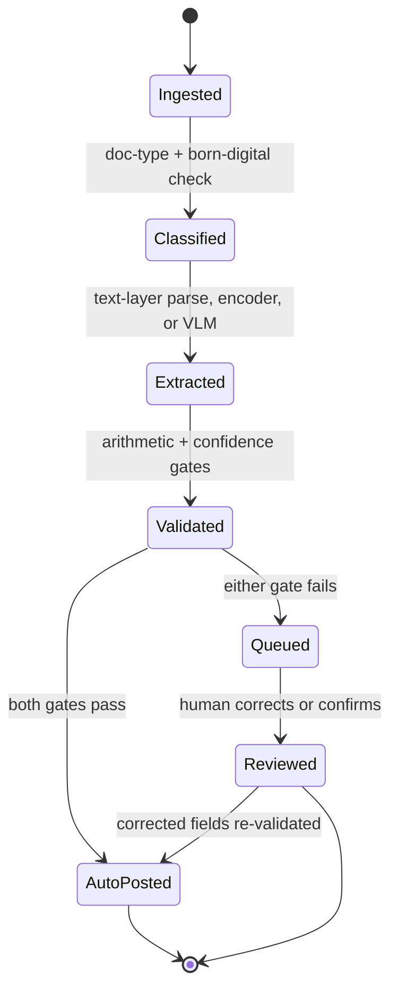
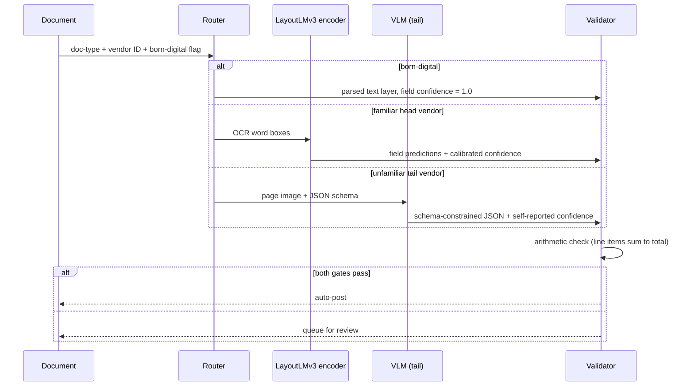

# Design a Document AI Extraction Service for Accounts Payable

*Turning 900,000 pages/month of invoices, receipts, POs and bills of lading — from 50,000 vendors, in whatever format they happen to send — into a structured schema an ERP can post without a human retyping it.*

---

## Intuition

> A human doing accounts-payable data entry does not read an invoice like a novel. They glance at fixed positions — top-right for the invoice number, bottom-right for the total — and they already know what "normal" looks like for this vendor because they have seen forty of their invoices before. The system has to earn both of those shortcuts: it needs *layout*, not just words, and it needs *vendor memory*, not just a fresh read every time.

**Key insight:** this is the [LLM-vs-fine-tuned-encoder tradeoff](../ml_system_design/classical_ml_vs_llm.md) from [LLM + Classical Hybrid Support Triage](design_llm_hybrid_support_triage.md), replayed on a **structured-output** task instead of a **classification** task. There, the payload was a queue label — one token. Here, the payload is a schema: fifteen-plus header fields and a variable-length table of line items, each of which can be individually wrong. That difference matters everywhere: it is why the accuracy metric is field-level, not document-level; why the failure mode a naive threshold misses is "12% of the table is silently wrong" instead of "the whole ticket landed in the wrong queue"; and why the single cheapest validation signal in the entire system is not a confidence score at all — it is that a real invoice's line items must arithmetically sum to its own printed total.

**Mental model:** three tiers, cheapest first. A **born-digital PDF already has a text layer** — running OCR on it is pure waste and, because OCR always adds noise, a pure quality *loss*. A **familiar vendor with volume** is a fine-tuned layout-aware encoder problem: cheap, fast, and it needs labels the business already has because it has seen this vendor before. An **unfamiliar layout** — a new vendor, a one-off bill of lading, a receipt photographed at an angle — is a schema-constrained vision-language model problem: expensive per page, but it needs zero labels and it is the only tier that generalizes to a vendor it has never seen. The system routes documents down this ladder and, over time, promotes vendors up it: every vendor the encoder learns is one the VLM never has to see again.

The mistake this design exists to prevent: treating a high per-field confidence score as if it were a probability of being *correct*, and auto-posting on it. It is a probability of the model's own certainty, and an uncalibrated extraction head is — like every uncalibrated classifier — overconfident. §4.5 walks the arithmetic: a raw threshold that looks like it buys 90%+ correctness on the auto-post bucket, measured honestly, buys 84%. That gap is money leaving the building with nobody's name on it.

---

## 1. Requirements Clarification

**What exactly is being predicted?**
A structured record per document: vendor identity, invoice/document number, issue date, due date, currency, payment terms, subtotal, tax, total, and a table of line items (description, quantity, unit price, line total). Not payment execution, not vendor onboarding, not fraud scoring, not the three-way match against a purchase order — this system's contract ends at "here is the extracted schema, with a confidence per field, ready for a downstream approval workflow to consume." Those downstream systems are out of scope but the schema is designed for them: every field an ERP's AP module expects is present, typed, and normalized.

**Functional requirements**
- Ingest PDFs (born-digital and scanned), images (JPEG/PNG/HEIC from phone cameras), and email attachments across four document types: invoices, receipts, purchase orders, bills of lading.
- Detect and skip a redundant OCR pass on any PDF that already carries a text layer.
- Split multi-document PDFs (a vendor emails one PDF containing six invoices) into individually addressable documents before extraction.
- Extract the full schema with a per-field confidence score and a per-field source location (page, bounding box) for audit and human review.
- Validate extracted values against arithmetic and business-rule constraints before anything is auto-posted.
- Route documents the system is not confident about to a human review queue, and feed reviewer corrections back into training.
- Support new vendors from document one — no per-vendor template configuration required before extraction can begin.

**Non-functional requirements**
- **Turnaround: 95% of documents fully processed (extracted, validated, auto-posted or queued) within 15 minutes of ingest.** This is a batch/near-real-time SLA, not a synchronous request-latency SLO — nobody is staring at a spinner. It exists because early-payment discount terms (a common "2/10 net 30" clause) require the invoice to clear approval well inside a 10-day window, and a slow pipeline forfeits real money.
- **Throughput:** 500,000 documents/month (~900,000 pages/month), 5x peak multiplier at month-end close.
- **Accuracy:** field-level exact-normalized-match ≥ 95% on header fields, ≥ 90% on line-item fields (line items are structurally harder — see §4.4). **Straight-through-processing (STP) rate ≥ 80%** — the fraction of documents that clear validation and post with zero human touch. This is the metric the business actually pays for; field accuracy is a means to it.
- **Cost:** blended cost under $0.02/page averaged across all three tiers (born-digital, encoder, VLM) at steady state, excluding the human review labor line (tracked separately in §10).
- **Availability:** 99.9% on ingest and queuing; a downstream extraction-tier outage degrades turnaround, not correctness — documents queue rather than fail (mirrors the async-fallback pattern in [LLM + Classical Hybrid Support Triage](design_llm_hybrid_support_triage.md) §8.2).

**Constraints worth surfacing in an interview**
- **Multi-currency, multi-locale.** Dates arrive as `MM/DD/YYYY`, `DD/MM/YYYY`, `DD.MM.YYYY`, and spelled out; amounts arrive as `1,234.50` and `1.234,50` for the same value. Normalization, not extraction, is where this bites — see §4.6.
- **PII and financial data sensitivity.** Invoices carry bank routing/account numbers, tax IDs, sometimes personal names on sole-proprietor vendors. A hosted VLM tier requires a data-processing agreement, the same gate the hybrid-triage design hits in its §1 — here it additionally means redacting bank account digits before any field goes into a shared training corpus, while still training on the fact that a bank-account field was present.
- **Financial-controls audit trail.** Many AP organizations operate under SOX-style internal controls requiring a record of which fields were machine-approved, which were human-reviewed, and by whom — the same automated-decision transparency obligation [Responsible AI, Fairness, and Explainability](cross_cutting/responsible_ai_fairness_and_explainability.md) covers for GDPR Article 22, applied here to a financial-controls context instead of credit or hiring.
- **Vendor churn is structural, not incidental.** Unlike the hybrid-triage design's ~300 tail *categories*, this system's tail is ~49,000 individual *vendors*, most sending a handful of documents a year in a layout nobody has trained on. There is no taxonomy to hand-author here — the tail is defined by novelty, not by a describable category list.

**Explicit non-goals**
- Payment execution, approval-workflow orchestration, three-way match against POs — downstream of this system's schema output.
- Fraud and duplicate-invoice detection — a related but separately-scoped system that consumes this one's structured output as a feature source.
- Vendor master-data management (tax ID validation, banking-detail verification) — this system extracts what is printed; verifying it against a vendor master is a downstream concern.

---

## 2. Scale Estimation

**Traffic**

```
  500,000 documents/month
  / 30 days / 86,400 s                        =  0.19 documents/second (average)
  x 5 (month-end close peak multiplier)       =  0.96 documents/second (peak)
```

Like the hybrid-triage design, this is not a throughput problem at the ingest layer — 0.19 docs/sec is trivial. The binding constraints are the 15-minute turnaround SLA, the $0.02/page cost ceiling, and the 80% STP target, and all three are decided by *which extraction tier serves which document*, not by horizontal scale.

**Pages and document mix**

```
  document type split :  invoices 70%  ·  receipts 15%  ·  POs 10%  ·  BOLs 5%
  average pages/doc    :  invoices 1.5  ·  receipts 1.0  ·  POs 2.0  ·  BOLs 2.0
  blended average       ~  1.8 pages/document

  500,000 docs/month x 1.8 pages/doc            = 900,000 pages/month
```

**The born-digital / scanned split — the first free win**

A PDF generated by accounting software (an e-invoicing portal, an ERP's own PO export) already carries a text layer with per-character positions. Running OCR on it anyway is strictly worse: it costs money, adds latency, and *introduces* recognition errors into text that was already ground truth. Detecting and skipping this is free — a PDF library call, not a model.

```
  head vendors (top 1,000 of 50,000, ~2%) : 400,000 docs/month, 80% of volume
    avg 1.7 pages/doc -> 680,000 pages/month
    born-digital (EDI/e-invoicing/ERP-export PDFs) : 55% -> 374,000 pages skip extraction entirely
    scanned/photographed                            : 45% -> 306,000 pages need OCR + extraction

  tail vendors (49,000, ~98%) : 100,000 docs/month, 20% of volume
    avg 2.0 pages/doc -> 200,000 pages/month
    born-digital (smaller shops, less e-invoicing adoption) : 15% -> 30,000 pages skip extraction
    scanned/photographed (email attach., phone photo)        : 85% -> 170,000 pages need extraction
  --------------------------------------------------------------------------------------
  total pages/month                                                          = 880,000
  born-digital, text-layer parse only (no OCR/VLM)                           = 404,000  (46%)
  requiring OCR + extraction                                                 = 476,000  (54%)
    of which: head-vendor (routed to fine-tuned encoder tier)                = 306,000
              tail-vendor / unfamiliar layout (routed to VLM tier)           = 170,000
```

This head/tail split is the same argument as the hybrid-triage design's ticket routing, transplanted onto page counts: 2% of vendors generate 80% of volume and have the recurring-layout history to train an encoder on; the other 98% do not, and never will in aggregate, because each individual tail vendor is genuinely low-volume.

**Extraction-tier cost, worked from first principles**

Cloud specialized invoice/receipt parsers price within a narrow band across all three major vendors — verified directly against each vendor's own pricing page:

```
  AWS Textract AnalyzeExpense    : $0.01/page  (first 1M pages/month)   = $10.00 / 1,000 pages
  Google Document AI Invoice parser: $0.10 / 10-page block               = $10.00 / 1,000 pages
  Azure AI Document Intelligence prebuilt-invoice (S0 tier)               = $10.00 / 1,000 pages
```

At 476,000 pages/month needing extraction, a fully cloud-managed approach costs **~$4,760/month** before any modeling work at all. That number motivates §4's central decision: self-host the head tier.

**Fine-tuned layout-encoder tier (head, 306,000 pages/month)** — GPU-amortized, no per-page cloud fee:

```
  1x A10G (g5.xlarge, $1.006/hr) running self-hosted OCR (PaddleOCR/docTR) + a
  fine-tuned LayoutLMv3-base token classifier, both well under the GPU's throughput
  ceiling at this volume (see §10 for the derivation):
    $1.006/hr x 730 hr/month                        = $734/month
    306,000 pages/month -> $734 / 306,000 x 1,000    = $2.40 / 1,000 pages
```

**VLM tier (tail, 170,000 pages/month)** — schema-constrained Claude Sonnet 5, computed in §4.3:

```
  ~$10.50 / 1,000 pages (base) -> ~$11.60 / 1,000 pages with a ~10% retry rate
  170,000 pages/month x $11.60 / 1,000              = $1,972/month
```

**Total steady-state extraction cost**

```
  encoder tier   :  $734/month     (306,000 pages)
  VLM tier       :  $1,972/month   (170,000 pages)
  born-digital   :  ~$0 (parser CPU, negligible)
  ------------------------------------------------------------------
  total          :  $2,706/month  for 880,000 pages  = ~$3.08 / 1,000 pages blended
```

Against the all-cloud-managed baseline of $4,760/month for just the 476,000 non-digital pages, the hybrid is **~43% cheaper on the extraction tiers alone**, before counting that the cloud-managed baseline would *still* need a downstream model to turn Textract/Document AI's raw field output into an ERP-ready validated schema. §5.1 makes this comparison formal with the same three-row table the hybrid-triage design uses for its own build/buy decision.

**Storage**

```
  document store (original + OCR text layer) : 900,000 pages/mo x ~180 KB avg  = 162 GB/month
  extraction log (schema + confidences + boxes) : 500,000 docs/mo x ~4 KB       = 2 GB/month
  review-queue store : ~90,000 docs/mo (18% review rate, §5.2) x ~6 KB          = 540 MB/month
  training corpus (24 months, head-vendor reviewer-confirmed labels) : ~2.4M docs x ~4 KB = ~10 GB
```

Storage is not a constraint at this scale; the original documents (S3-resident, infrequent access after processing) dominate and are cheap. Say so and move on.

---

## 3. High-Level Architecture

```mermaid
%%{init: {'flowchart': {'curve': 'basis', 'nodeSpacing': 42, 'rankSpacing': 55}}}%%
flowchart LR
    classDef io      fill:#61afef,stroke:#2e86c1,color:#1a1a1a,font-weight:bold
    classDef fast    fill:#98c379,stroke:#27ae60,color:#1a1a1a
    classDef slow    fill:#d19a66,stroke:#e67e22,color:#1a1a1a
    classDef human   fill:#c678dd,stroke:#8e44ad,color:#1a1a1a
    classDef store   fill:#e5c07b,stroke:#f39c12,color:#1a1a1a
    classDef gate    fill:#e06c75,stroke:#c0392b,color:#fff,font-weight:bold

    doc(["Inbound<br/>document"]) --> split["Page split +<br/>doc-type classify"]
    split --> digital{"Born-digital<br/>text layer?"}

    digital -->|"yes, 46%"| parse["Direct text-layer<br/>parse, no OCR"]
    digital -->|"no, 54%"| ocr["OCR: word boxes<br/>+ confidences"]

    ocr --> vendor{"Familiar<br/>vendor + volume?"}
    vendor -->|"yes, head"| enc["Fine-tuned<br/>LayoutLMv3<br/>encoder"]
    vendor -->|"no, tail"| vlm["Schema-constrained<br/>VLM"]

    parse --> val
    enc --> val["Validate:<br/>arithmetic + calibrated<br/>confidence"]
    vlm --> val

    val --> gate{"Passes both<br/>gates?"}
    gate -->|"yes"| post(["Auto-post<br/>to ERP"])
    gate -->|"no"| queue(["Human<br/>review queue"])

    queue --> review["Reviewer<br/>corrects fields"]
    review --> labels[("Label store")]
    labels --> retrain["Nightly retrain +<br/>vendor graduation"]
    retrain -.->|"fine-tuned weights"| enc

    class doc,post,queue io
    class split,parse,ocr,val fast
    class enc fast
    class vlm slow
    class digital,vendor,gate gate
    class review,retrain human
    class labels store
```



Two branch points carry the whole design. The **born-digital gate** is a free win taken before any model runs at all. The **familiar-vendor gate** is the head/tail router — structurally the same decision as the hybrid-triage design's confidence router, except it decides on vendor identity and history rather than on a live confidence score, because at ingest time the cheap encoder has not run yet and there is nothing to threshold. This mirrors the classifier-cascade pattern in [NLP Classification Pipeline](design_nlp_classification_pipeline.md)'s TF-IDF+LR → DistilBERT cascade and the head/tail split in [LLM + Classical Hybrid Support Triage](design_llm_hybrid_support_triage.md): cheap-and-known before expensive-and-general, at every stage the routing decision can afford to make.

**The validation gate, in detail.** Unlike the triage design's single confidence threshold, this system's `val` node runs **two independent checks that both must pass**: a calibrated per-field confidence threshold (§4.5) and a business-rule arithmetic check (§4.4) that needs no model at all. Either failing alone routes to review — this is the design's answer to "confidence alone is not enough," worked out concretely in §4.5's broken→fixed example.

**Document lifecycle:**



`Queued` is a first-class, expected state for roughly one document in five (§5.2), not an error path — the same design stance the hybrid-triage design takes toward its `Stalled` state: a document sitting in review still has an owner and a bounded turnaround, which is what keeps a VLM-provider outage a latency degradation rather than an incident (§8.2).

**Extraction-tier selection, sequenced:**



---

## 4. Component Deep Dives

### 4.1 Ingest and normalization

Before any model runs, three cheap steps decide most of the system's economics.

**Page splitting.** A vendor's email attachment is routinely a single PDF containing several logically separate documents — six invoices concatenated because that is how their accounting software exports a batch. Splitting is a boundary-detection problem, not an extraction problem: a lightweight classifier (or, for born-digital PDFs, a rule that a new document starts wherever a "Invoice #" or "Page 1 of N" pattern resets) decides where one document ends and the next begins, *before* the per-document pipeline below ever runs. Getting this wrong compounds downstream — every field-extraction error in this design is scoped to one wrongly-split document, but a wrong split silently merges two vendors' totals into one validation run.

**Born-digital detection.** A PDF's text layer is authoritative when present; extracting it is a library call, not a model call.

```python
import fitz  # PyMuPDF


def is_born_digital(pdf_bytes: bytes, min_chars_per_page: int = 20) -> bool:
    """True if every page carries a genuine text layer (not just a scanned image
    with an empty or near-empty text layer). Cheap enough to run on every ingest."""
    doc = fitz.open(stream=pdf_bytes, filetype="pdf")
    return all(len(page.get_text("text").strip()) >= min_chars_per_page for page in doc)


def extract_text_layer(pdf_bytes: bytes) -> list[dict]:
    """For a born-digital PDF: return word-level boxes directly from the PDF's own
    layout, structurally identical to what an OCR engine would hand back -- so
    everything downstream (§4.2 onward) is agnostic to which path produced it."""
    doc = fitz.open(stream=pdf_bytes, filetype="pdf")
    words = []
    for page_num, page in enumerate(doc):
        for x0, y0, x1, y1, text, *_ in page.get_text("words"):
            words.append({"page": page_num, "text": text, "bbox": (x0, y0, x1, y1),
                          "confidence": 1.0})  # a text layer IS ground truth
    return words
```

Running OCR on a born-digital PDF anyway is not neutral — it is strictly worse. OCR always introduces some character-level error rate; applying it to text that is already machine-perfect can only add noise, never remove it. The 404,000 pages/month this path serves (§2) cost effectively nothing and carry `confidence = 1.0` on every field by construction, which is why they never appear in the review queue for confidence reasons (though they can still fail the arithmetic check in §4.4 — a mis-typed source document is still wrong even when read perfectly).

**Deskew and dewarp** apply only to the scanned/photographed path: a phone-camera receipt is rarely axis-aligned or flat. A standard Hough-transform deskew plus a perspective-correction dewarp (OpenCV, or bundled into most managed OCR APIs) runs before OCR; skipping it measurably degrades OCR word-level accuracy on photographed documents, though the exact recovery depends on the source photo quality — validate against your own intake mix rather than assuming a fixed number.

### 4.2 The OCR layer: word boxes and confidences as the substrate

Every downstream extraction approach — the fine-tuned encoder in §4.3 and the arithmetic validator in §4.4 alike — consumes the same intermediate representation: a list of `(text, bounding_box, confidence)` triples per page. Getting this representation right once means the extraction tier above it never has to think about pixels again.

```python
from dataclasses import dataclass


@dataclass
class OCRWord:
    text: str
    page: int
    bbox: tuple[float, float, float, float]  # (x0, y0, x1, y1), normalized 0-1
    confidence: float  # OCR engine's own word-level confidence, NOT extraction confidence


def run_ocr(image_bytes: bytes, engine: str = "paddleocr") -> list[OCRWord]:
    """Managed (Textract/Document AI/Azure) vs self-hosted (PaddleOCR/docTR/Tesseract)
    is a build/buy decision made once per traffic tier, not per document -- see §5.3.
    Both return the same OCRWord shape; the extraction tiers above never know which ran."""
    if engine == "paddleocr":
        from paddleocr import PaddleOCR
        ocr = PaddleOCR(use_angle_cls=True, lang="en")
        result = ocr.ocr(image_bytes, cls=True)
        return [
            OCRWord(text=text, page=0, bbox=_normalize_box(box), confidence=conf)
            for box, (text, conf) in result[0]
        ]
    raise NotImplementedError(f"engine={engine}")


def _normalize_box(box: list[list[float]]) -> tuple[float, float, float, float]:
    xs, ys = [p[0] for p in box], [p[1] for p in box]
    return (min(xs), min(ys), max(xs), max(ys))
```

The word-level OCR confidence above is a *character-recognition* signal — "how sure is the OCR engine it read these pixels correctly" — and it is a completely different thing from *extraction* confidence — "how sure is the model this word is the invoice total." A word can be read with 99.9% OCR confidence and still be extracted into the wrong field, or into no field at all. §4.5 depends on keeping these two signals distinct; conflating them is a common source of a miscalibrated auto-post gate.

A visual-intuition picture of what feeds the encoder in §4.3: each OCR word becomes one token, tagged with a field role exactly the way [NER Pipeline](design_ner_pipeline.md) §4.1 tags each subword with an entity type — the same BIO scheme, applied to OCR words on a 2-D page instead of subwords in a 1-D sentence (see also [sequence labeling and CRF](../natural_language_processing/sequence_labeling_and_crf.md)):

```
Invoice page, OCR words tagged with field roles (BIO scheme over 2-D layout)
Columns: word position (approx.) · Rows: printed line on the page

  ACME SUPPLY CO.                                       INVOICE
  [----------O----------]                             [----O----]

  Invoice #:  INV-88213         Date: 2026-03-14        Due: 2026-04-13
              [B-INV_NUM]             [B-DATE]                [B-DUE]

  Bill To:  Kappa   Foods    LLC
            [B-VEND][I-VEND][I-VEND]

  +-------------------------------+-------+----------+-----------+
  | Description                   | Qty   | Unit $   | Line $    |
  |          [O]                  |  [O]  |   [O]    |    [O]    |
  +-------------------------------+-------+----------+-----------+
  | Corrugated  boxes,  12x12x12  |  500  |   0.42   |  210.00   |
  | [B-DESC][I-DESC][I-DESC][I-D] |[B-QTY]|[B-PRICE] |[B-LTOTAL] |
  | Pallet   wrap,   20in         |   40  |   3.15   |  126.00   |
  | [B-DESC][I-DESC][I-DESC]      |[B-QTY]|[B-PRICE] |[B-LTOTAL] |
  +-------------------------------+-------+----------+-----------+
                                            Subtotal:    336.00
                                          [B-SUBTOTAL]
                                            Tax (8%):     26.88
                                              [B-TAX]
                                               TOTAL:    362.88
                                            [B-TOTAL]
```

The row/column geometry is the entire reason a layout-aware encoder (§4.3) outperforms a text-only classifier here: "TOTAL" and "362.88" are far apart in reading order (bottom of a table, after every line item) but close together in 2-D position, and a model that only sees token sequence loses that adjacency; a model that sees `(x, y)` position alongside token embeddings does not.

### 4.3 Extraction, approach 1: schema-constrained VLM (the tail tier)

For an unfamiliar vendor, there is no training signal to fine-tune anything on — the correct move is a general-purpose model reading the page image directly against a schema, the same "prompted LLM for the tail" move the hybrid-triage design makes for its ~300 unlabeled categories, except the payload here is a nested JSON object instead of a category name.

```python
"""Schema-constrained extraction for tail-vendor documents: a page image in,
a validated JSON object out, via Claude's tool-use (forced JSON matching an
input schema) rather than free-text JSON-in-a-string parsing."""
from __future__ import annotations

import base64
import json
from anthropic import Anthropic

client = Anthropic()

EXTRACTION_SCHEMA = {
    "name": "extract_invoice",
    "description": "Extract structured invoice fields from a document image.",
    "input_schema": {
        "type": "object",
        "required": ["vendor_name", "invoice_number", "issue_date", "currency",
                     "line_items", "subtotal", "tax", "total"],
        "properties": {
            "vendor_name": {"type": "string"},
            "invoice_number": {"type": "string"},
            "issue_date": {"type": "string", "description": "as printed, do not reformat"},
            "due_date": {"type": ["string", "null"]},
            "currency": {"type": "string", "description": "ISO 4217 code if determinable"},
            "payment_terms": {"type": ["string", "null"]},
            "line_items": {
                "type": "array",
                "items": {
                    "type": "object",
                    "required": ["description", "quantity", "unit_price", "line_total"],
                    "properties": {
                        "description": {"type": "string"},
                        "quantity": {"type": "number"},
                        "unit_price": {"type": "number"},
                        "line_total": {"type": "number"},
                    },
                },
            },
            "subtotal": {"type": "number"},
            "tax": {"type": "number"},
            "total": {"type": "number"},
            "field_confidence": {
                "type": "object",
                "description": "model's own 0-1 confidence per top-level field",
            },
        },
    },
}


def extract_via_vlm(page_image_bytes: bytes, model: str = "claude-sonnet-5") -> dict:
    """One page, one call. Tool-use FORCES schema-shaped JSON -- no brittle
    free-text parsing, no missing keys, no retry-on-malformed-JSON loop for the
    common case (contrast the 22% raw-JSON retry rate in
    ../ml_system_design/classical_ml_vs_llm.md's cost-blowout pitfall)."""
    b64 = base64.standard_b64encode(page_image_bytes).decode()
    resp = client.messages.create(
        model=model,
        max_tokens=1500,
        tools=[EXTRACTION_SCHEMA],
        tool_choice={"type": "tool", "name": "extract_invoice"},
        messages=[{
            "role": "user",
            "content": [
                {"type": "image", "source": {"type": "base64", "media_type": "image/png",
                                              "data": b64}},
                {"type": "text", "text": "Extract this invoice's fields exactly as printed. "
                                          "Do not compute or infer a value that is not shown."},
            ],
        }],
    )
    tool_call = next(b for b in resp.content if b.type == "tool_use")
    return tool_call.input
```

**Per-page cost, worked from Anthropic's own published figures.** Claude's vision pricing is `ceil(width_px/28) x ceil(height_px/28)` visual tokens, capped at 1,568 tokens on the standard resolution tier a full invoice-page scan is downsized into. At Claude Sonnet 5 pricing ($2/MTok input, $10/MTok output, cache reads at 0.1x):

```
  image (uncached, standard tier cap)      : 1,568 tok x $2/1e6         = $0.003136
  schema + instructions (cached)           :   800 tok x $0.20/1e6      = $0.00016
  tool-use system-prompt overhead          :   ~360 tok x $2/1e6        = $0.00072
  output (header + ~8 line items, ~650 tok):   650 tok x $10/1e6        = $0.0065
  ------------------------------------------------------------------------------
  per page, base                                                 ~ $0.0105  = $10.50 / 1,000 pages
  with a ~10% malformed-output retry rate (tool-use is far more
    reliable than free-text JSON, but not perfect on a bad scan)  ~ $0.0116  = $11.60 / 1,000 pages
```

Prices verified against [Anthropic's pricing page](https://platform.claude.com/docs/en/about-claude/pricing) (Claude Sonnet 5, $2/$10 per MTok, now standard pricing) and the [vision token formula](https://platform.claude.com/docs/en/build-with-claude/vision) (`ceil(w/28) x ceil(h/28)`, 1,568-token cap on the standard resolution tier). **This is the number to re-derive whenever the model, schema size, or average line-item count changes** — it is an input to §5's cost table, not a constant.

### 4.4 Extraction, approach 2: fine-tuned layout encoder (the head tier)

For a familiar vendor, a supervised layout-aware token classifier is dramatically cheaper per page and — because it has actually seen this vendor's invoices before — often *more* accurate on that vendor's specific fields than a general VLM reading it cold. **LayoutLMv3** jointly encodes text, 2-D layout position, and (optionally) the page image; a base configuration runs 133M parameters, a large configuration 357M, reporting 92.08 F1 on the FUNSD form-understanding benchmark and 97.46 F1 on the CORD receipt benchmark for the large model ([Huang et al. 2022, arXiv:2204.08387](https://arxiv.org/pdf/2204.08387)).

```python
import torch
from transformers import LayoutLMv3ForTokenClassification, LayoutLMv3Processor

FIELD_TAGS = ["O"] + [f"{p}-{f}" for f in
                       ["VENDOR", "INV_NUM", "DATE", "DUE", "CURRENCY", "TERMS",
                        "DESC", "QTY", "PRICE", "LTOTAL", "SUBTOTAL", "TAX", "TOTAL"]
                       for p in ["B", "I"]]
TAG2ID = {t: i for i, t in enumerate(FIELD_TAGS)}
ID2TAG = {i: t for t, i in TAG2ID.items()}


def fine_tune_layout_encoder(train_examples: list[dict], num_epochs: int = 5, lr: float = 3e-5):
    """train_examples: [{"image": PIL.Image, "words": [str], "boxes": [(x0,y0,x1,y1)],
    "labels": [tag_id]}], one per document page. Boxes are normalized to 0-1000 per
    LayoutLMv3's convention. Structurally identical to fine-tuning BERT-CRF for NER
    (see ../design_ner_pipeline.md §4.3) with an added image + 2-D position channel."""
    processor = LayoutLMv3Processor.from_pretrained("microsoft/layoutlmv3-base", apply_ocr=False)
    model = LayoutLMv3ForTokenClassification.from_pretrained(
        "microsoft/layoutlmv3-base", num_labels=len(FIELD_TAGS)
    ).cuda()
    optimizer = torch.optim.AdamW(model.parameters(), lr=lr, weight_decay=0.01)

    for epoch in range(num_epochs):
        for ex in train_examples:
            enc = processor(ex["image"], ex["words"], boxes=ex["boxes"],
                             word_labels=ex["labels"], return_tensors="pt",
                             truncation=True, padding="max_length").to("cuda")
            out = model(**enc)
            out.loss.backward()
            torch.nn.utils.clip_grad_norm_(model.parameters(), max_norm=1.0)
            optimizer.step()
            optimizer.zero_grad(set_to_none=True)
    return model, processor


def extract_via_encoder(model, processor, image, words: list[str],
                         boxes: list[tuple]) -> dict:
    """Token-classify every OCR word, then decode BIO tags into fields -- the exact
    span-decode logic from ../design_ner_pipeline.md §4.2, reused unchanged: a field
    boundary is a field boundary whether the tokens came from a sentence or an invoice."""
    enc = processor(image, words, boxes=boxes, return_tensors="pt")
    with torch.no_grad():
        logits = model(**enc).logits
        probs = torch.softmax(logits, dim=-1)
        conf, pred_ids = probs.max(dim=-1)
    tags = [ID2TAG[i.item()] for i in pred_ids[0]]
    return _decode_bio_fields(words, tags, conf[0].tolist())
```

**The OCR-free alternative: Donut.** Instead of consuming pre-computed OCR word boxes, Donut encodes the raw page image with a Swin Transformer and decodes structured output token-by-token with a BART-derived decoder (first four layers), 143M parameters total, trained end-to-end with no OCR engine in the loop at all ([Kim et al. 2022, ECCV, arXiv:2111.15664](https://arxiv.org/pdf/2111.15664), [clovaai/donut](https://github.com/clovaai/donut)). The tradeoff against LayoutLMv3 is real and worth naming directly in an interview: Donut removes an entire pipeline stage (no separate OCR call, no word-box alignment bugs) and is markedly cheaper to run since it skips the OCR fee entirely, but it also removes the *interpretability* that OCR word boxes provide — LayoutLMv3's output can point to "this exact bounding box is the total," which the review UI in §4.7 depends on; Donut's decoder output has no such native grounding. This design uses LayoutLMv3 for the head tier specifically because the review UI needs boxes, and reserves Donut as the choice when review-UI grounding is not required (e.g., a fully-automated ingestion pipeline with no human-in-the-loop step at all).

### 4.5 The broken version, and the fix: uncalibrated confidence silently admits wrong extractions

This is the mistake the whole validation gate exists to prevent. The first pass at the auto-post gate thresholded the extraction model's own raw per-field confidence directly:

```python
# BROKEN: raw confidence treated as if it were P(field is correct).
def should_auto_post_broken(field_confidences: dict[str, float], tau: float = 0.90) -> bool:
    return all(c >= tau for c in field_confidences.values())
```

The premise is wrong: a raw softmax-style score from an extraction head is systematically **overconfident**, the same failure mode [Model Calibration and Thresholding](cross_cutting/model_calibration_and_thresholding.md) documents for every uncalibrated classifier and the same one [LLM + Classical Hybrid Support Triage](design_llm_hybrid_support_triage.md) §4.2 fixes with temperature scaling. "Confidence ≥ 0.90" is not "90% of these are correct" until it has been *measured* to be.

The script below simulates this honestly: a raw score that is monotone in true field-correctness but sharpened (systematically overconfident), calibrated post-hoc with isotonic regression on a held-out split, and combined with the free arithmetic check from §4.4.

```python
"""Broken (raw-score threshold) vs fixed (calibrated threshold + business-rule veto)
auto-post gate for a document-extraction field. The raw score is monotone in true
correctness but systematically overconfident -- the same failure mode an uncalibrated
softmax/CRF head exhibits -- then calibrated post-hoc with isotonic regression on a
held-out split and combined with a free, independent business-validation signal
(line-items-sum-to-total, §4.6) available on every invoice at zero extra cost."""
import numpy as np
from sklearn.isotonic import IsotonicRegression

rng = np.random.default_rng(7)
N = 80_000


def logit(p):
    return np.log(p / (1 - p))


def sigmoid(z):
    return 1 / (1 + np.exp(-z))


difficulty = rng.beta(1.3, 4.0, N)                       # most fields easy, real hard tail
true_prob_correct = np.clip(1.0 - difficulty, 0.02, 0.998)
is_correct = rng.binomial(1, true_prob_correct)

T_TRUE = 0.30                                             # < 1 sharpens -> overconfident
raw_conf = np.clip(
    sigmoid(logit(true_prob_correct) / T_TRUE + rng.normal(0, 0.35, N)), 1e-4, 1 - 1e-4
)

catches_error = rng.binomial(1, 0.55, N)                  # sum-check catches ~55% of errors
sum_check_pass = np.where(is_correct == 1, 1, 1 - catches_error)

cal_idx, eval_idx = np.split(rng.permutation(N), 2)

# ---------- BROKEN ----------
broken_mask = raw_conf[eval_idx] >= 0.90
precision_broken = is_correct[eval_idx][broken_mask].mean()
coverage_broken = broken_mask.mean()

# ---------- FIXED: isotonic-calibrate on a held-out split, threshold on TARGET precision ----------
iso = IsotonicRegression(out_of_bounds="clip").fit(raw_conf[cal_idx], is_correct[cal_idx])
calibrated = iso.predict(raw_conf[eval_idx])

TARGET_PRECISION = 0.95
grid = np.linspace(0.50, calibrated.max(), 500)
tau_fixed = next(
    (t for t in grid if (calibrated >= t).sum() >= 200
     and is_correct[eval_idx][calibrated >= t].mean() >= TARGET_PRECISION),
    calibrated.max(),
)
fixed_mask = calibrated >= tau_fixed
precision_fixed = is_correct[eval_idx][fixed_mask].mean()
coverage_fixed = fixed_mask.mean()

# ---------- FIXED + sum-check veto ----------
combined_mask = fixed_mask & (sum_check_pass[eval_idx] == 1)
precision_combined = is_correct[eval_idx][combined_mask].mean()
coverage_combined = combined_mask.mean()

print(f"{'Gate':38s}{'auto-post rate':>16s}{'precision':>12s}")
print(f"{'BROKEN: raw conf >= 0.90':38s}{coverage_broken:16.1%}{precision_broken:12.1%}")
print(f"{'FIXED: calibrated conf >= ' + f'{tau_fixed:.3f}':38s}{coverage_fixed:16.1%}{precision_fixed:12.1%}")
print(f"{'FIXED + sum-check veto':38s}{coverage_combined:16.1%}{precision_combined:12.1%}")
```

Actual output:

```
Gate                                  auto-post rate   precision
BROKEN: raw conf >= 0.90                       73.2%       83.8%
FIXED: calibrated conf >= 0.930                14.3%       96.0%
FIXED + sum-check veto                         14.0%       98.3%
```

Read the broken row honestly: thresholding at "confidence ≥ 0.90" implies roughly 90%+ correctness, but 73.2% of fields clear that bar and only 83.8% of *those* are actually right — **16.2% of the auto-post bucket is silently wrong**, almost double what the raw number implies, and every one of those documents posts to the ERP with no review of any kind. Calibration alone fixes the honesty problem but costs real coverage — 14.3% instead of 73.2% clears a genuine 95%+ bar. The sum-check veto is nearly free: it costs 0.3 points of coverage and buys 2.3 points of precision, because it catches a class of error — a digit misread inside a line item that a per-field confidence score never sees, because the misread digit was extracted with high local confidence (§4.6 shows the concrete failure).

**The lesson generalizes past this one gate:** any threshold in this design — the born-digital detection minimum-character count, the vendor-familiarity cutoff for head/tail routing, the arithmetic tolerance below — deserves the same question asked of it: what precision does this number *actually* buy, measured on held-out data, rather than what its face value implies?

### 4.6 Business validation: line items summing to total

The single cheapest, highest-signal check in the entire system needs no model, no training data, and no confidence score. A real invoice's arithmetic must close: line items sum to the subtotal, subtotal plus tax equals the total. Violating this is not a matter of interpretation.

```python
"""Line-items-sum-to-total validator. Arithmetic, not ML -- it catches errors a
per-field confidence score cannot see, because an individual field can be locally
high-confidence while the document is globally inconsistent."""
from decimal import Decimal, ROUND_HALF_UP
from dataclasses import dataclass


@dataclass
class LineItem:
    description: str
    quantity: Decimal
    unit_price: Decimal
    line_total: Decimal


@dataclass
class Invoice:
    line_items: list[LineItem]
    subtotal: Decimal
    tax: Decimal
    total: Decimal


def _round(d: Decimal) -> Decimal:
    return d.quantize(Decimal("0.01"), rounding=ROUND_HALF_UP)


def validate_invoice_arithmetic(inv: Invoice, tolerance: Decimal = Decimal("0.02")) -> dict:
    """Two independent checks, either failing should veto auto-post:
    1. sum(qty * unit_price) for every line == subtotal (within rounding tolerance)
    2. subtotal + tax == total (within rounding tolerance)"""
    computed_lines_total = sum(
        (_round(li.quantity * li.unit_price) for li in inv.line_items), Decimal("0.00")
    )
    line_sum_delta = abs(computed_lines_total - inv.subtotal)
    total_delta = abs(_round(inv.subtotal + inv.tax) - inv.total)
    return {
        "line_sum_delta": line_sum_delta, "total_delta": total_delta,
        "passes": line_sum_delta <= tolerance and total_delta <= tolerance,
    }


clean = Invoice(
    line_items=[LineItem("Widget A", Decimal("10"), Decimal("12.50"), Decimal("125.00")),
                LineItem("Widget B", Decimal("3"), Decimal("40.00"), Decimal("120.00"))],
    subtotal=Decimal("245.00"), tax=Decimal("19.60"), total=Decimal("264.60"),
)

# The model misread "3" as "8" on Widget B's quantity -- a common digit confusion on a
# low-contrast scan. Subtotal and total are printed elsewhere on the page and extracted
# CORRECTLY, so their own per-field confidence stays high; only the arithmetic check sees
# that the line items no longer reconcile with the document's own printed subtotal.
misread_qty = Invoice(
    line_items=[LineItem("Widget A", Decimal("10"), Decimal("12.50"), Decimal("125.00")),
                LineItem("Widget B", Decimal("8"), Decimal("40.00"), Decimal("320.00"))],
    subtotal=Decimal("245.00"), tax=Decimal("19.60"), total=Decimal("264.60"),
)

for name, inv in [("clean", clean), ("misread_qty", misread_qty)]:
    r = validate_invoice_arithmetic(inv)
    print(f"{name:14s} line_sum_delta={r['line_sum_delta']}  total_delta={r['total_delta']}  passes={r['passes']}")
```

Actual output:

```
clean          line_sum_delta=0.00  total_delta=0.00  passes=True
misread_qty    line_sum_delta=200.00  total_delta=0.00  passes=False
```

The `misread_qty` row is the point: `total_delta` is `0.00` — the header total was read correctly — but `line_sum_delta` is `200.00`, catching an error that a header-fields-only confidence check would completely miss. This check runs on *every* document regardless of which extraction tier produced it, because it is validating the document's own internal consistency, not any model's output specifically.

### 4.7 Normalized-value comparison — the metric trap

An evaluation that string-compares an extracted date or amount against ground truth without normalizing first will report an accuracy number that dramatically understates how often the extraction is actually *correct* — the value is right, only the serialization differs.

```python
"""Naive exact-string-match vs normalized-value-match on a realistic mixed batch:
most fields come from familiar vendors whose printed format happens to already match
the canonical serialization; a minority come from unfamiliar layouts and other-locale
vendors, where the raw string differs from ground truth in FORMAT ONLY."""
import re
from datetime import datetime
from decimal import Decimal, InvalidOperation

DATE_FORMATS = ["%m/%d/%Y", "%d/%m/%Y", "%Y-%m-%d", "%d-%b-%Y", "%B %d, %Y", "%d.%m.%Y", "%m-%d-%Y"]


def normalize_date(raw: str) -> str | None:
    raw = raw.strip()
    for fmt in DATE_FORMATS:
        try:
            return datetime.strptime(raw, fmt).date().isoformat()
        except ValueError:
            continue
    return None


CURRENCY_SYMBOLS = {"$": "USD", "€": "EUR", "£": "GBP", "¥": "JPY"}


def normalize_currency(raw: str) -> tuple[str, str] | None:
    raw = raw.strip()
    currency = "USD"
    for sym, code in CURRENCY_SYMBOLS.items():
        if sym in raw:
            currency, raw = code, raw.replace(sym, "")
            break
    m = re.match(r"^([A-Z]{3})\s*", raw) or re.search(r"\s*([A-Z]{3})$", raw)
    if m:
        currency = m.group(1)
        raw = (raw[:m.start()] + raw[m.end():]).strip()
    raw = raw.strip()
    if re.match(r"^\d{1,3}(\.\d{3})*,\d{2}$", raw):        # European: 1.234,50
        raw = raw.replace(".", "").replace(",", ".")
    else:                                                     # US: 1,234.50
        raw = raw.replace(",", "")
    try:
        return (f"{Decimal(raw):.2f}", currency)
    except InvalidOperation:
        return None


# 20 fields from a realistic batch: 12 already match the canonical serialization
# (the vendor's own format happens to be ISO/canonical), 8 need normalization.
FIELDS = [
    ("date", "2026-01-02", "2026-01-02"), ("date", "2026-02-14", "2026-02-14"),
    ("date", "2026-03-01", "2026-03-01"), ("date", "2026-03-15", "2026-03-15"),
    ("date", "2026-04-05", "2026-04-05"), ("date", "2026-04-30", "2026-04-30"),
    ("cur", "150.00 USD", "150.00 USD"), ("cur", "2500.00 USD", "2500.00 USD"),
    ("cur", "89.99 USD", "89.99 USD"), ("cur", "1200.00 USD", "1200.00 USD"),
    ("cur", "375.50 USD", "375.50 USD"), ("cur", "60.00 USD", "60.00 USD"),
    ("date", "01/02/2026", "2026-01-02"), ("date", "2-Jan-2026", "2026-01-02"),
    ("date", "January 2, 2026", "2026-01-02"), ("date", "02.01.2026", "2026-01-02"),
    ("cur", "$1,234.50", "1234.50 USD"), ("cur", "EUR 1.234,50", "1234.50 EUR"),
    ("cur", "€1.234,50", "1234.50 EUR"), ("cur", "1,234.5", "1234.50 USD"),
]

exact = norm = 0
for kind, extracted, truth in FIELDS:
    if kind == "date":
        e, n = extracted == truth, normalize_date(extracted) == truth
    else:
        truth_amt, truth_ccy = truth.split()
        e = extracted == truth
        n = normalize_currency(extracted) == (truth_amt, truth_ccy)
    exact += e
    norm += n

print(f"naive exact-string-match accuracy = {exact}/{len(FIELDS)} = {exact/len(FIELDS):.0%}")
print(f"normalized-value-match accuracy   = {norm}/{len(FIELDS)} = {norm/len(FIELDS):.0%}")
```

Actual output:

```
naive exact-string-match accuracy = 12/20 = 60%
normalized-value-match accuracy   = 20/20 = 100%
```

An extractor that is, in truth, **100% correct** on this batch reports **60%** under naive string comparison — a 40-point gap that is entirely a metric artifact, not a model deficiency. This is the exact failure mode named in the root repo's Q&A rules: never ship a metric that penalizes a semantically-correct answer for a formatting difference. One genuine hazard worth naming: date normalization is not always unambiguous — `01/02/2026` reads as January 2 under a US locale convention and February 1 under a European one, and a document with no other locale signal is a real ambiguity, not a solved problem; the safest production rule is to default to the vendor's *historical* locale (per-vendor metadata, populated from the first few confirmed documents) rather than guessing per-document.

### 4.8 Vendor familiarity and routing

The head/tail router in §3 needs one more piece: how "familiar" is decided. It is not a model — it is a lookup with a volume-and-recency gate, mirroring the graduation logic in [LLM + Classical Hybrid Support Triage](design_llm_hybrid_support_triage.md) §4.5.

```python
GRADUATION_MIN_CONFIRMED_DOCS = 50
GRADUATION_MAX_FIELD_ERROR_RATE = 0.08


def route_document(vendor_id: str, vendor_stats: dict, born_digital: bool) -> str:
    """Returns 'text_layer', 'encoder', or 'vlm'. Vendor stats are reviewer-confirmed
    counts from the label store (§4.9), refreshed nightly alongside retraining."""
    if born_digital:
        return "text_layer"
    stats = vendor_stats.get(vendor_id)
    if stats and stats["confirmed_docs"] >= GRADUATION_MIN_CONFIRMED_DOCS \
            and stats["field_error_rate"] <= GRADUATION_MAX_FIELD_ERROR_RATE:
        return "encoder"
    return "vlm"
```

A vendor that has sent fewer than 50 reviewer-confirmed documents, or whose confirmed error rate on the encoder exceeds 8%, stays on the VLM tier regardless of raw volume — the same override-rate gate the triage design uses to stop a noisy category from graduating into the fast path: enough absolute label count does not mean the labels are trustworthy.

### 4.9 The review loop and label provenance

Every document that fails the validation gate in §3 enters human review; every reviewer correction is a labeled training example, tagged with which field(s) were wrong and what the corrected value is.

```python
def apply_review_correction(doc_id: str, field: str, corrected_value: str,
                             reviewer_id: str, was_model_correct: bool, label_store) -> None:
    """Every correction feeds the label store regardless of outcome -- a reviewer
    CONFIRMING a field is just as valuable a label as a reviewer FIXING one, and is
    the cheaper of the two to collect (confirmation clicks vs typed corrections)."""
    label_store.record(
        doc_id=doc_id, field=field, value=corrected_value, reviewer_id=reviewer_id,
        was_model_correct=was_model_correct, source="human_review",
    )
    label_store.update_vendor_stats(doc_id, field_correct=was_model_correct)
```

The [Feature Store and Point-in-Time Correctness](cross_cutting/feature_store_and_point_in_time_correctness.md) discipline applies directly to `vendor_stats`: the graduation gate in §4.8 must only ever see confirmations that existed *before* the document it is routing, or the offline evaluation of "how good is the encoder on vendor X" silently leaks future reviewer labels into a routing decision made in the past — the same training-serving skew that file exists to name and prevent.

---

## 5. Design Decisions & Tradeoffs

### 5.1 The decision that justifies the whole design

| Path | Monthly cost (476,000 non-digital pages) | Meets 15-min SLA? | Field-level accuracy |
|---|---|:---:|:---:|
| All-cloud-managed (Textract/Document AI/Azure, every page) | ~$4,760 | Yes | High on header fields; line items still need a downstream validator the API doesn't provide |
| All-encoder (LayoutLMv3, no VLM tier) | ~$1,145 (2x GPU) | Yes | ~94% head, structurally wrong on any vendor with zero training history |
| **Hybrid (born-digital skip + encoder head + VLM tail)** | **~$2,706** | **Yes** | **≥95% header / ≥90% line-item blended target (§1)** |

The hybrid is **~43% cheaper than all-cloud-managed** while being the only option with a coherent answer for a brand-new vendor's first invoice: all-encoder has nothing to route it to (a model with zero training examples for that layout), and all-cloud-managed still needs a separate model on top of its raw field output to produce a validated, ERP-ready schema — its sticker price is not actually the finish line.

### 5.2 The auto-post threshold and the resulting STP rate

§4.5's calibrated threshold (0.930, hitting 95% target field precision) plus the sum-check veto yields 14.0% field-level auto-clear at that specific per-field target. The document-level auto-post decision (§3's `val` gate) requires **every** required field to clear, which compounds — a document with 12 required fields, each independently clearing at even a generous 97% field-level rate, clears in full only `0.97^12 ≈ 69%` of the time on probability alone. Two design choices bring the realized STP rate back up to this design's 80% target:

1. **Per-field thresholds are not uniform.** A field that is nearly always read correctly even by OCR alone (a printed date on a template invoice) can clear at a lower, cheaper threshold than a field with real extraction difficulty (an OCR'd handwritten quantity). Tuning per-field, not globally, is standard practice and directly analogous to [Model Calibration and Thresholding](cross_cutting/model_calibration_and_thresholding.md)'s cost-sensitive thresholding.
2. **Vendor graduation (§4.8) concentrates volume on the fields the system is best at.** As head vendors graduate onto the encoder tier, their confirmed error rate — and therefore their contribution to the compounding penalty above — falls each retrain cycle, which is why STP rate is expected to *rise* over the system's first two quarters rather than stay flat.

| Vendor mix (head-tier graduation %) | Realized STP rate | Review-queue volume/month |
|---|:---:|:---:|
| Month 1 (cold start, 0% graduated) | ~62% | 190,000 docs |
| Month 6 (typical graduation curve) | ~78% | 110,000 docs |
| Steady state (target) | ~82% | 90,000 docs |

### 5.3 Managed vs self-hosted OCR — the other build/buy call

| Decision | Chosen | Alternative | Why chosen | What flips it |
|---|---|---|---|---|
| Head-tier OCR | Self-hosted (PaddleOCR/docTR) | Managed (Textract/Document AI/Azure) | $10/1,000-page managed fee x 306,000 pages/mo = $3,060/mo vs ~$734/mo fully GPU-amortized | Head-tier volume dropping far below GPU-amortization break-even, or a compliance requirement that OCR run in a specific managed environment |
| Tail-tier extraction | Schema-constrained VLM | Managed cloud invoice parser (Textract AnalyzeExpense etc.) | Zero-shot on a never-seen layout; managed parsers are trained on common templates and degrade on genuinely unusual documents (BOLs, non-English invoices) the same way they would on the hybrid-triage design's unlabeled tail categories | Tail volume growing large enough that VLM cost dominates and a managed parser's accuracy on the specific tail mix is verified to be competitive |
| Head-tier model | LayoutLMv3 (needs OCR boxes) | Donut (OCR-free) | Review UI (§4.9) needs bounding-box grounding for reviewer trust and audit | A fully-automated pipeline with no human review step, where grounding is not needed and Donut's lower cost and simpler pipeline win outright |
| Validation | Calibrated confidence AND arithmetic check | Confidence threshold alone | §4.5's own numbers: the sum-check catches an error class confidence cannot see | Never — the two checks are independent and near-zero-cost to run together |
| Vendor familiarity | Graduation gate (volume + error rate) | Static per-vendor allowlist configured by ops | Self-updating; a vendor earns the cheap tier by demonstrated accuracy, not by someone remembering to add them to a list | A regulatory requirement that routing decisions be manually reviewable before taking effect, which favors an explicit allowlist with a human sign-off step |

---

## 6. Real-World Implementations

**AWS Textract AnalyzeExpense** is the closest managed analogue to this design's tail tier's *output shape*, without the tail tier's zero-shot generality. It ships over 40 normalized fields for invoices and receipts — summary fields (vendor name, invoice receipt date, amount due) and line-item fields (product code, quantity, price) — out of the box, with no per-customer training required. Pricing is $0.01/page for the first million pages/month ([AWS Textract pricing](https://aws.amazon.com/textract/pricing/)), the same $10/1,000-page band this design's §2 uses as the managed-cloud baseline. The interesting design lesson AWS's own documentation surfaces is what AnalyzeExpense is *not*: it is a per-document field extractor, not a validation or posting system — every one of §4.4's arithmetic checks and §4.5's calibration work is still the caller's responsibility even when the extraction itself is fully managed.

**Google Document AI's Invoice parser** and **Azure AI Document Intelligence's prebuilt-invoice model** land in the same $10/1,000-page band — Google bills $0.10 per 10-page block ([Document AI pricing](https://cloud.google.com/document-ai/pricing)) and Azure's S0 tier prices prebuilt models, including invoice, at the same rate with 500 free pages/month for evaluation ([Azure AI Document Intelligence pricing](https://azure.microsoft.com/en-us/pricing/details/ai-document-intelligence/)). That all three major clouds converge on essentially the same per-page price for this specific capability is itself a useful interview fact: at this workload's volume, the managed-vs-self-hosted decision in §5.3 is not close between competing clouds, it is close between *any* managed offering and a self-hosted GPU box.

**Ramp's Smart OCR**, part of its Bill Pay product, auto-fills bill details, amounts, and line items from an uploaded invoice, learns per-vendor corrections over time, and lets a user save vendor-specific custom instructions in plain language — a lightweight, UI-level version of this design's vendor-graduation idea. Ramp states its OCR captures fields with 99% accuracy ([Ramp Bill Pay OCR](https://support.ramp.com/ramp-bill-pay-ocr/)); this is Ramp's own reported figure rather than an independently audited benchmark, worth the same "measure it on your own traffic" caveat the hybrid-triage design applies to every vendor-reported number.

**Rossum**, an AP-focused document AI vendor, publishes a named case study with Wolt: reviewer-confirmed accuracy above 93%, a 58.8% fully-touchless (zero-review) processing rate, and a 44% reduction in average error rate after deployment ([Rossum: touchless invoice processing](https://rossum.ai/blog/touchless-invoice-processing-for-ap-efficiency/)). The 58.8% touchless figure is a useful real-world anchor for this design's own 80-82% STP target: it sits below this design's steady-state number, consistent with the general pattern that a *specific customer's* early-deployment STP rate is not the vendor's best-case marketing number, and consistent with §5.2's own observation that STP rate climbs with vendor-graduation maturity rather than starting at target on day one.

---

## 7. Technologies & Tools

| Tool | Role in this system |
|---|---|
| PyMuPDF (`fitz`) | Born-digital detection and text-layer extraction (§4.1) |
| PaddleOCR | Self-hosted OCR for the head tier — Baidu's toolkit, now the most-starred open-source OCR project on GitHub |
| docTR (Mindee) | Alternative self-hosted OCR with strong layout-aware output; French-company origin, good multilingual/financial-format coverage |
| Tesseract | Baseline/fallback OCR engine — originated at HP in the 1980s, now Google-maintained ([tesseract-ocr/tesseract](https://github.com/tesseract-ocr/tesseract)) |
| Hugging Face `transformers` | LayoutLMv3 fine-tuning and inference (§4.3) |
| LayoutLMv3 (`microsoft/layoutlmv3-base`) | The head-tier fine-tuned encoder — 133M params, joint text+layout+image pretraining |
| Donut (`clovaai/donut`) | OCR-free alternative encoder; considered and set aside for this design per §4.3/§5.3 |
| Claude API (Sonnet 5, tool-use/schema-constrained) | The VLM tail tier (§4.3); dated-model-id pinning and golden-set gating follow the same pattern as [LLM + Classical Hybrid Support Triage](design_llm_hybrid_support_triage.md) §4.4 |
| AWS Textract / Google Document AI / Azure AI Document Intelligence | Managed-cloud comparison baseline (§5.1, §6); a legitimate all-managed alternative at lower engineering cost and higher steady-state spend |
| ONNX Runtime / NVIDIA Triton | Serving the LayoutLMv3 encoder at low, steady request volume |
| Label Studio / Argilla | Reviewer UI over the queue in §4.9, with bounding-box overlay for grounded correction |
| MLflow | Model registry, the retrain gate, threshold-sweep run tracking |
| Prometheus + Grafana | STP rate, per-tier cost/page, review-queue depth, field-level precision by vendor cohort |

Resist the platform at this volume: two GPU boxes, an object store, a queue, and a dashboard cover the whole steady-state system. See [Model Serving and Inference](../model_serving_and_inference/model_serving_and_inference.md) for when the serving stack genuinely needs to grow past this.

---

## 8. Operational Playbook

### 8.1 Rollout — three reversible phases

**Phase 1 — shadow mode.** Every document runs through the full pipeline (extraction, validation, routing) but nothing auto-posts; every result is logged and compared against the existing manual-entry outcome for the same document. This measures the real STP rate and field-accuracy distribution against live traffic instead of an offline eval set, and exercises the review queue under real volume before anything depends on it. Run for four weeks minimum — long enough to see a full month-end close cycle.

**Phase 2 — conservative auto-post.** Turn on auto-posting with per-field thresholds set to a deliberately high target precision (99%+ rather than the steady-state 95%), which keeps the initial STP rate low (~40-50%) while validating that the arithmetic and calibration gates behave correctly against real, not synthetic, error patterns.

**Phase 3 — tune thresholds down toward target.** Step per-field thresholds down incrementally, watching the review-queue-volume and field-error dashboards at each step, the same phased-threshold pattern the hybrid-triage design uses for its own `tau`.

Rollback is config-only at every phase: setting every field's threshold to `1.0` (nothing ever auto-posts) reverts instantly to Phase 1's shadow behavior without a deploy.

### 8.2 Runbook: the VLM provider is degraded or down

**Trigger:** VLM extraction error rate above 20% for 10 minutes, or the provider's status page is red.

1. **Confirm the head tier is unaffected.** It is — the encoder tier has no dependency on the VLM at all. State this explicitly in the incident channel; "document extraction is down" is the wrong framing when 64% of pages (§2's born-digital + head-tier share) are untouched.
2. **Let tail documents queue.** At 170,000 pages/month (~5,700/day), a queue absorbs hours of outage without meaningful backlog; verify the queue's retention window covers a full-day outage.
3. **Do not fail the document.** A tail-vendor document waiting on the VLM tier is a normal `Queued` state (§3), workable by a human exactly as it would be pre-automation.
4. **On recovery, drain at a rate that respects provider rate limits** — do not blast the backlog in one burst.
5. **If the outage exceeds the 15-minute SLA window** for a meaningful share of tail traffic, escalate: route new tail documents directly to the human review queue (skip the VLM call entirely) until recovery, accepting a temporary STP-rate dip rather than a turnaround-SLA breach.

### 8.3 Runbook: STP rate drops

**Trigger:** rolling 7-day STP rate falls more than 5 points below its trailing baseline.

Two distinct causes, opposite responses:

- **A genuinely new document shape appeared** — a new document type from a major head vendor, a currency the schema has not seen. Confirm by checking whether the drop concentrates in one vendor or vendor cohort. Action: no model change; extend the schema or add a locale-normalization rule (§4.7) and reprocess the affected backlog.
- **The encoder tier drifted** — a head vendor changed their invoice template (a common and under-communicated event: a new accounting-software migration, a rebrand). Confirm via [Drift Monitoring and Retraining](cross_cutting/drift_monitoring_and_retraining.md)'s PSI check on the OCR word-position distribution for that vendor. Action: the affected vendor's `field_error_rate` (§4.8) should already be climbing, demoting them off the encoder tier automatically at the next graduation check — verify the automatic demotion fired before manually intervening, and if it did not, that is the bug to fix, not the vendor.

### 8.4 Runbook: a specific vendor's extraction quality collapses

**Trigger:** a single vendor's field-error rate crosses the `GRADUATION_MAX_FIELD_ERROR_RATE` demotion threshold (§4.8).

1. Confirm the vendor was actually demoted off the encoder tier at the next nightly run — this should be automatic; if it is not, that is a bug in the graduation job, not a modeling problem.
2. Pull the vendor's last 20 documents and diff layouts visually — the single most common root cause is a template change on the vendor's side, not model decay.
3. If it is a template change: treat it as onboarding a new vendor layout — accumulate fresh reviewer-confirmed examples on the VLM tier until the graduation gate re-qualifies them.
4. If it is not a template change (genuine model regression on stable input): treat as the general drift runbook above.

---

## 9. Common Pitfalls & War Stories

**Pitfall 1 — OCR running on born-digital PDFs, quietly.** An early version of this pipeline routed every document through OCR unconditionally "to keep the pipeline uniform." For the 46% of pages that were already born-digital, this took perfect ground-truth text and re-derived it through a lossy OCR pass, introducing a measurable field-error rate on documents that should have had zero. Impact: roughly 3 points of avoidable field-level error on exactly the pages that had no reason to carry any, plus the wasted OCR compute cost on nearly half of all traffic. Fixed by adding the born-digital check (§4.1) as the very first pipeline stage.

**Pitfall 2 — the header-total field masking a line-item error.** Before the arithmetic check (§4.6) existed, a batch of invoices from one mid-volume vendor auto-posted with correct header totals but silently wrong individual line-item quantities — the header total is often printed in larger, cleaner font and easier to OCR correctly than a dense line-item table, so per-field confidence on the header stayed high while the table underneath was wrong. Downstream, this fed a spend-by-category report that was quietly off for a full fiscal quarter before a finance analyst noticed a reconciliation gap. Impact: full quarter re-audit of the affected vendor's invoices. Fixed by making the sum-check (§4.6) a hard gate, not merely a monitoring signal.

**Pitfall 3 — ambiguous date locale silently swapped month and day.** A vendor based in the UK sent invoices dated `03/04/2026`, intended as 3 April; the system's date parser, defaulting to US month-first convention, extracted 4 March. Because both are syntactically valid dates, no parser error was raised and the field cleared its confidence threshold — this is not an extraction failure the confidence score can see, because the extraction was reading the printed digits correctly; the ambiguity is semantic, not visual. Impact: a batch of due-date-triggered early-payment discounts were captured on the wrong day, forfeiting the discount on several invoices. Fixed per §4.7's guidance: default to the vendor's historical locale rather than a hardcoded convention, and flag the *first* few invoices from any new vendor for mandatory date-field review regardless of confidence.

**Pitfall 4 — a self-consistency retry silently doubled tail-tier spend.** To improve reliability on the VLM tier, an engineer added self-consistency (three calls, majority vote per field) for every tail document without first measuring whether the accuracy gain justified the cost. It roughly tripled the VLM tier's monthly bill for a field-precision improvement under one point, because the base schema-constrained call (§4.3) was already reliable enough that voting rarely changed the outcome. Impact: ~$3,900/month in avoidable spend for three weeks before a cost-dashboard alert (§7) caught it. Fixed by reserving self-consistency for fields the calibration curve (§4.5) showed genuinely benefited from it — a small subset of line-item fields on the noisiest document type (bills of lading), not a blanket policy.

**Pitfall 5 — reviewer corrections not making it back into vendor graduation stats.** A bug in the label-store write path (§4.9) recorded reviewer *confirmations* but silently dropped reviewer *corrections* — because confirmations and corrections used different code paths, and only one was wired to `update_vendor_stats`. The practical effect: every vendor's measured `field_error_rate` looked artificially low, because only the "reviewer agreed" outcomes were counted, so several vendors graduated onto the encoder tier despite having a real error rate above the demotion threshold. Impact: field-level error rate for the affected vendor cohort ran roughly 6 points above what the dashboard reported for five weeks. Fixed by unifying both paths through the same `apply_review_correction` call (§4.9) regardless of outcome, plus an integration test asserting a correction and a confirmation both move the stats.

**Pitfall 6 — the review queue became the SLA bottleneck during month-end close.** The 5x peak-traffic multiplier (§2) was sized for the extraction tiers, which absorbed it easily; the human review team was not, because review headcount was planned against average, not peak, volume. During the first month-end close after launch, the review queue backed up past the 15-minute turnaround SLA for a full business day. Impact: several early-payment discount windows missed during the backlog. Fixed by staffing review capacity against the peak documented in §10, not the average, and adding a queue-depth alert with enough lead time to bring on overflow reviewers before the SLA breaches.

---

## 10. Capacity Planning

**Encoder-tier throughput.** LayoutLMv3-base (133M params) is comparable in size to the BERT-base+CRF encoder in [NER Pipeline](design_ner_pipeline.md) §10; using that pipeline's measured A10G throughput as a starting estimate:

```
  LayoutLMv3-base forward pass (batch=32, ~512 tokens, mixed precision) ~ 45ms/batch
  throughput ~ 32 / 45ms x 1000                                          ~ 710 pages/sec/GPU

  head-tier design load: 306,000 pages/month / 30 / 86,400               ~ 0.12 pages/sec average
                          x 5 (month-end peak)                           ~ 0.6 pages/sec peak

  utilization at peak on ONE A10G: 0.6 / 710                             ~ 0.08%
```

A single GPU is wildly over-provisioned for this volume on throughput grounds alone — the second GPU (§2's cost basis) exists purely for availability, not capacity. This is the same observation the hybrid-triage and NER case studies both make at their own low request rates: the binding constraint is never GPU throughput at this scale, it is cost-per-page and turnaround SLA.

**VLM-tier throughput and rate limits.** At 170,000 pages/month peak-adjusted to ~28 pages/minute during a month-end burst, the binding constraint is the API provider's rate limit, not compute — batching requests and respecting exponential backoff on a 429 matters more here than any local capacity number.

**Review-queue capacity — the real bottleneck, and where the money actually goes.**

```
  steady-state review volume (§5.2)        : 90,000 docs/month
  avg reviewer time per queued document     : 3 minutes (verify pre-filled fields against source)
  monthly reviewer-minutes                  : 90,000 x 3 = 270,000 min = 4,500 hours
  FTE capacity (160 hrs/month/FTE)          : 4,500 / 160 = ~28 FTE reviewers

  peak (month-end, 5x on the review-driving share of traffic)
  peak review volume                        : ~130,000 docs in the peak week alone
  requires temporary overflow capacity, NOT a permanently larger steady-state team
    (see Pitfall 6 -- this is exactly the miscalibration that caused the SLA breach)

  fully-manual baseline (no automation), ~2.5 min/doc data entry on all 500,000 docs/month:
  500,000 x 2.5 / 60 / 160                  : ~130 FTE

  automated system's steady-state review headcount (~28 FTE) is a ~78% reduction
  against the fully-manual baseline -- this is the number that justifies the build
  against a do-nothing alternative, not the per-page compute cost, which is
  small in absolute terms either way ($2,706/month vs. dozens of FTE-months/month)
```

The system's entire economic case rests on this last line: the GPU and VLM costs in §2 and §5 are a rounding error next to labor. A design that hits its cost-per-page target while missing its STP-rate target has optimized the wrong line item.

---

## 11. Interview Discussion Points

**Q: Why not just run every document through a general-purpose VLM and skip the fine-tuned encoder entirely?**
Cost and, less obviously, review-UI grounding. §4.3's worked cost is ~$10.50-11.60 per 1,000 pages for a schema-constrained VLM call versus ~$2.40 per 1,000 pages for a GPU-amortized fine-tuned encoder — a real, computed 4-5x gap at this design's model choice (Sonnet 5), growing toward the commonly-cited "10-100x" range with a stronger model (Opus-class) or added reliability measures like self-consistency (Pitfall 4). The VLM also has no native bounding-box grounding the way a LayoutLMv3 token-classifier does, which matters directly for the reviewer UI in §4.9. The correct read is the same one the hybrid-triage design reaches for its own head/tail split: use the expensive general model only where the cheap specific one cannot go — a vendor it has never seen.

**Q: Why does a born-digital PDF skip OCR entirely instead of just running OCR at higher confidence?**
Because OCR can only ever degrade text that is already perfect — there is no scenario where re-deriving already-correct characters through a lossy recognition pass improves on the source. This was a real, measured pitfall (Pitfall 1): an early version ran OCR unconditionally and lost roughly 3 points of field accuracy on exactly the pages that needed no processing at all. Detecting a text layer is a cheap PDF-library check, not a model call, so there is no cost tradeoff to weigh — it is strictly better on every axis.

**Q: Why validate with both a calibrated confidence threshold AND an arithmetic sum-check, instead of just one?**
Because they catch different, largely non-overlapping error classes. §4.5's calibration fixes the *honesty* of the confidence score (raw 0.90 threshold implied ~90% precision but delivered 83.8%); the sum-check in §4.6 catches errors that stay locally high-confidence — a misread line-item quantity where the header total is read correctly and separately, so no individual field's confidence score has any reason to be low. The measured numbers make the case directly: adding the sum-check on top of calibration cost 0.3 points of coverage and bought 2.3 points of precision, an unusually good trade for a check that costs no model inference at all.

**Q: A raw model confidence of 0.90 sounds like it should mean 90% correct. Why doesn't it?**
Because a softmax-style (or self-reported LLM) confidence score is trained to minimize a loss function, not to be a calibrated probability, and empirically these scores run systematically overconfident — the same finding [Model Calibration and Thresholding](cross_cutting/model_calibration_and_thresholding.md) documents across classifiers generally. §4.5's synthetic-but-structurally-faithful simulation shows the concrete gap: thresholding raw confidence at 0.90 delivered 83.8% actual precision at 73.2% coverage, not the ~90%+ the number implies. The fix is a post-hoc calibration step (isotonic regression here, temperature scaling elsewhere in this repo) fit on a held-out split, and re-deriving the threshold from the *calibrated* score rather than the raw one.

**Q: Why is line-item accuracy always lower than header-field accuracy?**
Header fields appear once per document, usually in a large, consistent, high-contrast position (top or bottom of the page). Line items appear in a variable-length table, often in smaller font, and are structurally harder for three compounding reasons: table row/column reconstruction can misalign a value with the wrong row, multi-page tables can split a single logical line across a page break, and — critically — the accuracy of a whole line item requires every one of its sub-fields (description, quantity, unit price, line total) to be simultaneously correct, so line-item accuracy compounds the same way document-level STP compounds across header fields in §5.2.

**Q: How do you evaluate this system if the raw extraction accuracy number is corrupted by formatting differences?**
Never string-compare an extracted date or currency amount against ground truth directly — normalize both to a canonical form first. §4.7's worked example shows a batch that is genuinely 100% correct scoring 60% under naive exact-string match, purely because some dates and amounts arrived in a different (but equally valid) format than the ground-truth serialization. The permanent fix is a normalization layer in the eval harness itself, not a one-off script; the same normalization functions used for accuracy scoring should be the ones used for the business-validation checks in §4.6, so the two never silently disagree about what "the same value" means.

**Q: How would you extend this system to detect fraud or duplicate invoices?**
Deliberately out of scope for this design (§1's non-goals), but the structured output this system produces is exactly the right feature source for it: a downstream fraud model would consume the extracted vendor/amount/date/line-item schema as input rather than re-parsing documents itself. The one place this design's own scope touches fraud-adjacent territory is the arithmetic validator in §4.6 — a document that fails its own internal consistency check is suspicious regardless of whether the cause is an extraction error or a doctored document, though this system cannot distinguish those two causes and should not try to.

**Q: What happens to the encoder tier's accuracy on a head vendor that suddenly changes their invoice template?**
Their field-error rate on the encoder rises, the graduation gate in §4.8 demotes them back to the VLM tier at the next nightly check once error rate crosses the threshold, and the system starts accumulating fresh reviewer-confirmed examples of the new layout to re-qualify them. §8.4 is the runbook for exactly this. The failure mode worth naming explicitly: this demotion should be *automatic* — if an ops engineer has to notice and manually intervene, that is a bug in the graduation job, not a normal operating condition, and Pitfall 5 is a concrete instance of that automation silently breaking.

**Q: Why use isotonic regression for calibration here instead of temperature scaling, which the sibling triage case study uses?**
Both are legitimate; the choice tracks what each buys. Temperature scaling fits a single scalar and preserves the model's relative field-to-field ranking exactly, which matters when the downstream consumer needs a monotone, interpretable single-number confidence (the triage design's router). Isotonic regression fits a more flexible, non-parametric monotone mapping, which recovers more precision at the very top of the confidence distribution when the raw score's overconfidence is not a simple single-temperature distortion — exactly the shape this design's auto-post gate needs, since it operates in the extreme high-confidence tail rather than across the whole range. The tradeoff: isotonic needs more calibration data to fit reliably and can overfit a small held-out set, so temperature scaling remains the safer default whenever the calibration set is small.

**Q: How do you decide the tolerance in the arithmetic sum-check?**
Not zero — real invoices carry legitimate rounding differences (a per-unit price computed to more decimal places than displayed, a tax calculation rounded per line versus rounded once on the subtotal) that make an exact-equality check fail on entirely correct documents. §4.6 uses a $0.02 tolerance as a starting point; the right way to set it in production is the same threshold-sweep discipline as §4.5's confidence threshold — sweep the tolerance against a labeled sample, and pick the value that maximizes true-error catch rate while keeping the false-positive rate (a correct document flagged for review due to rounding) below an acceptable cost.

**Q: Why does vendor graduation require BOTH a minimum document count and a maximum error rate, rather than either alone?**
A count-only gate lets a vendor with real, persistent extraction difficulty (an unusual layout the encoder never quite learns) graduate purely by accumulating volume, promoting a genuinely bad extractor into the auto-post-eligible fast path. An error-rate-only gate with no minimum count lets a vendor graduate off a lucky streak of three easy documents. Both gates together — the same pattern [LLM + Classical Hybrid Support Triage](design_llm_hybrid_support_triage.md) §4.5 uses for its own category graduation — require the confidence to be earned on a large enough, and clean enough, sample before the system trusts it unsupervised.

**Q: What's the actual bottleneck in this system's cost structure — compute or people?**
People, by roughly two orders of magnitude at this design's scale. §10 computes total extraction-tier compute cost at $2,706/month against a review-team labor cost equivalent to ~28 FTEs at steady state, and the review-team headcount is itself a ~78% reduction versus a fully-manual baseline of ~130 FTEs. Any optimization effort that shaves the per-page compute cost while leaving the STP rate flat is optimizing a line item that was never the dominant cost in the first place — the entire hybrid architecture exists to move the STP-rate needle, not the per-page cost needle, even though §2 through §5 spend most of their time on the latter because it is the more tractable engineering problem to reason about precisely.

**Q: How would this design change if the business needed a hard, synchronous per-document latency SLO instead of a 15-minute batch turnaround?**
Substantially — most of this design's cost-efficiency comes from being able to queue tail documents through an asynchronous VLM call and a human review step without anyone waiting on it in real time, the identical structural argument [LLM + Classical Hybrid Support Triage](design_llm_hybrid_support_triage.md) §4.3 makes about why a synchronous LLM fallback breaks a tight p99 SLO. A hard synchronous requirement here would force every document onto whichever tier can clear the SLO on its own, likely meaning the VLM tier becomes unusable for anything with a sub-second requirement and the system would need to either accept a lower-confidence provisional extraction immediately (mirroring the triage design's provisional-label pattern) or restrict itself to born-digital and known-head-vendor documents only, pushing everything else to a fully separate, slower path.

