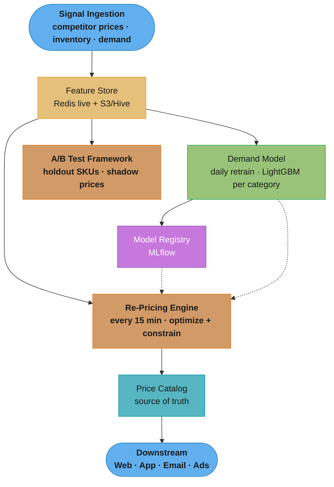
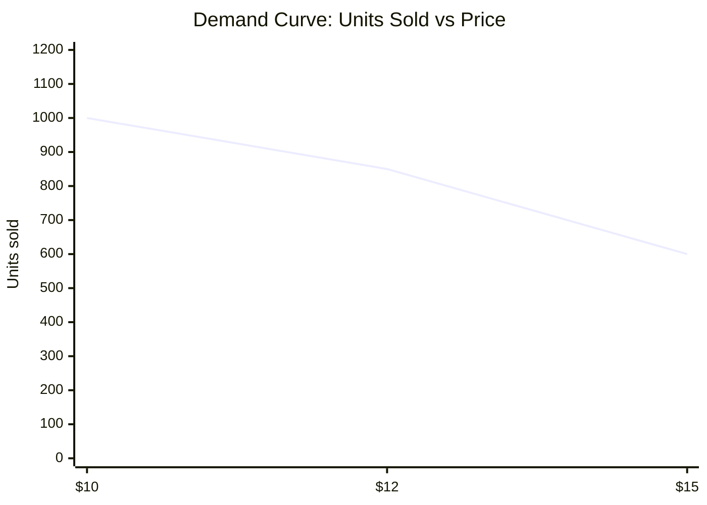
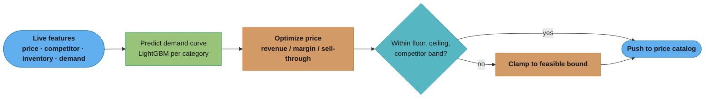
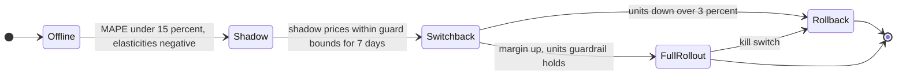

# Design a Dynamic Pricing System
## Intuition

> "Dynamic pricing is like a thermometer that adjusts the price dial in real time — but instead of measuring temperature, it measures supply-demand tension and willingness to pay."

**Key insight:** Dynamic pricing is not a prediction problem — it is a *decision* problem under uncertainty. The model predicts demand as a function of price; the optimizer then selects the price that maximizes revenue (or profit) subject to business constraints. Treating it purely as a regression problem (predict the best price) without an explicit optimization layer leads to myopic pricing that ignores margin, inventory, and competitive context.

Mental model: Think of pricing as moving along a demand curve in real time. At price $10, you sell 1,000 units; at $12, you sell 850; at $15, you sell 600. The revenue-maximizing price balances units sold against margin. Dynamic pricing continuously re-estimates this demand curve using live data and explores different price points to learn where the curve has shifted.

Why this system exists: pricing is the highest-leverage profit lever there is. McKinsey's widely cited analysis ("Using big data to make better pricing decisions", 2014) found that a 1% price increase translates on average into an **8.7% increase in operating profit, assuming no loss of volume**. For a retailer earning $50M operating profit on $1B of revenue, capturing even a 1% price improvement is worth roughly $4M — without selling a single additional unit. The volume caveat is the whole reason a demand model exists: the job is to find where price can rise without losing the units that paid for it.

**The trap that defines this problem: your own prices contaminate your training data.** Historical prices were not set at random — someone raised them when demand was strong and cut them when it was weak. Regress sales on those prices and the model learns "high price goes with high sales", which is the merchandiser's reaction to demand, not the customer's reaction to price. §4.5 reproduces that bias in runnable code and removes it two ways: with randomized exploration prices and with an instrumental variable. Every other component in this file assumes the elasticity is causal; if it is not, the optimizer confidently walks to the wrong price.

**The second trap: two pricing algorithms facing each other form a feedback loop.** In 2011 two Amazon marketplace sellers repriced an out-of-print biology textbook against each other until a new copy was listed at $23,698,655.93 (§6). Each rule was sensible alone; their product was greater than 1. §4.7 builds the safety layer — step caps, rate limits, absolute bounds, a kill switch — that makes that impossible here.

**What this study is not.** Ride-hailing surge, where price also moves *supply*, is a matching problem in [Design a Marketplace Matching System](design_marketplace_matching.md). Forecasting units at a *fixed* price for inventory planning is [Design a Demand Forecasting System](design_demand_forecasting.md). Valuing a customer over a lifetime, which a subscription price decision may need as an input, is [Design a Customer LTV Prediction System](design_customer_ltv_prediction.md).

**Vocabulary used throughout:**

| Term | Meaning |
|---|---|
| Own-price elasticity `e` | `%change in units / %change in price`; -1.5 means a 1% rise loses 1.5% of units |
| Cross-price elasticity | Change in one SKU's units when a substitute's price moves |
| Endogeneity | Price is correlated with unobserved demand shocks, so naive regression is biased |
| Instrument | A variable that moves price but affects demand only through price (a supplier cost shock) |
| Lerner rule | Profit-maximizing price under constant elasticity: `p* = c x e / (1 + e)`, valid only when `e < -1` |
| Binding constraint | The floor, ceiling, competitor band, or step cap that set the final price instead of the optimizer |
| Switchback test | Alternating the pricing policy over time windows in the same market to measure its effect |

---

## 1. Requirements Clarification

**Functional requirements:**
- Set prices for ~500k SKUs in real time, re-pricing every 15 minutes.
- Prices must respect hard constraints: floor price (cost + minimum margin), ceiling price (brand guidelines), and competitor price bands (stay within ±20% of median competitor price).
- Support multiple pricing objectives: revenue maximization, margin maximization, or sell-through (inventory clearance).
- Provide price elasticity estimates per SKU, category, and customer segment.
- A/B test infrastructure for evaluating new pricing strategies without global deployment. See [experimentation_and_online_evaluation.md](cross_cutting/experimentation_and_online_evaluation.md).

**Non-functional requirements:**
- Re-pricing latency: < 2 seconds to compute and push price updates for a batch of 10k SKUs.
- Model freshness: demand models retrained daily; price optimization runs every 15 minutes using the current model + live inventory signal.
- Availability: 99.9% — if the system fails, fall back to rule-based pricing (last computed price ± 5% drift cap).
- Audit trail: every price change must be logged with reason (model output, constraint binding, manual override).

**Out of scope:**
- Personalized pricing at the individual customer level (legal risk in regulated markets; separate system in B2B context).
- B2B contract pricing (negotiated, not algorithmic).
- Auction-based pricing (real-time bidding systems — covered by ads CTR prediction case study).

---

## 2. Scale Estimation

**SKU volume:** 500k active SKUs; 50k re-priced per 15-minute cycle (top-velocity SKUs; long tail re-priced daily).

**Re-pricing throughput:**
- 50k SKUs per 15 min = 3,333 SKUs/min = 55 SKUs/sec.
- Per-SKU computation: demand curve prediction (5ms) + optimizer (1ms) + constraint check (0.5ms) = ~7ms.
- Single-core throughput: 1,000/7ms ≈ 143 SKUs/sec.
- Required cores: ceil(55 / 143) = 1 core, but with 3× headroom = 3 cores.

**Demand model training:**
- Training data: 2 years of daily price × sales data per SKU = 365 × 2 × 500k = 365M rows.
- LightGBM demand model, 300 boosting rounds (see §4.1): ~20 minutes on 8 cores per category model.
- Model size: ~25 MB per model × 50 category models (trained per category, not per SKU) = 1.25 GB.

**Event volume (for training data collection):**
- 5M daily page views with price exposure; 2% add-to-cart; 0.8% purchase.
- Impression events: 5M/day; purchase events: 40k/day.
- Storage: 5M × 200 bytes = 1 GB/day → 365 GB/year.

**Infrastructure cost** (us-east-1 on-demand list prices, July 2026):
- Re-pricing service: 4 × c5.xlarge (99.9% HA with failover) at $0.17/hr = $124/month each = **$496/month**.
- Demand model training: 50 category models × 20 min on 8 cores = ~8 instance-hours/day on a 16-vCPU r5.4xlarge (two models in parallel) = ~250 hr/month. At the $1.008/hr on-demand rate that is **~$250/month**; on Spot (~$0.40/hr) it is ~$100/month.
- Feature store: Redis (4 GB for live inventory + pricing signals): ~$60/month.
- Total: **~$800/month** on-demand, ~$650/month with Spot training.

---

## 3. High-Level Architecture



Live competitor, inventory, and demand signals converge in one feature store; the daily-retrained demand model feeds the 15-minute re-pricing loop, which writes constrained prices to the catalog that is the single source of truth for every sales channel.

**Component inventory:**
- Signal ingestion: competitor price scraper (3rd-party API + in-house; 15-min cadence), WMS inventory feed (real-time webhook), clickstream demand signals (Kafka consumer).
- Feature store: Redis for real-time signals (< 1ms); S3/Hive for training-time features. See [feature_store_and_point_in_time_correctness.md](cross_cutting/feature_store_and_point_in_time_correctness.md).
- Demand model: LightGBM trained per product category; outputs demand curve (units as function of price).
- Re-pricing engine: Python service; for each SKU, queries demand model, runs gradient-based optimizer, applies constraints, writes to price catalog.
- Price catalog: PostgreSQL as master; cached in Redis for serving.

---

## 4. Component Deep Dives

### 4.1 Demand Model

The demand model predicts units_sold as a function of price and context features. A log-linear demand model is often sufficient and interpretable (the coefficient on log(price) is the price elasticity).



The downward demand curve is what the model re-estimates in real time; the optimizer walks along it to the price that maximizes revenue or margin, balancing units sold against per-unit contribution.

```python
import lightgbm as lgb
import numpy as np
import pandas as pd
from dataclasses import dataclass

@dataclass
class DemandFeatures:
    sku_id: str
    category: str
    current_price: float
    competitor_price: float
    price_gap_pct: float         # (our_price - comp_price) / comp_price
    inventory_level: int
    days_of_supply: float        # inventory / avg_daily_sales
    sell_through_rate_7d: float  # fraction of starting inventory sold in 7 days
    rolling_sales_7d: float
    rolling_sales_28d: float
    day_of_week: int             # 0=Monday
    is_holiday: bool
    is_campaign_active: bool
    log_price: float             # log(current_price) — key elasticity feature


def build_demand_training_data(
    price_history: pd.DataFrame,
    sales_history: pd.DataFrame,
) -> pd.DataFrame:
    """
    Join price observations with sales outcomes.
    CRITICAL: point-in-time join — sales for day T are joined with features
    observed at the *start* of day T, not at any later point.
    See feature_store_and_point_in_time_correctness.md.
    """
    merged = price_history.merge(
        sales_history,
        on=["sku_id", "date"],
        how="inner",
    )
    merged["log_price"] = np.log(merged["price"])
    merged["log_sales"] = np.log1p(merged["units_sold"])
    merged["price_gap_pct"] = (
        (merged["price"] - merged["competitor_price"]) / merged["competitor_price"]
    )
    return merged


def train_demand_model(
    training_data: pd.DataFrame,
    category: str,
) -> lgb.Booster:
    feature_cols = [
        "log_price", "price_gap_pct", "inventory_level", "days_of_supply",
        "sell_through_rate_7d", "rolling_sales_7d", "rolling_sales_28d",
        "day_of_week", "is_holiday", "is_campaign_active",
    ]
    X = training_data[feature_cols].values
    y = training_data["log_sales"].values  # log-transform for multiplicative errors

    dataset = lgb.Dataset(X, label=y, feature_name=feature_cols)
    params = {
        "objective": "regression",
        "metric": "rmse",
        "learning_rate": 0.05,
        "num_leaves": 31,
        "min_data_in_leaf": 50,
        "feature_fraction": 0.8,
        "verbose": -1,
    }
    return lgb.train(params, dataset, num_boost_round=300)


def predict_demand_at_price(
    model: lgb.Booster,
    features: DemandFeatures,
    candidate_price: float,
) -> float:
    """Predict expected units sold at a candidate price."""
    feat_vec = np.array([[
        np.log(candidate_price),
        (candidate_price - features.competitor_price) / features.competitor_price,
        features.inventory_level,
        features.days_of_supply,
        features.sell_through_rate_7d,
        features.rolling_sales_7d,
        features.rolling_sales_28d,
        features.day_of_week,
        float(features.is_holiday),
        float(features.is_campaign_active),
    ]])
    log_demand = model.predict(feat_vec)[0]
    return np.expm1(log_demand)  # reverse log1p transform
```

### 4.2 Price Optimizer



Each 15-minute cycle predicts the demand curve, optimizes for the chosen objective, then hard-clamps the result into the floor/ceiling/competitor-band feasible range before pushing — the constraint gate is what stops the optimizer from ever pricing below cost.

**Broken approach — naive argmax over discrete price grid:**

```python
# WRONG: searches over arbitrary price grid without respecting margin constraints
# and ignores that demand curve gradient provides a better search direction.

def optimize_price_naive(model, features, prices):
    revenues = []
    for p in prices:
        demand = predict_demand_at_price(model, features, p)
        revenues.append(p * demand)
    return prices[np.argmax(revenues)]  # BUG: ignores margin floor, inventory caps
```

**Correct approach — constrained gradient optimization:**

```python
from scipy.optimize import minimize_scalar
from dataclasses import dataclass

@dataclass
class PricingConstraints:
    floor_price: float          # cost + minimum margin
    ceiling_price: float        # brand maximum
    competitor_price: float
    max_competitor_gap_pct: float  # e.g., 0.20 = stay within ±20% of competitor
    inventory_level: int
    objective: str = "revenue"  # "revenue" | "margin" | "sell_through"


def optimize_price(
    model: lgb.Booster,
    features: DemandFeatures,
    constraints: PricingConstraints,
    cost_per_unit: float,
) -> tuple[float, dict]:
    """
    Find optimal price within [floor, ceiling] respecting competitor bands.
    Returns (optimal_price, diagnostics).
    """
    # Compute effective price bounds
    comp_lower = constraints.competitor_price * (1 - constraints.max_competitor_gap_pct)
    comp_upper = constraints.competitor_price * (1 + constraints.max_competitor_gap_pct)
    lower = max(constraints.floor_price, comp_lower)
    upper = min(constraints.ceiling_price, comp_upper)

    if lower > upper:
        # Constraints are infeasible: fall back to floor price
        return constraints.floor_price, {"binding_constraint": "infeasible_bounds"}

    def objective(price: float) -> float:
        demand = predict_demand_at_price(model, features, price)
        if constraints.objective == "revenue":
            return -(price * demand)  # minimize negative revenue
        elif constraints.objective == "margin":
            return -((price - cost_per_unit) * demand)
        else:  # sell_through: maximize units sold
            return -demand

    result = minimize_scalar(
        objective,
        bounds=(lower, upper),
        method="bounded",
        options={"xatol": 0.01},  # $0.01 price precision
    )

    optimal_price = round(result.x, 2)
    optimal_demand = predict_demand_at_price(model, features, optimal_price)
    diagnostics = {
        "optimal_price": optimal_price,
        "predicted_demand": optimal_demand,
        "expected_revenue": optimal_price * optimal_demand,
        "binding_constraint": "none",
        "lower_bound": lower,
        "upper_bound": upper,
    }
    # Flag which constraint is binding (useful for audit trail)
    if abs(optimal_price - lower) < 0.02:
        diagnostics["binding_constraint"] = "floor_or_competitor_lower"
    elif abs(optimal_price - upper) < 0.02:
        diagnostics["binding_constraint"] = "ceiling_or_competitor_upper"

    return optimal_price, diagnostics
```

### 4.3 Demand Curve Exploration with Contextual Bandits

The optimizer is only as good as the demand model. If the model has never observed a price point, its predictions are extrapolations. A contextual bandit layer allocates a small fraction of SKU × time windows to price exploration, allowing the demand model to learn from novel price points.

```python
import numpy as np
from dataclasses import dataclass, field

@dataclass
class PriceBanditState:
    sku_id: str
    base_price: float             # current optimal price
    exploration_radius_pct: float = 0.05  # explore ±5% around base price
    n_arms: int = 5               # number of candidate prices to try
    # CRITICAL: the Beta posterior is PER ARM. A single shared (alpha, beta) pair
    # makes Thompson sampling degenerate into uniform-random arm selection —
    # every arm draws from the same distribution, so the argmax is pure noise
    # and the bandit never learns which price point converts best.
    alpha: np.ndarray = field(default_factory=lambda: np.ones(5))       # successes + 1, per arm
    beta_param: np.ndarray = field(default_factory=lambda: np.ones(5))  # failures + 1, per arm


def select_exploration_price(
    state: PriceBanditState,
    exploration_budget_pct: float = 0.02,  # 2% of SKUs get exploration prices
) -> tuple[float, bool, int]:
    """
    With probability exploration_budget_pct, return an exploration price.
    Otherwise return the base (exploit) price.
    Thompson sampling: draw one sample from EACH arm's Beta posterior and take
    the argmax — arms with a better or less-certain posterior win more often.
    Returns (price, is_exploration, arm_index); arm_index is -1 when exploiting.
    """
    if np.random.random() > exploration_budget_pct:
        return state.base_price, False, -1  # exploit

    # Generate candidate prices within exploration radius
    lower = state.base_price * (1 - state.exploration_radius_pct)
    upper = state.base_price * (1 + state.exploration_radius_pct)
    candidates = np.linspace(lower, upper, state.n_arms)

    # Thompson sampling: one draw per arm from its own Beta posterior
    samples = np.random.beta(state.alpha, state.beta_param)
    chosen_arm = int(np.argmax(samples))

    return float(candidates[chosen_arm]), True, chosen_arm  # explore


def update_bandit_state(
    state: PriceBanditState,
    arm_index: int,
    units_sold: int,
    units_available: int,
) -> PriceBanditState:
    """
    Update the Beta posterior of the arm that was actually played.
    Successes = units_sold; failures = units_available - units_sold
    (exposures that did not convert).
    """
    if arm_index < 0:
        return state  # exploit pull: nothing to attribute to an exploration arm
    failures = max(units_available - units_sold, 0)
    # Beta-Binomial conjugate update, applied to the played arm only
    state.alpha[arm_index] += units_sold
    state.beta_param[arm_index] += failures
    return state
```

### 4.4 Calibration and Demand Curve Validation

```python
def compute_price_elasticity(
    model: lgb.Booster,
    features: DemandFeatures,
    base_price: float,
    delta_pct: float = 0.01,
) -> float:
    """
    Numerical estimate of price elasticity at current price.
    Elasticity = % change in demand / % change in price.
    Typical values: -0.5 (inelastic) to -3.0 (elastic).
    Below -4.0 suggests model instability; above 0 is a bug.
    """
    demand_base = predict_demand_at_price(model, features, base_price)
    demand_up = predict_demand_at_price(model, features, base_price * (1 + delta_pct))
    elasticity = ((demand_up - demand_base) / demand_base) / delta_pct
    return elasticity


def validate_demand_model(
    model: lgb.Booster,
    held_out_data: pd.DataFrame,
    feature_cols: list[str],
) -> dict:
    """
    Validate demand model on hold-out time period.
    Key metric: MAPE on units sold; also check elasticity sign and magnitude.
    NOTE: select the exact training feature columns in the exact training order.
    Dropping label columns and passing "everything else" silently feeds ids,
    dates and raw prices into the model and produces garbage predictions.
    """
    y_true = held_out_data["units_sold"].values
    y_pred = np.expm1(model.predict(held_out_data[feature_cols].values))

    mape = np.mean(np.abs(y_true - y_pred) / np.maximum(y_true, 1))
    return {
        "mape": mape,
        "rmse": np.sqrt(np.mean((y_true - y_pred) ** 2)),
        "median_error_pct": np.median(np.abs(y_true - y_pred) / np.maximum(y_true, 1)),
    }
```

### 4.5 Causal Elasticity — the endogeneity bug and two fixes

The demand model in §4.1 is trained on prices that merchandisers chose *because* of demand. The simulation below makes that concrete: an unobserved demand shock (weather, a viral post, a competitor stock-out) raises sales, and the merchandiser also raises price when they see it. The true elasticity is -1.8. A supplier cost shock moves price too, but has no direct effect on demand, which makes it a valid instrument.

```python
from __future__ import annotations

import numpy as np

rng = np.random.default_rng(42)
N = 5_000
TRUE_ELASTICITY = -1.8
BASE = np.log(20.0)

demand_shock = rng.normal(0.0, 0.4, N)   # unobserved by the model
cost_shock = rng.normal(0.0, 0.15, N)    # observed: supplier cost changes
log_price = BASE + 0.6 * demand_shock + 1.0 * cost_shock          # merchandiser reacts to demand
log_units = 6.0 + TRUE_ELASTICITY * (log_price - BASE) + demand_shock + rng.normal(0.0, 0.2, N)


def ols_slope(x: np.ndarray, y: np.ndarray) -> float:
    design = np.column_stack([np.ones_like(x), x])
    return float(np.linalg.lstsq(design, y, rcond=None)[0][1])


# BROKEN: regress log units on observed log price.
print("naive OLS elasticity:", round(ols_slope(log_price, log_units), 2))


def two_stage_least_squares(y: np.ndarray, x: np.ndarray, z: np.ndarray) -> float:
    """FIX 1: keep only the part of price explained by the instrument, then regress on it."""
    z_design = np.column_stack([np.ones_like(z), z])
    x_hat = z_design @ np.linalg.lstsq(z_design, x, rcond=None)[0]
    return ols_slope(x_hat, y)  # point estimate only; use a 2SLS library for standard errors


print("2SLS elasticity (cost instrument):", round(two_stage_least_squares(log_units, log_price, cost_shock), 2))

# FIX 2: randomized exploration prices, independent of the demand shock by construction.
n_explore = 1_000
explore_log_price = BASE + rng.uniform(-0.10, 0.10, n_explore)    # +/-10% around base
explore_log_units = (
    6.0 + TRUE_ELASTICITY * (explore_log_price - BASE) + demand_shock[:n_explore] + rng.normal(0.0, 0.2, n_explore)
)
slope = ols_slope(explore_log_price, explore_log_units)
resid_var = 0.4**2 + 0.2**2
std_err = np.sqrt(resid_var / (n_explore * np.var(explore_log_price)))
print(f"exploration elasticity: {slope:.2f} +/- {std_err:.2f} (1 s.e.)")
```

The arithmetic behind the three printed numbers is worth doing by hand, because it is the interview answer:

- **Naive OLS converges to about -0.60.** The slope is `cov(log p, log q) / var(log p)`. With `var(log p) = 0.6^2 x 0.16 + 0.15^2 = 0.0801` and `cov = -1.8 x 0.0801 + 0.6 x 0.16 = -0.0482`, the estimate is `-0.0482 / 0.0801 = -0.60`. The product looks *inelastic* (`|e| < 1`), and §4.6 shows what an optimizer does with an inelastic estimate: it raises price until a constraint stops it.
- **2SLS converges to -1.8**, because `cov(cost, log q) / cov(cost, log p)` contains no demand-shock term.
- **Exploration is unbiased but noisy.** A uniform +/-10% price has variance `0.2^2 / 12 = 0.0033`, so 1,000 exploration rows give a standard error of `sqrt(0.2 / (1,000 x 0.0033)) = ~0.25`. The +/-5% bandit radius in §4.3 has a quarter of that variance and doubles the standard error to ~0.49 — which is why exploration results are pooled across a category (thousands of SKU-windows), not trusted per SKU.

Production uses both: exploration prices (tagged `is_exploration=true` in the training table) carry most of the weight in the elasticity estimate, and supplier cost changes serve as an instrument for SKUs where exploration volume is too thin. Observational rows still train the *level* of demand (seasonality, trend), where endogeneity does less damage.

### 4.6 From Elasticity to Price — the Lerner rule and why `|e| < 1` is a red alert

Under constant elasticity `q = A x p^e` and unit cost `c`, profit `(p - c) x q` is maximized at `p* = c x e / (1 + e)`. The formula only has a finite answer when `e < -1`; at `e >= -1`, raising price never loses enough units to reduce revenue, and the optimizer runs to the ceiling.

```python
def lerner_price(unit_cost: float, elasticity: float) -> float | None:
    """Profit-maximizing price under constant elasticity; None if no interior optimum exists."""
    if elasticity >= -1.0:
        return None
    return unit_cost * elasticity / (1.0 + elasticity)


def profit(price: float, unit_cost: float, elasticity: float, scale: float = 1e5) -> float:
    return (price - unit_cost) * scale * price**elasticity


COST = 10.0
for e in (-3.0, -1.8, -1.5, -1.2, -0.6):
    print(e, lerner_price(COST, e))

p_true = lerner_price(COST, -1.8)          # 22.50
p_wrong = lerner_price(COST, -1.5)         # 30.00, priced with a 17% under-estimate of |e|
print("profit kept:", round(profit(p_wrong, COST, -1.8) / profit(p_true, COST, -1.8), 3))
print("units kept:", round((p_wrong / p_true) ** -1.8, 3))
```

| Estimated elasticity | Lerner price at $10 cost | Note |
|---|---|---|
| -3.0 | $15.00 | Highly substitutable |
| -1.8 | $22.50 | True value in §4.5 |
| -1.5 | $30.00 | |
| -1.2 | $60.00 | Small estimation error, huge price change |
| -0.6 | none | Naive OLS result from §4.5: optimizer pins to the ceiling |

Mispricing at $30 instead of $22.50 keeps 95.3% of profit (`1.6 x (30 / 22.5)^-1.8 = 0.953`) but only 59.6% of units. The profit curve is flat near its peak; the volume curve is not. That asymmetry is why this design also tracks units, sell-through and customer counts as guardrail metrics in every pricing experiment, and why any SKU whose estimated elasticity is above -1.1 is excluded from automated optimization and sent to a merchandiser.

### 4.7 The Price Safety Layer — step caps, rate limits, kill switch

The optimizer proposes; a separate, deliberately simple layer disposes. The layer never calls a model, so a model bug cannot disable it.

```python
from dataclasses import dataclass


@dataclass
class PriceGuard:
    floor: float
    ceiling: float
    max_step_pct: float = 0.08        # at most 8% per change
    max_changes_per_day: int = 3
    kill_switch: bool = False
    changes_today: int = 0

    def apply(self, current: float, proposed: float) -> tuple[float, str]:
        if self.kill_switch:
            return current, "kill_switch"
        if self.changes_today >= self.max_changes_per_day:
            return current, "rate_limited"
        lo, hi = current * (1 - self.max_step_pct), current * (1 + self.max_step_pct)
        stepped = min(max(proposed, lo), hi)
        final = round(min(max(stepped, self.floor), self.ceiling), 2)
        if final != current:
            self.changes_today += 1
        reason = "ok" if final == round(proposed, 2) else "clamped"
        return final, reason

    def new_day(self) -> None:
        self.changes_today = 0


def repricing_spiral(days: int, guard: PriceGuard | None) -> float:
    """Two sellers: A undercuts B by 0.17%, B prices 27% above A (the 2011 Amazon textbook case)."""
    price_a, price_b = 35.0, 45.0
    for _ in range(days):
        price_a = 0.9983 * price_b
        proposed_b = 1.270589 * price_a
        price_b = guard.apply(price_b, proposed_b)[0] if guard else proposed_b
        if guard:
            guard.new_day()
    return price_b


print("unguarded after 30 days:", round(repricing_spiral(30, None), 2))
print("guarded after 30 days:", repricing_spiral(30, PriceGuard(floor=20.0, ceiling=120.0)))
```

Each daily round multiplies seller B's price by `0.9983 x 1.270589 = 1.2684`, so after 30 days the unguarded price is `45 x 1.2684^30 = ~$56,000`. With the guard, the price can rise at most 8% a day and stops at the $120 ceiling. Every decision the guard makes is written to the audit log with its `reason`, which is what lets an on-call engineer answer "why is this SKU at $120" in one query, and what a regulator asks for first (§8 runbook 4).

### 4.8 Substitutes — optimizing a pair instead of two singletons

Per-SKU optimization assumes a SKU's demand depends only on its own price. For close substitutes (two headphone models, two pack sizes) a price rise on one pushes buyers to the other, and a per-SKU optimizer counts that as lost demand when part of it was kept in the family. A linear model makes the effect easy to see: `q1 = a1 - b11 x p1 + b12 x p2`, where `b12 > 0` is how many extra units of SKU 1 sell per $1 rise in SKU 2's price. (A constant-elasticity cross model is a poor choice here: with `q2` proportional to `p1^e21`, total margin grows without bound as `p1` rises, so the "joint optimum" runs to the edge of any search grid.)

```python
import numpy as np

a = np.array([1000.0, 900.0])        # demand intercepts
b_own = np.array([10.0, 12.0])       # units lost per $1 of own price
b_cross = np.array([4.0, 5.0])       # b12: SKU1 gain per $1 on p2; b21: SKU2 gain per $1 on p1
cost = np.array([40.0, 30.0])


def demand(p: np.ndarray) -> np.ndarray:
    return a - b_own * p + b_cross * p[::-1]


def margin(p: np.ndarray) -> float:
    return float(np.sum((p - cost) * demand(p)))


# BROKEN: each SKU owner maximizes their own margin, taking the other price as given.
# First-order conditions: 2*b11*p1 - b12*p2 = a1 + b11*c1 (and symmetric for SKU 2).
siloed_A = np.array([[2 * b_own[0], -b_cross[0]], [-b_cross[1], 2 * b_own[1]]])
siloed_rhs = a + b_own * cost
p_siloed = np.linalg.solve(siloed_A, siloed_rhs)

# FIX: one owner maximizes the pair's total margin; each FOC gains the other SKU's cross term.
cross_sum = b_cross.sum()
joint_A = np.array([[2 * b_own[0], -cross_sum], [-cross_sum, 2 * b_own[1]]])
joint_rhs = a + b_own * cost - b_cross[::-1] * cost[::-1]
p_joint = np.linalg.solve(joint_A, joint_rhs)

for name, p in (("siloed", p_siloed), ("joint", p_joint)):
    print(name, p.round(2), "units", demand(p).round(1), "margin", round(margin(p)))
```

The siloed prices are $84.00 and $70.00 (440 + 480 = 920 units, $38,560 margin). The joint prices are $100.00 and $83.33 (333 + 400 = 733 units, $41,333 margin): 7.2% more margin from 20% fewer units. Two lessons follow. Pricing substitutes separately leaves money on the table, which is why Decision 1 trains category-level demand models with sibling- and competitor-price features. And the joint optimum is again a volume trade, so the units and order-count guardrails from §4.6 apply. Estimating `b12` causally needs the two prices to vary independently, which means exploration must sometimes move one sibling and hold the other.

---
## 5. Design Decisions & Tradeoffs

**Decision 1: Per-SKU model vs category-level model vs global model**

| Approach | Accuracy | Coverage (sparse SKUs) | Training cost | Cold start |
|----------|----------|----------------------|--------------|-----------|
| Per-SKU model | Highest | Poor (no model for new SKUs) | 500k models = infeasible | Severe |
| Per-category model | Good | Good (SKU inherits category) | 50 models, 20 min each | Mild |
| Global model with SKU embeddings | Good | Good (embedding similarity) | 1 model, 45 min | Mild |

Use per-category models for top-20 categories (80% of revenue), global model for the long tail. New SKUs inherit the category model immediately. See [model_selection_and_algorithm_choice](../model_selection_and_algorithm_choice/model_selection_and_algorithm_choice.md).

**Decision 2: Revenue maximization vs margin maximization**

Revenue maximization is the wrong objective in most cases because it ignores COGS variation across SKUs. A high-COGS SKU priced to maximize revenue may still be sold at a loss. Production objective: maximize gross margin dollars = (price - cost) × predicted demand. Exception: clearance pricing (objective = minimize inventory × time, subject to floor = cost) and loss-leader pricing (objective = volume, used to drive basket growth for high-margin companion SKUs).

**Decision 3: Handling SUTVA in pricing A/B tests**

If you randomly assign SKUs to treatment/control (different price levels), customers can observe both prices and arbitrage or complain. SUTVA is violated. Solution: use geo-level A/B tests (treatment geographies get the new pricing strategy, control geographies keep current). This prevents within-session comparison. Alternatively, use holdback SKUs (test on 5% of SKUs in same category) with careful counterpart-matching to avoid cross-SKU effects. See [experimentation_and_online_evaluation.md](cross_cutting/experimentation_and_online_evaluation.md).

**Decision 4: Exploration rate**

Setting exploration_budget_pct too high reduces revenue (you're running suboptimal prices). Too low means the demand model is poorly calibrated for unobserved price points, leading to bad optimization decisions. Production recommendation: 2% of SKUs × 15-minute windows assigned to exploration. At 50k re-priced SKUs per cycle, this is 1,000 SKUs exploring at any time. Exploration cost is second-order, not first-order: at the revenue optimum the gradient is zero, so a ±5% price deviation costs only ~0.2-0.3% of *that SKU's* revenue — and because only 2% of SKUs explore at a time, the blended loss is well under 0.01% of total revenue. That asymmetry (cheap exploration, expensive extrapolation error) is why the exploration budget exists at all.

**Decision 5: Competitor price reaction**

Reactive pricing (always undercut competitor by X%) creates price wars and destroys industry margins. Production approach: set competitor price as a *constraint* (stay within ±20%), not an optimization target. Only react to sustained competitor price changes (price gap stable for > 2 hours), not momentary fluctuations (which may be errors). Rate-limit price changes: no more than 3 price changes per SKU per day to avoid customer frustration.

**Decision 6: Where elasticity comes from — observational, instrumented, or experimental**

| Source | Bias | Variance | Cost | Use in this design |
|---|---|---|---|---|
| Observational price history | High: merchandiser prices react to demand (§4.5 naive estimate -0.60 vs true -1.8) | Low | Free | Demand *level* features only |
| Instrument (supplier cost changes) | Low if the instrument only moves demand through price | Medium; weak when cost rarely moves | Free, but needs cost history | Thin-exploration SKUs |
| Randomized exploration (§4.3) | None by construction | High per SKU (s.e. ~0.49 at +/-5% and 1,000 rows) | 2% of SKU-windows at off-optimal prices, under 0.01% of revenue | Primary elasticity signal, pooled by category |

The bias column decides it: an unbiased noisy estimate can be pooled until it is precise, while a biased precise estimate stays wrong no matter how much data arrives.

**Decision 7: Point demand prediction vs a demand interval in the optimizer**

The optimizer in §4.2 maximizes expected margin at a point demand prediction. For SKUs with thin data the prediction interval is wide, and the optimizer happily picks a price whose *expected* margin is highest but whose downside (stock left at season end) is severe. Two options: optimize a pessimistic quantile of demand (e.g. the P20 from a quantile LightGBM, `objective="quantile", alpha=0.2`), or penalize the objective by the interval width. This design uses the P20 for SKUs with fewer than 30 sales in the last 28 days and the point estimate otherwise. The quantile model's coverage must itself be checked (does 20% of actual demand fall below the P20?), using the methods in [Model Calibration and Thresholding](cross_cutting/model_calibration_and_thresholding.md); an uncalibrated "P20" is just another point estimate.

---

## 6. Real-World Implementations

**Amazon (1P Pricing):** Amazon re-prices aggressively and continuously — the most-cited public measurement (Profitero, December 2013) put it at **more than 2.5 million price changes per day**, roughly 1,700 per minute. For contrast, the same study counted 52,956 price changes at Best Buy and 54,633 at Walmart across the whole of November 2013 — about 107,000 combined in a month against Amazon's 2.5 million in a day. The "Buy Box" algorithm combines price, fulfillment speed, and seller rating into a single competitiveness score, so a seller's effective demand curve is a step function around the Buy Box threshold rather than a smooth curve. Amazon has not published its 1P demand-model architecture; treat any specific description of it as inference, not fact.

**Airbnb (Smart Pricing):** Airbnb's Smart Pricing advises hosts on nightly rates, and the design is documented in Ye et al., *Customized Regression Model for Airbnb Dynamic Pricing* (KDD 2018). It is a three-stage system: (1) a binary classifier predicting booking probability for each listing-night, (2) a regression model predicting a suggested price trained with a **customized asymmetric loss** rather than plain squared error, and (3) a personalization layer producing the final suggestion. Key structural challenge: hosts stay in control and frequently override the suggestion, so observed prices are a mixture of algorithmic and human decisions — the custom loss is how the paper handles the fact that "correct price" is never directly observed, only booked/not-booked at the price the host actually set.

**Uber (Surge Pricing):** Uber's surge pricing is a market-clearing mechanism: multiply the base price by a surge multiplier when demand exceeds supply in a geohex. The pricing model estimates the supply response (additional drivers coming online per unit of surge) and the demand response (riders dropping out per unit of surge), then picks the multiplier that clears the market. Both elasticities are real and both matter; the public literature (Hall, Kendrick & Nosko 2015 on the rider side; Chen & Sheldon 2015 on the driver side) does not support a clean claim that one dominates the other, and estimates vary by city and time of day.

**Booking.com (Accommodation Pricing):** Booking.com combines algorithmic recommendations with partner-controlled pricing, predicting booking probability as a function of price, competitor rates, and remaining inventory. Scarcity signals ("only 2 rooms left") are a well-known part of the surface, and the company is famous for running everything through large-scale A/B tests. Booking.com has not published a specific revenue-per-available-room lift for a scarcity-aware demand model, so treat the direction (scarcity raises willingness to pay) as the takeaway rather than any particular percentage.

**Zalando (Fashion E-commerce):** Zalando runs markdown optimization — deciding when and how deeply to discount slow-moving inventory before the season ends — and has published on it. Their model balances selling enough units before season end against selling at the highest possible price. In *Tricks from the Trade for Large-Scale Markdown Pricing* (2024), Zalando authors formulate the problem as a large-scale optimization solved by **Lagrangian decomposition with heuristic cut generation** (not approximate dynamic programming) and report improvements of **3-6% in revenue and 2-5% in profit**. A 2026 Zalando follow-up, *High-frequency pricing at scale for e-commerce* (arXiv 2606.13741), describes a multi-objective framework maximising long-term profit and net merchandise value across **more than 5 million articles**.

**The Amazon textbook spiral (2011, documented by Michael Eisen):** Biologist Michael Eisen documented on his blog ("Amazon's $23,698,655.93 book about flies", April 2011) two marketplace sellers repricing an out-of-print copy of Peter Lawrence's *The Making of a Fly* against each other. Once a day seller `profnath` set its price to 0.9983 times `bordeebook`'s; `bordeebook` then set its price to 1.270589 times `profnath`'s. The product of the two factors is about 1.268, so both prices grew roughly 27% a day, from about $1.7M when Eisen first saw the listing to a peak of $23,698,655.93. Neither algorithm had a sanity bound on its own output. This is the canonical public example of two individually reasonable repricing rules forming an unstable loop, and it is the scenario §4.7's guard is tested against.

**Sources, condensed:**

| Company / source | What this file borrows | Reference |
|---|---|---|
| Amazon (Profitero measurement) | Scale of continuous repricing: 2.5M+ changes per day | Profitero, December 2013 |
| Airbnb | Asymmetric loss when the "correct" price is never observed | Ye et al., KDD 2018 |
| Uber | Two-sided elasticity (riders and drivers) | Hall, Kendrick and Nosko 2015; Chen and Sheldon 2015 |
| Zalando | Markdown optimization, 3-6% revenue, 2-5% profit | Zalando, 2024 |
| Amazon marketplace sellers | Repricing feedback loop, no output bound | Eisen, April 2011 |

---

## 7. Technologies & Tools

| Tool | Use case | Advantage | Limitation |
|------|----------|-----------|------------|
| LightGBM | Demand model (tabular features) | SHAP elasticity interpretation, handles missing data | Not designed for cross-elasticity between SKUs |
| `scipy.optimize` | Price optimization (single SKU) | Fast, no dependencies, handles bound constraints | Not parallelized for batch SKU optimization |
| Optuna | Hyperparameter tuning for demand model | Parallelizable TPE sampler | Overhead for daily retraining cycles |
| Kafka | Real-time inventory + demand signal ingestion | Low-latency event streaming | Ops complexity |
| Feast / Tecton | Feature store (competitor prices, inventory) | PIT correctness; Redis serving | Engineering investment |
| Statsmodels | Price elasticity regression (interpretable baseline) | OLS/log-log elasticity coefficients | Assumes linear demand; no interaction effects |

---

## 8. Operational Playbook

### Eval Pipeline
- **Revenue impact test (weekly):** Compare actual revenue for priced SKUs vs a matched control set with prices frozen at last week's levels. Measure revenue lift. Requires geo or holdout-SKU A/B test. See [experimentation_and_online_evaluation.md](cross_cutting/experimentation_and_online_evaluation.md).
- **Demand model validation (daily):** On a held-out time window (yesterday's unseen data), compute MAPE < 15% on units sold. Block model promotion if MAPE exceeds threshold.
- **Elasticity sanity check (per model update):** Price elasticities should be negative (-0.3 to -4.0 range) for 95%+ of SKUs. Flag any SKU where predicted elasticity > 0 (positive elasticity is a bug unless the SKU is a Giffen good, which is rare in practice).

### Observability
- Monitor distribution of price changes per 15-min cycle. If >10% of SKUs move by >5% in a single cycle, halt and alert (suggests a competitor price data feed error causing cascading price changes).
- Track price floor binding rate: if > 30% of SKUs are bound at the floor price, the model may be systematically over-predicting demand at higher prices.
- See [drift_monitoring_and_retraining.md](cross_cutting/drift_monitoring_and_retraining.md) for feature distribution monitoring.

### Incident Runbooks
1. **Price spiraling (rapid repeated price cuts):** Symptom: a SKU's price drops to floor in < 2 hours. Diagnosis: competitor is aggressively cutting price, system is reacting in a feedback loop. Mitigation: rate-limit price decreases to 1 per SKU per 4-hour window; apply minimum 2-hour lag before reacting to competitor price changes.
2. **Demand model returns extreme predictions (e.g., 10,000 units at $100 for a mid-range product):** Symptom: price optimizer drives to ceiling due to extreme demand prediction. Diagnosis: feature pipeline fed an outlier (inventory_level = 0 or a missing competitor price defaulting to 0). Mitigation: clamp demand predictions to [0, 5× historical max]; alert on-call. Resolution: fix feature pipeline null handling.
3. **Competitor price feed outage:** Symptom: all competitor_price features = NULL for 30+ minutes. Mitigation: substitute last known competitor price (cache in Redis with 24-hour TTL); widen constraint bands to ±30% to reduce sensitivity. Resolution: restore feed; re-run pricing cycle once feed is healthy.
4. **Regulatory escalation (personalized pricing complaint):** Mitigation: demonstrate that pricing is per-SKU × context, not per-customer — all users requesting the same SKU at the same time see the same price. Log every price change with features and output for compliance audit trail. See [responsible_ai_fairness_and_explainability.md](cross_cutting/responsible_ai_fairness_and_explainability.md).

### Releasing a Pricing Policy Change

A new demand model or objective changes prices for 50k SKUs within one 15-minute cycle, so it ships in four gated steps:



*Shadow mode computes and logs the new price beside the live one without publishing it, which surfaces the share of SKUs the new policy would move and by how much; a policy that would move more than 10% of SKUs by over 5% in its first cycle goes back for review.*

- **Switchback design:** alternate old and new policy in 4-hour blocks within each test region for 4 weeks. Blocks absorb most day-of-week and promotion effects, and customers in one region never see two prices for the same SKU at the same moment. Carryover is real (a shopper sees a price at 11:59 and buys at 12:01), so drop the first 30 minutes of each block from analysis. Power and analysis details: [Experimentation and Online Evaluation](cross_cutting/experimentation_and_online_evaluation.md).
- **Kill switch:** one flag per category, read by the guard (§4.7) on every cycle, that freezes prices at their current values. Practise flipping it once a quarter; a kill switch that has never been used is assumed broken.
- **Elasticity drift:** recompute the pooled exploration elasticity per category weekly; a move of more than 0.3 (for example -1.8 to -1.4) triggers a review before the optimizer sees it, because §4.6 shows small elasticity errors near -1 become large price errors. The monitoring pattern is in [Drift Monitoring and Retraining](cross_cutting/drift_monitoring_and_retraining.md).

---

## 9. Common Pitfalls & War Stories

*The incidents below are illustrative composites of recurring failure patterns, not citations of specific public incidents. The failure mechanisms are real and common; the company descriptions and the impact figures are representative examples chosen to make the magnitude concrete, and should not be quoted as measured public record.*

**Pitfall 1: Training demand model without controlling for endogeneity.** A large retailer trained a demand model on historical price × sales data. The model found that higher prices correlated with *higher* sales for some SKUs — a positive elasticity. Root cause: SKUs that are popular (high demand) are also priced higher. The correlation was demand → price, not price → demand. The model learned the reverse causality. Fix: use instrumental variable regression or train on experimental price variation (randomized price tests) rather than historical observational data. The endogeneity-corrected model showed uniformly negative elasticity, and the new pricing strategy increased revenue by 4.2%.

**Pitfall 2: Price war from reactive pricing.** An electronics retailer configured their system to match competitors within 5 minutes of any price drop. Their competitors had the same system. The result: a race to the bottom on a popular laptop SKU — price went from $999 to $649 in 4 hours, destroying $3.2M in margin across the industry. Both companies eventually added reaction delays and minimum-margin floors, but the damage was done. Key lesson: reactive pricing policies must have dampening mechanisms (minimum reaction delay, maximum change per cycle).

**Pitfall 3: Exploration damaging customer trust.** A subscription SaaS company ran Thompson sampling on pricing plans, showing different prices to different user cohorts. A user on Twitter noticed that they were seeing $29/month while a colleague in the same city was seeing $25/month for the same plan. The resulting PR storm forced the company to homogenize pricing. Lesson: price exploration is best done at the channel/geography level, not individual user level. Contextual exploration (higher prices shown during high-demand periods) is perceived as fair; individual-level price discrimination is not.

**Pitfall 4: Ignoring cross-elasticity in large catalogs.** An e-commerce company optimized each SKU's price independently. A 15% price increase on a flagship headphone drove a 20% increase in revenue for that SKU — but overall headphone category revenue dropped because customers switched to substitute products. The per-SKU model had positive ROI when measured at the SKU level and negative ROI at the category level. Fix: include category-level demand signals as features (e.g., if your SKU's price increases 10%, include predicted demand shift to substitute SKUs). Category-level optimization increased total margin by 2.8% vs per-SKU optimization.

**Pitfall 5: Not accounting for inventory dynamics.** A fashion retailer deployed a revenue-maximizing pricing model without inventory awareness. The model priced slow-moving inventory at high prices (it predicted high demand because similar items had sold well at those prices). By end of season, 40% of slow-moving inventory remained unsold and had to be liquidated at 30% of cost. The fix: add days-of-supply as a feature and shift the objective to "sell-through prioritization" when days_of_supply < 30 and season_days_remaining < 45. This automatic markdown trigger eliminated 60% of end-of-season liquidation.

**Pitfall 6: A competitor feed that reported prices in cents.** A home-goods retailer's competitor-price vendor changed one marketplace's feed from dollars to cents without notice. The competitor band (±20% of the median competitor price, §1) suddenly centred on $1,999 for a $19.99 kettle, so its lower bound ($1,599) sat above the brand ceiling. §4.2's `optimize_price` treats `lower > upper` as infeasible and returns the floor price, so the optimizer proposed cost-plus-minimum-margin prices for 4,200 SKUs in one cycle. The guard's step cap held each change to 8% and 3 changes a day, so prices fell about 22% (`1 - 0.92^3 = 0.22`) before the "more than 10% of SKUs moved by over 5%" alert (§8) paged on-call 40 minutes in. Impact (illustrative): about $140k of gross margin given away over 6 hours, plus two SKUs that sold out at near-cost prices. Without the step cap the same feed error would have moved every affected price to its floor in one cycle. Fix: validate every competitor price against the SKU's trailing 30-day median and reject values more than 5x away; freeze the competitor feature, not the optimizer, when more than 2% of a feed fails validation; and change the infeasible-bounds fallback from "floor price" to "keep the current price and alert", because an infeasible constraint set is a data problem, not a pricing decision.

**Pitfall 7: Optimizing on a naive elasticity.** A grocery-delivery company fit elasticities by regressing weekly sales on weekly price across 18 months of history. Promotions had been scheduled into high-demand weeks, so the estimated elasticity for 30% of SKUs was between -0.4 and -0.9 (the §4.5 bias). The optimizer, seeing inelastic demand, pushed those SKUs to their ceilings; basket size fell because shoppers left for a competitor for the whole order, not just the repriced items. Impact (illustrative): a 2.1% drop in orders over 3 weeks before the switchback test read out, on a business doing $40M of orders a month, about $2.5M of order value. Fix: exploration-based elasticities (Decision 6), the `e > -1.1` exclusion rule (§4.6), and order count as a guardrail metric in every pricing test.

**Impact summary:**

| Pitfall | Mechanism | Illustrative cost | Guard that limits it |
|---|---|---|---|
| 1 Endogeneity | Merchandiser prices react to demand | Wrong sign on elasticity | Exploration and instruments (§4.5) |
| 2 Price war | Two reactive policies with gain near 1 | $3.2M margin in 4 hours | Reaction delay, step cap, floor (§4.7) |
| 4 Cross-elasticity | Per-SKU optimum cannibalizes the category | Negative category ROI | Category-level demand features |
| 5 No inventory awareness | Revenue objective ignores season end | 40% of slow stock liquidated at 30% of cost | Sell-through objective trigger |
| 6 Unit change in a feed | Constraint band built on bad data | ~$140k in 6 hours | Feed validation, step cap, move-share alert |
| 7 Naive elasticity | Inelastic estimate drives prices to ceiling | ~$2.5M order value | Decision 6, `e > -1.1` exclusion |

---

## 10. Capacity Planning

**Primary bottleneck:** Demand model prediction throughput for batch re-pricing.

```
Batch re-pricing: 50k SKUs per 15-min cycle
Model prediction: 10ms per SKU (feature fetch 7ms + inference 3ms)
Single-core throughput: 100 SKUs/sec
Required time for 50k SKUs: 500 seconds ≈ 8.3 min on 1 core
→ With 2 cores: 4.2 min; with 4 cores: 2.1 min (well within 15-min window)

Optimizer: 1ms per SKU (scipy minimize_scalar, bounded)
Total optimizer time: 50k × 1ms = 50 sec → not a bottleneck

Feature fetch: Redis GET for 20 features per SKU
Redis throughput: ~100k ops/sec per node with pipelining (single-threaded command loop)
  → 50k SKUs × 20 features = 1M ops ≈ 10 sec on one node; shard across 3 nodes → ~3 sec
```

**Scaling to 5M SKUs (10× current):**
- Batch re-pricing: 500k SKUs per cycle. At 100 SKUs/sec per core: 5,000 sec on 1 core → parallelize across 52 cores (13 × r5.xlarge, 4 vCPU each) → ~100 sec, well inside the 15-min window.
- Switch to vectorized batch prediction (`Booster.predict` on one 500k-row matrix, not 500k single-row calls): the 5,000 sec of per-row overhead collapses to a few seconds, because the per-call Python/marshalling cost dominates single-row inference.
- Redis: at 500k SKU feature fetches per 15 min, use cluster mode with 3 shards.
- Monthly infrastructure: ~$2,400 (13 × r5.xlarge at $0.252/hr = $2,390/month for the pricing service, plus expanded Redis).

**How long until exploration gives a usable elasticity per category?**

```
Exploration share                    = 2% of 50k re-priced SKU-windows per cycle = 1,000 per cycle
Cycles per day                       = 96 (every 15 min)
Exploration SKU-windows per day      = 96,000 across 50 categories -> ~1,900 per category per day
Windows with at least one sale       = assume 25% for mid-velocity SKUs -> ~480 usable rows per category per day
Target s.e. on elasticity            = 0.10
Required rows at +/-5% radius        = 0.2 / (0.000833 x 0.10^2) = ~24,000
Days to target per category          = 24,000 / 480 = ~50 days
At +/-10% radius (variance 4x)       = ~6,000 rows -> ~13 days
```

The radius is the lever: doubling it quadruples price variance and cuts the time to a precise elasticity by 4x, at a higher per-window revenue cost (still second-order, §5 Decision 4). This design uses +/-5% for the top 20 categories, where volume is plentiful, and +/-10% for the long tail.

**Switchback test sizing:** with 4-hour blocks, 6 blocks a day, 8 test regions and 4 weeks, there are `6 x 8 x 28 = 1,344` blocks, 672 per arm. If block-level margin has a coefficient of variation of 12%, the minimum detectable effect at 80% power and 5% two-sided significance is about `2.8 x 0.12 x sqrt(2 / 672) = 1.8%` of margin. A policy expected to move margin by 1% needs roughly 3.3x as many blocks (`(1.8 / 1.0)^2 = 3.3`): more regions, or about 13 weeks.

**Audit log volume:** every guard decision is logged (§4.7): 50k SKUs x 96 cycles x ~300 bytes = ~1.4 GB per day, ~520 GB a year, kept for the regulatory retention period in cold storage.

---

## 11. Interview Discussion Points

**Q: What is price elasticity and how do you measure it in production?**
**Short:** Elasticity is the percent change in units per percent change in price; estimate it causally from randomized price tests or instruments, not raw price history.

Price elasticity of demand is the ratio of percentage change in demand to percentage change in price. Elasticity = -1.5 means a 1% price increase causes a 1.5% demand decrease. In production, you measure elasticity empirically by training a log-linear demand model (log demand ~ log price + controls), where the coefficient on log price is the elasticity. The challenge is endogeneity: observed price correlates with demand for non-causal reasons (popular items are priced higher). Solution: train on randomized price experiments or use competitor prices as instruments. Validate that all estimated elasticities are negative and in the reasonable range (-0.3 for necessities to -4.0 for luxury/substitutable goods).

**Q: Your demand model estimates an elasticity of -0.6 for a product whose true elasticity is about -1.8. What went wrong, and what does the optimizer do with it?**
**Short:** Historical prices were raised when demand was high, so regression mixes the merchandiser's reaction into the slope; an inelastic estimate drives the optimizer to the price ceiling.

The naive slope is `cov(log p, log q) / var(log p)`. When price partly tracks an unobserved demand shock, the covariance picks up a positive term from that shock and the slope moves toward zero, or even turns positive (§4.5 works the numbers: -0.60 instead of -1.8). Under constant elasticity the profit-maximizing price `c x e / (1 + e)` does not exist when `e >= -1`, so the optimizer raises price until a constraint binds. Fix the estimate with randomized exploration prices or an instrument such as supplier cost changes, and exclude any SKU whose estimate is above -1.1 from automated optimization.

**Q: Two repricing bots, each reasonable on its own, sent a used textbook to $23.7M. How do you make your system immune to that?**
**Short:** Two coupled pricing rules whose gains multiply above 1 diverge; bound every output with step caps, rate limits, absolute floors and ceilings, and a kill switch.

In the 2011 Amazon case one seller priced at 0.9983x the other and the other at 1.270589x the first, so each daily round multiplied both prices by about 1.268. No rule is wrong in isolation; the loop is. A separate guard layer that never calls a model (§4.7) caps each change (8% here), limits changes per day (3), clamps to absolute floor and ceiling, and logs a reason for every decision. Add a population alert on the share of SKUs moving more than 5% in one cycle, because a feed error or a competitor's bot shows up there first.
**Q: How do you design a pricing A/B test without SUTVA violations?**
**Short:** Randomize at the level customers cannot compare across: geographies, holdout SKUs, or time blocks in a switchback, never individual users on the same SKU.

You cannot randomly assign individual users to different prices for the same SKU — users will compare prices and complain, violating the stable unit treatment value assumption (SUTVA). Use one of: (1) geo-level A/B test (different pricing strategies in different geographies); (2) holdout SKUs (apply new strategy to 5% of SKUs, keep 5% at current prices, measure category-level revenue difference); (3) time-based switchback (alternate pricing strategies week-by-week in the same geographies). Geo-level is most common for pricing experiments. Switchback works for pricing rules that affect supply (e.g., surge pricing) where time-of-day matters more than geography.

**Q: How do you prevent a price war when competitors have the same reactive pricing system?**
**Short:** Dampen reactions with a minimum delay, a per-cycle step cap, a hard margin floor, and human review when competitor prices keep falling.

Implement reaction dampening: (1) minimum delay — do not react to competitor price changes less than 2 hours old; (2) maximum change per cycle — cap price changes at ±8% per 15-minute window; (3) floor enforcement — never price below cost + minimum margin regardless of competitive signal; (4) trend detection — if competitor prices are monotonically decreasing, trigger human review rather than automatic reaction; (5) category-wide monitoring — if average category price drops > 10% in 24 hours, pause automated pricing and escalate.

**Q: How do you handle the cold-start problem for newly listed SKUs?**
**Short:** Start from the category model and similar SKUs, price conservatively for the first days to gather data, then blend toward SKU-level observations.

New SKUs have no historical sales data to train a per-SKU demand model. Use the category model as the prior: new SKU inherits the demand curve shape of its category, using similar-attribute SKUs (same brand tier, price tier, product type) for initialization. After the first 7 days, blend the category model with the SKU-specific observed data using a weighted average (weight shifts to observed data as N increases). For the first 3 days, run at a conservative price (P50 of category price distribution) to gather elasticity data before optimizing.

**Q: How do you measure the ROI of dynamic pricing vs static pricing?**
**Short:** Run a geo holdout with frozen static prices as control for about 8 weeks, measure margin per available unit, and pick distant control regions to limit spillover.

Run a geo holdout experiment: assign 20% of geographies to a control group with static prices (frozen at the pre-deployment level), apply dynamic pricing to the remaining 80%. Measure revenue per available unit and gross margin over 8 weeks. Do not go in with a hard-coded expected lift — published, verifiable numbers are rare, and the ones that exist are narrow: Zalando reported 3-6% revenue and 2-5% profit improvement from markdown optimization in fashion. Anything you quote as a cross-industry "expected lift" band is vendor marketing unless you can name the study. Account for cannibalization: if dynamic pricing in one geo shifts demand to adjacent geos (customers shop in the cheaper geo), the holdout test will overstate the lift. Use geographically distant geographies as control to minimize spillover.

**Q: What are the fairness concerns with dynamic pricing?**
**Short:** Location or behaviour features can proxy protected groups, essential goods are price-capped in emergencies, and gouging accusations carry legal and brand risk.

Three main concerns: (1) Price discrimination by income or location — if demand model features correlate with protected class membership (e.g., zip code correlates with race), the model can deliver different prices to different demographic groups. In the US, this is legal for most products but ethically problematic. Mitigation: audit price distributions by demographic proxy and test for disparate impact. (2) Essential goods pricing — dynamically pricing necessities (food, medicine) during emergencies is regulated or illegal in many jurisdictions. Design explicit caps. (3) Price gouging allegations — even legal dynamic pricing can generate severe PR risk. Implement maximum daily change caps (e.g., no more than 20% above baseline on any product in any day). See [responsible_ai_fairness_and_explainability.md](cross_cutting/responsible_ai_fairness_and_explainability.md).

**Q: How do you debug a demand model that predicts unreasonably high demand at high prices?**
**Short:** Look for confounders that raise both price and demand: seasonality, scarcity-driven listings, and point-in-time leaks in the feature pipeline.

Run a feature importance analysis: identify which features are most predictive, then sort historical data by those features and manually inspect whether the correlation is causal. Common root causes: (1) seasonal confounding — prices and demand are both high during holidays; the model learns price → demand when the causal direction is season → both; fix by adding seasonal features to the model; (2) selection bias — high-priced SKUs are only listed when inventory is scarce and demand is high; the model sees high price + high demand without understanding the inventory constraint; fix by adding days_of_supply as a feature; (3) data pipeline error — sales from a different period leaking into features via incorrect PIT join. Check [feature_store_and_point_in_time_correctness.md](cross_cutting/feature_store_and_point_in_time_correctness.md).

**Q: When should you use reinforcement learning instead of a demand model + optimizer?**
**Short:** Use RL only when today's price changes future demand or inventory state and decisions are frequent; otherwise a demand model plus optimizer is simpler and better.

Use RL when: (1) prices have long-term effects that a myopic optimizer misses — e.g., subscription pricing where low acquisition price today drives high LTV revenue over 3 years; (2) the business has a complex multi-period objective (e.g., clear 80% of inventory by a deadline while maximizing cumulative revenue); (3) the decision frequency is high enough to make exploration computationally tractable (> 1,000 pricing decisions per SKU per week). RL is not worth the engineering overhead for: (1) SKUs with infrequent price changes, (2) situations where the demand curve is stable and well-estimated, (3) regulated categories where explainability of individual pricing decisions is required. For 90% of e-commerce SKUs, demand model + constrained optimizer outperforms RL at 1/10th the complexity.

**Q: How wrong can your elasticity be before it costs real money?**
**Short:** Profit is flat near the optimum but volume is not: pricing on -1.5 instead of -1.8 keeps about 95% of profit but loses about 40% of units.

With constant elasticity and a $10 unit cost, the true optimum at -1.8 is $22.50 and an estimate of -1.5 gives $30. Profit at $30 is `1.6 x (30 / 22.5)^-1.8 = 0.953` of the optimum, which looks harmless, but units fall to `(30 / 22.5)^-1.8 = 0.596`. Lost customers, lost basket items and a weaker position against competitors are not in the single-SKU profit formula. Near -1 the formula explodes (an estimate of -1.2 gives $60), so error in elasticity matters far more for inelastic products. Track units and order count as guardrails in every pricing experiment, not only margin.

**Q: How long does price exploration take to produce a reliable elasticity, and how do you speed it up?**
**Short:** Standard error falls with rows times price variance, so at +/-5% a category needs about 24,000 sale rows for s.e. 0.10; widening to +/-10% cuts that 4x.

Elasticity standard error is about `sqrt(residual variance / (n x var(log price)))`. A uniform +/-5% exploration radius has log-price variance of about 0.00083; with residual variance 0.2, reaching s.e. 0.10 needs ~24,000 rows, roughly 50 days at ~480 usable exploration rows per category per day. Doubling the radius quadruples the variance and cuts the time to ~13 days at a higher per-window revenue cost. Also pool across similar SKUs (hierarchical shrinkage) rather than trusting per-SKU estimates, and use supplier cost changes as an instrument where they move often enough.
