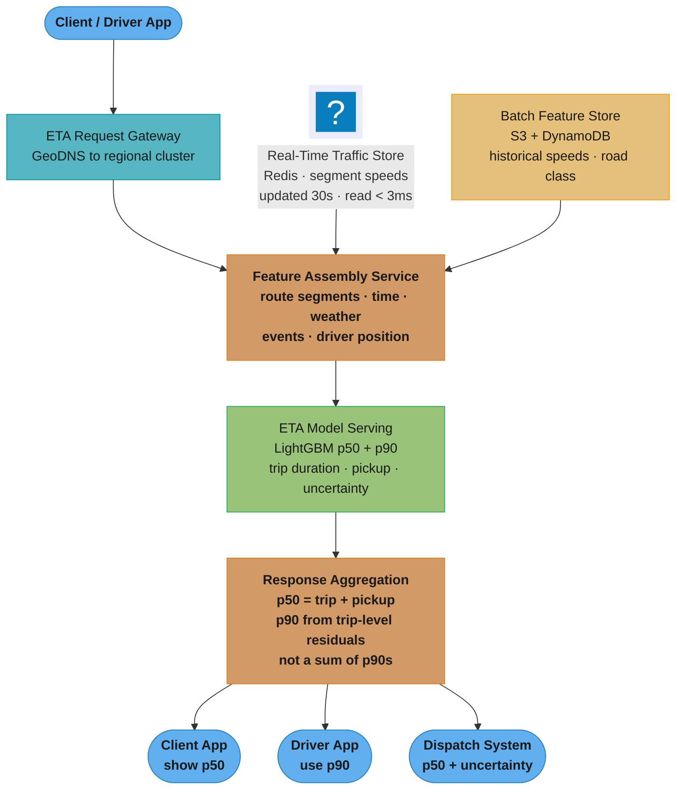
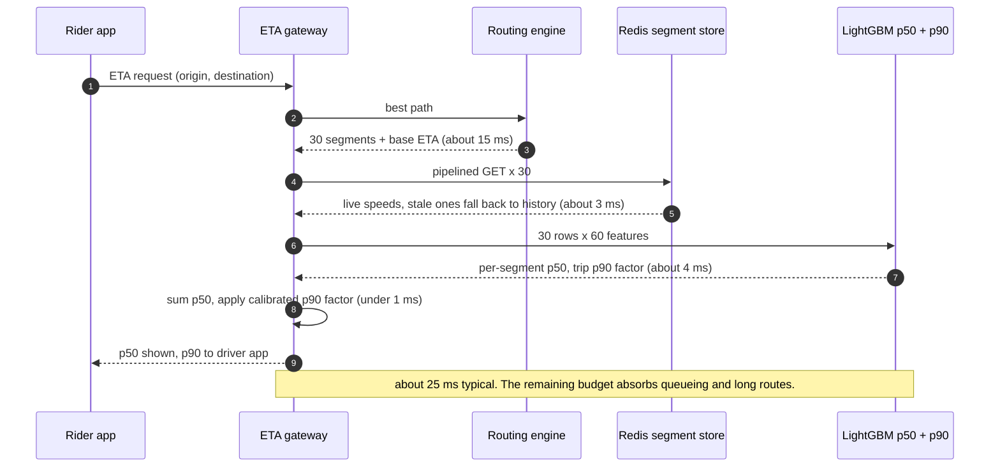
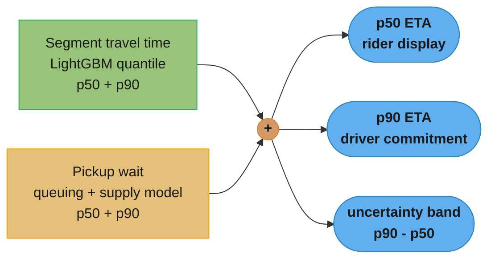
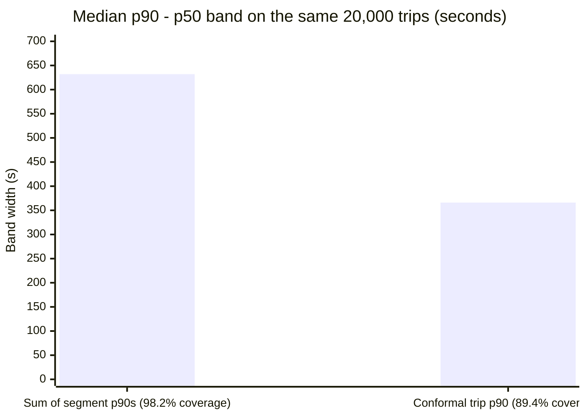
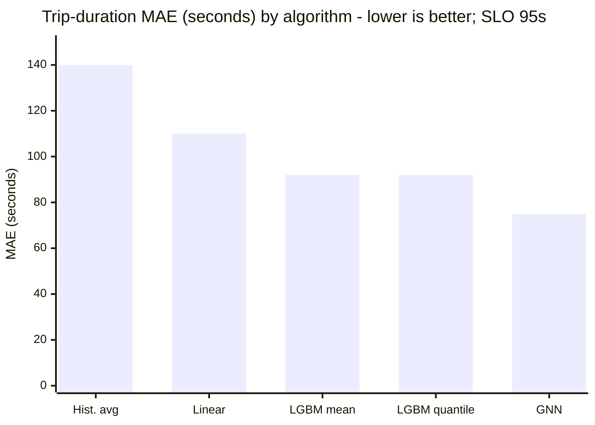

# Design an ETA Prediction System
## Intuition

> An ETA prediction system is like a professional navigator in an unfamiliar city: good enough to get you there, but the real skill is communicating honest uncertainty — "probably 12 minutes, but could be 18 if the game just ended."

**Key insight:** ETA is a regression problem at its core, but naive RMSE optimization produces the wrong model for a marketplace. Riders cancel more when ETA is *longer than expected* than when it is longer in absolute terms. Drivers are evaluated on their ability to meet the ETA they were given. The system must produce p50 (median) estimates for display, p90 (conservative) estimates for driver commitment, and accurate uncertainty bounds for decision-making. This requires quantile regression, not simple mean regression.

Mental model: decompose ETA into three sub-problems — each with a different algorithm: (1) segment-level travel time estimation (historical + real-time: GBDT + graph features); (2) pickup wait time (queuing model + supply forecasting: statistical); (3) uncertainty quantification (quantile regression on residuals: LightGBM with asymmetric loss). The final ETA is a combination of all three, assembled at request time.

One combination rule deserves a warning up front because it looks obviously right and is wrong: **quantiles do not add**. The p50 of a trip is close to the sum of its parts' typical times, but the p90 of a 25-segment trip is far below the sum of 25 segment p90s, because the segments do not all run slow at once. §4.5 shows a runnable case where summing segment p90s gives 98% coverage and a band 1.7x wider than needed; drivers committed to that number look "on time" while riders see an ETA that is useless.

**Sibling study, not duplicated here:** [Marketplace Matching](design_marketplace_matching.md) consumes this system's pickup ETA as an edge weight and owns dispatch; this file owns the travel-time and uncertainty estimate and stops at the ETA API.

**Vocabulary used throughout:**

| Term | Meaning here |
|---|---|
| Segment | A directed road edge between two intersections, the routing engine's unit of travel time |
| Routing-engine ETA | Sum of per-segment traversal times along the chosen path (OSRM/Valhalla); the "physics" baseline |
| Residual / post-processing model | ML model that predicts `actual − routing-engine ETA` rather than the ETA itself (Uber's DeepETA design, §6) |
| p50 / p90 | Conditional median / 90th percentile of trip duration |
| Coverage | Fraction of completed trips whose actual duration ≤ the predicted p90; target ≥ 88% |
| Band width | `p90 − p50`; the guard against "buying" coverage with absurd p90s (§9 Pitfall 5) |
| Pinball loss | The asymmetric loss whose minimiser is a quantile; at α = 0.9 an underestimate costs 9x an overestimate |
| Conformal calibration | Post-hoc rescaling of a predicted interval on held-out data so empirical coverage matches the target |

---

## 1. Requirements Clarification

**Functional requirements:**
- Predict end-to-end ETA: time from now until the rider reaches their destination.
- Sub-components: pickup ETA (driver → rider) + trip duration (rider → destination).
- Inputs: origin coordinates, destination coordinates, current time, driver GPS position, live traffic data.
- Output: p50 ETA (displayed to rider), p90 ETA (driver commitment), uncertainty range (for rider expectation setting).
- Real-time updates: recalculate ETA every 15 seconds during active trips; update rider app.

**Non-functional requirements:**
- Latency: p99 < 150ms for ETA request (including feature fetch); p99 < 50ms for model inference alone.
- Throughput: 200k ETA requests/second during peak (major city, rush hour, concurrent events).
- Accuracy: mean absolute error (MAE) ≤ 95 seconds on trip duration; coverage of p90 interval ≥ 88% (p90 must contain actual ETA at least 88% of the time).
- Geographic coverage: 50 cities globally; cross-city model (shared parameters) with city-specific fine-tuning.
- Freshness: real-time traffic features must be < 2 minutes stale for traffic-sensitive routes.

**Out of scope:**
- Route optimization (which path to take): separate routing service.
- Driver dispatch (which driver to assign): matching system consumes ETA as input.
- Surge pricing: separate model, but consumes ETA predictions.

**Clarify with the interviewer (each answer changes the design):**
- Who consumes which number? Rider display, driver commitment, dispatch and pricing each read a different quantile; a single "the ETA" is a red flag.
- Is the route given (navigation) or unknown (pre-booking, where the driver may take any path)? Unknown routes are why a residual model on a routing-engine ETA (§6) beats a pure segment sum.
- Ride-hailing or delivery? Delivery adds restaurant prep time and a stop at pickup, and its lateness costs differ.
- What does "late" cost? If a late arrival costs more than an early one, the display quantile should sit above the median (§9 Pitfall 1).
- Is GPU serving available? It decides whether the GNN in §5 is a product option or a research track.
- How many cities, and how fast do new ones launch? That sets the cold-start design (§11) and the calibration pooling rule (§10).

---

## 2. Scale Estimation

**Request volume:** 200k req/s peak across 50 cities = 4k req/s per city average. During city events: up to 20k req/s for a single city.

**Active trips at peak:** 10M trips/day with an average trip duration of ~20 minutes means concurrency, not daily volume, drives the update load. At peak (≈10% of the day's trips in one hour) that is 1M trips/hour × 20/60 h = **~330k concurrent trips**, each refreshed every 15 s → **~22k update requests/second**. These must be batched (not individual API calls). Note the arithmetic trap: multiplying *daily* trips by the update rate would give 667k/s and over-provision the fleet ~30x.

**Historical training data:** 3 years × 365 days × 10M trips/day ≈ 11B trips. Sampled to 500M for training (stratified by city, time-of-day, day-of-week, weather condition).

**Real-time features:** road segment speeds from GPS probe data. Global road network: ~50M road segments. Each segment's speed updated every 30 seconds = 1.67M segment updates/second globally → requires a streaming aggregation layer (Flink/Kafka Streams).

**Model size:** LightGBM ensemble (p50 + p90 models): ~200MB combined. Loaded into memory on serving nodes — no disk I/O at request time.

**Serving infrastructure:** size on **CPU service time**, not on p99 wall-clock latency — the two differ by 5x here and confusing them is the classic capacity-planning error.
- Per request the service burns ~10 ms of CPU (feature assembly + two LightGBM inferences); the 50 ms figure is p99 *wall clock*, which includes Redis wait and queueing.
- 200k req/s × 10 ms CPU = **2,000 CPU-core-equivalents** at theoretical 100% utilisation.
- Provision at ~50% core utilisation so the tail does not queue: 4,000 cores → at 32 cores/server, **~125 servers** globally.
- With horizontal autoscaling: 125 baseline + 50 for peak headroom = ~175 servers at peak.

**Worked scale math the interviewer will probe:**

| Quantity | Derivation | Result |
|---|---|---|
| Segments scored per request | median route ~30 segments (95% < 40, §11) | ~30 rows per request, so 200k req/s is ~6M segment rows/s |
| Redis reads per second | 200k req/s × 30 segment lookups, pipelined per request | ~6M key reads/s; at ~100k-200k ops/s per Redis shard that is 30-60 shards before replicas |
| Label volume | 10M trips/day, each labelled the moment it ends | ~115 labelled trips/s, so hourly MAE per city is statistically tight (a 4k-trip/hour city gives a ±3s MAE confidence interval) |
| Probe ingest | 1.67M segment updates/s × ~50 bytes | ~83 MB/s into Kafka before replication |
| Training table | 500M sampled trips × 60 features × 4 bytes | ~120 GB float32 in memory; trains on one large-memory node or a 10-node distributed LightGBM job |

The second row is where designs fail: candidates size the model fleet carefully and forget that the feature store sees 30x the request rate. Pre-aggregating the route into 3-5 super-segments (§11) is as much a Redis-capacity decision as a latency one.

---

## 3. High-Level Architecture



*Feature assembly fuses a real-time traffic path (Redis, 30s-fresh) with a batch historical path (S3/DynamoDB); the quantile model then emits p50 and p90, and aggregation fans the same prediction out to three consumers that each read a different quantile.*

**Data flow:** client request → feature assembly (route segments + real-time traffic + batch features) → LightGBM inference (p50, p90 per segment) → aggregation → response.

The 150 ms p99 budget is spent in a fixed order, and the sequence below is where each millisecond goes on a typical 30-segment route:



*The routing call and the Redis round trip together cost more than the model; that is why §5 Decision 1 can afford a GBDT and not a 45 ms GNN, and why super-segments (§11) cut latency and Redis load at the same time.*

---

## 4. Component Deep Dives

### 4.1 Feature Engineering for Road Segments

```python
import numpy as np
import pandas as pd
from dataclasses import dataclass
from datetime import datetime

@dataclass
class SegmentFeatures:
    segment_id: str
    distance_km: float
    road_class: int            # 0=highway, 1=primary, 2=secondary, 3=residential
    n_lanes: int
    speed_limit_kmh: float
    current_speed_kmh: float   # real-time from probe data
    historical_p50_speed: float  # same hour, same day-of-week, historical median
    historical_p90_speed: float  # same hour, same day-of-week, 90th percentile speed
    time_of_day_sin: float     # sin(2π × hour/24) — cyclic encoding
    time_of_day_cos: float     # cos(2π × hour/24)
    day_of_week_sin: float     # sin(2π × dow/7)
    day_of_week_cos: float     # cos(2π × dow/7)
    rain_intensity: float      # 0=dry, 1=light, 2=heavy
    event_nearby: int          # binary: major event within 2km
    congestion_ratio: float    # current_speed / historical_p50_speed

def encode_temporal_features(ts: datetime) -> dict[str, float]:
    """Cyclic encoding avoids discontinuity at midnight/Sunday."""
    hour = ts.hour + ts.minute / 60
    dow = ts.weekday()
    return {
        "time_of_day_sin": np.sin(2 * np.pi * hour / 24),
        "time_of_day_cos": np.cos(2 * np.pi * hour / 24),
        "day_of_week_sin": np.sin(2 * np.pi * dow / 7),
        "day_of_week_cos": np.cos(2 * np.pi * dow / 7),
        "is_rush_hour": int(7 <= ts.hour <= 9 or 17 <= ts.hour <= 19),
        "is_weekend": int(ts.weekday() >= 5),
    }
```

### 4.2 Quantile Regression for ETA Distribution — Broken Then Fixed

```python
import lightgbm as lgb
import numpy as np

# WRONG: mean regression — optimizes MSE, outputs average ETA
# MSE is symmetric: underestimating by 5min is penalized equally as overestimating.
# But riders are more frustrated by ETA surprises (arrived late vs expected)
# than by absolute ETA length. The business wants p50 display, p90 commitment.
lgbm_mean = lgb.LGBMRegressor(
    objective="mse",  # symmetric loss → biased toward mean, not appropriate for ETA
    n_estimators=300,
    random_state=42,
)
# This model is optimized for average accuracy but not for rider experience:
# 50% of trips arrive later than predicted → 50% of riders are surprised
```

```python
# CORRECT: separate quantile models for p50 and p90
# Quantile regression with asymmetric loss (pinball loss)
# α=0.5 → p50 (median): underestimate and overestimate equally penalized
# α=0.9 → p90: 9x penalty for underestimate vs 1x for overestimate
# → model deliberately biases toward conservative (later) estimates

lgbm_p50 = lgb.LGBMRegressor(
    objective="quantile",
    alpha=0.50,         # predict median trip duration
    n_estimators=500,
    learning_rate=0.03,
    num_leaves=63,
    min_child_samples=50,
    random_state=42,
)

lgbm_p90 = lgb.LGBMRegressor(
    objective="quantile",
    alpha=0.90,         # predict 90th percentile trip duration
    n_estimators=500,
    learning_rate=0.03,
    num_leaves=63,
    min_child_samples=50,
    random_state=42,
)

def predict_eta_with_uncertainty(
    X: np.ndarray,
    p50_model: lgb.LGBMRegressor,
    p90_model: lgb.LGBMRegressor,
) -> dict[str, np.ndarray]:
    p50 = p50_model.predict(X)
    p90 = p90_model.predict(X)
    uncertainty = p90 - p50   # uncertainty band width in seconds
    return {
        "eta_p50_s": p50,     # display to rider
        "eta_p90_s": p90,     # driver commitment
        "uncertainty_s": uncertainty,
    }
```

The end-to-end ETA is assembled from two independent sub-models, each emitting its own quantiles:



*Trip duration and pickup wait are modeled separately — a trained quantile GBDT and a statistical queuing model — and combined. The medians add approximately; the p90s do not, so the combined p90 comes from a trip-level residual calibration (§4.5), not from adding the two p90 outputs. Carrying a calibrated p50 and p90 through the whole pipeline is what lets the rider see an attractive median while the driver commits to an achievable 90th-percentile time.*

### 4.3 Real-Time Traffic Feature Pipeline (Flink) — Broken Then Fixed (runnable)

Production runs this as a Flink job keyed by `segment_id` with event-time windows; the Python below has the same semantics and runs with the standard library only, which makes the classic bug easy to see. The broken version accumulates every probe a segment has ever seen and calls the median "the last 30 seconds". Its `window_seconds` parameter exists in the signature and is never used, which is how this bug survives code review.

```python
from __future__ import annotations

from collections import deque
from collections.abc import Iterable, Iterator
from dataclasses import dataclass
from statistics import median


@dataclass(frozen=True)
class Probe:
    ts: float          # event time, seconds
    segment_id: str
    speed_kmh: float


# BROKEN: the buffer never evicts, so the "30-second median" is a median over the
# segment's whole history and barely moves when a jam starts.
def segment_speed_broken(probes: Iterable[Probe]) -> Iterator[tuple[float, str, float]]:
    buf: dict[str, list[float]] = {}
    for p in probes:
        buf.setdefault(p.segment_id, []).append(p.speed_kmh)
        if len(buf[p.segment_id]) >= 3:
            yield p.ts, p.segment_id, median(buf[p.segment_id])


# FIX: evict by EVENT time, not by count, so the window is really 30 s wide.
def segment_speed(probes: Iterable[Probe], window_s: float = 30.0,
                  min_probes: int = 3) -> Iterator[tuple[float, str, float]]:
    buf: dict[str, deque[Probe]] = {}
    for p in probes:
        q = buf.setdefault(p.segment_id, deque())
        q.append(p)
        while q and q[0].ts <= p.ts - window_s:
            q.popleft()
        if len(q) >= min_probes:
            yield p.ts, p.segment_id, median(x.speed_kmh for x in q)


if __name__ == "__main__":
    # one probe every 2 s for 10 minutes; a jam drops speed from 60 to 12 km/h at t=300 s
    stream = [Probe(t, "seg-42", 60.0 if t < 300 else 12.0) for t in range(0, 600, 2)]
    for name, fn in [("broken", segment_speed_broken), ("fixed", segment_speed)]:
        out = {round(ts): v for ts, _, v in fn(stream)}
        print(f"{name:>6}: t=330s {out[330]:5.1f} km/h  t=420s {out[420]:5.1f} km/h  "
              f"t=598s {out[598]:5.1f} km/h")
```

```
broken: t=330s  60.0 km/h  t=420s  60.0 km/h  t=598s  36.0 km/h
 fixed: t=330s  12.0 km/h  t=420s  12.0 km/h  t=598s  12.0 km/h
```

The broken aggregator reports free-flow speed for the first five minutes of a jam and only reaches the midpoint after the jam has lasted as long as all prior history; on a segment with a week of history it would never move. Every ETA routed through that segment during the jam is optimistic by a factor of five for that segment, which is the §9 Pitfall 2 failure from the other direction. Three production details the toy leaves out: windows run on *event* time with a watermark (a probe that arrives 20 s late still belongs to its own window), the output is written to Redis with a 2-minute TTL so a segment that stops receiving probes falls back to its historical p50 instead of serving a stale jam forever, and a confidence weight `min(1, n_probes / 10)` blends live and historical speed when probes are sparse. State size is bounded by design: 50M segments × at most ~15 probes in a 30 s window × ~24 bytes ≈ 18 GB across the job, spread over the TaskManagers' keyed state.
### 4.4 Pickup Wait Time Model

```python
import numpy as np
from scipy import stats as scipy_stats

def estimate_pickup_wait(
    supply_in_zone: int,              # number of available drivers within 2km
    demand_rate: float,               # requests per minute in the zone
    driver_distance_m: float,         # distance of nearest available driver
    zone_congestion: float,           # current speed / historical speed ratio
    driver_arrival_rate_per_min: float = 0.5,  # drivers becoming free per minute
) -> dict[str, float]:
    """
    Simple queuing-based pickup wait estimate.
    Driver arrival time = distance / (historical speed × congestion_factor)
    For no available drivers: M/M/1-style wait on the driver arrival process.

    NOTE the trap in the empty-zone branch: the arrival rate must come from an
    independent estimate of how fast drivers free up in this zone. Deriving it
    from `supply_in_zone` is circular — that value is 0 in exactly this branch,
    so any ratio built from it collapses to whatever floor you clamp with, and
    the "queue model" silently degenerates into a constant.
    """
    if supply_in_zone > 0:
        avg_speed_kmh = 25.0 * zone_congestion     # urban average speed in km/h
        drive_time_s = (driver_distance_m / 1000) / avg_speed_kmh * 3600
        return {
            "pickup_p50_s": drive_time_s,
            "pickup_p90_s": drive_time_s * 1.3,   # +30% buffer for congestion variance
            "source": "nearest_driver",
        }
    else:
        # Effective service rate = driver arrivals net of competing demand.
        net_rate = max(driver_arrival_rate_per_min - demand_rate, 0.05)
        expected_wait_s = (1.0 / net_rate) * 60
        expected_wait_s = min(expected_wait_s, 900.0)  # cap displayed wait at 15 min
        return {
            "pickup_p50_s": expected_wait_s,
            "pickup_p90_s": expected_wait_s * 1.8,
            "source": "queue_model",
        }
```

### 4.5 Combining Quantiles — Broken Then Fixed (runnable)

The tempting way to build a trip p90 is to predict a p90 per segment and add them up. It is wrong for the same reason a portfolio's 90th-percentile loss is not the sum of each stock's: the parts are only partly correlated, so their bad days rarely coincide. The simulation below gives each trip 10-40 segments, a shared trip-level congestion factor (σ = 0.20 in log space) and independent segment noise (σ = 0.35), then compares the two constructions on 20,000 unseen trips. Only `numpy` is needed.

```python
from __future__ import annotations

import numpy as np
from numpy.typing import NDArray

FloatArr = NDArray[np.float64]
Z90 = 1.2816                                   # standard-normal 90th percentile
SEG_SIGMA, TRIP_SIGMA = 0.35, 0.20             # segment noise, shared trip congestion


def simulate_trips(n: int, rng: np.random.Generator) -> tuple[list[FloatArr], FloatArr]:
    """Each trip: 10-40 segments with a free-flow median time, one shared congestion
    multiplier per trip (rain, an incident) and independent per-segment noise."""
    medians, actual = [], np.empty(n)
    for i in range(n):
        m = rng.uniform(15.0, 60.0, size=rng.integers(10, 41))   # seconds per segment
        congestion = rng.lognormal(0.0, TRIP_SIGMA)
        actual[i] = (m * congestion * rng.lognormal(0.0, SEG_SIGMA, size=m.size)).sum()
        medians.append(m)
    return medians, actual


# BROKEN: trip p90 = sum of per-segment p90s.
def p90_sum_of_segment_quantiles(medians: list[FloatArr]) -> FloatArr:
    seg_p90_factor = np.exp(Z90 * np.hypot(SEG_SIGMA, TRIP_SIGMA))   # each segment's own p90
    return np.array([m.sum() * seg_p90_factor for m in medians])


# FIX: predict a trip-level point estimate, then calibrate ONE trip-level multiplier on
# held-out trips (split conformal on actual / estimate). The trip-level residuals
# already contain the real correlation between segments.
def p50_trip(medians: list[FloatArr]) -> FloatArr:
    return np.array([m.sum() for m in medians])


def conformal_p90_factor(p50_cal: FloatArr, actual_cal: FloatArr, alpha: float = 0.10) -> float:
    ratios = np.sort(actual_cal / p50_cal)
    k = int(np.ceil((len(ratios) + 1) * (1.0 - alpha))) - 1
    return float(ratios[min(k, len(ratios) - 1)])


def report(name: str, p90: FloatArr, p50: FloatArr, actual: FloatArr) -> None:
    coverage = float((actual <= p90).mean())
    band = float(np.median(p90 - p50))
    print(f"{name:>22}: coverage={coverage:.1%}  median p90-p50 band={band:5.0f}s")


if __name__ == "__main__":
    rng = np.random.default_rng(11)
    cal_m, cal_y = simulate_trips(5_000, rng)
    test_m, test_y = simulate_trips(20_000, rng)

    p50 = p50_trip(test_m)
    report("sum of segment p90s", p90_sum_of_segment_quantiles(test_m), p50, test_y)
    factor = conformal_p90_factor(p50_trip(cal_m), cal_y)
    report("conformal trip p90", p50 * factor, p50, test_y)
```

```
   sum of segment p90s: coverage=98.2%  median p90-p50 band=  632s
    conformal trip p90: coverage=89.4%  median p90-p50 band=  366s
```



*The summed construction "wins" on coverage by 9 points and pays for it with 266 extra seconds of band on every trip. Coverage alone would pick the wrong model; band width (and pinball loss, §4.7) picks the right one.*

The broken construction does not *fail* any coverage alert: 98.2% clears the 88% SLO comfortably, which is exactly why it survives in production. Its cost shows up elsewhere: a band 1.7x wider than necessary (632s vs 366s on trips whose median is ~15 minutes), so the driver commitment is ~10 minutes above the median and the rider-facing "arrives by" window is too wide to plan around. The fix keeps the segment model for the *median* (where sums are approximately right) and calibrates the trip-level quantile once on held-out completed trips, which lands at 89.4% against a 90% target. In production the point estimate is the LightGBM p50 head rather than a sum of medians, and the conformal factor is fitted per city and time-of-day bucket and refreshed daily from the previous day's completed trips, which is cheap because ETA labels arrive the instant a trip ends. Pickup wait is combined the same way: calibrate on `actual pickup + actual trip` residuals, never add a pickup p90 to a trip p90. The classifier version of the same post-hoc idea (fit on held-out data, check empirical coverage per slice) is in [Model Calibration and Thresholding](./cross_cutting/model_calibration_and_thresholding.md).

### 4.6 Serving the Quantile Models on Triton's FIL Backend

The two LightGBM heads are tree ensembles, not neural networks, so a DL model server buys nothing over a well-built CPU service; the question is only whether you want batching and multi-model management handled for you. NVIDIA Triton's FIL (Forest Inference Library) backend serves XGBoost, LightGBM, scikit-learn and cuML forests, reads LightGBM's text format (`model.txt`) directly, and runs on CPU or GPU from the same config. A model repository for the p90 head:

```
eta_p90/
├─ 1/
│  └─ model.txt          # lgb.Booster.save_model(...) output, objective=quantile, alpha=0.9
└─ config.pbtxt
```

```protobuf
backend: "fil"
max_batch_size: 8192
input [ { name: "input__0", data_type: TYPE_FP32, dims: [ 60 ] } ]
output [ { name: "output__0", data_type: TYPE_FP32, dims: [ 1 ] } ]
instance_group [ { kind: KIND_CPU, count: 4 } ]
parameters [
  { key: "model_type", value: { string_value: "lightgbm" } },
  { key: "is_classifier", value: { string_value: "false" } }
]
dynamic_batching { max_queue_delay_microseconds: 500 }
```

```python
from __future__ import annotations

import numpy as np
import tritonclient.http as httpclient


def predict_p90_seconds(client: httpclient.InferenceServerClient, rows: np.ndarray) -> np.ndarray:
    """rows: (n_segments, 60) float32 feature matrix for one route."""
    inp = httpclient.InferInput("input__0", list(rows.shape), "FP32")
    inp.set_data_from_numpy(rows.astype(np.float32))
    out = httpclient.InferRequestedOutput("output__0")
    result = client.infer("eta_p90", inputs=[inp], outputs=[out])
    return result.as_numpy("output__0").reshape(-1)


# client = httpclient.InferenceServerClient(url="eta-triton.internal:8000")
```

Three things to know before adopting it. FIL runs in 32-bit floats, so assert parity on ~10k logged requests against `lgb.Booster.predict` before cutover (a few milliseconds of drift on a 900-second trip is fine; a mismatch in feature order is not, and parity is the only test that catches it). The `max_queue_delay_microseconds: 500` setting trades up to 0.5 ms of queueing for batching 30 segment rows of many concurrent requests into one call, which is where most of the CPU saving comes from. And Triton is one option, not a requirement: an in-process FastAPI service calling `Booster.predict` is simpler and is the default in §7; BentoML or KServe are the alternatives when the team already standardises on them. TorchServe is not an option for new work: its repository (`pytorch/serve`) was archived on 2025-08-07 and is read-only.

### 4.7 Evaluating a Quantile Model Per Slice (runnable)

A single global coverage number is the ETA equivalent of accuracy on an imbalanced dataset: it averages away the slices drivers complain about. The report below computes, per city × hour bucket, the p50 MAE, the p90 pinball loss (the proper scoring rule for a quantile, so it can rank two models even when both have acceptable coverage), coverage and band width, and flags slices outside the two-sided 88-92% gate. The toy uses one global band; Seattle's evening peak is noisier than everything else.

```python
from __future__ import annotations

import numpy as np
import pandas as pd


def pinball(y: pd.Series, pred: pd.Series, q: float) -> float:
    diff = y - pred
    return float(np.mean(np.maximum(q * diff, (q - 1.0) * diff)))


def slice_report(trips: pd.DataFrame, by: list[str], min_trips: int = 500) -> pd.DataFrame:
    """Per-slice ETA health; slices below `min_trips` are flagged rather than trusted."""
    def agg(g: pd.DataFrame) -> pd.Series:
        return pd.Series({
            "trips": len(g),
            "mae_p50_s": float((g["actual_s"] - g["p50_s"]).abs().mean()),
            "pinball_p90": pinball(g["actual_s"], g["p90_s"], 0.9),
            "coverage_p90": float((g["actual_s"] <= g["p90_s"]).mean()),
            "band_s": float((g["p90_s"] - g["p50_s"]).median()),
        })
    rep = trips.groupby(by).apply(agg, include_groups=False)
    rep["flag"] = np.where(rep["trips"] < min_trips, "too_few",
                  np.where((rep["coverage_p90"] < 0.88) | (rep["coverage_p90"] > 0.92), "breach", "ok"))
    return rep


if __name__ == "__main__":
    rng = np.random.default_rng(5)
    n = 200_000
    trips = pd.DataFrame({
        "city": rng.choice(["austin", "denver", "seattle"], n),
        "hour_bucket": rng.choice(["night", "am_peak", "midday", "pm_peak"], n),
    })
    trips["p50_s"] = rng.uniform(300, 1800, n)
    spread = np.where((trips["city"] == "seattle") & (trips["hour_bucket"] == "pm_peak"), 0.40, 0.22)
    trips["actual_s"] = trips["p50_s"] * rng.lognormal(0.0, spread)
    trips["p90_s"] = trips["p50_s"] * np.exp(1.2816 * 0.22)          # one global band

    print(f"global coverage: {(trips['actual_s'] <= trips['p90_s']).mean():.1%}")
    rep = slice_report(trips, ["city", "hour_bucket"])
    print(rep[rep["flag"] != "ok"][["trips", "coverage_p90", "pinball_p90", "flag"]].round(3))
```

```
global coverage: 88.8%
                       trips  coverage_p90  pinball_p90    flag
city    hour_bucket
seattle pm_peak      16748.0         0.759      122.062  breach
```

The global number passes the 88% SLO; one slice in twelve is at 75.9%, and its pinball loss is ~2.5x the others. That slice is roughly 8% of trips, and in it one driver commitment in four is missed. Per-slice coverage is the alert; pinball loss is the model-selection metric (lower is better, and unlike coverage it cannot be gamed by widening the band); band width is the guardrail. The per-bucket conformal factor from §4.5 is the fix for exactly this pattern, and the `too_few` flag is what stops a 40-trip slice from triggering a page.

---

## 5. Design Decisions & Tradeoffs

**Decision 1: LightGBM over deep learning (GNN/Transformer) for segment-level ETA.**
Alternatives considered: (a) graph neural network over road graph — more accurate for long-horizon route planning (handles multi-hop dependencies); on 10+ minute trips it reaches MAE 75s vs GBDT's 92s; (b) GBDT on segment features — simpler, faster to serve (3ms vs 45ms for GNN on CPU), easier to debug; (c) simple linear model on historical average — MAE 140s, insufficient. Decision: GBDT for the segment-level predictor; MAE 92s vs 75s for GNN is acceptable given the roughly 15x CPU-latency advantage (3ms vs 45ms; 7.5x once the p50+p90 pair is served at 6ms). GNN is reserved for future work when the serving infrastructure supports GPU inference within the 50ms budget. See [Algorithm Selection](../model_selection_and_algorithm_choice/model_selection_and_algorithm_choice.md).

**Decision 2: Quantile regression (p50 + p90) over mean regression.**
Mean regression produces a single ETA estimate optimized for symmetric loss. Riders are not symmetric — being late by 5 minutes is worse than being early by 5 minutes (riders wait, drivers feel pressure). p90 predictions are used for driver commitments: if the driver is given p90 as their "committed ETA" and 90% of trips complete within this time, the driver is considered on-time 90% of the time. This decouples rider-facing display (p50 = shorter, more attractive ETA) from driver-facing commitment (p90 = achievable in 9/10 trips). The cost: two models instead of one, slightly higher training time.

**Decision 3: Cyclic feature encoding for time-of-day.**
Naively encoding hour as an integer (0-23) creates a discontinuity: hour 23 and hour 0 (midnight) are adjacent in time but distant in the feature space (23 vs 0 difference = 23). The model may learn a wrong pattern. Cyclic encoding using sin/cos eliminates this: sin(2π×23/24) ≈ sin(2π×0/24) = both near 0, correctly representing midnight continuity. This is a simple but impactful feature engineering choice for any time-series ML system.

**Decision 4: Separate models per city vs single global model.**
Alternatives: (a) one model per city — 50 models; highest accuracy per city; but new cities start from scratch (cold start); (b) single global model with city-ID embedding — lower accuracy in established cities; (c) global model + city-specific fine-tuning (transfer learning) — global model provides warm start; city-specific fine-tuning adapts to local road patterns. Decision: option (c). A global model is trained on 500M trips from all cities. City-specific fine-tuning uses the last 30 days of trips for that city, with the global model's weights as initialization. New cities launch with the global model and gain 3+ months of trip data before fine-tuning begins.

**Decision 5: Real-time traffic freshness SLO of 2 minutes.**
Traffic changes rapidly at events (concerts, sports games). 2-minute staleness means: during a traffic incident that lasts < 2 minutes, the model may not detect it. This is accepted — incidents shorter than 2 minutes don't materially affect trip-level ETA. For incidents lasting 5+ minutes, the Flink pipeline detects the speed drop within 2 minutes and updates the model input. At 150ms ETA API latency: 2-minute staleness is trivially achievable with Redis TTL-based freshness enforcement.

**Decision 6: Define the label and clean it before tuning anything.**
"Actual trip duration" is `dropoff_ts − pickup_ts` from the driver app, and roughly every failure of an ETA model that "looked fine offline" traces to rows that are not trips: GPS-glitch trips with implausible speeds (> 150 km/h average), trips where the driver forgot to end the ride (duration > 3x the routing-engine ETA and the vehicle stationary at the end), and multi-stop trips logged as one. Rules: drop rows with average speed outside 2-150 km/h, drop trips whose duration exceeds 3x the base ETA *and* that end with > 5 minutes stationary, and split multi-stop trips at each stop. Typical effect: 1-2% of rows removed, and a p90 head that stops chasing artifacts. Log every dropped row with its reason, because a sudden jump in drop rate is itself an upstream incident.

**Decision 7: Serving runtime — in-process `Booster.predict` behind FastAPI, with Triton FIL as the scale-out option.**
At ~6M segment rows/s the decision is about batching and fleet management, not model support. (a) In-process FastAPI + LightGBM: zero network hops, simplest to debug, but each request scores its 30 rows alone. (b) Triton FIL backend (§4.6): dynamic batching across concurrent requests, CPU or GPU from one config, model versioning in the repository layout; costs one extra hop (~0.3-1 ms) and a parity test. (c) BentoML or KServe: worth it when the organisation already runs them for other models, since they add packaging and rollout tooling rather than speed. Decision: (a) for the first two years, (b) once the fleet passes ~100 servers, where a batching win of even 20% CPU is ~25 servers. TorchServe, sometimes still listed in older comparisons, is archived (2025-08-07) and is not considered.

**Comparison table:**

| Algorithm | MAE (seconds) | p90 coverage | Serving latency | Training time |
|---|---|---|---|---|
| Historical average | 140s | 72% | <1ms | 0 (lookup) |
| Linear regression | 110s | 78% | 1ms | 5 min |
| LightGBM (mean) | 92s | 84% | 3ms | 25 min |
| LightGBM (quantile p50/p90) | 92s / — | 89% | 6ms | 50 min |
| GNN (graph neural) | 75s | 91% | 45ms CPU | 6 hours |



*The GNN is the accuracy leader at 75s MAE but costs 45ms of the 50ms CPU inference budget on its own, leaving nothing for feature assembly or the p90 head. LightGBM (92s) clears the 95s SLO at 3–6ms, so it serves p50/p90 today while the GNN stays a research track for long-trip accuracy.*

---

## 6. Real-World Implementations

**Uber:** published "DeepETA: How Uber Predicts Arrival Times Using Deep Learning" (2022-02-10) and the paper "DeeprETA: An ETA Post-processing System at Scale" (arXiv 2206.02127) — and the important structural point is that it is a **residual/post-processing model, not an end-to-end ETA predictor**. A routing engine produces a base ETA as a sum of segment traversal times from map data and real-time traffic; DeepETA predicts the *residual* between that base ETA and the observed outcome. Uber says this post-processing model is its highest-QPS model and must return within a few milliseconds. The team tested seven architectures (MLP, NODE, TabNet, sparsely gated mixture-of-experts, HyperNetworks, Transformer, linear Transformer) and found an encoder-decoder with self-attention most accurate, and that discretizing and embedding *all* inputs gave a significant lift; the loss is an asymmetric Huber with two parameters (delta for robustness to outliers, omega for asymmetry), which lets the same architecture produce a mean ETA for fares or a specific quantile for other use cases — the deep-learning counterpart of the pinball-loss heads in §4.2. The model it replaced was a gradient-boosted tree ensemble that Uber describes as one of the largest and deepest XGBoost ensembles in the world at the time, which stopped scaling with dataset size. Uber's post does not describe LightGBM as a preprocessing stage feeding the Transformer; the base ETA comes from the routing engine.

**Lyft:** has published on building a **custom gradient-boosted-tree package** for travel-time estimation, with time plus start/end location as the primary features and space-partitioning schemes (geohashes, S2 cells) used to turn raw coordinates into model-usable cluster IDs. Beyond that, Lyft's ETA stack is not publicly documented in detail — treat any specific claim about a residual neural network on top of the GBDT, or its per-request latency, as unsourced.

**Google Maps (with DeepMind):** described in "Traffic prediction with advanced Graph Neural Networks" (DeepMind blog, 2020-09-03). Google Maps combines live traffic for road segments with historical patterns to predict traffic 10, 20 or 50 minutes into a drive. Google says its predictive ETAs were already accurate for over 97% of trips; the GNN work cut the remaining inaccuracies by up to 50% in cities including Berlin, Jakarta, São Paulo, Sydney, Tokyo and Washington D.C. (and by more than 50% in Taichung). The structural idea is the **Supersegment**: a route analyser groups adjacent road segments that share significant traffic volume, and a Graph Neural Network trained with multiple objectives predicts travel time per Supersegment, so congestion upstream informs the prediction downstream. That is the multi-hop dependency §5 Decision 1 trades away for CPU latency, and the reason the GNN track in this design is a research track rather than a dead end.

**DiDi (China):** published the **WDR (Wide-Deep-Recurrent)** model — Wang, Fu & Ye, *Learning to Estimate the Travel Time*, KDD 2018. It formulates ETA as a spatio-temporal regression over floating-car data and jointly trains three components: a wide linear model (memorizes feature crosses), a deep network (generalizes over sparse categorical features), and a recurrent model that consumes the route's ordered link sequence. The recurrent branch is what handles the ordered-segment structure a flat GBDT cannot. WDR remains the backbone of DiDi's travel-time estimation, with the recurrent module later upgraded to a Transformer. Public reporting does not include per-city MAPE figures for a GBDT+CNN ensemble; do not quote one.

---

## 7. Technologies & Tools

| Component | Technology | Alternative | Rationale |
|---|---|---|---|
| Streaming traffic | Flink (Kafka Streams) | Spark Streaming | Flink's event-time processing and low latency (< 100ms) matches 2-min freshness SLO |
| Real-time feature store | Redis Cluster | DynamoDB | Redis p99 < 2ms; DynamoDB ~5ms; extra 3ms matters at 200k req/s |
| Model training | LightGBM quantile | XGBoost quantile, NGBoost | LightGBM 3x faster; native quantile objective; NGBoost for distributional output |
| Model serving | FastAPI + uvicorn (in-process LightGBM) | NVIDIA Triton (FIL backend), BentoML, KServe | LightGBM doesn't need DL serving infra; Triton FIL adds cross-request dynamic batching once the fleet is large (§4.6, Decision 7) |
| Batch feature store | S3 + DynamoDB | Feast | DynamoDB for point lookups of historical segment stats; S3 for training data |
| Monitoring | Prometheus + Grafana | Datadog | MAE per city per time-window; p90 coverage rate; latency percentiles |
| Routing | OSRM / Valhalla | Google Maps API | Self-hosted routing for cost; provides route segments as input to ETA model |
| Interval calibration | numpy split conformal (§4.5) | MAPIE | a per-bucket ratio quantile is ~10 lines; MAPIE when you need CQR or many interval types |
| Load testing the model server | Triton `perf_analyzer` | Locust, k6 | measures latency and throughput at a given concurrency and batch size, which is the number the batching decision in §4.6 needs |

---

## 8. Operational Playbook

**(a) Model Evaluation Pipeline:**
- Hourly: MAE and p90 coverage computed on completed trips from prior hour (labels = actual trip duration, available immediately post-trip).
- Daily: aggregate metrics by city, time-of-day bucket, road class, weather condition.
- Weekly: full retrain on the rolling 90-day window; champion/challenger shadow for 7 days before promotion.

See [Experimentation and Online Evaluation](./cross_cutting/experimentation_and_online_evaluation.md) for A/B experiment design for model changes.

**(b) Observability:**
- Real-time: ETA API p99 latency (alert if > 200ms); Redis read p99 (alert if > 5ms).
- Per-city MAE monitoring: alert if MAE in any city exceeds 2× the baseline (may indicate traffic data outage or model issue).
- p90 coverage: alert if coverage drops below 85% (model is underestimating trip durations systematically).
- Traffic feature freshness: alert if any segment's Redis TTL has expired without update for > 5 minutes.

See [Drift Monitoring and Retraining](./cross_cutting/drift_monitoring_and_retraining.md) for PSI monitoring.

**(b2) Promotion gates for a new ETA model:** ETA labels arrive within minutes, so every gate is measured on *live* completed trips during a staged rollout rather than only offline.

| Stage | Traffic | Duration | Gate to advance |
|---|---|---|---|
| Offline | replay of last 14 days | 1 run | MAE ≤ champion − 1s on every city; p90 coverage 88-92% on every city × hour bucket |
| Shadow | 100% scored, 0% shown | 48 h | per-city MAE delta and coverage within the offline result ± 1 point; p99 latency within budget |
| Canary | 5% of riders (hash on rider_id) | 72 h | cancellation rate not worse than control at 95% confidence; coverage ≥ 88% |
| Ramp | 25% → 50% → 100% | 24 h each | same gates; automatic rollback on any breach |

The 88-92% coverage band is deliberately two-sided: below 88% drivers are judged against times they cannot meet, above 92% the model is buying coverage with width (§9 Pitfall 5).

**(b3) Data-quality checks that run before every retrain and every hour in production:**
- Label drop rate (Decision 6 rules): alert if it moves > 1 point from its 7-day mean; a jump usually means a driver-app release changed how trips end.
- Probe freshness: share of route segments served from historical fallback; alert above 15% in any city (normal is 3-8%).
- Feature parity: for 1,000 sampled live requests a day, recompute features offline from the logged inputs and compare; any feature with > 0.1% mismatch blocks the next retrain (this is the check that would have caught §9 Pitfall 2).
- Routing-engine version: the base-ETA cost model is a feature; a routing-engine deploy without an ETA-model recalibration is treated as a model change and goes through the §8 gates.

**(c) Incident Runbooks:**

**Runbook 1 — Traffic data pipeline failure (Flink outage):**
Symptom: Redis segment speeds go stale (TTL expires without refresh); p90 coverage drops below 85%.
Diagnosis: check Flink job status; check Kafka consumer lag on GPS event topic.
Mitigation: fall back to historical p50 speed for all segments (model input degrades gracefully — historical average replaces real-time speed).
Resolution: restart Flink job; verify Kafka consumer lag drains; monitor coverage rate recovery.

**Runbook 2 — MAE spike in a specific city (> 2× baseline):**
Symptom: MAE in City X climbs from 85s to 210s within 30 minutes.
Diagnosis: check for major events (sports game, concert) via event calendar API; check weather; check if road closure data is propagated.
Mitigation: if known event: apply hardcoded +20% ETA multiplier for affected zones; notify dispatch system.
Resolution: collect event trip data for retraining; update event calendar integration for future auto-adjustment.

**Runbook 3 — ETA API latency p99 > 150ms SLO:**
Symptom: p99 latency alert fires; Redis read latency is normal (<3ms) but feature assembly is slow.
Diagnosis: check number of route segments per request (very long routes have 100+ segments); check CPU utilization on ETA servers.
Mitigation: autoscale ETA server pool; limit segment count to 50 and use coarser segment resolution for very long trips.
Resolution: capacity review; add batch routing for long-distance requests.

**Runbook 4 — p90 coverage collapse after model promotion:**
Symptom: new model deployed; p90 coverage drops from 89% to 79% within 2 hours.
Diagnosis: compare challenger vs champion predictions for recent trips; check if quantile parameter changed in training.
Mitigation: roll back to champion model immediately (< 5 minutes to revert via model registry).
Resolution: debug challenger training; check if training data window included an anomalous period; retrain with corrected data.

**Runbook 5 — Coverage drifts in one city × hour bucket while the global number looks fine:**
Symptom: global p90 coverage 89%, but the Friday 17:00-19:00 bucket in one city reads 78% for three consecutive weeks.
Diagnosis: check whether the bucket's conformal factor (§4.5) is fitted on enough trips (a bucket with < 500 trips per refresh has a noisy 90th percentile); check for a structural change (new road closure, school term) that shifted the residual distribution.
Mitigation: widen that bucket's factor to the 95th-percentile ratio until it recovers; alert the city ops team.
Resolution: pool sparse buckets with adjacent hours for calibration; add the structural change as a feature for the next retrain. Coverage must be monitored per slice, because an average across 50 cities × 24 hours hides exactly the slices drivers complain about.

---

## 9. Common Pitfalls & War Stories

*These are illustrative composites of recurring failure patterns, not accounts of specific public incidents. The mechanisms are real and common; the company descriptions, dates and impact figures are representative and should not be quoted as measured public record.*

**Pitfall 1 — Symmetric loss producing systematically late arrivals, early-stage ride-hailing startup (2017).**
ETA model trained with RMSE (symmetric loss) optimized average accuracy but produced p50 predictions at the wrong level. 52% of trips arrived later than predicted (the model was biased toward the mean, which was pulled higher by outlier-long trips). Riders complained about "ETA lies." The model was technically accurate (low RMSE) but behaviorally wrong (more trips were late than early). Resolution: switch to quantile regression and push the display quantile *above* the median — α=0.55, not below it. Predicting p45 would make 55% of trips run longer than displayed, which is the failure being fixed; predicting p55 means the rider arrives earlier than promised more often than later. MAE rises slightly (a displayed quantile above the median is by construction not the MAE-optimal point) in exchange for the arrival-surprise asymmetry the business actually cares about.

**Pitfall 2 — Training-serving skew from real-time features, Uber-scale platform (2019).**
ETA model trained on logged feature values from historical trips, but a feature (congestion_ratio = current_speed / historical_p50_speed) was computed differently at training time (using the full day's historical data as "historical_p50") vs serving time (using a 30-day rolling average). The values were correlated but systematically different: training-time congestion_ratio was biased toward 1.0 (the day's average is always 1 by definition); serving-time congestion_ratio could be 0.3 (current speed far below 30-day historical). Model trained on feature range 0.8-1.2; served with feature range 0.2-2.0 → severe extrapolation error. See [Feature Store](./cross_cutting/feature_store_and_point_in_time_correctness.md). Impact, at this study's scale: an extrapolating model on the congested tail of trips (say the 15% of trips where serving-time congestion_ratio < 0.6) with MAE doubling from ~92s to ~180s is ~1.5M trips/day with an ETA that is three minutes off; the fix is to compute the feature with one function, from one store, for both training and serving.

**Pitfall 3 — Geographic bias in training data, regional taxi platform (2020).**
ETA model performed well for the city center (90%+ of training trips) but had 35% MAE in the suburbs (5% of training trips). Suburban trips were underrepresented in training → model learned poor estimates for sparse areas. Resolution: stratified sampling by geo-cluster to ensure suburb zones have at least 10% representation in training data; separate evaluation metrics per geo-cluster with explicit SLOs per zone.

**Pitfall 4 — Holiday drift not handled, delivery platform (2022, Black Friday).**
ETA model trained on the previous 90 days of trip data. On Black Friday, trip volume surged 4x, congestion patterns changed dramatically (residential areas congested due to package deliveries, typically quiet highways busy with warehouse logistics). Model MAE spiked from 95s to 280s. The model had seen previous weekday-like patterns but no Black Friday data in its 90-day window. Fix: maintain a "special day" supplement dataset of historical holiday trips; inject this into training when the calendar indicates a high-traffic holiday approaching. Impact: MAE tripling (95s to 280s) on a 4x-volume day means ~40M ETAs off by ~4.7 minutes on average on the one day the platform most needs dispatch to work.

**Pitfall 5 — P90 coverage gaming via overly conservative estimates, shipping company (2021).**
Engineering team was evaluated on "p90 coverage" (fraction of trips completing within the p90 ETA). They found that setting alpha=0.98 instead of 0.90 increased coverage to 99% — trivially beating the metric. But the p90 ETA shown to customers was 45% longer than actual trip time, destroying customer experience. Metric was too narrow: adding a second metric (mean p90 width in seconds — must be ≤ 2× p50 width) prevented gaming. Any model that achieves high coverage by massively inflating p90 will fail the width constraint.

**Pitfall 6 — Summed segment p90s: the bug that passes every coverage alert, delivery platform.**
The courier-commitment ETA was built as "sum of per-leg p90s" (restaurant prep p90 + pickup p90 + drive p90). Coverage read 98%, so every dashboard was green, and the team spent a quarter optimising latency instead. Meanwhile the customer-facing "arrives by" window was ~10 minutes wider than the true 90% interval (the §4.5 simulation reproduces the 1.7x band inflation), and checkout conversion on orders with a promised window above 45 minutes was measurably lower. Impact, illustrative: at 2M orders/day, a 1-point conversion loss on the ~20% of orders shown a long window is ~4k lost orders/day, ~$120k/day at a $30 basket. Fix: one trip-level conformal calibration (§4.5), a two-sided coverage gate (88-92%) in §8, and a band-width metric on the main dashboard next to coverage.

**Pitfall 7 — A routing-engine deploy silently shifts the residual model, ride-hailing platform.**
The maps team shipped a new turn-cost model that made the routing engine's base ETA ~6% shorter on urban routes. The residual model, trained on the old base ETA, kept adding its learned correction on top, so p50 ran ~6% early for two weeks and p90 coverage fell from 89% to 82% in the densest cities before anyone connected the two deploys. Impact, illustrative: at 10M trips/day, 7 points of coverage is ~700k extra missed driver commitments per day. Fix: treat the routing engine's version as a model input, gate routing deploys through the ETA shadow stage (§8 b3), and refit the conformal factor within 24 hours of any routing change.

---

## 10. Capacity Planning

**Primary bottleneck: ETA request processing at 200k req/s.**

```
Per-request compute:
- Redis feature fetch: 3ms (30 segment lookups, pipelined)
- LightGBM p50 inference: 2ms (500 trees on 60 features)
- LightGBM p90 inference: 2ms (500 trees on 60 features)
- Feature assembly + response serialization: 3ms
Total per request: ~10ms average, 50ms p99

Serving servers needed (size on CPU service time, NOT on p99 wall clock —
p99 includes Redis wait and queueing, so using it inflates the fleet ~5x):
  ~10ms CPU per request -> 1 / 0.010s = 100 req/s per CPU core
  Target 50% core utilisation so the 50ms p99 tail does not queue:
  32 cores x 100 req/s x 0.5 = 1,600 req/s per server
  At 200k req/s global, 50-city distribution:
  200k / 1,600 = 125 servers globally
  Add 40% headroom for regional peaks: ~175 servers
```

**Scaling formula:**
- If requests double to 400k/s: add 175 servers (linear scaling — each server is stateless).
- If p99 SLO tightens to 50ms: reduce Redis lookups (pre-aggregate segments into route-level features) or move tree inference off CPU. Note that **LightGBM has no native GPU inference** — its GPU support is training-only; GPU-accelerated tree scoring requires exporting to NVIDIA's cuML Forest Inference Library (FIL) or to ONNX Runtime.
- If cities expand to 200: training infrastructure scales linearly; serving infrastructure scales sub-linearly (smaller cities have lower traffic).

**Cost model (global):**

| Component | Config | Cost/month |
|---|---|---|
| ETA serving | 175 × c5.2xlarge at $0.34/hr | ~$43k |
| Redis Cluster (real-time traffic) | 10 × r5.2xlarge at $0.504/hr in each of 5 regions | ~$18k |
| Flink streaming (traffic pipeline) | 20 TaskManagers (c5.2xlarge, 8 vCPU) per region × 5 | ~$25k |
| Training (weekly retrain) | EMR, 50 nodes × 2h = ~433 node-hr/month on r5.4xlarge at $1.008/hr EC2 + $0.252/hr EMR surcharge (AWS Price List, us-east-1) | ~$0.5k |
| S3 storage (training data, logs) | 500GB/day compressed, 2-year retention ≈ 365 TB at $0.023/GB-mo | ~$8k |
| **Total** | | **~$95k/month** |

To size the cost against value, assume (illustrative — substitute your own marketplace's measured figure) that accurate ETA contributes $0.50 per ride through reduced cancellations and better driver utilization. At 10M rides/day that is $5M/day, ~$152M/month, making model infrastructure ~0.06% of attributable revenue. The conclusion is robust to being off by an order of magnitude on that $0.50: accuracy, not infrastructure cost, is the lever worth optimizing here.

**Sizing the feature path, which the model fleet math hides:**

```
Redis (real-time segment speeds):
  hot set: 50M segments x ~64 B (key + speed + n_probes + ts) = ~3.2 GB per region
  reads:   200k req/s x 30 segments = 6M lookups/s, pipelined -> 200k round trips/s
  writes:  1.67M segment updates/s globally, ~330k/s per region (5 regions)
  -> sized by ops, not memory: ~10 shards/region at ~600k pipelined ops/s per shard,
     x2 for replicas; memory per shard is under 1 GB.

Flink (probe aggregation):
  GPS probes: assume 1M active drivers x 1 ping / 4 s = 250k events/s globally
  map-matching to segments is the expensive step (~50-100 us/event of CPU)
  250k x 100 us = 25 CPU-seconds per second -> ~25 cores busy, 100 cores at 25% util
  -> 20 TaskManagers x 8 vCPU per region (cost table above) leaves ~8x headroom for
     event bursts and checkpointing.

Conformal calibration (§4.5):
  50 cities x 24 hour buckets x 7 days = 8,400 buckets
  10M trips/day / 8,400 = ~1,200 trips per bucket per day -> a daily refit is
  statistically fine for large cities; pool buckets for cities < 50k trips/day.
```

**Effect of cross-request batching (Triton FIL, §4.6):** tree inference cost per row falls as rows are batched because the trees stay in cache and the per-call overhead is paid once. Batching the ~30 rows of one route is free; batching across requests needs a queue delay. At 1,600 req/s per server, a 500 µs window collects ~0.8 requests per server on average, so most of the gain comes from route-level batching, and cross-request batching pays only on the busiest regional servers. Measure with Triton's `perf_analyzer` at the real request mix before buying the extra hop.

**Training capacity (weekly retrain):**

```
Rows: 500M sampled trips x 60 features (float32) = 120 GB in memory
LightGBM histogram construction: ~O(rows x features) per tree level
  2 heads x 500 trees x depth ~8 = 8,000 tree levels
  50-node EMR (r5.4xlarge, 16 vCPU) data-parallel = 800 cores
  budget: ~2 h per weekly run (the cost table assumes 50 nodes x 2 h)
City fine-tunes: 50 cities x last 30 days (~300k-9M trips each)
  ~5-20 min each on one node, run in parallel after the global model
Conformal refit (§4.5): pure aggregation over yesterday's 10M trips, < 5 min
```

The asymmetry matters for incident response: a bad model can be rolled back in five minutes, a bad calibration refit in five minutes, but a corrected global retrain takes two hours plus the §8 shadow stage, so the rollback path has to be the first move, never the retrain.

**What breaks at 3x (600k req/s, 150 cities):** serving scales linearly (~525 servers, ~$130k/month), but Redis read volume (18M lookups/s) and per-bucket calibration in small new cities break first. The fixes are architectural, not more hardware: super-segment pre-aggregation cuts lookups ~10x, and hierarchical calibration (city → region → global prior) keeps new-city coverage honest until each city has ~50k trips/day.

---

## 11. Interview Discussion Points

**Q: Why use GBDT instead of a graph neural network for ETA, given roads are inherently a graph?**
**Short:** Latency: a CPU GNN takes 45ms of a 50ms inference budget for a 15-20% relative MAE gain on long trips, while GBDT serves p50 and p90 in about 6ms and meets the 95s MAE SLO.
GNN captures multi-hop spatial dependencies — congestion propagating from segment A to segments B and C downstream. For short trips (< 15 minutes), this long-range dependency is less important — local segment speed is the primary predictor. For long trips, the GNN cuts MAE by roughly 15-20% in relative terms (92s to 75s) — note that is a percentage of the error, not percentage points of anything. The tradeoff: GNN inference at 45ms on CPU consumes almost the entire 50ms model-inference budget, leaving no room for feature assembly or the second quantile head; requiring GPU for serving increases cost by 5x. Decision: GBDT for p50 serving (correct 90%+ of trips), with a GNN research track for long-trip accuracy improvement once GPU serving infra is ready. See [Algorithm Selection](../model_selection_and_algorithm_choice/model_selection_and_algorithm_choice.md).

**Q: What is quantile regression and why is it better than mean regression for ETA?**
**Short:** It minimises pinball loss to predict a chosen quantile, so p50 is early as often as late and p90 is met 90% of the time, where a mean model is dragged late by right-skewed outlier trips.
Mean regression (MSE/RMSE loss) minimizes the expected squared error — it predicts the conditional mean ETA. The conditional mean is sensitive to outlier-long trips (stuck in traffic, accident) and produces predictions that are late more often than early (because the mean is pulled above the median by right-skewed distributions). Quantile regression minimizes the pinball loss for a specific quantile α: for α=0.5, it predicts the median (half of trips arrive earlier, half later); for α=0.9, it predicts the value below which 90% of trips complete. The asymmetric loss for α=0.9 penalizes underestimates 9x more than overestimates, producing conservative estimates. The benefit: p50 displays feel accurate (riders are early as often as late); p90 driver commitments are achievable 90% of the time (drivers feel fairly evaluated).

**Q: How do you handle the cold-start problem for ETA in a new city?**
**Short:** Start from the global model plus OpenStreetMap road attributes, then fine-tune on city trips; MAE typically moves from about 130s on day 0 to about 92s after 90 days.
Three-layer approach: (1) global model warm start — the global model trained on 500M trips provides a reasonable baseline for new cities (road types, time-of-day patterns are universal); (2) historical aggregation — OSM (OpenStreetMap) provides road segment attributes (class, speed limit, lanes) even before any trips; combine these with the global model for day-0 estimates; (3) rapid fine-tuning — as trips accumulate (within 30 days), fine-tune the global model on city-specific data. The global model MAE in a new city is typically 130s (vs 90s for established cities). After 30 days of fine-tuning: 100s MAE. After 90 days: 92s (matching established city performance).

**Q: How do you detect when the ETA model has degraded?**
**Short:** Labels arrive when each trip ends, so compute hourly MAE and p90 coverage per city on completed trips and add input-drift checks such as congestion-ratio PSI between label checks.
Two monitoring layers: (1) label-based (trip duration available immediately post-trip) — compute rolling MAE and p90 coverage on completed trips every hour; alert if MAE in any city exceeds 2× baseline or p90 coverage drops below 85%; (2) input distribution (no label required) — monitor real-time traffic feature distribution (segment speed distributions) vs historical; if congestion ratio PSI > 0.2 in a city, investigate whether a major event or incident is causing the shift. Hour-level granularity is achievable because trip duration labels are available the moment the trip ends (not a slow-feedback problem like churn or credit). See [Drift Monitoring](./cross_cutting/drift_monitoring_and_retraining.md).

**Q: What happens to ETA during an unexpected major event (concert just ended)?**
**Short:** Probe speeds from nearby drivers update Redis within about 30 seconds and all affected segments within 2 minutes, so new requests pick up the congestion with no manual step.
Within 30 seconds: GPS probe data from nearby drivers starts showing reduced speeds on surrounding roads. The Flink pipeline updates Redis segment speeds within 30 seconds. The ETA model automatically uses these lower speeds for new requests routing through the affected area. Within 2 minutes: all segments in the affected area have fresh congestion data. The ETA model adjusts accordingly — no manual intervention required. If the event was on the event calendar: a pre-computed "event multiplier" was already staged, providing an additional layer of adjustment before probe data catches up. If it was an unexpected event: the 30-second probe-data update is the sole correction mechanism.

**Q: How would you extend this system to predict the ETA for a food delivery (multi-stop)?**
**Short:** Add a restaurant queue model and a stop-time buffer to the road ETA, and calibrate the combined interval on end-to-end residuals because lateness costs differ from ride-hailing.
Food delivery has three legs: restaurant pickup wait (variable, depends on restaurant queue) + restaurant to customer (similar to ride-hailing) + customer wait tolerance. Key differences: (1) restaurant queue introduces a non-road-dependent wait time; predict restaurant queue using restaurant-specific historical data + current order volume; (2) the ETA must account for driver stopping time at pickup (2-5 minutes); (3) the food degrades in quality if ETA is too long (different business cost of overestimation vs ride-hailing). Architecture change: add a restaurant queue model (LightGBM or simple queuing model using historical order-to-pickup times per restaurant); ETA = queue_model_output + road_ETA + buffer. See the design for marketplace matching for how driver dispatch interacts with this estimate.

**Q: Walk me through how you'd A/B test a new ETA model.**
**Short:** Randomize by rider, use trip completion and ETA accuracy as the OEC with support contacts and driver ratings as guardrails, apply CUPED, check SRM on day 1 and run 14 days.
This is a user-level A/B experiment. OEC: trip completion rate (proxy for "ETA was accurate enough that rider didn't cancel") plus post-trip ETA accuracy (|predicted_p50 - actual_duration| < 2 minutes as a binary metric). Guardrails: no increase in support contacts for ETA-related complaints; no degradation in driver rating (which partly reflects whether the driver met the promised ETA). CUPED: use prior week's trip completion rate as the pre-experiment covariate. Sample size: at 10M trips/day, 1pp lift in completion rate (MDE) requires ~50k users per arm for 80% power at alpha=0.05, achievable in 1 day. Run for 14 days minimum to capture weekly seasonality. Check for SRM on day 1 (assignment is by rider_id hash). See [Experimentation](./cross_cutting/experimentation_and_online_evaluation.md).

**Q: Why are ETA errors not uniformly distributed across geographies and what do you do about it?**
**Short:** Sparse probe data, complex junctions and bimodal traffic raise error in some areas; widen bands by data confidence, add junction features and hold per-cluster SLOs.
ETA errors are higher in: (a) data-sparse areas (low GPS probe density → historical speed estimates are noisy); (b) complex road networks (highway interchanges, areas with many turns vs straight segments); (c) high-variance areas (traffic patterns are bimodal — very fast at off-peak, very slow at peak, with high uncertainty at transitions). Fix: (a) sparse areas — accept higher uncertainty, widen p90 band proportionally to probe data confidence; (b) complex networks — add turn penalty features and intersection delay estimates; (c) high-variance — the quantile model naturally captures this by outputting a wider (p90 - p50) band in high-variance areas. Report MAE separately by geo-cluster and maintain per-cluster SLOs. Set explicit SLA exceptions for extreme geographies (airport access roads during travel peaks) with documented wider tolerance. See [Responsible AI](./cross_cutting/responsible_ai_fairness_and_explainability.md) for the equity dimension of geographic ETA disparity.

**Q: What is the relationship between ETA accuracy and marketplace efficiency?**
**Short:** Bad ETAs raise cancellations, cause suboptimal dispatch and distort surge pricing; the direction is clear, but the size of each effect must come from your own holdout experiments.
ETA accuracy affects marketplace efficiency in three ways: (1) cancellation rate — when ETA display is significantly longer than actual (conservative model), riders cancel and re-request, wasting driver time and reducing system throughput; (2) driver supply positioning — the dispatch system uses ETA to determine which driver is "closest" to a rider; inaccurate ETA causes suboptimal matching, reducing the fraction of riders matched to the nearest driver; (3) dynamic pricing — surge pricing is triggered when demand significantly exceeds supply; if ETA is overestimated (long perceived wait), demand is artificially suppressed (fewer ride requests), causing unnecessary surge. The direction is well established, but be careful about quoting a magnitude: no public, verifiable figure ties a specific MAE improvement to a specific cancellation-rate or utilization delta, so any "MAE 140s to 92s buys X% fewer cancellations" number you cite has to come from your own holdout experiment, not from the literature.

**Q: How do you handle the tail latency problem for ETA on complex multi-segment routes?**
**Short:** Cost is linear in segment count, so cap fine-grained segments near 50, merge long routes into super-segments and cache the most common routes; 95% of routes need none of this.
Long routes cost more because the model is scored once per segment, not because any tree gets wider. The feature vector is a fixed ~60 columns regardless of route length, so the cost is N inferences plus N Redis lookups, linear in segment count. At 200 segments, p99 for the model work alone can reach 80ms. Solutions: (1) coarse-grained routing for long trips — aggregate 200 segments into 20 "super-segments" at the cost of some granularity; that is 20 scored rows instead of 200, a 10x cut in both inference calls and feature reads; (2) pre-computation — for the top-1000 most common routes, pre-compute ETA at 5-minute intervals and serve from cache; lookup is <1ms; (3) segment count cap — cap at 50 segments for the fine-grained model; use the linear/historical model for the remaining segments; combine. In practice, 95% of routes have < 40 segments; the tail latency problem affects < 5% of requests and can be handled by capping segment count with minimal accuracy loss.

**Q: Why can't you get a trip's p90 by adding the p90 of each segment?**
**Short:** Quantiles do not add: segments rarely all run slow together, so the sum of segment p90s overshoots the trip p90, giving near-100% coverage and a band far wider than needed.

Only means add exactly; the p90 of a sum depends on how correlated the parts are. With partly independent segment noise, the bad days of 25 segments do not coincide, so the trip's 90th percentile sits well below the sum of the 25 individual 90th percentiles. The §4.5 simulation shows the summed construction at 98.2% coverage with a 632s band, against 89.4% coverage and a 366s band from a trip-level conformal calibration. The trap is that it passes a one-sided coverage alert, so gate on a two-sided band (88-92%) and track band width next to coverage.

**Q: What is conformal calibration and why use it on top of a quantile model?**
**Short:** It rescales a predicted interval using held-out residuals so that empirical coverage matches the target, fixing quantile heads that drift or were never well calibrated.

Split conformal takes a calibration set the model did not train on, computes a nonconformity score per example (here `actual / predicted p50`), and uses its `ceil((n + 1)(1 − α))`-th smallest value as the multiplier. Under exchangeability the result covers at least `1 − α` of new trips with no distributional assumption. For ETA it is cheap because labels arrive minutes after each trip, so the factor can be refitted daily per city × hour bucket. The caveat is that the guarantee is marginal: it holds on average over the calibration population, so monitor coverage per slice, not only globally.

**Q: Why predict the residual of a routing-engine ETA instead of the ETA itself?**
**Short:** The routing engine already encodes the road graph and live traffic; a model on its residual learns only what physics misses, needs less data and is easier to update than the engine.

Uber's DeepETA is the public example: the routing engine sums segment traversal times along the best path, and the network predicts the gap between that and the observed outcome. This keeps the map, turn costs and live speeds where they belong, lets the model absorb things the engine cannot (route choice, pickup type, local habits), and makes it easy to add new data sources by updating the post-processing model rather than refactoring the engine. The design cost is a dependency: if the routing engine changes its cost model, the residual distribution shifts and the post-processor must be retrained or recalibrated.

**Q: Which serving runtime would you choose for the LightGBM quantile heads, and why not TorchServe?**
**Short:** An in-process FastAPI service first, then Triton's FIL backend for cross-request batching at large fleet sizes; TorchServe's repository was archived in 2025 and is not an option.

Tree models need no deep-learning server: `Booster.predict` in the API process has no extra hop and is simplest to debug. Triton's FIL backend serves LightGBM `model.txt` directly on CPU or GPU, adds dynamic batching and repository-based versioning, and becomes worth its extra hop when the fleet passes ~100 servers. BentoML or KServe fit when the organisation already standardises on them. Whatever runtime you pick, run a parity test of ~10k logged requests against `Booster.predict`, because FIL runs in FP32 and a feature-order mismatch is invisible until you compare outputs.

**Q: How do you roll out a new ETA model safely when labels arrive in minutes?**
**Short:** Shadow for 48 hours, canary 5% of riders for 72 hours, then ramp, gating each step on per-city MAE, two-sided p90 coverage and cancellation rate, with automatic rollback.

Fast labels change the playbook: you can evaluate on live completed trips at every stage instead of trusting an offline replay. Hash on rider_id for the canary so a rider's ETAs stay consistent, compare cancellations against the control group with a confidence interval rather than eyeballing, and require every city × hour bucket to keep coverage inside 88-92%. Keep the champion warm in the registry so rollback is a pointer flip under five minutes, which is what made Runbook 4 survivable.
**Q: How do you compare two quantile models when both meet the coverage target?**
**Short:** Use pinball loss per slice: it is a proper scoring rule for a quantile, so it rewards a tighter correct p90 and cannot be gamed by widening the band the way coverage can.

Coverage only says whether the p90 is high enough; a model that predicts "two hours" for every trip has 100% coverage. Pinball loss at α = 0.9 charges 0.9 per second of underestimate and 0.1 per second of overestimate, so its minimiser is the true 90th percentile and it prefers the sharper of two calibrated models. Report it per city × hour bucket next to coverage and band width (§4.7): coverage is the alert, pinball loss picks the winner, band width is the guardrail.

**Q: Your streaming speed feature reacts to a jam five minutes late. Where do you look first?**
**Short:** At the window logic: a buffer that never evicts, or evicts by count instead of event time, turns a 30-second median into a median over history that barely moves when speed collapses.

The §4.3 toy shows the broken aggregator reporting 60 km/h for five minutes after a drop to 12 km/h, while the event-time window switches within one window. Check, in order: that the window is keyed by segment and bounded by event time with a watermark, that late probes land in their own window, that the Redis TTL (2 minutes) forces fallback to history instead of serving stale values, and that the minimum-probe rule is not suppressing updates on sparse segments. A unit test that replays a synthetic step change, like the toy, belongs in the job's CI.
**Q: What goes wrong if the pickup-wait model derives its driver arrival rate from current supply in the zone?**
**Short:** It becomes circular: in the empty-zone branch supply is zero, so any rate built from it collapses to the clamp floor and the "queue model" silently returns a constant wait.

The empty-zone case is exactly when the queue model matters, and it is exactly when `supply_in_zone` is 0. The arrival rate must come from an independent estimate, such as the historical rate at which drivers become free in or enter that zone at that hour, net of competing demand (§4.4). Cap the displayed wait (15 minutes here) and widen p90 more than p50 in this branch, because the uncertainty is dominated by whether a driver frees up at all. Test it with a replay of empty-zone requests: a model whose output never varies across them is the circular version.