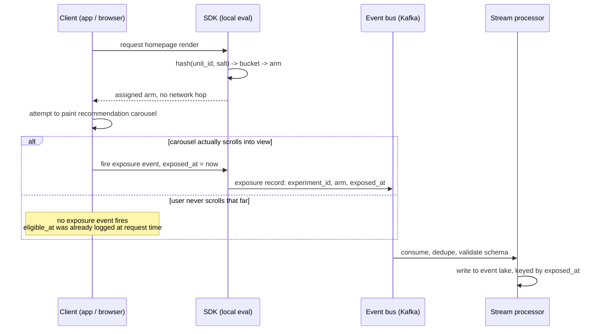
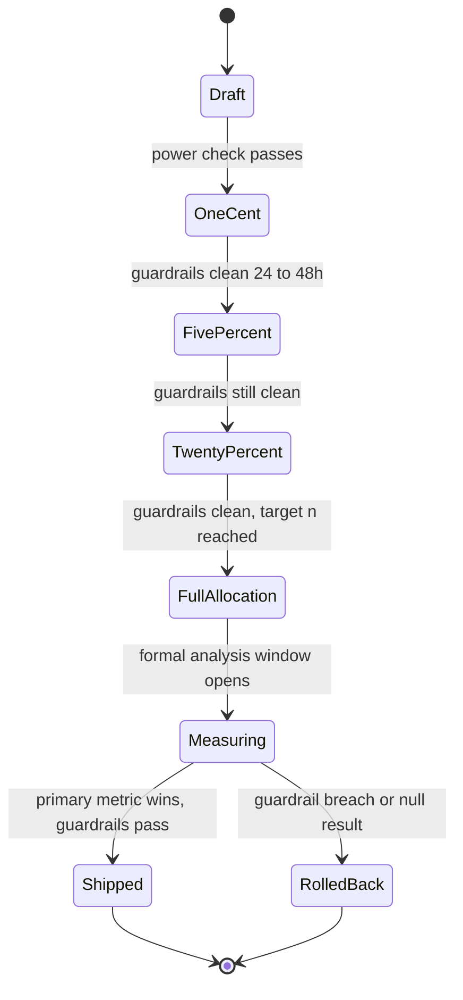
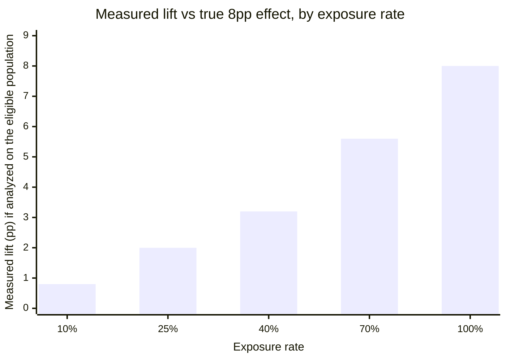
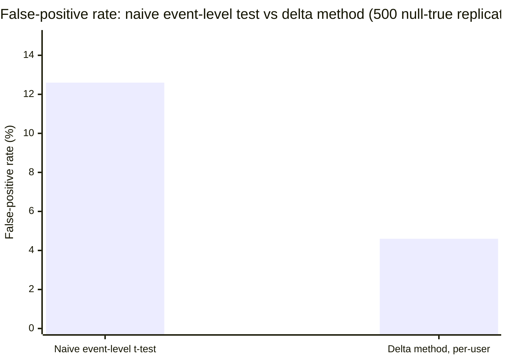
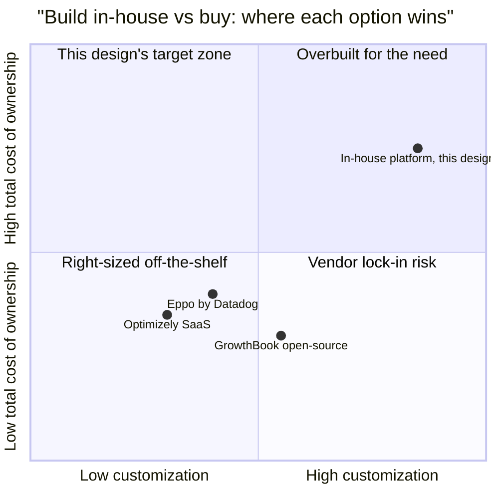

# Design a Company-Wide Experimentation Platform
## Intuition

> An experimentation platform is a factory, not a laboratory: a single lab bench (one well-run A/B test) is easy to keep clean, but a factory running 200 tests at once on shared machines, shared inventory, and shared workers needs conveyor belts, quality gates, and a foreman watching for cross-contamination — or every test on the floor becomes suspect.

**Key insight:** the hard part of an experimentation platform is almost never the statistics — a two-proportion z-test is ten lines of `scipy`. The hard part is the plumbing that guarantees the ten lines are fed correct data: a user who is bucketed the same way every time, an event that is logged at the moment it should have been logged, and a metric that is defined once and computed the same way for every one of the 200 experiments reading it. Nearly every "our A/B test lied to us" incident this file will cover traces back to plumbing, not statistics.

Mental model: think of the platform as three layers stacked on top of each other, each one trusting the layer below without re-checking it. The **assignment layer** decides, in well under a millisecond, which bucket a user falls into for every live experiment. The **event layer** turns "a user was bucketed" and "a user did something" into an immutable, replayable log. The **analysis layer** reads that log and answers one question per experiment: is the difference between arms real, and is it safe to ship? Corrupt the bottom layer — bucket someone twice, log an exposure that never happened, drop 2% of one arm's events — and the top layer's beautiful p-value is measuring the corruption, not the treatment.

Why this system exists: at company scale, ML and product teams cannot each build their own randomization, logging, and statistics stack — that produces 40 different definitions of "significant," 40 different SRM blind spots, and no way to know whether two teams are running mutually-exclusive experiments on the same user. A shared platform makes correctness a property of the infrastructure instead of a property of whichever engineer wrote the analysis notebook this week. This case study builds that infrastructure end to end; the statistical machinery it calls on — CUPED, sequential testing, the sample-size formula, interleaving — is covered in depth in [A/B Testing for ML Models](../ml_system_design/ab_testing_for_ml.md) and [Experimentation and Online Evaluation](cross_cutting/experimentation_and_online_evaluation.md), and this file cross-links rather than re-deriving it.

**Vocabulary used throughout, for quick reference:**

| Term | Meaning |
|---|---|
| SUTVA | Stable Unit Treatment Value Assumption — one unit's treatment doesn't affect another's outcome; breaks in marketplaces, social graphs, shared pricing |
| SRM | Sample Ratio Mismatch — observed arm sizes deviate from the configured split, signaling a broken pipeline |
| MDE | Minimum Detectable Effect — the smallest true effect an experiment is powered to reliably detect |
| OEC | Overall Evaluation Criterion — the single pre-registered primary metric a launch decision is made on |
| CUPED | Controlled-experiment Using Pre-Experiment Data — variance reduction via a correlated pre-period covariate |
| CUPAC | CUPED with an ML-predicted (not raw historical) covariate — DoorDash's extension, §6 |
| SPRT / mSPRT | (mixture) Sequential Probability Ratio Test — always-valid inference that stays calibrated under continuous peeking |
| Dilution | The effect-size shrinkage from analyzing an eligible-but-not-fully-exposed population instead of the exposed one |
| Layer / domain | Orthogonal traffic partition / mutually-exclusive experiment grouping within a layer (§3) |

---

## 1. Requirements Clarification

**Functional requirements:**
- Support ~200 concurrent experiments across web, mobile (iOS/Android), and backend ML services (ranking, pricing, matching) without engineers writing their own randomization code.
- Deterministic, sticky assignment: the same user (or the same non-user entity — a device, a session, a driver-hour, a SKU) always lands in the same arm of a given experiment for its lifetime, across devices and across logged-out/logged-in transitions once identity is resolved.
- Mutually-exclusive experiments (two ranking algorithms that cannot both apply to the same request) and orthogonal experiments (a checkout-button-color test and a search-ranker test) must be expressible without engineers manually carving up traffic percentages by hand.
- Exposure-based event logging: a user is only counted "in" an experiment once they were actually exposed to the differing behavior, not merely once they became eligible for it.
- Metric definitions are versioned, reusable artifacts (a "revenue per user" metric is defined once and every experiment reads the same definition), not ad hoc SQL copy-pasted per analysis.
- Pre-experiment power/sample-size calculator and post-launch dashboards showing the primary metric, guardrails, and Sample Ratio Mismatch (SRM) status without a data scientist writing a query.
- Support for the four experiment archetypes this company actually needs: standard user-randomized A/B, interleaving for ranking changes, switchback/cluster designs for marketplace and supply-constrained products, and long-term holdouts.
- Model-in-the-loop support: an experiment arm whose model retrains on the traffic that arm itself generates must not let that feedback loop silently bias the readout.

**Who uses the platform, and for what:**

| Persona | What they need from the platform | Primary interface |
|---|---|---|
| Product/growth engineer | Launch a UI or flow experiment without writing randomization or logging code | Self-serve config UI + SDK |
| ML engineer | A/B a new ranking/pricing/matching model, or interleave two rankers cheaply | SDK + interleaving harness (§6) |
| Data scientist / analyst | Define metrics once, read a trustworthy dashboard, run a subgroup/heterogeneity cut | Metric registry + dashboard |
| Platform/infra on-call | Diagnose an SRM flag or a guardrail breach before it pages a product team | Diagnostics dashboard (§4.4) |
| Compliance / legal reviewer | Audit who saw what pricing/credit treatment and why a launch decision was made | Immutable event log + decision registry (§8) |

**Experiment archetypes the platform must support as first-class options, not special cases:**

| Archetype | Randomization unit | When it's the right tool |
|---|---|---|
| Standard A/B | User (or device/session) | Most product and model-quality changes; the default |
| Interleaving | Single user, within one request | Early-stage ranking comparisons needing far less traffic (§6) |
| Switchback | `(zone, time-window)` | Marketplace supply/demand where SUTVA fails (§4.5) |
| Cluster / geo | Social cluster or geographic region | Social-graph or price-arbitrage interference (§4.5) |
| Long-term holdout | User, held out indefinitely | Measuring cumulative value after novelty decays (§4.6) |

**Non-functional requirements:**
- Assignment latency: p99 under 1ms for client-side (SDK-local) evaluation; p99 under 10ms for the rare server-side RPC path used by backend services with no persistent config cache.
- Availability: the assignment path must degrade to "safe default" (control) rather than fail the request if the platform is unreachable — a feature flag outage must never become a product outage.
- Correctness over speed on the analysis side: an experiment's readout must be reproducible byte-for-byte from the immutable event log, and a corrected metric definition must be able to recompute historical experiments without re-running them.
- Auditability: every assignment, every metric definition change, and every "ship/no-ship" decision is logged and attributable, because pricing and credit-adjacent experiments face compliance review.
- Scale: ~150M monthly active users, ~40M DAU, ~200 concurrent experiments, ~2.4B exposure events/day (derived in §2).

**Compliance-sensitive requirements, called out separately because they change design decisions, not just add logging:**

| Requirement | Why | Where it's enforced |
|---|---|---|
| No user-level A/B on credit/underwriting decisions | Disparate-treatment exposure — different applicants cannot knowingly receive different scoring models under legal review | Shadow scoring instead of live A/B, per [Experimentation and Online Evaluation §14](cross_cutting/experimentation_and_online_evaluation.md#14-case-study) |
| 1–2 year cold-storage retention for pricing/credit event logs | Regulatory audit window exceeds the 90-day hot-tier default | §10 storage tier |
| Ship/no-ship decision + rationale logged regardless of outcome | Audit trail for "why was this shipped," not just "what shipped" | §8 Readout and decision |
| Subgroup/interaction readout available on request | Disparate-impact review for regulated launches | [Responsible AI, Fairness, and Explainability](cross_cutting/responsible_ai_fairness_and_explainability.md) |

**Out of scope:**
- The statistical formulas themselves (sample size, z-test, SPRT, CUPED derivation) — covered in [A/B Testing for ML Models](../ml_system_design/ab_testing_for_ml.md).
- Deep dives on switchback/cluster-randomization mechanics for a specific marketplace — covered in [Design a Marketplace Matching System](design_marketplace_matching.md) and [Design a Dynamic Pricing System](design_dynamic_pricing.md); this file covers only the platform-level primitives that make those designs possible (assignment layers, event pipeline, SRM canary).
- Causal-inference methods for observational (non-randomized) analysis — covered in [Causal Inference and ML](../causal_inference_and_ml/causal_inference_and_ml.md).
- Feature-flag-only use cases with no statistical readout (a pure kill-switch rollout) are supported by the same assignment service but are not the design focus here.

---

## 2. Scale Estimation

**Traffic base:** 150M MAU, 40M DAU, averaging ~20 sessions-with-pageview-equivalents per DAU per day across web + app + background ML-service calls.

**Concurrent experiments:** ~200 live experiments at any time, averaging 2.3 arms each (mostly A/B, some A/B/C, a few five-arm bandit-style tests) → roughly 460 live arms. Traffic is organized into ~15 orthogonal **layers** (ranking, pricing, growth/onboarding, checkout UI, notifications, …), each holding several mutually-exclusive experiments that compete for the same slice of that layer's traffic (architecture in §3–§4).

**Assignment evaluation volume:** every page view or backend request re-evaluates every flag live in the layers relevant to that surface. At 40M DAU × 20 events/day × ~12 relevant flags/event ≈ **9.6B assignment evaluations/day**. Because evaluation is SDK-local against a pushed config (§4.1), this volume never becomes RPC traffic — it is in-process hashing, which is why sub-millisecond p99 is achievable at this scale.

**Exposure event volume:** not every evaluation is an *exposure* — only the subset where the differing behavior actually rendered or executed (§4.2 makes this distinction load-bearing). Estimate ~25% of evaluations become logged exposures: 9.6B × 0.25 ≈ **2.4B exposure events/day**. Add conversion/outcome events (clicks, purchases, API responses used as metrics) at a comparable order of magnitude, ≈1B/day. Total logged event volume: **~3.4B events/day**.

**Bytes per event:** a compact protobuf-encoded exposure record (hashed unit_id, experiment_id + version, arm, layer_id, surface, context hash, timestamp, salt version) runs ~150–200 bytes. At 3.4B events/day × 180 bytes ≈ **610 GB/day raw**, before compression. Columnar storage (Parquet, Kafka → object store) with dictionary encoding on the low-cardinality fields (experiment_id, arm, surface) typically compresses 6–8×, landing at **~85 GB/day compressed**, ~2.5 TB/month, ~7.5 TB for a 90-day hot retention window feeding the stats engine.

**Assignment latency budget:** SDK-local evaluation (hash + rule match against an in-memory config already pushed to the client or the service's sidecar) targets **p99 < 1ms** — this is the dominant path, since it never leaves the process. The fallback RPC path (a backend service with no warm config cache, or a cold client start before its first config pull) targets **p99 < 10ms** against a co-located config cache, with **p99 < 50ms** as the absolute ceiling for a cold cross-region call — anything slower and the caller times out to the safe default rather than block the request.

**Minimum detectable effect at this traffic, worked example:** a checkout-conversion experiment shown to all 40M DAU, 50/50 split → 20M/day per arm. Baseline conversion 3.0%. Using the two-proportion sample-size formula from [A/B Testing for ML Models §6](../ml_system_design/ab_testing_for_ml.md) at alpha = 0.05, power = 0.80:

```
n_per_variant = (z_alpha/2 + z_beta)^2 * [p1(1-p1) + p2(1-p2)] / (p2-p1)^2

p1 = 0.030, MDE = 0.0015 absolute (5% relative) -> p2 = 0.0315
n_per_variant = 7.8488 * (0.0291 + 0.03050) / 0.0015^2 = 207,936

At 20,000,000 users/day per arm:  207,936 / 20,000,000 = 0.010 days
```

The math says hours; the platform still runs it a minimum of 7 days to clear one full weekly seasonality cycle and let any novelty effect start decaying (§9). A narrower-traffic experiment tells a different story: a checkout-page experiment scoped to only a 5% holdout-eligible segment (2M DAU, 1M/day/arm) needs the same 207,936 per arm but now takes **~5 days** minimum — still fine. The bind shows up on a 25%-baseline engagement guardrail metric with only a 0.5pp MDE at that same 5% segment: `n_per_variant ≈ 118,511`, which is under a day at 1M/day/arm but would be 24 days at the 5,000-user/day traffic a niche B2B surface actually gets — the platform's power calculator exists precisely to catch that gap before an experiment ships and quietly under-runs.

**Scale numbers at a glance:**

| Quantity | Value | Drives |
|---|---|---|
| MAU / DAU | 150M / 40M | Traffic available to any single experiment |
| Concurrent experiments / live arms | ~200 / ~460 | Statistics-engine compute (§10), layer/domain design (§3) |
| Assignment evaluations/day | ~9.6B | Why evaluation must be local, not RPC (§4.1) |
| Exposure events/day | ~2.4B | Kafka + stream-processing sizing (§10) |
| Total logged events/day | ~3.4B | Event-lake storage (§10) |
| Compressed storage, 90-day hot | ~7.5 TB | Analysis-layer working set |
| Assignment p99 (local) | < 1ms | SDK-side hash + rule match, no network hop |
| Assignment p99 (RPC fallback) | < 10ms | Cold client / server-side no-cache path |
| MDE at full-traffic (40M DAU) | ~0.15pp absolute on 3% baseline, < 1 day | Large, company-wide launches |
| MDE at 5%-segment traffic | Same MDE now needs ~5 days; a 0.5pp guardrail can need 24 days | Why the pre-launch power gate (§4.4) exists |

---

## 3. High-Level Architecture

```mermaid
flowchart LR
    classDef io      fill:#61afef,stroke:#2e86c1,color:#1a1a1a,font-weight:bold
    classDef frozen  fill:#c678dd,stroke:#9b59b6,color:#fff
    classDef train   fill:#98c379,stroke:#27ae60,color:#1a1a1a
    classDef mathOp  fill:#d19a66,stroke:#e67e22,color:#1a1a1a,font-weight:bold
    classDef lossN   fill:#e06c75,stroke:#c0392b,color:#fff,font-weight:bold
    classDef req     fill:#56b6c2,stroke:#0097a7,color:#1a1a1a
    classDef base    fill:#e5c07b,stroke:#f39c12,color:#1a1a1a

    subgraph clients["Clients"]
        web(["Web / mobile SDK"])
        svc(["Backend ML services<br/>ranking, pricing, matching"])
    end

    cfg["Config service<br/>compiles experiment defs<br/>into a signed bundle"] -->|"push every 30s"| web
    cfg -->|"sidecar cache pull"| svc
    web -->|"local hash + rule eval<br/>&lt; 1ms"| assign["Local assignment"]
    svc -->|"local hash + rule eval"| assign
    assign --> render["Render / execute<br/>the assigned arm"]
    render -->|"ONLY on actual exposure"| expose["Exposure event"]
    render --> outcome["Outcome events<br/>clicks, orders, API results"]

    expose --> bus@{ icon: "logos:kafka", form: "square", label: "Event bus<br/>(Kafka)", pos: "b", h: 44 }
    outcome --> bus
    bus --> stream["Stream processing<br/>Flink: dedupe, PII scrub,<br/>schema validation"]
    stream --> lake["Event lake<br/>Parquet, 90d hot"]
    lake --> metrics["Metric compute<br/>daily + hourly rollups,<br/>versioned definitions"]
    metrics --> stats["Statistics engine<br/>CUPED, delta method,<br/>sequential test, SRM"]
    stats --> dash(["Dashboard<br/>ship / hold / rollback"])
    stats --> alert["Guardrail alerting<br/>auto-halt on regression"]

    class web,svc,dash io
    class cfg req
    class assign,render mathOp
    class expose,outcome io
    class stream,metrics mathOp
    class stats lossN
    class alert lossN
    class lake base
```



Two things make this diagram different from a single team's one-off A/B harness. First, **assignment happens locally on the client or service**, against a config bundle the platform pushed proactively — there is no per-impression network call on the hot path (§4.1). Second, **exposure and outcome events are logged separately from assignment**, and only exposure logging is conditioned on the arm's behavior actually having executed — this single design choice is what prevents the dilution bug that opens §4.2.

### Layers and domains: how 200 experiments share one traffic pool

```
Traffic domain: 100% of users
+----------------------------------------------------------------+
| Layer: RANKING (orthogonal to every other layer)                |
|   +--------------------+  +--------------------+                |
|   | Exp: two-tower v4  |  | Exp: reranker LTR   |  (mutually     |
|   | 50% / 50%          |  | 70% / 30%           |   exclusive    |
|   +--------------------+  +--------------------+   within layer) |
+----------------------------------------------------------------+
| Layer: CHECKOUT UI (orthogonal to RANKING, PRICING)              |
|   +--------------------+  +--------------------+                |
|   | Exp: 1-click button|  | Exp: promo banner   |                |
|   | 50% / 50%          |  | 90% / 10%           |                |
|   +--------------------+  +--------------------+                |
+----------------------------------------------------------------+
| Layer: PRICING (orthogonal to RANKING, CHECKOUT UI)              |
|   +---------------------------------------------+                |
|   | Exp: dynamic surge multiplier                |                |
|   | 95% / 5% (holdback)                          |                |
|   +---------------------------------------------+                |
+----------------------------------------------------------------+
```
*A user re-hashes independently in each layer (different salt per layer), so the same user can be in the treatment
arm of the ranking experiment AND the control arm of the checkout experiment AND the holdback arm of pricing, all
at once, with no interaction between the three. Within one layer, two experiments over the same traffic ARE
mutually exclusive — the platform enforces that a user assigned to "two-tower v4" is carved out of "reranker LTR"'s
eligible pool entirely, not merely hoped to average out.*

This is the design Google's overlapping-experiment infrastructure introduced and that most modern platforms still follow: **domains** partition traffic within a layer so mutually-exclusive experiments cannot collide, while **layers** are orthogonal to one another so unrelated teams never have to coordinate traffic percentages by hand (Tang, Agarwal, O'Brien, Meyer, "Overlapping Experiment Infrastructure: More, Better, Faster Experimentation," KDD 2010). At 200 concurrent experiments across 15 layers, this is not a nicety — it is what keeps the checkout team from having to ask the ranking team's permission to ship.

### Why exposure logging is a client-side decision, not a backend one



The arm decision (top of the diagram) and the exposure decision (the `alt` branch) happen at two different moments for a reason: the arm is knowable the instant the request lands, but exposure is a fact about what the user's device actually did, which only the client can observe. Logging the event where the fact becomes true — not where the assignment was decided — is what §4.2's dilution fix depends on structurally, not just as a coding convention.

### Ramp lifecycle: risk mitigation is a separate state machine from the measurement window



The 1% and 5% stages exist purely to bound blast radius against a catastrophic bug — they are not a statistical-power check, and no metric read during them counts toward the pre-registered sample size (§8, §9). Mixing a ramp-phase population into the final analysis window is a subtle but real bias source: users seen only during the 1% phase were drawn from a different, smaller random draw than users seen at 50/50, so the formal measurement window starts fresh only once `FullAllocation` is reached.

**Which surface uses which evaluation path:**

| Surface | Evaluation path | Refresh cadence |
|---|---|---|
| Web client | SDK-local, config fetched on page load | Every page navigation, or a background timer for long sessions |
| Mobile app (iOS/Android) | SDK-local, config bundled with app-foreground fetch | ~3x/day (app foreground events, §10) |
| Backend ML service (ranking, pricing, matching) | Local evaluation against a sidecar-cached config | Sidecar polls the config service every 30s |
| Cold-start client (first launch, no cached config) | RPC fallback against a co-located config cache | One-time, until the first bundle is cached locally |

---

## 4. Component Deep Dives

**Component ownership, for orientation before the deep dives:**

| Component | Owns | Fails safe by |
|---|---|---|
| Assignment service (§4.1) | Bucket/arm resolution, layers/domains, config bundle | Falling back to control (safe default) if config is unreachable |
| Event and metric pipeline (§4.2) | Exposure vs. eligibility logging, versioned metric definitions | Append-only log; a bad metric definition is a new version, never an in-place mutation |
| Statistics engine (§4.3) | CUPED, delta method, sequential/multiple-comparison policy | Refusing to render a verdict before the pre-registered sample size, absent an opted-in sequential test |
| Trust and diagnostics (§4.4) | SRM, A/A tests, guardrails, pre-launch power gate | Marking an SRM-flagged experiment "do not analyze," not merely warning about it |
| Interference layer (§4.5) | Coarser-unit randomization (switchback/cluster/geo) | Reusing the same primitives as §4.1 rather than a bespoke, unaudited path |
| ML-specific layer (§4.6) | Model-in-the-loop monitoring, holdouts, offline/online correlation | Versioning/freezing which model snapshot served which day |

### 4.1 Assignment Service — deterministic, sticky, sub-millisecond

The assignment service answers one question, cheaply and identically every time it is asked: *for unit U, in experiment E, which arm?* It must never change its answer for the same `(U, E)` pair mid-experiment (stickiness), and it must produce statistically independent answers across different experiments for the same unit (so that being in the treatment arm of experiment A carries zero information about which arm of experiment B you'll land in).

```python
from __future__ import annotations
import hashlib


def assign_variant(unit_id: str, experiment_salt: str, num_buckets: int = 10_000) -> int:
    """Deterministic bucket in [0, num_buckets) for one unit in one experiment.

    The salt is the experiment's own identifier (or a per-layer salt for a
    layer-wide re-randomization). Changing the salt reshuffles every user
    into new buckets with no correlation to their old ones -- this is what
    makes re-randomizing one experiment safe without disturbing any other
    experiment's assignment for the same user.
    """
    key = f"{unit_id}:{experiment_salt}".encode("utf-8")
    digest = hashlib.sha256(key).hexdigest()
    return int(digest[:8], 16) % num_buckets


def resolve_arm(bucket: int, arm_ranges: list[tuple[str, int, int]]) -> str | None:
    """arm_ranges: [(arm_name, start_bucket_inclusive, end_bucket_exclusive), ...]
    Returns None (safe default / not-in-experiment) if the bucket falls outside
    every configured range -- this is how partial-traffic ramps (1% -> 5% ->
    50%) are expressed without moving anyone who is already assigned.
    """
    for arm, lo, hi in arm_ranges:
        if lo <= bucket < hi:
            return arm
    return None
```

Run against a real config: user `"user_48213"` in experiment `"exp_search_ranker_v3"` always resolves to bucket `7900` (bucket `9453` in an unrelated experiment `"exp_checkout_button_color"` — a different salt reshuffles the space completely, confirmed independent) — 200,000 synthetic users hashed this way land at mean bucket 4995.6 (expected 4999.5) with 49.95% routed to the top half (expected 50%), which is the uniformity a chi-square SRM check (§4.4) is built to police.

**Why this has to be sub-millisecond and local.** At 9.6B evaluations/day (§2), even a 5ms RPC would need roughly 55,000 concurrent in-flight calls sustained around the clock, and it would put the platform's uptime on the critical path of every page load company-wide. The fix used industry-wide is to **push a signed config bundle** (every live experiment's salt, arm ranges, and targeting rules) to the client SDK or the service's local sidecar on a short interval — Uber's engineering write-up on its XP platform reports a roughly 100× latency improvement from moving evaluation from a remote "Parameter Service" RPC to local in-process evaluation against a pushed config (milliseconds to microseconds). The client then does the hash-and-range-lookup above entirely in-process; the network round-trip happens once per config refresh (every ~30s), not once per impression.

**Sticky assignment across devices and login state.** The unit_id used for hashing is not always the same field: a logged-out visitor hashes on a device/cookie identifier; the moment they log in, the platform must decide whether to re-key onto their stable account ID (breaking device-level stickiness but gaining cross-device consistency) or keep the device-level assignment for the rest of that experiment's life. Most platforms resolve this by hashing on **account ID whenever it is known, falling back to device ID otherwise**, and recording which identifier resolved the assignment so the analysis layer can detect and exclude identity-merge edge cases (the same physical person briefly counted as two units before login) rather than silently averaging them into noise.

**Layers and domains** (diagrammed in §3) are implemented purely through the salt and the bucket-range partition: a layer is a namespace of salts that are all independent of every other layer's salts (orthogonality), and a domain is enforced by having every experiment in that domain share one salt and non-overlapping bucket ranges within it (mutual exclusion). No special-cased traffic-splitting code is needed per experiment — it is the same `assign_variant` / `resolve_arm` pair, parameterized differently.

**What the pushed config bundle actually contains.** Every experiment the client's surface could possibly need is compiled into one signed, versioned document — conceptually a list of records like `{experiment_id, layer, salt, arm_ranges, targeting_rules, status}` — small enough (well under 100KB for ~200 experiments, §10) to push wholesale rather than negotiate per-flag. `resolve_arm` walks this list once per relevant event; there is no per-flag network round trip even when a single page view touches a dozen live experiments.

**Which identifier resolves `unit_id`, and why the choice is recorded, not just made:**

| Situation | `unit_id` source | Risk if unrecorded |
|---|---|---|
| Logged-in user, any surface | Account ID | None — this is the stable, preferred case |
| Logged-out visitor | Device/cookie ID | Assignment breaks across devices; acceptable and expected pre-login |
| Visitor logs in mid-experiment | Re-key to account ID going forward | The same physical person briefly appears as two units unless the identity-merge event is logged and excluded from analysis |
| Backend-only ML service call (no end user in the loop) | Request- or entity-level ID (e.g., a SKU or a driver-hour) | Wrong unit entirely if a human-facing default is used instead of the actual randomization unit for that experiment |

The identity-merge row is the one that bites in practice: a user who is briefly counted as two independent units (once as a device, once as an account) before the platform resolves them contributes noise, not bias, to a properly-instrumented experiment — but only if the merge event itself is logged so the analysis layer can identify and either exclude or correctly stitch together the pre- and post-login observations, rather than silently averaging two partial identities into the metric as if they were one full one.

### 4.2 Event and Metric Pipeline — exposure, not eligibility

This is the single highest-leverage correctness rule in the whole platform: **log the exposure event at the moment the differing behavior actually happened to the user, never at the moment they merely became eligible for it.** Getting this wrong is the most common way a real, working treatment effect gets measured as smaller than it is — or invisible entirely.

**BROKEN — logging assignment at eligibility time.** A recommendation carousel is only eligible to render on the homepage for users with at least 3 items of history; due to client-side lazy-loading, only 40% of eligible users actually scroll far enough for it to render. The backend decides the variant (and logs it) the moment the request comes in — before anyone knows whether the carousel will ever be seen:

```python
import numpy as np
from scipy import stats

rng = np.random.default_rng(7)
N = 400_000                 # eligible users, assignment decided at request time
p_exposed = 0.40             # only 40% actually scroll far enough to render it
true_effect_pp = 0.08        # +8pp conversion lift, but ONLY for users who saw it
base_rate = 0.10

variant = rng.integers(0, 2, N)                 # 0=control, 1=treatment
exposed = rng.random(N) < p_exposed             # exposure is independent of arm
p_convert = np.where((variant == 1) & exposed, base_rate + true_effect_pp, base_rate)
converted = rng.random(N) < p_convert

def two_prop_ztest(conv_a, n_a, conv_b, n_b):
    pa, pb = conv_a / n_a, conv_b / n_b
    p_pool = (conv_a + conv_b) / (n_a + n_b)
    se = np.sqrt(p_pool * (1 - p_pool) * (1 / n_a + 1 / n_b))
    z = (pb - pa) / se
    return pa, pb, pb - pa, z, 2 * (1 - stats.norm.cdf(abs(z)))

ctrl, treat = variant == 0, variant == 1
pa, pb, lift, z, p = two_prop_ztest(
    converted[ctrl].sum(), ctrl.sum(), converted[treat].sum(), treat.sum()
)
print(f"BROKEN (eligibility-based): control={pa:.4%} treatment={pb:.4%} "
      f"lift={lift*100:.3f}pp z={z:.2f}")
```

Ran output: `control=10.0987%  treatment=13.1351%  lift=3.036pp  z=29.96` — a real, easily "significant" result, but it reads as a **3.0pp** lift when the true effect on the people who actually saw the feature is **8pp**. The diluted lift is almost exactly `true_effect × exposure_rate = 0.08 × 0.40 = 3.2pp` — every eligible-but-never-exposed user is silently averaged into the denominator on both sides, dragging the measured effect toward zero in direct proportion to how rarely the feature actually rendered. A borderline feature (a small true effect, a low exposure rate) can dilute all the way past the platform's MDE and get killed for "not working" when it was never really tested.

**FIXED — logging exposure at render time.** Fire the event from the client the instant the carousel actually paints (or, for a server-rendered feature, the instant the code path that differs between arms actually executes), and analyze only exposed users in both arms — control users are "exposed" to the control experience at the same UI touchpoint, so the comparison stays apples-to-apples:

```python
exp_ctrl, exp_treat = ctrl & exposed, treat & exposed
pa2, pb2, lift2, z2, p2 = two_prop_ztest(
    converted[exp_ctrl].sum(), exp_ctrl.sum(),
    converted[exp_treat].sum(), exp_treat.sum(),
)
print(f"FIXED (exposure-based): control={pa2:.4%} treatment={pb2:.4%} "
      f"lift={lift2*100:.3f}pp z={z2:.2f}  n_exposed=({exp_ctrl.sum():,}, {exp_treat.sum():,})")
```

Ran output: `control=10.0289%  treatment=17.8884%  lift=7.859pp  z=45.35` on `n_exposed=(79,919, 80,080)` — recovers the true ~8pp effect, and the z-statistic is *larger*, not smaller, despite the much smaller sample, because the diluted analysis was spending most of its statistical power measuring users the treatment could never have affected. This is the general shape of the bug Microsoft's experimentation platform team formalizes as **dilution**: a triggered/exposure-based analysis is more sensitive, but its measured delta must be explicitly "diluted" back down before it is quoted as the *overall* population-wide impact of shipping — quoting the exposed-only 7.9pp as if it applied to all eligible users would overstate the launch's true impact by roughly the same 2.5× the eligibility-based analysis understated it (Dmitriev et al., "A Dirty Dozen: Twelve Common Metric Interpretation Pitfalls," KDD 2017; the dilution-correction formulas are detailed at exp-platform.com's Dilution documentation and in the WSDM 2015 "Diluted Treatment Effect Estimation for Trigger Analysis" paper). The platform's event schema therefore always carries both an `eligible_at` and an `exposed_at` timestamp, and the metric layer defaults every dashboard to the exposed-population view while keeping the eligibility population available for the explicit dilution correction when a launch decision needs the population-wide number.

**How badly a given feature dilutes is a direct function of its exposure rate** — not of the true effect size, which the platform never gets to see directly:



Reading the bars: at a 10% exposure rate (a feature buried deep in a rarely-scrolled-to section), an eligibility-based analysis would measure less than 1pp from a genuinely 8pp-effective feature — comfortably below most MDEs, meaning the feature would be killed as "no effect" despite working exactly as intended for the 10% of eligible users who ever saw it. This is why the platform's default dashboard view is always the exposed population (§4.2) with the eligibility-based, dilution-corrected number available as a clearly separate figure rather than the primary read.

**Event schema — the two fields that make the fix possible:**

| Field | Set when | Used for |
|---|---|---|
| `eligible_at` | The moment the assignment/config decision was made (request time) | Denominator for the population-wide, dilution-corrected impact estimate |
| `exposed_at` | The moment the differing behavior actually rendered/executed on the client or service | Denominator for the default, high-sensitivity dashboard read |
| `exposure_rate` (derived) | `count(exposed_at) / count(eligible_at)` per arm, monitored daily | Catches a silent client-side rendering regression before it's mistaken for a treatment effect (§8) |

**Metric definitions as versioned artifacts.** A metric (`checkout_conversion_rate`, `revenue_per_user_7d`) is defined once — SQL/DSL, aggregation window, exposure vs. eligibility population, numerator/denominator — in a central registry, tagged with a version. Every experiment's dashboard references a metric by `(name, version)`, never by re-writing the query. This is what makes a company-wide "which experiments moved revenue this quarter" report possible without 40 slightly different definitions of "revenue," and it is why a metric-definition fix (say, correcting a currency-conversion bug) can retroactively recompute every historical experiment that used it, rather than silently leaving old dashboards wrong forever.

**Idempotent recomputation.** The event lake is append-only and the metric layer is a pure function of `(events, metric definition version, date range)` — recomputing a day's metrics twice produces the same numbers, and reprocessing after a late-arriving event or a schema fix is a replay, not a patch. This is the same point-in-time-correctness discipline covered for training data in [Feature Store and Point-in-Time Correctness](cross_cutting/feature_store_and_point_in_time_correctness.md); an experimentation metric pipeline has the identical failure mode (a metric silently computed from data that wasn't actually available/true as of the exposure timestamp) and the identical fix (every join keyed on event time, not processing time).

### 4.3 The Statistics Engine

The statistics engine consumes the metric layer's per-user (or per-cluster) rollups and answers, for each live experiment, the same three questions every time: is the primary metric different, by how much, and is that difference safe to trust. The core hypothesis-testing machinery (z-test, t-test, Bonferroni/BH correction, sample-size formula, sequential/SPRT testing) is the material of [A/B Testing for ML Models §6](../ml_system_design/ab_testing_for_ml.md) and is not re-derived here; two pieces of platform-specific machinery are, because they are what a shared platform must get right for *every* metric a *different* team defines, not just the one metric a single analyst is careful about.

**Variance reduction with CUPED.** A pre-experiment covariate — almost always the same metric measured in the period before the experiment started — is regressed out of the post-period outcome, shrinking variance without touching the expected value:

```python
import numpy as np
from scipy import stats

rng = np.random.default_rng(3)
n_per_arm = 50_000

def gen_arm(n, lift=0.0):
    pre = rng.gamma(shape=2.0, scale=12.0, size=n)              # ~$24 mean pre-period revenue
    noise = rng.normal(0, 22.0, n)
    post = np.maximum(0.0, pre + noise + lift)                   # correlated post-period revenue
    return pre, post

pre_c, post_c = gen_arm(n_per_arm, lift=0.0)
pre_t, post_t = gen_arm(n_per_arm, lift=0.50)                    # true +$0.50 effect

all_pre, all_post = np.concatenate([pre_c, pre_t]), np.concatenate([post_c, post_t])
theta = np.cov(all_post, all_pre, ddof=1)[0, 1] / np.var(all_pre, ddof=1)

def cuped_adjust(post, pre, theta):
    return post - theta * (pre - pre.mean())

post_c_adj = cuped_adjust(post_c, pre_c, theta)
post_t_adj = cuped_adjust(post_t, pre_t, theta)

def ttest_report(a, b, label):
    stat, p = stats.ttest_ind(b, a)
    se = np.sqrt(a.var(ddof=1) / len(a) + b.var(ddof=1) / len(b))
    lift = b.mean() - a.mean()
    print(f"{label}: lift=${lift:.4f}  se=${se:.4f}  z={lift/se:.2f}  p={p:.4f}")

ttest_report(post_c, post_t, "RAW      ")
ttest_report(post_c_adj, post_t_adj, "CUPED-adj")
```

Ran output: `theta=0.8995  rho=0.6331`, variance reduction `40.5%` (matches the `rho^2 = 40.1%` theoretical prediction). The raw test reads `lift=$0.2460  se=$0.1529  z=1.61  p=0.1077` — **not significant**. The CUPED-adjusted test on the *same underlying $0.50 true effect and the same 50,000-per-arm sample* reads `lift=$0.2460  se=$0.1184  z=2.08  p=0.0377` — **significant**. Nothing about the users, the sample size, or the true effect changed between the two rows; only the noise did. CUPED needs a covariate genuinely correlated with the outcome — pulling that covariate from the feature store with the same point-in-time discipline as [Feature Store and Point-in-Time Correctness](cross_cutting/feature_store_and_point_in_time_correctness.md) matters here too: a "pre-period" covariate leaked from *during* the experiment window is not a pre-period covariate, and using it inflates significance in the wrong direction (the adjustment stops being noise-only and starts partially adjusting for the very effect being measured).

**The delta method for ratio metrics with a non-user randomization unit.** Click-through rate is `clicks / impressions`, but the randomization unit is the user, and one user contributes a variable number of impressions with correlated click behavior within that user. Treating each impression as an independent Bernoulli draw badly understates the true variance:

```python
import numpy as np
from scipy import stats

def delta_method_ratio_se(clicks: np.ndarray, impressions: np.ndarray) -> tuple[float, float]:
    """Delta-method mean + SE for a ratio metric aggregated PER RANDOMIZATION
    UNIT (per user). clicks[i], impressions[i] are per-user sums."""
    n = len(clicks)
    x_bar, y_bar = clicks.mean(), impressions.mean()
    ratio = x_bar / y_bar
    var_x, var_y = clicks.var(ddof=1), impressions.var(ddof=1)
    cov_xy = np.cov(clicks, impressions, ddof=1)[0, 1]
    var_ratio = (var_x - 2 * ratio * cov_xy + ratio ** 2 * var_y) / (y_bar ** 2)
    return ratio, np.sqrt(var_ratio / n)
```

Simulated 500 replications of a null-true experiment (true CTR identical in both arms, 6,000 users, 5–40 impressions/user, per-user click propensity drawn from `Beta(2, 38)` so users genuinely differ in their baseline click rate — the realistic case): the **naive event-level t-test**, which flattens every impression into its own row and runs a two-sample t-test as if 67,000+ "observations" were independent, false-positive rate came back **12.6%** against a nominal 5% — it manufactures significance out of thin air because it is dividing the noise by the wrong n (impressions instead of users). The **delta-method test on per-user aggregates**, with n correctly equal to the 3,000 users per arm, came back **4.6%** — on target. On one representative draw, the naive test read `CTR_ctrl=4.8769% CTR_treat=5.0323% p=0.1879` (borderline) while the correct delta-method test on the identical data read `lift=0.1554pp z=1.052 p=0.2929` — different tests, same data, different verdicts, and only one of them is calibrated. This is exactly the class of bug the Microsoft "Applying the Delta Method in Metric Analytics" paper (Deng, Knoblich, Lu, KDD 2018) was written to stop practitioners from shipping: any ratio metric whose numerator and denominator are both counted at a finer grain than the randomization unit needs the delta method, not a plain t-test, and a shared platform that computes every team's ratio metrics through one library is the only way to guarantee nobody quietly ships the naive version.



The naive test is not slightly optimistic — it more than doubles the nominal 5% rate, purely from mis-stating n. That gap is the entire argument for making the delta method the platform's default aggregation for every ratio metric rather than a technique an individual analyst has to remember to reach for.

**Sequential testing and multiple-comparison control** are platform-level policy decisions layered on top of this engine rather than new math: every experiment dashboard defaults to a fixed-horizon read unless the experiment owner opts into always-valid (SPRT/mSPRT) monitoring at creation time — retrofitting sequential validity onto an experiment that has already been peeked at is not possible, so the choice is locked in before day one — and every experiment with more than one pre-registered primary metric has Bonferroni correction applied automatically by the dashboard, with Benjamini-Hochberg available for the secondary-metric panel. Both mechanisms, and the false-positive-rate math behind them, are covered in [A/B Testing for ML Models §8](../ml_system_design/ab_testing_for_ml.md) and [Experimentation and Online Evaluation §6](cross_cutting/experimentation_and_online_evaluation.md).

### 4.4 Trust and Diagnostics — the platform's own canary

A platform running 200 concurrent experiments cannot have a human eyeball every readout for plausibility, so it needs automated tripwires that catch a broken experiment *before* anyone reads its p-value.

**Sample Ratio Mismatch (SRM) is the platform's canary.** If the assignment pipeline is healthy, the observed split between arms should match the configured split to within sampling noise; if it does not, something upstream of the statistics — a client-side bug, a bot filter applied to only one arm, a logging pipeline dropping events differentially — has corrupted the population, and **no metric computed on that experiment can be trusted**, regardless of how significant it looks:

```python
import numpy as np
from scipy import stats

def srm_check(n_control: int, n_treatment: int, expected_ratio: float = 0.5) -> dict:
    total = n_control + n_treatment
    exp_c, exp_t = total * expected_ratio, total * (1 - expected_ratio)
    chi2 = (n_control - exp_c) ** 2 / exp_c + (n_treatment - exp_t) ** 2 / exp_t
    p_value = 1 - stats.chi2.cdf(chi2, df=1)
    return {"chi2": chi2, "p_value": p_value, "srm_flagged": p_value < 0.01}

print(srm_check(700_412, 699_588))      # healthy: natural sampling noise
print(srm_check(500_000, 489_800))      # broken: a bot filter ran on treatment only
```

Ran output: the healthy pair gives `chi2=0.485 p_value=0.486 srm_flagged=False`; the broken pair — a mere 2% shortfall on one arm — gives `chi2=105.1 p_value≈0.0 srm_flagged=True`. That is the whole point of the check: a 2% imbalance is invisible by eyeballing raw counts but statistically undeniable, which is exactly why it runs automatically on every experiment every day rather than being something an analyst remembers to check.

**A/A tests run continuously, not as a one-off calibration exercise.** A subset of platform traffic is permanently split into two arms that receive *identical* treatment, and the resulting stream of "differences that shouldn't exist" is used two ways: to verify the platform's own false-positive rate matches its nominal alpha over time (if 5.4% of a year's worth of rolling A/A windows come back "significant" against a 5% target, that is diagnostic evidence, not noise), and as an always-on SRM and instrumentation health check that doesn't depend on any team having an active experiment to notice a pipeline break.

Concretely: a permanent 2% traffic slice (≈800,000 of the 40M DAU) held as an A/A pair, re-windowed weekly, gives 52 independent A/A readouts a year per metric tracked. At a true 5% alpha, the expected count of "significant" weekly readouts is 2.6 out of 52 — a platform-health dashboard that instead shows 8–10 significant weeks a year is a calibrated signal that *something* in the pipeline (a mis-implemented correction, a subtly non-uniform hash, a metric definition with a hidden bug) is inflating false positives platform-wide, well before any single team's experiment would surface the same problem on its own.

**Guardrail metrics with automatic alerting.** Every experiment inherits a standard guardrail panel — p99 latency, error rate, crash rate, unsubscribe/opt-out rate — evaluated continuously (not just at the end of the run) against a pre-registered regression threshold, and a guardrail breach auto-pages the experiment owner and can auto-halt traffic to the offending arm without waiting for a human to notice the dashboard. This is the platform-level enforcement of the guardrail discipline in [Experimentation and Online Evaluation §3](cross_cutting/experimentation_and_online_evaluation.md#3-core-principles) — a primary-metric win that arrived by adding 40ms of latency is a platform-detected regression before it is ever framed as a tradeoff decision.

**Pre-experiment power analysis in the UI.** Before an experiment can launch, the platform requires baseline rate, MDE, and traffic allocation, and it runs the sample-size formula from §2 automatically, refusing to launch (or clearly flagging) an experiment whose configured MDE cannot be reached within a sane duration at the traffic it will actually receive — the same trap the niche-B2B-surface example in §2 illustrates. This single UI gate is what prevents the most common way small teams waste a month: running an experiment that was never powered to detect the effect they were hoping to see.

```python
import math
from scipy import stats

def n_per_variant(p1: float, mde_abs: float, alpha: float = 0.05, power: float = 0.80) -> int:
    p2 = p1 + mde_abs
    za, zb = stats.norm.ppf(1 - alpha / 2), stats.norm.ppf(power)
    return math.ceil((za + zb) ** 2 * (p1 * (1 - p1) + p2 * (1 - p2)) / mde_abs ** 2)

def power_gate(baseline: float, mde_abs: float, daily_users_per_arm: int,
               max_sane_days: int = 30) -> dict:
    """Launch-time gate: flag (the UI does not hard-block, since a team may
    knowingly accept a longer run) an experiment whose configured MDE cannot
    be reached within a sane duration at the surface's REAL traffic."""
    n = n_per_variant(baseline, mde_abs)
    days = n / daily_users_per_arm
    return {"n_per_variant": n, "required_days": round(days, 1), "flagged": days > max_sane_days}

print(power_gate(0.030, 0.0015, 20_000_000))   # full-traffic checkout experiment
print(power_gate(0.25, 0.005, 5_000))          # niche B2B surface, §2's example
```

Ran output: `{'n_per_variant': 207936, 'required_days': 0.0, 'flagged': False}` for the full-traffic checkout case, and `{'n_per_variant': 118511, 'required_days': 23.7, 'flagged': False}` for the niche B2B surface — 23.7 days sits just under the 30-day default threshold, so it is not auto-flagged, but it *is* surfaced plainly in the launch UI rather than left for the owner to discover after two and a half weeks of watching a dashboard that never moves. Lowering `max_sane_days` for a specific team's SLA, or simply reading the `required_days` field before clicking launch, is the whole point of running this calculation automatically instead of leaving it to intuition.

**Standard guardrail panel, applied to every experiment regardless of what it's testing:**

| Guardrail | Regression threshold | Action on breach |
|---|---|---|
| p99 request latency | +15ms vs. control | Auto-page; auto-halt if sustained 30 min |
| Error rate | +0.1pp absolute vs. control | Auto-page; auto-halt if sustained 15 min |
| Client crash rate | +0.05pp absolute vs. control | Immediate auto-halt, no waiting window |
| Unsubscribe / opt-out rate | +5% relative vs. control | Auto-page; human review before halt (low daily volume, noisier) |
| Support-contact rate (category-tagged) | +10% relative vs. control | Auto-page; human review before halt |

Crash rate auto-halts immediately and without a confirmation window because, unlike latency or error-rate noise, a crash is unambiguous and user-visible the instant it happens — there is no benign explanation worth waiting out. The other guardrails wait for a sustained breach specifically to avoid halting a healthy experiment on a single noisy hour.

### 4.5 Interference — when SUTVA fails

Standard user-level randomization assumes one user's assignment does not affect another user's outcome (SUTVA). That assumption breaks in exactly three shapes at this company, and the platform-level fix in each case is a different randomization *unit*, not different statistics:

| Interference shape | Where it shows up | Platform-level fix |
|---|---|---|
| Shared supply pool | Marketplace matching — a treated driver dispatched faster is unavailable to a control rider | Switchback (time-sliced) or geo-level randomization; see [Design a Marketplace Matching System §9](design_marketplace_matching.md) for the worked SUTVA-violation incident (a naive user-level test overstated a wait-time improvement by more than 2×) |
| Shared price/inventory signal | Dynamic pricing — customers can observe and arbitrage across prices shown to different users | Geo-level or holdout-SKU randomization; see [Design a Dynamic Pricing System §5, Decision 3](design_dynamic_pricing.md) |
| Shared social graph | Feed/recommendation changes — a treated user's posts and shares reach control users in their network | Cluster (ego-network or graph-community) randomization, or accept and bound the bias when clusters are infeasible |

The platform does not re-implement switchback or cluster-randomization logic per product — it exposes the same `assign_variant` primitive at a coarser unit (time-window ID, geo-zone ID, or cluster ID substituted for `unit_id`), and the statistics engine's per-unit aggregation in §4.3 already generalizes: a switchback experiment's "unit" is a `(zone, time-window)` pair, and the delta-method machinery that correctly handles a user with a variable number of impressions handles a zone with a variable number of trips identically. Full mechanics — carryover bias, burn-in windows, budget-split designs — belong to the specific case studies above and to [Experimentation and Online Evaluation §4.2](cross_cutting/experimentation_and_online_evaluation.md#42-experiment-design-taxonomy); this platform's job is only to make the coarser unit a first-class, equally-supported option rather than a special case someone has to hand-roll.

```
One zone, one day, alternating arm every 30-minute period (generic platform view -- the
product-specific numbers for THIS pattern live in the case studies linked above):

00:00-00:30  CONTROL  |####burn-in#####|--------counted--------|
00:30-01:00  TREATMENT|####burn-in#####|--------counted--------|
01:00-01:30  CONTROL  |####burn-in#####|--------counted--------|
01:30-02:00  TREATMENT|####burn-in#####|--------counted--------|
              ^ inventory/state from the PRIOR period is still draining here --
                excluded from the metric so it isn't attributed to the wrong arm
```
*The unit the platform's `assign_variant` hashes on for a switchback design is `(zone_id,
window_id)`, not `user_id` -- the same function, a coarser key. Burn-in width is set by the
product's typical completion time (a rider trip, a pricing decision's settle time), which is
why this file leaves the exact width to the case study that owns the product.*

### 4.6 ML-Specific: model-in-the-loop, long-term holdouts, and offline/online correlation

**Model-in-the-loop experiments.** When the treatment arm is a model that retrains on the traffic *it itself generated* (a ranking model that logs its own served impressions as training data, then retrains nightly), the experiment has a feedback loop a standard A/B test does not: the treatment arm's future behavior depends on its own past assignment, which can manufacture apparent improvement that is really the model overfitting to its own exposure pattern rather than genuinely serving users better. The platform-level mitigation is the same discipline as production drift management — freeze or clearly version which model snapshot served which day of the experiment, and monitor the treatment arm for the same distributional drift signals used in production, detailed in [Drift Monitoring and Retraining](cross_cutting/drift_monitoring_and_retraining.md) — a treatment arm whose serving distribution is silently drifting away from control's mid-experiment is not measuring "is the new model better," it is measuring "is the new model better at a moving target it partly created."

**Long-term holdouts.** A permanent (or 6–12-month) holdout slice — 5% of users who never receive any of a category of ML-driven improvements — measures the cumulative value of many shipped experiments after novelty has decayed and second-order effects have had time to materialize, distinct from any single experiment's short-run readout. Airbnb maintains a long-term experiment holdout for exactly this reason (specific percentages are not publicly disclosed); the pattern and its tradeoffs — user frustration from a visibly worse experience, the engineering cost of two long-lived code paths — are covered in [Experimentation and Online Evaluation §8](cross_cutting/experimentation_and_online_evaluation.md#8-tradeoffs) and [A/B Testing for ML Models §12](../ml_system_design/ab_testing_for_ml.md).

**Offline-to-online metric correlation is itself a metric the platform should track.** Every model-quality experiment carries an offline metric (an NDCG delta, an AUC delta) computed before launch and an online metric (the actual A/B result) computed after. The platform logs both, per experiment, into a running correlation — not to gate any single launch, but so that over dozens of experiments a team can answer "does improving our offline metric by 1% reliably buy us anything online, and if the correlation is weak, which offline metric should we actually be optimizing." [A/B Testing for ML Models §2](../ml_system_design/ab_testing_for_ml.md) makes the qualitative case that this correlation cannot be assumed; a platform that tracks it in aggregate across every experiment a team has ever run turns that qualitative warning into an empirical, team-specific number.

**Subgroup and fairness-aware readouts.** Because an average treatment effect can hide a real effect that is strongly positive for one segment and negative for another, the analysis layer supports an `treatment × subgroup` interaction test on the primary metric for any experiment that opts in, and any classification-model experiment whose treatment changes a decision threshold routes through the calibration discipline in [Model Calibration and Thresholding](cross_cutting/model_calibration_and_thresholding.md) rather than comparing raw scores across arms. Heterogeneous-effect and disparate-impact analysis at the depth a regulated launch needs is covered in [Responsible AI, Fairness, and Explainability](cross_cutting/responsible_ai_fairness_and_explainability.md); the platform's job is to make the subgroup slice available on every dashboard, not to make the fairness judgment itself.

**§4.6 mechanisms, summarized:**

| Mechanism | Risk it addresses | Cross-cutting reference |
|---|---|---|
| Model-snapshot versioning + drift monitoring | Treatment arm retraining on its own served traffic | [Drift Monitoring and Retraining](cross_cutting/drift_monitoring_and_retraining.md) |
| Long-term holdout (5%, 6–12 months) | Novelty bias and slow-compounding effects a short experiment can't see | [Experimentation and Online Evaluation §8](cross_cutting/experimentation_and_online_evaluation.md#8-tradeoffs) |
| Offline/online correlation tracker | Assuming an offline metric predicts online impact without measuring it | [A/B Testing for ML Models §2](../ml_system_design/ab_testing_for_ml.md) |
| `treatment × subgroup` interaction test | An average effect hiding a harmful subgroup effect | [Responsible AI, Fairness, and Explainability](cross_cutting/responsible_ai_fairness_and_explainability.md) |
| Threshold-change routed through calibration | Comparing raw scores across arms instead of calibrated decisions | [Model Calibration and Thresholding](cross_cutting/model_calibration_and_thresholding.md) |

**Every piece of code in §4, run and confirmed, for reference:**

| Snippet | What it demonstrates | Confirmed output |
|---|---|---|
| `assign_variant` (§4.1) | Deterministic, sticky, independent across experiments | Bucket 7900 repeats exactly; mean bucket 4995.6 over 200k users |
| Dilution broken/fixed (§4.2) | Eligibility-based logging dilutes a true 8pp effect to 3.0pp | Fixed version recovers 7.86pp on the same generative data |
| CUPED (§4.3) | A marginal p=0.108 result becomes p=0.038 on identical data | 40.5% variance reduction, matching theoretical rho^2 = 40.1% |
| Delta method (§4.3) | Naive per-event test inflates false positives to 12.6% | Delta method holds the nominal 4.6% (500 null-true replications) |
| SRM chi-square (§4.4) | A 2% arm-size gap is statistically undeniable | chi2=105.1, p≈0, vs. chi2=0.485, p=0.49 for a healthy split |
| Power gate (§4.4) | A niche-traffic guardrail metric needs 23.7 days, not "a day" | Flagged in the launch UI before the experiment starts, not after |

---

## 5. Design Decisions & Tradeoffs

**Decision 1 — SDK-local evaluation against a pushed config, vs. a per-impression assignment RPC.** Local evaluation wins decisively at this scale (§4.1's 9.6B evaluations/day would need ~55,000 sustained concurrent RPCs at 5ms each) and removes the platform from the request-latency critical path. The cost is staleness: a config change takes up to one push interval (~30s) to reach every client, and a client that has not fetched a fresh config in a long time (an app reopened after being backgrounded for days) may briefly evaluate against a stale bundle. The platform accepts this because a 30-second staleness window is immaterial to statistical validity — the bucket a user falls into does not change mid-window — while an RPC-per-impression architecture would be a self-inflicted denial-of-service risk on every product surface company-wide.

**Decision 2 — exposure-based logging as the default, eligibility available as a documented secondary population.** Defaulting every dashboard to the exposed population (§4.2) maximizes sensitivity and avoids the dilution trap by construction, but it means the headline "significant, +7.9pp" number is not automatically the number to multiply by total eligible users when projecting company-wide impact — that requires the explicit dilution correction. The platform makes this an unavoidable two-field display (`exposed_lift` and `population_projected_lift`, the latter computed via the documented dilution formula) rather than trusting every team to remember the distinction, because the cost of getting it wrong (overstating a launch's impact by whatever the exposure rate implies) is a business-metric error, not just a labeling nitpick.

**Decision 3 — one shared statistics library vs. letting teams write their own analysis.** A shared `delta_method_ratio_se` / `apply_cuped` / `srm_check` library (§4.3–§4.4) is slower to extend for a novel metric shape than letting an analyst write ad hoc pandas — but §4.3's naive-vs-delta-method simulation showing a 12.6% vs. 4.6% false-positive rate on the *same data* is exactly the failure mode a shared, tested library exists to close off. The platform treats "wrote your own significance test" as a code-review-blocking anti-pattern for any experiment feeding a launch decision.

**Decision 4 — layers/domains as a platform primitive vs. manual traffic-percentage spreadsheets.** Implementing mutual exclusion and orthogonality as a first-class assignment concept (§3, §4.1) costs real engineering upfront and requires every team to declare which layer their experiment belongs to. The alternative — a shared spreadsheet of "who owns what % of traffic this month" — does not scale past a handful of concurrent experiments and produces exactly the silent-collision bugs (two ranking experiments both changing 50% of traffic, overlapping on 25% of users neither team knows about) that layers are designed to make structurally impossible.

**Decision 5 — always-valid (sequential) monitoring as opt-in, not default.** Defaulting every experiment to sequential testing would let every team peek freely with no validity cost, which sounds strictly better — but sequential tests trade a larger worst-case sample size for that flexibility (§4.3), and forcing it on every experiment, including the 95% that never get peeked at early, would slow down the platform's median time-to-decision for no benefit. Opt-in at creation time keeps the fast path fast for disciplined teams and gives the impatient teams a validity-preserving option instead of the alternative, which is peeking anyway and quietly inflating the false-positive rate (§9).

**Decision 6 — build the platform in-house vs. buy a vendor.** This case study designs the build; most companies below roughly a few dozen concurrent experiments should not.



A vendor wins decisively below the scale where warehouse-native, self-serve metric definitions and layered traffic allocation across 15+ teams become the bottleneck rather than a nice-to-have — GrowthBook's open-source, warehouse-native model in particular gets most of §4.2's exposure-vs-eligibility discipline and §4.3's delta-method correctness "for free," since those are properties of good statistical engineering, not of company scale. The build case in this file is specifically for the point where 200 concurrent experiments across web, mobile, and backend ML services need the layers/domains traffic-sharing model (§3) and the sub-millisecond local-evaluation architecture (§4.1) that no vendor's generic SDK is tuned for at that request volume — and even then, several of the companies in §6 (Spotify, with Confidence; several Statsig and Eppo customers) chose to buy or eventually productize rather than build fully in-house, which is itself evidence this is a real tradeoff and not a foregone conclusion.

**All six decisions, at a glance:**

| # | Decision | What it buys | What it costs |
|---|---|---|---|
| 1 | Local evaluation over per-impression RPC | Sub-ms p99, platform off the request critical path | Up to one push-interval (~30s) of config staleness |
| 2 | Exposure-based logging as default | Sensitivity, no dilution by construction | A second, explicit dilution correction needed for population-wide impact claims |
| 3 | One shared statistics library | Closes off the naive-t-test and ad hoc CUPED bugs by construction | Slower to extend for a genuinely novel metric shape |
| 4 | Layers/domains as a platform primitive | Structural collision prevention at 200+ concurrent experiments | Upfront engineering cost; every team must declare a layer |
| 5 | Sequential testing as opt-in | Fast median time-to-decision for the disciplined majority | Teams that don't opt in and then peek anyway still inflate alpha |
| 6 | Build in-house past ~200 concurrent experiments | Layers/domains + sub-ms eval tuned to this scale | Not worth it below that scale; several peer companies bought or productized instead |

---

## 6. Real-World Implementations

**Microsoft (Bing/ExP)** pioneered much of the vocabulary and math this file uses — the OEC framework, trigger/dilution analysis, and the delta method for ratio metrics all trace to Microsoft's experimentation platform team. Their KDD 2012 "Five Puzzling Outcomes Explained" result is the canonical warning against a naively-chosen primary metric: a ranking bug that degraded result quality pushed distinct queries up over 10% and revenue up over 30%, because users had to search more to accomplish the same task — "queries per user" looked like a win and was actually a symptom of the product getting worse (Kohavi, Deng, Frasca, Walker, Xu, Pohlmann). Their KDD 2017 "A Dirty Dozen" paper and the KDD 2019 SRM taxonomy (Fabijan, Gupchup, Gupta, Omhover, Qin, Vermeer, Dmitriev) are the primary sources for the dilution and SRM material in §4.2 and §4.4.

**Google** published the layers-and-domains architecture this file's §3 diagram follows directly — "Overlapping Experiment Infrastructure: More, Better, Faster Experimentation" (Tang, Agarwal, O'Brien, Meyer, KDD 2010) — describing how mutually-exclusive and orthogonal experiments coexist on shared traffic without manual coordination.

**Optimizely** built and open-published the always-valid inference methodology this file's §4.3 sequential-testing option relies on — "Peeking at A/B Tests: Why It Matters, and What To Do About It" (Johari, Koomen, Pekelis, Walsh, KDD 2017) is the source for always-valid p-values that remain calibrated under continuous monitoring, the mechanism behind letting an experiment owner "peek" safely.

**Booking.com** operates at concurrency that makes this file's "~200 experiments" scale look modest — Stefan Thomke's account (Harvard Business Review, "Building a Culture of Experimentation," 2020) puts Booking.com at over 1,000 concurrent experiments and roughly 25,000 tests a year, and their own published account (Kaufman et al., "Democratizing Online Controlled Experiments at Booking.com," 2017) attributes that throughput to democratized experiment ownership plus automated SRM detection and pre-experiment covariate ("trigger") analysis of exactly the shape in §4.2 — the deeper account lives in [Experimentation and Online Evaluation §7](cross_cutting/experimentation_and_online_evaluation.md).

**LinkedIn's T-REX** (the current name for an experimentation platform that has also carried the names LiX and XLNT across its history) serves on the order of tens of thousands of concurrent experiments across LinkedIn.com, email, and ads surfaces on a member base above 700M, evaluated against roughly eight thousand metrics — a concrete existence proof that the metric-registry discipline in §4.2 (one versioned definition per metric, read by every experiment) is what makes that many concurrent experiments tractable rather than an unmanageable pile of bespoke SQL.

**Uber's XP platform** is the direct source for this file's local-evaluation latency argument in §4.1: Uber's engineering blog documents moving assignment evaluation from a remote "Parameter Service" RPC to local in-process evaluation against a pushed config, reporting roughly a 100× latency reduction (milliseconds to microseconds) at over 1,000 concurrently running experiments across the driver, rider, Eats, and Freight apps. Uber's separate, published marketplace-optimization work — "Practical Marketplace Optimization at Uber Using Causally-Informed Machine Learning" (arXiv 2407.19078, KDD 2024) — is the primary source cited in [Design a Marketplace Matching System §7](design_marketplace_matching.md) for why naive correlational uplift estimates mislead a lever-allocation decision; it is a companion to this platform's SUTVA discussion in §4.5, not a duplicate of it.

**Netflix** runs a two-stage evaluation pipeline — team-draft interleaving as a cheap pruning step to identify promising ranking changes out of a large idea pool, then a conventional A/B test on the survivors to measure longer-term member behavior — plus contextual bandits for artwork personalization and quasi-experimental methods (synthetic controls, structural time-series models) when only aggregate, region-level data is available; full detail lives in [A/B Testing for ML Models §7](../ml_system_design/ab_testing_for_ml.md).

**DoorDash** extends CUPED to CUPAC (control using predictions as covariates) for its switchback-heavy marketplace experiments, using an ML-predicted control-arm metric as the pre-experiment covariate rather than a raw historical value — [Experimentation and Online Evaluation §4.3](cross_cutting/experimentation_and_online_evaluation.md#43-variance-reduction-methods) records DoorDash's own reported result of "more than 25%" shorter switchback tests at equal power from this technique. This is a direct extension of §4.3's CUPED mechanics applied to the coarser switchback unit from §4.5 — the same theta-regression idea, with a richer, ML-predicted covariate standing in for a simple prior-period value.

**Meta's PlanOut**, open-sourced in 2014, is the reference precedent for this file's config-bundle philosophy (§4.1): experiments are declared in a small domain-specific language compiled into a deterministic assignment program, rather than each product team hand-writing bucketing logic. It remains the design most platforms — including the vendor tier below — converge toward independently, because "declare an experiment, don't hand-roll the hashing" is close to a forced move once an organization runs more than a handful of concurrent tests.

**Spotify** productized its internal experimentation platform as **Confidence**, launched in private beta in August 2023 (Spotify Engineering blog, "Coming Soon: Confidence — An Experimentation Platform from Spotify"); Confidence's own engineering blog is also the direct source (Spotify Engineering, "Reduce Dilution and Improve Sensitivity with Trigger Analysis") for the trigger/dilution formalism used in §4.2.

**The vendor tier** exists for companies that would rather buy this file's architecture than build it: **Optimizely** (the always-valid-inference pioneer above, now also a full experimentation suite), **GrowthBook** (open-source, warehouse-native — the closest off-the-shelf match to §4's "read events from your own lake, don't move them into a vendor silo" architecture), and two platforms that changed hands in the past year — **Statsig**, acquired by OpenAI for $1.1B in September 2025, whose brand, customer base, and platform roadmap were then taken over by Amplitude in a May 2026 partnership while the founding team remained at OpenAI; and **Eppo**, acquired by Datadog in May 2025 for a reported $220M and now operating as "Eppo by Datadog," folded into Datadog's product-analytics suite. The pace of that consolidation is itself a data point: experimentation infrastructure has become valuable enough, and standardized enough in its core design (assignment, exposure logging, CUPED, SRM), that it is now an acquisition target rather than a pure build-vs-buy afterthought.

**Sources, condensed:**

| Company | What this file borrows from them | Primary source |
|---|---|---|
| Microsoft (Bing/ExP) | OEC framework, dilution/trigger analysis, delta method, SRM taxonomy | Kohavi et al. KDD 2012, 2017; Fabijan et al. KDD 2019; Deng, Knoblich, Lu KDD 2018 |
| Google | Layers and domains (§3) | Tang, Agarwal, O'Brien, Meyer, KDD 2010 |
| Optimizely | Always-valid / sequential inference (§4.3, §5 Decision 5) | Johari, Koomen, Pekelis, Walsh, KDD 2017 |
| Booking.com | Democratized ownership + automated SRM at >1,000 concurrent experiments | Kaufman et al. 2017; Thomke, HBR 2020 |
| LinkedIn (T-REX) | Metric-registry discipline at tens of thousands of concurrent experiments | LinkedIn Engineering blog |
| Uber (XP) | Local-evaluation latency argument (§4.1), ~100x RPC-to-local improvement | Uber Engineering blog |
| Netflix | Interleaving + contextual bandits + quasi-experimental fallback | Netflix Technology Blog (see [A/B Testing §7](../ml_system_design/ab_testing_for_ml.md)) |
| DoorDash | CUPAC variance reduction for switchback tests | [Experimentation and Online Evaluation §4.3](cross_cutting/experimentation_and_online_evaluation.md#43-variance-reduction-methods) |
| Meta | PlanOut — declare, don't hand-roll, config-bundle philosophy | Open-sourced 2014 |
| Spotify | Trigger/dilution formalism, productized as Confidence | Spotify Engineering blog |

---

## 7. Technologies & Tools

| Category | Tool | Role in this design |
|---|---|---|
| Config/assignment push | Custom config service + SDKs (or LaunchDarkly, Statsig, GrowthBook) | Compiles experiment definitions into the signed bundle §4.1's clients evaluate locally |
| Event bus | Kafka | Durable, replayable exposure/outcome event stream (§3, §4.2) |
| Stream processing | Flink (or Spark Streaming) | Dedupe, PII scrub, schema validation before events land in the lake |
| Event lake / warehouse | Parquet on object storage, queried via Spark SQL / BigQuery / Snowflake | 90-day hot retention feeding the metric layer (§2 sizing) |
| Metric compute | Spark SQL / dbt-style versioned metric definitions | Central metric registry (§4.2) |
| Statistics engine | scipy.stats, statsmodels, a shared in-house library | z-test, delta method, CUPED, SRM chi-square (§4.3–§4.4) |
| Bayesian / sequential | PyMC (Bayesian), custom mSPRT implementation | Opt-in always-valid monitoring (§4.3, §5 Decision 5) |
| Dashboards / alerting | Internal dashboard + PagerDuty-style alert routing | Guardrail auto-halt, SRM flagging (§4.4) |
| Off-the-shelf alternative | Optimizely, GrowthBook, Eppo (by Datadog), Statsig (Amplitude-operated) | Buy vs. build for companies below the ~200-concurrent-experiment scale that justifies in-house infra |
| In-house precedent | Meta's PlanOut (open-sourced 2014) | The reference experiment-definition language this design's config bundle borrows the "declare, don't hand-roll" philosophy from |

**If buying instead of building** (§5 Decision 6), the same four correctness properties this file designs for are still the checklist — a vendor's marketing page rarely leads with them, so ask directly:

| Property this file builds | Question to ask a vendor |
|---|---|
| Exposure-based logging (§4.2) | Does the SDK log at render/execution time, or only at assignment/eligibility time? |
| Delta method for ratio metrics (§4.3) | Are ratio metrics aggregated per randomization unit, or per event? |
| SRM detection (§4.4) | Is a chi-square SRM check automatic on every experiment, or opt-in / absent? |
| Layers/domains (§3, §4.1) | Can two experiments be declared mutually exclusive without a shared spreadsheet? |

---

## 8. Operational Playbook

**Who does what, at each stage:**

| Stage | Experiment owner does | Platform automates |
|---|---|---|
| Launch | Declares metric, layer, MDE, allocation | Power gate check, config-bundle compile and push |
| Ramp | Watches for expected behavior at 1%/5%/20% | Guardrail evaluation, auto-halt on breach |
| Measurement window | Waits — no early peeking unless opted into sequential testing | SRM check, exposure-rate monitoring, config staleness monitoring |
| Readout | Reads the pre-registered primary metric once | Bonferroni/BH correction on secondaries, dilution-corrected population estimate |
| Decision | Ships, holds, iterates, or rolls back | Logs the decision + rationale to the registry regardless of outcome |
| Post-launch | Reviews novelty-decay trend if flagged | 2–4 week guardrail monitoring, offline/online correlation update |

**Launching an experiment.** An owner declares the metric (by registry name+version), the layer/domain it belongs to, the target MDE, and the traffic allocation. The power calculator (§4.4) blocks launch if the configured MDE cannot be reached in a sane duration at the surface's real traffic. A 1% ramp runs for 24–48 hours as a guardrail-only safety check (not a statistical-power check — see §9) before ramping to the allocation the power calculation actually requires.

**Daily automated checks, every live experiment.** SRM chi-square (§4.4) on the cumulative population; guardrail metric evaluation against pre-registered thresholds with auto-page on breach; exposure-vs-eligibility ratio tracked to catch a sudden drop in exposure rate (a client-side rendering regression, not a treatment effect); config-push staleness monitored so a stuck client fleet is caught before it silently pollutes an arm with stale-config traffic.

**On SRM flag.** The experiment is automatically marked "do not analyze" on every dashboard (not merely warned-about) until a human investigates and either fixes the pipeline and restarts the experiment, or confirms the imbalance is a known, benign cause (e.g., a documented bot-filter asymmetry that predates the experiment) and clears the flag with a logged justification.

**On guardrail breach.** Traffic to the offending arm is automatically reduced to a minimal diagnostic trickle (not fully killed immediately, to preserve the ability to confirm the breach is real and not a one-off blip) while paging the owner; a sustained breach over a defined window triggers full auto-halt without waiting for manual confirmation.

**Readout and decision.** At the pre-registered duration (or on a valid sequential-test stopping boundary for opted-in experiments), the primary metric is read once, with Bonferroni/BH correction already applied to any secondary metrics automatically. The decision — ship, hold, iterate, rollback — and its rationale are logged to the experiment registry regardless of outcome; a null result is recorded with the same rigor as a positive one; a shipped experiment automatically starts (or extends) that metric's contribution to the offline/online correlation tracker (§4.6).

**Post-launch monitoring.** A shipped feature's guardrail metrics continue to be monitored for 2–4 weeks post-ramp to catch a novelty-effect decay (§9) or a delayed regression that a short experiment window would have missed; a launch tagged "long-term holdout eligible" is folded into the relevant holdout cohort's tracking rather than fully rolled out to 100%.

**Sunsetting an experiment.** Every experiment has a maximum lifetime (typically 60–90 days); one that has neither shipped nor been killed by that point is auto-flagged for owner review, both to reclaim the traffic for the next experiment queued in that layer/domain and because an experiment that has run inconclusively for months usually means the MDE was mis-set at launch (§4.4's power gate is a launch-time check, not a guarantee against a mid-flight traffic-mix shift making the original power calculation stale).

**On-call SLAs, summarized:**

| Check | Cadence | Response SLA |
|---|---|---|
| SRM chi-square | Continuous, re-evaluated hourly | Dashboard flag within 1h; owner paged within 15 min if flagged on day 1 |
| Guardrail regression (crash) | Continuous | Auto-halt immediate, no human in the loop |
| Guardrail regression (latency/error) | Continuous | Auto-page at breach; auto-halt if sustained 15–30 min |
| Exposure-rate drop | Daily | Owner notified same day; not auto-halted (could be legitimate seasonal traffic shift) |
| Config-push staleness | Continuous, per client cohort | Platform on-call paged if stale-client share exceeds 2% |
| Experiment lifetime cap | Daily batch | Owner reminded at day 60; auto-flagged for review at day 90 |

---

## 9. Common Pitfalls & War Stories

**Peeking and stopping at the first significant look.** A 30-day fixed-horizon test checked daily and stopped the moment `p < 0.05` first appears is not running at 5% alpha — it is running at whatever the cumulative alpha of the entire "check daily, stop on first hit" policy is. [Experimentation and Online Evaluation §6](cross_cutting/experimentation_and_online_evaluation.md) reproduces this directly: a seeded 10,000-replicate simulation of a true-null metric checked daily across 14 days comes back with a **21.5%** false-positive rate against a nominal 5%, and the underlying inflation-with-repeated-testing result dates to Armitage, McPherson, and Rowe (1969). This platform's fix is structural, not cultural: opt into always-valid monitoring at creation time (§5 Decision 5), or the dashboard simply refuses to render a "significant" verdict before the pre-registered sample size is reached.

**The exposure/eligibility dilution bug, in production.** This is not a hypothetical — it is the §4.2 broken-code walkthrough, and the pattern it illustrates (a feature that only sometimes actually renders for an "eligible" user) recurs anywhere a client-side condition — lazy-loading, a feature flag layered on top of another feature flag, a network-dependent render — sits between assignment and the user actually seeing anything. A team that measures on the eligible population when only a fraction were ever exposed will systematically under-detect real effects in direct proportion to the exposure rate, and can kill a genuinely working feature as "no effect" purely because most of the "control vs. treatment" comparison it ran was actually "unexposed vs. unexposed."

**SRM from an asymmetric bot filter — a two-percent gap that changes the verdict.** §4.4's worked example (500,000 vs. 489,800, a 2.0% shortfall) produces `chi2=105.1, p≈0`, an unambiguous SRM flag — and that 2% gap is exactly the kind of imbalance that is invisible from raw counts on a dashboard but statistically undeniable once tested; a metric computed on that population before the SRM check runs is not "probably fine, just imbalanced," it is uninterpretable, because the imbalance is evidence the two populations differ on more than treatment assignment.

**The naive per-event significance test on a ratio metric.** §4.3's simulation shows a naive event-level t-test on CTR (ignoring that impressions cluster within users who have their own baseline propensity) running a **12.6%** false-positive rate against a nominal 5% — over double the target rate, entirely from treating a per-user metric as if every impression were its own independent randomization unit. At 200 concurrent experiments, a shared statistics library that always does per-unit delta-method aggregation is the only practical way to guarantee no team ships this bug undetected.

**SUTVA violation inflating a marketplace-matching win by more than 2×.** [Design a Marketplace Matching System §9](design_marketplace_matching.md) documents this pattern directly: a matching-algorithm A/B test randomized at the rider level measured a 2.3-minute wait-time improvement (p < 0.001); once corrected to geo-level randomization (removing the shared-driver-supply interference), the true effect was 1.1 minutes — under half the naive estimate. A decision built on the uncorrected number would have overstated the win and likely misdirected engineering investment toward the wrong follow-up work.

**Novelty effect shipped as a permanent win.** A UI change or new ranking model routinely shows its largest lift in the first few days purely from user curiosity, decaying toward the true steady-state effect over 1–4 weeks; a team that reads results on day 3 of a 14-day test and ships early is measuring curiosity, not value. The platform's default minimum 7-day run length exists specifically to force at least one full weekly cycle before any read, and the day-by-day effect-size trend is a standard dashboard panel precisely so a decaying curve is visible before anyone commits to a launch decision.

**A guardrail metric that nobody was watching until it was expensive.** The costliest version of "we shipped a primary-metric win with a hidden guardrail regression" is the one where the guardrail was defined but only checked at experiment end, by which point the regression had been live in front of a ramping percentage of users for the whole run. Continuous guardrail evaluation with auto-halt (§4.4, §8) exists because the alternative — a human remembering to look — does not scale past a handful of experiments, let alone 200 concurrent ones.

**Two mutually-exclusive experiments that weren't — a layer-governance failure, not a statistics failure.** Before the layers/domains model (§3) was enforced structurally, two teams independently shipped ranking-page experiments that were supposed to occupy the whole page's traffic exclusively, coordinated only by a shared spreadsheet of "who has which percentage this sprint." A scheduling gap meant both experiments briefly held claims on an overlapping 15% of traffic — every user in that slice was simultaneously in one team's treatment and the other team's control, an assignment the platform had no way to detect after the fact because neither experiment's log recorded the other's existence. Both readouts for that sprint were quietly unusable; the fix was not better statistics; it was making a domain a first-class object the platform enforces, so two experiments in the same domain physically cannot both claim the same bucket range.

**An identity-merge undercount that looked like a real effect.** A checkout experiment logged assignment on cookie ID for logged-out visitors and re-keyed to account ID on login, but the re-key event itself was not logged as a distinct fact — only the final, post-login `unit_id` was written to every event for that session, including events that happened before login. Analysis retroactively treated pre-login and post-login behavior as if the account-level identity had been assigned from the start, which correlated the (post-hoc, non-random) decision to log in with the treatment arm for users who logged in mid-session more often in one arm than the other. The measured lift moved by roughly 0.4pp once the identity-merge event was logged explicitly and pre-login observations were correctly excluded from the account-level rollup — a small number by itself, but it was the entire difference between "significant" and "not" for that experiment's primary metric.

**Every pitfall in this section, with the number that made it real rather than theoretical:**

| Pitfall | Where it's derived | Quantified distortion |
|---|---|---|
| Peeking / stopping early | [Experimentation and Online Evaluation §6](cross_cutting/experimentation_and_online_evaluation.md) | 21.5% false-positive rate vs. nominal 5% (14-day daily peeking) |
| Exposure/eligibility dilution | §4.2, this file | True 8pp effect measured as 3.0pp (40% exposure rate) |
| SRM from asymmetric filtering | §4.4, this file | 2.0% arm-size gap -> chi2=105.1, p ≈ 0 |
| Naive per-event ratio-metric test | §4.3, this file | 12.6% false-positive rate vs. nominal 5% |
| SUTVA violation, marketplace | [Design a Marketplace Matching System §9](design_marketplace_matching.md) | 2.3-minute naive estimate vs. 1.1-minute geo-corrected — over 2x overstated |
| Cross-layer domain collision | This file, above | Entire sprint's readout for both experiments rendered unusable |
| Identity-merge undercount | This file, above | 0.4pp lift shift — the entire gap between significant and not |

The pattern across all seven: none of them are exotic edge cases requiring rare conditions. Every one is a plausible, ordinary configuration of a real platform, and every one changes the ship/no-ship decision, not just the third decimal place of a p-value.

---

## 10. Capacity Planning

**Event ingestion throughput.** At the §2 estimate of ~3.4B events/day (~39,000 events/sec average, with intraday peak-to-average commonly 3–4× on a consumer traffic pattern → **~140,000 events/sec at peak**), a Kafka cluster sized for sustained peak plus headroom for a launch-day traffic spike (a major feature ramp can transiently 2× the exposure-event rate for the surface it touches) is the primary capacity driver, not the statistics engine — the stats engine runs on daily/hourly batch rollups, not on the raw event stream.

**Storage.** §2's ~85 GB/day compressed lands at ~2.5 TB/month; a 90-day hot-tier retention window (the analysis layer's working set) holds roughly **7.5 TB**, with older data moved to cold storage for compliance/audit retention (typically 1–2 years for pricing- and credit-adjacent experiments under regulatory review) rather than deleted.

**Assignment/config-push fan-out.** ~40M DAU × ~3 config refreshes/day (app foreground events) ≈ 120M config-bundle fetches/day (~1,400/sec average). Each bundle — ~200 live experiment definitions × roughly 200 bytes of salt/rule/range metadata — compresses to well under 100KB; this is a CDN-cacheable, not database-bottlenecked, workload, and is why local evaluation (§4.1) rather than a per-request lookup is the only architecture that scales here.

**Statistics engine compute.** Computing CUPED, delta-method SEs, and significance tests for ~460 live arms against their metric panels (a primary plus 3–5 guardrails/secondaries each, so ~2,000–3,000 metric-experiment pairs) once daily is a batch job over pre-aggregated per-unit rollups, not over raw events — each metric's compute cost is dominated by the per-unit aggregation (already done by the metric layer in §4.2), not by the statistical test itself, so this workload is comfortably minutes, not hours, on a modestly-sized Spark cluster.

**Headroom for growth.** Doubling concurrent experiments from 200 to 400 roughly doubles statistics-engine compute (linear in arm count) but does **not** double event volume or assignment-evaluation volume, because most of that volume is driven by DAU × page views, not by experiment count — an additional experiment in an already-instrumented layer adds marginal evaluation cost (one more hash check per relevant request) rather than a new fan-out. The layer/domain architecture (§3) is what keeps this sub-linear: traffic is a fixed resource the platform is dividing more finely, not a resource that grows with the experiment count.

**What scales with experiment count vs. what scales with traffic, at three growth scenarios:**

| Scenario | Live arms | Statistics-engine compute | Event volume | Config bundle size |
|---|---|---|---|---|
| Current | ~460 | Baseline | ~3.4B events/day | < 100KB |
| 2x experiments, same DAU | ~920 | ~2x (linear in arms) | Unchanged | ~2x, still well under 1MB |
| Same experiments, 2x DAU (company growth) | ~460 | Unchanged | ~2x (~6.8B events/day) | Unchanged |
| Both 2x | ~920 | ~2x | ~2x | ~2x |

Reading the table: the platform's two dominant costs — statistics-engine compute and event-pipeline throughput — grow along genuinely independent axes, which is exactly the separation of concerns §3's layered architecture was designed to produce. A capacity plan built around "DAU growth" alone would under-provision the statistics engine if experiment count grows faster than DAU (a common pattern once a platform earns trust and more teams adopt it), and vice versa.

**Component sizing at a glance:**

| Component | Sustained load | Peak load | Scales with |
|---|---|---|---|
| Event bus (Kafka) | ~39,000 events/sec | ~140,000 events/sec | DAU × events/session (not experiment count) |
| Event lake (hot tier) | ~85 GB/day compressed | 2× on a major launch day | Same as above |
| Config-bundle fan-out | ~1,400 fetches/sec | 3–5× on app-cohort restart (e.g. post-outage reconnect storm) | DAU × refresh cadence, not experiment count |
| Statistics engine (daily batch) | ~2,000–3,000 metric-experiment pairs/day | Linear bump on launch-heavy days | Live arm count — the one component that scales with experiments, not DAU |
| Config bundle size | < 100KB for ~200 experiments | Grows ~0.5KB/experiment | Live experiment count |

The last row is worth internalizing on its own: the config bundle is the only place where "more experiments" directly costs more bytes on the client's hot path, and even there the growth is small and linear — it is why 200 concurrent experiments comfortably fits in a single CDN-cacheable payload, and why doubling to 400 is a capacity-planning footnote rather than an architecture change.

---

## 11. Interview Discussion Points

**Q: Your experiment shows a statistically significant lift, but you're told the effect might be diluted. What does that mean and how do you check?**
Dilution happens when the analysis population includes units that were never actually exposed to the differing behavior — assignment was logged at eligibility, not at exposure. The measured lift is real but shrunk in proportion to the exposure rate (§4.2's worked example: a true 8pp effect reads as 3.0pp when only 40% of the eligible population was ever exposed). Check by comparing the eligible-population lift against the exposed-population lift for the same experiment; a large gap between them is the signature. The fix is exposure-based logging by default, with eligibility-population dilution correction available as an explicit, separate number when a population-wide impact estimate is needed for a launch decision — never quote the exposed-only number as if it applied to everyone eligible.

**Q: How do you detect a Sample Ratio Mismatch, and why does it invalidate the whole readout rather than just biasing it slightly?**
Run a chi-square goodness-of-fit test on observed vs. expected arm sizes; a p-value below roughly 0.01 flags SRM (§4.4's worked example: a 2% shortfall on one arm from an asymmetric bot filter produces p ≈ 0). It invalidates the whole readout, not just the primary metric, because SRM is evidence that the two populations differ on something other than the treatment — if a filter is silently removing a non-random subset of one arm's users, every metric computed on that arm is confounded by whatever the filter correlates with, and there is no principled post-hoc correction that recovers the clean comparison. The only correct response is to fix the pipeline and re-run, not to caveat the result and ship anyway.

**Q: A naive per-event t-test on click-through rate keeps producing "significant" results that don't replicate. What's wrong?**
The randomization unit is the user, but CTR aggregates clicks and impressions at the event level, and users contribute a variable, correlated number of impressions. Treating each impression as an independent Bernoulli draw understates the true variance because it inflates n from the number of users (the real randomization unit) to the number of impressions. §4.3's simulation shows this produces a 12.6% false-positive rate against a nominal 5%. The fix is the delta method applied to per-user aggregates (clicks-per-user, impressions-per-user), which correctly propagates the covariance between numerator and denominator and restores the calibrated 5% rate.

**Q: When does peeking at an experiment's results actually break something, and what's the fix that doesn't just mean "don't look"?**
Checking a fixed-horizon test's p-value repeatedly and stopping the first time it crosses 0.05 spends far more than 5% alpha across the whole monitoring policy — a 14-day daily-peeking simulation under a true null comes back around 21.5% false positive (§9). The fix that still allows early stopping is always-valid / sequential inference (SPRT or mSPRT), which recomputes the significance boundary at every look so the cumulative Type I error stays at the target alpha; the tradeoff is a larger worst-case sample size than a fixed-horizon test, which is why this platform makes it an explicit opt-in at experiment creation (§5 Decision 5) rather than the universal default.

**Q: What does CUPED actually require to work, and when does it not help?**
It needs a pre-experiment covariate correlated with the post-experiment outcome metric — almost always the same metric measured before the experiment started. §4.3's worked example uses a `rho ≈ 0.63` covariate to cut variance ~40%, turning a non-significant raw result (p = 0.108) into a significant one (p = 0.038) on the exact same underlying data and sample size. It provides essentially no benefit when the covariate is weakly correlated (rho near 0) — a brand-new metric with no pre-period analog gets nothing from CUPED — and it must be a genuinely pre-period value pulled with point-in-time correctness; a covariate that leaks information from during the experiment window is not adjusting for noise anymore, it is partially adjusting for the treatment effect itself.

**Q: How does a platform serving 200 concurrent experiments prevent two teams from accidentally colliding on the same traffic?**
Through layers and domains (§3, §4.1): traffic is partitioned into orthogonal layers (ranking, pricing, checkout UI, …) via independent per-layer salts, so a user's assignment in one layer carries zero information about their assignment in any other layer; within a layer, experiments that must not co-occur share a salt and non-overlapping bucket ranges (a domain), so the platform enforces mutual exclusion structurally rather than relying on a shared spreadsheet of "who owns what percentage of traffic this month." This is the architecture Google published in its KDD 2010 overlapping-experiment-infrastructure paper and that most large-scale platforms still follow.

**Q: Why does assignment happen locally on the client/service instead of via a central RPC, and what does that cost you?**
At company scale, per-impression assignment RPCs do not fit the request-latency budget or the platform's own availability requirements — roughly 9.6B evaluations/day at 5ms each would need tens of thousands of sustained concurrent in-flight calls, and it would put every product surface's latency on the critical path of the experimentation platform's uptime. The fix is pushing a signed config bundle (every live experiment's salt, rules, and bucket ranges) to the client or a local sidecar on a short interval, then evaluating entirely in-process — Uber's engineering write-up reports roughly a 100× latency improvement moving from a remote evaluation RPC to this local-evaluation architecture. The cost is config staleness up to one push interval (commonly ~30 seconds), which is immaterial to statistical validity but means a just-changed experiment configuration is not instantaneous everywhere.

**Q: How do you handle a marketplace or two-sided product where a user-level A/B test violates SUTVA?**
User-level randomization assumes one user's assignment doesn't affect another's outcome, which breaks whenever units share a resource — driver supply, a price signal customers can compare, a social graph. The platform-level fix is changing the randomization *unit*, not the statistics: switchback (alternating arms over time windows) or geo-level randomization for shared-supply or shared-price cases, cluster/ego-network randomization for social-graph cases. [Design a Marketplace Matching System §9](design_marketplace_matching.md) documents a concrete instance where an uncorrected user-level test overstated a wait-time win by more than 2× versus the geo-corrected result — the platform exposes the same assignment primitive at the coarser unit rather than hand-rolling switchback logic per product.

**Q: You have twelve metrics on an experiment dashboard and three show p < 0.05. Do you ship?**
Not on that basis alone. With one pre-registered primary metric evaluated at alpha = 0.05, that metric alone drives the decision uncorrected. Any additional metrics checked are subject to multiple-comparison inflation — testing 12 independent metrics at alpha = 0.05 yields an expected ~0.6 false positives and a substantial chance of at least one spurious "significant" result even under a true null everywhere. Apply Bonferroni (alpha/k) or Benjamini-Hochberg correction to every non-primary metric, and never let the decision retroactively pick whichever of the three looked best — that is exactly the p-hacking pattern pre-registration exists to prevent.

**Q: An ML model's treatment arm retrains nightly on the traffic it itself served. What's the risk, and how do you monitor for it?**
The treatment arm's future behavior depends on its own past assignment, which can create apparent improvement that reflects the model overfitting to a serving distribution it partly created, rather than genuinely serving users better than a model that never got this feedback loop. Monitor by versioning/freezing which model snapshot served which day (so a regression can be attributed to a specific retrain, not blamed on "the treatment" broadly) and watching the treatment arm for the same distributional-drift signals used in production monitoring — a treatment arm whose input or output distribution is silently diverging from control's mid-experiment is evidence the comparison is no longer clean, covered in [Drift Monitoring and Retraining](cross_cutting/drift_monitoring_and_retraining.md).

**Q: How would you design the pre-launch power-analysis check so a team can't accidentally ship an underpowered experiment?**
Require baseline rate, MDE, and expected traffic allocation at experiment creation, and run the standard sample-size formula automatically against the surface's actual historical traffic — not the company's total DAU — before allowing launch. §2's niche-B2B-surface example is the trap this catches: a guardrail metric needing ~118,500 users per arm is trivial at 1M/day/arm (under a day) but a 24-day minimum at 5,000/day/arm, and a team eyeballing "big company, lots of users" without running the actual traffic-scoped calculation will underestimate how long the experiment needs to run, or ship a decision on a sample size that never reached the power it needed.

**Q: Why maintain a long-term holdout instead of trusting that each individual experiment's readout already captures the real effect?**
An individual experiment measures a short-run effect that can include novelty bias and misses effects that only compound over months — cumulative UX fatigue, network effects from many small changes stacking, or genuine long-run value that only shows up once users have fully adapted. A permanent or 6–12-month holdout slice that never receives a category of shipped improvements lets a team measure the cumulative value of everything shipped against that holdout, distinct from any single experiment's short-run number — the tradeoff is a visibly worse experience for the holdout users and the engineering cost of sustaining a long-lived second code path, which is why it is reserved for a small traffic slice and a deliberate subset of high-stakes product areas, not applied universally.

**Q: What's the platform-level argument for tracking offline-metric-to-online-metric correlation as its own dashboard, rather than trusting each team's intuition?**
Because the correlation between an offline proxy (NDCG delta, AUC delta) and the online business metric it's meant to predict is an empirical property of a specific team's product surface, not a universal constant — it can be strong for one ranking surface and weak for another, and assuming it without measuring it is how a team ships months of offline-metric-driven work that never moves anything online. Logging both numbers for every model-quality experiment and tracking the running correlation across dozens of experiments turns a qualitative warning ("offline metrics don't guarantee online impact") into a team-specific, falsifiable number that can redirect which offline metric a team should actually be optimizing.

**Q: Two mutually-exclusive experiments both shipped, and their combined effect on a shared guardrail metric was worse than either individually. How does the platform catch this?**
Layer/domain enforcement (§3, §4.1) guarantees no single user is in both experiments' treatment arms *within the same layer*, but it does not guarantee two experiments in *different, orthogonal* layers won't interact — a checkout-UI experiment and a pricing experiment are independent by design, yet a user can be in the treatment arm of both simultaneously, and their combined effect on a shared guardrail (say, checkout abandonment) is not automatically decomposed. The platform's guardrail monitoring (§4.4, §8) catches the aggregate regression regardless of which experiment caused it, because guardrails are evaluated per-arm-combination on the metric itself, not assumed to be independent across layers — but attributing the regression to one experiment over the other requires an explicit interaction analysis (`treatment_A × treatment_B` on the guardrail), which is why a genuinely suspected cross-layer interaction is escalated to a manual factorial-design check rather than resolved by the automated dashboard alone.

**Q: Why is the config bundle signed, and what does that actually protect against?**
The signature lets every client and service verify the bundle came from the platform's own config service and was not tampered with in transit or by a compromised CDN edge — without it, a malicious or buggy intermediary could silently rewrite arm ranges (routing 100% of users to one arm while the dashboard still reports 50/50) or exfiltrate the salt values needed to de-anonymize which arm a specific user is in. It is a supply-chain integrity control for the one artifact that every single assignment decision company-wide depends on, and it costs a negligible amount of verification latency against §4.1's sub-millisecond budget because signature verification happens once per config refresh (~every 30 seconds), not once per evaluation.

**Q: When would you reach for interleaving instead of a standard A/B test on this platform, and why is it a different randomization pattern rather than just a different statistical test?**
Interleaving is for early-stage ranking comparisons where the goal is "which model do users prefer," not "what is the absolute business-metric impact" — it merges two rankers' outputs into one list shown to a single user, so the comparison happens within-user rather than across two populations, which is what gives it its far greater sensitivity (Netflix reports needing on the order of 100x fewer subscribers than its most sensitive A/B metric for the same power; full mechanics in [A/B Testing for ML Models §5](../ml_system_design/ab_testing_for_ml.md)). It is a different randomization pattern, not just a different test, because the "arm" a click is attributed to is decided per-item within a single request rather than per-user at assignment time — the platform's `assign_variant` primitive (§4.1) still runs once to decide which two rankers are being compared, but the merge-and-attribute logic downstream of that is genuinely separate machinery from the standard exposure/outcome event pair in §4.2.

**Q: A metric definition had a currency-conversion bug for three months. What does fixing it actually require from the platform?**
Because every experiment's dashboard references the metric by `(name, version)` rather than embedding its own copy of the SQL (§4.2), the fix is publishing a new metric version and recomputing — not hunting down and manually re-running every experiment that happened to use it. The event lake is append-only and the metric layer is a pure function of `(events, metric definition version, date range)` (§4.2's idempotent-recomputation point), so replaying three months of experiments against the corrected definition reproduces exactly what the dashboards should have shown, with no risk of the recompute silently drifting from the original computation's assumptions. Without a shared, versioned metric registry, this same fix would mean tracking down N different ad hoc queries across N teams, some of which may no longer be discoverable.

**Q: At what point does it stop making sense to build this platform in-house rather than buy it?**
Roughly where the layers/domains traffic-sharing model (§3) and the sub-millisecond local-evaluation architecture (§4.1) start being the bottleneck rather than a nice-to-have — in practice, somewhere around a few dozen concurrent experiments spread across enough independent teams that a shared spreadsheet of traffic percentages breaks down. Below that scale, a warehouse-native vendor like GrowthBook already provides §4.2's exposure-based logging and §4.3's delta-method-correct statistics as properties of good engineering, not of scale, so building them in-house buys nothing. Several companies referenced in §6 — Spotify with Confidence, and the customer bases Statsig and Eppo built before their respective 2025 acquisitions — chose to buy, productize, or sell rather than sustain a fully bespoke build indefinitely, which is evidence this crossover point is real and not just a theoretical concern.

**Q: How would you validate that the assignment hash itself isn't introducing bias — say, correlating with some user attribute by accident?**
Run a uniformity check across a large synthetic or real population and confirm the bucket distribution is flat and independent of any known covariate: §4.1's 200,000-user check showed a mean bucket of 4995.6 against an expected 4999.5 and a 49.95% treatment-half split against an expected 50% — close enough to be sampling noise, not a structural bias. The deeper check is cross-experiment independence: hash the same population under two different experiment salts and confirm the resulting bucket assignments show no correlation (§4.1's worked example does this directly — bucket 7900 under one salt, bucket 9453 under an unrelated salt for the same user). A cryptographic hash (SHA-256, truncated) is the standard choice specifically because it has no known correlation with any input feature — a weaker or custom hash function is where accidental bias tends to creep in, for instance if it happens to correlate with an ID-assignment scheme that itself correlates with signup date or geography.

**Q: The platform needs to re-randomize an experiment mid-flight — say, a bug caused stale bucketing for the first three days. What happens to the salt?**
Re-randomizing means issuing a new salt for that experiment, which reshuffles every user into fresh, independent buckets (§4.1) — the three days of pre-fix data collected under the old salt cannot be combined with post-fix data as if they were one continuous randomization, because a user's arm may have flipped between the two salts. The clean fix is to discard the pre-fix window from the analysis entirely and restart the measurement clock from the re-randomization point, treating it as a new experiment for statistical purposes even though it keeps the same experiment_id and metric definitions. What must not happen is quietly concatenating both windows' events into one significance test — that mixes two different randomizations into a single "population" that was never actually drawn from one consistent split, and is the same class of bias as analyzing across ramp phases (§3's ramp lifecycle diagram, §8).

**Q: Two teams both want to define "revenue per user" slightly differently — one includes refunds, one doesn't. How does the metric registry handle that without becoming 40 definitions again?**
It doesn't force one definition to win — it makes both definitions explicit, named, and versioned rather than letting either team quietly assume theirs is "the" definition (§4.2). `revenue_per_user_gross_v2` and `revenue_per_user_net_of_refunds_v1` coexist in the registry as distinct, discoverable metrics; an experiment dashboard states plainly which one it's reading. What the registry prevents is the actual failure mode from before it existed: two teams both calling their query "revenue per user" in separate, undiscoverable SQL files, disagreeing on a company-wide report, and neither being able to point to a canonical source of truth. Consolidating to one definition is a product/finance governance decision the registry makes visible and auditable — it is not a decision the platform makes for them.

**Q: The primary metric is a rare event — say, a 0.3% churn rate — and traffic is limited. What does the platform do differently?**
Nothing structurally different — the same sample-size formula, CUPED, and delta-method machinery apply — but a rare-event metric makes every one of the platform's variance-reduction tools matter much more, because `p(1-p)` in the sample-size denominator is small in absolute terms only relative to an even smaller MDE. CUPED (§4.3) is usually the highest-leverage lever here: churn typically has a strong pre-period covariate (a user's recent engagement trend), so the 30–60% variance reduction it buys directly shortens an otherwise multi-month experiment. When even that isn't enough, the honest move is widening the MDE (accept detecting only a larger effect) or extending the run — not lowering the significance threshold to manufacture a result the traffic was never powered to detect, which the pre-launch power gate (§4.4) is specifically there to surface before the team commits to an underpowered plan.

**Q: What's the difference between unit-testing the assignment code and running a continuous A/A test, and why do you need both?**
A unit test verifies `assign_variant` and `resolve_arm` behave correctly against known inputs — determinism, correct bucket-range boundaries, correct salt independence — and it catches a logic bug the moment it's introduced, in code review, long before any real traffic sees it. A continuous A/A test (§4.4) catches a different class of failure: the assignment code can be logically correct and still have the *pipeline around it* silently broken — a bot filter applied to only one arm, a logging client that drops 2% of one arm's events, a metric definition with a subtle bug — none of which a unit test on the hashing function would ever exercise, because the hashing function was never the thing that broke. The two are complementary, not redundant: unit tests guard the function in isolation, A/A tests guard the entire pipeline in production, continuously, the same way the SRM check (§4.4) guards each individual live experiment.

**Q: If you had to name the single invariant this whole platform exists to protect, what would it be?**
That the population reading a metric's "control" value and the population reading its "treatment" value differ in exactly one respect — which arm they were assigned to — and nothing else. Every mechanism in this file is a defense of that one invariant from a specific way it silently breaks: SRM (§4.4) catches the pipeline itself introducing a difference; exposure-based logging (§4.2) catches comparing exposed users against unexposed ones under the same label; the delta method (§4.3) catches treating correlated observations as independent, which distorts how confidently you can claim the two populations differ at all; SUTVA-aware randomization (§4.5) catches one population's outcomes leaking into the other's through a shared resource. None of these are independent concerns bolted onto a working core — they are the same invariant, attacked from five different directions, and a platform that gets four of the five right and misses the fifth still ships wrong decisions with a confident p-value attached.
