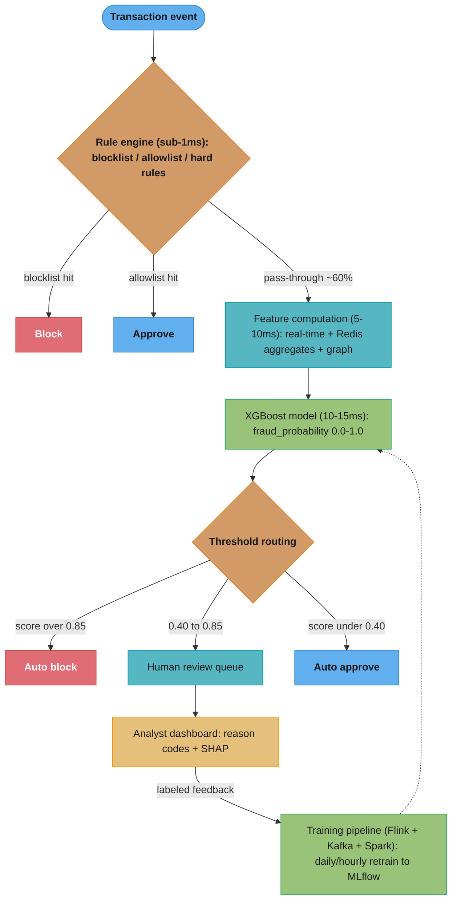
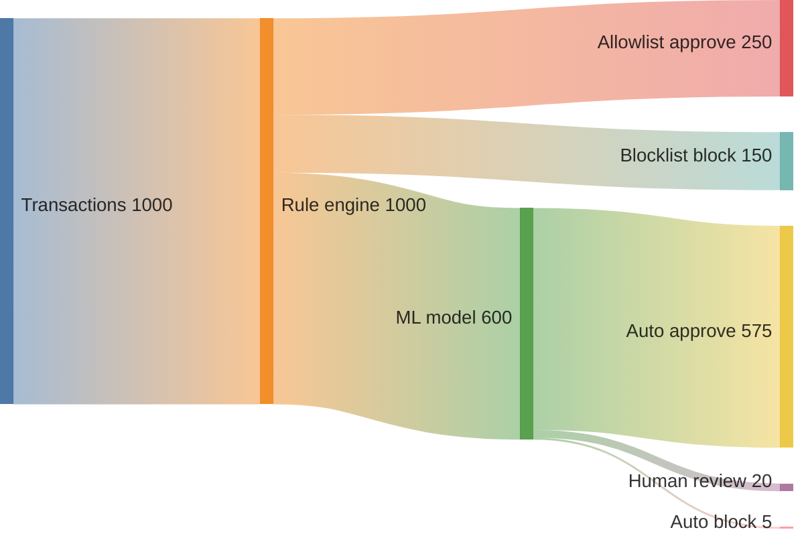
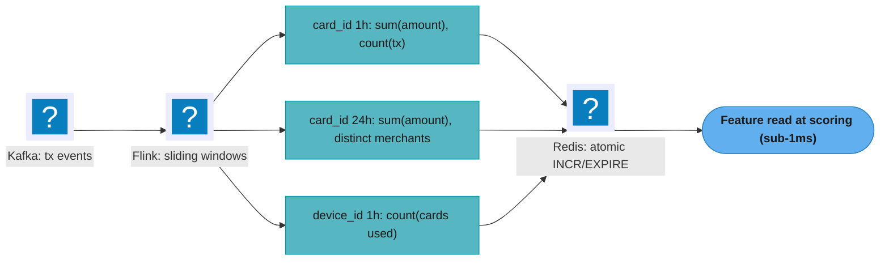

# Design a Real-Time Fraud Detection System
## Intuition

> Fraud scoring is an airport security line that has to clear 10,000 passengers a second. Most walk through on a known-traveller pass, a few are stopped by hard rules, and the scanner only judges the uncertain middle. It has 50 ms per passenger and must write down a reason for every person it stops.

**Key insight:** the model is the smallest part of the latency budget and the largest part of the risk. Fraud is 1 in 1,000 transactions, so a model with an excellent AUC can still block more good customers than it catches fraudsters. The system is therefore built around the *operating point* (three score zones, an auto-block threshold chosen on a temporal holdout) and around *label delay* (a chargeback can arrive 120 days late), not around another 0.01 of AUC.

Mental model: three layers in series. Deterministic rules clear about 40% of traffic in under 1 ms. Precomputed streaming features (Flink to Redis) turn "what has this card done in the last hour" into a sub-millisecond GET. One XGBoost model scores the remaining 60%, and its SHAP values become the regulatory reason codes. Labels come back from analysts in hours and from chargebacks over months.

Why this system exists: at 864M transactions a day and a 0.1% fraud rate, about 864k fraudulent attempts arrive every day. Missing 20% of them at an illustrative $200 average loss is about $35M a day of exposure. Blocking just 0.1% of legitimate traffic stops about 863k good customers a day. Every decision below trades between those two numbers.

**Sibling, not duplicated here:** the payment decision system around this model (rules, velocity counters, thresholds, step-up and the authorization latency budget) is in [Fraud and Risk Scoring](../../fintech/fraud_and_risk_scoring/fraud_and_risk_scoring.md) in `fintech/`. This study owns the model, its features, its labels and its monitoring.

---

## 1. Requirements Clarification


Design a fraud detection system for a payment platform processing 10,000 transactions per second. Every transaction must be scored in under 50ms P99. The business requires greater than 99.9% precision (false positives block legitimate transactions, destroying user trust) while catching greater than 80% of fraud (recall). The fraud base rate is 0.1% — 1 in 1,000 transactions is fraudulent, creating severe class imbalance. The system must support feedback loops: when analysts review flagged transactions, those labels flow back to retrain the model.

**Functional requirements:**
- Score every transaction that the rule engine does not resolve, and return approve, review or block with up to 3 reason codes.
- Route the 0.40-0.85 score band to an analyst queue and capture each verdict as a label.
- Ingest chargebacks and cardholder fraud reports as delayed labels; retrain at least daily.
- Let analysts add an emergency rule that takes effect within minutes, with no model deploy.

**Non-functional requirements and constraints:**
- 10K TPS peak, 864M transactions/day
- P99 latency < 50ms end-to-end
- Precision > 99.9%, Recall > 80% (F-beta with beta=0.5, precision-weighted)
- Fraud rate 0.1% — class imbalance ratio 1:1000
- Model must be explainable (regulatory requirement: reason codes for declined transactions)
- Online learning: model updated at minimum daily, preferably hourly

**Out of scope:**
- The authorization rules engine, 3-D Secure step-up and issuer decisioning (owned by `fintech/`, linked above).
- Merchant-onboarding and account-opening fraud (separate models on different entities).
- Chargeback representment and the dispute workflow.

---

## 2. Scale Estimation

| Quantity | Derivation | Result |
|---|---|---|
| Scores per second at peak | 10K TPS x 60% that pass the rule engine | 6,000 model calls/s |
| Fraud attempts per day | 864M x 0.1% | ~864k |
| Fraud labels in a 30-day window | 30 x 864k | ~26M (30% subsampling gives the ~7.8M positives in §10) |
| Review-band arrivals | 2% of 10K TPS | 200/s, ~17.3M/day before the queue filter in §11 |
| Online feature reads | 10K TPS x 5 Redis GETs | 50K GET/s |
| Label completeness | card-network dispute window up to 120 days | the newest 4 months of labels are always partial |

Two numbers drive the design. The 6,000 scores per second on the hot path force precomputed features and a CPU tree model; a GPU deep net would fit the throughput but not the explanation requirement. The 120-day label lag means the freshest data is always partly unlabelled, so the hourly retrain cannot rely on chargebacks (§11).

### Data Volume Projections

```
Year 0 (current):
  Transaction rate: 10K TPS, 864M transactions/day
  Transaction event size: ~2KB (features + metadata)
  Daily raw log: 864M × 2KB = 1.73TB/day
  Label join: the Visa/Mastercard cardholder dispute window runs up to 120 days,
    so 90 days is HOT (queryable Parquet) and days 91-120+ age into cold storage
  Total hot storage (90 days): 1.73TB × 90 = 156TB (Parquet on S3)
  Redis feature keys: 100M active cards × 3 windows × ~500B per key = 150GB Redis cluster

Year 1 (2x transaction growth):
  20K TPS, 1.73B transactions/day, ~3.46TB/day
  Redis: 200M cards × 3 windows = 300GB (6-node r5.2xlarge cluster)
  Model retraining data (30-day): ~104TB Parquet

Year 3 (5x growth):
  50K TPS, 4.32B transactions/day, ~8.6TB/day
  Redis cluster: 12-node (750GB active feature data)
  Flink processing: 50K events/sec → requires 80 task manager slots
  90-day S3 retention: 780TB
```

---

## 3. High-Level Architecture



The rule engine resolves roughly 40% of transactions deterministically in sub-1ms; the remaining ~60% get windowed features and an XGBoost score that routes into auto-block, human review, or auto-approve. Analyst-confirmed labels feed the retraining loop (dotted).



Representative disposition of 1,000 transactions: the rule engine clears ~40% (allow + block) and passes ~60% to the model, which auto-blocks about 0.5% and sends about 2% to human review — consistent with the score-distribution guardrails.



Spend-velocity aggregates are computed off the critical path: Flink maintains per-card and per-device sliding windows with exactly-once semantics and writes them to Redis, so scoring only does a sub-1ms GET instead of a live aggregation.

---

## 4. Component Deep Dives

Training rows are the feature values logged at decision time, joined later to labels; recomputing a velocity feature at training time would let post-transaction activity leak in. The rule is the one in [Feature Store and Point-in-Time Correctness](./cross_cutting/feature_store_and_point_in_time_correctness.md).

### 4.1 XGBoost Model with Threshold Optimization

```python
import numpy as np
import pandas as pd
import xgboost as xgb
from sklearn.model_selection import StratifiedKFold
from sklearn.metrics import precision_recall_curve, fbeta_score, confusion_matrix
from imblearn.over_sampling import SMOTE
from imblearn.under_sampling import RandomUnderSampler
from imblearn.pipeline import Pipeline as ImbPipeline
import shap
from typing import Optional


def build_fraud_features(df: pd.DataFrame) -> pd.DataFrame:
    """Feature engineering for fraud detection.

    Expected raw columns:
      tx_amount, merchant_category_code (MCC), hour_of_day, day_of_week,
      ip_country, card_country, device_fingerprint_age_days,
      spend_velocity_1h, spend_velocity_24h, spend_velocity_7d,
      tx_count_1h, tx_count_24h,
      is_new_merchant (first tx at this merchant),
      failed_attempts_15min,
      shared_device_with_fraud (graph feature, 0/1),
      card_device_age_days (how long card-device pair has been seen together)
    """
    f = df.copy()

    # Derived features
    f["amount_vs_velocity_ratio"] = f["tx_amount"] / (f["spend_velocity_1h"] + 1.0)
    f["country_mismatch"] = (f["ip_country"] != f["card_country"]).astype(int)
    f["is_high_risk_mcc"] = f["merchant_category_code"].isin(
        [6011, 6051, 7995, 5912]  # ATM, crypto, gambling, pharmacies
    ).astype(int)
    f["tx_frequency_spike"] = (f["tx_count_1h"] > 5).astype(int)
    f["unusual_hour"] = f["hour_of_day"].between(0, 5).astype(int)
    f["new_device"] = (f["device_fingerprint_age_days"] < 1).astype(int)
    f["velocity_24h_vs_7d"] = f["spend_velocity_24h"] / (
        f["spend_velocity_7d"] / 7.0 + 1.0
    )  # daily spend vs weekly average

    feature_cols = [
        "tx_amount", "hour_of_day", "day_of_week",
        "spend_velocity_1h", "spend_velocity_24h", "spend_velocity_7d",
        "tx_count_1h", "tx_count_24h",
        "is_new_merchant", "failed_attempts_15min",
        "shared_device_with_fraud", "card_device_age_days",
        "amount_vs_velocity_ratio", "country_mismatch", "is_high_risk_mcc",
        "tx_frequency_spike", "unusual_hour", "new_device",
        "velocity_24h_vs_7d",
    ]
    return f[feature_cols]


def train_fraud_model(
    X: pd.DataFrame,
    y: np.ndarray,
) -> xgb.XGBClassifier:
    """Train XGBoost with class-imbalance handling."""
    # Combined resampling: SMOTE minority class up, then undersample majority.
    # In imbalanced-learn a float sampling_strategy is the MINORITY-TO-MAJORITY
    # ratio after resampling, not a fraction of the dataset:
    #   SMOTE(0.1)               -> n_fraud = 0.10 * n_legit  (1:10)
    #   RandomUnderSampler(0.5)  -> n_fraud = 0.50 * n_legit  (1:2)
    smote = SMOTE(sampling_strategy=0.1, random_state=42)
    under = RandomUnderSampler(sampling_strategy=0.5, random_state=42)
    pipeline = ImbPipeline([("smote", smote), ("under", under)])

    X_res, y_res = pipeline.fit_resample(X, np.asarray(y))
    y_res = np.asarray(y_res)  # fit_resample returns an ndarray when y is an ndarray
    print(f"Resampled: {np.bincount(y_res.astype(int))} (legit, fraud)")

    # scale_pos_weight must be computed on the RESAMPLED set, not the raw 0.1%
    # base rate. Passing 999 here on top of a 2:1 set double-counts the
    # correction and collapses precision (see Failure 2).
    n_neg, n_pos = np.bincount(y_res.astype(int))[:2]
    scale_pos_weight = n_neg / max(n_pos, 1)  # ~2.0 after the pipeline above

    model = xgb.XGBClassifier(
        n_estimators=500,
        max_depth=6,
        learning_rate=0.05,
        subsample=0.8,
        colsample_bytree=0.8,
        scale_pos_weight=scale_pos_weight,
        eval_metric=["logloss", "auc"],
        # The sklearn wrapper does not encode labels for you: pass y already
        # encoded as 0..n-1 (here 0 = legitimate, 1 = fraud).
        random_state=42,
        n_jobs=-1,
        tree_method="hist",  # faster for large datasets
    )

    # Cross-val to estimate generalization
    cv = StratifiedKFold(n_splits=5, shuffle=True, random_state=42)
    oof_probs = np.zeros(len(X_res))
    for fold, (train_idx, val_idx) in enumerate(cv.split(X_res, y_res)):
        model.fit(
            X_res.iloc[train_idx], y_res[train_idx],
            eval_set=[(X_res.iloc[val_idx], y_res[val_idx])],
            verbose=False,
        )
        oof_probs[val_idx] = model.predict_proba(X_res.iloc[val_idx])[:, 1]

    # Final fit on all resampled data
    model.fit(X_res, y_res)
    return model


def find_optimal_thresholds(
    model: xgb.XGBClassifier,
    X_val: pd.DataFrame,
    y_val: np.ndarray,
    beta: float = 0.5,  # precision-weighted
) -> dict[str, float]:
    """Find auto-block and review thresholds using F-beta on validation set."""
    probs = model.predict_proba(X_val)[:, 1]
    precision, recall, thresholds = precision_recall_curve(y_val, probs)
    # sklearn returns precision/recall of length n_thresholds + 1 (the trailing
    # point is precision=1, recall=0 and has NO threshold). Trim before indexing
    # thresholds by an argmax, otherwise a best_idx of n raises IndexError.
    precision, recall = precision[:-1], recall[:-1]

    f_scores = []
    for p, r in zip(precision, recall):
        if p + r == 0:
            f_scores.append(0.0)
        else:
            f_beta = (1 + beta**2) * p * r / (beta**2 * p + r)
            f_scores.append(f_beta)

    best_idx = int(np.argmax(f_scores))
    auto_block_threshold = float(thresholds[best_idx])

    # Review zone lower bound: lowest threshold that still holds recall >= 80%
    recall_80_idx = np.where(recall >= 0.80)[0]
    review_lower = float(thresholds[recall_80_idx[-1]]) if len(recall_80_idx) else 0.3

    result = {
        "auto_block": auto_block_threshold,
        "review_lower": review_lower,
        "best_f_beta": float(f_scores[best_idx]),
        "precision_at_threshold": float(precision[best_idx]),
        "recall_at_threshold": float(recall[best_idx]),
    }
    print(f"Thresholds: auto_block={auto_block_threshold:.3f}, "
          f"review_lower={review_lower:.3f}")
    print(f"F{beta}={result['best_f_beta']:.4f}, "
          f"P={result['precision_at_threshold']:.4f}, "
          f"R={result['recall_at_threshold']:.4f}")
    return result


def explain_decision(
    model: xgb.XGBClassifier,
    X_instance: pd.DataFrame,
    top_n: int = 5,
) -> list[dict]:
    """Generate SHAP-based reason codes for a single transaction decision."""
    explainer = shap.TreeExplainer(model)
    shap_values = explainer.shap_values(X_instance)

    feature_names = X_instance.columns.tolist()
    shap_row = shap_values[0]  # single instance
    contributions = sorted(
        zip(feature_names, shap_row),
        key=lambda x: abs(x[1]),
        reverse=True,
    )

    reason_map = {
        "spend_velocity_1h": "Unusually high spend in last hour",
        "country_mismatch": "Transaction country differs from card country",
        "is_new_merchant": "First transaction at this merchant",
        "shared_device_with_fraud": "Device associated with known fraud",
        "tx_frequency_spike": "Abnormal transaction frequency",
        "unusual_hour": "Transaction at unusual hour",
        "amount_vs_velocity_ratio": "Amount unusually high relative to recent spending",
    }

    reasons = []
    for feature, shap_val in contributions[:top_n]:
        if shap_val > 0:  # contributing to fraud score
            reasons.append({
                "feature": feature,
                "contribution": float(shap_val),
                "reason_code": reason_map.get(feature, f"Feature: {feature}"),
            })
    return reasons
```

### 4.2 Streaming Feature Aggregation (Flink concept in Python)

```python
from dataclasses import dataclass, field
from collections import deque
import time
import redis


@dataclass
class SlidingWindowAggregator:
    """
    Conceptual implementation of Flink sliding-window aggregation.
    In production: Flink with RocksDB state backend, exactly-once semantics.
    This shows the logic; actual Flink code uses Java/Scala DataStream API.
    """
    window_seconds: int
    events: deque = field(default_factory=deque)

    def add_event(self, amount: float, timestamp: float) -> None:
        self.events.append((timestamp, amount))
        self._evict_old(timestamp)

    def _evict_old(self, current_ts: float) -> None:
        cutoff = current_ts - self.window_seconds
        while self.events and self.events[0][0] < cutoff:
            self.events.popleft()

    def get_sum(self) -> float:
        return sum(amt for _, amt in self.events)

    def get_count(self) -> int:
        return len(self.events)


class FraudFeatureStore:
    """Redis-backed feature store for real-time fraud features."""

    def __init__(self, redis_client: redis.Redis) -> None:
        self.redis = redis_client

    def update_spend_velocity(
        self,
        card_id: str,
        amount: float,
        timestamp: float,
    ) -> None:
        """Increment rolling spend using sorted-set trick."""
        key_1h = f"spend:{card_id}:1h"
        key_24h = f"spend:{card_id}:24h"
        key_7d = f"spend:{card_id}:7d"

        pipe = self.redis.pipeline()
        # Store amount in sorted set with timestamp as score
        member = f"{timestamp}:{amount}"
        pipe.zadd(key_1h, {member: timestamp})
        pipe.zadd(key_24h, {member: timestamp})
        pipe.zadd(key_7d, {member: timestamp})

        # Remove entries outside window
        now = timestamp
        pipe.zremrangebyscore(key_1h, "-inf", now - 3600)
        pipe.zremrangebyscore(key_24h, "-inf", now - 86400)
        pipe.zremrangebyscore(key_7d, "-inf", now - 604800)

        # Set TTL
        pipe.expire(key_1h, 7200)
        pipe.expire(key_24h, 90000)
        pipe.expire(key_7d, 691200)
        pipe.execute()

    def get_spend_features(self, card_id: str) -> dict[str, float]:
        """Get spend velocity features for scoring."""
        now = time.time()
        pipe = self.redis.pipeline()

        for window_name, window_sec in [("1h", 3600), ("24h", 86400), ("7d", 604800)]:
            key = f"spend:{card_id}:{window_name}"
            pipe.zrangebyscore(key, now - window_sec, "+inf", withscores=False)
        results = pipe.execute()

        def sum_amounts(members: list[bytes]) -> float:
            total = 0.0
            for m in members:
                try:
                    total += float(m.decode().split(":")[1])
                except (IndexError, ValueError):
                    pass
            return total

        return {
            "spend_velocity_1h": sum_amounts(results[0]),
            "spend_velocity_24h": sum_amounts(results[1]),
            "spend_velocity_7d": sum_amounts(results[2]),
            "tx_count_1h": len(results[0]),
            "tx_count_24h": len(results[1]),
        }
```

### 4.3 Online Scoring Service

```python
from dataclasses import dataclass
import numpy as np
import xgboost as xgb
import redis
import time


@dataclass
class FraudScore:
    transaction_id: str
    fraud_probability: float
    decision: str  # "approve", "review", "block"
    reason_codes: list[str]
    latency_ms: float


class FraudScoringService:
    """
    End-to-end fraud scoring pipeline.
    Target: <50ms P99 including feature fetch and model inference.
    """

    BLOCKLIST_KEY = "blocklist:cards"
    ALLOWLIST_KEY = "allowlist:merchants"

    def __init__(
        self,
        model: xgb.XGBClassifier,
        feature_store: "FraudFeatureStore",
        thresholds: dict[str, float],
    ) -> None:
        self.model = model
        self.feature_store = feature_store
        self.auto_block_threshold = thresholds["auto_block"]   # e.g., 0.85
        self.review_lower = thresholds["review_lower"]         # e.g., 0.40

    def score(self, transaction: dict) -> FraudScore:
        start = time.perf_counter()
        tx_id = transaction["transaction_id"]
        card_id = transaction["card_id"]

        # Stage 1: Rule engine (<1ms)
        if self._is_blocklisted(card_id):
            return FraudScore(tx_id, 1.0, "block", ["Card on blocklist"],
                              (time.perf_counter() - start) * 1000)
        if self._is_allowlisted(transaction.get("merchant_id", "")):
            return FraudScore(tx_id, 0.0, "approve", [],
                              (time.perf_counter() - start) * 1000)

        # Stage 2: Feature computation (5-10ms)
        velocity_features = self.feature_store.get_spend_features(card_id)
        all_features = {**transaction, **velocity_features}
        X = self._build_feature_vector(all_features)

        # Stage 3: ML scoring (10-15ms)
        fraud_prob = float(self.model.predict_proba(X)[:, 1][0])

        # Stage 4: Decision + reason codes
        if fraud_prob >= self.auto_block_threshold:
            decision = "block"
        elif fraud_prob >= self.review_lower:
            decision = "review"
        else:
            decision = "approve"

        latency = (time.perf_counter() - start) * 1000
        return FraudScore(tx_id, fraud_prob, decision, [], latency)

    def _is_blocklisted(self, card_id: str) -> bool:
        return bool(self.feature_store.redis.sismember(self.BLOCKLIST_KEY, card_id))

    def _is_allowlisted(self, merchant_id: str) -> bool:
        return bool(self.feature_store.redis.sismember(self.ALLOWLIST_KEY, merchant_id))

    def _build_feature_vector(self, features: dict) -> np.ndarray:
        # Build ordered feature array matching model's expected input
        feature_order = [
            "tx_amount", "hour_of_day", "day_of_week",
            "spend_velocity_1h", "spend_velocity_24h", "spend_velocity_7d",
            "tx_count_1h", "tx_count_24h", "is_new_merchant",
            "failed_attempts_15min", "shared_device_with_fraud",
            "card_device_age_days",
        ]
        return np.array([[features.get(f, 0.0) for f in feature_order]])
```

### 4.4 Threshold Selection on a Temporal Split — Broken Then Fixed

The threshold is the product decision, so the split it is tuned on matters more than the model. A random split lets the model see fraud from the validation month during training, and the threshold it returns is too aggressive for production. Calibration and threshold choice are covered in depth in [Model Calibration and Thresholding](./cross_cutting/model_calibration_and_thresholding.md).


```python
# BROKEN: Using random train/val split for threshold optimization
# Fraud patterns are temporal — training on all months and validating on random 10%
# means the model has "seen" future fraud patterns via training data leakage

from sklearn.model_selection import train_test_split
import numpy as np
import xgboost as xgb
from sklearn.metrics import precision_recall_curve


def optimize_threshold_broken(
    X: np.ndarray,
    y: np.ndarray,
    model: xgb.XGBClassifier,
) -> float:
    # BUG: Random split — validation set contains fraud from same time window as training
    # Model already overfit to these fraud patterns → inflated validation precision
    X_train, X_val, y_train, y_val = train_test_split(
        X, y, test_size=0.2, random_state=42, stratify=y
    )
    model.fit(X_train, y_train)
    probs = model.predict_proba(X_val)[:, 1]
    precision, recall, thresholds = precision_recall_curve(y_val, probs)
    # Returns threshold=0.72 with precision=99.95% on validation
    # In production: precision=97.8% — overoptimistic by 2.15 percentage points
    best_idx = np.argmax(precision[recall >= 0.80])
    return float(thresholds[best_idx])


# FIX: Temporal validation split — validate on the most recent month only
# Training: months 1-5, Validation: month 6, Test: month 7 (held out)

def optimize_threshold_correct(
    df_with_timestamp: "pd.DataFrame",  # includes 'timestamp' and 'label' columns
    X: np.ndarray,
    y: np.ndarray,
    model: xgb.XGBClassifier,
    validation_window_days: int = 30,
) -> float:
    """
    Time-based split: train on all data except last validation_window_days.
    Validate on most recent validation_window_days.
    This simulates real deployment: model trained on past, evaluated on future.
    """
    import pandas as pd
    cutoff = df_with_timestamp["timestamp"].max() - pd.Timedelta(days=validation_window_days)
    train_mask = df_with_timestamp["timestamp"] < cutoff
    val_mask = ~train_mask

    model.fit(X[train_mask], y[train_mask])
    probs = model.predict_proba(X[val_mask])[:, 1]
    y_val = y[val_mask]

    precision, recall, thresholds = precision_recall_curve(y_val, probs)
    # Threshold is more conservative: typically 0.85-0.90 vs 0.72 from random split
    recall_mask = recall[:-1] >= 0.80
    if recall_mask.any():
        best_idx = int(np.argmax(precision[:-1][recall_mask]))
        return float(thresholds[recall_mask][best_idx])
    return 0.90  # conservative default
```

### 4.5 SHAP Reason Codes — Broken Then Fixed

Reason codes are a regulatory output, so the explainer is production code with its own failure modes.


```python
# BROKEN: two independent bugs in one class.
# (1) A single explainer object is shared across request threads. shap's
#     explainers are not documented as thread-safe: KernelExplainer is a
#     confirmed offender (shap/shap#2863), and TreeExplainer carries its own
#     documented shared mutable state — shap/shap#729 reports that
#     `explainer.expected_value` flips from a scalar to a two-element list
#     in place during a LightGBM `shap_values()` call, which is exactly the
#     attribute the conservation check below reads. (Related: shap/shap#4162,
#     where a TreeExplainer given a background dataset serialises onto one
#     core and starves other threads in the process.) There is no published
#     report of `shap_values()` returning wrong numbers under concurrency, so
#     do not claim one; a per-thread or per-process instance is simply the
#     safe default rather than something to discover in prod.
# (2) The conservation check below compares the SHAP sum against
#     predict_proba(). TreeExplainer defaults to model_output="raw", which for
#     an XGBoost binary:logistic model is the LOG-ODDS margin — so
#     shap_values.sum() + expected_value never equals a probability, and the
#     assertion fires on every well-formed explanation.

import shap
import threading
import xgboost as xgb
import numpy as np


class FraudExplainerBroken:
    def __init__(self, model: xgb.XGBClassifier) -> None:
        # BUG 1: single explainer shared across threads
        self.explainer = shap.TreeExplainer(model)

    def explain(self, X: np.ndarray) -> np.ndarray:
        return self.explainer.shap_values(X)


# FIX: Use thread-local explainer instances, or serialize with a lock,
# or use a process pool (separate memory space per worker)

import concurrent.futures


class FraudExplainerCorrect:
    def __init__(self, model: xgb.XGBClassifier) -> None:
        self.model = model
        self._local = threading.local()

    def _get_explainer(self) -> shap.TreeExplainer:
        """Thread-local explainer — each thread gets its own instance."""
        if not hasattr(self._local, "explainer"):
            self._local.explainer = shap.TreeExplainer(self.model)
        return self._local.explainer

    def explain(self, X: np.ndarray) -> np.ndarray:
        explainer = self._get_explainer()
        shap_values = explainer.shap_values(X)
        # Conservation holds in the model's RAW output space. TreeExplainer's
        # default model_output="raw" is the log-odds margin for XGBoost
        # binary:logistic, so compare against output_margin=True — or push the
        # sum through a sigmoid before comparing to predict_proba.
        base_value = explainer.expected_value
        raw_margin = self.model.predict(X, output_margin=True)
        shap_sum = shap_values.sum(axis=1) + base_value
        if not np.allclose(shap_sum, raw_margin, atol=0.01):
            raise RuntimeError(
                f"SHAP conservation violated: shap_sum={shap_sum}, "
                f"raw_margin={raw_margin}"
            )
        return shap_values
```

Note the two separate lessons: isolate explainer state per worker, and always
check conservation in the space the explainer actually explains. A check written
against `predict_proba()` fails on correct explanations and passes on nothing,
which is worse than no check at all.

---

## 5. Design Decisions & Tradeoffs


**Rule engine first**: roughly 40% of transactions are cleared by allowlist/blocklist in under 1ms (the split assumed throughout this study — see the disposition sankey above), reducing ML model load and latency budget for the remaining transactions. Known fraud patterns (card number appears in breach database) are handled deterministically with zero false-negative risk.

**XGBoost over deep learning**: Regulatory requirements mandate explainability — each decline must include a human-readable reason code (e.g., "unusual transaction location," "high spend velocity"). XGBoost with SHAP values satisfies this. Deep models require post-hoc approximations (LIME) that can be inconsistent. XGBoost also trains in minutes, enabling hourly retraining on fresh fraud patterns.

**Threshold tuning for asymmetric costs**: Blocking a legitimate transaction costs far more than missing fraud in brand terms. Use F-beta with beta=0.5 (precision-weighted) for threshold selection. Optimal threshold is typically 0.85 for auto-block, not the naive 0.5. Maintain a borderline zone (0.40-0.85) for human review rather than binary auto-decisions.

**Class imbalance**: 0.1% fraud rate means naive training optimizes for always predicting legitimate. Two strategies, applied in a fixed order: (1) resample — SMOTE to generate synthetic minority samples in feature space, then undersample the majority class; in `imbalanced-learn` a float `sampling_strategy` is the *minority-to-majority ratio after resampling*, so `SMOTE(0.1)` then `RandomUnderSampler(0.5)` lands at 2:1 negative to positive. (2) `scale_pos_weight` in XGBoost, computed on the **resampled** set, not the raw one. The common bug is stacking both at raw-data strength: `scale_pos_weight=999` on a set already rebalanced to 2:1 double-counts the correction and drives precision through the floor. Pick one primary lever and tune the other on the data the model actually sees.

**Streaming features with Flink**: Spend velocity over the last 1 hour is a top-3 feature for fraud. Computing it requires stateful aggregation. Flink maintains per-card windowed state in RocksDB with exactly-once semantics. Results are written to Redis for sub-millisecond read during inference.

**Reason codes are a fairness surface too:** a top SHAP factor such as `country_mismatch` or `is_high_risk_mcc` can act as a proxy for nationality or neighbourhood. Audit the reason-code distribution by customer segment before launch; see [Responsible AI, Fairness and Explainability](./cross_cutting/responsible_ai_fairness_and_explainability.md).

**Tradeoff summary:**

| Decision | Chosen | Alternative | Reasoning |
|----------|--------|-------------|-----------|
| Model type | XGBoost | Neural network (MLP, Transformer) | XGBoost: interpretable SHAP values, trains in minutes, handles missing features |
| Imbalance strategy | One primary lever: scale_pos_weight, or SMOTE capped at 1:10 with scale_pos_weight recomputed on the resampled set | Stacking both at raw-data strength | Stacking double-counts the correction and collapses precision (§9 Failure 2); resampling also distorts probabilities, so recalibrate on a temporal holdout |
| Feature aggregation | Flink sliding windows | Lambda architecture (speed + batch) | Flink unified streaming eliminates dual-path complexity |
| Threshold | F-beta (beta=0.5) | Fixed 0.5 or ROC-optimal | F-beta explicitly encodes business cost of false positives vs false negatives |
| Review zone | [0.40, 0.85] | Binary approve/block | Borderline zone recovers precision without sacrificing recall |
| Graph features | Precomputed + cached | Real-time graph traversal | Real-time graph query >50ms; precompute nightly, cache in Redis |

---

## 6. Real-World Implementations

**Stripe Radar (published architecture and numbers):** Stripe's engineering post "How we built it: Stripe Radar" (Ryan Drapeau, 2023-03-29) says Radar assesses more than 1,000 characteristics of a transaction, decides in under 100 ms, and incorrectly blocks 0.1% of legitimate payments. It puts fraud "on the order of 1 out of every 1,000 payments", the same base rate this study uses. The model history is the useful part. Stripe started with simple models such as logistic regression, then ran a Wide & Deep ensemble of an XGBoost model and a DNN, and in mid-2022 moved to a DNN-only, ResNeXt-inspired multi-branch network. Removing XGBoost without a replacement would have cost 1.5% recall. The DNN-only model cut training time by over 85%, to under two hours. Stripe's Radar product page (checked 2026-11-25) says the model is trained on more than 70 trillion data points across the Stripe network, and that there is a 92% likelihood a charge comes from a card Stripe has seen before.

**What that means for this design:** Stripe's edge is network breadth: a card seen at another merchant brings its history to the first transaction here. A single platform has no such signal, which is why this design leans on velocity, device and graph features (§4) and on a rules layer that changes in minutes. Stripe moved off XGBoost because retraining speed and DNN techniques (embeddings, transfer learning) mattered more at its data volume than exact attribution. This design keeps one XGBoost model because reason codes must be exact TreeSHAP values and a 25-minute retrain (§10) is not the bottleneck. Revisit the choice when more training data, not more features, becomes the main lever.

**Card-network rules shape the labels:** Visa and Mastercard generally give a cardholder up to 120 days from the transaction to dispute it. Any issuer or processor therefore trains on labels that are incomplete for the most recent four months. That is why this design retrains hourly on analyst verdicts and keeps a pending-label buffer for chargebacks (§11).

---

## 7. Technologies & Tools

| Component | Technology | Role |
|-----------|-----------|------|
| Rule Engine | Redis SET (blocklist/allowlist) | Sub-1ms hard rules, deterministic |
| Feature Storage | Redis Cluster (sorted sets) | Rolling window spend aggregation |
| Stream Processing | Apache Flink | Real-time feature computation, exactly-once |
| Event Bus | Apache Kafka | Transaction event streaming |
| ML Model | XGBoost | Fraud probability scoring, 10-15ms |
| Imbalance Handling | SMOTE + RandomUnderSampler (imbalanced-learn) | Class imbalance 1:1000 |
| Explainability | SHAP TreeExplainer | Regulatory reason codes |
| Threshold Selection | F-beta optimization (precision-weighted) | Precision/recall tradeoff tuning |
| Experiment Tracking | MLflow | Model versioning, threshold tracking |

---

## 8. Operational Playbook

Feature drift, score-distribution guardrails, retraining cadence and the promotion process are below; the PSI and KS implementations are in [Drift Monitoring and Retraining](./cross_cutting/drift_monitoring_and_retraining.md), and the shadow-then-A/B design follows [Experimentation and Online Evaluation](./cross_cutting/experimentation_and_online_evaluation.md).


### Features That Drift Fastest

```
Feature                           Drift rate    Why it drifts
────────────────────────────────────────────────────────────────────────
new_device (device_age < 1 day)   Very high     Fraudsters rotate devices daily
spend_velocity_1h                 High          Attack patterns shift; seasonal spending
failed_attempts_15min             High          Brute-force bot activity waxes/wanes
country_mismatch                  High          Travel patterns; VPN usage trends
is_high_risk_mcc                  Medium        Fraudsters shift to new merchant categories
card_device_age_days              Medium        Legitimate users get new devices periodically
tx_amount                         Low           Consumer spending patterns stable month-to-month
hour_of_day distribution          Low           Shifts with daylight saving, seasonal habits
```

### PSI Monitoring for Fraud Features

```python
# PSI alert thresholds calibrated to fraud feature characteristics
FRAUD_FEATURE_PSI_THRESHOLDS = {
    "spend_velocity_1h": 0.15,          # seasonal variation expected
    "new_device": 0.20,                  # bot campaigns cause legitimate spikes
    "country_mismatch": 0.15,
    "failed_attempts_15min": 0.25,       # DDoS/brute-force highly variable
    "amount_vs_velocity_ratio": 0.10,   # stable; shift indicates new fraud pattern
    "shared_device_with_fraud": 0.10,   # should be stable graph topology
}

# Model output monitoring
SCORE_DISTRIBUTION_ALERTS = {
    "fraction_auto_blocked": {"lower": 0.0005, "upper": 0.005},  # 0.05-0.5% of traffic
    "fraction_in_review": {"lower": 0.005, "upper": 0.05},        # 0.5-5% of traffic
    "median_fraud_score": {"lower": 0.02, "upper": 0.15},         # among all transactions
}
```

### Retraining Triggers and Cadence

```
Cadence        Trigger condition                                Action
─────────────────────────────────────────────────────────────────────────────
Daily          Scheduled                                        Full XGBoost retrain
Hourly         New confirmed fraud labels from analysts >1000   Incremental warm-start retrain
Triggered      PSI > 0.20 on any top-5 feature                 Emergency retrain + feature audit
Triggered      Precision drops below 99.5% on 1000-tx window   Threshold re-optimization
Triggered      Fraud rate on auto-approved tx > 0.3% (vs 0.1%) Emergency rule addition + retrain
Triggered      New attack vector identified by analyst          Emergency feature engineering
Weekly         Scheduled                                        Graph feature rebuild (device associations)
Monthly        Scheduled                                        Model audit: SHAP drift, feature importance shift
```

### A/B Testing for Model Promotion

```
Shadow mode (1 week):
  New model runs in parallel on 100% of traffic
  Predictions logged but not served
  Validation checklist:
    - Latency P99 < 50ms (reject if exceeds 45ms to leave 10% headroom)
    - SHAP values computed and verified (conservation property)
    - Score distribution similar to production model (PSI < 0.15)

A/B test (2 weeks minimum):
  Treatment: 20% of traffic scored by new model
  Control: 80% scored by production model
  Primary metrics:
    - Precision on auto-blocked transactions (chargeback rate in blocked set)
    - Recall: fraud rate on auto-approved transactions (delayed label, 30 days)
  Guardrails:
    - False positive rate in review queue must not increase > 5%
    - P99 latency must not increase > 5ms
  Statistical threshold: 95% confidence on primary metrics

Ramp: 20% → 50% → 100% at 3-day intervals after significance confirmed
```

### Incident runbooks

**Runbook 1 — Stale streaming features (Flink consumer lag over 2 minutes):**
Symptom: the lag alert fires, and the share of scored transactions with `spend_velocity_1h = 0` rises.
Mitigation: while lag is over 5 minutes, lower the auto-block threshold from 0.85 to 0.70 automatically (§9 Failure 1), and scale out the Flink velocity job.
Resolution: confirm Redis TTLs are window + 60 minutes so keys outlive the lag; backfill the affected windows before the next retrain uses them.

**Runbook 2 — Review queue overflow (arrivals over 2x normal):**
Symptom: queue age over 4 hours; `fraction_in_review` above its 5% guardrail.
Diagnosis: compare feature PSI against the score shift. A shift with no feature drift points at the model or the threshold config; a shift with drift points at a real attack or a broken upstream feed.
Mitigation: tighten queue entry to expected loss over $500 and score over 0.60 (§11), and hold (do not approve) the transactions that fall out of the queue.
Resolution: retrain or add an emergency rule; restore normal entry rules once arrivals fall below 1.2x normal.

**Runbook 3 — Proxy precision below 99.5% on a rolling 1,000-decision window:**
Mitigation: roll back to the previous model version in MLflow (one alias change) and keep the old threshold with it.
Resolution: re-optimise the threshold on a temporal holdout (§4.4), then repeat shadow mode and the A/B test before re-promotion.

**Runbook 4 — New attack vector reported by analysts:**
Mitigation: add a rule within minutes that forces the segment to review (§9 Failure 3).
Resolution: add features that describe the vector, retrain with the attack-window labels, and deploy within 72 hours; keep the rule until the new model's recall on the segment is confirmed.

---

## 9. Common Pitfalls & War Stories


*The incidents below are illustrative composites of recurring failure patterns, not accounts of specific public incidents. The mechanisms and the remediations are real; the transaction counts, loss totals and time-to-detect figures are representative numbers chosen to make the magnitude concrete, and should not be quoted as measured public record.*

### Failure 1: Redis Key Expiry During Peak Transaction Window

**What failed:** On Black Friday, transaction volume spiked to 45K TPS (4.5x normal 10K TPS). The Flink streaming feature computation fell behind by 8 minutes — spend velocity features in Redis were stale. More critically, some Redis keys expired before Flink could refresh them: a card that had spent $2,000 in the last hour showed spend_velocity_1h=0 because the key had expired and Flink's write was delayed. The fraud model saw no velocity signal and approved 312 fraudulent transactions totaling $187K in 45 minutes.

**Detection:** Chargebacks arrived 3 days later from card network. Real-time detection failed because the model's fraud score was low (velocity feature was zero). Post-hoc analysis correlated the window to Flink consumer lag. Time-to-detect: 3 days (via chargeback data), 45 minutes for Flink lag alert (but that alert was not actionable to fraud team).

**Recovery steps:**
1. Emergency manual blocklist: analyst added 890 card IDs that were flagged in the affected 45-minute window to the blocklist.
2. Chargeback disputes filed with card networks for $187K.
3. Flink parallelism increased from 8 to 32 workers specifically for spend velocity jobs; autoscaling enabled on Flink task managers.
4. Redis TTL extended from window_size+10min to window_size+60min to provide buffer during consumer lag.

**Prevention:** Added Kafka consumer lag as a feature-quality signal: if Flink lag > 5 minutes, automatically increase the fraud threshold from 0.85 to 0.70 (more conservative) to compensate for stale features. Alert on lag > 2 minutes.

---

### Failure 2: SMOTE Overfitting to Synthetic Minority Samples

**What failed:** A model retrained with SMOTE sampling_strategy=0.5 (fraud → 50% of training data) achieved F-beta=0.92 on the validation set but precision=97.5% in production (target: >99.9%). Investigation showed SMOTE was generating synthetic fraud samples that interpolated between real fraud cases, creating a dense cluster of fraud-like feature combinations in embedding space. The model learned to predict fraud for any transaction in those regions, but real legitimate transactions sometimes occupied the same feature space (e.g., a legitimate $1,500 transaction from a new merchant at 2am — common for business travelers).

**Detection:** Production precision monitoring: daily false-positive rate dashboard showed precision at 97.5%, below the 99.9% target. Analyst reviews showed 60% of flagged transactions in the manual review queue were legitimate. Time-to-detect: 2 weeks after new model deploy.

**Recovery steps:**
1. Rolled back to previous model (pre-SMOTE).
2. Reduced SMOTE sampling_strategy from 0.5 to 0.1 — in imbalanced-learn that float is the minority-to-majority ratio after resampling, so this moves the synthetic fraud class from 1:2 down to 1:10 against the majority (not "50% of the data" to "10% of the data").
3. Validated on time-held-out test set (3-month delay to capture chargebacks) rather than random split, which better represented real distribution.
4. Added graph features as hard guardrails: no SMOTE samples generated for transactions where shared_device_with_fraud=0 (legitimate device network reduces fraud probability strongly).

**Prevention:** Precision monitoring on the fastest label available, which is *not* the chargeback — a dispute travels the issuer/network cycle and cannot land within 24 hours. Use analyst adjudications of the review queue (hours) and inbound cardholder fraud reports to the issuer as the 24-hour proxy signal, and reconcile against chargebacks months later. Alert immediately if proxy precision drops below 99.5% on a rolling 1,000-decision window.

---

### Failure 3: Concept Drift From New Account Takeover Vector

**What failed:** Fraudsters discovered a new attack: instead of using stolen card numbers, they compromised email accounts, changed shipping addresses, and placed orders using the original card on file. The model's features (country_mismatch, new_device, velocity) did not capture this pattern. Fraud rate in the "new shipping address + email change within 24 hours" segment rose from 0.1% to 8% over 3 weeks. The model scored these transactions at 0.2-0.3 (legitimate), passing them to auto-approve. $2.3M in losses accumulated before detection.

**Detection:** An analyst noticed an unusual pattern in chargebacks — all from the same demographic (email change 24h before order). Cross-referenced with model feature logs. Time-to-detect: 3 weeks.

**Recovery steps:**
1. Emergency rule added to the rule engine: if email_changed_within_24h AND new_shipping_address → force to human review queue regardless of model score.
2. Feature engineering: added email_change_age_hours, shipping_address_age_hours, address_change_velocity_7d.
3. Retrained XGBoost model on new features with labeled examples from the attack window.
4. Deployed new model within 72 hours of root cause identification.

**Prevention:** Weekly analyst review of chargeback patterns to identify emerging fraud vectors not captured by current features. Feature importance monitoring: if model's top-10 features do not include features covering a new fraud pattern within 2 weeks of its emergence, trigger emergency feature engineering sprint.

---

### Failure 4: Threshold Tuned on a Random Split

**What failed:** the threshold search in §4.4 used a random 80/20 split. It returned 0.72 with 99.95% validation precision; production precision was 97.8%.

**Impact:** false positives per true positive rose from 0.001 (at 99.9%) to 0.0225 (at 97.8%), 22x more wrongful blocks. At 0.8 caught frauds per 1,000 transactions and 864M transactions a day, that is about 691k true blocks a day and about 15.5k blocked good customers a day instead of about 700.

**Prevention:** threshold search only on a temporal holdout, and a release gate that compares holdout precision with the last 7 days of proxy precision.

### Failure 5: Reason-Code Check Rejected Every Explanation

**What failed:** the SHAP conservation check in §4.5 compared log-odds SHAP sums with `predict_proba()`. It raised on every well-formed explanation, so no decline carried a reason code.

**Impact:** about 500K decisions a day need explanations (§10). Every one of them failed until the check was fixed, a direct regulatory exposure for each declined customer.

**Prevention:** test the explainer against the model's raw margin in CI with a fixed set of transactions, and alert on the share of declines with no reason code.

---

## 10. Capacity Planning

Data volume projections are in §2; this section sizes compute and serving.

### Training Compute Requirements

```
XGBoost Fraud Model (daily retrain):
  Dataset: 30-day rolling window × 864M tx/day × 0.3 subsampled = 7.8B training examples
  Fraud in that pool at the 0.1% base rate: ~7.8M positives
  After rebalancing to fraud:legit = 1:10, the training set is ~86M rows
    (7.8M fraud + 78M sampled legit) — NOT 15M; the negatives dominate the count
  Hardware: c5.4xlarge (16 vCPU, 32GB RAM)
  Duration: ~25 minutes (tree_method=hist, 19 features, 500 trees)
  Cost: $0.68/hr × 0.42hr = $0.29/run × 365 = $106/year

Graph Feature Precomputation (nightly):
  Build device-card association graph: 864M nodes, 2B edges
  GraphX on Spark (10-node EMR r5.2xlarge): 3 hours/night
  Cost: 10 × $0.504/hr × 3hr = $15/night = $5,475/year

SHAP Explanation Precomputation (async, post-decision):
  500K decisions/day requiring SHAP (review queue + blocks)
  TreeExplainer: 10ms per decision → 5M ms = 83 CPU-minutes
  2 dedicated c5.xlarge for async SHAP: $0.17/hr each
  Cost: 2 × $0.17 × 24 × 365 = ~$2,978/year

Total annual training cost: ~$8,559
```

### Serving Infrastructure

```
Transaction Scoring Service:
  10K TPS peak, 50ms P99 budget
  Each scoring instance: XGBoost inference 15ms, Redis GET 5ms, network 10ms
  Instances needed: 10K TPS × 30ms avg latency = 300 concurrent requests
  10 instances (c5.2xlarge, 8 vCPU): 30 concurrent requests each
  Cost: 10 × $0.34/hr = $3.40/hr = $2,450/month

Redis Feature Store:
  10K TPS × 5 Redis GETs per tx = 50K GET/sec
  10-node Redis Cluster (r5.xlarge, 32GB RAM each): 5K ops/node
  Estimated active data: 150GB across 10 nodes (15GB/node)
  Cost: 10 × $0.252/hr = $2.52/hr = ~$1,814/month

Kafka Cluster (transaction events + label feedback):
  10K events/sec sustained, 30K peak
  5-broker cluster (kafka.m5.2xlarge)
  Cost: ~$750/month

Flink Streaming (feature computation):
  32 task managers (c5.xlarge, 4 vCPU)
  Cost: 32 × $0.17/hr = $5.44/hr = ~$3,917/month

Total monthly serving infrastructure: ~$8,931
```

---

## 11. Interview Discussion Points


**Q: How do you handle the class imbalance of 0.1% fraud rate?**
**Short:** Reweight with scale_pos_weight or resample with SMOTE, never both at full strength, then pick the threshold with F-beta on a temporal holdout instead of using 0.5.
Three-layer approach: (1) cost reweighting — on the raw 0.1% data, scale_pos_weight = 999 makes each fraud example count as 999 legitimate ones during gradient computation. (2) Resampling — SMOTE generates synthetic fraud examples by interpolating in feature space between existing fraud cases, avoiding overfit to exact training fraud rows. These two are alternatives, not additives: if you resample first, recompute scale_pos_weight on the resampled class counts, or you correct twice and precision collapses. (3) Threshold tuning: the naive 0.5 threshold is wrong for imbalanced data; use F-beta with beta=0.5 on a time-held-out validation set (not random split — fraud patterns are temporal). Target threshold is typically 0.85 for auto-block.

**Q: How do you prevent model degradation as fraud patterns evolve (concept drift)?**
**Short:** Watch feature PSI and the fraud rate in auto-approved traffic, retrain hourly on a rolling 30-day window, and keep an analyst rules layer that can change in minutes.
Fraudsters adapt within days of a new model deploy. Mitigations: (1) Monitor PSI (Population Stability Index) on feature distributions — PSI > 0.2 triggers alert. (2) Monitor fraud rate on auto-approved transactions using delayed labels — under Visa and Mastercard rules a cardholder generally has up to 120 days from the transaction date to raise a dispute (longer for some fraud and recurring-billing reason codes), so chargeback labels trail the decision by months, not days. (3) Hourly model retraining on a rolling 30-day window so fresh fraud patterns quickly dominate. (4) Maintain an "emergency rules" layer that analysts can update within minutes without model retraining.

**Q: Why use F-beta with beta=0.5 for threshold selection rather than maximizing AUC?**
**Short:** AUC ignores the operating point; with 999 legitimate payments per fraud, a tiny false-positive rate still blocks many good customers, so F-beta 0.5 weights precision twice as much as recall.
AUC measures overall ranking quality but does not account for the asymmetric cost of errors. Suppose (illustrative figures — plug in your own unit economics) a wrongly blocked legitimate transaction costs $50 in support handling, churn risk and reputation, while missed fraud costs $200 in loss. Those per-event costs alone say "chase recall" — but the volume asymmetry inverts it: legitimate transactions outnumber fraudulent ones 999:1, so a false-positive rate that looks negligible still generates far more wrongful blocks than there are frauds to catch. F-beta with beta=0.5 weights precision twice as heavily as recall, directly encoding that asymmetry. AUC would sit at 0.98+ while the system produces an unacceptable absolute number of false positives.

**Q: How do you ensure the fraud score is produced in <50ms given streaming feature computation?**
**Short:** Precompute streaming aggregates in Flink and write them to Redis so scoring is a sub-ms GET, and compute SHAP asynchronously; the hot path totals ~31 ms of the 50 ms budget.
The critical insight is that streaming features must be precomputed, not computed on the critical path. Flink aggregates spend velocity continuously and writes results to Redis. At scoring time, the API does a Redis GET (sub-1ms), not a Flink computation. The 50ms budget is: rule engine 1ms + Redis feature fetch 5ms + model inference 15ms + network 10ms = 31ms, leaving 19ms buffer for tail latency. SHAP explanations (50-100ms) are computed asynchronously after the decision is returned.


**Q: How do you handle feedback delays in fraud labels, where a chargeback can be raised months after the transaction?**
**Short:** Treat recent labels as censored: train on windows older than the 120-day dispute window, use analyst verdicts for fast retrains, and backfill as chargebacks arrive.
The feedback delay creates a censoring problem: recent transactions have incomplete labels — Visa and Mastercard generally give the cardholder up to 120 days from the transaction date to dispute (longer under some fraud and recurring-billing reason codes), so the label window stays open long after the decision — many fraudulent transactions have not yet been charged back. Training naively on recent data with incomplete labels underestimates fraud probability and biases the model toward legitimate predictions. Mitigations: (1) Use a training window that excludes the most recent 120 days, i.e. the full dispute window (train on months 1-9, evaluate on month 10 with complete labels). (2) For hourly retraining on fresh data, use analyst-confirmed labels (faster: analyst reviews within 4 hours) rather than chargeback labels. (3) Implement a "pending label" state: transactions from the last 120 days are held in a label buffer; as chargebacks arrive, the buffer is updated and periodically used to fine-tune the model.

**Q: How do you maintain explainability while improving model accuracy with ensemble methods?**
**Short:** Keep one XGBoost model so TreeSHAP stays exact; add interaction features and monotonic constraints, and feed any second model in as a feature, never as an ensemble member.
Single XGBoost provides SHAP values that are exact (not approximate) because TreeExplainer computes the exact Shapley decomposition for tree models. Stacking multiple XGBoost models or adding neural components breaks this: SHAP becomes approximate (KernelSHAP, LIME) and much slower (100-1000x). The approach that preserves explainability while improving accuracy: (1) Feature engineering — add interaction features (amount_vs_velocity_ratio, country_mismatch × new_device) to a single XGBoost model rather than ensembling two models. (2) Monotonicity constraints: constrain features like spend_velocity_1h to be monotonically increasing in fraud score, which also prevents SHAP from showing counterintuitive values. (3) If a second model is required (e.g., a graph neural network for device association), use it only as a feature input (graph_fraud_score) to the XGBoost model, not as an ensemble. The XGBoost then explains the combined signal.

**Q: What is the review queue economics, and how do you size it?**
**Short:** At 2% of 10K TPS the raw review band is 17.3M items a day, far beyond analyst capacity, so only high-expected-loss, high-score items enter and the rest are auto-dispositioned.
The review queue contains transactions with fraud score in [0.40, 0.85] where human judgment is required. Sizing: at 10K TPS, ~60% of traffic survives the rule engine and reaches the ML model, and the score-distribution guardrail puts ~2% of *total* traffic in the review zone. That is 0.02 × 10K = 200 transactions/second = 17.3M per day. Each analyst reviews 200 transactions per hour → 17.3M / 200 = 86,400 analyst-hours/day. At $40/hour fully-loaded cost, this is $3.5M/day — clearly unsustainable. The review queue must be ruthlessly prioritized: only transactions with expected loss > $500 AND fraud_score > 0.60 enter the queue (reduces queue by 85%). Automated disposition handles the rest with slightly lower precision. The threshold zone [0.40, 0.60] is auto-approved with enhanced monitoring; [0.60, 0.85] is auto-reviewed with transaction hold.

**Q: How does the system handle coordinated bot attacks targeting the scoring service itself?**
**Short:** Return only the decision, never the score; rate-limit per card; flag machine-regular timing; blur the boundary with random overrides near the threshold; and plant canary features.
A coordinated attack might send millions of test transactions at low amounts to probe the model's decision boundary and infer the fraud threshold. Defenses: (1) Score obfuscation: never return the exact fraud probability to the client — return only the decision (approved/declined/pending). (2) Rate limiting at the API gateway: max 100 transactions per card per hour enforced in the rule engine, regardless of fraud score. (3) Behavioral fingerprinting: transaction inter-arrival times that are too regular (bots send at fixed intervals) trigger a rule-engine flag, routing to human review. (4) Model obfuscation: periodically introduce noise into auto-approve/block decisions for borderline scores (score 0.38-0.42 gets 20% stochastic override). This makes the boundary fuzzy from the attacker's perspective. (5) Canary features: hidden features that legitimate merchants would never trigger but test-probing bots might, similar to honeypots.

**Q: How do you reconcile the 99.9% precision requirement with the 80% recall requirement?**
**Short:** Split the work by zone: the auto-block band alone must reach 99.9% precision, while the review band trades precision for recall, so total recall is the sum of both zones.
At 0.1% fraud rate with 99.9% precision and 80% recall: for every 1,000 transactions, 1 is fraud and 999 are legitimate. Catching 80% of fraud means 0.8 true positives per 1,000 transactions. Precision of 99.9% caps false positives at TP × (1 − P)/P = 0.8 × 0.001/0.999 ≈ 0.0008 per 1,000 transactions — about 1 false positive per 1,000 auto-blocked decisions, which is a false-positive rate of roughly 8 in 10 million legitimate transactions. That absolute rate, not the headline precision, is what makes the operating point hard. In practice, this precision-recall operating point is achieved via the three-zone architecture: the auto-block zone (score > 0.85) must have 99.9% precision on its own, while the review zone (0.40-0.85) has lower precision (85-95%) but higher recall. The combined system recall is: auto-block recall + review recall. This separation allows optimizing each zone independently.

**Q: Stripe replaced its XGBoost-plus-DNN ensemble with a pure DNN. Why does this design keep XGBoost?**
**Short:** Stripe trains on network-wide data where a bigger DNN keeps improving; this design trains on one platform's data and must emit exact TreeSHAP reason codes, so one GBDT still wins.
Stripe's 2023 write-up (§6) gives the trade in numbers: dropping XGBoost from its Wide & Deep ensemble would have cost 1.5% recall, so Stripe built a ResNeXt-style multi-branch DNN to replace its memorisation, and training time fell by over 85% to under two hours. The reasons were data scale and research velocity, since the DNN keeps improving as training data grows and supports embeddings and transfer learning. This system has a different constraint set: one platform's data, a regulatory need for exact per-decision attributions (TreeSHAP on a single tree model is exact, a DNN needs approximations), and a 25-minute retrain that is not the bottleneck. The decision rule: move to a DNN when data volume, not feature engineering, is the main lever and retraining time is slowing experiments, and budget for a new reason-code method before you do.

**Q: Blocked transactions never get a fraud label. How do you stop that from biasing the next model?**
**Short:** Route a small random slice of would-be blocks to review instead, log the routing probability, and weight those labels by inverse propensity so retraining sees the region it blocks.
An auto-block is a censoring policy: a blocked payment never completes, so it can never charge back, and the only label for a wrongly blocked customer is a complaint. Train only on completed transactions and the model never learns its own false positives in the block zone; worse, each retrain makes the block zone look cleaner than it is. The fix is exploration: send a small random fraction of score-over-0.85 transactions to review (not to approve), size the fraction to analyst capacity, record the probability that each was routed, and weight the reviewed labels by the inverse of that probability. Add inbound false-decline complaints as a second label source. Measure the effect the same way any online policy change is measured; see [Experimentation and Online Evaluation](./cross_cutting/experimentation_and_online_evaluation.md).
