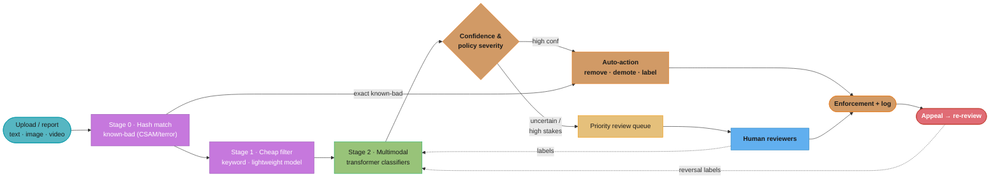
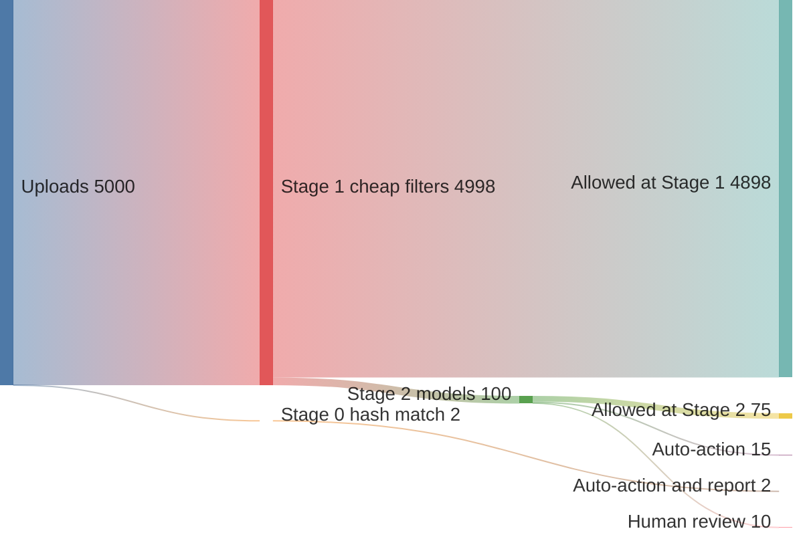
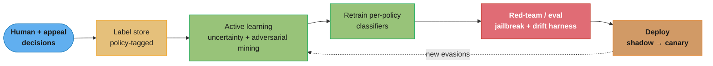

# Design a Harmful Content Detection System (Trust & Safety / Integrity)
## Intuition

> "Content moderation is airport security for a platform that admits a billion travelers a second: you cannot hand-search everyone, the threats keep changing their disguises, and both a missed weapon and a strip-searched grandmother are front-page failures."

**Key insight:** Harmful-content detection is not a classification problem, it is a *resourced decision system under adversarial, asymmetric, rare-positive conditions*. Three properties break every convention you carry over from a recommender: (1) **prevalence is tiny** — violating content is often 0.01–1% of volume, so accuracy is a useless metric and precision/recall/PR-AUC rule; (2) **error costs are policy-specific and asymmetric** — a false negative on child-safety or terrorism is catastrophic and legally mandated to be near-zero, while a false negative on spam is a nuisance, and a false positive that removes lawful speech is a different, censorship-shaped harm; (3) **the label distribution is adversarial and non-stationary** — bad actors mutate text (leetspeak, homoglyphs), images (crops, overlays), and behavior to evade whatever you deployed last week. The design that falls out is a **cascade** of cheap high-recall filters feeding expensive multimodal classifiers, which feed a **prioritized human-review queue**, closing a loop where human decisions become tomorrow's training labels.

Mental model: a functional funnel with a human backstop. Volume enters at the top; each stage is *cheaper-but-blunter above, costlier-but-sharper below*; the model's job is not to decide everything but to *decide the easy cases automatically and route the hard/high-stakes cases to humans*, whose finite review capacity is the binding constraint the whole system is engineered around.

Why this system exists: platforms are legally and existentially required to remove illegal and policy-violating content (CSAM, terrorism, incitement, fraud, spam) at a scale no human workforce can match, while *not* over-removing lawful content (which is its own reputational, regulatory — DSA, and user-trust harm). Meta, YouTube, TikTok, and Reddit each run integrity systems processing billions of items daily; the EU Digital Services Act and similar laws make the precision/recall operating point a compliance decision, not just an ML one. This is a very common senior/staff MLE and applied-scientist interview prompt.

Cross-read: this study reuses primitives from [imbalanced_data_and_leakage_traps](../imbalanced_data_and_leakage_traps/imbalanced_data_and_leakage_traps.md), [adversarial_ml_and_robustness](../adversarial_ml_and_robustness/adversarial_ml_and_robustness.md), [active_learning_and_weak_supervision](../active_learning_and_weak_supervision/active_learning_and_weak_supervision.md), and the LLM-side [guardrails_and_content_safety](../../llm/guardrails_and_content_safety/guardrails_and_content_safety.md) (for generative-content moderation), but centers the *integrity system design* those pieces plug into.

**Sibling study, not duplicated here:** [AI Content Moderation](../../llm/case_studies/design_ai_content_moderation.md) in the LLM section owns moderation *with* LLMs (policy-as-prompt classifiers, guardrail models, moderating generated output). This file owns the classic integrity stack: hash matching, the classifier cascade, per-policy thresholds against a human-review budget, and prevalence measurement.

**Vocabulary used throughout:**

| Term | Meaning here |
|---|---|
| Policy | One enforceable rule (hate, spam, child safety); each has its own model, threshold, cost matrix and legal regime |
| Prevalence | Share of *viewed* or *uploaded* content that violates a policy; measured by random-sample audit, never by counting removals |
| Proactive rate | Share of actioned content found by the system before any user reported it |
| Operating point | The (t_auto, t_review) threshold pair for one policy |
| Review budget | Human decisions per day reserved for a policy; the binding constraint (§2) |
| Perceptual hash | A hash that stays close under re-encoding, resizing or small edits (PhotoDNA, PDQ, TMK), unlike MD5/SHA-256 |
| Appeal reversal rate | Share of appealed actions overturned; the leading indicator of over-removal |

---

## 1. Requirements Clarification

**Functional requirements:**
- Classify user-generated content (text posts, comments, images, video, and behavior signals) against a **policy taxonomy** (e.g., hate, violence/incitement, harassment, self-harm, child safety, terrorism, spam, scams, nudity, misinformation).
- Take graded **enforcement actions**: allow, demote/reduce-reach, age-gate, warn/label, remove, ban account, or escalate to legal/NCMEC reporting (for child-safety).
- Route uncertain or high-stakes cases to a **human-review queue** with prioritization.
- Support an **appeals** path (user contests a removal → re-review → possible reversal), and feed reversals back as labels.
- Operate **proactively** (scan on upload, before/at distribution) and **reactively** (user reports).

**Non-functional requirements:**
- Latency: proactive scan must fit the publish path — soft-real-time (e.g., < 1 s for text, seconds for image/video first-pass); deep review can be async.
- Throughput: billions of items/day; peak bursts around events.
- Precision/recall targets are **per policy**, not global: child-safety and terrorism run at maximum recall (accept low precision, human-verify); spam runs at high precision (auto-action) to avoid annoying users.
- Auditability: every automated action must be explainable and logged for compliance and appeals.
- Adversarial robustness: withstand evasion (obfuscation, adversarial perturbation) and coordinated campaigns.

**Clarify with the interviewer (each changes the design):**
- Which policy area is the focus? (Child-safety uses hash-matching + mandated reporting; hate speech is a nuanced text problem; spam is behavioral.) A single "harmful content" model is a red flag — policies have different data, costs, and legal regimes.
- Proactive vs reactive emphasis, and what human-review capacity we have (it is the binding constraint).
- Modality mix (text-only vs image/video/multimodal).

**Out of scope:** the appeals *UI*, human-reviewer labor management, and the CDN/storage layer.

---

## 2. Scale Estimation

**Volume:**
- 5B content items/day uploaded (posts + comments + media). Peak ~100k items/sec.
- Prevalence of violating content: assume ~0.5% overall, but wildly policy-dependent (spam ~1–3%; terrorism/CSAM orders of magnitude rarer). At 0.5% of 5B = **25M violating items/day** to catch — and, crucially, ~4.975B benign items/day that a careless system will false-positive on.

**The false-positive arithmetic (the key estimation the interviewer wants):**
- Daily benign = 4.975B, daily violating = 25M. Suppose a classifier with 90% recall and a **1% false-positive rate** on benign content — a rate that sounds excellent in isolation.
- That is **49.75M wrongful flags/day**, dwarfing the 22.5M true positives it catches. This is the base-rate trap: at low prevalence even a "great" FPR floods review and over-removes.
- Note the two are not interchangeable. That same 1% FPR yields precision of 22.5M / (22.5M + 49.75M) = **31%**, not 99%. Confusing 1 − precision with the false-positive rate is the single most common error in this estimation; at 0.5% prevalence, hitting 99% precision requires an FPR near 0.005%, roughly 200x tighter.
- This is why thresholds are set per policy against a review budget, not to maximize F1.

**Human-review capacity (the binding constraint):**
- Say 20,000 reviewers, ~500 decisions/reviewer/day = **10M human decisions/day**.
- You can only route ~10M of 5B items (0.2%) to humans. So the models must *auto-decide* the overwhelming majority and spend the scarce human budget on the highest-value uncertain/high-stakes cases → prioritization is a core algorithm, not an afterthought.

**Compute:**
- Cheap first-pass (hash match, keyword/regex, lightweight text classifier): ~microseconds–ms per item, runs on everything → CPU fleet sized to 100k items/sec.
- Heavy multimodal transformer (image+text): only on the fraction that survives first-pass (say 2% = 100M/day) → GPU fleet.
- Hash databases (PhotoDNA/PDQ perceptual hashes for known child-safety material, GIFCT's shared hash database for terrorist content): millions of reference hashes, memory-resident matching.

**Worked scale math the interviewer will probe:**

| Quantity | Derivation | Result |
|---|---|---|
| Hash index memory | 10M reference hashes × (PDQ 256-bit + 64-bit id) | ~400 MB, so every matcher node holds a full copy |
| Hash comparisons | 100k items/s; a PDQ match is a Hamming-distance search, done with multi-index hashing (split 256 bits into 16 chunks, exact-match any chunk, verify candidates) | a few hundred candidate checks per item instead of 10M |
| Stage-2 GPU input | 2% of 5B = 100M items/day; at ~200 items/s per GPU for a multimodal model | ~6 GPUs at the daily mean, ~30-50 provisioned for 5x bursts and per-policy heads |
| Review budget split | 10M decisions/day: e.g. child safety 1M (never cut), hate/harassment 4M, scams 2M, everything else 3M | each policy's threshold is solved against *its* slice (§4.6) |
| Audit labels for prevalence | per policy, ~3,000 stratified labels/day (§4.7) | ~30k labels/day across 10 policies, 0.3% of the review budget, to measure what the other 99.7% misses |
| Appeals | assume 2% of 25M actions/day appealed | ~500k re-reviews/day that also come out of the review budget |

The last row is the one teams forget: every wrongful removal costs review capacity twice, once to remove it and once to reinstate it on appeal, which is why precision on auto-actioned policies buys back far more human time than it appears to.

---

## 3. High-Level Architecture



Content flows through progressively more expensive stages; a routing decision keyed on model confidence *and* policy severity sends high-confidence cases to auto-action and uncertain/high-stakes cases to a prioritized human queue, whose decisions (and appeal reversals) flow back as training labels.

The same funnel in daily volumes (millions of items, illustrative split consistent with §2: 2% of uploads reach Stage 2, 10M human decisions a day):



*Almost all volume exits at Stage 1, which is why its recall is monitored end to end (§9 Pitfall 4): the 4,898M items it allows are never seen by a model that could have caught them. The 10M human-review band is the thinnest flow and the one every threshold in §4.6 is solved against.*



The label flywheel: human/appeal decisions become labels, active learning mines the most informative and most adversarial examples, per-policy classifiers retrain, a red-team/drift harness gates deployment, and newly-observed evasions feed back into mining.

**Component inventory:**
- Stage 0 hash matcher: perceptual-hash lookup against known-bad databases (child-safety, terrorism) — exact-ish match, near-zero false positive, immediate action + mandated reporting.
- Stage 1 cheap filters: keyword/regex, language ID, a distilled text classifier, behavioral heuristics (account age, velocity).
- Stage 2 heavy models: per-policy multimodal transformers (text encoder + image/video encoder), calibrated.
- Router: per-policy thresholds + severity → auto-action vs queue.
- Review queue: prioritization by expected harm × reach × uncertainty.
- Label/retrain loop: active learning + adversarial mining, shadow/canary deploy.

---

## 4. Component Deep Dives

### 4.1 The policy taxonomy and per-policy operating points

There is no single "harmful" label. Each policy is its own binary (or graded) problem with its own prevalence, cost matrix, and legal regime.

```python
from dataclasses import dataclass


@dataclass(frozen=True)
class PolicyConfig:
    name: str
    # Cost of a miss (false negative) vs a wrongful action (false positive),
    # in comparable "harm units". These drive the threshold, not F1.
    cost_false_negative: float
    cost_false_positive: float
    auto_action_allowed: bool     # can the model act without a human?
    mandated_reporting: bool      # legal obligation (e.g., child-safety → NCMEC)


POLICIES = {
    # Catastrophic misses, legally mandated: run at MAX recall, human/hash verify,
    # never rely on a soft classifier alone.
    "child_safety": PolicyConfig("child_safety", 1_000_000, 50, False, True),
    "terrorism":    PolicyConfig("terrorism",      500_000, 100, False, True),
    # Serious but nuanced: model demotes, human confirms removal.
    "hate_speech":  PolicyConfig("hate_speech",       500, 30,  False, False),
    "harassment":   PolicyConfig("harassment",        300, 25,  False, False),
    # High-volume nuisance: auto-action at high precision is fine.
    "spam":         PolicyConfig("spam",                5,  2,  True,  False),
}
```

What those configurations turn into, as an illustrative operating-point sheet (the kind of one-page table Trust & Safety, Legal and ML sign off together, and that is versioned with the model):

| Policy | Detection path | Auto-action | Review slice (decisions/day) | Target | Primary metric |
|---|---|---|---|---|---|
| Child safety | Hash match + classifier to human | Hash match only, then mandated report | 1M, never reallocated | recall on known material ~100%; every classifier hit human-verified | time to report, recall on audit |
| Terrorism | Shared hash list + classifier to human | Hash match only | 0.5M | recall first | proactive rate, audit recall |
| Hate / harassment | Multilingual text + image models | Demote only; removal human-confirmed | 4M | precision of removals ≥ 90% | appeal reversal rate by slice |
| Scams | Behavioural + content models | Above t_auto | 2M | expected harm under budget (§4.6) | user reports per 10k views |
| Spam | Cheap filter + distilled model | Yes, at high precision | 0.3M | precision ≥ 98% | appeal reversal rate |

*Each row is a separate decision with a separate owner; changing one row's budget changes every other row's achievable recall, because these slices plus the policies not listed sum to the fixed 10M.*

### 4.2 Threshold selection under a review-capacity budget

The single most important quantitative decision: given a classifier's score distribution, where do you set the auto-action and review thresholds so you (a) never exceed human capacity and (b) minimize expected harm per policy?

**Broken approach — one global threshold to maximize F1:**

```python
# WRONG: a single 0.5 threshold (or a global F1-optimal one) across all policies.
# At 0.5% prevalence, F1 is dominated by the majority and the threshold either
# floods human review with false positives or misses catastrophic content.
def decide_naive(score: float) -> str:
    return "remove" if score >= 0.5 else "allow"
    # Ignores prevalence, cost asymmetry, and the fixed review budget.
```

**Correct approach — cost-and-capacity-aware thresholds per policy:**

```python
import numpy as np


def choose_thresholds(scores: np.ndarray, labels: np.ndarray,
                      policy: PolicyConfig, prevalence: float,
                      daily_volume: int, review_budget: int):
    """
    Pick (t_auto, t_review) to minimize expected harm subject to the human-review
    queue not exceeding `review_budget` items/day.

    - Items with score >= t_auto  -> auto-action (only if policy allows).
    - Items with t_review <= score < t_auto -> human review.
    - Items with score < t_review -> allow.

    We sweep candidate thresholds on a validation set with known labels, estimate
    expected cost = FN*cost_fn + FP*cost_fp scaled to daily volume, and reject any
    (t_auto, t_review) whose projected review volume blows the budget.
    """
    best = None
    grid = np.linspace(0.5, 0.999, 200)
    for t_review in grid:
        for t_auto in grid[grid >= t_review]:
            auto = scores >= t_auto
            review = (scores >= t_review) & (scores < t_auto)

            # projected daily review load (fraction routed to humans * volume)
            review_load = review.mean() * daily_volume
            if review_load > review_budget:
                continue  # infeasible: exceeds human capacity

            # if the policy forbids auto-action, "auto" bucket must also be reviewed
            if not policy.auto_action_allowed:
                review_load += auto.mean() * daily_volume
                if review_load > review_budget:
                    continue

            # expected cost on the validation sample, scaled to daily volume
            fn = ((~auto) & (~review) & (labels == 1)).mean()   # allowed but violating
            fp = (auto & (labels == 0)).mean()                  # auto-actioned but benign
            cost = (fn * policy.cost_false_negative
                    + fp * policy.cost_false_positive) * daily_volume

            if best is None or cost < best[0]:
                best = (cost, float(t_auto), float(t_review), review_load)
    return best  # (expected_cost, t_auto, t_review, projected_review_load)
```

This routine encodes the whole philosophy: for `child_safety` (auto-action forbidden, enormous FN cost) it will push `t_review` low to send almost everything suspicious to humans; for `spam` (auto-action allowed, tiny costs) it will set a high `t_auto` and route almost nothing to humans. The review budget is a hard constraint, so improving a model's precision *buys back* review capacity that can be spent on a harder policy — a systems-level tradeoff interviewers love.

### 4.3 The classifier cascade

```python
from dataclasses import dataclass


@dataclass
class Verdict:
    policy: str
    action: str          # allow | remove | demote | queue | report
    score: float
    stage: str
    reason: str


class ModerationCascade:
    """
    Stage 0: exact/perceptual hash match against known-bad DBs -> immediate action.
    Stage 1: cheap filters cull the obvious-benign majority (they never reach GPUs).
    Stage 2: heavy multimodal classifiers score survivors per policy.
    Router:  per-policy thresholds (Section 4.2) decide auto vs queue.
    """

    def __init__(self, hash_db, cheap_filters, heavy_models, thresholds):
        self.hash_db = hash_db
        self.cheap_filters = cheap_filters      # list of fast callables
        self.heavy_models = heavy_models        # dict policy -> model
        self.thresholds = thresholds            # dict policy -> (t_auto, t_review)

    def evaluate(self, item) -> list[Verdict]:
        # Stage 0 — hash match (child-safety / terrorism): highest precision path
        h = self.hash_db.match(item)
        if h is not None:
            return [Verdict(h.policy, "report" if POLICIES[h.policy].mandated_reporting
                            else "remove", 1.0, "hash", "known-bad hash match")]

        # Stage 1 — cheap filters: if nothing trips, exit early (the 98% common case)
        if not any(f(item) for f in self.cheap_filters):
            return [Verdict("none", "allow", 0.0, "cheap", "no signal")]

        # Stage 2 — heavy per-policy models (only on survivors: the expensive fleet)
        verdicts = []
        for policy, model in self.heavy_models.items():
            score = model.predict_proba(item)
            t_auto, t_review = self.thresholds[policy]
            cfg = POLICIES[policy]
            if score >= t_auto and cfg.auto_action_allowed:
                verdicts.append(Verdict(policy, "remove", score, "heavy", "high-confidence"))
            elif score >= t_review:
                verdicts.append(Verdict(policy, "queue", score, "heavy", "uncertain/high-stakes"))
        return verdicts or [Verdict("none", "allow", 0.0, "heavy", "below thresholds")]
```

### 4.4 Human-review queue prioritization

Human capacity is fixed, so the queue is ordered by *expected value of review*, not FIFO. A borderline post about to go viral is worth more review than a confidently-scored post with 3 views.

```python
def review_priority(item, score: float, policy: PolicyConfig,
                    predicted_reach: float) -> float:
    """
    Priority = expected harm prevented by reviewing now.

      expected_harm ≈ P(violating) * severity * reach
      uncertainty bonus: items near the decision boundary teach the model most
                         (active-learning value), so nudge them up.

    Confidently-benign, low-reach items sink to the bottom and may never be
    reviewed — which is correct: spending a scarce reviewer there is waste.
    """
    p_violating = score
    severity = policy.cost_false_negative
    uncertainty = 1.0 - abs(score - 0.5) * 2.0          # peaks at score=0.5
    return p_violating * severity * predicted_reach * (1.0 + 0.5 * uncertainty)
```

### 4.5 Adversarial robustness and the label flywheel

Evaders mutate content continuously, so the training set must be *actively* refreshed with the newest evasions, and the model hardened against perturbation.

```python
def normalize_adversarial_text(text: str) -> str:
    """
    First line of defense against text obfuscation: canonicalize homoglyphs,
    leetspeak, zero-width chars, and spacing tricks BEFORE the classifier sees
    the text. Evaders write 'fr€€ v!agr@' or 'h a t e' to dodge keyword and
    token models; normalization collapses these to their canonical form.
    """
    import unicodedata, re
    text = unicodedata.normalize("NFKC", text)          # homoglyph/width fold
    leet = str.maketrans({"0": "o", "1": "i", "3": "e", "4": "a",
                          "5": "s", "€": "e", "@": "a", "!": "i", "$": "s"})
    text = text.translate(leet)
    text = re.sub(r"(?<=\w)\s+(?=\w)", "", text) if len(text) < 40 else text  # de-space short strings
    return text.lower()


def mine_hard_negatives(recent_evasions, model, k: int = 5000):
    """
    Active-learning + adversarial mining: pull the human-confirmed violations that
    the CURRENT model scored LOW (it missed them) and the confirmed-benign items it
    scored HIGH (false positives). These boundary/adversarial cases are the highest
    signal for the next retrain — far more than random sampling.
    """
    scored = [(x, model.predict_proba(x), x.human_label) for x in recent_evasions]
    missed = [x for x, s, y in scored if y == 1 and s < 0.5]       # false negatives
    over   = [x for x, s, y in scored if y == 0 and s > 0.5]       # false positives
    return (missed + over)[:k]
```

The loop is the moat: because adversaries adapt, a *static* model decays fast (see Pitfall 2). Continuous mining of confirmed evasions + appeal reversals, retrained per policy, keeps the operating point valid. See [drift_monitoring_and_retraining.md](cross_cutting/drift_monitoring_and_retraining.md) and [active_learning_and_weak_supervision](../active_learning_and_weak_supervision/active_learning_and_weak_supervision.md).

### 4.6 Thresholds Under a Review Budget — Broken Then Fixed (runnable)

§4.2 shows the threshold routine in outline; this version is self-contained and runs with `numpy` only. It draws 1M validation scores for a Stage-2 classifier at 2% prevalence (the post-cascade rate on 100M items/day), then compares the F1-optimal single threshold against a budgeted (t_auto, t_review) search for two policies with very different cost matrices.

```python
from __future__ import annotations

from dataclasses import dataclass

import numpy as np
from numpy.typing import NDArray

FloatArr = NDArray[np.float64]
BoolArr = NDArray[np.bool_]


@dataclass(frozen=True)
class Policy:
    name: str
    cost_fn: float          # harm units per missed violation
    cost_fp: float          # harm units per wrongful action
    auto_allowed: bool
    review_budget: int      # human decisions/day reserved for this policy


@dataclass(frozen=True)
class Outcome:
    t_auto: float
    t_review: float
    auto_removed_benign: int
    missed: int
    review_load: int
    cost: float


def validation_scores(n: int, prevalence: float, rng: np.random.Generator) -> tuple[FloatArr, BoolArr]:
    y = rng.random(n) < prevalence
    logit = np.where(y, rng.normal(1.0, 1.5, n), rng.normal(-4.0, 1.3, n))
    return 1.0 / (1.0 + np.exp(-logit)), y


def evaluate(s: FloatArr, y: BoolArr, p: Policy, t_auto: float, t_review: float, scale: float) -> Outcome:
    auto = s >= t_auto
    review = (s >= t_review) & ~auto
    if not p.auto_allowed:              # forbidden auto-action means humans see it too
        review, auto = review | auto, np.zeros_like(auto)
    missed = int(((~auto) & (~review) & y).sum() * scale)
    fp = int((auto & ~y).sum() * scale)
    load = int(review.sum() * scale)
    return Outcome(t_auto, t_review, fp, missed, load, missed * p.cost_fn + fp * p.cost_fp)


# BROKEN: one threshold chosen to maximise F1, applied as "remove if score >= t".
def f1_threshold(s: FloatArr, y: BoolArr) -> float:
    best_t, best_f1 = 0.5, -1.0
    for t in np.linspace(0.05, 0.95, 91):
        pred = s >= t
        tp = (pred & y).sum()
        f1 = 2 * tp / max(pred.sum() + y.sum(), 1)
        if f1 > best_f1:
            best_t, best_f1 = float(t), float(f1)
    return best_t


# FIX: minimise expected harm subject to the policy's review budget.
def budgeted_thresholds(s: FloatArr, y: BoolArr, p: Policy, scale: float) -> Outcome:
    grid = np.quantile(s, np.linspace(0.90, 0.99999, 120))
    best: Outcome | None = None
    for t_review in grid:
        for t_auto in [*grid[grid >= t_review], 1.01]:
            o = evaluate(s, y, p, float(t_auto), float(t_review), scale)
            if o.review_load <= p.review_budget and (best is None or o.cost < best.cost):
                best = o
    assert best is not None, "budget too small for any threshold pair"
    return best


if __name__ == "__main__":
    rng = np.random.default_rng(0)
    daily_volume, sample = 100_000_000, 1_000_000
    s, y = validation_scores(sample, prevalence=0.02, rng=rng)
    scale = daily_volume / sample
    for p in (Policy("hate_speech", 500, 30, False, 2_000_000),
              Policy("spam", 5, 2, True, 300_000)):
        t = f1_threshold(s, y)
        naive = evaluate(s, y, Policy(p.name, p.cost_fn, p.cost_fp, True, 0), t, t, scale)
        fixed = budgeted_thresholds(s, y, p, scale)
        for name, o in (("F1 remove", naive), ("budgeted", fixed)):
            print(f"{p.name:>11} {name:>9}: auto-removed benign={o.auto_removed_benign:>9,} "
                  f"missed={o.missed:>9,} review/day={o.review_load:>9,} harm={o.cost:,.0f}")
```

```
hate_speech F1 remove: auto-removed benign=  198,700 missed=  397,500 review/day=        0 harm=204,711,000
hate_speech  budgeted: auto-removed benign=        0 missed=  351,300 review/day=1,933,600 harm=175,650,000
       spam F1 remove: auto-removed benign=  198,700 missed=  397,500 review/day=        0 harm=2,384,900
       spam  budgeted: auto-removed benign=  227,500 missed=  300,800 review/day=  252,100 harm=1,959,000
```

What the numbers teach:

- **The F1 threshold is the same for both policies**, because F1 knows nothing about costs, legal regime or the review budget. For hate speech it auto-removes ~199k benign posts a day on a policy where auto-removal is not allowed at all; that is the over-removal headline in §9.
- **For hate speech the fix moves work to humans, not to the model:** zero wrongful auto-removals, 46k fewer misses a day, and 1.93M of the 2M reserved reviews used. The binding constraint is the budget, exactly as §2 predicted.
- **For spam the fix removes *more* benign items (227k vs 199k) and is still right,** because a missed scam costs 2.5x a wrongful spam removal and the budgeted search trades along that ratio. "Fewer false positives" is not a universal goal; minimum expected harm under the budget is.
- **Most of the remaining hate-speech misses are a model problem, not a threshold problem.** 351k misses on ~2M daily violations is what a classifier with this score overlap delivers; the next lever is a better model (or more review budget), and the budgeted search tells you what each unit of either is worth.

The harm weights (500, 30, 5, 2) are policy inputs from Trust & Safety and Legal, not ML hyperparameters; changing them is a governance decision that should be versioned like code. The scores fed to this search must be calibrated, or the chosen thresholds stop meaning the same thing after the next retrain; per-policy isotonic calibration and its monitoring are covered in [Model Calibration and Thresholding](cross_cutting/model_calibration_and_thresholding.md).

### 4.7 Measuring What You Miss: Stratified Prevalence Audits (runnable)

A proactive system only sees what it catches, so recall needs an independent estimate: humans label a random sample of what the system *allowed*. Violations in the allowed pool are rare and cluster just under the action threshold, so a uniform sample spends most of its labels on obviously benign items. Stratifying by score and oversampling the strata where misses live gives a tighter estimate for the same label budget, and reweighting each stratum by its size keeps it unbiased.

```python
from __future__ import annotations

import numpy as np
from numpy.typing import NDArray

FloatArr = NDArray[np.float64]
BoolArr = NDArray[np.bool_]


def allowed_pool(n: int, rng: np.random.Generator) -> tuple[FloatArr, BoolArr]:
    """Items the system ALLOWED. Misses hide here, concentrated just under the threshold."""
    s = rng.beta(0.6, 12.0, n)                                # most allowed items score near 0
    p_violating = np.minimum(0.0003 + 1.5 * s ** 2, 1.0)     # misses cluster at higher scores
    return s, rng.random(n) < p_violating


# NAIVE: a uniform random audit of the allowed pool. Unbiased, but noisy.
def uniform_audit(s: FloatArr, y: BoolArr, k: int, rng: np.random.Generator) -> float:
    idx = rng.choice(len(s), size=k, replace=False)
    return float(y[idx].mean() * len(s))


# BETTER: stratify by score, spend more labels where misses live, reweight by stratum size.
def stratified_audit(s: FloatArr, y: BoolArr, k: int, rng: np.random.Generator,
                     edges: tuple[float, ...] = (0.0, 0.02, 0.05, 0.10, 0.20, 1.01),
                     share: tuple[float, ...] = (0.10, 0.15, 0.20, 0.25, 0.30)) -> float:
    total = 0.0
    for lo, hi, frac in zip(edges[:-1], edges[1:], share):
        members = np.flatnonzero((s >= lo) & (s < hi))
        take = min(len(members), max(1, int(k * frac)))
        sample = rng.choice(members, size=take, replace=False)
        total += y[sample].mean() * len(members)
    return total


if __name__ == "__main__":
    rng = np.random.default_rng(4)
    s, y = allowed_pool(5_000_000, rng)
    truth = int(y.sum())
    for name, fn in (("uniform", uniform_audit), ("stratified", stratified_audit)):
        est = np.array([fn(s, y, 3_000, rng) for _ in range(200)])
        lo, hi = np.percentile(est, [5, 95])
        print(f"{name:>10}: true misses={truth:,}  mean est={est.mean():,.0f}  "
              f"90% of audits within [{lo:,.0f}, {hi:,.0f}]")
```

```
   uniform: true misses=43,632  mean est=44,317  90% of audits within [31,583, 58,333]
stratified: true misses=43,632  mean est=42,629  90% of audits within [34,211, 50,842]
```

Both estimators centre on the truth; the stratified one narrows the range of daily estimates from ~26.8k to ~16.6k misses with the same 3,000 labels, which is the gain you would otherwise buy by labelling ~2.6x as many items uniformly (interval width scales with 1/√n). The real broken version is the one in §9 Pitfall 6: no audit at all, reporting "removed 10M items" with no denominator. Two operational rules: refresh the stratum boundaries when the model changes (a new model moves where misses live), and keep the audit labels out of the training set's evaluation slice, or the audit stops being independent of the thing it measures. Recall then follows as `caught / (caught + estimated misses)`.

### 4.8 Behavioural Features and Point-in-Time Correctness

Content alone misses coordinated abuse; account age, posting velocity, prior strikes and graph features (shared devices, shared payment instruments) carry much of the signal for spam and scams. These features change by the minute and are the classic leakage source in integrity training data: a training row for a post made at 10:00 must use the account's strike count *as of 10:00*, not the count after this very post was actioned at 10:05. Join behavioural features to labels with an as-of join on the post timestamp, and log the served feature vector at decision time so the retrain uses exactly what the router saw. The mechanics are in [Feature Store and Point-in-Time Correctness](cross_cutting/feature_store_and_point_in_time_correctness.md); the integrity-specific trap is that the label itself (the enforcement action) writes back into the features (strike count, account status), so a leak here teaches the model "accounts with a strike from this post are violators", which is circular.

### 4.9 Ordering the Review Queue — Broken Then Fixed (runnable)

§4.4 gives the priority formula; this simulation shows how much it is worth. One day's review queue holds 200,000 items with calibrated violation probabilities, three severity tiers (70% at 1, 25% at 10, 5% at 100) and heavy-tailed reach (Pareto, so a few items would be seen by thousands). Reviewers can clear 50,000. Harm prevented is severity × views avoided for each violating item reviewed.

```python
from __future__ import annotations

import numpy as np
from numpy.typing import NDArray

FloatArr = NDArray[np.float64]


def day_of_queue(n: int, rng: np.random.Generator) -> dict[str, FloatArr]:
    """Items routed to review in one day. Reach is heavy-tailed: a few go viral."""
    score = rng.beta(2.0, 3.0, n)                              # calibrated P(violating)
    severity = rng.choice([1.0, 10.0, 100.0], n, p=[0.70, 0.25, 0.05])
    reach = rng.pareto(1.2, n) * 50.0 + 10.0                   # views if left up
    arrival = np.sort(rng.uniform(0.0, 24.0, n))               # hour of arrival
    violating = rng.random(n) < score
    return {"score": score, "severity": severity, "reach": reach,
            "arrival": arrival, "violating": violating.astype(float)}


def harm_prevented(q: dict[str, FloatArr], order: np.ndarray, capacity: int) -> float:
    """Reviewing an item removes it if violating; harm = severity x views avoided."""
    reviewed = order[:capacity]
    return float((q["violating"][reviewed] * q["severity"][reviewed] * q["reach"][reviewed]).sum())


# BROKEN: first in, first out. Capacity runs out on whatever arrived early.
def fifo(q: dict[str, FloatArr]) -> np.ndarray:
    return np.argsort(q["arrival"], kind="stable")


# FIX: expected harm prevented = P(violating) x severity x predicted reach.
def expected_harm(q: dict[str, FloatArr]) -> np.ndarray:
    return np.argsort(-(q["score"] * q["severity"] * q["reach"]))


if __name__ == "__main__":
    rng = np.random.default_rng(9)
    q = day_of_queue(200_000, rng)
    capacity = 50_000                                          # reviewers clear 25%
    total = float((q["violating"] * q["severity"] * q["reach"]).sum())
    for name, fn in (("fifo", fifo), ("expected-harm", expected_harm)):
        got = harm_prevented(q, fn(q), capacity)
        print(f"{name:>13}: harm prevented = {got / total:.1%} of the day's total")
```

```
         fifo: harm prevented = 25.5% of the day's total
expected-harm: harm prevented = 95.9% of the day's total
```

FIFO prevents exactly the share of harm you would expect from reviewing a random quarter of the queue; ordering by expected harm prevents 96% of it with the same 50,000 decisions, because severity × reach is so concentrated that a small fraction of items carries most of the harm. The toy overstates the real gain in one way and understates it in another. It uses *true* reach, while production predicts it (virality models are noisy, so the real gain is lower); and it ignores time, while in production an item reviewed late has already been seen (so delaying high-reach items under FIFO is worse than shown). Two production rules follow: never let a priority queue starve low-priority items forever (age the priority, or reserve a slice of capacity for the oldest items so appeals and low-reach reports still get answered), and keep child-safety in its own queue with its own capacity, outside any formula that trades it against reach.

---

## 5. Design Decisions & Tradeoffs

**Decision 1: Cascade vs one big multimodal model on everything.**
Running the heavy transformer on all 5B items/day is prohibitively expensive and unnecessary — 98%+ is obviously benign. The cascade spends compute proportional to suspicion: hash match and cheap filters cull the majority; only survivors hit GPUs. Cost of the cascade: added system complexity and the risk that a too-aggressive cheap filter drops true positives before the good model sees them (monitor stage-1 recall).

**Decision 2: Precision-first vs recall-first — decided per policy, never globally.**

| Policy | Operating point | Rationale |
|--------|-----------------|-----------|
| Child safety / terrorism | Max recall, auto-action forbidden, hash + human verify | Catastrophic, legally mandated; a miss is unacceptable; false positives are tolerable because humans confirm |
| Hate / harassment | High recall to demote, human-confirm removal | Nuanced, context-dependent; over-removal is a free-speech harm |
| Spam / scams | High precision, auto-action | Huge volume; a wrong removal annoys but a miss is low-harm; humans can't scale here |

A single global threshold is the classic wrong answer — state that costs and legal regimes differ by policy.

**Decision 3: Proactive (scan on upload) vs reactive (user reports).**
Proactive catches harm before it spreads (essential for the worst content) but scans everything (cost) and risks over-removal at scale. Reactive is cheap and high-precision (a human already flagged it) but slow — harm has already reached an audience. Production uses both: proactive for high-severity policies, reactive + proactive-demotion for nuanced ones.

**Decision 4: Auto-action vs human-in-the-loop.**
Auto-action scales but over-removes and is hard to appeal fairly; humans are accurate and context-aware but capacity-bound and exposed to traumatic content. The router splits by confidence × severity: auto-act only where precision is high and policy allows; route the rest to a prioritized queue. The review budget is the hard constraint that makes model precision improvements *fungible* across policies.

**Decision 5: Handling label noise and reviewer disagreement.**
Human labels are noisy and policies are subjective (inter-annotator agreement on hate speech can be low). Use multiple reviewers on ambiguous items, track per-reviewer calibration, and treat appeal reversals as strong corrective labels. Do not train on single-reviewer labels for subjective policies without agreement filtering — noisy labels cap model quality and bake in reviewer bias (a fairness risk; see [responsible_ai_fairness_and_explainability.md](cross_cutting/responsible_ai_fairness_and_explainability.md)).

**Decision 6: Where LLM-based classifiers fit.**
LLM judges and guardrail models can apply a written policy zero-shot and explain their decision, which makes them strong for *new* policies and for pre-sorting the human queue. They are a poor fit for the high-volume stages: at ~100k items/s, even a small LLM per item is orders of magnitude more expensive than a distilled classifier, and their decisions are harder to calibrate per policy. The split that follows: distilled classifiers for Stage 1 and the bulk of Stage 2, an LLM (or a few-shot model in the FSL style) on the uncertain band and on newly defined policies until enough labels exist to distil a classifier, and the LLM's rationale attached to the review ticket to cut reviewer time. Generated-content moderation is a different problem and lives in the [AI Content Moderation](../../llm/case_studies/design_ai_content_moderation.md) study.

**Decision 7: Hash match first, classifier second, for known content.**
For content that has been seen and adjudicated before, a perceptual-hash match is cheaper (microseconds), more precise (near-zero false positives at a tight Hamming threshold) and legally better understood than any classifier. Classifiers exist for content that is *new*. The design consequence is ordering, not choice: every confirmed violation that is likely to be re-uploaded is hashed and added to Stage 0, so the classifier's job shrinks over time to genuinely novel content, and the hash list needs the same governance as a model (provenance, dispute path, kill switch; §8 runbook 5).

---

## 6. Real-World Implementations

**Meta (Integrity / "Community Standards Enforcement").** Publishes quarterly prevalence and proactive-detection-rate metrics per policy area — a public artifact of the per-policy operating-point philosophy (proactive detection >99% for some areas, far lower for nuanced ones). Uses cross-lingual multimodal classifiers and a large human-review workforce. Two distinct systems are worth keeping straight: **WPIE (Whole Post Integrity Embeddings)** is the earlier BERT/XLM-based service that produces a single holistic representation of a whole post (text, caption, image, URL together); **Few-Shot Learner (FSL, announced December 2021)** is a later "large-scale, multimodal, multilingual, zero or few-shot model" that Meta says can adapt to new or evolving types of harmful content "within weeks instead of months", works in more than 100 languages, and does not require model fine-tuning; its "Entailment Few-Shot Learning" approach turns a class label into a natural-language policy description and asks whether the post entails it. FSL consumes a pooled WPIE embedding as one input; they are not the same thing. The design lesson for §4.5: the bottleneck FSL attacks is the weeks of labelling a new policy needs, not classifier accuracy on an old one.

**YouTube.** Combines automated flagging with human review; publishes a Community Guidelines enforcement report showing that the majority of removals are first flagged by automated systems, then a large fraction removed before any views — the proactive-scan design. Uses hash-matching (Content ID's cousin for known-bad) and classifier cascades.

**PhotoDNA / NCMEC.** Child-safety detection relies on perceptual-hash matching against known-CSAM hash databases, with mandated reporting to NCMEC. PhotoDNA was developed by Microsoft Research with Hany Farid of Dartmouth College, beginning in 2009; NCMEC maintains hash databases in the PhotoDNA format and in others including PDQ, MD5 and SHA-1. The volume this pipeline feeds is public: NCMEC's CyberTipline received 36.2 million reports of suspected child sexual exploitation in 2023, 20.5 million in 2024 and 21.3 million in 2025. This is the archetypal Stage-0 hash matcher: near-zero false positive, immediate action, legal obligation — never a soft classifier acting alone. Note the design consequence of tens of millions of reports a year: the *reporting* path (evidence preservation, report assembly, escalation of urgent cases) is a production system with its own SLOs, not an afterthought of the classifier.

**GIFCT (Global Internet Forum to Counter Terrorism).** GIFCT runs a hash-sharing database (HSDB) that lets member companies identify and share signals of terrorist and violent extremist content without sharing user data. It supports both cryptographic hashes (MD5, SHA-256) for exact matches and perceptual hashes (PDQ for images, TMK for video) for near-duplicates, lets members attach labels (content type, associated entity, behavioural indicators), and includes a feedback mechanism where members mark whether they agree with a label and whether the content meets inclusion criteria. That feedback loop is the cross-company version of the appeal-reversal signal in §8: a shared known-bad list without a dispute path accumulates wrong entries that every member then enforces.

**Jigsaw (Google) — Perspective API.** A productionized toxicity/hate text classifier exposed as an API; notable for its published work on *bias in toxicity models* (models over-flagging text mentioning identity terms) and for running the 2019 Kaggle competition "Jigsaw Unintended Bias in Toxicity Classification", which made identity-subgroup bias an explicit evaluation target rather than an afterthought — a concrete example of the fairness pitfall in §9.

**Reddit / Discord.** Blend automated filters (AutoMod rules = cheap keyword/heuristic stage) with human moderators (community + admin) — the cascade + human-in-the-loop pattern at a different scale, emphasizing configurable per-community thresholds.

---

## 7. Technologies & Tools

| Tool | Use case | Advantage | Limitation |
|------|----------|-----------|------------|
| PhotoDNA / perceptual hashing | Known-bad image match (Stage 0) | Near-zero FP, instant, legally accepted | Only catches known content; evadable by heavy edits |
| PDQ (images) / TMK (video) perceptual hashes | Cross-platform hash sharing (GIFCT HSDB) and near-duplicate matching | Open formats supported by the shared databases; robust to re-encoding | Hamming threshold must be tuned per list; looser thresholds raise false matches fast |
| Multimodal transformers (CLIP-style, text+image encoders) | Stage-2 per-policy classifiers | Context-aware, handles novel content | GPU cost; needs labeled data; adversarially attackable |
| Distilled/lightweight text models (fastText, DistilBERT) | Stage-1 cheap filter | ms latency, runs on all volume | Lower precision; misses nuance |
| LLM-as-judge / guardrail models | Nuanced policy reasoning, generated-content moderation | Zero/few-shot on new policies; explanations | Latency/cost; prompt-injection risk (see LLM guardrails) |
| Vector search + clustering | Coordinated-campaign / near-duplicate detection | Finds evasion variants and rings | Needs good embeddings; tuning |
| Streaming (Flink/Kafka) | Behavioral signals, velocity, virality prediction for queue priority | Real-time reach estimates | Operational complexity |
| Human-review tooling + active learning (Snorkel-style) | Label generation, prioritization | Turns scarce human time into best labels | Reviewer wellbeing; label noise |

---

## 8. Operational Playbook

### Eval pipeline
- **Per-policy PR curves** on held-out, human-adjudicated golden sets (never accuracy). Report precision at the chosen recall, and PR-AUC.
- **Prevalence estimation:** sample-and-label random traffic to estimate how much violating content the system is *missing* (proactive systems only measure what they catch — you need an independent prevalence audit).
- **Appeal reversal rate:** high reversal rate = over-removal (precision problem); track per policy and per demographic slice (fairness).
- **Adversarial eval / red-team:** a maintained suite of evasion attempts (obfuscated text, perturbed images, jailbreaks) run every deploy. See [red_team_eval_harness.md](../../llm/case_studies/cross_cutting/red_team_eval_harness.md) analog for generative surfaces.

### Observability
- Stage-by-stage funnel volumes and drop rates (a cheap-filter change that halves Stage-2 volume may be silently dropping true positives).
- Review queue depth and SLA (are high-priority items reviewed within target?).
- Score-distribution drift per policy (shift = new evasion pattern or distribution change).
- Reviewer agreement / calibration monitoring.
- Realised vs projected review load per policy for 24 hours after every model or threshold change; a gap above ~10% means calibration or thresholds drifted (§11).
- Hash-list health: matches per newly added hash in its first hour (a hash matching 10,000 items in an hour is either a viral re-upload or a bad entry, and needs a human look either way).
- Per-group false-positive rate on the identity-term slices, refreshed from the daily audit labels, alerting when the gap to the overall rate exceeds the 1.25x gate.
- Time-to-action for high-severity items at p50 and p99, since harm accrues with views while an item waits.
- Stage-0 match latency and index version per matcher node, so a node serving a stale hash list is visible.

### Experiments and release gates
You cannot A/B test "stop removing child-safety content for 50% of users", so experimentation here is constrained by policy severity:
- **Severe policies (child safety, terrorism):** no live holdout ever. New models run in shadow against the current one; disagreements go to expert reviewers, and the challenger ships only if it catches everything the champion catches on the golden set plus the disagreement set.
- **Nuanced policies (hate, harassment):** shadow first, then a small live ramp where the *new* model's extra actions are routed to human review rather than auto-actioned, so the experiment cannot over-remove. Measure precision of the new actions, appeal reversal rate, and per-group false-positive rate.
- **Demotion and ranking interventions (borderline content, reduced reach):** ordinary randomized experiments are fine, with prevalence-of-views and user reports as metrics. Randomize by user, check sample-ratio mismatch, and run at least a week to cover weekly content cycles. The statistics are in [Experimentation and Online Evaluation](cross_cutting/experimentation_and_online_evaluation.md).

| Gate | Threshold (example) | Owner |
|---|---|---|
| Golden-set recall per policy | ≥ champion; never lower on child safety or terrorism | ML + T&S policy |
| Precision of auto-actions on the golden set | ≥ 98% for spam auto-removal | ML |
| Per-group FPR gap (identity-term slices) | ≤ 1.25x the overall FPR | Responsible AI |
| Projected review load at chosen thresholds | ≤ the policy's budget (§4.6) | T&S operations |
| Red-team evasion suite | no regression on any obfuscation family | Red team |

### Incident runbooks
1. **Evasion wave (recall collapse on a policy):** confirmed violations scoring low. Mitigate: lower t_review to flood human review temporarily; hotfix normalization rules; emergency-mine and retrain. Root-cause the new obfuscation.
2. **Over-removal spike (appeal reversals surge):** a retrain or threshold change raised false positives. Mitigate: roll back threshold/model; audit the change on the golden set; check for a poisoned/biased label batch.
3. **Review queue overflow:** priority queue exceeds capacity. Mitigate: raise auto-action thresholds on low-severity policies to free capacity for high-severity; add surge reviewers; never drop child-safety items.
4. **Coordinated campaign:** sudden burst of near-duplicate violating content. Mitigate: cluster by embedding + hash the variant; add to Stage-0 known-bad; rate-limit the source accounts.
5. **Hash-list false positive:** a benign meme lands in a shared known-bad list and Stage 0 removes it at full volume within an hour. Mitigate: pull the hash from the local copy immediately (Stage 0 must support a per-hash kill switch), restore actioned items in bulk, and file the dispute through the list's feedback mechanism. Root-cause: why a single-source hash reached auto-action without a local confirmation step.

---

## 9. Common Pitfalls & War Stories

*These are illustrative composites of recurring failure patterns, not accounts of specific public incidents. The mechanisms are real; the quoted precision figures, agreement scores and recall estimates are representative and should not be quoted as measured public record. The one exception is Pitfall 3, whose identity-term bias effect is documented publicly for early toxicity models (Jigsaw/Perspective).*

**Pitfall 1: Chasing accuracy / a global threshold at low prevalence.** A team reported "99.5% accuracy" on a hate-speech model. At 0.5% prevalence, a model that labels *everything benign* scores 99.5% accuracy while catching zero violations. When shipped with a single global 0.5 threshold, it simultaneously missed nuanced hate speech and false-positived on reclaimed-slur and counter-speech posts, triggering an over-removal backlash. Fix: PR-AUC per policy, prevalence audits, and per-policy cost-and-capacity thresholds (§4.2, runnable in §4.6). Accuracy is banned from the dashboard. Impact at this study's scale: the §4.6 simulation puts the F1-style single threshold at ~199k wrongful auto-removals a day on a policy that forbids auto-removal, ~6M a month, each one a potential appeal that costs review capacity a second time.

**Pitfall 2: The static-model decay / adversarial treadmill.** A spam classifier deployed at 98% precision degraded to ~80% within weeks as spammers A/B-tested obfuscations against it (they can query the platform and see what gets through — the model is effectively a public oracle). The team had no retraining loop, treating moderation like a fraud-*free* classification task. Fix: continuous adversarial mining of confirmed evasions + appeal reversals, per-policy retrain cadence, and text normalization as a pre-filter. Moderation is inherently non-stationary; a model without a flywheel is already dying. Impact: at an assumed 50M spam auto-actions a day, falling from 98% to 80% precision moves wrongful removals from ~1M to ~10M a day, and the appeal queue that follows eats capacity reserved for harder policies.

**Pitfall 3: Fairness — biased toxicity models over-flagging identity terms.** A toxicity classifier learned to associate identity terms ("gay", "muslim", "black") with toxicity because its training data over-represented those terms in toxic contexts (documented publicly for early toxicity models). It then suppressed benign posts *by and about* those communities — algorithmic censorship of the groups the policy meant to protect. Fix: measure per-group false-positive rates, debias the training distribution, add counter-speech and reclaimed-language examples, and audit reversal rates by slice. See [responsible_ai_fairness_and_explainability.md](cross_cutting/responsible_ai_fairness_and_explainability.md).

**Pitfall 4: Cheap-filter silently eating true positives.** To cut GPU cost, a team tightened the Stage-1 filter so fewer items reached the heavy model. Stage-2 precision looked *better* (the survivors were more obviously bad) while overall recall quietly fell — the true positives that looked benign to the cheap filter never reached the good model and were auto-allowed. Fix: monitor *end-to-end* recall via prevalence audits, not stage-local metrics; periodically sample cheap-filter "allow" decisions through the heavy model. Impact: if the tightened filter drops just 2% of the 25M daily violations before Stage 2, that is 500k violating items a day auto-allowed with no model ever looking at them, while every Stage-2 dashboard improves.

**Pitfall 5: Training on noisy single-reviewer labels for subjective policies.** A harassment model was trained on single-reviewer labels; inter-annotator agreement was ~0.6. The model plateaued and inherited individual reviewers' idiosyncratic calls, producing inconsistent enforcement. Fix: multi-review ambiguous items, filter to agreed labels for training, track reviewer calibration, and treat appeal reversals as gold corrections.

**Pitfall 6: No prevalence audit → flying blind on misses.** A platform proudly reported "removed 10M spam posts" with no denominator. Because a proactive system only measures what it catches, leadership could not tell whether that was 90% or 30% of actual spam. A random-sample labeling audit revealed recall was ~40%. Fix: independent prevalence estimation via random-traffic sampling is the only way to measure false negatives; §4.7 shows how stratifying the audit by score narrows the estimate for the same label budget. Impact: at 40% recall, "removed 10M" means ~15M violating items stayed up over the same period.

**Pitfall 7: The strike count that leaked the label.** A scam classifier used "number of enforcement strikes on the account" as a feature, read at training time from the current account table. For every training post that had been actioned, the strike created *by that action* was already in the feature, so the model learned "has a strike → violating" and reported 0.97 PR-AUC offline. In production, a first-time scammer has zero strikes at posting time and the model's recall on new accounts collapsed to roughly half its offline figure. Impact: new-account scams are the bulk of scam volume, so roughly half of them passed Stage 2 until a PIT audit found it six weeks later. Fix: as-of joins on the post timestamp for every behavioural feature and decision-time feature logging (§4.8).

---

## 10. Capacity Planning

**Primary constraint: human-review budget, not compute.**

```
Volume: 5B items/day, peak ~100k items/sec
Reviewers: 20,000 × ~500 decisions/day = 10M human decisions/day (0.2% of volume)

Cascade compute:
  Stage 0 (hash match): runs on 100% → 5B/day. In-memory perceptual-hash index of
      millions of reference hashes (~400 MB); multi-index Hamming match ~microseconds. CPU fleet sized to 100k items/sec.
  Stage 1 (cheap filter): runs on 100% → ms/item. CPU fleet, ~100k items/sec.
  Stage 2 (heavy multimodal): runs on survivors ≈ 2% = 100M/day ≈ 1,200/sec avg,
    bursts higher. GPU cost ~ (1,200/sec)/(per-GPU throughput ~200 items/sec)
    ≈ 6 GPUs steady, provision ~30-50 for burst + per-policy models.

Review-budget math (the real bottleneck):
  If a model improvement lifts spam precision so 5M fewer spam items need human review,
  that 5M/day capacity can be REALLOCATED to a harder policy (e.g., hate speech).
  => Model precision is fungible with review capacity. This is the core capacity lever.

Surge planning (breaking-news event → 3-5× on some policies):
  Pre-provision reviewer surge pool; auto-raise low-severity auto-action thresholds
  to free human capacity; NEVER divert capacity away from child-safety.
```

The interview-defining point: unlike the recommender studies where GPU scoring dominates, here **compute is cheap and human review is the scarce resource** — so the objective of the ML system is largely *to conserve and best-allocate human attention*.

**Reviewer capacity, worked:**

```
Decisions per reviewer: 500/day assumes ~50 s per item over ~7 productive hours.
  Child-safety or graphic-violence items take longer and are capped per reviewer
  per shift for wellbeing, so effective capacity on those queues is ~200-300/day.
Cost: at an assumed fully loaded $40k/year per reviewer, 20,000 reviewers
  = $800M/year, ~$0.22 per decision. A Stage-2 GPU fleet of 50 GPUs at ~$2/GPU-hour
  is under $1M/year. One percent more precision on a high-volume policy is worth
  more than the whole GPU fleet.
Queue SLA: if p99 time-to-review for high-severity items must be < 1 hour,
  the high-severity queue must be sized for the PEAK hour, not the daily mean:
  peak/mean ~2x in most regions -> reserve ~2x the mean hourly arrival as capacity.
Appeals: ~500k/day (§2) at ~$0.22 = ~$110k/day spent re-reviewing earlier decisions.
```

**What changes at 10x volume (50B items/day):** compute scales linearly and stays cheap; human review cannot. At a fixed 20,000 reviewers the routed share falls from 0.2% to 0.02%, so every policy's t_review rises and the §4.6 search will push nuanced policies toward demotion instead of removal. The system-level answers are not more reviewers but higher-precision models, few-shot policy adaptation (Meta's FSL is exactly this lever), clustering so one decision covers many near-duplicates, and LLM-assisted triage that pre-sorts the queue.

---

## 11. Interview Discussion Points

**Q: Why is accuracy the wrong metric for content moderation?**
**Short:** At 0.01-1% prevalence a model that allows everything scores over 99% accuracy while catching nothing; use per-policy precision, recall and PR-AUC plus independent prevalence audits.
Because violating content is rare — often 0.01–1% prevalence — so a model that labels everything benign scores 99%+ accuracy while catching nothing. At low base rates, accuracy is dominated by the majority class and hides both misses and false positives. You use per-policy precision/recall and PR-AUC, report precision at a chosen recall, and run independent prevalence audits (random-sample labeling) to estimate the false negatives a proactive system cannot otherwise see.

**Q: Why can't you use a single classifier with one threshold for all harmful content?**
**Short:** Policies differ in prevalence, cost of a miss, cost of a wrongful removal and legal regime, so each needs its own operating point solved against a shared review budget.
Because policies differ in prevalence, cost asymmetry, and legal regime. Child-safety and terrorism have catastrophic, legally-mandated miss costs and run at maximum recall with hash-matching and human verification (auto-action forbidden); spam is high-volume and low-harm, so high-precision auto-action is appropriate; hate speech is nuanced and context-dependent, so over-removal is itself a harm. A single global threshold is optimal for none of them — you set per-policy operating points against per-policy cost matrices and a shared review budget.

**Q: You have a classifier at 99% precision and 90% recall. Is that good enough to auto-remove?**
**Short:** It depends on prevalence, policy and review budget: first check the number really is precision, since a 1% false-positive rate at 0.5% prevalence is only about 31% precision.
It depends entirely on prevalence and policy. First check the arithmetic: at 0.5% prevalence over 5B items, ~4.975B are benign, so 99% precision at 90% recall implies only ~227k false positives/day and a false-positive rate near 0.005% — that is a much stronger claim than it sounds, and it is worth confirming the number is really precision and not 1 minus the FPR. Slip to a 1% FPR and you get ~50M wrongful removals/day against ~22.5M true catches, which is 31% precision, not 99% — the base-rate trap. For spam the 99% operating point might be acceptable with appeals; for hate speech, over-removal at that volume is a censorship disaster; for child-safety you would never auto-remove on a soft classifier regardless. "Good enough" is a function of prevalence, the cost matrix, whether humans verify, and the review budget — not the headline precision/recall.

**Q: How do you decide what goes to a human vs gets auto-actioned?**
**Short:** Route by calibrated confidence and policy severity against a fixed review budget, and order the human queue by expected harm: probability times severity times predicted reach.
Route by model confidence *and* policy severity against a fixed review budget. High-confidence, high-precision, auto-action-allowed cases (e.g., confident spam) are actioned automatically; uncertain or high-stakes cases (near the decision boundary, or any child-safety/terrorism signal) go to a prioritized human queue. Because human capacity is fixed and tiny relative to volume (~0.2%), you order the queue by expected harm prevented — P(violating) × severity × predicted reach, with an uncertainty bonus for items that also teach the model most.

**Q: The system is adversarial — how do you keep it from decaying?**
**Short:** Treat it as non-stationary: normalize obfuscated input, mine confirmed evasions and appeal reversals into retraining, cluster campaign variants and gate every deploy on a red-team suite.
Treat it as inherently non-stationary. Evaders can query the platform and observe what passes, so a static model is a public oracle they optimize against; a spam model at 98% precision can decay to ~80% in weeks. Defenses: input normalization (fold homoglyphs/leetspeak/zero-width chars before the model), continuous adversarial mining of human-confirmed evasions and appeal reversals as high-signal training data, per-policy retraining cadence, near-duplicate/campaign clustering to catch variants, and a red-team eval suite gating every deploy.

**Q: What is the binding constraint in this system, and why does it change the design?**
**Short:** Human review capacity, about 0.2% of volume, so the ML system's job is to auto-decide easy cases and spend reviewers where they prevent the most harm; precision buys back review time.
Human-review capacity, not compute. You can route only ~0.2% of volume to humans, so the ML system's real job is to *conserve and best-allocate human attention*: auto-decide the easy majority, and spend scarce reviewers on the highest-value uncertain/high-stakes cases. A corollary is that model precision is fungible with review capacity — improving spam precision frees human hours that can be reallocated to a harder policy like hate speech. This is the opposite of the recommender case studies, where GPU scoring dominates cost.

**Q: How do you handle child-safety content differently from hate speech?**
**Short:** Child safety uses perceptual-hash matching with near-zero false positives and mandated NCMEC reporting; hate speech is a nuanced text problem run at high recall with human-confirmed removal.
Child-safety uses Stage-0 perceptual-hash matching (PhotoDNA) against known-CSAM databases with near-zero false positives, immediate action, and legally mandated reporting to NCMEC — a soft classifier never acts alone, and auto-removal without human/hash verification is not the model. Hate speech is a nuanced, context-dependent text problem run at high recall to demote with human confirmation before removal, because over-removal suppresses lawful and counter-speech. Different data (known-bad hashes vs labeled text), different cost matrix, different legal regime, different operating point.

**Q: How do you prevent the model from being biased against the groups it is meant to protect?**
**Short:** Measure false-positive rates per identity slice, rebalance training data with counter-speech and reclaimed-language examples, audit appeal reversals by slice and gate deploys on the gap.
Measure false-positive rates per demographic slice, not just aggregate precision. Early toxicity models learned to associate identity terms ("gay", "muslim") with toxicity because training data over-represented them in toxic contexts, then suppressed benign posts by and about those communities. Fixes: debias the training distribution, add counter-speech and reclaimed-language positives-that-are-actually-benign, audit appeal-reversal rates by slice, and gate deployment on per-group fairness metrics. Over-removal that concentrates on protected groups is algorithmic censorship, not safety.

**Q: How do you measure recall (false negatives) when a proactive system only sees what it catches?**
**Short:** Label a random, ideally score-stratified, sample of what the system allowed; that audit is the only unbiased estimate of misses, and recall is caught divided by caught plus misses.
With an independent prevalence audit: randomly sample live traffic (including content the system allowed) and have humans label it, giving an unbiased estimate of how much violating content is slipping through. Reporting "removed 10M spam items" without a denominator is flying blind — it could be 90% or 30% of actual spam. The random-sample audit is the only way to estimate the miss rate and thus true recall.

**Q: Why a cascade instead of running your best multimodal model on everything?**
**Short:** Over 98% of 5B daily items are obviously benign, so cheap stages cull them and GPUs see only survivors; monitor end-to-end recall so the cheap filter does not silently drop violations.
Cost and necessity: 98%+ of 5B daily items are obviously benign, and running a heavy transformer on all of them is prohibitively expensive and wasteful. The cascade spends compute proportional to suspicion — hash match and cheap filters cull the majority, only survivors hit GPUs. The risk to manage is a too-aggressive cheap filter silently dropping true positives before the good model sees them, so you monitor end-to-end recall via prevalence audits and periodically sample cheap-filter "allow" decisions through the heavy model.

**Q: How do appeals fit into the ML system, beyond being a user-facing feature?**
**Short:** Appeal reversals are a leading over-removal indicator tracked per policy and slice, and reversed decisions become high-quality corrective labels for the next retrain.
Appeals are a high-signal corrective label source and a precision monitor. A surge in appeal reversals on a policy is a leading indicator of over-removal (a precision regression from a model or threshold change), so reversal rate is tracked per policy and per demographic slice. Reversed decisions become gold-standard corrections in the training set, and the appeal loop closes the flywheel: human adjudication → labels → retrain, which is especially valuable for subjective policies where the original single-reviewer label may have been wrong.

**Q: How do you deal with noisy, subjective human labels for policies like harassment?**
**Short:** Multi-review ambiguous items, train on agreed labels, track per-reviewer calibration and treat appeal reversals as corrections, since single-reviewer labels at about 0.6 agreement cap quality.
Recognize that inter-annotator agreement can be low (~0.6 for subjective policies), so single-reviewer labels cap model quality and bake in individual bias. Send ambiguous items to multiple reviewers, train only on agreed labels for subjective policies, track per-reviewer calibration to detect drifting or biased reviewers, and treat appeal reversals as strong corrections. Do not blindly train on raw single-reviewer verdicts — you would be modeling reviewer idiosyncrasy, not policy.

**Q: A breaking-news event triggers a 5× spike in borderline content on one policy. What happens?**
**Short:** The review queue overflows first; raise auto-action thresholds on low-severity policies, add surge reviewers and hash confirmed variants, but never divert capacity from child safety.
The review queue overflows first (compute scales more gracefully than humans). Mitigations: temporarily raise auto-action thresholds on low-severity policies to free human capacity, activate a surge reviewer pool, and cluster near-duplicate variants so one adjudication covers many items (promote confirmed variants to the Stage-0 known-bad hash store). Critically, never divert capacity away from child-safety/terrorism to absorb the surge — those operating points are fixed by law and severity.

**Q: Why does the F1-optimal threshold give the same answer for spam and for hate speech, and why is that a problem?**
**Short:** F1 depends only on the score distribution and labels, not on what a miss or a wrongful removal costs, so it ignores the cost matrix, the legal regime and the review budget that differ by policy.

In the §4.6 simulation both policies get the same F1 threshold, which auto-removes ~199k benign items a day, including on hate speech, where auto-removal is not allowed. The budgeted search instead sends hate-speech candidates to the 2M-a-day review slice (zero wrongful auto-removals, 46k fewer misses) and, for spam, accepts slightly more wrongful removals because a missed scam costs 2.5x more. Say this in the interview: thresholds are a constrained optimisation over harm and capacity, and the harm weights are a governance input.

**Q: How would you design the prevalence audit so it gives a tight estimate without blowing the review budget?**
**Short:** Label a score-stratified random sample of allowed content, oversampling strata just under the threshold where misses cluster, and reweight each stratum by its size so the estimate stays unbiased.

A uniform sample of the allowed pool is unbiased but spends most labels on obviously benign items, so day-to-day estimates swing widely. In §4.7, 3,000 stratified labels narrow the range of daily estimates from ~26.8k to ~16.6k misses, which is what ~2.6x as many uniform labels would buy. Keep the audit independent: refresh strata when the model changes, never feed audit items into model selection, and report recall as caught divided by caught plus estimated misses, with an interval.

**Q: Why order the review queue by expected harm rather than first in, first out?**
**Short:** Harm is concentrated in a few high-severity, high-reach items, so ranking by probability times severity times reach prevents far more harm with the same reviewers than FIFO does.

In §4.9, with capacity for a quarter of a 200,000-item day, FIFO prevents 25.5% of the day's harm and expected-harm ordering prevents 95.9%. Real gains are smaller because reach is predicted, not known, but larger in one way the toy omits: an item reviewed late has already been seen. Guard the priority queue with aging or a reserved slice for the oldest items so low-reach reports and appeals are not starved, and keep child safety in a separate queue with its own capacity.

**Q: What can go wrong with a shared known-bad hash list, and how do you defend against it?**
**Short:** A wrong hash in a shared list is enforced instantly at full volume by every member, so Stage 0 needs per-hash provenance, a kill switch, a dispute path and local confirmation before auto-action.

Hash matching is near-zero false positive only if the reference list is right. A benign image that lands in a list (a mislabel, or a meme that reuses a frame) gets removed across platforms within minutes. Defences: record who contributed each hash and when, support removing a single hash from the local copy without a redeploy, route the first N matches of a newly added hash to human confirmation, and use the list's feedback mechanism (GIFCT's HSDB has one) to dispute labels. Treat the hash list as a model with its own release process.

**Q: Where would you use an LLM in this system, and where would you avoid it?**
**Short:** Use it on the uncertain band, for new policies before labels exist, and to pre-sort and explain review tickets; avoid it on the high-volume stages, where cost and calibration favour distilled classifiers.

At ~100k items/s, per-item LLM inference is far more expensive than a distilled classifier, and LLM outputs are harder to calibrate into a stable per-policy operating point. The strong uses are where volume is small and reasoning matters: zero-shot application of a newly written policy (the problem Meta's Few-Shot Learner targets), triage of the uncertain band, and a written rationale on each review ticket that cuts reviewer time. Distil the LLM's labelled decisions into a cheap classifier once a policy has enough data, and keep humans on the final call for nuanced removals.
**Q: How do you keep thresholds meaningful across retrains?**
**Short:** Calibrate each policy model's scores on fresh held-out data after every retrain, so a score of 0.8 keeps meaning an 80% violation rate and the solved thresholds stay valid.

The §4.6 search picks thresholds on a score scale; a retrain that sharpens or shifts the score distribution changes what each threshold means even if ranking quality is unchanged, and the projected review load is suddenly wrong. Fit isotonic or Platt calibration per policy on a recent held-out slice, re-run the budgeted search on calibrated scores, and alert if the realised review load in the first 24 hours after a deploy differs from the projection by more than ~10%. That last check is the cheapest signal that calibration or thresholds drifted.

**Q: How would you behave differently for a platform with 1M items a day instead of 5B?**
**Short:** Drop most of the cascade and the GPU fleet, buy hash matching and a vendor classifier, and spend effort on review tooling and policy clarity, since humans can see a much larger share of volume.

At 1M items a day a reviewer team of 50 at 500 decisions each covers 2.5% of volume, ten times the share at 5B, so thresholds can route far more to humans and auto-action only clear spam. Hash matching against shared lists (PhotoDNA via NCMEC programmes, GIFCT's HSDB for members) is still mandatory for child safety and terrorism because it is cheap and legally expected. A single multimodal classifier or a vendor API replaces per-policy heads, and the prevalence audit can be a simple uniform sample. The principles (per-policy thresholds, a review budget, appeals as labels) stay; the machinery shrinks.