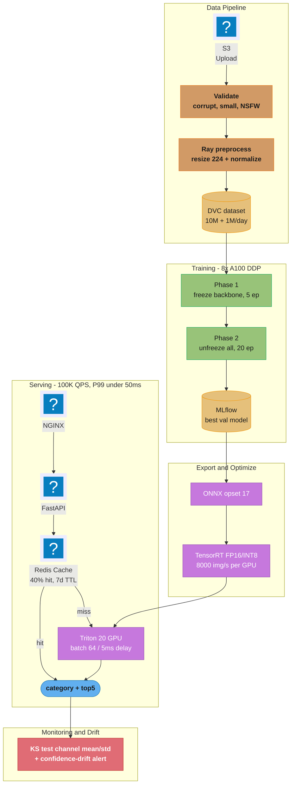
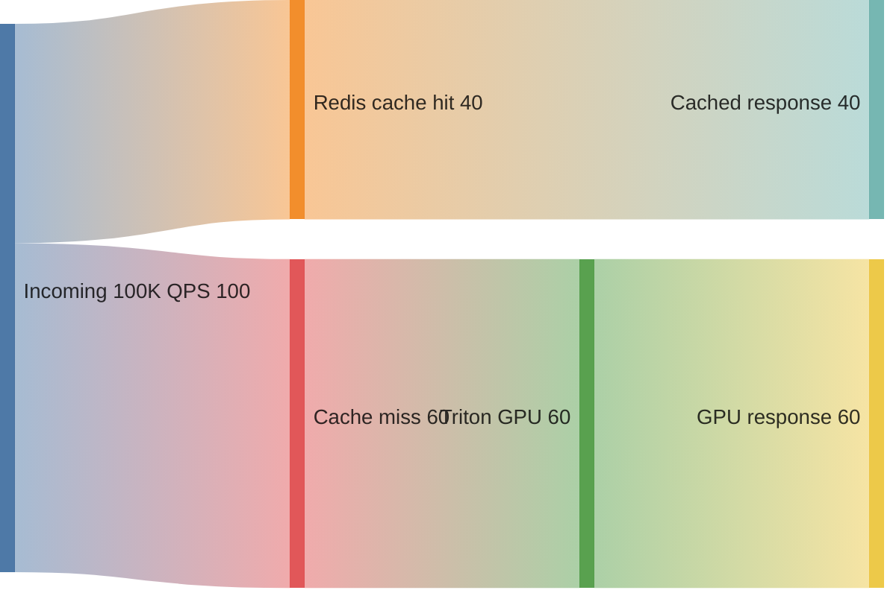
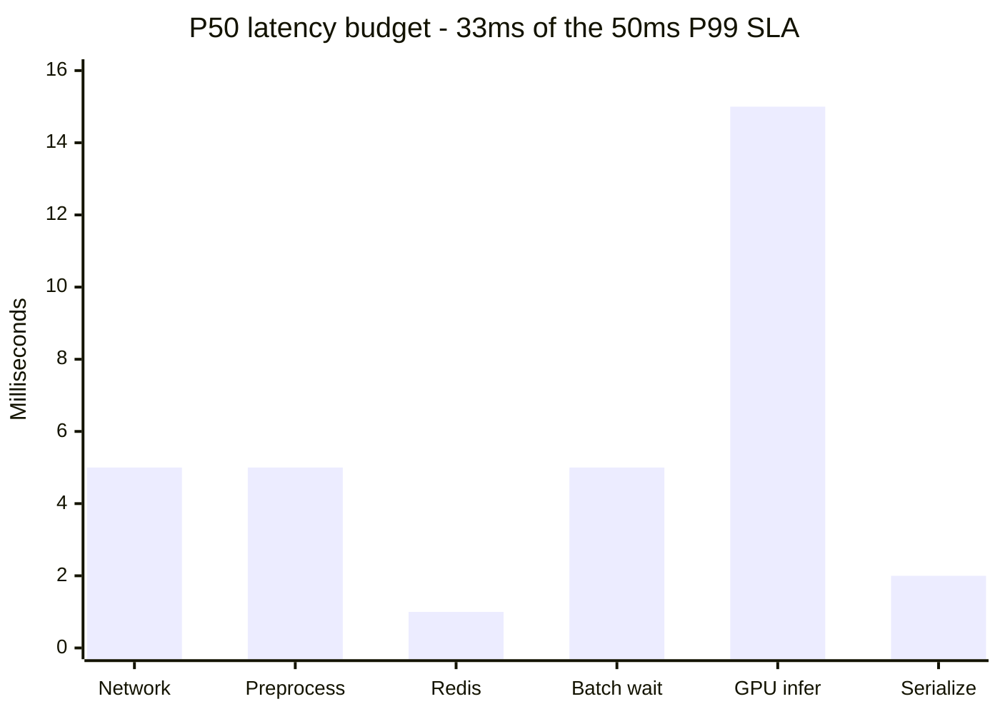

# Design an Image Classification Pipeline at Scale
## Intuition

> An image classifier at this scale is a sorting office. A million parcels a day arrive with a picture and no address, and each must land in one of 1,000 bins within 5 seconds. Meanwhile 100,000 people a second ask "which bin is this one in?".

**Key insight:** two workloads share one model. Upload-time classification (1M a day, 5 s budget) is easy on latency. Read-path classification (100K QPS, 50 ms P99) is a throughput problem, solved by caching, dynamic batching and a compiled engine, not by a better backbone. Most accuracy losses come from the pipeline around the model (export mode, augmentation, preprocessing), not from the architecture (§9).

Mental model: train in PyTorch, export once to ONNX, compile to TensorRT, serve on Triton with a 5 ms batching window behind a content-hash cache. Every arrow in that chain can change predictions silently, so each one has an equivalence test.

Why this system exists: category labels drive search filters, recommendations and ad targeting. At 95% top-1 accuracy, 5% of 1M daily uploads is 50k listings a day in the wrong category, each one invisible in the filter a buyer would use.

---

## 1. Requirements Clarification


Design a production image classification system for an e-commerce platform that automatically categorizes product images into 1,000 categories (e.g., "Men's Running Shoes", "Women's Handbag - Leather"). Sellers upload 1M new product images per day. Each uploaded image must be classified within 5 seconds for the seller to see the result. At steady state, the system must serve 100K classification requests per second (catalog browsing, recommendation systems consuming category labels) with less than 50ms P99 latency. Target accuracy: 95% top-1 on a balanced test set, 98% top-5.

**Functional requirements:**
- Classify every uploaded product image into one of 1,000 categories within 5 seconds, and show the seller the result.
- Serve category predictions to browsing, recommendation and ads systems on the read path.
- Add a new category without a full retrain.
- Flag low-confidence images for seller confirmation or human review.

**Non-functional requirements:**
- 1M images/day training pipeline ingestion
- 100K QPS inference, <50ms P99 latency
- 95% top-1 accuracy, 98% top-5 accuracy on 1000 categories
- New category addition without full retraining (few-shot via prototypical networks)
- Drift detection: catch distribution shift within 24 hours

**Out of scope:**
- Multi-label tagging (discussed in §11, not built).
- Image moderation and counterfeit detection (separate models).
- Visual similarity search (it reuses the backbone embedding but has its own index).

---

## 2. Scale Estimation

| Quantity | Derivation | Result |
|---|---|---|
| Read-path load after the cache | 100K QPS x (1 - 0.40 hit rate) | 60K/s to the GPU fleet |
| Load per GPU node | 60K / 20 nodes | 3K/s, ~37% of the assumed 8K/s per-node ceiling (§10) |
| Batch cadence per node at peak | 3K/s / 64 per full batch | ~47 full batches/s, one every ~21 ms |
| Raw upload storage | 1M x ~500 KB | ~500 GB/day |
| New labelled training images | 1% of 1M uploads carry a confirmed label | ~10k/day, ~3.7M/year |
| Latency stack (P50) | network 5 + preprocess 5 + cache 1 + batch wait 5 + GPU 15 + serialise 2 | 33 ms of the 50 ms P99 budget |

The cache line is the cheapest capacity in the system: every point of hit rate removes 1K QPS from the GPUs. The labelled-intake line is the trap: uploads grow 365M a year, but the training set grows only ~3.7M a year.

### Data Volume Projections

```
Year 0 (current):
  Daily upload: 1M images × ~500KB average = 500GB/day to S3
  Preprocessed (224×224 JPG, 40KB avg): 1M × 40KB = 40GB/day
  Annotation labels (PostgreSQL): 1M × 200 bytes = 200MB/day
  Training dataset: 10M LABELED images. Note the trap — uploads are 1M/day
    (365M/year) but only the ~1% that carry a confirmed human/seller category
    label enter training, so the training set grows ~3.7M/year, not 365M/year
  S3 storage (raw, 2yr retention): 500GB × 730 = 365TB
  S3 storage (preprocessed, 1yr): 40GB × 365 = 14.6TB
  ONNX model artifact: ~47MB at FP32 (12.2M params × 4 bytes); INT8 TensorRT
    engine is ~4x smaller. Either way, negligible

Year 1 (30% upload growth):
  1.3M images/day, 650GB/day raw, 52GB/day preprocessed
  Labeled intake: 1.3M/day × 365 × 1% = 4.7M → training dataset ~14.8M images
  Weekly retraining time: ~8 hours on 8× A100 (5.5 hours today, scaled by the
    1.48x larger dataset)

Year 3 (3x growth):
  3M images/day, 1.5TB/day raw
  Training dataset: ~40M images
  May require dataset pruning: discard images >2 years old or lowest-quality
  Estimated dataset management overhead: 4 engineering-weeks/year
```

---

## 3. High-Level Architecture



Five stages flow top-to-bottom: a DVC-versioned dataset feeds two-phase fine-tuning; the best MLflow checkpoint is exported to ONNX/TensorRT and served behind a content-hash cache that absorbs ~40% of the 100K QPS, and every response streams into drift monitoring.



The content-hash cache serves ~40% of requests directly, cutting effective GPU-bound traffic from 100K to 60K QPS — the single biggest lever for hitting both the latency and the cost budget.



GPU inference (15ms) plus the three 5ms stages dominate; the components sum to 33ms P50, leaving 17ms of tail-latency headroom under the 50ms P99 budget.

---

## 4. Component Deep Dives

Training labels are joined as of the snapshot date: sellers correct categories for weeks after upload, so a training set rebuilt today must not use corrections made after its snapshot. The rule is the one in [Feature Store and Point-in-Time Correctness](./cross_cutting/feature_store_and_point_in_time_correctness.md).


### 4.1 EfficientNet Fine-Tuning (PyTorch)

```python
import torch
import torch.nn as nn
import torch.nn.functional as F
from torch.utils.data import DataLoader, Dataset
from torchvision import transforms, models
from torchvision.models import EfficientNet_B3_Weights
import numpy as np
from pathlib import Path
from PIL import Image
import time


class ProductImageDataset(Dataset):
    """Dataset loading product images with augmentation."""

    TRAIN_TRANSFORMS = transforms.Compose([
        transforms.RandomResizedCrop(224, scale=(0.7, 1.0)),
        transforms.RandomHorizontalFlip(),
        transforms.ColorJitter(brightness=0.3, contrast=0.3, saturation=0.2, hue=0.1),
        transforms.RandomGrayscale(p=0.05),
        transforms.ToTensor(),
        transforms.Normalize(
            mean=[0.485, 0.456, 0.406],
            std=[0.229, 0.224, 0.225],
        ),
    ])

    VAL_TRANSFORMS = transforms.Compose([
        transforms.Resize(256),
        transforms.CenterCrop(224),
        transforms.ToTensor(),
        transforms.Normalize(
            mean=[0.485, 0.456, 0.406],
            std=[0.229, 0.224, 0.225],
        ),
    ])

    def __init__(
        self,
        image_paths: list[str],
        labels: list[int],
        split: str = "train",
    ) -> None:
        self.image_paths = image_paths
        self.labels = labels
        self.transform = (
            self.TRAIN_TRANSFORMS if split == "train" else self.VAL_TRANSFORMS
        )

    def __len__(self) -> int:
        return len(self.image_paths)

    def __getitem__(self, idx: int) -> tuple[torch.Tensor, int]:
        img = Image.open(self.image_paths[idx]).convert("RGB")
        return self.transform(img), self.labels[idx]


def mixup_data(
    x: torch.Tensor,
    y: torch.Tensor,
    alpha: float = 0.2,
) -> tuple[torch.Tensor, torch.Tensor, torch.Tensor, float]:
    """Mixup augmentation: blend two random training examples."""
    if alpha > 0:
        lam = float(np.random.beta(alpha, alpha))
    else:
        lam = 1.0
    batch_size = x.size(0)
    index = torch.randperm(batch_size, device=x.device)
    mixed_x = lam * x + (1 - lam) * x[index]
    y_a, y_b = y, y[index]
    return mixed_x, y_a, y_b, lam


def mixup_criterion(
    criterion: nn.Module,
    pred: torch.Tensor,
    y_a: torch.Tensor,
    y_b: torch.Tensor,
    lam: float,
) -> torch.Tensor:
    return lam * criterion(pred, y_a) + (1 - lam) * criterion(pred, y_b)


def build_model(num_classes: int = 1000, dropout: float = 0.3) -> nn.Module:
    """EfficientNet-B3 with custom classifier head."""
    model = models.efficientnet_b3(weights=EfficientNet_B3_Weights.IMAGENET1K_V1)
    in_features = model.classifier[1].in_features  # 1536
    model.classifier = nn.Sequential(
        nn.Dropout(p=dropout),
        nn.Linear(in_features, num_classes),
    )
    return model


def train_epoch(
    model: nn.Module,
    loader: DataLoader,
    optimizer: torch.optim.Optimizer,
    criterion: nn.Module,
    device: torch.device,
    use_mixup: bool = True,
    grad_accum_steps: int = 4,
) -> dict[str, float]:
    model.train()
    total_loss = 0.0
    correct = 0
    total = 0

    optimizer.zero_grad()
    for step, (images, labels) in enumerate(loader):
        images, labels = images.to(device), labels.to(device)

        if use_mixup:
            images, y_a, y_b, lam = mixup_data(images, labels)
            with torch.autocast(device_type=device.type, dtype=torch.bfloat16):
                outputs = model(images)
                loss = mixup_criterion(criterion, outputs, y_a, y_b, lam)
        else:
            with torch.autocast(device_type=device.type, dtype=torch.bfloat16):
                outputs = model(images)
                loss = criterion(outputs, labels)

        loss = loss / grad_accum_steps
        loss.backward()

        if (step + 1) % grad_accum_steps == 0:
            torch.nn.utils.clip_grad_norm_(model.parameters(), 1.0)
            optimizer.step()
            optimizer.zero_grad()

        total_loss += loss.item() * grad_accum_steps
        preds = outputs.argmax(dim=1)
        if not use_mixup:
            correct += (preds == labels).sum().item()
        total += labels.size(0)

    return {
        "loss": total_loss / len(loader),
        "accuracy": correct / total if not use_mixup else float("nan"),
    }


def two_phase_finetune(
    model: nn.Module,
    train_loader: DataLoader,
    val_loader: DataLoader,
    device: torch.device,
    num_classes: int = 1000,
) -> nn.Module:
    """Two-phase fine-tuning strategy."""
    criterion = nn.CrossEntropyLoss(label_smoothing=0.1)

    # Phase 1: train classifier head only (freeze backbone)
    for param in model.features.parameters():
        param.requires_grad = False
    optimizer_p1 = torch.optim.Adam(model.classifier.parameters(), lr=1e-3)

    print("Phase 1: training classifier head (5 epochs)")
    for epoch in range(5):
        metrics = train_epoch(
            model, train_loader, optimizer_p1, criterion, device, use_mixup=False
        )
        print(f"  Epoch {epoch+1}: loss={metrics['loss']:.4f}, "
              f"acc={metrics['accuracy']:.4f}")

    # Phase 2: unfreeze all, lower LR
    for param in model.parameters():
        param.requires_grad = True
    optimizer_p2 = torch.optim.Adam([
        {"params": model.features.parameters(), "lr": 1e-5},
        {"params": model.classifier.parameters(), "lr": 1e-4},
    ])
    # T_max counts SCHEDULER STEPS, not samples. scheduler.step() is called once
    # per epoch below, so T_max must be the epoch count (20). Setting it to
    # 20 * len(train_loader) makes the cosine complete ~len(train_loader)x too
    # slowly: the LR barely moves across the whole run and the schedule is inert.
    scheduler = torch.optim.lr_scheduler.CosineAnnealingLR(optimizer_p2, T_max=20)

    print("Phase 2: full fine-tuning (20 epochs)")
    best_val_acc = 0.0
    for epoch in range(20):
        metrics = train_epoch(
            model, train_loader, optimizer_p2, criterion, device,
            use_mixup=True, grad_accum_steps=4
        )
        # Validate
        model.eval()
        correct, total = 0, 0
        with torch.no_grad():
            for images, labels in val_loader:
                images, labels = images.to(device), labels.to(device)
                outputs = model(images)
                correct += (outputs.argmax(1) == labels).sum().item()
                total += labels.size(0)
        val_acc = correct / total
        scheduler.step()

        print(f"  Epoch {epoch+1}: train_loss={metrics['loss']:.4f}, "
              f"val_acc={val_acc:.4f}")

        if val_acc > best_val_acc:
            best_val_acc = val_acc
            torch.save(model.state_dict(), "best_model.pt")

    print(f"Best validation accuracy: {best_val_acc:.4f}")
    model.load_state_dict(torch.load("best_model.pt"))
    return model
```

### 4.2 ONNX Export and Triton Python-Backend Model

```python
import torch
import torch.nn as nn
import onnx
import onnxruntime as ort
import numpy as np
import time


def export_to_onnx(
    model: nn.Module,
    output_path: str = "efficientnet_b3.onnx",
    opset_version: int = 17,
    batch_size: int = 64,
) -> None:
    """Export PyTorch model to ONNX with dynamic batching support."""
    model.eval()  # load-bearing: the exporter traces whatever mode it is given
    device = next(model.parameters()).device
    dummy_input = torch.randn(1, 3, 224, 224, device=device)

    # torch.export-based exporter (dynamo=True is the default). Dynamic axes are
    # declared with dynamic_shapes, positionally matching `args`; constant
    # folding and graph optimization are always on.
    torch.onnx.export(
        model,
        (dummy_input,),
        output_path,
        opset_version=opset_version,
        input_names=["image"],
        output_names=["logits"],
        dynamic_shapes=({0: torch.export.Dim.DYNAMIC},),  # dynamic batch dim
    )

    # Verify ONNX model
    onnx_model = onnx.load(output_path)
    onnx.checker.check_model(onnx_model)
    print(f"ONNX model exported to {output_path}")

    # Equivalence gate (§9 Failure 2): the export must reproduce PyTorch's logits.
    session = ort.InferenceSession(output_path, providers=["CPUExecutionProvider"])
    check = torch.randn(batch_size, 3, 224, 224)
    with torch.no_grad():
        expected = model(check.to(device)).cpu().numpy()
    got = session.run(["logits"], {"image": check.numpy()})[0]
    max_err = float(np.abs(got - expected).max())
    if max_err > 1e-3:
        raise RuntimeError(f"ONNX logits differ from PyTorch by {max_err:.4f}")


```

The exported ONNX graph is compiled to a TensorRT engine (optimization profile batch 1-64) and served by NVIDIA Triton Inference Server. The serving unit is two models in one Triton model repository: a **TensorRT model** that only runs the network, and a **Python-backend model** that decodes JPEG bytes, normalizes, calls the TensorRT model through Business Logic Scripting (BLS), and formats the top-5 response. Clients call only the Python model.

```text
model_repository/
├── product_classifier/          # Python backend: decode + normalize + top-5
│   ├── config.pbtxt
│   └── 1/model.py
└── efficientnet_b3_trt/         # TensorRT backend: the network only
    ├── config.pbtxt
    └── 1/model.plan
```

```protobuf
# product_classifier/config.pbtxt
name: "product_classifier"
backend: "python"
max_batch_size: 64                  # the dynamic batcher never forms a batch larger than this
input  [ { name: "IMAGE"       data_type: TYPE_STRING dims: [ 1 ] } ]   # raw JPEG bytes
output [ { name: "PREDICTIONS" data_type: TYPE_STRING dims: [ 1 ] } ]   # JSON per image
instance_group [ { count: 4 kind: KIND_CPU } ]   # each instance is its own stub process,
                                                 # so 4 instances decode JPEGs in parallel
dynamic_batching {
  max_queue_delay_microseconds: 5000             # hold a request at most 5 ms to fill a batch
  default_queue_policy {
    max_queue_size: 5000                         # bounded queue: shed load instead of OOM (Failure 1)
    timeout_action: REJECT
    default_timeout_microseconds: 40000          # a request older than 40 ms cannot meet the SLA
  }
}

# efficientnet_b3_trt/config.pbtxt
name: "efficientnet_b3_trt"
platform: "tensorrt_plan"
max_batch_size: 64
input  [ { name: "image"  data_type: TYPE_FP32 dims: [ 3, 224, 224 ] } ]
output [ { name: "logits" data_type: TYPE_FP32 dims: [ 1000 ] } ]
instance_group [ { count: 2 kind: KIND_GPU } ]
dynamic_batching { }                 # merges BLS calls from the 4 Python instances, no added delay
```

```python
# product_classifier/1/model.py — Triton Python backend
from __future__ import annotations

import io
import json

import numpy as np
from PIL import Image

MEAN = np.array([0.485, 0.456, 0.406], dtype=np.float32).reshape(3, 1, 1)
STD = np.array([0.229, 0.224, 0.225], dtype=np.float32).reshape(3, 1, 1)


def preprocess(jpeg: bytes) -> np.ndarray:
    """Resize short side to 256, centre-crop 224, scale to [0, 1], normalize -> (3, 224, 224)."""
    img = Image.open(io.BytesIO(jpeg)).convert("RGB")
    w, h = img.size
    scale = 256 / min(w, h)
    img = img.resize((round(w * scale), round(h * scale)), Image.BILINEAR)
    w, h = img.size
    left, top = (w - 224) // 2, (h - 224) // 2
    img = img.crop((left, top, left + 224, top + 224))
    arr = np.asarray(img, dtype=np.float32).transpose(2, 0, 1) / 255.0
    return (arr - MEAN) / STD


def top5_json(logits: np.ndarray) -> list[bytes]:
    """Softmax each row and return one JSON document (as bytes) per image."""
    z = logits - logits.max(axis=1, keepdims=True)          # numerically stable softmax
    probs = np.exp(z) / np.exp(z).sum(axis=1, keepdims=True)
    out: list[bytes] = []
    for row in probs:
        idx = np.argsort(row)[::-1][:5]
        out.append(json.dumps({
            "category_id": int(idx[0]),
            "confidence": float(row[idx[0]]),
            "top5": [{"category_id": int(i), "confidence": float(row[i])} for i in idx],
        }).encode())
    return out


def split_by_request(items: list[bytes], counts: list[int]) -> list[list[bytes]]:
    """Give each request back exactly the rows it sent, in order."""
    chunks, start = [], 0
    for n in counts:
        chunks.append(items[start:start + n])
        start += n
    return chunks


try:  # present only inside the Triton container
    import triton_python_backend_utils as pb_utils
except ImportError:  # lets the pure functions above be unit-tested anywhere
    pb_utils = None


class TritonPythonModel:
    def initialize(self, args: dict[str, str]) -> None:
        self.trt_model = "efficientnet_b3_trt"

    def _run_trt(self, batch: np.ndarray) -> np.ndarray:
        """One BLS call to the TensorRT model for the whole batch."""
        req = pb_utils.InferenceRequest(
            model_name=self.trt_model,
            requested_output_names=["logits"],
            inputs=[pb_utils.Tensor("image", batch)],
        )
        resp = req.exec()
        if resp.has_error():
            raise pb_utils.TritonModelException(resp.error().message())
        return pb_utils.get_output_tensor_by_name(resp, "logits").as_numpy()

    # BROKEN: Triton's dynamic batcher hands execute() a LIST of up to 64
    # requests, but the Python backend does not concatenate them for you.
    # Looping and calling the GPU once per request turns a batch of 64 into
    # 64 batches of 1: the batcher waited 5 ms for nothing and GPU
    # utilization falls back to the ~10% of the unbatched design.
    def execute_broken(self, requests: list) -> list:
        responses = []
        for request in requests:
            raw = pb_utils.get_input_tensor_by_name(request, "IMAGE").as_numpy()
            batch = np.stack([preprocess(r[0]) for r in raw])
            preds = top5_json(self._run_trt(batch))      # one GPU call PER REQUEST
            responses.append(pb_utils.InferenceResponse(output_tensors=[
                pb_utils.Tensor("PREDICTIONS", np.array(preds, dtype=np.object_).reshape(-1, 1))
            ]))
        return responses

    # FIX: decode every image from every request, stack them into ONE tensor,
    # make ONE GPU call, then split the rows back per request. Return exactly
    # one response per request, in request order, or Triton fails the batch.
    def execute(self, requests: list) -> list:
        images: list[np.ndarray] = []
        counts: list[int] = []
        bad: dict[int, str] = {}
        for i, request in enumerate(requests):
            raw = pb_utils.get_input_tensor_by_name(request, "IMAGE").as_numpy()
            try:
                decoded = [preprocess(r[0]) for r in raw]
            except Exception as exc:        # one corrupt JPEG must not fail 63 good requests
                bad[i] = f"undecodable image: {exc}"
                decoded = []
            images.extend(decoded)
            counts.append(len(decoded))

        preds = top5_json(self._run_trt(np.stack(images))) if images else []
        per_request = split_by_request(preds, counts)

        responses = []
        for i, rows in enumerate(per_request):
            if i in bad:
                responses.append(pb_utils.InferenceResponse(
                    output_tensors=[], error=pb_utils.TritonError(bad[i])))
            else:
                responses.append(pb_utils.InferenceResponse(output_tensors=[
                    pb_utils.Tensor("PREDICTIONS", np.array(rows, dtype=np.object_).reshape(-1, 1))
                ]))
        return responses

    def finalize(self) -> None:
        pass


if __name__ == "__main__":
    # Offline check of the batching contract without a Triton server.
    fake_logits = np.random.default_rng(0).normal(size=(5, 1000)).astype(np.float32)
    rows = top5_json(fake_logits)
    chunks = split_by_request(rows, [2, 0, 3])
    assert [len(c) for c in chunks] == [2, 0, 3]
    assert json.loads(chunks[2][0])["category_id"] == int(np.argmax(fake_logits[2]))
    print("batching contract OK")
```

Three things in this model carry the latency SLA. (1) **One GPU call per `execute()`**, not per request: the Python backend receives the batcher's requests as a list and leaves concatenation to you. (2) **Preprocessing on CPU instances, inference on GPU instances**: JPEG decode is the CPU-bound step, so 4 CPU stub processes keep 2 GPU engine instances fed; putting decode on the GPU instance serializes it in front of the engine. (3) **A bounded queue with a timeout**: `max_queue_size` and `default_timeout_microseconds` turn an overload into fast `REJECT`s the API gateway can answer from the cache fallback, instead of an unbounded backlog (see Failure 1). The same two-model split also works without Python: a Triton **ensemble** with a DALI preprocessing model avoids the Python stub entirely at the cost of a less flexible preprocessing language. BentoML, KServe (with Triton as its predictor runtime) and Ray Serve are the managed-wrapper alternatives; see the tradeoff summary in §5.

### 4.3 Drift Detection

```python
import numpy as np
from scipy import stats
import redis
import json


class ImageDriftDetector:
    """
    Monitor for distribution shift in incoming images.
    Tracks pixel-level statistics and prediction confidence.
    """

    BASELINE_KEY = "drift:baseline"
    CURRENT_WINDOW_KEY = "drift:current:{hour}"

    def __init__(self, redis_client: redis.Redis) -> None:
        self.redis = redis_client

    def record_prediction(
        self,
        image_array: np.ndarray,  # (C, H, W) float32 [0,1]
        confidence: float,
        hour: int,
    ) -> None:
        """Record per-channel statistics and confidence for drift monitoring."""
        stats_dict = {
            "r_mean": float(image_array[0].mean()),
            "g_mean": float(image_array[1].mean()),
            "b_mean": float(image_array[2].mean()),
            "r_std": float(image_array[0].std()),
            "g_std": float(image_array[1].std()),
            "b_std": float(image_array[2].std()),
            "confidence": confidence,
        }
        key = self.CURRENT_WINDOW_KEY.format(hour=hour)
        self.redis.rpush(key, json.dumps(stats_dict))
        self.redis.expire(key, 7200)  # 2-hour window

    def check_drift(self, hour: int, alpha: float = 0.05) -> dict[str, bool]:
        """KS test comparing current window to baseline."""
        baseline_raw = self.redis.lrange(self.BASELINE_KEY, 0, -1)
        current_raw = self.redis.lrange(
            self.CURRENT_WINDOW_KEY.format(hour=hour), 0, -1
        )
        if len(baseline_raw) < 100 or len(current_raw) < 100:
            return {"insufficient_data": True}

        baseline = [json.loads(x) for x in baseline_raw]
        current = [json.loads(x) for x in current_raw]

        alerts = {}
        for metric in ["r_mean", "g_mean", "b_mean", "confidence"]:
            baseline_vals = [d[metric] for d in baseline]
            current_vals = [d[metric] for d in current]
            ks_stat, p_value = stats.ks_2samp(baseline_vals, current_vals)
            alerts[f"{metric}_drift"] = p_value < alpha

        # Confidence spike detection: low_conf_rate > 2x baseline
        baseline_low_conf = sum(1 for d in baseline if d["confidence"] < 0.5) / len(baseline)
        current_low_conf = sum(1 for d in current if d["confidence"] < 0.5) / len(current)
        alerts["confidence_spike"] = current_low_conf > 2 * baseline_low_conf

        return alerts
```

### 4.4 Dynamic-Batching Delay — Broken Then Fixed

```python
# BROKEN: Triton dynamic batcher with a 50 ms queue delay (too long)
# The batcher sends a batch the moment it reaches max_batch_size, so the delay
# only bites when traffic is too light to fill 64 slots:
#   peak, 5,000 req/s per node: 64 requests arrive in 12.8 ms  -> batch sent at 12.8 ms
#   off-peak, 500 req/s per node: 64 requests need 128 ms     -> the 50 ms timer fires first
# Off-peak, the oldest request in every batch waits the full 50 ms:
#   P99 = 50 ms queue + 15 ms inference = 65 ms, over the 50 ms SLA, at the
#   time of day with the LEAST load. Peak-hour load tests never see it.
#
# product_classifier/config.pbtxt (BROKEN):
#   max_batch_size: 64
#   dynamic_batching { max_queue_delay_microseconds: 50000 }   # 50 ms
#
# FIX: cap the delay at what the latency budget can spend (5 ms of the 50 ms),
# and bound the queue so overload becomes a fast REJECT instead of a backlog.
#   peak: unchanged, batches still fill to 64 before the timer matters
#   off-peak: batches of ~3 (500 req/s x 5 ms) leave every 5 ms, P99 ~ 20 ms
#
# product_classifier/config.pbtxt (FIXED):
#   max_batch_size: 64
#   dynamic_batching {
#     max_queue_delay_microseconds: 5000                        # 5 ms
#     default_queue_policy {
#       max_queue_size: 5000
#       timeout_action: REJECT
#       default_timeout_microseconds: 40000
#     }
#   }
#
# Tune it with Triton's perf_analyzer at BOTH ends of the daily curve, e.g.
#   perf_analyzer -m product_classifier --request-rate-range=500:5000:1500
# and read p99 per rate, not one number at peak.
# Additionally: add a health-check to verify actual P99 after config change

import asyncio
import time
import statistics
import httpx
import numpy as np


async def measure_p99_latency(
    endpoint: str,
    num_requests: int = 1000,
    concurrency: int = 50,
) -> dict[str, float]:
    """Measure P99 latency of classification endpoint under sustained load."""
    latencies: list[float] = []
    dummy_image = np.random.randint(0, 255, (224, 224, 3), dtype=np.uint8)
    import io
    from PIL import Image
    import base64
    buf = io.BytesIO()
    Image.fromarray(dummy_image).save(buf, format="JPEG")
    image_b64 = base64.b64encode(buf.getvalue()).decode()

    async with httpx.AsyncClient() as client:
        for _ in range(num_requests // concurrency):
            start_batch = time.perf_counter()
            responses = await asyncio.gather(*[
                client.post(endpoint, json={"image": image_b64})
                for _ in range(concurrency)
            ])
            elapsed = (time.perf_counter() - start_batch) * 1000
            # Each request in the batch experiences ~elapsed/concurrency latency
            for _ in responses:
                latencies.append(elapsed)

    return {
        "p50_ms": statistics.median(latencies),
        "p99_ms": float(np.percentile(latencies, 99)),
        "p999_ms": float(np.percentile(latencies, 99.9)),
    }
```

---

## 5. Design Decisions & Tradeoffs


**EfficientNet-B3 over ResNet-50**: with torchvision's `IMAGENET1K_V1` weights, EfficientNet-B3 reports **82.008% ImageNet top-1 / 96.054% top-5** against ResNet-50's **76.130% top-1**, at 12.2M parameters vs 25.6M. The compound scaling (jointly scale depth, width, resolution) makes it more efficient for fine-grained classification like product categories. **Two caveats that bite in practice.** (1) That 82.0% is measured with the weights' own preset transform — resize 320, centre-crop **300** — not the 224 crop used elsewhere in this pipeline; running B3 at 224 gives up accuracy, so either adopt the 300px preset or re-measure your own baseline rather than inheriting the published number. (2) Fewer parameters and fewer FLOPs do **not** automatically mean lower wall-clock latency: EfficientNet's depthwise-separable convolutions are memory-bandwidth bound and frequently benchmark *slower* than ResNet-50 on the same hardware. Measure latency on your target device; do not infer it from the parameter count.

**Two-phase fine-tuning**: In phase 1, only the classifier head trains (backbone frozen). This prevents catastrophic forgetting of ImageNet features and establishes a good initialization for the head in 5 epochs. Phase 2 unfreezes all layers with a much lower LR (1e-5) to gently adapt the backbone. Skipping phase 1 hurts, and the mechanism is the defensible part: a randomly initialised head emits large, arbitrarily directed gradients on the first steps, and with the backbone unfrozen those flow straight into the pretrained weights. The *magnitude* of the drop is not something to quote from folklore — no controlled ablation exists for EfficientNet on a 1,000-class product catalog, and the answer depends heavily on head initialisation and the phase-2 learning rate. Run the two-arm experiment once on your own data and record the number.

**Dynamic batching in Triton Inference Server**: At 100K QPS with 20 GPU nodes, each node sees 5K RPS. Without batching, GPU utilization is <10% (each inference uses only a fraction of GPU compute). Triton's dynamic batcher holds requests in the model's scheduler queue for at most `max_queue_delay_microseconds: 5000` (5ms) and sends them together as one batch of up to `max_batch_size: 64`; it sends immediately when the batch fills, so the delay is only paid when traffic is too light to fill a batch. GPU utilization rises from 10% to 80%, reducing cost 4x. The 5ms batching delay is acceptable within the 50ms budget. Triton's dynamic batcher adds **no** delay unless you set this field (`dynamic_batching { }` alone sends the largest batch available right away), so the 5ms is a deliberate setting, not a default.

**Content-hash caching**: Identical product images are re-submitted frequently (catalog exports, seller re-uploads). A content hash of the raw image bytes as cache key catches exact duplicates. Redis with 7-day TTL, and a ~40% hit rate assumed throughout this study — reduces GPU load by 40%. (Prefer SHA-256 over MD5 for the key; MD5 collisions are constructible by an attacker who controls the uploaded bytes. See the cache-key question in §11.)

**ONNX export for cross-platform serving**: PyTorch model is exported to ONNX once and served via TensorRT (NVIDIA GPUs, peak throughput), ONNX Runtime (CPU fallback, new region without GPU budget), and CoreML (edge devices via conversion). Single training produces artifacts for all platforms.

**Few-shot category addition**: Adding a new category without full retraining uses prototypical networks — compute the mean embedding of 5-20 example images of the new category using the frozen backbone, store as the "prototype." At inference, classify by nearest prototype in embedding space. Accuracy is ~85% (vs 95% for trained categories) but sufficient for new category bootstrapping.

**Tradeoff summary:**


| Decision | Chosen | Alternative | Reasoning |
|----------|--------|-------------|-----------|
| Model architecture | EfficientNet-B3 | ViT-B/16, ResNet-50 | EfficientNet-B3: best accuracy/latency tradeoff at 12M params; ViT needs more data |
| Fine-tuning strategy | Two-phase (freeze → unfreeze) | Full fine-tuning from epoch 1 | Two-phase prevents an untrained head's large gradients from destroying pretrained features; the accuracy delta is real but unquantified here — measure it on your own catalog |
| Inference server | Triton Inference Server | Ray Serve, BentoML, KServe | Triton: server-side dynamic batching with a per-model queue delay, a native TensorRT backend, and a Python backend for preprocessing in one process tree. Ray Serve batches in Python (`@serve.batch`) and suits multi-model Python pipelines; BentoML gives the simplest packaging; KServe is the Kubernetes control plane and can run Triton as its predictor, so it complements rather than replaces it |
| Precision | BF16 | FP16, INT8 | BF16: larger dynamic range than FP16 (fewer NaN issues), A100-native; INT8 needs calibration |
| Caching key | SHA-256 of raw image bytes | Perceptual hash (pHash) | A cryptographic hash catches exact duplicates (the common case) and cannot be collided by an uploader, unlike MD5; pHash catches near-duplicates at 3x cost |
| New category strategy | Prototypical networks (few-shot) | Full retraining | Prototypical: deploy in hours with 5 examples; full retrain takes 2 days |

---

## 6. Real-World Implementations

**eBay (category prediction inside visual search):** Yang et al., "Visual Search at eBay" (KDD 2017, arXiv:1706.03154), describe a system built for eBay's "massive volatile inventory". A supervised network predicts the top categories of a query image and the search is limited to those categories; the same network produces a compact binary signature, so both come from a single forward inference. It powered visual search in eBay ShopBot and Close5. The lesson for this study: a category classifier is often an index-pruning step for search, which is why read-path load (100K QPS) dwarfs upload volume.

**Pinterest (one visual engine, several products):** Zhai et al., "Visual Discovery at Pinterest" (WWW 2017, arXiv:1702.04680), describe one visual discovery engine behind Related Pins (2014), Similar Looks (2015), Flashlight (2016) and Lens (2017), with object detection as a key technical choice, and report that it significantly improves engagement in search and recommendation. The parallel here: treat the backbone embedding from §4.1 as a shared asset (few-shot prototypes, near-duplicate detection, similar items), not only as the input to a 1,000-way head.

**Published numbers this design relies on:** the EfficientNet-B3 and ResNet-50 ImageNet accuracies in §5 are torchvision's published figures for the `IMAGENET1K_V1` weights. The new-category method follows Snell, Swersky and Zemel, "Prototypical Networks for Few-shot Learning" (NeurIPS 2017).

---

## 7. Technologies & Tools


| Component | Technology | Role |
|-----------|-----------|------|
| Backbone | EfficientNet-B3 (timm / torchvision) | ImageNet pretrained feature extractor |
| Training Framework | PyTorch DDP (DistributedDataParallel) | Multi-GPU training, 8x A100 |
| Mixed Precision | BF16 (torch.autocast) | 2x training speedup, A100 native |
| Augmentation | torchvision transforms + Mixup | Regularization, reduce overfitting |
| Model Registry | MLflow | Versioning, metric tracking, artifact storage |
| Export | torch.onnx.export (opset 17) | Cross-platform deployment artifact |
| Inference Runtime | NVIDIA Triton Inference Server (Python backend + TensorRT backend) | Dynamic batching, BLS preprocessing, GPU serving |
| Caching | Redis (SHA-256 key, 7-day TTL) | Duplicate image request deduplication |
| Drift Detection | KS test + confidence monitoring | Distribution shift alerting |
| Data Versioning | DVC (Data Version Control) | Reproducible training datasets |

---

## 8. Operational Playbook

Drift signals, thresholds, retraining cadence and the promotion process are below. Low-confidence routing depends on calibrated confidences ([Model Calibration and Thresholding](./cross_cutting/model_calibration_and_thresholding.md)); the PSI and KS mechanics are in [Drift Monitoring and Retraining](./cross_cutting/drift_monitoring_and_retraining.md); the shadow-then-A/B design follows [Experimentation and Online Evaluation](./cross_cutting/experimentation_and_online_evaluation.md).


### Features That Drift Fastest

```
Signal                              Drift rate    Reason
──────────────────────────────────────────────────────────────────────
Image color distribution (channel   Very high     Seasonal product trends (winter/summer
mean/std per channel)                             colors); photography trends; seller
                                                  behavior changes (new photo studio)
Prediction confidence distribution  High          OOD products from new sellers; new
                                                  categories being forced into old ones
Category distribution of requests   High          Seasonal catalog changes (swimwear in
                                                  summer); promotional category focus
Image resolution distribution       Medium        Sellers upgrading cameras
                                                  (higher resolution over time)
Top-1 accuracy (from QA samples)    Low           Model robust to gradual drift;
                                                  sharp drops indicate category addition
```

### PSI Thresholds and Alerting

```python
# Image-level monitoring: compute hourly over 10K random images

IMAGE_MONITORING_THRESHOLDS = {
    "r_channel_mean_psi": 0.15,     # seasonal color shifts expected
    "confidence_below_0.5_rate": {  # fraction of low-confidence predictions
        "baseline_multiplier_alert": 2.0,   # alert if 2x baseline rate
    },
    "top_category_concentration": {  # fraction from single category
        "alert_threshold": 0.25,     # alert if >25% from one category (viral product?)
    },
}

# Accuracy monitoring: 100 QA-labeled images per day
ACCURACY_THRESHOLDS = {
    "rolling_7day_top1_accuracy": 0.92,   # alert if < 92% (vs 95% target)
    "rolling_7day_top5_accuracy": 0.97,   # alert if < 97% (vs 98% target)
    "per_category_accuracy_drop": 0.05,   # alert if any category drops > 5pp
}
```

### Retraining Triggers and Cadence

```
Cadence        Trigger                                       Action
──────────────────────────────────────────────────────────────────────────
Nightly        Scheduled                                     Fine-tune on 1M new images
Weekly         Scheduled                                     Full retrain (25 epochs)
Triggered      QA accuracy < 92% (rolling 3 days)           Emergency full retrain
Triggered      r_channel_mean PSI > 0.15                    Alert + schedule fine-tune
Triggered      Confidence < 0.5 rate doubles                 Shadow deploy fine-tuned model
Triggered      New category added (seller feedback)          Prototypical network update;
                                                              schedule fine-tune after 100 examples
Monthly        Scheduled                                     INT8 TensorRT recalibration
                                                              (calibration data should match
                                                               current image distribution)
```

### A/B Testing for Model Promotion

```
Shadow mode (48 hours):
  New model runs alongside production
  Compare predictions: check for category distribution shifts
  Latency check: new model P99 must be within 5ms of production

Traffic split A/B (1 week):
  5% traffic to new model, 95% to production
  Primary metric: seller satisfaction (product listing accuracy survey)
  Automated metric: fraction of seller corrections (seller manually overrides
    the auto-category within 48h of upload — lower is better)
  Guardrail: per-category top-1 accuracy must not drop > 1pp in any category

Ramp: 5% → 25% → 50% → 100% at 2-day intervals after statistical significance
Statistical threshold: 95% confidence on seller correction rate (primary)
```

### Incident runbooks

**Runbook 1 — Triton rejects above 1% or P99 above 50 ms:** check that the autoscaler reads GPU (not CPU) utilization, pre-scale ahead of known promotions, and serve cached fallbacks for rejected requests (§9 Failure 1).

**Runbook 2 — Export equivalence gate fails:** block the deploy. Check `model.eval()` before export, the opset, and the age of the INT8 calibration set; recalibrate if it is over a month old (§9 Failure 2).

**Runbook 3 — A category drops more than 5 points in the QA sample:** diff the last augmentation and preprocessing changes against the drop, roll back the model, and rerun the per-category evaluation (§9 Failure 3).

**Runbook 4 — Low-confidence rate doubles:** usually new out-of-distribution products. Route low-confidence images to seller confirmation, and look for a candidate new category to bootstrap with prototypes.

---

## 9. Common Pitfalls & War Stories


*The incidents below are illustrative composites of recurring failure patterns, not accounts of specific public incidents. The mechanisms and remediations are real; the QPS spikes, accuracy deltas and time-to-detect figures are representative and should not be quoted as measured public record.*

### Failure 1: Triton Queue Saturation Under Burst Traffic

**What failed:** A major promotional event drove 250K QPS (2.5x the designed 100K QPS) over a 20-minute window. K8s HPA was configured to scale on CPU utilization, but GPU nodes take 6-8 minutes to provision and warm up (download model artifact from S3, load the TensorRT engine and start the Python-backend stub processes). During the scale-out window, existing 20 GPU nodes became memory-saturated — dynamic batching accumulated requests faster than GPU could process them. The model's dynamic-batcher queue, configured with no `max_queue_size` and therefore unbounded, grew past 10K pending requests; requests timed out at the gateway after already waiting longer than the SLA, and the gateway returned HTTP 503. 35% of classification requests returned errors for 12 minutes.

**Detection:** HTTP 503 rate alert fired at 2% error rate (threshold). GPU memory utilization alerts were already firing at 95% for 8 minutes before the scale-out completed. Time-to-detect: 2 minutes (HTTP error alert).

**Recovery steps:**
1. Repointed the HPA metric from CPU utilization to GPU utilization (CPU is a poor proxy on an inference node — the GPU saturates while CPU looks idle), raised max replicas from 20 to 40, and set the scale-up threshold at 50% GPU utilization.
2. Added predictive scaling: integration with promotions calendar API — when a promotion starts, pre-scale to 30 nodes 15 minutes beforehand.
3. Increased Redis cache TTL from 7 days to 14 days during promotional windows to increase cache hit rate from 40% to 55%, reducing effective QPS by an additional 15%.
4. Bounded the Triton queue (`default_queue_policy { max_queue_size: 5000 timeout_action: REJECT default_timeout_microseconds: 40000 }`) and added request shedding in the API gateway: on a Triton reject, return cached predictions from lower-confidence fallback (Redis nearest-neighbor lookup) rather than HTTP 503.

**Prevention:** Load test at 3x expected peak before each major promotional event. Pre-scale to 1.5x normal capacity 30 minutes before event start based on promotions calendar.

---

### Failure 2: Model Export Produces Different Predictions Than PyTorch Original

**What failed:** After exporting EfficientNet-B3 to ONNX (opset 17), a systematic accuracy regression was discovered: top-1 accuracy on the validation set dropped from 95.2% to 93.8% (1.4 percentage points). Root cause: the model was still in training mode when `torch.onnx.export` was called, so BatchNorm exported with per-batch statistics rather than the eval-mode running statistics, and dropout was baked in live. Constant folding — always on in the exporter — then fused those wrong BatchNorm constants into the preceding Conv2D weights, making the damage invisible in the graph.

**Why `model.eval()` is load-bearing.** The `torch.export`-based exporter (`dynamo=True`, the default) traces the module in whatever mode it is actually in, and the PyTorch docs are explicit that you must "set the training mode of the model before exporting." Nothing in the export call flips the module to eval for you, so a training-mode module exports a training-mode graph and the export succeeds silently. Treat `model.eval()` as part of the export contract, not as hygiene.

**Detection:** Post-export validation script compared ONNX output vs PyTorch output on 1,000 validation images. Mean absolute error between logits was 0.23 (should be < 0.001 for exact match). Time-to-detect: 30 minutes (post-export validation caught it before deployment).

**Recovery steps:**
1. Fixed export: called `model.eval()` before `torch.onnx.export()`.
2. Added numerical equivalence check to CI/CD pipeline: export must achieve |PyTorch_logit - ONNX_logit| < 0.001 on 1,000 test images, or deployment is blocked.
3. Added accuracy regression test: ONNX accuracy on 5,000 validation images must be within 0.3% of PyTorch accuracy.

**Prevention:** Mandatory pre-export checklist in deployment script: (1) model.eval(), (2) torch.no_grad(), (3) fixed random seed, (4) equivalence verification on test batch.

---

### Failure 3: Data Augmentation Causing Training-Production Mismatch

**What failed:** Training augmentation included `RandomHorizontalFlip()` with p=0.5. For 45 product categories the image is not left-right symmetric and the asymmetry is the discriminating signal: left- vs right-footed shoe listings, mirrored brand wordmarks and dial text on watches, and clothing whose button/zip side differs by category. Flipping teaches the model that a mirrored logo or a mirrored dial is the same image, destroying exactly the cue those categories depend on. Accuracy on watch/jewelry categories fell from 97% to 82%. Production sellers complained that their premium watches were being miscategorized.

**Detection:** Per-category accuracy monitoring showed watch category accuracy drop 15 percentage points in the weekly accuracy report. QA team's 100-image daily sample caught 8 watch miscategorizations in one day. Time-to-detect: 3 weeks after the augmentation was added.

**Recovery steps:**
1. Removed `RandomHorizontalFlip()` from augmentation pipeline for the 45 orientation-sensitive categories (identified via product attribute database).
2. Added category-conditional augmentation: different augmentation pipelines for symmetrical products (electronics, bags — can flip) vs orientation-sensitive products (watches, shoes, asymmetric clothing).
3. Retrained model; watch category accuracy recovered to 96%.

**Prevention:** Augmentation changes require a per-category accuracy evaluation on 1,000 images before training pipeline approval. Categories with accuracy drop > 1% block the augmentation change.

---

### Failure 4: FP16 Without Loss Scaling, and a 50 ms Batching Delay

**What failed:** two pipeline settings, both silent. A weekly retrain used `torch.autocast(dtype=torch.float16)` without a `GradScaler`. FP16 tops out at 65,504, so large gradients overflowed to inf, small ones underflowed to 0, and the loss went to NaN partway through. Separately, the Triton queue delay was set to 50 ms (§4.4).

**Impact:** the NaN run wasted the weekly 8x A100 retrain slot, and the previous week's model kept serving. The 50 ms delay was invisible at peak, when batches fill in 12.8 ms, but off-peak (500 req/s per node, 128 ms to fill 64 slots) the oldest request in every batch waited the full 50 ms, alone the size of the whole P99 budget.

**Prevention:** default to BF16 on A100 (it keeps FP32's exponent range, so no scaler is needed) or wrap FP16 in `torch.amp.GradScaler`; raise on the first NaN loss; and load-test latency at off-peak as well as peak arrival rates. Mixed-precision mechanics are in [GPU and Hardware Optimization](../gpu_and_hardware_optimization/gpu_and_hardware_optimization.md).

---

## 10. Capacity Planning

Data volume projections are in §2; this section sizes training and serving.

### Training Compute Requirements

```
Weekly Full Retrain:
  Dataset: 10M labeled images (Phase 1: 5 epochs + Phase 2: 20 epochs)
  Hardware: 8× A100 40GB (p4d.24xlarge), PyTorch DDP
  Phase 1 (frozen backbone): 5 epochs × ~4min/epoch = 20 minutes
  Phase 2 (full model): 20 epochs × ~15min/epoch = 5 hours
  Total: ~5.5 hours per weekly retrain
  Cost: p4d.24xlarge ($21.96/hr on-demand, us-east-1) × 5.5hr = $121/run
        = ~$483/month (4 retrains)

Nightly Fine-Tune (incremental, ~10K newly labeled images):
  1 epoch fine-tune on new labeled images + 500K replayed historical
  Hardware: p4d.24xlarge (8× A100 — the instance is not divisible, so you pay
    for all 8 even when the job only saturates 4)
  Duration: 45 minutes
  Cost: $21.96/hr × 0.75hr = $16.47/run × 30 = ~$494/month

ONNX Export + TensorRT Calibration (after each retrain):
  INT8 calibration requires 1,000 calibration images
  TensorRT build: 30 minutes on 1 GPU
  Cost: negligible

Total monthly training cost: ~$977
```

### Serving Infrastructure

```
Triton GPU Cluster (100K QPS, <50ms P99):
  Effective QPS after 40% cache hit: 60K QPS
  Each GPU (A10G): ASSUME 8,000 images/sec at batch_size=64 with a TensorRT
    INT8 engine. This is a planning assumption, not a published benchmark —
    EfficientNet's depthwise convolutions are bandwidth-bound and real
    throughput varies several-fold with resolution, batch size and TensorRT
    version. Benchmark your own engine before committing to a node count;
    every number below is linear in this figure.
  Nodes needed: 60K / 8K = 7.5 → 20 nodes (2.7x headroom)
  K8s HPA: scale from 20 to 40 nodes (max) on GPU utilization > 50%
  Cost: 20× g5.xlarge (A10G) at $1.006/hr = ~$14,500/month (peak)
  Avg utilization ~60%: effective ~$8,700/month

Redis Cache (SHA-256 key, 40% hit rate):
  Cache size: assume 2M unique image hashes (7-day window)
  Per entry: SHA-256 (32 bytes) + prediction result (500 bytes) = 532 bytes
  Total: 2M × 532B = ~1GB — trivially small
  Redis cache: 1× r5.large (2 vCPU, 16GB RAM)
  Cost: $0.126/hr = ~$91/month

FastAPI API Gateway:
  10× c5.xlarge (4 vCPU, 8GB RAM) for request routing + S3 download
  Cost: 10 × $0.17/hr = ~$1,224/month

Ray Preprocessing Cluster:
  500 workers for image validation + resize
  20× c5.4xlarge (16 vCPU): 25 workers/node
  Cost: 20 × $0.68/hr = $13.60/hr = ~$9,900/month
    (this is the item most worth autoscaling — 1M uploads/day does not need
     500 workers resident 24/7; scaling to the upload diurnal roughly halves it)

Total monthly serving infrastructure: ~$19,900
```

---

## 11. Interview Discussion Points


**Q: How do you handle the 100K QPS requirement with <50ms P99?**
**Short:** Cache exact duplicates (~40% hit rate), batch on the GPUs with Triton's 5 ms dynamic batcher at up to 64, and autoscale on GPU utilization; the stages add up to ~33 ms P50.
Three mechanisms work together: (1) Redis caching with a content-hash key deduplicates ~40% of requests, reducing effective QPS to 60K. (2) Triton's dynamic batcher holds requests for at most `max_queue_delay_microseconds: 5000` and sends them as one batch of up to 64 (immediately if 64 arrive sooner), increasing GPU utilization from 10% to 80%. With 20 GPU nodes carrying 3K effective QPS each, the fleet absorbs the 60K post-cache load at roughly 37% of its assumed per-node ceiling. (3) Horizontal auto-scaling (K8s HPA on GPU utilization metric): scale from 20 to 40 nodes in 3 minutes if load spikes. The 50ms budget breaks down as: network 5ms + preprocessing 5ms + Redis lookup 1ms + batching wait 5ms + GPU inference 15ms + response serialization 2ms = 33ms P50, with 17ms tail latency headroom.

**Q: How do you detect and respond to model drift in production?**
**Short:** Track per-channel pixel statistics and the low-confidence rate hourly as label-free early warnings, and confirm with a 100-image daily human QA sample before retraining.
Two-tier monitoring: (1) Pixel-level drift — track per-channel mean/std of incoming images hourly. KS test against the baseline distribution (collected during model launch). PSI > 0.2 or p < 0.05 triggers a Slack alert and automatic shadow deployment of a candidate retrained model. (2) Quality drift — 100 images/day are sampled and human-labeled by QA. If rolling 7-day accuracy drops below 92%, trigger emergency retraining. Confidence distribution monitoring provides an early warning signal: if the fraction of predictions with confidence <0.5 doubles, this indicates OOD (out-of-distribution) inputs before ground truth labels are even available.

**Q: How do you add a new product category without retraining the full model?**
**Short:** Average the frozen-backbone embeddings of 5-20 examples into a prototype and classify by nearest prototype (~85% accuracy), then train a real head once 100+ examples exist.
Prototypical network approach: (1) Collect 5-20 representative images of the new category from the seller's catalog. (2) Pass them through the EfficientNet backbone (frozen), extract the penultimate 1536-dim embedding. (3) Compute the mean of these embeddings — this is the "prototype" for the new class. (4) At inference time for the new category, compute cosine similarity between the query image embedding and all stored prototypes; the nearest prototype determines the class. Accuracy is ~85% vs 95% for trained classes, but deployment is instant. After accumulating 100+ examples, schedule a fine-tuning run to promote the class to a full trained head.


**Q: How does TensorRT INT8 quantization differ from FP16, and when should you use each?**
**Short:** FP16 needs no calibration and stays within ~0.1% of FP32; INT8 needs representative calibration data, can lose 0.5-2% accuracy, and at best doubles tensor-core throughput over FP16.
FP16 (half-precision) reduces the bit-width of weights and activations from 32 to 16 bits, preserving floating-point representation with reduced precision. It requires no calibration and typically achieves accuracy within 0.1% of FP32 while providing 2x memory reduction and 1.5-2x speedup. INT8 quantization maps weights and activations to 8-bit integers, requiring a calibration step: pass 1,000+ representative images through the model and record the distribution of activations. TensorRT clips activations to an INT8-representable range calibrated to this distribution. INT8 provides 4x memory reduction vs FP32; on NVIDIA tensor cores the INT8 peak is 2x the FP16 peak (on an A10G, 250 TOPS vs 125 TFLOPS), so ~2x is the ceiling and real-world gains are usually less because bandwidth-bound layers do not scale with arithmetic throughput. Accuracy can drop 0.5-2% if calibration data is unrepresentative. Use FP16 when accuracy loss is unacceptable and memory is sufficient; use INT8 when serving budget is constrained and calibration data is reliable.

**Q: How would you design the pipeline to support multi-label classification (a product image can belong to multiple categories)?**
**Short:** Replace softmax cross-entropy with per-class sigmoids and BCEWithLogitsLoss, threshold each class independently, and evaluate with mAP and per-class F1 instead of top-1 accuracy.
Replace the single-class CrossEntropyLoss with BCEWithLogitsLoss (binary cross-entropy applied independently to each class). The model output layer changes from softmax (probability over mutually exclusive classes) to sigmoid applied to each class logit (independent probability per class). At inference, a threshold (typically 0.5) is applied per class, and all classes above the threshold are returned. Training data construction changes: instead of a single category label, each image has a binary vector of length 1,000 indicating which categories apply. Evaluation metrics change from top-1/top-5 accuracy to per-class precision/recall, mean average precision (mAP), and F1 per category. The key challenge is negative label noise: if an image is labeled "Men's Jeans," the model should not be penalized for predicting "Denim" even if that label was not provided.

**Q: How do you handle class imbalance in a 1,000-category classifier where some categories have 100x more examples than others?**
**Short:** Sample categories in proportion to the square root of their size, add class-weighted loss, use prototypes for categories under 100 examples, and judge by macro-averaged accuracy.
A product catalog typically has a power-law distribution: top 50 categories (electronics, apparel basics) have millions of examples; bottom 500 have hundreds. Three approaches: (1) Weighted sampling: during training, sample each category at a rate proportional to sqrt(category_count) rather than linearly — this gives rare categories proportionally more representation without completely ignoring popular ones. (2) Class-weighted loss: apply inverse-frequency weights to the CrossEntropyLoss. For a category with 100 images vs 100,000 images, the loss weight is 1000x higher. (3) Few-shot head for rare categories: categories with fewer than 100 examples use prototypical network (mean embedding) rather than a trained classifier head, and their head graduates to a trained head once 500 examples are accumulated. Evaluation must use per-category macro-averaged accuracy, not overall accuracy, to detect degradation in rare categories.

**Q: What are the risks of using the MD5 hash of raw image bytes as a cache key?**
**Short:** MD5 collisions can be crafted, so on attacker-supplied uploads use SHA-256 for the exact-duplicate key, and add a perceptual hash as a second cache layer for near-duplicates.
The serious risk is that MD5 is broken, not that it is short. The birthday bound of ~2^64 only applies to *accidental* collisions; MD5's collision resistance has been defeated since 2004, and chosen-prefix collisions have been practical since 2019 at roughly 2^39 work. On a platform where any seller can upload arbitrary bytes, an attacker can deliberately craft two different images sharing an MD5 and poison the cache, so the second image is served the first one's category. Use SHA-256 for any content-addressed key on attacker-supplied data — it is not the bottleneck at 100K QPS. Beyond that, the benign risks: (1) Re-uploaded images with different metadata but same content — MD5 is correct to return the cached result since the image content is identical. (2) Pixel-identical images with different EXIF metadata — raw bytes differ, MD5 differs, cache miss even though visual content is the same. To catch near-duplicates, replace or supplement MD5 with a perceptual hash (pHash, average hash): compute DCT of the image and compare binary hash. pHash catches resized, JPEG-recompressed, and EXIF-stripped duplicates that MD5 misses. Production: use SHA-256 as the L1 key (exact duplicate, 40% hit rate) and pHash as L2 cache (near-duplicate, additional 15% hit rate), combining for 55% effective cache hit rate.

**Q: How do you ensure reproducibility of model training across weekly retrains?**
**Short:** Enable deterministic algorithms, seed DataLoader workers, version the dataset with DVC, pin the framework image, and checkpoint full training state so a rerun lands within 0.1%.
Reproducibility means: given the same training data and hyperparameters, training produces a model with accuracy within 0.1% of the previous run. Challenges: (1) GPU non-determinism — CUDA operations like atomicAdd in parallel reduce are non-deterministic by default. Enable `torch.use_deterministic_algorithms(True)` and set `CUBLAS_WORKSPACE_CONFIG=:4096:8` environment variable. (2) Data loader ordering — pin random seed for DataLoader worker processes (`worker_init_fn` that seeds each worker with a fixed seed derived from epoch number). (3) Data versioning — use DVC to version the exact training dataset; the training run records the DVC commit hash. (4) Framework version pinning — Docker image pins exact versions of PyTorch, CUDA, cuDNN, torchvision; any update requires explicit approval and a regression test. (5) Checkpoint-based reproducibility: save full training state (model, optimizer, scheduler, epoch, random state) every 5 epochs; resume from checkpoint is deterministic.

**Q: Why can an ONNX or TensorRT export score lower than the PyTorch model it came from, and how do you catch it?**
**Short:** Export freezes whatever mode and numerics the module is in; a training-mode export or stale INT8 calibration shifts logits silently, so gate every deploy on a logit-equivalence and accuracy check.
Three causes recur. A module exported in training mode carries batch-statistics BatchNorm and live dropout; in §9 Failure 2 that cost 1.4 points of top-1 (95.2% to 93.8%). An opset or operator difference can change numerics at the edges. INT8 calibration on images that no longer match production shifts activation ranges. The gate is mechanical: FP32 ONNX logits within 0.001 of PyTorch on 1,000 fixed images, and the compiled engine's top-1 within 0.3 points of PyTorch on 5,000 images. Run it in CI on every export, and recalibrate INT8 monthly against current traffic.

**Q: How do you choose Triton's max_queue_delay for a 50 ms P99 budget?**
**Short:** Size it for the off-peak arrival rate: the delay only binds when a batch cannot fill, so a long delay is invisible at peak and is added to every off-peak batch.
Triton sends a batch as soon as it reaches `max_batch_size` or the oldest request has waited `max_queue_delay_microseconds`, whichever comes first. At 5,000 req/s per node, 64 requests arrive in 12.8 ms, so any delay above that never fires. At 500 req/s per node, 64 requests take 128 ms, so the timer fires every time and the oldest request pays the whole delay. Budget it from the latency stack: 50 ms P99 minus the ~28 ms of non-batching stages leaves room for a few milliseconds, which is why this design uses 5 ms. Verify with `perf_analyzer` at both the peak and the off-peak request rates, and bound the queue so overload becomes fast rejects instead of a backlog.
