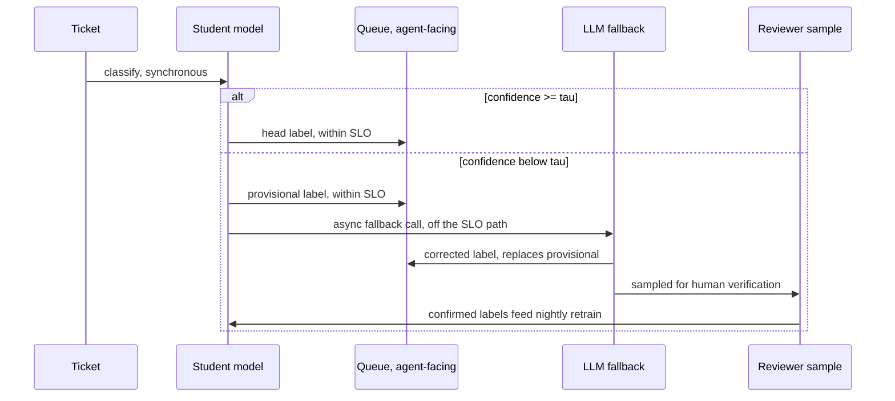
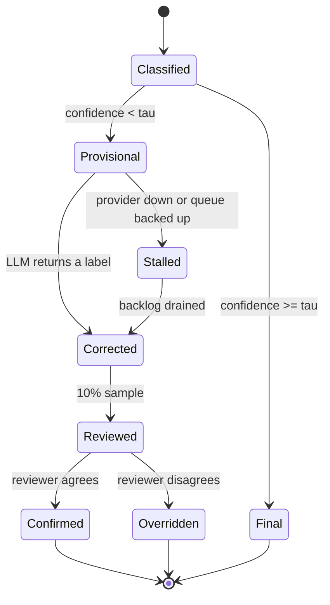

# Design an LLM + Classical Hybrid Support-Ticket Triage System

*Routing 2M tickets/month under a 200ms p99 SLO, where the head is a classical-ML problem and the tail is an LLM problem — inside one product.*

---

## Intuition

> Triage is not one problem. It is two problems wearing the same interface.

Forty **head** categories — billing, login, refund, outage — cover 85% of the volume and have years of hand-labelled history. They are a textbook supervised-classification problem: abundant labels, stable taxonomy, and a latency budget a distilled encoder clears with room to spare. Roughly 300 **tail** categories — a specific partner integration failing, a rare plan combination, a bug that appeared last Tuesday — cover the other 15% and have essentially no labels, because each one is individually too rare and too fast-changing to have ever justified a labelling pass. They are a textbook LLM problem: open-ended, low-volume, defined by a taxonomy description rather than by examples.

**Key insight:** the paradigm choice is not a property of the *product*, it is a property of the *slice of traffic*. A team that picks one model for the whole feature is answering the wrong question. Route by slice, and let a calibrated confidence score decide which slice a ticket is in.

**Mental model:** think of the classical model as a fast reflex and the LLM as deliberate thought. The reflex must always fire inside the SLO, because that is what the SLO measures. Deliberate thought is allowed to take longer, provided nothing the user experiences is waiting on it. Every architectural decision in this design falls out of keeping those two on separate clocks.

The mistake this design exists to prevent: putting the LLM on the synchronous path "just for the hard 15%". A 15% slice on a 900ms path does not cost you 15% of your latency budget — it costs you your p99, entirely, because the p99 is measured over all traffic and 15% is far above the 1% the tail percentile samples.

---

## 1. Requirements Clarification

The questions worth asking before drawing a box, with the answers this design assumes.

**What exactly is being predicted?**
The queue a ticket lands in — one of 40 head categories or ~300 tail categories — at ingest time. Not the answer to the ticket, not a resolution, not a draft reply. Routing only. This scoping matters: an LLM that *answers* tickets is a different system with a different SLO (the customer is waiting on a reply, so 2s is fine) and different economics.

**Functional requirements**
- Classify every inbound ticket into exactly one of ~340 categories at ingest.
- Assign a queue before an agent could plausibly open the ticket.
- Correct an initially-provisional assignment when a better label arrives, without the agent losing the ticket.
- Emit a confidence score per prediction, consumable by downstream routing rules.
- Feed reviewer-confirmed labels back into training, so the taxonomy the classical model covers grows over time.

**Non-functional requirements**
- **Latency: 200ms p99 on the routing decision.** This is a hard veto, not a preference. It is set by the product: tickets appear in an agent's queue view that polls every few hundred milliseconds, and a ticket that arrives unrouted is visibly broken.
- **Throughput:** 2,000,000 tickets/month, with a 5x peak multiplier during incident-driven spikes.
- **Accuracy:** blended routing accuracy above 90%, where "correct" means the agent who opens it does not re-route it. Per-category precision on the 40 head categories above 90%.
- **Availability:** 99.9% on the routing decision. Critically, this SLO must hold *through an LLM provider outage* — see §8.
- **Cost:** under $20k/year all-in for the routing system. This is a support-ops budget line, not an ML-platform budget line.

**Constraints worth surfacing in an interview**
- **PII.** Ticket bodies contain names, order numbers, sometimes payment context. Sending them to a hosted LLM requires a data-processing agreement and a redaction pass. This is a real gate on the design, not a footnote: if the answer is "we cannot send ticket text off-premises", the entire fallback tier becomes a self-hosted open-weight model and §5's cost table changes.
- **Language.** Assume English-primary. Non-English traffic routes to a language-specific queue by a cheap language-ID model before the classifier ever runs — a separate, much easier problem that should not be smuggled into this one.
- **Taxonomy churn.** The 300 tail categories are not static. Support ops adds and retires them monthly. Any design that requires retraining to recognise a new category is structurally wrong for the tail.

**Explicit non-goals**
- Ticket resolution, reply drafting, or agent assist.
- Sentiment and priority scoring (separate models, separate fields, same ingest hook).
- Routing to an individual agent — this routes to a queue; skill-based agent assignment is downstream.

---

## 2. Scale Estimation

Everything below is derived, not asserted. An interviewer's real question in this section is whether you can size a system from first principles when the numbers change.

**Traffic**

```
  2,000,000 tickets/month
  / 30 days / 86,400 s                       =  0.77 tickets/second (average)
  x 5 (incident-driven peak multiplier)       =  3.9 tickets/second (peak)
  x 3 (safety factor for capacity planning)   = ~12 tickets/second (design point)
```

Note how small this is. 0.77 req/s is not a throughput problem — it is a **latency and cost** problem. Candidates who spend the interview on sharding and horizontal scale have misread the requirements. The binding constraints here are the 200ms p99 and the $20k budget, and both are decided by *which model serves which ticket*, not by how many boxes you run.

**Where the 5x peak multiplier comes from — and why it is the wrong worry**

Support traffic is not Poisson. It is driven by *incidents*: a payment provider degrades and 40,000 people write in about the same thing within twenty minutes. That is a 40x instantaneous burst on a 0.77 req/s baseline, far above the 5x planning multiplier.

```
  incident burst : 40,000 tickets / 1,200 s  =  33 tickets/second
  student capacity, one instance             = 150-200 tickets/second
  utilisation during the burst               = ~20%
```

The instance absorbs it. What does *not* absorb it is the fallback tier — an incident produces a flood of near-identical, novel tickets, exactly the shape the router flags as low-confidence, so a 40x traffic burst can produce a 100x+ fallback burst against a provider rate limit. **The capacity risk in this system is on the asynchronous path, not the synchronous one**, which is the inverse of where most candidates look. Mitigations: a token-bucket rate limiter in front of the fallback consumer (the queue is doing its job by growing), and near-duplicate collapse — hash the redacted text, and if 40,000 tickets share a hash prefix, call the teacher once and fan the label out.

**The head/tail split**

```
  head : 2,000,000 x 0.85  = 1,700,000 tickets/month across 40 categories
  tail : 2,000,000 x 0.15  =   300,000 tickets/month across ~300 categories
                             = ~1,000 tickets/month per tail category, on average
```

That last number is the whole argument. A thousand examples per month sounds like plenty until you remember the distribution inside the tail is itself long-tailed: the median tail category sees tens of tickets a month, not a thousand. There is no world in which you hand-label 300 categories at that volume.

**Token accounting for the LLM tier**

A fallback call carries the ticket text plus the tail taxonomy. With prompt caching on the taxonomy block, the per-call marginal cost is dominated by the ticket itself.

```
  ticket text (median support ticket)        ~  400 input tokens
  taxonomy + instructions (cached)           ~ 6,000 input tokens, charged at 0.1x on a cache hit
  structured category output                 ~   60 output tokens

  Claude Haiku 4.5, $1/MTok input, $5/MTok output:
    uncached input :    400 x $1  / 1e6      = $0.00040
    cached  input :   6,000 x $0.10 / 1e6    = $0.00060   (cache hit rate ~99%, taxonomy is static)
    output        :      60 x $5  / 1e6      = $0.00030
  ------------------------------------------------------------
  per call, without caching the taxonomy     ~ $0.0007
  per call, with the taxonomy cached          ~ $0.0013 -> $0.0007 once amortised over the hit rate
```

Prices verified against the [Claude pricing page](https://platform.claude.com/docs/en/about-claude/pricing) (Haiku 4.5 at $1/MTok input, $5/MTok output, cache hits at 0.1x input). Anthropic's own worked example puts a full 10,000-ticket support *conversation* workload at ~$37 — about $0.0037/ticket for multi-turn conversation, which is 5x our per-call number precisely because classification is one short turn, not a conversation. **Use $0.0007/call** throughout. Re-derive it whenever the model or the prompt changes; the number is an input to every table below, not a constant.

**The three cost curves**

```
  ALL-LLM        : 2,000,000/mo x $0.0007          = $1,400/mo   = $16,800/year
  ALL-CLASSICAL  : 1 x g5.xlarge on-demand, 24x7
                   $1.006/hr x 730 hr/mo           =   $734/mo   =  $8,700/year
                   + year-1 training/labelling                    = +$40,000 one-time
  HYBRID         : $8,700 GPU + fallback + review                = see §5
```

**Fallback volume — the number the hybrid's economics hang on**

```
  genuinely-tail tickets the router correctly flags low-confidence:
      300,000 x 0.90                                     = 270,000/mo
  head tickets the router flags low-confidence (false positives):
    1,700,000 x 0.02                                     =  34,000/mo
  --------------------------------------------------------------------
  total LLM fallback volume                               ~ 304,000/mo
                                                          = 15.2% of traffic
  cost: 304,000 x $0.0007                                 = $213/mo = $2,554/year
```

**Storage**

```
  prediction log : 2M/mo x ~800 bytes (text hash, label, confidence, path, latency)
                                                    = 1.6 GB/month
  review queue   : 304,000 x 0.10 sampled x ~2 KB  = 61 MB/month
  training set   : 24 months of head history, ~3M labelled tickets x ~1.5 KB
                                                    = 4.5 GB, trivially S3-resident
```

Nothing here is a storage problem either. Say so in the interview and move on — recognising which dimensions are *not* constraints is as much a signal as sizing the ones that are.

---

## 3. High-Level Architecture

```mermaid
%%{init: {'flowchart': {'curve': 'basis', 'nodeSpacing': 45, 'rankSpacing': 55}}}%%
flowchart LR
    classDef io      fill:#61afef,stroke:#2e86c1,color:#1a1a1a,font-weight:bold
    classDef fast    fill:#98c379,stroke:#27ae60,color:#1a1a1a
    classDef slow    fill:#d19a66,stroke:#e67e22,color:#1a1a1a
    classDef human   fill:#c678dd,stroke:#8e44ad,color:#1a1a1a
    classDef store   fill:#e5c07b,stroke:#f39c12,color:#1a1a1a

    tk(["Inbound ticket"]) --> redact["PII redaction<br/>+ language ID"]
    redact --> student["Distilled student<br/>40-class encoder<br/>p99 15ms"]
    student --> router{"Calibrated<br/>confidence<br/>>= tau?"}

    router -->|"yes, 85%"| q(["Agent queue<br/>final label"])
    router -->|"no, 15%"| prov(["Agent queue<br/>provisional label"])

    prov -.-> fb["Async fallback queue"]
    fb --> llm["LLM teacher<br/>full 340-cat taxonomy"]
    llm --> correct["Queue correction<br/>replaces provisional"]
    correct --> q

    llm -->|"10% sample"| review["Human review"]
    review --> labels[("Label store")]
    labels --> retrain["Nightly retrain<br/>+ category graduation"]
    retrain --> student

    class tk,q,prov io
    class redact,student,router,correct fast
    class fb,llm slow
    class review,retrain human
    class labels store
```



The single most important edge in this diagram is the **dotted** one. Everything above it runs on the request path and is measured by the 200ms SLO. Everything below it runs on a queue and is not. The `prov` node exists solely so that the dotted edge can be dotted: without a provisional label to ship immediately, the fallback would have to be synchronous, and the SLO would inherit the LLM's latency distribution for 15% of traffic.

The feedback loop at the bottom is what makes this design get *cheaper* over time rather than more expensive. Reviewer-confirmed tail labels accumulate; once a tail category has enough of them, it graduates into the student's label space and stops generating fallback calls forever.

**The async correction flow, in detail:**



The `alt` branch is the design. On both paths the queue has a label inside the SLO; only the *correction* is deferred. An agent working a queue at human speed — tens of seconds per ticket — never observes the difference, which is why "provisional for 800ms" is an acceptable product behaviour and "unrouted for 800ms" is not.

**A ticket's lifecycle**, which is the state machine the queue and the review loop share:



`Stalled` is a first-class state, not an error state. A ticket sitting there still has a queue and an agent can still work it — which is precisely the property that turns a provider outage into a latency degradation rather than an incident (§8.2). Systems that model this as a failure end up retrying, alerting and paging on something that is behaving as designed.

---

## 4. Component Deep Dives

### 4.1 The label-distillation pipeline

The tail has no labels. The LLM's first job is not to serve traffic — it is to *manufacture a training set*. Run it offline over historical tickets, at batch pricing, and you convert an unlabelled corpus into a supervised problem.

```python
"""Bootstrap tail labels with an LLM teacher, then distil into a student encoder."""
from __future__ import annotations

import json
import torch
import torch.nn.functional as F
from anthropic import Anthropic
from transformers import AutoModelForSequenceClassification, AutoTokenizer

client = Anthropic()

TAXONOMY = json.load(open("taxonomy.json"))          # 340 categories, name + one-line description
SYSTEM = (
    "You classify support tickets into exactly one category from the provided taxonomy. "
    "Return JSON: {\"category\": <name>, \"confidence\": <0-1>, \"rationale\": <one sentence>}. "
    "If no category fits, return category \"UNKNOWN\"."
)


def teacher_label(ticket_text: str) -> dict:
    """One teacher call. The taxonomy block is cached: it is identical on every call."""
    resp = client.messages.create(
        model="claude-haiku-4-5",
        max_tokens=128,
        system=[
            {"type": "text", "text": SYSTEM},
            # Cache the 6k-token taxonomy: charged at 1.25x once, then 0.1x on every hit.
            {"type": "text", "text": json.dumps(TAXONOMY),
             "cache_control": {"type": "ephemeral"}},
        ],
        messages=[{"role": "user", "content": ticket_text}],
    )
    return json.loads(resp.content[0].text)
```

Two details that separate a working bootstrap from a broken one.

**Keep the teacher's full probability signal, not just its argmax.** A hard label throws away everything the teacher knew about its own uncertainty, and uncertainty is exactly the signal the student needs to learn a *calibrated* confidence — which the router then thresholds. If the teacher exposes logprobs, distil against them; if it only returns a self-reported confidence, use that to weight the example.

**Never train the student on teacher labels the reviewers have not sampled.** The teacher is wrong on the tail at a measurable rate (this design assumes 85% — see §2), and a student trained on unaudited teacher output inherits that error *and* launders it into something that looks like ground truth. The 10% review sample is not QA theatre; it is the only thing standing between you and a model confidently reproducing an LLM's mistakes.

```python
def distillation_loss(student_logits, teacher_probs, hard_labels, T: float = 2.0, alpha: float = 0.5):
    """Hinton distillation: soft targets carry the teacher's uncertainty structure.

    T > 1 flattens both distributions so the student learns the teacher's RANKING over
    wrong classes, not just its top pick. The T**2 factor restores the soft term's
    gradient magnitude, which otherwise scales as 1/T**2 and silently vanishes.
    """
    soft = F.kl_div(
        F.log_softmax(student_logits / T, dim=-1),
        teacher_probs.pow(1.0 / T) / teacher_probs.pow(1.0 / T).sum(-1, keepdim=True),
        reduction="batchmean",
    ) * (T ** 2)
    hard = F.cross_entropy(student_logits, hard_labels)
    return alpha * soft + (1 - alpha) * hard


def train_student(train_ds, n_labels: int = 40):
    tok = AutoTokenizer.from_pretrained("distilbert-base-uncased")
    model = AutoModelForSequenceClassification.from_pretrained(
        "distilbert-base-uncased", num_labels=n_labels
    ).cuda()
    opt = torch.optim.AdamW(model.parameters(), lr=3e-5, weight_decay=0.01)

    for batch in train_ds:                                  # 3 epochs over ~3M head tickets
        enc = tok(batch["text"], truncation=True, max_length=256,
                  padding=True, return_tensors="pt").to("cuda")
        logits = model(**enc).logits
        loss = distillation_loss(logits, batch["teacher_probs"].cuda(),
                                 batch["hard_label"].cuda())
        loss.backward()
        opt.step()
        opt.zero_grad(set_to_none=True)
    return model, tok
```

`max_length=256` is a deliberate cost/accuracy trade: support tickets have a heavy head of short messages, and truncating the long tail of pasted stack traces costs little accuracy while halving inference cost against `512`. Measure it on your own length distribution before copying the number.

### 4.2 The confidence router

A raw softmax from a fine-tuned encoder is **not** a probability. Modern deep classifiers are systematically overconfident — a model reporting 0.95 is right rather less than 95% of the time — and thresholding an uncalibrated score means your `tau` has no stable meaning. Temperature scaling is the cheapest fix that works: one scalar, fitted post-hoc on a held-out set, monotone so it cannot change any argmax.

```python
class TemperatureScaler(torch.nn.Module):
    """One learned scalar. Fit AFTER training, on a held-out set the model never saw."""

    def __init__(self):
        super().__init__()
        self.log_T = torch.nn.Parameter(torch.zeros(1))     # T = exp(0) = 1 at init

    def forward(self, logits):
        return logits / self.log_T.exp()

    def fit(self, val_logits, val_labels, steps: int = 200):
        opt = torch.optim.LBFGS([self.log_T], lr=0.01, max_iter=steps)

        def closure():
            opt.zero_grad()
            loss = F.cross_entropy(self(val_logits), val_labels)
            loss.backward()
            return loss

        opt.step(closure)
        return self
```

The router itself is deliberately boring. Everything interesting has already happened by the time it runs.

```python
def route_ticket(text: str, student, scaler, tau: float = 0.75) -> dict:
    """Synchronous decision only. This function is what the 200ms SLO measures."""
    logits = student.logits(text)                       # ~15ms p99 on a g5.xlarge
    probs = torch.softmax(scaler(logits), dim=-1)       # calibrated
    conf, idx = probs.max(dim=-1)

    if conf.item() >= tau:
        return {"queue": student.labels[idx], "confidence": conf.item(),
                "path": "student", "provisional": False}

    # Ship a provisional assignment NOW; correct it asynchronously.
    enqueue_llm_fallback(text)                          # returns immediately; SQS put ~2ms
    return {"queue": "pending_review", "confidence": conf.item(),
            "path": "student", "provisional": True}
```

**Conformal abstention is the principled alternative to a hand-tuned `tau`.** Temperature scaling makes the score honest; it does not tell you where to cut. Split conformal prediction does, with a *distribution-free finite-sample guarantee*: pick a target error rate `alpha`, compute the empirical quantile of nonconformity scores on a calibration set, and every prediction set built from that quantile covers the true label with probability at least `1 - alpha`. Abstain — route to the LLM — whenever the set is not a singleton.

```python
import numpy as np


def conformal_threshold(cal_probs: np.ndarray, cal_labels: np.ndarray, alpha: float = 0.05) -> float:
    """Split-conformal calibration. Returns q_hat: keep classes with prob >= 1 - q_hat.

    Guarantee: the resulting prediction sets contain the true label with probability
    >= 1 - alpha, marginally, with NO assumption on the model or the data distribution
    beyond exchangeability of the calibration and test sets.
    """
    n = len(cal_labels)
    scores = 1.0 - cal_probs[np.arange(n), cal_labels]     # nonconformity of the TRUE class
    level = np.ceil((n + 1) * (1 - alpha)) / n             # finite-sample correction
    return float(np.quantile(scores, min(level, 1.0), method="higher"))


def route_conformal(probs: np.ndarray, labels: list[str], q_hat: float) -> dict:
    keep = [labels[i] for i in np.where(probs >= 1.0 - q_hat)[0]]
    if len(keep) == 1:
        return {"queue": keep[0], "provisional": False}
    # Empty set (nothing confident enough) or ambiguous set (several plausible) -> LLM.
    return {"queue": "pending_review", "provisional": True, "candidates": keep}
```

The tradeoff is honest and worth stating in an interview: conformal gives you a *coverage* guarantee and a knob (`alpha`) with a meaning, but the abstention *rate* is whatever the data says it is — you do not get to choose it. A hand-tuned `tau` lets you pin the abstention rate to your fallback budget and gives up the guarantee. This design ships `tau` because the budget is a hard constraint and the review loop provides an empirical safety net; see §5 for when that call flips. Cross-reference [uncertainty_quantification_and_conformal_prediction](../uncertainty_quantification_and_conformal_prediction/uncertainty_quantification_and_conformal_prediction.md) and [model_calibration_and_thresholding](cross_cutting/model_calibration_and_thresholding.md).

### 4.3 The broken version, and the fix

This is the mistake the design exists to prevent, and it is worth showing in the form it actually shipped in. The first pass had the ticket wait for the LLM whenever confidence was low:

```python
# BROKEN: this passed every test at low traffic, then breached the SLO in production.
def route_ticket_broken(text: str, student, scaler, tau: float = 0.75) -> dict:
    probs = torch.softmax(scaler(student.logits(text)), dim=-1)
    conf, idx = probs.max(dim=-1)
    if conf.item() >= tau:
        return {"queue": student.labels[idx]}
    label = call_llm_sync(text)          # <-- blocks. 300-1200ms. On the SLO path.
    return {"queue": label}
```

Work the latency arithmetic and the failure is arithmetic, not bad luck. Let `p = 0.15` be the fallback rate:

```
  85% of traffic : 15ms
  15% of traffic : 15ms + LLM latency

  The p99 of the OVERALL distribution samples the slowest 1% of ALL traffic.
  Since 15% > 1%, the overall p99 lies entirely inside the LLM branch:

    overall p99  ~=  15ms + (LLM's p93 within its own branch)
                 ~=  15ms + ~900ms
                 ~=  915ms          against a 200ms budget -> 4.6x over

  Even at p = 0.005 (half a percent!) the p99 would still land in the LLM branch
  for the top 0.5% of traffic. There is no fallback rate small enough to make a
  synchronous 900ms call safe under a 200ms p99. The fix is structural, not a tuning.
```

The fix is `route_ticket` in §4.2: ship a provisional label immediately, correct asynchronously. It is not an optimisation layered on the design — it is the mechanism that makes the SLO achievable at all. A synchronous fallback silently inherits the provider's entire latency distribution for its slice, no matter how small the slice is.

### 4.4 The eval harness that catches prompt drift

The classical model has a training distribution, so classical drift detection applies to it ([monitoring_and_drift_detection](../monitoring_and_drift_detection/monitoring_and_drift_detection.md)). The LLM tier has *no training distribution you control* — the vendor's does, and it can change under a stable alias. The only defence is a frozen golden set scored on every release and on a schedule.

```python
GOLDEN = load_jsonl("golden_500.jsonl")   # 500 reviewer-confirmed tickets, frozen, version-pinned


def score_release(model_id: str, prompt_version: str) -> dict:
    correct, per_cat = 0, {}
    for ex in GOLDEN:
        pred = teacher_label_with(ex["text"], model_id=model_id, prompt=prompt_version)
        ok = pred["category"] == ex["label"]
        correct += ok
        per_cat.setdefault(ex["label"], [0, 0])
        per_cat[ex["label"]][0] += ok
        per_cat[ex["label"]][1] += 1
    return {
        "accuracy": correct / len(GOLDEN),
        "worst_category": min(per_cat.items(), key=lambda kv: kv[1][0] / kv[1][1]),
        "model_id": model_id, "prompt_version": prompt_version,
    }


def gate(baseline: dict, candidate: dict, tol: float = 0.02) -> bool:
    """Block the release on a regression. Aggregate accuracy alone is NOT enough:
    a 2-point aggregate drop can hide a category that went from 95% to 20%."""
    if candidate["accuracy"] < baseline["accuracy"] - tol:
        return False
    return candidate["worst_category"][1][0] / candidate["worst_category"][1][1] >= 0.60
```

**Pin the model version, never the alias.** An alias like `claude-haiku-4-5` is a moving target by design; a dated model id is not. Pin the dated id in production config, run the golden set against the new id in CI when you want to move, and promote only on a green gate. Treating an alias as stable is how a system silently changes behaviour on a day nobody deployed anything.

### 4.5 The human-review loop and category graduation

Ten percent of LLM-corrected tail tickets are sampled for human verification. A confirmed label joins the training set; an overridden label joins it *as the human's version*, and the category is flagged for a prompt review if its override rate is high. Once a tail category accumulates enough reviewer-confirmed examples — a few hundred, the same order of magnitude it takes to bootstrap any new class — it graduates into the student's label space at the next retrain.

```python
GRADUATION_MIN_CONFIRMED = 300
GRADUATION_MAX_OVERRIDE_RATE = 0.15


def graduation_candidates(label_store) -> list[str]:
    """Tail categories the student can now learn directly. Run before each nightly retrain."""
    out = []
    for cat, stats in label_store.tail_stats().items():
        if stats.confirmed < GRADUATION_MIN_CONFIRMED:
            continue
        if stats.override_rate > GRADUATION_MAX_OVERRIDE_RATE:
            continue        # the teacher is unreliable here; a student would only amplify it
        out.append(cat)
    return out
```

The override-rate gate is the one people leave out. A category the teacher gets wrong 40% of the time has plenty of "confirmed" examples in absolute terms and is exactly the category you must not graduate — you would be promoting the teacher's confusion into the fast path, where nothing reviews it any more.

### 4.6 PII redaction on the ingest path

§1 lists PII as a constraint. It is also a latency line item, and it sits *before* the classifier, so it eats the same 200ms budget.

```python
import re

PATTERNS = {
    "EMAIL":  re.compile(r"\b[\w.+-]+@[\w-]+\.[\w.]+\b"),
    "CARD":   re.compile(r"\b(?:\d[ -]*?){13,19}\b"),
    "ORDER":  re.compile(r"\bORD-\d{6,12}\b"),
    "PHONE":  re.compile(r"\+?\d[\d\s().-]{7,}\d"),
}


def redact(text: str) -> tuple[str, dict[str, int]]:
    """Replace PII with typed placeholders. ~0.3ms on a 400-token ticket.

    Placeholders, not deletion: the classifier benefits from knowing an order number
    was PRESENT (that is signal for the 'order status' category) while never seeing
    its value. Deleting the span destroys that signal and measurably hurts accuracy.
    """
    counts = {}
    for name, pat in PATTERNS.items():
        text, n = pat.subn(f"<{name}>", text)
        counts[name] = n
    return text, counts
```

Three things this gets right that a naive version does not.

**Redact once, at ingest, and store only the redacted form** in the fallback queue, the prediction log and the label store. A redaction pass that runs only on the LLM path leaves raw PII in the log that feeds training, which is the same exposure with a longer half-life.

**Typed placeholders preserve signal.** `<CARD>` tells the model a card number was mentioned; deleting the digits tells it nothing. On this taxonomy the presence of an order number is one of the strongest features for the order-status categories.

**Regex is a floor, not a ceiling.** Names and addresses need an NER pass, which costs 5-10ms and must be budgeted against the 200ms SLO like any other component. If your compliance posture requires it, that is a real 5-10ms, and the honest move is to put it in the latency table in §10 rather than to pretend the redaction is free.

### 4.7 Correction mechanics — idempotency and ordering

The async correction path is where distributed-systems bugs enter what otherwise looks like an ML problem. Three properties are load-bearing.

```python
def apply_correction(ticket_id: str, corrected: str, teacher_run_id: str, store) -> bool:
    """Idempotent, ordered, and safe against a human who already acted."""
    tk = store.get(ticket_id)

    # 1. Idempotency: at-least-once delivery means this WILL be called twice.
    if teacher_run_id in tk.applied_runs:
        return False

    # 2. Ordering: a retry can deliver an older correction after a newer one.
    #    Sequence on the enqueue time, not on arrival.
    if tk.last_correction_seq is not None and tk.enqueue_seq <= tk.last_correction_seq:
        return False

    # 3. Human wins. If an agent has already re-routed this ticket, the model
    #    does not get to overrule them -- but we DO record the disagreement,
    #    because an agent override is the cheapest label in the whole system.
    if tk.manually_routed:
        store.record_disagreement(ticket_id, model_said=corrected, human_said=tk.queue)
        return False

    store.update(ticket_id, queue=corrected, provisional=False,
                 applied_runs=tk.applied_runs | {teacher_run_id},
                 last_correction_seq=tk.enqueue_seq)
    return True
```

The third branch is the one worth arguing for in an interview. Agent overrides are free, high-quality, in-distribution labels arriving continuously — a strictly better signal than the 10% review sample, which costs money and lags. A system that silently overwrites them is discarding its best training data *and* teaching agents that the routing is unpredictable. Log every disagreement and feed it into the same label store as the reviewer sample, weighted higher.

---

## 5. Design Decisions & Tradeoffs

### 5.1 The decision that justifies the whole design

| Path | Year-1 cost | Year-2+ cost | Meets 200ms p99? | Blended routing accuracy |
|------|------------|---------------|:---:|:---:|
| All-LLM (Claude Haiku 4.5, every ticket) | ~$16,800 | ~$16,800 | **No** — 300-1200ms per call | High on both head and tail, but disqualified on latency |
| All-classical (DistilBERT, head only, no tail labels) | ~$48,700 | ~$8,700 | Yes — 5-15ms | ~80% (every tail ticket misrouted) |
| **Hybrid (student + calibrated router + LLM fallback)** | **~$55,450** | **~$12,750** | **Yes** — the synchronous path is always the student's | **~91%** |

Steady state for the hybrid is `$8,700 (GPU) + $2,554 (fallback at ~15% of traffic) + ~$1,500 (ongoing review sampling)`. That is **24% cheaper than routing every ticket through the LLM** ($12,750 vs $16,800/year) while being the *only* option that clears the latency SLO, and it buys about **eleven points of routing accuracy** over the all-classical path for roughly $4,050/year more than the cheapest option. The year-1 premium over all-classical (~$6,750: a $4,200 LLM-assisted tail-labelling bootstrap plus the first year of fallback traffic) buys tail coverage that pure classical structurally cannot have, because pure classical never had labels for those 300 categories.

**Verifying the 91% blended-accuracy figure** — asserted numbers are worthless in a design round, so walk it:

```
  head     :  1,700,000/mo x 0.94 (student accuracy on head)             = 1,598,000 correct/mo

  tail     :    300,000/mo
             x 0.90 (router correctly flags it low-confidence)
             x 0.85 (LLM-corrected tail accuracy once it arrives)        =   229,500 correct/mo
             +   300,000/mo x 0.10 (missed by router, silently wrong)    =         0 correct/mo
  --------------------------------------------------------------------------------------------
  total correct     :  1,598,000 + 229,500                               = 1,827,500 / 2,000,000
  blended accuracy  :  1,827,500 / 2,000,000                             =            91.4%
```

The 10% of tail traffic the router misses — a genuinely-tail ticket the student was confidently, wrongly sure about — is the residual error the review sample exists to catch. It is not zero, but it is a known, measured, shrinking number rather than the unmeasured ~100% miss rate the all-classical path carries silently.

### 5.2 Why `tau = 0.75`

The threshold is a calibration exercise, not a guess. Build a held-out set of student predictions against known labels, sort by calibrated confidence, and sweep the cutoff.

| `tau` | Precision on the confident bucket | Share of traffic kept synchronous | Monthly fallback cost |
|-------|-----------------------------------|-----------------------------------|-----------------------|
| 0.60 | 88% | 94% | ~$84 |
| **0.75** | **95%** | **85%** | **~$213** |
| 0.90 | 99% | 61% | ~$546 |

A lower `tau` keeps more traffic on the fast, cheap path but accepts more silent misroutes. A higher `tau` catches more errors but pushes more volume through the LLM, which costs more per ticket even off the latency-critical path. `0.75` is where this team accepted "precise enough to auto-route without a human check, without sending the majority of traffic through the LLM" — a business tradeoff tuned against the misroute rate they are willing to own, not a constant the framework hands you.

### 5.3 The other decisions, and what would flip them

| Decision | Chosen | Alternative | Why chosen | What flips it |
|---|---|---|---|---|
| Head model | Distilled DistilBERT, 40 classes | Prompted LLM for everything | 15ms vs 900ms; $0.0000004 vs $0.0007 per ticket | Head volume collapsing below ~200k/mo, where the GPU never amortises |
| Router threshold | Hand-tuned `tau` | Split-conformal abstention | `tau` pins the abstention rate to the fallback budget | A regulatory or contractual coverage guarantee — conformal gives one, `tau` does not |
| Fallback tier | Hosted LLM API | Self-hosted open-weight model | No GPU fleet, no eval-harness for a model you own, taxonomy changes are a prompt edit | PII rules forbidding off-premises text, or fallback volume above ~2M calls/month where a self-hosted 8B model wins on unit cost |
| Fallback timing | Async, after a provisional label | Synchronous | §4.3 — the p99 arithmetic makes sync structurally impossible | An SLO above ~2s, at which point sync is simpler and simpler wins |
| Retrain cadence | Nightly | Weekly / on-demand | Tail categories graduate as soon as they qualify, shrinking fallback cost monthly | Label volume too low for a nightly delta to matter; then weekly, with the same gates |
| Provider version | Pinned dated model id | Floating alias | An alias changes behaviour without a deploy (§4.4) | Nothing. Never float an alias in a graded path |
| Taxonomy delivery | Cached prompt block | Fine-tuned tail classifier | 300 categories churn monthly; a prompt edit ships in minutes, a retrain does not | The taxonomy stabilising, at which point the whole tail becomes a classical problem |

### 5.4 What happens when the provider deprecates the model

This is the tradeoff candidates almost never raise, and it is the one that bites in year two. A hosted model has a lifecycle you do not control. The mitigations that actually work:

1. **Pin dated model ids**, so a retirement is a scheduled event with a notice period rather than a silent behaviour change.
2. **Keep the golden set and the gate** (§4.4) — migrating to a successor model is then a measured decision, not a leap.
3. **Keep the prompt provider-portable.** A taxonomy in JSON and a structured-output instruction port across vendors in an afternoon. A prompt tuned to one model's quirks does not.
4. **Let the graduation loop run.** Every category that graduates is one fewer category depending on any vendor at all. Over two years this is the real hedge: the system is designed to need the LLM *less* over time.

---

## 6. Real-World Implementations

**Zendesk intelligent triage** is the closest published production analogue to the classical tier here. It classifies every inbound ticket by intent, sentiment and language using models trained on the customer's own historical tickets, writing the predictions into custom fields that downstream routing rules and reports consume without waiting for an agent to read the ticket. Two design choices are worth lifting: the classifications are written as *fields*, so routing logic stays declarative and auditable rather than being buried in the model; and intent, sentiment and language are separate predictions, not one fused label — the same separation this design assumes in §1's non-goals. ([Zendesk: About intelligent triage](https://support.zendesk.com/hc/en-us/articles/4964463770650-About-intelligent-triage), [Automatically classifying tickets](https://support.zendesk.com/hc/en-us/articles/4550640560538-Automatically-classifying-customer-intent-sentiment-and-language))

**Salesforce Einstein Case Classification** is the same shape with the label-scarcity problem stated explicitly in the product docs. Admins choose which picklist fields to predict (Type, Reason, Priority, custom picklists) and Salesforce trains a per-field model on the org's resolved cases. The documented data floor is the interesting part: Salesforce warns that a segment with only 400-1,000 closed cases can build a model but that the low volume hurts prediction quality. That threshold is precisely why the ~300 tail categories in this design — with a median of *tens* of tickets a month — cannot be served by a per-category supervised model at all, and why an LLM reading a taxonomy description is the only tier that covers them. Einstein also ships a graded-automation ladder (recommend the top three values to an agent, or populate the field automatically), which is the same provisional-then-confirmed idea this design implements with `tau`. ([Salesforce Help: Configure Your Einstein Classification Model](https://help.salesforce.com/s/articleView?language=en_US&id=sf.cc_service_new_model.htm&type=5), [Einstein Case Classification](https://www.salesforce.com/blog/einstein-case-classification/))

**Intercom's Fin** is the fully-generative end of the spectrum and the useful contrast. Intercom reports an average resolution rate across customers that has climbed steadily — 76% as of their March 2026 post — and has explicitly moved its own success metric away from a binary resolved/not-resolved toward outcome-based measurement as the agent took on harder problems. Note what Fin is doing that this design deliberately is not: *resolving* tickets, where the customer is already waiting on a reply and a second of latency is invisible. That different SLO is what licenses a different architecture. It is also worth knowing that third-party measurements of production resolution rates run materially below the vendor-reported figure, which is a general lesson about vendor metrics rather than a criticism of Fin: **the number that matters is the one measured on your own traffic**. ([Intercom: From resolutions to outcomes](https://www.intercom.com/blog/from-resolutions-to-outcomes-evolving-how-fin-delivers-value/))

**Klarna** is the cautionary implementation, and the most instructive of the four. Klarna's OpenAI-built assistant handled two-thirds of customer-service chats in its first month — 2.3M conversations, work equivalent to 700 full-time agents, resolution time down from 11 minutes to under 2, an estimated $40M profit improvement in 2024. Then, in 2025, Klarna publicly reversed course: the CEO said the automation push had gone too far on quality and the company began rehiring human agents so customers could always reach a person. The lesson for this design is not "do not use LLMs" — it is that the *escalation path and the human loop are load-bearing parts of the architecture*, not a phase-two nicety. The 10% review sample and the `pending_review` queue in §3 are exactly the components Klarna had to add back. ([OpenAI: Klarna](https://openai.com/index/klarna/), [Klarna press release](https://www.klarna.com/international/press/klarna-ai-assistant-handles-two-thirds-of-customer-service-chats-in-its-first-month/))

---

## 7. Technologies & Tools

| Tool | Role in this system |
|------|---------------------|
| Hugging Face `transformers` | Student model definition, tokenizer, training loop |
| DistilBERT (or a comparable small encoder) | The 40-class student — 6 layers, 66M params, ~15ms p99 on a single GPU |
| PyTorch | Training, the distillation loss, temperature-scaling fit |
| ONNX Runtime or NVIDIA Triton | Serving the student with dynamic batching; Triton if you need multi-model or shadow deploys on one box |
| Claude API (Haiku 4.5, dated model id) | The fallback teacher and the offline label bootstrap; prompt caching on the taxonomy block |
| Amazon SQS (or Kafka) | The async fallback queue — the component that makes the dotted edge in §3 possible |
| MLflow | Model registry, the promotion gate, and the run that records each `tau` sweep |
| Argilla or Label Studio | The reviewer UI over the 10% sample; feeds the label store |
| A feature/label store (Feast, or plain Parquet on S3 at this scale) | Reviewer-confirmed labels, category graduation counters |
| Prometheus + Grafana | Fallback rate, graduation rate, per-category precision, cost per ticket |
| Evidently or a bespoke golden-set runner | Drift on the student; §4.4's gate on the LLM tier |

At 0.77 req/s, resist the platform. A queue, one GPU box, an object store and a dashboard is the correct amount of infrastructure. See [model_serving_and_inference](../model_serving_and_inference/model_serving_and_inference.md) for when the serving stack genuinely needs to grow.

---

## 8. Operational Playbook

### 8.1 Rollout — three reversible phases

Ship this in phases that each roll back to the previous one without a code change.

**Phase 1 — classical only, LLM in shadow.** The head-only router serves all traffic. The LLM is called on every low-confidence ticket but its answer is *logged and discarded*. This measures the true tail-misroute rate against live traffic instead of an offline estimate, and it exercises the fallback queue under real load before anything depends on it. Run for two weeks minimum.

**Phase 2 — fallback live, conservative `tau`.** Turn on the correction path with `tau = 0.90`, which keeps fallback volume low (~39% of traffic per §5.2's sweep — deliberately generous while the async pipeline is being validated end to end). Watch correction latency, queue depth and the rate of corrections that arrive *after* an agent already opened the ticket.

**Phase 3 — tune `tau` down to 0.75.** Step it in increments, watching the fallback-rate dashboard at each step.

Rollback is trivial by construction: **phase 2 rolls back to phase 1 by pinning `tau = 1.0`** (every ticket goes provisional, correction still async) or `tau = 0.0` (nothing ever falls back). Neither requires a model change or a deploy — `tau` is config.

### 8.2 Runbook: the LLM provider is down

**Trigger:** fallback error rate above 20% for 5 minutes, or provider status page red.

This is the runbook the whole architecture was designed to make boring.

1. **Confirm the SLO is unaffected.** It will be. The synchronous path never calls the LLM. Check the routing-latency p99 dashboard and state this explicitly in the incident channel — the instinct to declare a Sev-1 on "the AI is down" is exactly what the design prevents.
2. **Let the queue absorb it.** Fallback messages accumulate in SQS. At 304k/month the queue grows at ~7 messages/minute; a 4-hour outage leaves ~1,700 messages, well inside any reasonable retention.
3. **Do not fail the ticket.** Tickets stay in `pending_review` with their provisional label. Agents work `pending_review` manually, as they did before the system existed.
4. **Set the queue's DLQ redrive policy to retry, not drop.** Verify before you need it, not during.
5. **On recovery**, drain the backlog at a rate that respects the provider's rate limits. Do not blast 1,700 calls at once into a service that just came back.
6. **Communicate the degradation honestly:** "tail tickets are routing slower" — not "routing is down".

If the outage exceeds ~24 hours, the escalation is to raise `tau` toward 0 (send everything to the student, accept head-only accuracy) so `pending_review` stops growing, and to staff manual triage for the tail.

### 8.3 Runbook: fallback rate spiked

**Trigger:** fallback rate above 25% (design point is 15%) for 1 hour.

Two causes, and they demand opposite responses, so diagnose before acting.

- **A genuinely new ticket type appeared** — a product incident, a new integration, a pricing change. The router is doing exactly its job: it recognised that it does not recognise these. Confirm by grouping the low-confidence tickets by the LLM's returned category; a spike concentrated in one or two categories is this case. Action: none on the model. Add the category to the taxonomy if it is new, and let graduation handle it.
- **The student drifted.** Confirm by checking accuracy on the frozen golden set and by comparing the calibrated-confidence distribution against last week's. A spike *spread evenly across categories* with degraded golden-set accuracy is this case. Action: retrain, and investigate why nightly retraining did not catch it.

The cost consequence is worth alerting on independently: the design's "24% cheaper than all-LLM" conclusion was sized on a 10-20% fallback rate. At 40% the arithmetic reverses and the split needs re-costing, not just re-monitoring.

### 8.4 Runbook: the student drifted

**Trigger:** golden-set accuracy below baseline minus 2 points, or PSI above 0.2 on the input-length or vocabulary distribution.

1. Freeze graduation — do not add categories to a model that is already off.
2. Diff the recent traffic against the training distribution. Support-ticket drift is usually *lexical* (a renamed product, a new error code) rather than semantic.
3. Retrain on the last 90 days, weighted toward recent data.
4. **Refit temperature scaling on a fresh held-out set.** This is the step teams skip. The old `T` was fitted for the old model; reusing it means `tau` no longer means what the sweep said it meant, and the fallback rate moves for reasons nobody can explain.
5. Re-run the `tau` sweep and confirm the operating point still buys 95% precision.

See [drift_monitoring_and_retraining](cross_cutting/drift_monitoring_and_retraining.md) for the general loop.

### 8.5 Runbook: prompt or model drift on the LLM tier

**Trigger:** golden-set accuracy on the LLM tier drops, or the provider announces a model update.

1. Confirm the production config still pins a *dated* model id. If it is on an alias, that is the root cause and the fix is permanent.
2. Score the new model id against the golden set. Check per-category, not just aggregate (§4.4's gate).
3. If it regresses, stay pinned and open a migration ticket with a deadline before the retirement date.
4. If it improves, promote through the same gate as any model change.

### 8.6 Dashboards

One screen, six numbers, in this order:

| Metric | Why it is on the screen | Alert |
|---|---|---|
| Routing p99 latency | The SLO | > 150ms for 10 min |
| Fallback rate | The economics *and* the drift signal | > 25% or < 5% for 1 hr |
| Graduation rate (categories/quarter) | Whether the flywheel is turning | 0 for two quarters |
| Per-category precision, worst 5 | Where an aggregate number hides a failure | any category < 60% |
| Cost per ticket | The budget line, computed not estimated | > $0.0004 blended |
| Correction lag p95 | Whether "async" is still fast enough to be invisible | > 60s |

The fallback rate deserves a *two-sided* alert. Too high means drift or a new ticket type. Too low usually means the fallback path is silently broken — an expired API key, a queue consumer that died — and the system is quietly serving head-only accuracy while every dashboard except this one looks healthy.

---

## 9. Common Pitfalls & War Stories

**Pitfall 1 — The synchronous fallback that passed every test.** The first implementation blocked on the LLM whenever confidence was low (§4.3). It passed load tests at 10% of production traffic because the test harness measured mean latency, not p99. In production the routing p99 sat at 915ms against a 200ms SLO from day one, and the SLO breach was attributed to "the vendor being slow" for three weeks before anyone worked the arithmetic. **Quantified impact:** 4.6x SLO breach on 100% of traffic for 21 days; ~1.4M tickets routed outside SLO. **Fix:** provisional label synchronously, correction asynchronously. **Prevention:** load-test on percentiles, and always compute what fraction of traffic the slow branch carries against the percentile you are defending.

**Pitfall 2 — Per-call cost modelled at list price, blown by retries.** Budget said $213/month for fallback. The first month billed $511. Root cause: a naive retry policy retried on every non-200, including the 400s returned for malformed JSON output, and each retry was a fully-billed call. 41% of spend was retries of requests that could never succeed. **Quantified impact:** 2.4x cost overrun. **Fix:** retry only on 429 and 5xx, with exponential backoff and a cap of 2 attempts; treat a 400 as a permanent failure that routes to human triage. **Prevention:** model cost from *billed calls*, not from logical calls, and put billed-call count on the dashboard next to cost.

**Pitfall 3 — The prototype that became production because nobody budgeted the distillation.** An all-LLM prototype shipped in a week to "prove the concept". It worked, support ops loved it, and the distillation work — the thing that would make it fast and cheap — was scheduled for "next quarter" three quarters running. Two years later the system was still all-LLM, still breaching the latency SLO, and the migration was now a rewrite because the taxonomy had grown around the LLM's flexibility in ways a 40-class encoder could not absorb. **Quantified impact:** ~$34,000 of avoidable spend over two years, plus a migration that grew from 4 weeks to 4 months. **Fix:** treat the distillation as part of the first release, not a follow-up; a prototype that cannot meet the SLO is not a prototype of this system. **Prevention:** make the SLO a release gate on the prototype itself.

**Pitfall 4 — An LLM in a path with an adverse-action requirement.** A later iteration extended this router to also flag tickets for a fraud-review queue, which fed an account-restriction decision. That decision is regulated: the customer is entitled to a reason. The LLM tier could produce a fluent rationale but not a stable, auditable, reproducible one — the same ticket re-scored the next day could produce a different sentence. **Quantified impact:** the feature was pulled two weeks after launch during a compliance review; six weeks of engineering discarded. **Fix:** any path feeding a regulated decision uses the classical model only, with SHAP-based reason codes, and abstains to a human rather than to the LLM. **Prevention:** ask "does anything downstream of this queue require an explanation?" in requirements, not in review. See [responsible_ai_fairness_and_explainability](cross_cutting/responsible_ai_fairness_and_explainability.md).

**Pitfall 5 — Evaluation by vibes, because there were never labels.** For the first six months the tail had no golden set. Quality was assessed by a manager spot-reading tickets and saying it "seemed good". When the team finally built the frozen 500-ticket golden set, measured tail accuracy was 71%, not the 85% everyone had been quoting from the original vendor demo. Every cost and accuracy table built on 85% had been wrong for six months. **Quantified impact:** the blended accuracy figure reported to leadership was overstated by roughly four points; two roadmap decisions were made on it. **Fix:** build the golden set before the first production release, from reviewer-confirmed labels, and freeze it. **Prevention:** no unlabelled tier ships without a labelled evaluation set. The absence of training labels is not an excuse for the absence of *evaluation* labels — 500 examples is a week of one person's time.

**Pitfall 6 — `tau` tuned once, never re-tuned after the taxonomy grew.** The threshold was swept against a 40-category student. Eighteen months and twelve graduations later the student had 52 classes, its confidence distribution had shifted (more classes means lower peak softmax, mechanically), and `tau = 0.75` now flagged 31% of traffic instead of 15%. Cost had doubled and nobody had changed anything. **Quantified impact:** fallback spend from $213 to $441/month, undetected for five months. **Fix:** re-run the `tau` sweep and refit temperature scaling as a mandatory step in every retrain that changes the label space. **Prevention:** the two-sided fallback-rate alert in §8.6 would have caught this in a day.

**Pitfall 7 — Provisional labels that agents could see and act on.** The `pending_review` queue was rendered with the provisional label visible and no indication it was provisional. Agents worked from it, and when the correction arrived 800ms later the ticket vanished from one queue and appeared in another — mid-read. **Quantified impact:** an internal-tooling bug report every week for a month, and agents learning to distrust the routing. **Fix:** render provisional assignments with an explicit state, and suppress the reassignment animation if the ticket is currently open. **Prevention:** async correction is a *product* decision as much as an architectural one — walk the UI consequence before shipping it.

**Pitfall 8 — The teacher's mistakes laundered into ground truth.** An early retrain used all LLM-produced tail labels, not just reviewer-confirmed ones, on the reasoning that "more data is better". The student learned the teacher's systematic confusion between two similar integration categories and, being confident by construction on its own training distribution, stopped routing them to the fallback at all — so the error became invisible to the review sample too. **Quantified impact:** two categories at 20% precision for a full quarter, discovered only by a support manager's complaint. **Fix:** train only on reviewer-confirmed labels; gate graduation on override rate (§4.5). **Prevention:** never let an unaudited model's output become another model's ground truth.

---

## 10. Capacity Planning

**The 200ms budget, itemised**

A latency SLO is a budget, and a budget you have not itemised is a budget you will overspend. Every component on the synchronous path, measured at p99:

| Stage | p99 | Notes |
|---|---:|---|
| Ingest, parse, deserialise | 3ms | |
| PII redaction, regex only (§4.6) | 0.3ms | |
| PII redaction, with an NER pass | +8ms | Only if compliance requires it — budget it, do not discover it |
| Tokenisation, `max_length=256` | 1.5ms | Fast tokenizers; the slow Python path is 10x this |
| Student forward pass, fp16, batched | 15ms | The dominant term, and still 7.5% of budget |
| Temperature scaling + argmax | <0.1ms | One divide |
| Enqueue to fallback (low-confidence path only) | 2ms | SQS put; fire-and-forget |
| Queue write, agent-facing | 6ms | |
| **Total, high-confidence path** | **~26ms** | |
| **Total, low-confidence path** | **~28ms** | The provisional label, not the correction |
| **Headroom against 200ms** | **~172ms** | |

Two readings of this table matter. First, the *classical* path is nowhere near its budget — which is why the design can afford an NER redaction pass, a second model, or a 512-token context if any of them earns its place. Second, and more important: the low-confidence path costs 2ms more than the high-confidence path, **not 900ms more**. That single row is the entire architectural argument in one number, and it is the row a candidate should be able to produce on a whiteboard.

**The student's serving tier**

```
  DistilBERT, 6 layers, 66M params, seq_len 256, fp16
    single-sample latency, g5.xlarge (A10G 24GB) :  ~12-15ms p99
    throughput with dynamic batching (bs 16)     :  150-200 req/s sustained

  Required (from Section 2):
    average                                       :  0.77 req/s
    peak (5x)                                     :  3.9 req/s
    design point (3x safety on peak)              :   12 req/s

  Headroom at the design point: 150 / 12  =  12.5x
```

The classical side is **never capacity-constrained at this volume**. A second instance is added for *availability* — removing a single point of failure on the synchronous path — not for throughput. Say this explicitly in an interview; a candidate who autoscales a fleet for 0.77 req/s has not read the numbers.

**The fallback queue**

```
  arrival rate  : 304,000/mo / 30 / 86,400   =  0.117 msg/s  (~7/minute)
  service rate  : 1 consumer x 1/0.9s        =  1.1 msg/s
  utilisation   : 0.117 / 1.1                =  10.6%

  Backlog during a provider outage of length H:
    H = 1 hr   ->    ~420 messages
    H = 4 hr   ->  ~1,700 messages
    H = 24 hr  -> ~10,100 messages
  Drain time after a 4-hour outage, at 1.1 msg/s and 50% of capacity
  reserved for live traffic:  1,700 / 0.55  =  ~52 minutes
```

Two consumers, not one — the same availability argument as the GPU. The queue itself is the cheapest insurance in the system.

**Growth: what changes, and where the economics flip**

| Volume | Student tier | Fallback cost/yr | All-LLM cost/yr | Still the right design? |
|---|---|---|---|---|
| 2M/mo (today) | 1 g5.xlarge + 1 for HA | ~$2,554 | ~$16,800 | Yes — 24% cheaper, only option meeting SLO |
| 5M/mo | same 2 instances (30 req/s peak, still 5x headroom) | ~$6,400 | ~$42,000 | Yes, and the margin widens: GPU cost is flat |
| 20M/mo | 3-4 instances, or move to an inference-optimised instance family | ~$25,500 | ~$168,000 | Yes — this is where the hybrid's flat GPU cost dominates decisively |
| 200k/mo | 1 instance, badly amortised | ~$255 | ~$1,680 | **No** — at this volume the GPU costs 5x the all-LLM bill. Serve on CPU, or go all-LLM and accept the SLO |

The shape to internalise: **the classical tier's cost is flat in volume, the LLM tier's is linear.** Every doubling of traffic makes the hybrid look better, and every halving makes it look worse. The crossover for this system sits somewhere near 400k tickets/month; below it, the honest answer in an interview is "I would not build this — I would call the API and negotiate the SLO."

Storage and the label store scale linearly and remain negligible at every point on this table (§2). See [latency_and_throughput_optimization](../ml_system_design/latency_and_throughput_optimization.md) for the serving-side levers if the student's p99 ever becomes the constraint.

---

## 11. Interview Discussion Points

**Q: Why not just use the LLM for everything, given it is accurate on both head and tail?**
**Short:** Latency vetoes it: a 900ms call on 15% of traffic puts the overall p99 entirely inside the LLM branch, 4.6x over a 200ms budget.

Cost is not the disqualifying factor here — $16,800/year is inside the budget. Latency is. The p99 is measured across all traffic, so any branch carrying more than 1% of requests determines it; at 15% the overall p99 is the LLM's p93, roughly 915ms against a 200ms SLO. There is no fallback rate small enough to make a synchronous 900ms call safe under this SLO, which is why the fix is structural (async correction) rather than a tuning. Lead with the latency arithmetic, not the cost table — an interviewer wants to see you identify the *binding* constraint, and the cost saving is a second-order benefit that follows from the same decision.

**Q: Why not just use the classical model for everything and skip the LLM?**
**Short:** It has no tail classes in its output space at all, so all 300k tail tickets per month are misrouted — blended accuracy lands near 80%.

A 40-class DistilBERT trained on the labelled head cannot emit a label it has never seen. Every tail ticket is forced into the nearest head bucket and is wrong by construction: `0.85 x 0.94 + 0.15 x 0 ~= 80%`. That is not a rounding error — one ticket in five lands in the wrong queue, and the failing fifth is disproportionately the tickets that most need a specialist, because that is what "tail" means. The deeper point is that you could not fix this by training harder: the tail has no labels, so there is no supervised problem to solve until something manufactures them.

**Q: What makes the confidence threshold trustworthy? A softmax is not a probability.**
**Short:** Temperature scaling on a held-out set. One scalar, fitted post-hoc, monotone — so it recalibrates confidence without changing any prediction.

Modern deep classifiers are systematically overconfident, so an uncalibrated `tau` has no stable meaning and the fallback rate moves for reasons nobody can explain. Temperature scaling divides the logits by a single learned `T` fitted by minimising NLL on a held-out set the model never trained on; because it is monotone it cannot change an argmax, so accuracy is untouched and only the confidence is repaired. The operational consequence people miss: **refit `T` on every retrain**, or the sweep that justified `tau = 0.75` no longer describes the model in production.

**Q: What would conformal prediction give you here that a hand-tuned threshold does not?**
**Short:** A distribution-free finite-sample coverage guarantee — the prediction set contains the true label with probability at least 1 - alpha, with no model assumptions.

Split conformal computes an empirical quantile of nonconformity scores on a calibration set and builds prediction sets from it; you abstain whenever the set is not a singleton. The guarantee is marginal, not per-category, and it holds under exchangeability alone. The tradeoff is that you choose the *error rate*, not the *abstention rate* — which is the wrong knob when your binding constraint is a fallback budget. This design ships `tau` for that reason and keeps conformal in reserve for the case where a coverage guarantee becomes contractual or regulatory.

**Q: How do you get labels for 300 categories nobody has ever labelled?**
**Short:** The LLM manufactures them offline: run it over historical tickets at batch pricing, then sample 10% for human review before any of it becomes training data.

The bootstrap turns an unlabelled corpus into a supervised problem for a few thousand dollars — this is the highest-leverage thing an LLM does in a classical ML system, and it is invisible in the serving diagram. The non-negotiable constraint is that only *reviewer-confirmed* labels enter the training set. A student trained on unaudited teacher output inherits the teacher's systematic confusions and, being confident on its own training distribution, stops routing those cases to the fallback — so the error becomes invisible to the review sample too. That failure is Pitfall 8, and it cost a quarter of 20%-precision routing on two categories.

**Q: How do you know the LLM tier has not silently changed behaviour?**
**Short:** A frozen golden set scored on every release and on a schedule, with a per-category gate — and a pinned dated model id rather than a floating alias.

The classical model has a training distribution you own, so standard drift detection applies. The LLM tier does not: the vendor's distribution can move under a stable alias with no deploy on your side. The defence is a version-pinned golden set of a few hundred reviewer-confirmed tickets, scored in CI whenever the model id or prompt changes and on a cron regardless, gated on both aggregate accuracy *and* worst-category accuracy — a 2-point aggregate drop can hide a category that fell from 95% to 20%. Pin the dated model id in production config so a vendor change is a scheduled migration rather than a surprise.

**Q: What is your runbook when the LLM provider goes down?**
**Short:** Nothing user-visible happens: the synchronous path never calls the LLM, so tickets keep routing within SLO and only corrections are delayed.

Fallback messages accumulate in the queue at ~7/minute; a 4-hour outage leaves about 1,700 messages, which drain in under an hour once the provider recovers. Tickets sit in `pending_review` with their provisional labels and agents work them manually, exactly as they did before the system existed. The design point worth naming in an interview is that **a slow provider and a down provider are the same problem from the synchronous path's perspective** — removing the LLM from that path bought protection against both, which is why one architectural decision closes two unrelated failure modes.

**Q: Why does this system get cheaper over time rather than more expensive?**
**Short:** Reviewer-confirmed tail categories graduate into the student's label space, so each one permanently stops generating fallback calls.

Once a tail category accumulates a few hundred confirmed examples at an acceptable teacher override rate, the nightly retrain adds it as a first-class class and the router stops sending it to the LLM. The fallback rate should therefore trend *down* release over release, and that trend is a first-class dashboard metric. Two consequences: a fallback rate that is flat for two quarters means the flywheel has stalled and something in the review loop is broken, and every graduated category is one fewer dependency on any vendor — which is the real hedge against a model retirement.

**Q: Why gate graduation on the teacher's override rate rather than just on example count?**
**Short:** A category the teacher gets wrong 40% of the time has plenty of confirmed examples and is exactly the one you must not promote into the unreviewed fast path.

Count alone measures volume, not reliability. Promoting a high-override category moves the teacher's confusion into the student, where the router will be confident about it and no review sample will ever see it again. The gate is two-sided by design: at least 300 reviewer-confirmed examples *and* an override rate under 15%. A category failing the second test is a signal to fix its prompt or split it, not to train on it.

**Q: How would you decide between a hosted API and a self-hosted open-weight model for the fallback tier?**
**Short:** Volume and data residency. Below a few million fallback calls a month the hosted API wins on total cost of ownership; PII constraints can veto it outright.

At 304k calls/month the hosted API costs $213/month and requires no GPU fleet, no serving stack, no eval harness for a model you own, and no capacity planning — taxonomy changes are a prompt edit. A self-hosted 8B model has a near-zero marginal cost per call but a fixed floor of instance cost and operational burden, so it wins only once volume amortises that floor, somewhere above a couple of million calls a month at this prompt size. The constraint that overrides the arithmetic entirely is data handling: if ticket text cannot leave your infrastructure, self-hosting is not a cost decision, it is the only option.

**Q: The fallback rate dropped from 15% to 3% overnight and nobody deployed. Is that good?**
**Short:** Almost certainly not — a silent drop usually means the fallback path is broken, and the system is quietly serving head-only accuracy.

An expired API key, a dead queue consumer, or a misconfigured `tau` all produce this shape, and every dashboard except the fallback rate looks healthy: latency is *better*, cost is *lower*, and the student's own accuracy metric is unchanged because it is only measured on head traffic. Meanwhile every tail ticket is being misrouted. This is why the fallback-rate alert is two-sided, and it is the single most useful monitoring lesson in the design: the metric that catches a silent failure is often the one that looks like an improvement.

**Q: Support ops adds a new tail category this morning. What has to happen before it routes correctly?**
**Short:** One line in the taxonomy JSON and a prompt-cache invalidation — no retraining, because the LLM tier reads the taxonomy rather than having learned it.

That property is the reason the tail is served by an LLM at all, and it is worth naming explicitly: with ~300 categories churning monthly, any design requiring a retrain per category change is structurally wrong for this slice. The new category is immediately routable through the fallback path; it accumulates reviewer-confirmed labels over the following weeks; and once it clears the graduation gate it moves into the student. The only operational caution is that adding a category invalidates the cached taxonomy block, so the first calls after the change pay the full uncached input price — irrelevant at 304k calls/month, but worth knowing before you edit the taxonomy hourly.

**Q: How do you A/B test a change to this system when part of the answer arrives asynchronously?**
**Short:** Randomise at ticket level and measure the agent's re-route rate, not the model's offline accuracy — the corrected label is the one that matters.

Offline accuracy on a golden set gates a release; it does not measure the product. The business metric is whether the agent who opens the ticket re-routes it, which naturally accounts for the async correction because the correction lands long before an agent gets there. Two traps: correction lag must be in the experiment's guardrail metrics (a variant that is more accurate but corrects in 5 minutes is worse), and the two arms must not share the graduation loop, or the treatment arm's confirmed labels leak into the control arm's next retrain. See [experimentation_and_online_evaluation](cross_cutting/experimentation_and_online_evaluation.md).

**Q: At what volume would you not build this at all?**
**Short:** Below roughly 400k tickets/month the GPU never amortises — the classical tier's cost is flat while the LLM's is linear, so the crossover runs the other way.

At 200k tickets/month a dedicated GPU costs about $8,700/year against an all-LLM bill of $1,680, and the hybrid is five times more expensive than the thing it was supposed to beat. The honest answer at that scale is to call the API, serve the student on CPU if the SLO permits, or renegotiate the SLO. The shape to carry into any hybrid design: **flat cost versus linear cost means every doubling of traffic favours the classical tier and every halving favours the API** — so the first question about a hybrid is always "at what volume?", never "which model is better?".

**Q: What is the single decision in this design you would defend hardest?**
**Short:** Serving a provisional label synchronously and correcting asynchronously — it is what makes the SLO, the cost budget and the tail's accuracy simultaneously achievable.

Every other choice is tunable. `tau` is config, the fallback vendor is swappable, the student architecture is an implementation detail. The sync/async split is the one decision that, if reversed, makes the requirements mutually unsatisfiable — and it is also what turns a vendor outage from an incident into a delay. When an interviewer asks what you would change, the useful answer names the decisions that are *cheap* to revisit and the one that is not.

---

**Related reading.** The framework this study instantiates is [classical_ml_vs_llm](../ml_system_design/classical_ml_vs_llm.md); its §14 is the compact version of this system. For the same head/tail cascade under adversarial pressure rather than cost pressure, see [design_harmful_content_detection](design_harmful_content_detection.md); for the pure-classical text cascade, [design_nlp_classification_pipeline](design_nlp_classification_pipeline.md). The distillation mechanics are in [model_compression_and_efficiency](../model_compression_and_efficiency/model_compression_and_efficiency.md), the calibration and thresholding material in [model_calibration_and_thresholding](cross_cutting/model_calibration_and_thresholding.md) and [uncertainty_quantification_and_conformal_prediction](../uncertainty_quantification_and_conformal_prediction/uncertainty_quantification_and_conformal_prediction.md), and the retraining loop in [drift_monitoring_and_retraining](cross_cutting/drift_monitoring_and_retraining.md).
