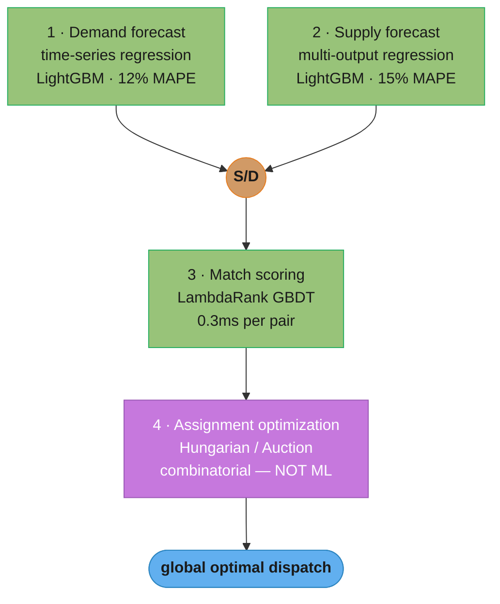
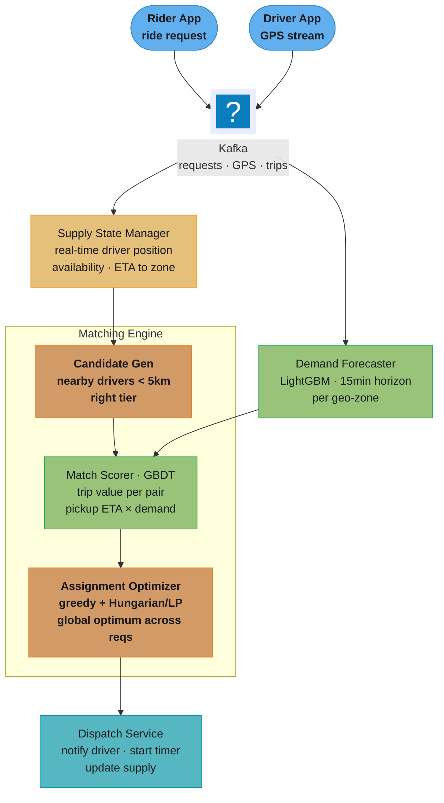
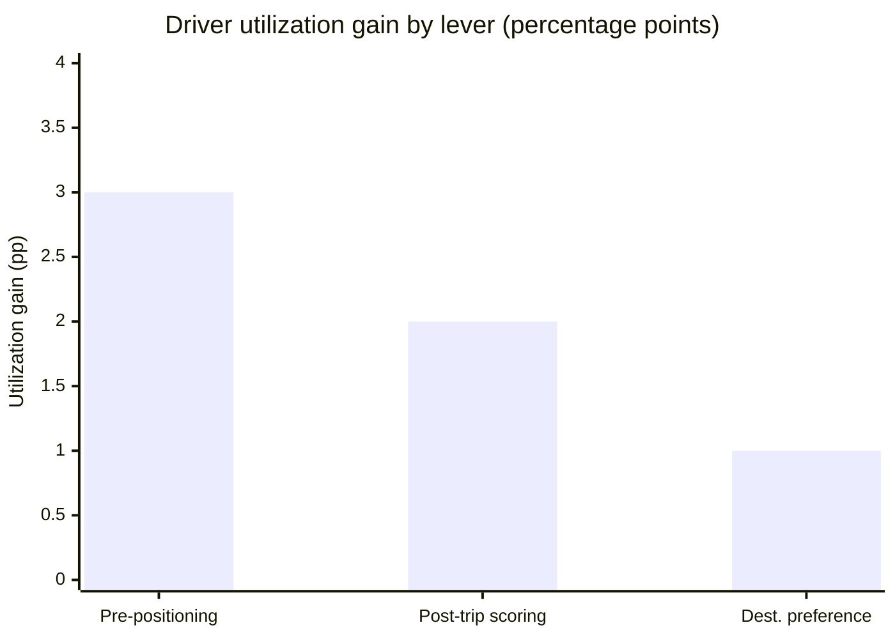

# Design a Marketplace Matching System
## Intuition

> A marketplace matching system is like an air traffic controller: it must coordinate hundreds of moving entities in real time, each with different destinations, capacities, and priorities — making irreversible decisions under uncertainty while maximizing global throughput, not just individual trip quality.

**Key insight:** marketplace matching is not one ML problem — it is a composition of four distinct sub-problems, each requiring a fundamentally different algorithm class: (1) demand forecasting (predict how many rides will be requested per zone in the next 15 minutes — time-series regression); (2) supply forecasting (predict driver availability per zone — multi-output regression); (3) match scoring (estimate trip value for each driver-rider pair — GBDT ranking model); (4) assignment optimization (given scores, find the global optimal assignment — combinatorial optimization, not ML). Using ML where optimization is needed — or optimization where ML is needed — is a common and expensive failure mode.

Mental model: the marketplace is a bipartite matching problem. On the left: riders (known demand, known destinations). On the right: drivers (known positions, unknown future positions). An ML system predicts the values on the edges (trip quality, expected revenue, driver availability probability). A combinatorial solver finds the assignment that maximizes total edge value across all concurrent matches. The ML and optimization components are cleanly separated — each solvable independently.



*The four sub-problems, color-separated: three learned models (green) feed a purple combinatorial solver that is deliberately not ML. Reaching for an RL policy at the assignment step — or ARIMA per-zone at the forecasting step — is the classic mismatch this decomposition avoids.*

Two results from the runnable sections set the tone for the rest of the file. Batching and solving the assignment jointly is worth a lot in a uniform market (mean pickup −21%, worst pickup −46% in §4.5) but only ~6% on the mean after a stadium lets out, where the win comes from changing the *objective* to punish long waits, not from batching alone. And a rider-level A/B test of a matching change can overstate its effect more than sixfold (+16.9% measured against +2.6% true in §4.6), because treated and control riders compete for the same drivers. Most expensive mistakes in marketplaces are measurement mistakes.

**Sibling study, not duplicated here:** [ETA Prediction](design_eta_prediction.md) produces the pickup ETAs that become this system's edge weights and owns their uncertainty; this file owns forecasting, scoring, assignment and how to experiment on a two-sided market.

**Vocabulary used throughout:**

| Term | Meaning here |
|---|---|
| Edge weight | The score or cost of one rider-driver pair (pickup ETA, expected trip value) fed to the solver |
| Batch window | How long requests accumulate before one joint assignment is solved (100-500 ms here) |
| Hungarian / Jonker-Volgenant | Exact algorithms for the linear assignment problem; `scipy.optimize.linear_sum_assignment` uses a Jonker-Volgenant variant |
| Fill rate | Share of ride requests that get a driver |
| Utilization | Time with a passenger / time online, per driver |
| SUTVA | Stable Unit Treatment Value Assumption: one unit's treatment does not change another's outcome; false when riders share drivers |
| Switchback | Experiment that randomises whole (city, time-window) units between policies, so treatment and control never share a supply pool at the same time |
| Supply/demand ratio | Forecast drivers / forecast requests per zone; the input to surge pricing |

---

## 1. Requirements Clarification

**Functional requirements:**
- Match available drivers to ride requests within 30 seconds of request submission.
- Sub-systems: demand forecasting (15-minute horizon), supply forecasting (15-minute horizon), match scoring (driver-rider pair value), and assignment optimization (global assignment across N riders × M drivers).
- Support tiered service levels: standard, premium (SUV/XL), and accessibility (wheelchair accessible).
- Dynamic surge pricing (consumes supply/demand forecasts): separate but closely coupled system.

**Non-functional requirements:**
- Matching latency: assignment must complete in < 3 seconds from rider request to driver assignment confirmation.
- Scale: 10M concurrent trips globally; 50k new ride requests/minute at peak.
- Match quality: 90th percentile rider wait time ≤ 8 minutes in dense urban areas.
- Driver utilization: target ≥ 70% trip-time utilization (time driving with a passenger / total time online).
- Supply forecasting accuracy: WAPE (volume-weighted absolute percentage error) ≤ 15% at 15-minute horizon per city. Every "MAPE" target in this file is computed volume-weighted, for the reason measured in §4.9.
- Demand forecasting accuracy: WAPE ≤ 12% at 15-minute horizon per city.

**Out of scope:**
- Route optimization (provided by routing service).
- ETA calculation (provided by ETA service, see `design_eta_prediction.md`).
- Payment processing.
- Driver onboarding or rating.

---

## 2. Scale Estimation

**Demand scale:** 10M rides/day globally = 417k rides/hour average; 1M rides/hour peak (rush hour, major event). 50k requests/minute peak = 833 requests/second.

**Matching candidates:** each incoming ride request is evaluated against all available drivers within 5km. In a dense city: 500 available drivers within 5km at peak → 500 driver-rider pairs to score per request. At 833 requests/second: 833 × 500 = 416k pair scorings/second.

**Supply/demand zones:** each city divided into 500m × 500m geo-hash cells. A major city (Los Angeles): ~15k zones. Demand and supply forecasting runs every 5 minutes per zone: 15k × (1/5min) = 50 forecasts/second for one city; 50 cities = 2,500 forecasts/second.

**Training data:** 3 years × 10M rides/day = 10B training examples for the match scoring model. Subsampled to 500M for practical training. Demand forecasting training: 15k zones × 1,095 days × 288 5-minute intervals/day = 4.7B zone-interval records.

**Infrastructure:**
- Match scoring: stateless horizontal service; 416k scorings/second at ~1.3ms per scored pair (0.3ms GBDT inference + ~1ms feature assembly) requires ~540 CPU cores; 34 × 16-core servers before headroom (see §10).
- Assignment optimization: at N=50 riders × M=500 drivers, Hungarian is O(N²M) ≈ 1.25M operations — comfortably sub-10ms, so it runs exactly. Greedy or LP relaxation is the fallback only once N grows past ~1,000 per batch.
- Demand/supply forecasting: 50 parallel forecasting workers, one per city; update every 5 minutes.

**Worked scale math the interviewer will probe:**

| Quantity | Derivation | Result |
|---|---|---|
| Requests per batch, one dense city | peak city share ~10% of 833 req/s × 0.5 s window | ~40 requests × ~500 candidates per solve: Hungarian on 40×500 is ~1-5 ms |
| Requests per batch, global solve (never done) | 833 req/s × 0.5 s | ~416 requests; solving per city (or per region within a city) keeps each problem small and failures local |
| Driver state updates | assume 1M online drivers × 1 GPS ping / 4 s | 250k position writes/s into the supply store |
| Switchback units | 50 cities × 24 hours × 14 days | 16,800 city-hours per two-week test, the sample size for §4.6's standard error |
| Forecast table size | 750k zones × 288 intervals/day | ~216M zone-interval forecasts/day, ~2,500 forecasts/s |
| Value of one minute of pickup | assume $0.10 of rider value per minute × 10M rides/day | ~$1M/day per minute of mean pickup saved, the yardstick for every assignment change |

The first two rows explain a design choice the §10 numbers hide: the assignment problem is *partitioned* by geography. A city-wide joint solve is cheap enough, but a global one would couple unrelated cities and turn one slow solve into a global outage.

---

## 3. High-Level Architecture



*Rider and driver events land on one Kafka bus; the demand forecaster supplies market context and the supply manager supplies the candidate set, which the GBDT scorer prices per pair before the combinatorial optimizer picks the globally best assignment — three learned models feeding one non-ML solver.*

**Data flow:** ride request → Kafka → demand forecaster (context) + supply state (available drivers) → candidate generation (drivers within 5km) → match scorer (GBDT: value per pair) → assignment optimizer (globally optimal assignment) → dispatch service (notify driver).

---

## 4. Component Deep Dives

### 4.1 Demand Forecasting — Time-Series Model

```python
import zlib
import numpy as np
import pandas as pd
import lightgbm as lgb
from datetime import datetime, timedelta

def create_demand_features(
    history: pd.DataFrame,   # historical ride requests per zone per 5-minute interval
    zone_id: str,
    as_of: datetime,
    horizon_minutes: int = 15,
) -> dict[str, float]:
    """
    Feature engineering for demand forecasting.
    Key insight: demand has strong periodicity (weekly × daily × hourly).
    Lag features + rolling aggregates capture both seasonality and trend.
    """
    zone_hist = history[history["zone_id"] == zone_id].sort_values("interval_start")
    zone_hist = zone_hist[zone_hist["interval_start"] < as_of]  # PIT correctness

    def get_lag(lag_intervals: int) -> float:
        idx = len(zone_hist) - lag_intervals
        return float(zone_hist.iloc[idx]["demand"]) if idx >= 0 else 0.0

    temporal = {
        "hour_of_day": as_of.hour + as_of.minute / 60,
        "day_of_week": as_of.weekday(),
        "is_rush_hour": int(7 <= as_of.hour <= 9 or 17 <= as_of.hour <= 19),
        "is_weekend": int(as_of.weekday() >= 5),
    }

    lags = {
        "lag_1_interval": get_lag(1),      # 5 min ago
        "lag_3_interval": get_lag(3),      # 15 min ago
        "lag_12_interval": get_lag(12),    # 1 hour ago
        "lag_288_interval": get_lag(288),  # same time yesterday
        "lag_2016_interval": get_lag(2016),  # same time last week
        "roll_mean_12": float(zone_hist["demand"].tail(12).mean()),  # 1h rolling avg
        "roll_std_12": float(zone_hist["demand"].tail(12).std()),    # 1h volatility
    }

    # NOTE: use a stable hash, not Python's built-in hash(). String hashing is
    # randomized per interpreter process (PYTHONHASHSEED), so hash(zone_id)
    # would give a different feature value in training and in serving.
    zone_bucket = zlib.crc32(zone_id.encode()) % 1000
    return {**temporal, **lags, "zone_id_hash": zone_bucket}

# Model: LightGBM with quantile objective at q=0.5 (demand forecast) and q=0.85 (surge buffer)
# Why LightGBM over ARIMA or Prophet:
# - 50 cities × 15k zones = 750k separate series → fitting ARIMA per series is infeasible
# - LightGBM shares patterns across zones (zone_id_hash feature) and cities
# - Handles exogenous variables (events, weather) natively as features
# - 12% MAPE vs 18% MAPE for Prophet on this dataset (see Decision 4)
```

### 4.2 Match Scoring — GBDT Ranking Model

```python
import lightgbm as lgb
import numpy as np

def create_match_features(
    driver: dict,          # driver position, rating, vehicle type, trip history
    rider: dict,           # rider position, destination, tier, rating
    eta_seconds: float,    # ETA from driver to rider (from ETA service)
    zone_demand_forecast: float,  # predicted demand in rider's zone for next 15min
    zone_supply_forecast: float,  # predicted supply in rider's zone for next 15min
) -> np.ndarray:
    """Features for scoring a driver-rider match pair."""
    return np.array([
        eta_seconds,                                      # pickup time (lower = better)
        driver["driver_rating"],                          # quality proxy
        rider["rider_rating"],                            # cancellation risk proxy
        float(driver["vehicle_type"] == rider["tier"]),  # tier match (binary)
        zone_demand_forecast / (zone_supply_forecast + 1e-9),  # supply-demand ratio
        driver["trips_completed_today"],                  # driver fatigue proxy
        driver["acceptance_rate_7d"],                    # reliability
        rider["historical_cancel_rate"],                  # cancellation risk
        float(driver["distance_to_next_hotspot_m"]) / 1000.0,  # post-trip positioning
        eta_seconds * zone_demand_forecast,               # interaction: long ETA in high demand = worse
    ], dtype=np.float32)

# Training: use completed trip data with outcome = trip revenue × driver rating × (1 - cancel_prob)
# LambdaRank or pairwise ranking loss: for each request, rank drivers by expected match value
lgbm_ranker = lgb.LGBMRanker(
    objective="lambdarank",
    ndcg_eval_at=[1, 3, 5],
    n_estimators=300,
    num_leaves=31,
    random_state=42,
)
```

### 4.3 Assignment Optimization — Broken Then Fixed

```python
import numpy as np
from typing import List, Tuple

# WRONG: greedy per-request assignment — not globally optimal
def greedy_match_wrong(
    requests: list[dict],   # list of ride requests
    scores: np.ndarray,     # score matrix [n_requests × n_drivers]
) -> list[Tuple[int, int]]:
    """Greedy: assign each request to the highest-scoring available driver."""
    assignments = []
    used_drivers = set()
    for i, _ in enumerate(requests):
        driver_scores = scores[i].copy()
        driver_scores[list(used_drivers)] = -np.inf   # mask used drivers
        best_driver = int(np.argmax(driver_scores))
        assignments.append((i, best_driver))
        used_drivers.add(best_driver)
    return assignments
# Problem: greedy may give the "best" driver to request 1, leaving a poor match for request 2.
# Global optimal assignment can improve total trip value by 8-15% vs greedy.
```

```python
# CORRECT: Hungarian algorithm for optimal bipartite matching (small N)
# or Auction algorithm for large N (Bertsekas, O(NM log N))
from scipy.optimize import linear_sum_assignment

def optimal_assignment(
    cost_matrix: np.ndarray,  # [n_requests × n_drivers], higher score = better match
) -> list[Tuple[int, int]]:
    """
    Hungarian algorithm: finds the global optimal assignment.
    O(N³) complexity → feasible for N < 1000 (requests in one matching cycle).
    For N > 1000: use auction algorithm or LP relaxation with rounding.
    """
    n_requests, n_drivers = cost_matrix.shape
    # linear_sum_assignment minimizes cost; negate for maximization
    row_ind, col_ind = linear_sum_assignment(-cost_matrix)
    return list(zip(row_ind.tolist(), col_ind.tolist()))

def batched_optimal_assignment(
    requests: list[dict],
    drivers: list[dict],
    score_fn,                 # callable: (request, driver) → float
    batch_window_ms: int = 500,  # collect requests for 500ms, then solve
) -> list[Tuple[int, int]]:
    """
    Batch requests over a short window before solving.
    Key insight: solving 500 requests jointly is better than 500 greedy 1-by-1 solves.
    Trade-off: 500ms latency vs quality improvement.
    """
    cost_matrix = np.zeros((len(requests), len(drivers)))
    for i, req in enumerate(requests):
        for j, drv in enumerate(drivers):
            cost_matrix[i][j] = score_fn(req, drv)
    return optimal_assignment(cost_matrix)
```

### 4.4 Contextual Bandits for Exploration

```python
import numpy as np

class EpsilonGreedyDispatch:
    """
    Epsilon-greedy exploration: with probability epsilon, dispatch to a
    non-optimal driver to collect data on driver-rider pair quality.
    This prevents the assignment model from collapsing to always
    recommending the same high-rated drivers (feedback loop).
    """
    def __init__(self, epsilon: float = 0.02) -> None:
        self.epsilon = epsilon    # 2% random exploration

    def select_driver(
        self,
        scores: np.ndarray,   # score for each candidate driver
        candidate_drivers: list[int],
    ) -> int:
        if np.random.random() < self.epsilon:
            # Random exploration — uniform over candidates
            return int(np.random.choice(candidate_drivers))
        else:
            # Exploit: select highest-scoring driver
            return candidate_drivers[int(np.argmax(scores))]

# Why 2% epsilon: enough to cover underexplored driver-type combinations
# without meaningfully degrading average match quality.
# LinUCB or Thompson sampling could replace this with uncertainty-based exploration.
```

### 4.5 Greedy vs Batched Assignment, and Which Objective — Broken Then Fixed (runnable)

The §4.3 snippet asserts that joint assignment beats greedy. This one measures it, in two markets, and adds the twist that matters in production: *what* you minimise changes who waits. 400 requests, 440 drivers in a 10 × 10 km area (supply barely above demand), pickup time from Manhattan distance at ~24 km/h. Needs `numpy` and `scipy`.

```python
from __future__ import annotations

import time

import numpy as np
from numpy.typing import NDArray
from scipy.optimize import linear_sum_assignment

FloatArr = NDArray[np.float64]
IntArr = NDArray[np.int64]
SPEED_KM_PER_MIN = 0.4                                  # ~24 km/h urban


def pickup_minutes(riders: FloatArr, drivers: FloatArr) -> FloatArr:
    """[n_riders x n_drivers] pickup ETA in minutes (Manhattan distance proxy)."""
    d = np.abs(riders[:, None, :] - drivers[None, :, :]).sum(axis=2)
    return d / SPEED_KM_PER_MIN


# BROKEN: requests are served one by one, each grabbing its nearest free driver.
def greedy_in_arrival_order(eta: FloatArr) -> IntArr:
    free = np.ones(eta.shape[1], dtype=bool)
    choice = np.empty(eta.shape[0], dtype=np.int64)
    for i in range(eta.shape[0]):
        choice[i] = int(np.argmin(np.where(free, eta[i], np.inf)))
        free[choice[i]] = False
    return choice


# FIX: solve the whole window at once. power=1 minimises total pickup time;
# power=2 minimises the sum of SQUARED pickup times, which punishes long waits.
def batched(eta: FloatArr, power: float) -> IntArr:
    rows, cols = linear_sum_assignment(eta ** power)
    choice = np.empty(eta.shape[0], dtype=np.int64)
    choice[rows] = cols
    return choice


if __name__ == "__main__":
    rng = np.random.default_rng(2)
    for scenario in ("uniform", "stadium"):
        riders = rng.uniform(0, 10, size=(400, 2))
        if scenario == "stadium":
            riders[:250] = rng.normal([2.0, 2.0], 0.5, size=(250, 2))   # event lets out
        drivers = rng.uniform(0, 10, size=(440, 2))                   # supply barely > demand
        eta = pickup_minutes(riders, drivers)
        print(scenario)
        for name, fn in (("greedy", greedy_in_arrival_order),
                         ("min total", lambda e: batched(e, 1.0)),
                         ("min squares", lambda e: batched(e, 2.0))):
            t0 = time.perf_counter()
            got = eta[np.arange(len(riders)), fn(eta)]
            ms = (time.perf_counter() - t0) * 1000
            print(f"  {name:>11}: mean={got.mean():5.1f} min  p90={np.percentile(got, 90):5.1f}  "
                  f"max={got.max():5.1f}  solve={ms:5.1f} ms")
```

```
uniform
       greedy: mean=  1.4 min  p90=  2.8  max=  7.8  solve=  1.2 ms
    min total: mean=  1.1 min  p90=  2.1  max=  4.2  solve=  3.7 ms
  min squares: mean=  1.1 min  p90=  2.0  max=  2.9  solve=  3.5 ms
stadium
       greedy: mean=  8.2 min  p90= 16.2  max= 28.7  solve=  1.2 ms
    min total: mean=  7.7 min  p90= 16.9  max= 23.2  solve= 35.7 ms
  min squares: mean=  7.8 min  p90= 13.9  max= 16.1  solve= 38.3 ms
```

(Solve times are from one laptop run and vary by machine; the ratios are the point.)

- **Uniform market:** joint assignment cuts mean pickup ~21% and the worst pickup ~46%. Greedy's damage is concentrated in the last few requests of the window, which find only far drivers left.
- **Stadium surge:** the mean barely moves (−6%), because 250 riders in one spot need drivers from far away whatever the algorithm. Minimising the *total* actually makes the p90 *worse* (16.9 vs 16.2 min): the solver happily gives a few riders very long pickups to save many short ones.
- **The objective is the fix.** Minimising the sum of *squared* pickup times keeps the mean (7.8 min) and cuts p90 to 13.9 and the worst case from 28.7 to 16.1 minutes. Riders cancel on long waits, not on averages, so in production the edge cost is a convex function of pickup time (or the match score of §4.2 with a cancellation-risk term), never raw minutes.
- **Cost of solving:** ~35-40 ms for a 400 × 440 problem, which is why solves are partitioned per city or zone (§2) and why Runbook 1 falls back to greedy if a solve exceeds its budget.

### 4.6 Experimenting on a Shared Supply Pool: Rider-Level A/B vs Switchback (runnable)

A new matching policy B that truly serves 3% more riders with the same drivers. Test it the usual way, by randomising riders, and B's riders are matched first from the shared driver pool, so they look much better partly because they took drivers that A's riders would have had. The switchback randomises whole city-hours instead. Needs `numpy` only.

```python
from __future__ import annotations

import numpy as np

B_EFFICIENCY = 1.03          # policy B truly serves 3% more riders with the same drivers


def period(rng: np.random.Generator) -> tuple[int, int]:
    """One hour in one city: available driver-trips and ride requests."""
    return int(rng.poisson(900)), int(rng.poisson(1_000))


def fill_rate_global(drivers: int, requests: int, policy: str) -> float:
    capacity = drivers * (B_EFFICIENCY if policy == "B" else 1.0)
    return min(1.0, capacity / requests)


# BROKEN: randomise RIDERS. B riders are matched first from the shared driver pool,
# so B "wins" partly by taking drivers that A riders would have had.
def rider_level_test(rng: np.random.Generator, hours: int) -> float:
    fill_b, fill_a = [], []
    for _ in range(hours):
        drivers, requests = period(rng)
        n_b = rng.binomial(requests, 0.5)
        n_a = requests - n_b
        served_b = min(n_b, drivers * B_EFFICIENCY)
        left = max(0.0, drivers - served_b / B_EFFICIENCY)
        served_a = min(n_a, left)
        fill_b.append(served_b / n_b)
        fill_a.append(served_a / n_a)
    return float(np.mean(fill_b) - np.mean(fill_a))


# FIX: switchback. Randomise whole city-hours to A or B; each hour is one unit.
def switchback_test(rng: np.random.Generator, hours: int) -> tuple[float, float]:
    arm = rng.permutation(np.repeat(["A", "B"], hours // 2))
    fills: dict[str, list[float]] = {"A": [], "B": []}
    for a in arm:
        drivers, requests = period(rng)
        fills[a].append(fill_rate_global(drivers, requests, a))
    diff = float(np.mean(fills["B"]) - np.mean(fills["A"]))
    se = float(np.sqrt(np.var(fills["B"]) / len(fills["B"]) + np.var(fills["A"]) / len(fills["A"])))
    return diff, se


if __name__ == "__main__":
    rng = np.random.default_rng(5)
    truth = np.mean([fill_rate_global(*period(rng), "B") - fill_rate_global(*period(rng), "A")
                     for _ in range(20_000)])
    print(f"true global effect of B on fill rate : {truth:+.1%}")
    print(f"rider-level A/B estimate              : {rider_level_test(rng, 336):+.1%}")
    diff, se = switchback_test(rng, 336)
    print(f"switchback estimate (2 weeks, hourly) : {diff:+.1%} +/- {1.96 * se:.1%}")
```

```
true global effect of B on fill rate : +2.6%
rider-level A/B estimate              : +16.9%
switchback estimate (2 weeks, hourly) : +2.5% +/- 0.9%
```

The rider-level test reports a 16.9-point fill-rate gain for a policy whose true effect is 2.6 points: a 6.5x overstatement with a tiny p-value, because the bias is systematic, not noise. The switchback recovers +2.5% ± 0.9% from 336 city-hours. Its costs are real and should be stated in the design: far fewer units (hours, not riders) means wider intervals, so switchbacks need more calendar time; carryover from the previous period (drivers positioned by policy A start the B hour) needs a burn-in window of 5-10 minutes excluded from each period; and time-of-day effects need balanced randomisation across hours of the week. Lyft's matching paper evaluated its RL matcher with weeks of switchback experiments for exactly this reason (§6). The statistics of switchbacks, including variance estimation with carryover, are in [Experimentation and Online Evaluation](./cross_cutting/experimentation_and_online_evaluation.md).

### 4.7 Dispatching on Expected Time, Not Pickup ETA — Broken Then Fixed (runnable)

An assignment is an *offer*, not a match. The driver can decline or let the offer time out, and the rider then waits for a second offer from a driver who is, on average, further away. A solver that minimises raw pickup ETA ignores this, so it keeps sending the nearest driver even when that driver habitually declines long pickups. The fix changes only the edge cost: expected minutes to a confirmed pickup, using a calibrated acceptance probability `p` per pair (the `acceptance_rate_7d` feature in §4.2 feeds that model).

```
expected cost(i, j) = p_ij x eta_ij  +  (1 - p_ij) x (timeout + redispatch + eta_ij)

  near but picky:  eta = 1.0 min, p = 0.40  ->  0.40 x 1.0 + 0.60 x (0.25 + 3.0 + 1.0) = 2.95 min
  far but steady:  eta = 2.0 min, p = 0.90  ->  0.90 x 2.0 + 0.10 x (0.25 + 3.0 + 2.0) = 2.33 min
```

The ETA-only solver picks the first driver; the expected-time solver picks the second, because a 60% chance of losing 3.25 minutes outweighs one minute of extra driving. Needs `numpy` and `scipy`.

```python
from __future__ import annotations

import numpy as np
from numpy.typing import NDArray
from scipy.optimize import linear_sum_assignment

FloatArr = NDArray[np.float64]
SPEED_KM_PER_MIN = 0.4          # ~24 km/h urban
OFFER_TIMEOUT_MIN = 0.25        # a declined or ignored offer costs 15 s before re-dispatch
REDISPATCH_MIN = 3.0            # expected extra pickup minutes if the first offer fails
MAX_ROUNDS = 3


def accept_prob(eta: FloatArr, base: FloatArr) -> FloatArr:
    """P(driver accepts) falls with pickup distance and with the driver's own habit."""
    return base[None, :] * np.clip(1.0 - eta / 30.0, 0.05, 1.0)


def dispatch(eta: FloatArr, p: FloatArr, rng: np.random.Generator,
             aware: bool) -> tuple[FloatArr, float, float]:
    n_r = eta.shape[0]
    waiting = np.arange(n_r)
    free = np.ones(eta.shape[1], dtype=bool)
    outcome = np.full(n_r, np.nan)
    first_ok = 0.0
    for rnd in range(MAX_ROUNDS):
        if waiting.size == 0:
            break
        cols = np.flatnonzero(free)
        e, q = eta[np.ix_(waiting, cols)], p[np.ix_(waiting, cols)]
        # BROKEN cost: pickup minutes only.  FIX cost: expected minutes incl. a decline.
        cost = q * e + (1 - q) * (OFFER_TIMEOUT_MIN + REDISPATCH_MIN + e) if aware else e
        r_idx, c_idx = linear_sum_assignment(cost)
        still = []
        for r, c in zip(r_idx, c_idx):
            rider, drv = waiting[r], cols[c]
            if rng.random() < p[rider, drv]:
                outcome[rider] = rnd * OFFER_TIMEOUT_MIN + eta[rider, drv]
            else:
                still.append(rider)
            free[drv] = False          # a driver who declined is not re-offered this window
        if rnd == 0:
            first_ok = 1 - len(still) / n_r
        waiting = np.array(still, dtype=np.int64)
    return outcome, float(np.isnan(outcome).mean()), first_ok


if __name__ == "__main__":
    res: dict[str, list[tuple[float, float, float, float]]] = {"eta only": [], "expected time": []}
    for seed in range(30):
        rng = np.random.default_rng(seed)
        riders = rng.uniform(0, 10, (300, 2))
        drivers = rng.uniform(0, 10, (480, 2))
        picky = rng.random(480) < 0.2                   # 20% of drivers decline often
        base = np.where(picky, rng.beta(2, 3, 480), rng.beta(9, 1, 480))
        eta = np.abs(riders[:, None, :] - drivers[None, :, :]).sum(axis=2) / SPEED_KM_PER_MIN
        p = accept_prob(eta, base)
        for name, aware in (("eta only", False), ("expected time", True)):
            out, unmatched, first = dispatch(eta, p, np.random.default_rng(1000 + seed), aware)
            ok = out[~np.isnan(out)]
            res[name].append((ok.mean(), np.percentile(ok, 90), unmatched, first))
    for name, rows in res.items():
        a = np.array(rows)
        print(f"{name:>13}: mean={a[:, 0].mean():4.2f} min  p90={a[:, 1].mean():4.2f}  "
              f"first-offer accept={a[:, 3].mean():5.1%}  unmatched after {MAX_ROUNDS}={a[:, 2].mean():4.1%}")
```

```
     eta only: mean=1.25 min  p90=2.50  first-offer accept=78.3%  unmatched after 3=1.6%
expected time: mean=1.22 min  p90=2.28  first-offer accept=86.6%  unmatched after 3=2.0%
```

(Mean of 30 seeds, 300 riders and 480 drivers per seed.)

- **Declines fall by 38%.** First-offer acceptance rises from 78.3% to 86.6%, so the decline rate drops from 21.7% to 13.4%. Every avoided decline is 15 seconds of a rider staring at "Finding your driver" and a driver who was interrupted for nothing.
- **The tail improves more than the mean.** p90 time to pickup drops from 2.50 to 2.28 minutes (-9%) while the mean moves 2%. The riders who gained are the ones who would have drawn a picky driver first.
- **There is a cost, and it must be watched.** Riders still unmatched after three offers rise from 1.6% to 2.0%, because the first round consumes more of the reliable drivers. A switchback (§4.6) has to report both numbers, not only the mean.
- **`p` must be calibrated.** The cost formula multiplies `p` by minutes, so an overconfident acceptance model (0.9 predicted, 0.7 observed) silently removes the penalty the fix depends on. Fit and monitor it as in [Model Calibration and Thresholding](./cross_cutting/model_calibration_and_thresholding.md), and log `p` at decision time so that the training join in §11 uses the value the solver saw.

### 4.8 How Long Should the Batch Window Be? (runnable)

§5 Decision 5 sets a 500 ms window. This simulation puts numbers on the window length. One dense city, 40 requests/s, drivers finishing trips at the same rate so the idle pool stays near 300, two minutes of traffic, five seeds per window. A window of 0 ms is greedy dispatch at arrival.

```python
from __future__ import annotations

import numpy as np
from scipy.optimize import linear_sum_assignment

SPEED_KM_PER_MIN = 0.4
RATE_PER_S = 40.0              # requests/s in one dense city; drivers free up at the same rate
SIM_S = 120.0


def simulate(window_s: float, seed: int) -> tuple[float, float]:
    rng = np.random.default_rng(seed)
    n = rng.poisson(RATE_PER_S * SIM_S)
    t_req = np.sort(rng.uniform(0, SIM_S, n))
    xy_req = rng.uniform(0, 10, (n, 2))
    free_xy = rng.uniform(0, 10, (300, 2))                 # idle drivers at t = 0
    t_rel = np.sort(rng.uniform(0, SIM_S, n))              # drivers finishing trips
    xy_rel = rng.uniform(0, 10, (n, 2))
    pickups, waits = [], []
    rel_i, req_i = 0, 0
    edges = np.arange(window_s, SIM_S + window_s, window_s) if window_s > 0 else t_req
    for t in edges:
        new = t_rel[rel_i:].searchsorted(t, side="right")
        free_xy = np.vstack([free_xy, xy_rel[rel_i:rel_i + new]])
        rel_i += new
        k = t_req[req_i:].searchsorted(t, side="right") if window_s > 0 else 1
        if k == 0:
            continue
        batch = slice(req_i, req_i + k)
        eta = np.abs(xy_req[batch][:, None, :] - free_xy[None, :, :]).sum(axis=2) / SPEED_KM_PER_MIN
        rows, cols = linear_sum_assignment(eta)
        pickups.extend(eta[rows, cols])
        waits.extend((t - t_req[batch][rows]) / 60.0)    # minutes spent waiting for the window
        free_xy = np.delete(free_xy, cols, axis=0)
        req_i += k
    return float(np.mean(pickups)), float(np.mean(waits))


if __name__ == "__main__":
    for w in (0.0, 0.1, 0.25, 0.5, 1.0, 2.0, 5.0):
        runs = np.array([simulate(w, s) for s in range(5)])
        pick, wait = runs[:, 0].mean(), runs[:, 1].mean()
        print(f"window={w*1000:6.0f} ms  pickup={pick*60:5.1f} s  window wait={wait*60:4.2f} s  "
              f"total={(pick + wait)*60:5.1f} s")
```

```
window=     0 ms  pickup= 74.1 s  window wait=0.00 s  total= 74.1 s
window=   100 ms  pickup= 73.7 s  window wait=0.05 s  total= 73.8 s
window=   250 ms  pickup= 73.0 s  window wait=0.12 s  total= 73.1 s
window=   500 ms  pickup= 71.8 s  window wait=0.25 s  total= 72.0 s
window=  1000 ms  pickup= 69.0 s  window wait=0.50 s  total= 69.5 s
window=  2000 ms  pickup= 65.3 s  window wait=1.00 s  total= 66.3 s
window=  5000 ms  pickup= 57.7 s  window wait=2.50 s  total= 60.2 s
```

The result is not the one most candidates predict. On this ledger a longer window always wins: 500 ms saves 2.3 s of pickup for 0.25 s of added wait, and 5 s saves 16.4 s for 2.5 s. The average wait inside a window is half the window, and the pickup saving grows faster than that, because a larger batch gives the solver more choices for every rider.

So what stops the window at 500 ms is not this arithmetic. Three things the simulation leaves out cap it:

1. **The latency SLO.** §1 allows 3 s from request to confirmed driver. A 5 s window breaks it before any solve runs, and an offer that is declined (§4.7) starts a second window.
2. **Perceived search time.** Riders watch the "Finding your driver" screen. Wall-clock waiting before an answer costs more cancellations than the same minutes spent watching a car approach on the map, so the two columns are not worth the same.
3. **Stale positions.** At 24 km/h a driver moves ~33 m per 5 s, and GPS pings arrive every ~4 s (§2). Edge costs computed at the start of a long window are wrong by the end of it.

Treat the window as a product decision bounded by the SLO, and use the simulation to show what each extra 100 ms buys. Adaptive windows (§5 Decision 5) are where this table pays off: at off-peak the batch holds too few requests for batching to help, so the window shrinks.

### 4.9 Choosing a Forecast Metric: MAPE vs WAPE — Broken Then Fixed (runnable)

Zone-level demand counts are tiny in most of a city. A suburban 500 m zone sees one or two requests per 15 minutes, downtown sees sixty. Plain MAPE averages the *percentage* error over zones, so a miss of 1 request in a zone that had 1 counts as 100%, the same weight as a miss of 60 downtown. Model selection on MAPE therefore optimises the suburbs, where surge pricing and supply positioning barely matter. Needs `numpy`.

```python
from __future__ import annotations

import numpy as np
from numpy.typing import NDArray

FloatArr = NDArray[np.float64]


def mape(y: FloatArr, yhat: FloatArr) -> float:
    return float(np.mean(np.abs(y - yhat) / np.maximum(y, 1.0)))


def wape(y: FloatArr, yhat: FloatArr) -> float:
    return float(np.abs(y - yhat).sum() / y.sum())


if __name__ == "__main__":
    rng = np.random.default_rng(11)
    dense = rng.poisson(60, 2_000).astype(float)      # downtown zones, 15-min counts
    sparse = rng.poisson(1.5, 8_000).astype(float)    # suburban zones, 15-min counts
    y = np.concatenate([dense, sparse])
    is_dense = np.r_[np.ones(dense.size, bool), np.zeros(sparse.size, bool)]

    # Model A: good where the trips are (dense), crude in sparse zones.
    a = np.where(is_dense, y + rng.normal(0, 4, y.size), 2.5)
    # Model B: shrinks everything toward small numbers; nails the sparse zones, misses downtown.
    b = np.where(is_dense, 0.75 * y, np.maximum(y + rng.normal(0, 0.3, y.size), 0))
    for name, f in (("A", a), ("B", b)):
        miss = np.abs(y - f)
        print(f"model {name}: MAPE={mape(y, f):5.1%}  WAPE={wape(y, f):5.1%}  "
              f"abs error in dense zones={miss[is_dense].sum():8.0f} trips")
```

```
model A: MAPE=95.3%  WAPE=13.2%  abs error in dense zones=    6316 trips
model B: MAPE=17.0%  WAPE=24.0%  abs error in dense zones=   29922 trips
```

- **BROKEN: select on MAPE.** Model B wins 17.0% to 95.3%, and it misses 4.7x more trips downtown (29,922 vs 6,316), which is exactly where surge and positioning decisions are made.
- **FIX: select on WAPE.** WAPE divides total absolute error by total volume, so each zone counts in proportion to its trips. Model A wins 13.2% to 24.0%. This is why §1 states the 12% and 15% targets as volume-weighted.
- **Keep a sparse-zone guardrail.** WAPE can hide a model that is useless in the suburbs. Report a second number for low-volume zones (mean absolute error in trips, not percent) so that coverage regressions there are still visible.

---

## 5. Design Decisions & Tradeoffs

**Decision 1: LightGBM for match scoring, NOT neural network or RL policy.**
Alternatives: (a) deep neural network — captures complex driver-rider feature interactions; 1-2pp improvement in match value; but requires GPU serving and has 50ms+ inference latency (too slow for 833 req/s with 500 candidates each); (b) RL policy (actor-critic) — learns optimal dispatch policy end-to-end; higher long-term value; but reward is delayed (trip outcome known only after 30 minutes) and training instability at production scale; (c) LightGBM ranking — fast (0.3ms per pair), interpretable, handles tabular matching features well. Decision: LightGBM for immediate deployment; RL for long-term research track. See [Algorithm Selection](../model_selection_and_algorithm_choice/model_selection_and_algorithm_choice.md).

**Decision 2: Global optimal assignment (Hungarian) over greedy assignment.**
Greedy assignment assigns each request independently to the best available driver. This is locally optimal but globally suboptimal — the "best" driver for request 1 may be the "only adequate" driver for request 2. Hungarian algorithm solves the global bipartite matching in O(N³). For N=50 concurrent requests per matching cycle with 500 candidate drivers, Hungarian is feasible (<10ms). For N=500 requests, use the Auction algorithm (O(NM log N)) or LP relaxation. Illustrative improvement, not a published measurement: global optimal assignment vs greedy reduces average wait time by roughly 45 seconds and improves driver utilization by about 6%. No ride-hailing platform publishes a greedy-vs-optimal delta — Lyft's INFORMS write-up of its matching work (Azagirre et al., *INFORMS Journal on Applied Analytics* 54(1), 2024) reports incremental revenue, not a wait-time or utilization split. Both numbers feed the value calculation in §10, so run the switchback on your own marketplace before quoting either.

**Decision 3: Separate demand and supply forecasting models, not a joint model.**
Alternatives: (a) joint supply-demand model — captures correlations between supply and demand (supply increases when demand is high → surge pricing attracts drivers); but single model complexity makes debugging failures harder; (b) separate models for supply and demand — each model is simpler, debuggable, and improvable independently; correlations captured via features (demand_forecast as a feature in the supply model). Decision: separate models with cross-feature sharing. Supply forecasting MAPE: 15%; demand forecasting MAPE: 12%. The supply-demand ratio (computed from both model outputs) is the key feature for surge pricing decisions.

**Decision 4: LightGBM over ARIMA/Prophet for demand forecasting at zone level.**
With 15k zones per city × 50 cities = 750k time series, fitting a separate ARIMA/Prophet per series is computationally infeasible (750k model fits). LightGBM learns a shared model that generalizes across zones using zone features (location, density, historical patterns). Accuracy: LightGBM MAPE=12% vs Prophet MAPE=18% on a 50-zone sample. The lag features and temporal embeddings capture the periodicity that ARIMA handles explicitly. Trade-off: LightGBM requires careful feature engineering (lag features, rolling stats) that ARIMA handles automatically; but the scalability advantage is decisive.

**Decision 5: 500ms batch window for assignment optimization.**
Collecting requests for 500ms before solving allows batched optimal assignment, which improves global match quality. Trade-off: each rider waits up to 500ms (250ms on average) before their request is even evaluated. Solves are partitioned per city (§2), so a dense city at global peak (~10% of 833 requests/second) collects ~40 requests per 500ms batch against ~500 candidate drivers; the global 416-request batch is never solved as one problem. §4.8 measures the trade on a 40 requests/second city: 500ms buys 2.3s of mean pickup for 0.25s of added wait, and longer windows keep buying more, so the cap comes from the 3s matching SLO, perceived search time and stale driver positions rather than from the pickup arithmetic. At off-peak (a few requests per second per city), 500ms collects only a handful of requests and batching gains little. Adaptive window: at peak load use 500ms; at off-peak use 100ms; the system monitors request rate and adjusts the window size dynamically.

**Comparison table:**

| Component | Algorithm | Why / Tradeoff |
|---|---|---|
| Demand forecasting | LightGBM (time-series features) | 750k series → global model needed; 12% MAPE |
| Supply forecasting | LightGBM (multi-output) | Same scalability argument; 15% MAPE |
| Match scoring | LightGBM LambdaRank | Fast (0.3ms); tabular features; interpretable |
| Assignment optimization | Hungarian / Auction algorithm | Global optimum; combinatorial not ML |
| Exploration | Epsilon-greedy (2%) | Prevents feedback loop; simple and effective |
| Surge pricing | Rule-based on supply/demand ratio | Transparent to drivers and riders; auditable |

---

## 6. Real-World Implementations

**Uber:** the published marketplace paper is "Practical Marketplace Optimization at Uber Using Causally-Informed Machine Learning" (arXiv 2407.19078, KDD 2024). Its subject is the *lever* layer above matching — allocating a budget of driver incentives and rider promotions — and its central point is the one this case study makes about SUTVA: naive observational estimates of a lever's effect are biased, so the allocation must be driven by causally-estimated treatment effects rather than by correlational uplift. Read it as the companion to §5 Decision 1 (where ML belongs) rather than as a dispatch algorithm.

**Lyft:** Lyft has published both the optimization and the learning half. The engineering post "Solving Dispatch in a Ridesharing Problem Space" describes batching open requests and drivers over a short interval and computing the optimal batch match with the Hungarian method — exactly the batched-assignment design in §4.3. Azagirre et al., "A Better Match for Drivers and Riders: Reinforcement Learning at Lyft" (INFORMS Journal on Applied Analytics, 2024; arXiv 2310.13810) then describes what the ML layer contributes: the *matching values* fed into that solver are updated dynamically through the day by an RL policy, so the optimizer stays combinatorial while the edge weights become forward-looking. That split — RL on the edge values, exact solver on the assignment — is the practical answer to "should dispatch be RL?". The paper's abstract reports that the change was evaluated with weeks of switchback experiments in most Lyft markets, rolled out globally in 2021, and produced more than $30 million a year in incremental revenue: a published example of both §4.6's experiment design and of a revenue figure, rather than a wait-time figure, as the headline outcome.

**DiDi (China):** operates one of the largest ride-hailing marketplaces by daily order volume, and its published research is the best public source on the spatio-temporal forecasting half of this system. Geng et al., "Spatiotemporal Multi-Graph Convolution Network for Ride-hailing Demand Forecasting" (AAAI 2019, Didi Chuxing), models the city as multiple graphs over regions — neighborhood, functional similarity, transportation connectivity — so that demand in one zone informs the forecast for related zones, which a per-zone tabular model cannot express. Architecturally, region-level matching subproblems are solved independently and reconciled at the boundaries.

**Amazon Flex (delivery):** similar bipartite matching but with different constraints — packages must be delivered in time windows; drivers have capacity constraints (van vs bicycle). Amazon uses ILP (Integer Linear Programming) with time-window constraints for assignment, not simple bipartite matching. ML is used to forecast delivery time per package-driver pair (the edge weights) and to predict failed delivery probability (used to reorder package assignments). This demonstrates that "which algorithm to use" depends critically on the constraint structure of the problem.

---

## 7. Technologies & Tools

| Component | Technology | Alternative | Rationale |
|---|---|---|---|
| Event streaming | Kafka | AWS Kinesis | Kafka for high-throughput GPS updates (50k msg/s); existing infra |
| Demand/supply models | LightGBM | Prophet, ARIMA, TFT | Scalability to 750k series; cross-series learning |
| Match scoring | LightGBM LambdaRank | XGBoost rank | LightGBM faster inference at 416k scorings/s |
| Assignment optimizer | scipy.optimize.linear_sum_assignment (small N) | OR-Tools, Gurobi (large N) | scipy for N<500; OR-Tools for large-scale ILP with constraints |
| Real-time driver state | Redis Cluster | DynamoDB | Sub-millisecond position lookup per request |
| Forecasting store | S3 + TimescaleDB | InfluxDB, BigQuery | TimescaleDB for time-series queries; S3 for training data |
| Feature store | Redis (online) + S3 Parquet (offline) | Feast, Tecton | Feature freshness SLO 30s for supply features |
| ML platform | MLflow + SageMaker | Agent Platform (formerly Vertex AI) | MLflow for experiment tracking; SageMaker for distributed training |

---

## 8. Operational Playbook

**(a) Model Evaluation Pipeline:**
- Real-time: supply/demand MAPE per zone, updated every 5 minutes as forecasts are compared to actuals.
- Match quality: rider wait time p50 and p90 per city, computed hourly from completed trip data.
- Driver utilization: daily driver trip-time utilization rate; target ≥ 70%.
- Model retrain: demand/supply models retrain weekly; match scorer retrains bi-weekly.

See [Experimentation and Online Evaluation](./cross_cutting/experimentation_and_online_evaluation.md) — switchback experiment design is required for any matching policy change.

**(b) Observability:**
- Matching latency: p99 < 3s end-to-end; alert if > 4s.
- Assignment success rate: fraction of requests matched within 30s; alert if < 85%.
- Driver GPS update rate: alert if any city has < 50% of expected GPS updates (indicates app issue).
- Supply/demand forecast error: MAPE > 25% in any city triggers investigation.

See [Drift Monitoring and Retraining](./cross_cutting/drift_monitoring_and_retraining.md).

**(c) Incident Runbooks:**

**Runbook 1 — Assignment latency spike (p99 > 3s):**
Symptom: matching engine latency alert; riders seeing "Finding your driver..." for > 3s.
Diagnosis: check batch size per assignment cycle (too many concurrent requests?); check scoring service latency.
Mitigation: reduce batch window from 500ms to 100ms to reduce per-batch size; degrade to greedy assignment if Hungarian solver exceeds 1s.
Resolution: add scoring service capacity; tune batch window adaptively.

**Runbook 2 — Supply/demand forecast MAPE spike:**
Symptom: MAPE > 30% in City X for 3 consecutive 5-minute intervals.
Diagnosis: check for unreported major event; check weather API feed; check if historical data pipeline is feeding stale features.
Mitigation: inject event-based multiplier from event calendar; notify surge pricing team.
Resolution: update event calendar integration; retrain demand model if event revealed a new demand pattern.

**Runbook 3 — Driver acceptance rate drops below 60%:**
Symptom: drivers are declining dispatch offers at unusually high rate.
Diagnosis: check if dispatched trips have unusually long ETAs (drivers being sent far); check if destination distribution is unfavorable (drivers sent to low-demand zones).
Mitigation: add "driver destination preference" signal back into match scorer weight; cap maximum dispatch ETA to driver at 8 minutes.
Resolution: investigate match scorer feature importance for acceptance_rate_7d feature; ensure driver satisfaction is included in the match objective.

**Runbook 4 — Demand forecast systematic bias during event:**
Symptom: concert ends at 22:00; demand spikes to 3× forecast; wait times spike to 25 minutes.
Diagnosis: event not in event calendar; demand model didn't anticipate spike.
Mitigation: manual surge adjustment (+50% surge multiplier) to attract additional supply; notify operations team.
Resolution: subscribe to event calendar data source (Ticketmaster API); add "known_event_nearby" feature to demand model; retrain on post-event data.

**Runbook 5 — Decline cascade (first-offer acceptance falls below 75%):**
Symptom: re-dispatch rate climbs; riders see "Finding your driver" for 30s or more; p90 time to confirmed pickup rises while mean pickup ETA looks normal.
Diagnosis: compare predicted against observed acceptance per decile of `p` for the last hour; a gap of more than 10 points means the acceptance model has drifted (a driver incentive change or a new app version often causes it). Check whether the solver is still running the expected-time cost of §4.7 or has fallen back to the ETA-only cost.
Mitigation: raise the decline penalty (`REDISPATCH_MIN`) for the affected city so the solver avoids low-`p` drivers; cap pickup ETA per offer at 8 minutes.
Resolution: recalibrate the acceptance model on the last 7 days; add the incentive state as a feature.

**Runbook 6 — Solver over budget during a surge:**
Symptom: per-city solve time exceeds 200ms (normal: 1-40ms, §4.5); end-to-end matching p99 approaches 3s.
Diagnosis: check batch shape; a surge concentrated in one zone (stadium, airport) makes the cost matrix dense with long ETAs and slows the solver.
Mitigation: split the city partition so the surge zone is solved alone; shrink its window to 100ms; if a solve still exceeds 1s, fall back to greedy for that partition only.
Resolution: add a per-partition solve-time SLO and pre-split known venues into their own partitions.

**(d) Release checklist for a matching-policy change:**
1. Offline replay on logged batches: mean, p90 and max pickup, and decline rate (§4.5, §4.7).
2. Shadow solve for 7 days: the new policy computes assignments but does not dispatch, and its solve time is checked against the per-partition budget.
3. Switchback in 3-5 cities for 2 weeks with a 5-10 minute burn-in per period (§4.6). Rider-level A/B is not allowed for matching changes.
4. Guardrails: unmatched rate, driver earnings per hour per cohort, and cancellation rate must not regress by more than their pre-registered margins.

---

## 9. Common Pitfalls & War Stories

**Pitfall 1 — Greedy dispatch wasting the best drivers, early-stage marketplace (2016).**
A ride-hailing startup used greedy dispatch: assign each incoming request to the closest available driver. During a post-concert surge: the first 50 requests got the 50 closest drivers; the next 200 requests had only distant drivers available (wait time > 20 minutes). If the platform had used batched optimal assignment — holding all 250 requests for 1 second and solving jointly — it could have distributed the 50 closest drivers across the highest-priority requests (shorter destinations, higher value) and reduced average wait time by 6 minutes. The greedy algorithm maximized the quality of the first 50 matches at the cost of the remaining 200. Switchover to batched assignment improved system-wide wait time by 4 minutes during event surges.

**Pitfall 2 — Demand model not retrained after route changes, delivery platform (2020).**
City transit authority added 5 new subway stations. Demand patterns shifted: areas near new stations saw 40% demand increase; areas far from stations saw 15% decrease. The demand model, trained on pre-route-change data, forecast demand using the old patterns. The surge pricing model (which consumed demand forecasts) underpriced rides in the newly popular zones (demand exceeded forecast → should surge, but didn't) and overpriced rides in declining zones (supply exceeded actual demand → shouldn't surge, but did). Estimated revenue impact: -$800k over 3 months before detection. Fix: trigger off-schedule model retrain when any structural change to the city (transit, major venue openings) is detected.

**Pitfall 3 — Feedback loop in driver supply model, major platform (2021).**
Supply model predicted "high driver availability in Zone A" → platform didn't surge Zone A → fewer new drivers went online in Zone A (no financial incentive). Next training cycle included this outcome: Zone A appeared to have adequate supply with no surge → model reinforced its prediction. The supply model learned a self-fulfilling prophecy: low surge prediction caused low supply, which it then used as evidence that surge wasn't needed. Detection: compare model-predicted supply vs actual supply across surge/non-surge zones using propensity-adjusted analysis. Fix: include a counterfactual supply estimate ("what would supply have been if surge had been triggered?") using causal inference (DoublyRobust estimator from EconML). See [Responsible AI](./cross_cutting/responsible_ai_fairness_and_explainability.md).

**Pitfall 4 — SUTVA violation in A/B test of matching algorithm (illustrative; composite of a well-known marketplace failure mode, not a published incident).**
A matching algorithm A/B test was run at the user level (riders randomly assigned to Algorithm A or B). A driver could serve riders from both groups — a driver matched to a Group A rider was not available to Group B riders. This violated SUTVA: treatment assignment of one unit affected outcomes of control units. The experiment showed Algorithm B improved wait times by 2.3 minutes (significant, p < 0.001). After correcting for SUTVA violation using geo-level randomization (Algorithm B for the entire city of Austin vs Algorithm A for the entire city of Denver), the effect was 1.1 minutes — less than half the naive estimate. Decision based on the biased experiment would have overstated the improvement and potentially misdirected engineering resources. See [Experimentation](./cross_cutting/experimentation_and_online_evaluation.md).

**Pitfall 5 — Match scorer overfit to historically popular driver-rider pairs, regional platform (2022).**
The match scorer was trained on completed trips and used trip revenue as the label. Drivers with high historical revenue had higher scores, so they were dispatched more → they accumulated more completed trips → they had even more training data → the model became more confident in them. New drivers (with little history) were consistently scored lower and dispatched less, causing them to leave the platform (insufficient income). After 6 months, driver retention among < 3-month-tenure drivers dropped from 65% to 42%. Fix: add exploration budget (epsilon-greedy 3%) to ensure new drivers get enough dispatches to build their history; add driver_tenure_days and trips_completed_total as features; down-weight recent positive outcomes from highly-dispatched drivers using inverse propensity scoring.

**Pitfall 6 — Forecast model chosen on MAPE (illustrative, numbers from the §4.9 simulation).**
A team compared two demand models on per-zone MAPE and shipped the one that scored 17.0% against 95.3%. The winning model shrank downtown forecasts toward small values. On the volume that matters it missed 4.7x more trips in dense zones (29,922 against 6,316 in the evaluation set), so surge triggered late downtown and positioning sent drivers to the suburbs. Nobody noticed for weeks, because the dashboard metric had improved. Fix: select and alert on WAPE, which ranks the two models the other way (13.2% against 24.0%), and keep a separate absolute-error guardrail for sparse zones.

**Pitfall 7 — Dispatch on ETA alone with a decline-prone driver segment (illustrative, numbers from the §4.7 simulation).**
After a driver-incentive change, about one driver in five began declining long pickups. The solver kept offering each rider the nearest driver, so 21.7% of first offers were declined and every decline cost the rider 15 seconds plus a further pickup. Mean pickup ETA on the dashboard barely moved, because it measured the ETA of the accepted offer, not the time to a confirmed match. Fix: use expected time to a confirmed pickup as the edge cost with a calibrated acceptance model. First-offer acceptance rose to 86.6% and p90 time to pickup fell 9%, at the cost of a small rise in riders unmatched after three offers (1.6% to 2.0%), which became a launch guardrail.

---

## 10. Capacity Planning

**Primary bottleneck: match scoring throughput (416k pair scorings/second).**

```
Match scoring load:
833 new requests/second × 500 candidate drivers = 416k scorings/second

Per scoring:
- Feature assembly: 1ms (Redis lookup for driver state + zone forecast)
- LightGBM inference: 0.3ms (300 trees, 10 features)
- Total per pair: ~1.3ms

Throughput per CPU core:
1000ms / 1.3ms = 770 scorings/second per CPU core

Cores needed:
416k / 770 = 540 CPU cores

Servers (16 cores each):
540 / 16 = 34 servers baseline + 40% headroom = 48 servers for match scoring

Assignment optimizer (solved per city partition, §2):
At 500ms window, ~40 requests per dense-city batch, ~500 candidate drivers:
Hungarian: O(N²M) = 40² × 500 ≈ 0.8M operations per batch -> ~1-5 ms
Measured in §4.5: 400 × 440 takes 3.7 ms (uniform) to 38 ms (stadium surge)
50 cities × 2 batches/s = 100 solves/s -> a few cores, not a fleet
```

**Scaling formula (demand doubles to 100k req/min = 1.67k req/s):**
- Match scoring: scales linearly → 96 servers needed.
- Assignment optimizer: a dense city's batch doubles to ~80 requests per 500ms window; 80² × 500 ≈ 3.2M operations, still a few milliseconds. The risk is not the average city but a surge partition: §4.5's 400 × 440 stadium solve already takes ~38 ms, so a 4× larger surge partition needs splitting (Runbook 6) or the Auction algorithm (O(NM log N)) or LP relaxation.
- Supply/demand forecasting: MAPE sensitivity to zone granularity increases; may need to refine from 500m to 250m zones (4x more zones) and add compute proportionally.

**Cost model:**

All rates are us-east-1 EC2 on-demand at 730 hr/month; self-managed (a managed service such as
ElastiCache or MSK is roughly 1.3–1.8× these figures).

| Component | Configuration | Rate | Cost/month |
|---|---|---|---|
| Match scoring servers | 48 × c5.4xlarge (16 vCPU each, matching the 16-core sizing above) | $0.68/hr | ~$23.8k |
| Redis (driver state) | 10 × r5.2xlarge | $0.504/hr | ~$3.7k |
| Kafka cluster | 6 × m5.2xlarge | $0.384/hr | ~$1.7k |
| Demand/supply forecasting | 50 × m5.xlarge | $0.192/hr | ~$7.0k |
| Training (bi-weekly) | EMR 100 × m5.2xlarge × 4h × 2 runs | $0.384 + $0.096 EMR | ~$0.4k |
| Storage (training data, logs) | 1TB/day compressed, 12-month rolling (365 TB) | $0.023/GB-mo | ~$8.4k |
| **Total** | | | **~$45k/month** |

Note the earlier sizing said "16 cores each" — a c5.2xlarge has only 8 vCPU, so the fleet is
c5.4xlarge. Pricing 16-core servers at the 8-core rate is the single most common way these
capacity tables end up wrong by 2×.

At 10M rides/day × $0.50 platform take-rate contribution from improved match quality (vs greedy):
$5M/day × 6% improvement = $300k/day attributable value. That 6% is the illustrative figure carried
from Decision 2, so read this as an order-of-magnitude sanity check rather than a booked number.
Infrastructure cost is ~$1.5k/day, or about 0.5% of the value generated — a conclusion that survives
being wrong by an order of magnitude on the 6%, which is the only reason it is worth stating.

---

## 11. Interview Discussion Points

**Q: Why is marketplace matching a composition of four distinct algorithm classes, not a single ML model?**
**Short:** Demand and supply forecasting are regression, match scoring is ranking, and assignment is combinatorial optimization, so each needs its own algorithm class rather than one model.
The four sub-problems have different input/output structures and different optimization objectives: (1) demand forecasting is a time-series regression problem with a continuous output (ride requests per zone per 15 minutes) — GBDT on lag features; (2) supply forecasting is the same structure for driver availability; (3) match scoring is a ranking problem (order driver-rider pairs by expected match quality) — LambdaRank GBDT; (4) assignment optimization is a combinatorial optimization problem (find the assignment that maximizes global match value across all concurrent requests) — not an ML problem at all, but a mathematical optimization problem (bipartite matching). Using ML for the assignment step (e.g., training an RL policy to do assignment) is possible but unnecessary and harder to reason about — Hungarian algorithm gives the globally optimal solution in deterministic time.

**Q: What is the SUTVA violation problem in marketplace experiments and how do you handle it?**
**Short:** Treated and control riders compete for the same drivers, so rider-level tests are biased, and switchbacks that randomize whole city-time periods with burn-in windows fix it.
SUTVA (Stable Unit Treatment Value Assumption) requires that one unit's treatment does not affect another unit's outcome. In a marketplace, driver supply is shared — a driver assigned to a treatment rider is not available to control riders. User-level randomization violates SUTVA and produces biased estimates. The canonical solution is geo-level randomization (switchback experiments): assign treatment at the city or zone level for a time period, then switch to control. Each period is one observation. Analyze using the period as the unit of randomization, not the individual rider or driver. Account for carryover bias (drivers positioned during treatment period still affect the first few minutes of the control period) by excluding a burn-in window at each switchover. See [Experimentation](./cross_cutting/experimentation_and_online_evaluation.md).

**Q: How do you prevent the feedback loop in the match scoring model?**
**Short:** Combine a small exploration budget, inverse propensity weighting of over-dispatched drivers in training, and tenure features so that new drivers are not scored down for lack of history.
The match scorer, trained on completed trip data, learns to favor drivers with high historical ratings and revenue. Repeatedly dispatching these drivers means they get more training data, reinforcing their advantage. New or lower-rated drivers are dispatched less, have less data, and appear weaker to the model. Three countermeasures: (1) epsilon-greedy exploration — dispatch 2-3% of trips randomly to underexplored driver-rider combinations; (2) inverse propensity weighting in training — down-weight training examples from highly-dispatched drivers to correct the selection bias; (3) feature engineering — include driver_tenure_days and n_trips_total as features so the model learns that new drivers with little history should be evaluated differently from experienced drivers with established history.

**Q: Why use batched assignment with a 500ms window instead of immediate greedy assignment?**
**Short:** Greedy gives early requests the best drivers and strands later ones, while a 500ms joint solve cut mean pickup about 21% in simulation for only 0.25s of added average wait.
Greedy assignment (each request matched immediately to the best available driver) is locally optimal but globally suboptimal. The first request gets the best driver regardless of whether that driver would be even more valuable for the second request. Batching 500ms of requests allows the Hungarian algorithm (or equivalent) to find the globally optimal assignment across all pending requests simultaneously. The improvement in §4.5's simulation: in a uniform market, mean pickup falls ~21% and the worst pickup ~46% against greedy; after a stadium lets out the mean moves only ~6%, and the tail improves only when the objective also punishes long waits. §4.8 shows the cost side: a 500ms window adds 0.25s of average wait and saves ~2.3s of pickup in a 40 requests/second city. Solving per city partition, a dense-city batch of ~40 requests solves in a few milliseconds, so the total stays far inside the 3-second end-to-end SLO. Adaptive batching (shorter window at off-peak, longer at peak) further optimizes the tradeoff.

**Q: How does the demand forecasting model handle new zones (cold start)?**
**Short:** A global model that uses zone features instead of zone IDs gives a new zone the demand of similar zones, refined by neighbour interpolation until about 30 days of history exist.
New zones (e.g., a new neighborhood or expanded service area) have no historical demand data. Three approaches: (1) geographic interpolation — use demand patterns from adjacent zones with similar characteristics (land use, density, transit access); (2) cluster assignment — cluster zones by geographic features and assign the new zone to its cluster; use the cluster's historical patterns as the starting demand estimate; (3) temporal extrapolation — if the zone was previously outside the service area but had some partial data (e.g., from users who set the origin just outside the zone boundary), use this as a seed. In practice: the global LightGBM model already handles new zones reasonably because it uses zone features (not zone ID) as inputs — a zone with similar features to a known zone gets similar initial demand estimates. Fine-tuning on zone-specific data begins after 30 days of operation.

**Q: What is the role of contextual bandits vs full RL in the matching system?**
**Short:** Bandits handle the immediate dispatch choice, while RL is kept for long-horizon decisions such as driver pre-positioning and forward-looking match values, which need a simulator to train.
Contextual bandits (epsilon-greedy, LinUCB, Thompson Sampling) optimize the immediate dispatch decision (which driver to send now) treating each match as an independent decision. Full RL optimizes the long-term policy (which sequence of dispatch decisions maximizes driver lifetime value and platform revenue over the driver's entire online shift). The key difference: RL learns that pre-positioning a driver near an anticipated surge zone now may be suboptimal for the immediate match but optimal for the next 10 matches. This long-horizon optimization is where Lyft's published gain came from: its RL matching values, evaluated by switchback, were reported to add more than $30 million a year in incremental revenue (§6). The tradeoff: RL requires a simulator (the city's ride environment) for training — an expensive engineering investment. Contextual bandits are used for immediate match decisions; RL is reserved for the pre-positioning problem (moving idle drivers toward expected demand).

**Q: How would you handle fairness concerns in driver dispatch?**
**Short:** Monitor trip value per driver-hour by cohort with a concentration measure such as the Gini coefficient, and keep each cohort's expected value within a set band of the platform average.
If the match scoring model systematically dispatches shorter, less profitable trips to specific demographic groups of drivers, this is disparate treatment. Monitoring: compute the distribution of trip revenue per driver-shift by driver demographic group (where available); use the coefficient of variation across groups as a fairness metric. If the distribution of trip value is more concentrated (high-value trips going to a small group of high-rated drivers), compute the Gini coefficient of trip value per driver-group. Alert if Gini > 0.4 (high inequality). Mitigation: enforce a "trip value equity" constraint in the match scorer — each driver cohort's expected trip value per hour should be within ±20% of the platform average. Implement via threshold adjustment on the match score per driver cohort. See [Responsible AI](./cross_cutting/responsible_ai_fairness_and_explainability.md).

**Q: Walk me through the data pipeline for retraining the match scorer.**
**Short:** Log the full feature vector at decision time, join it to trip outcomes as labels, validate the data, train on a temporal split, and shadow the challenger for 7 days before promotion.
Training data: completed trips from the past 60 days. Label: trip_value = trip_revenue × (1 - cancel_indicator) × driver_acceptance_weight. Features: the features logged at the time of the match decision (driver position, rider position, zone forecasts, ETA). Key requirement: features must be logged at decision time and stored, not recomputed from current state — recomputing would use current driver positions and zone forecasts (different from what was used to make the decision) → training-serving skew. Implementation: log the full feature vector for each match decision to S3 at serving time. At training time, join the logged features to the trip outcome labels. Run data validation (Great Expectations) to check label rate and feature distributions. Train on 80% / validate on 20% temporal holdout. Champion/challenger shadow period: 7 days before promotion. See [Feature Store](./cross_cutting/feature_store_and_point_in_time_correctness.md).

**Q: How does the matching system interact with surge pricing?**
**Short:** Surge is set from the forecast supply-demand ratio and enters the match scorer as a feature, and forecasters must anticipate the supply that surge itself attracts to avoid overshoot.
Surge pricing is determined by the supply-demand ratio output from the demand and supply forecasting models: if demand_forecast_15min > supply_forecast_15min × surge_threshold, trigger surge pricing. The surge price attracts additional drivers (supply increases) and reduces rider demand (some price-sensitive riders cancel). The matching system consumes the surge price as a feature in the match scorer — higher-surge zones have higher match value because trip revenue is higher. The feedback loop: surge → more drivers online → supply increases → surge dissipates. The demand/supply forecaster must anticipate this feedback when generating forecasts (otherwise, the forecast predicts a surge that causes driver supply to arrive, which the model didn't account for, causing an overshoot). This is the "Lucas critique" applied to marketplace dynamics: the model's predictions affect the behavior it's predicting.

**Q: How do you measure and improve driver utilization?**
**Short:** Utilization is time with a passenger divided by time online, raised mainly by pre-positioning idle drivers, scoring matches on post-trip position and letting drivers set destination preferences.
Driver utilization = (time spent driving with a passenger) / (total time online). Target: 70% utilization. Measurement: computed per driver-day from trip start/end timestamps and driver online/offline events. Improvement levers: (1) pre-positioning — move idle drivers toward anticipated demand zones before the demand materializes; (2) match scoring that accounts for post-trip position — favor matches that leave drivers in high-demand zones after the trip (factor "distance to nearest high-demand zone after this trip" into match score); (3) destination preference — allow drivers to filter preferred destination zones (reduces long-distance deadhead); (4) trip batching — for delivery platforms, batch multiple stops for one driver (not applicable for ride-hailing where passengers board simultaneously). Illustrative impact of each lever (planning figures, not a published measurement; size them with a switchback on your own market): pre-positioning +3% utilization, match scoring for post-trip position +2%, destination preference +1% (but reduces driver flexibility, so capped).



*Pre-positioning idle drivers toward forecast demand is the single largest lever (+3pp) — a long-horizon decision the greedy matcher cannot make, and the strongest argument for the RL pre-positioning research track. The three levers are additive toward the 70% utilization target.*

**Q: Why should the assignment cost be expected time to a confirmed pickup rather than the pickup ETA?**
**Short:** An assignment is only an offer, so a near driver who often declines costs the rider a 15-second timeout plus a further pickup, which an ETA-only cost cannot see.
The solver's output is an offer that a driver can decline or ignore. With cost `p x eta + (1 - p) x (timeout + redispatch + eta)`, a near driver with acceptance 0.40 costs 2.95 expected minutes and a driver twice as far with acceptance 0.90 costs 2.33, so the solver prefers the reliable one. In §4.7's simulation this raised first-offer acceptance from 78.3% to 86.6% and cut p90 time to pickup by 9%, while riders unmatched after three offers rose from 1.6% to 2.0%, which is why both numbers go into the switchback readout. The formula multiplies `p` by minutes, so the acceptance model must be calibrated and logged at decision time; an overconfident `p` silently removes the penalty.

**Q: How do you choose the length of the batching window?**
**Short:** Use the latency SLO, perceived search time and stale driver positions as the cap, because the pickup saving alone keeps growing with the window.
§4.8's simulation of a 40 requests/second city shows the trap: 500ms saves 2.3s of mean pickup for 0.25s of average added wait, 2s saves 8.8s for 1s, and 5s saves 16.4s for 2.5s, so a pure time ledger always says "wait longer". What it leaves out decides the answer: the 3-second request-to-confirmation SLO, riders cancelling while they watch a search screen (waiting without an answer costs more than watching a car approach), and driver positions that drift ~33 m every 5 seconds. Pick the longest window that keeps p99 matching latency inside the SLO with room for one declined offer, and shrink it at off-peak when batches are too small to help.

**Q: Why is per-zone MAPE the wrong metric for choosing a demand forecaster?**
**Short:** MAPE weights a one-trip suburban zone the same as a sixty-trip downtown zone, so it rewards models that win in sparse zones and lose where surge decisions are made.
Plain MAPE averages percentage errors across zones, and most zones have tiny counts. In §4.9, a model that shrank downtown forecasts scored 17.0% MAPE against 95.3% for a model that was accurate downtown, while missing 4.7x more downtown trips. WAPE (total absolute error divided by total volume) ranks them the other way, 13.2% against 24.0%. Select on WAPE, state accuracy targets as volume-weighted, and keep a separate absolute-error guardrail for sparse zones so that a regression there still shows up.

**Q: Why partition the assignment problem by city instead of solving one global batch?**
**Short:** Riders in different cities cannot share drivers, so a global solve buys nothing and couples unrelated markets, turning one slow solve into a global outage.
A request in Austin and a driver in Denver can never be matched, so the global cost matrix is block-diagonal and the joint optimum is exactly the set of per-city optima. Solving them together only adds cost: Hungarian is cubic, so one 416-request batch is far slower than ten 40-request batches, and a stall in one market delays every market. Per-city partitions (and per-zone partitions inside very large cities or around a stadium surge) keep each solve in the 1-40 ms range measured in §4.5, keep failures local, and let each partition fall back to greedy on its own budget.

**Q: When should the solver minimise squared pickup time instead of total pickup time?**
**Short:** When demand is concentrated, because minimising the total can give a few riders very long pickups, while squaring the cost protects the tail at almost no cost to the mean.
In §4.5's uniform market both objectives give a 1.1-minute mean and similar tails. After a stadium lets out, minimising the total makes p90 worse than greedy (16.9 against 16.2 minutes) because the solver trades a few very long pickups for many short ones. Minimising the sum of squares keeps the mean at 7.8 minutes, cuts p90 to 13.9 and the worst pickup from 28.7 to 16.1 minutes. Riders cancel on long waits, not on averages, so production edge costs are convex in pickup time; the match score of §4.2 with a cancellation-risk term plays the same role.

**Q: How would you roll out a new matching policy safely?**
**Short:** Replay it offline on logged batches, shadow-solve for a week, then run a switchback with burn-in periods and pre-registered guardrails, never a rider-level A/B test.
Offline replay on logged batches gives mean, p90 and worst pickup and the decline rate without risk. A 7-day shadow solve checks that the new policy's solve time stays inside the per-partition budget on real traffic. The launch decision then comes from a switchback in a few cities for about two weeks, with 5-10 minute burn-in windows excluded from each period, because §4.6 shows a rider-level test can overstate the effect 6.5x. Guardrails on unmatched rate, cancellation rate and driver earnings per hour by cohort must hold within pre-registered margins, and Lyft's published RL matcher followed the same switchback discipline before its 2021 global rollout.