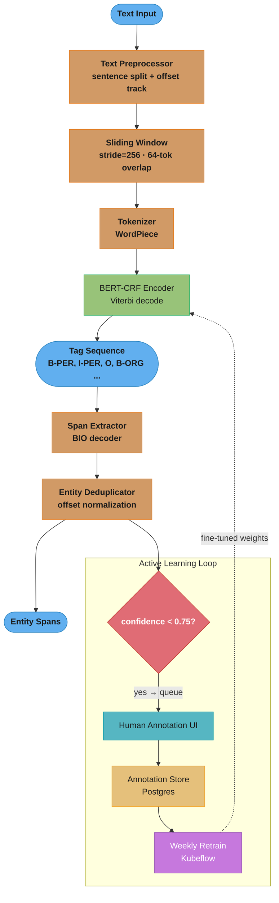
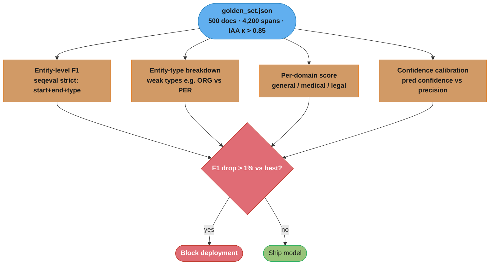
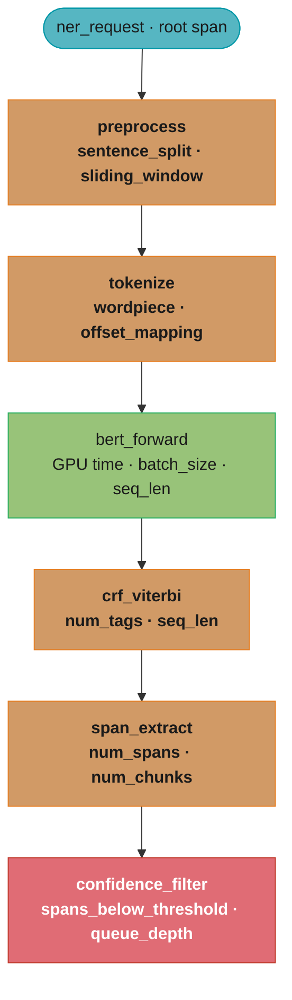

# Design a Named Entity Recognition (NER) Pipeline

## Intuition

> Like a highlighter that learned to read — the system scans unstructured text and marks every person, organization, location, date, and domain-specific entity without being told where to look.

**Key insight:** NER is token classification, not sequence classification. Every input token gets a label, and the label of one token constrains what labels its neighbors can have — which is why a CRF layer on top of BERT outperforms a plain softmax head.

Mental model: a tagger plus three pieces of plumbing that decide whether its output is usable. The **tagger** (BERT + CRF) labels tokens. The **alignment layer** maps subword tokens and sliding windows back to character offsets in the original text, and most production NER bugs live here, not in the model (§4.2, §4.5). The **operating point** decides which spans are emitted and which go to a human, and it must differ by entity type because a missed social-security number and a missed city name do not cost the same (§4.6).

Why this system exists: 5M documents a day cannot be read by people, and every downstream consumer (search filters, compliance redaction, knowledge-graph population, the bridge-entity step in [Question Answering](design_question_answering_system.md)) needs structured entities with exact offsets. A wrong offset breaks redaction even when the label is right.

This study owns **span extraction**: tagging, alignment, long-document merge, per-type thresholds and the active-learning loop. It does not repeat [NLP Classification Pipeline](design_nlp_classification_pipeline.md), which labels whole documents, or [Document AI Extraction](design_document_ai_extraction.md), which owns layout-aware extraction from scanned forms. Its cross-cutting references are [Model Calibration and Thresholding](cross_cutting/model_calibration_and_thresholding.md) for per-type operating points, [Drift Monitoring and Retraining](cross_cutting/drift_monitoring_and_retraining.md) for entity drift, [Responsible AI, Fairness and Explainability](cross_cutting/responsible_ai_fairness_and_explainability.md) for PII handling, [Feature Store and Point-in-Time Correctness](cross_cutting/feature_store_and_point_in_time_correctness.md) for leak-free training snapshots, and [Experimentation and Online Evaluation](cross_cutting/experimentation_and_online_evaluation.md) for shadow and A/B rollout.

| Term | Meaning in this study |
|---|---|
| BIO | Begin / Inside / Outside tags per token (§4.1) |
| Entity-level F1 | F1 where a span counts only if start, end and type all match (`seqeval`) |
| Span marginal | The probability of one span's tag sequence summed over all paths (forward-backward), used as span confidence |
| Window context | How far a token sits from the edge of its sliding window; predictions near an edge see less context (§4.5) |
| Operating point | The confidence threshold chosen per entity type for a target precision or recall (§4.6) |
| Snapshot | A frozen, dated training set; the eval set is excluded from every snapshot by document id (Pitfall 8) |

---

## 1. Requirements Clarification

**Functional requirements:**
- Tag every entity span in free-form text with its entity type (PER, ORG, LOC, DATE, MONEY, PRODUCT, and 5 domain-specific types: DISEASE, DRUG, LAW, CASE_NUM, TICKER)
- Return entity text, type, character offsets, and confidence score
- Support batch inference for documents and streaming inference for short texts
- Fine-tunable on domain-specific labeled corpora (medical, legal, financial)
- Active-learning loop: flag low-confidence spans for human review and incorporate feedback

**Non-functional requirements:**
- Latency: P95 < 50ms for texts up to 512 tokens; P95 < 200ms for documents up to 4K tokens
- Throughput: 2,000 documents/minute in batch mode
- Precision: ≥ 0.92 F1 on CoNLL-2003 (general); ≥ 0.88 on domain-specific eval sets
- Availability: 99.9% uptime for the synchronous API
- Model update cycle: weekly incremental retraining with human annotation feedback

**Out of scope:**
- Coreference resolution (linking "Apple" and "the company" to the same entity)
- Relation extraction (detecting that "Elon Musk" founded "Tesla")
- Entity disambiguation / linking to Wikidata

---

## 2. Scale Estimation

**Traffic:**
- 5M documents/day at average 800 tokens per document = 4B tokens/day = 2.8M tokens/minute average
- Peak: 3× average → 8.3M tokens/minute
- Synchronous API: 2,000 requests/minute (P99 = 512 tokens each), concentrated in business hours → ~1M docs/day
- Batch pipeline: the remaining 4M documents/day, processed in an 8-hour window → 500K docs/hour

**Compute sizing:**
- BERT-base NER inference: ~1.6ms/doc amortized on A10G at batch size 32 (512 tokens, mixed precision) — see §10 for the 50ms-per-32-doc batch breakdown
- 2,000 requests/minute synchronous (33 docs/sec): 1 A10G saturated at ~640 docs/sec, so 2 replicas for HA and 2x headroom
- Batch 500K docs/hour (139 docs/sec): 3 A10G batch workers (64 docs/batch, ~0.1 sec/batch) — 1 for load, 3 for variable document length

**Storage:**
- Annotation store: 500K labeled spans/day → 15M/month → ~3 GB/month (Postgres)
- Model artifacts: 440 MB per BERT-base checkpoint; 20 versions retained = 9 GB
- Active-learning queue: 50K spans/day awaiting review → <1 GB Redis ZSET

**Cost** (A10G = g5.xlarge, us-east-1 on-demand $1.006/hr):
- Synchronous API: 2 × $1.006/hr × 730 = $1,470/month
- Batch workers: 3 × $1.006/hr × 8hr/day × 30 = $725/month
- Total serving cost: ~$2,200/month for 150M documents/month

---

## 3. High-Level Architecture



The synchronous path (blue input → orange preprocessing → green BERT-CRF → orange span extraction) tags text end to end; spans below 0.75 confidence branch into the active-learning loop, whose weekly retrain feeds fine-tuned weights back into the encoder (dotted).

**Component inventory:**
- **Text Preprocessor:** sentence splitter (spaCy), sliding window for long docs, offset tracker
- **BERT-CRF Encoder:** BERT-base-uncased + CRF layer; outputs per-token BIO tags + Viterbi scores
- **Span Extractor:** BIO → entity spans with character offsets; handles subword alignment
- **Entity Deduplicator:** merges overlapping spans from sliding window chunks
- **Confidence Filter:** routes low-confidence spans to active-learning queue
- **Annotation Store:** Postgres with spans table; feeds weekly retrain
- **Batch Processor:** Kafka consumer → model worker → output topic (Avro schema)

**Data flow:**
1. Text arrives via REST API or Kafka topic
2. Preprocessor splits text into ≤ 512-token chunks with 64-token overlap
3. BERT-CRF runs Viterbi decoding to produce globally-optimal BIO tag sequence
4. Span Extractor converts BIO tags to entity objects with start/end char offsets
5. Spans below confidence threshold are queued for annotation
6. Weekly batch job aggregates annotations and triggers fine-tuning pipeline

---

## 4. Component Deep Dives

### 4.1 BIO Tagging Scheme and BERT-CRF

BIO tags every token as `B-TYPE` (beginning of entity), `I-TYPE` (inside entity), or `O` (outside). For 11 entity types, the label space is 2×11 + 1 = 23 tags. A plain BERT softmax head treats each token independently — it can produce `I-ORG` after `O`, which is invalid. The CRF layer adds a transition matrix that makes globally-consistent sequences more likely.

```python
from dataclasses import dataclass
from typing import Optional
import torch
import torch.nn as nn
from transformers import BertModel, BertTokenizerFast
from torchcrf import CRF


ENTITY_TYPES = ["PER", "ORG", "LOC", "DATE", "MONEY", "PRODUCT",
                "DISEASE", "DRUG", "LAW", "CASE_NUM", "TICKER"]
# Build tag list: O + B-TYPE + I-TYPE for each entity type
TAGS = ["O"] + [f"{prefix}-{etype}"
                for etype in ENTITY_TYPES
                for prefix in ["B", "I"]]
TAG2ID = {tag: i for i, tag in enumerate(TAGS)}
ID2TAG = {i: tag for tag, i in TAG2ID.items()}
NUM_TAGS = len(TAGS)  # 23


@dataclass
class NERSpan:
    text: str
    entity_type: str
    start_char: int
    end_char: int
    confidence: float
    token_start: int
    token_end: int


class BERTCRFModel(nn.Module):
    def __init__(self, bert_model_name: str = "bert-base-uncased", num_tags: int = NUM_TAGS,
                 dropout: float = 0.1):
        super().__init__()
        self.bert = BertModel.from_pretrained(bert_model_name)
        self.dropout = nn.Dropout(dropout)
        self.classifier = nn.Linear(self.bert.config.hidden_size, num_tags)
        # CRF layer: learns transition matrix (num_tags × num_tags)
        # Models constraints like I-ORG cannot follow O
        self.crf = CRF(num_tags, batch_first=True)

    def forward(
        self,
        input_ids: torch.Tensor,           # (batch, seq_len)
        attention_mask: torch.Tensor,       # (batch, seq_len)
        labels: Optional[torch.Tensor] = None,  # (batch, seq_len)
    ) -> dict:
        outputs = self.bert(input_ids=input_ids, attention_mask=attention_mask)
        sequence_output = self.dropout(outputs.last_hidden_state)  # (batch, seq_len, hidden)
        emissions = self.classifier(sequence_output)               # (batch, seq_len, num_tags)

        if labels is not None:
            # CRF negative log-likelihood (negate because CRF returns log-likelihood)
            # mask=attention_mask because padding tokens have no valid label
            loss = -self.crf(emissions, labels, mask=attention_mask.bool(), reduction="mean")
            return {"loss": loss}
        else:
            # Viterbi decoding: returns a list of variable-length tag sequences
            mask = attention_mask.bool()
            predictions = self.crf.decode(emissions, mask=mask)
            # Sequence-level confidence = exp(log P(best path | emissions)).
            # pytorch-crf exposes only `forward`; `_compute_score` /
            # `_compute_normalizer` are private and expect seq-first tensors,
            # so go through forward(reduction="none"), which returns the
            # per-sequence log-likelihood already normalized.
            with torch.no_grad():
                padded = torch.zeros_like(input_ids)
                for i, tags in enumerate(predictions):
                    padded[i, :len(tags)] = torch.tensor(tags, device=input_ids.device)
                log_likelihood = self.crf(emissions, padded, mask=mask, reduction="none")
                confidences = torch.exp(log_likelihood)  # (batch,)
            return {"predictions": predictions, "confidences": confidences.tolist()}
```

### 4.2 Subword Alignment and Span Extraction

BERT's WordPiece tokenizer splits "Johnson" into ["John", "##son"]. The NER model tags both subwords, but we want to return the original character offsets. `BertTokenizerFast` provides word-to-token alignment maps.

```python
from transformers import BertTokenizerFast


class NERInferencePipeline:
    def __init__(self, model: BERTCRFModel, model_name: str = "bert-base-uncased",
                 max_length: int = 512, stride: int = 256, confidence_threshold: float = 0.75):
        self.model = model
        self.tokenizer = BertTokenizerFast.from_pretrained(model_name)
        self.max_length = max_length
        self.stride = stride
        self.confidence_threshold = confidence_threshold
        self.model.eval()

    def predict(self, text: str) -> list[NERSpan]:
        # Tokenize with return_offsets_mapping=True for char offset alignment
        encoding = self.tokenizer(
            text,
            return_offsets_mapping=True,
            max_length=self.max_length,
            stride=self.stride,
            truncation=True,
            padding="max_length",
            return_overflowing_tokens=True,
            return_tensors="pt",
        )

        all_spans: list[NERSpan] = []
        for chunk_idx in range(len(encoding["input_ids"])):
            chunk_input_ids = encoding["input_ids"][chunk_idx].unsqueeze(0)
            chunk_attention_mask = encoding["attention_mask"][chunk_idx].unsqueeze(0)
            offset_mapping = encoding["offset_mapping"][chunk_idx].tolist()

            with torch.no_grad():
                output = self.model(chunk_input_ids, chunk_attention_mask)

            predictions = output["predictions"][0]
            seq_confidence = output["confidences"][0]

            spans = self._decode_bio_to_spans(
                text, predictions, offset_mapping, chunk_attention_mask[0].tolist(),
                seq_confidence
            )
            all_spans.extend(spans)

        # Deduplicate overlapping spans from sliding window chunks
        return self._deduplicate_spans(all_spans)

    def _decode_bio_to_spans(
        self, text: str, predictions: list[int], offset_mapping: list[tuple],
        attention_mask: list[int], seq_confidence: float
    ) -> list[NERSpan]:
        spans: list[NERSpan] = []
        current_entity: Optional[dict] = None

        for token_idx, (tag_id, (char_start, char_end), is_valid) in enumerate(
            zip(predictions, offset_mapping, attention_mask)
        ):
            if not is_valid or char_start == char_end:
                # Skip padding and special tokens ([CLS], [SEP])
                if current_entity:
                    spans.append(self._finalize_span(text, current_entity, seq_confidence))
                    current_entity = None
                continue

            tag = ID2TAG[tag_id]

            if tag.startswith("B-"):
                if current_entity:
                    spans.append(self._finalize_span(text, current_entity, seq_confidence))
                current_entity = {
                    "entity_type": tag[2:],
                    "start_char": char_start,
                    "end_char": char_end,
                    "token_start": token_idx,
                    "token_end": token_idx,
                }
            elif tag.startswith("I-") and current_entity and tag[2:] == current_entity["entity_type"]:
                current_entity["end_char"] = char_end
                current_entity["token_end"] = token_idx
            else:
                if current_entity:
                    spans.append(self._finalize_span(text, current_entity, seq_confidence))
                    current_entity = None

        if current_entity:
            spans.append(self._finalize_span(text, current_entity, seq_confidence))

        return spans

    def _finalize_span(self, text: str, entity: dict, confidence: float) -> NERSpan:
        entity_text = text[entity["start_char"]:entity["end_char"]]
        return NERSpan(
            text=entity_text,
            entity_type=entity["entity_type"],
            start_char=entity["start_char"],
            end_char=entity["end_char"],
            confidence=confidence,
            token_start=entity["token_start"],
            token_end=entity["token_end"],
        )

    def _deduplicate_spans(self, spans: list[NERSpan]) -> list[NERSpan]:
        # From sliding window chunks, the same entity may appear in two chunks
        # Keep the span with higher confidence when offsets overlap
        spans.sort(key=lambda s: (s.start_char, -s.confidence))
        deduped: list[NERSpan] = []
        last_end = -1
        for span in spans:
            if span.start_char >= last_end:
                deduped.append(span)
                last_end = span.end_char
        return deduped
```

**Broken → fixed: plain softmax head instead of CRF**

```python
# BROKEN: softmax head emits locally-optimal but globally-invalid sequences
class BrokenNERModel(nn.Module):
    def forward(self, input_ids, attention_mask, labels=None):
        output = self.bert(input_ids=input_ids, attention_mask=attention_mask)
        logits = self.classifier(output.last_hidden_state)  # (B, T, num_tags)
        if labels is not None:
            loss = nn.CrossEntropyLoss()(logits.view(-1, NUM_TAGS), labels.view(-1))
            return {"loss": loss}
        preds = logits.argmax(-1)  # independent per-token argmax → can produce I-ORG after O
        return {"predictions": preds.tolist()}

# FIXED: CRF layer models transition constraints, Viterbi finds globally-optimal sequence
# Size of the win depends on the corpus: on CoNLL-2003 the published BERT numbers already
# come from a plain softmax token-classification head (92.4 test F1 for BERT-base), and the
# reported CRF gain on top of BERT is small there because BERT's context already resolves
# most boundaries. The gain grows on domain corpora with ambiguous multi-token boundaries
# (medical: "type 2 diabetes mellitus" spans 4 tokens). Measure it on your own corpus.
```

### 4.3 Domain Fine-Tuning with Active Learning

A model trained on CoNLL-2003 degrades sharply on medical text: its label set does not even contain DRUG or DISEASE, and forms like "HbA1c", "ICD-10 code E11.9" and "metformin 500mg BID" never appear in news corpora, so both the tokenizer's subword splits and the tagger's priors are wrong. Fine-tuning on a few thousand domain-labeled sentences recovers most of the gap — measure it on your own eval set rather than assuming a fixed recovery.

```python
from torch.utils.data import Dataset, DataLoader
from transformers import get_linear_schedule_with_warmup
import numpy as np
from seqeval.metrics import f1_score, precision_score, recall_score


class NERDataset(Dataset):
    def __init__(self, texts: list[str], labels: list[list[str]],
                 tokenizer: BertTokenizerFast, max_length: int = 512):
        self.encodings = []
        self.label_ids = []
        for text, word_labels in zip(texts, labels):
            words = text.split()
            encoding = tokenizer(
                words, is_split_into_words=True,
                max_length=max_length, truncation=True,
                padding="max_length", return_tensors="pt"
            )
            # Align word-level labels to subword tokens
            word_ids = encoding.word_ids()
            label_ids = []
            prev_word_id = None
            for word_id in word_ids:
                if word_id is None:
                    label_ids.append(-100)  # Special tokens: ignore in loss
                elif word_id != prev_word_id:
                    label_ids.append(TAG2ID[word_labels[word_id]])
                else:
                    # Continuation subword: use I- tag if B- was used, else O
                    prev_tag = word_labels[word_id]
                    if prev_tag.startswith("B-"):
                        label_ids.append(TAG2ID["I-" + prev_tag[2:]])
                    else:
                        label_ids.append(TAG2ID[prev_tag])
                prev_word_id = word_id
            self.encodings.append({k: v.squeeze(0) for k, v in encoding.items()})
            self.label_ids.append(torch.tensor(label_ids))

    def __len__(self):
        return len(self.encodings)

    def __getitem__(self, idx):
        return {**self.encodings[idx], "labels": self.label_ids[idx]}


def fine_tune_ner(
    model: BERTCRFModel,
    train_texts: list[str],
    train_labels: list[list[str]],
    val_texts: list[str],
    val_labels: list[list[str]],
    num_epochs: int = 5,
    lr: float = 3e-5,
    batch_size: int = 16,
) -> dict:
    tokenizer = BertTokenizerFast.from_pretrained("bert-base-uncased")
    train_dataset = NERDataset(train_texts, train_labels, tokenizer)
    val_dataset = NERDataset(val_texts, val_labels, tokenizer)

    train_loader = DataLoader(train_dataset, batch_size=batch_size, shuffle=True)
    val_loader = DataLoader(val_dataset, batch_size=batch_size)

    # Differential learning rates: lower LR for BERT layers, higher for CRF + classifier
    optimizer = torch.optim.AdamW([
        {"params": model.bert.parameters(), "lr": lr},
        {"params": model.classifier.parameters(), "lr": lr * 10},
        {"params": model.crf.parameters(), "lr": lr * 10},
    ], weight_decay=0.01)

    total_steps = len(train_loader) * num_epochs
    scheduler = get_linear_schedule_with_warmup(
        optimizer, num_warmup_steps=total_steps // 10, num_training_steps=total_steps
    )

    best_val_f1 = 0.0
    best_model_state = None

    for epoch in range(num_epochs):
        model.train()
        total_loss = 0.0
        for batch in train_loader:
            optimizer.zero_grad()
            output = model(
                batch["input_ids"], batch["attention_mask"],
                labels=batch["labels"].clamp(min=0)  # Replace -100 with 0 for CRF
            )
            output["loss"].backward()
            torch.nn.utils.clip_grad_norm_(model.parameters(), max_norm=1.0)
            optimizer.step()
            scheduler.step()
            total_loss += output["loss"].item()

        # Validation
        val_f1 = evaluate_ner(model, val_loader, tokenizer)
        if val_f1 > best_val_f1:
            best_val_f1 = val_f1
            best_model_state = {k: v.clone() for k, v in model.state_dict().items()}

    model.load_state_dict(best_model_state)
    return {"best_val_f1": best_val_f1}


def uncertainty_sampling_ner(
    pipeline: NERInferencePipeline,
    unlabeled_texts: list[str],
    budget: int = 200,
) -> list[tuple[int, float]]:
    """Return indices of texts with the lowest sequence-level NER confidence."""
    scores = []
    for idx, text in enumerate(unlabeled_texts):
        spans = pipeline.predict(text)
        if spans:
            min_confidence = min(s.confidence for s in spans)
        else:
            min_confidence = 1.0  # No entities predicted → fully confident (skip)
        scores.append((idx, min_confidence))

    # Sort by ascending confidence → most uncertain first
    scores.sort(key=lambda x: x[1])
    return scores[:budget]
```

### 4.4 Nested NER

Standard BIO cannot represent nested entities: "Apple [ORG] CEO [TITLE] Tim Cook [PER]" — "Tim Cook" is nested inside "Apple CEO Tim Cook". Two approaches:

```
Standard BIO (flat, misses nesting):
  Apple  → B-ORG
  CEO    → O        ← loses the TITLE span
  Tim    → B-PER
  Cook   → I-PER

Span-based approach (handles nesting):
  Enumerate all spans (i, j) up to length L
  Score each span independently: sigmoid(BERT_pooled(i..j) · W) → P(entity_type)
  Allows overlapping predictions
  Cost: O(n²) spans per sentence → cap L=10 for efficiency
```

```python
def enumerate_candidate_spans(
    token_embeddings: torch.Tensor,  # (seq_len, hidden)
    max_span_length: int = 10,
) -> list[tuple[int, int, torch.Tensor]]:
    seq_len = token_embeddings.size(0)
    candidates = []
    for start in range(seq_len):
        for end in range(start + 1, min(start + max_span_length + 1, seq_len)):
            # Mean pooling of the span's token embeddings
            span_repr = token_embeddings[start:end].mean(dim=0)
            candidates.append((start, end, span_repr))
    return candidates
```

### 4.5 Merging Spans Across Sliding Windows

A 4K-token document runs through BERT as overlapping 512-token windows (§5 uses stride 256). Every entity near a window edge is predicted twice, once with too little context, and an entity that straddles an edge is predicted as two truncated halves. Pitfall 5 is what exact-match deduplication does with that: both halves survive. The rule that works is the one used for SQuAD-style long-context readers: **trust the prediction made from the window where the span has the most context on both sides**, and drop any span that touches an interior window edge, because the neighbouring window holds the complete version. That requires the overlap to be longer than the longest entity.

```python
from __future__ import annotations

from dataclasses import dataclass


@dataclass(frozen=True)
class Span:
    start: int          # character offset in the full document
    end: int            # exclusive
    label: str
    confidence: float
    window_id: int


# BROKEN: exact-match dedupe. Truncated halves and conflicting labels in the
# overlap all survive, so one company becomes three entities.
def merge_exact_dedupe(spans: list[Span]) -> list[Span]:
    seen: set[tuple[int, int, str]] = set()
    out = []
    for s in spans:
        key = (s.start, s.end, s.label)
        if key not in seen:
            seen.add(key)
            out.append(s)
    return sorted(out, key=lambda s: (s.start, s.end))


# FIX: drop spans cut by an interior window edge, then resolve overlaps in
# favour of the prediction with the most context on its weaker side.
def merge_max_context(spans: list[Span], windows: dict[int, tuple[int, int]],
                      doc_len: int) -> list[Span]:
    def is_cut(s: Span) -> bool:
        ws, we = windows[s.window_id]
        return (s.start <= ws and ws > 0) or (s.end >= we and we < doc_len)

    def context(s: Span) -> int:
        ws, we = windows[s.window_id]
        return min(s.start - ws, we - s.end)

    candidates = sorted((s for s in spans if not is_cut(s)),
                        key=lambda s: (-context(s), -s.confidence))
    kept: list[Span] = []
    for s in candidates:
        if all(s.end <= k.start or s.start >= k.end for k in kept):
            kept.append(s)
    return sorted(kept, key=lambda s: s.start)


if __name__ == "__main__":
    windows = {0: (0, 2_000), 1: (1_000, 3_000), 2: (2_000, 4_000)}
    predictions = [
        Span(1_980, 2_000, "ORG", 0.88, 0),    # "International Busine" cut at window 0's end
        Span(1_980, 2_023, "ORG", 0.97, 1),    # full "International Business Machines Corporation"
        Span(2_000, 2_023, "ORG", 0.71, 2),    # tail cut at window 2's start
        Span(2_950, 2_963, "PER", 0.62, 1),    # "Watson Health" 37 chars from window 1's end
        Span(2_950, 2_963, "ORG", 0.91, 2),    # same text, 950 chars of context in window 2
    ]
    print("BROKEN:", [(s.start, s.end, s.label) for s in merge_exact_dedupe(predictions)])
    print("FIX:   ", [(s.start, s.end, s.label)
                      for s in merge_max_context(predictions, windows, doc_len=4_000)])
```

The broken merge returns five spans for two entities; the fixed merge returns `(1980, 2023, ORG)` and `(2950, 2963, ORG)`. Two production details matter. The windows are defined in tokens but the spans in characters, so the window table must store each window's character range from the tokenizer's `offset_mapping`, and pinning the tokenizer version is part of the contract (Runbook 4). And the `doc_len` edge cases are real: a span at the very start of the document touches window 0's left edge legitimately and must not be dropped, which is what the `ws > 0` and `we < doc_len` guards encode.

### 4.6 Per-Type Operating Points and a Second Detector for PII

The pipeline gates spans with one confidence threshold (0.75 in the runbooks). One number cannot serve every entity type: for a search facet, a false ORG is the expensive error, so ORG wants a **precision** target; for compliance redaction, a missed social-security or card number is the expensive error, so those types want a **recall** target, and a model alone rarely reaches 99% recall on them. The fix has two parts: an operating point per type fitted on dev data, and a deterministic second detector (pattern plus checksum) unioned with the model for the types that have one.

```python
from __future__ import annotations

import re

import numpy as np

CARD_RE = re.compile(r"\b\d(?:[ -]?\d){12,18}\b")      # 13-19 digits, spaces or dashes allowed


def luhn_valid(number: str) -> bool:
    digits = [int(c) for c in number if c.isdigit()]
    if not 13 <= len(digits) <= 19:
        return False
    total = 0
    for i, d in enumerate(reversed(digits)):
        if i % 2 == 1:
            d *= 2
            if d > 9:
                d -= 9
        total += d
    return total % 10 == 0


def card_spans(text: str) -> list[tuple[int, int, str]]:
    """Pattern + checksum detector: high recall, and Luhn removes most false hits."""
    return [(m.start(), m.end(), "CREDIT_CARD") for m in CARD_RE.finditer(text)
            if luhn_valid(m.group())]


def threshold_for_recall(conf: np.ndarray, is_true: np.ndarray, target: float) -> float:
    pos = np.sort(conf[is_true == 1])[::-1]
    return float(pos[int(np.ceil(target * pos.size)) - 1]) if pos.size else 0.0


def threshold_for_precision(conf: np.ndarray, is_true: np.ndarray, target: float) -> float:
    order = np.argsort(-conf)
    precision = np.cumsum(is_true[order]) / np.arange(1, len(order) + 1)
    ok = np.flatnonzero(precision >= target)
    return float(conf[order][ok.max()]) if ok.size else 1.01


POLICY: dict[str, tuple[str, float]] = {
    "SSN": ("recall", 0.99), "PER": ("recall", 0.97),             # redaction types
    "ORG": ("precision", 0.92), "LOC": ("precision", 0.92),       # search-facet types
}


def fit_operating_points(dev: dict[str, tuple[np.ndarray, np.ndarray]]) -> dict[str, float]:
    points = {}
    for label, (conf, is_true) in dev.items():
        kind, target = POLICY[label]
        fit = threshold_for_recall if kind == "recall" else threshold_for_precision
        points[label] = fit(conf, is_true, target)
    return points


if __name__ == "__main__":
    rng = np.random.default_rng(5)
    dev = {}
    for label, (a_true, a_false) in {"SSN": (8, 3), "PER": (9, 3), "ORG": (9, 4), "LOC": (10, 4)}.items():
        conf = np.concatenate([rng.beta(a_true, 2, 900), rng.beta(2, a_false, 300)])
        is_true = np.concatenate([np.ones(900), np.zeros(300)])
        dev[label] = (conf, is_true)
    points = fit_operating_points(dev)
    for label, (conf, is_true) in dev.items():
        r_global = float(np.mean(conf[is_true == 1] >= 0.75))           # BROKEN: one threshold
        r_typed = float(np.mean(conf[is_true == 1] >= points[label]))  # FIX: per type
        print(f"{label}: recall@0.75 {r_global:.1%}  threshold {points[label]:.2f} -> recall {r_typed:.1%}")
    text = "Card 4111 1111 1111 1111 was charged; order ref 1234 5678 9012 3456."
    print(card_spans(text))   # only the Luhn-valid test card number is returned
```

The order reference `1234 5678 9012 3456` matches the pattern but fails the checksum, so only the card number is redacted. The price of recall targets is precision: at a 0.99 recall target the SSN threshold falls low enough that more non-SSN spans are redacted, which for redaction is the right side to err on and for a search facet would not be. Each type's threshold is refitted when the model changes and monitored per type, never as one aggregate; the method is in [Model Calibration and Thresholding](cross_cutting/model_calibration_and_thresholding.md), and the reason to treat PII misses as a governance issue, not a metric, is in [Responsible AI, Fairness and Explainability](cross_cutting/responsible_ai_fairness_and_explainability.md). Presidio (§6) packages the same two-detector shape as an open-source library.

---

## 5. Design Decisions & Tradeoffs

| Decision | Choice | Alternatives | Rationale |
|---|---|---|---|
| Tag scheme | BIO (flat) | BIOES, span-based | BIO is simpler and sufficient for non-nested entities; BIOES adds E-/S- tags but marginal gain; span-based needed only for nested NER |
| Sequence model | BERT-base + CRF | BERT-large, RoBERTa, BiLSTM-CRF | BERT-base hits ~92 F1 on CoNLL-2003 at 50ms (published: 92.4 test F1); BERT-large adds only 0.4 F1 (92.8) for ~3× the latency; CRF costs almost nothing and mainly buys valid sequences |
| Long-document handling | Sliding window (stride=256) | Hierarchical BERT, Longformer | Sliding window reuses BERT-base weights; Longformer improves cross-chunk entities but requires 10× training cost |
| Active learning strategy | Uncertainty (min confidence) | Random, diversity (coreset) | Uncertainty reaches a given F1 on a materially smaller annotation budget than random (measure the ratio on your own corpus); coreset needed only when class imbalance is severe |
| Subword label assignment | First subword gets word label | Average logits across subwords | First-subword convention is de facto standard; averaging adds complexity without F1 gain in practice |
| Window merge | Drop edge-cut spans, keep max-context prediction (§4.5) | Exact-match dedupe; keep highest confidence | Confidence does not track context: a prediction 20 characters from a window edge can be confident and wrong. Context on both sides is what the model was trained with, so it decides; exact dedupe keeps truncated halves |
| Emission threshold | Per-type operating point: recall targets for PII, precision targets for facets (§4.6) | One global threshold tuned on micro-F1 | Micro-F1 is dominated by frequent types (PER, ORG), so the global threshold is wrong for rare, high-cost types such as SSN |
| PII detection | Model unioned with pattern + checksum detectors | Model only; regex only | The model handles names and free-form identifiers; checksums give near-certain recall on structured numbers and reject look-alikes such as order references |
| Zero-shot new types | Span-based generalist model (GLiNER) as a bootstrap labeler | Fine-tune immediately; prompt an LLM | A compact encoder extracts arbitrary types in parallel at a fraction of LLM cost; its spans seed the annotation queue until 500+ gold labels allow a fine-tune |

**Comparison: CRF vs softmax head** — the accuracy rows below are illustrative in-house
measurements on this pipeline's own corpora, not published benchmark results. The one published
anchor: Devlin et al. report **92.4 CoNLL-2003 test F1 for BERT-base with a plain
token-classification (softmax) head**, so do not assume a CRF is what gets you to 92 on news text.

| Metric | Softmax head | CRF layer | Delta |
|---|---|---|---|
| CoNLL-2003 F1 (published, softmax head) | 0.924 | — | — |
| Domain (medical) NER F1, in-house | 0.831 | 0.868 | +3.7pp |
| Inference latency (512 tok) | 38ms | 41ms | +3ms |
| Training time | 1× | 1.1× | +10% |
| Invalid sequences | 0.8% of outputs | 0% | critical |

---

## 6. Real-World Implementations

**Amazon Comprehend:** Offers pre-trained NER for PER/ORG/LOC/DATE/QUANTITY plus custom entity types via Amazon Comprehend Custom. AWS documents the training-data floor for custom entity recognition explicitly: with plain-text annotations you need **at least 3 annotated input documents and 25 annotations per entity type** (and a corpus of at least 5 KB); with PDF annotations the floor rises to **250 documents and 100 annotations per entity**. AWS does not publish the model architecture, so treat "it is a BERT under the hood" as an assumption, not a fact.

**Financial-domain NER (pattern):** Financial text needs TICKER, COMPANY, PERSON and ECONOMIC_INDICATOR types, and the hard case is that a surface form like "Apple" is simultaneously a common noun, a company and a ticker. The standard fix is a domain-specific entity-linking layer after NER that resolves the surface form against a security master, rather than trying to teach the tagger to disambiguate. Bloomberg's published work in this space is BloombergGPT (2023), which reports NER and NED results on internal and public financial datasets — its numbers are not comparable to a fine-tuned encoder tagger, so do not carry them over as a NER baseline.

**Google Cloud Healthcare Natural Language API:** Extracts medical concepts from clinical text (medications, procedures, problems) and maps them to standard vocabularies. Google does not publish the underlying architecture. The interesting design problem it surfaces is nested NER: in "500mg aspirin", "aspirin" is a DRUG while "500mg aspirin" is a dosage instruction containing it — handled by a layered span extractor that identifies drug names first, then dosage spans that contain them.

**Document-scale intelligence/legal NER (pattern):** Corpora of 10M+ documents with 20+ entity types (CASE_NUMBER, STATUTE, LEGAL_ENTITY) use sliding-window BERT with cross-chunk entity merging, then post-NER coreference chaining across sentences. Vendors in this space (Palantir and others) do not publish per-entity F1 on their customers' corpora, so plan to build your own golden set rather than shopping for a headline number.

**spaCy's transformer pipeline (`spacy-transformers`):** Production-ready transformer NER wired into the spaCy pipeline. Their `en_core_web_trf` model uses a **roberta-base** backbone (not BERT) and reports **NER F = 0.899 (P 0.897 / R 0.901) on OntoNotes 5** in the published model metadata, with full subword alignment support.

**BioBERT (Lee et al., Korea University and NAVER, Bioinformatics 2020).** The reference result for the domain-specific encoder row in §11. BioBERT continues BERT's pre-training on large biomedical corpora with almost the same architecture, and reports gains over previous state of the art of 0.62% F1 on biomedical NER, 2.80% F1 on relation extraction and 12.24% MRR on biomedical QA, with the weights released openly. The honest reading for this pipeline: on NER the domain pre-training gain is under one F1 point over prior state of the art, far smaller than the gain from fine-tuning on in-domain labels (§4.3). Pre-train for vocabulary coverage; label for accuracy.

**GLiNER (Zaratiana, Tomeh, Holat, Charnois, arXiv 2311.08526, 2023).** A compact NER model built on a bidirectional transformer encoder that extracts *arbitrary* entity types named at inference time, in parallel rather than token by token as an LLM generates. The authors report it outperforming both ChatGPT and fine-tuned LLMs in zero-shot evaluation on several NER benchmarks. In this design it fills the gap the weekly retrain cannot: when a new type appears (a new product line, a new regulation code), it produces candidate spans on day one for the annotation queue, and the supervised BERT-CRF takes over once enough gold labels exist.

**Presidio (Data Privacy Stack; open-sourced by Microsoft).** An open-source PII identification and anonymization library, now a community-owned project, whose recognizers combine named entity recognition, regular expressions, rule-based logic and checksums with surrounding context, across text, images and structured data. It is the packaged form of §4.6's two-detector design. Its own documentation warns that automated detection cannot guarantee finding all sensitive information and that additional protections are needed, which is exactly why §4.6 sets recall targets per type and keeps a human review queue for low-confidence PII.

| Source | What this study borrows | Primary source |
|---|---|---|
| Google (BERT) | 92.4 CoNLL-2003 test F1 with a softmax head | Devlin et al., NAACL 2019 |
| Korea University / NAVER | Domain pre-training gain is small on NER | Lee et al., BioBERT |
| Zaratiana et al. | Zero-shot generalist NER as a bootstrap labeler | GLiNER, arXiv 2311.08526 |
| Data Privacy Stack (Presidio) | NER + regex + checksum PII recognizers | Presidio documentation |
| Explosion (spaCy) | Transformer NER with subword alignment | `en_core_web_trf` metadata |
| AWS (Comprehend Custom) | Minimum training data for custom entity types | AWS documentation |

---

## 7. Technologies & Tools

| Tool | Role | Strengths | Weaknesses |
|---|---|---|---|
| HuggingFace `transformers` | BERT fine-tuning | Pre-built NER pipelines, AutoModelForTokenClassification | Higher-level API hides CRF customization |
| `pytorch-crf` / `torchcrf` | CRF layer | Viterbi decoding, gradient-compatible | Must handle -100 label masking carefully |
| spaCy + `spacy-transformers` | NER pipeline (production) | Named entity ruler, batch processing, serialization | Less flexible for custom architectures |
| Flair | Contextual string embeddings for NER | Strong multilingual support, simple API | Slower than BERT-based approaches, less community support |
| Label Studio | Annotation platform | NER span annotation, active learning integration, webhooks | Self-hosted ops overhead |
| Prodigy (Explosion AI) | Active-learning annotation | Integrated uncertainty sampling, compatible with spaCy | Commercial license |
| `seqeval` | NER evaluation metrics | Entity-level F1 (not token-level), supports BIO/BIOES | Strict span match (start+end+type must all match) |

---

## 8. Operational Playbook

### (a) Eval Pipeline


Every candidate model scores against the frozen golden set; the four entity-level metrics feed a single regression gate that blocks any deployment dropping more than 1% F1 versus the current best.

Reference: [../cross_cutting/drift_monitoring_and_retraining.md](cross_cutting/drift_monitoring_and_retraining.md) for retraining trigger criteria.

### (b) Observability

Trace hierarchy (OpenTelemetry):


Each OpenTelemetry child span wraps one pipeline stage in execution order; the per-span attributes (GPU time, seq_len, queue_depth) localize exactly where a latency regression originates.

Key metrics:
- `ner.latency_p95_ms` by doc_length bucket (< 128, 128–256, 256–512 tokens)
- `ner.f1_rolling_7d` per entity type (computed on sampled + annotated predictions)
- `ner.active_learning_queue_depth` (alert if > 10K items: annotation throughput issue)
- `ner.confidence_distribution` (histogram of per-span confidence; shift = distribution drift)

### (c) Incident Runbooks

**Runbook 1 — F1 drops > 3% overnight**
- Symptom: `ner.f1_rolling_7d` drops from 0.92 to 0.89
- Diagnosis: compare entity-type breakdown; check if new entity subtype appeared in traffic
- Mitigation: enable higher human review rate for affected entity type (drop threshold from 0.75 → 0.60)
- Resolution: collect 500 new labeled examples for affected type; trigger targeted fine-tune

**Runbook 2 — Latency spike (P95 > 200ms)**
- Symptom: `ner.latency_p95_ms` spikes from 45ms to 220ms
- Diagnosis: check doc_length distribution (large-doc traffic spike?), GPU utilization, batch queue depth
- Mitigation: reduce sliding window size from 512 → 256 tokens (sacrifices cross-sentence entities)
- Resolution: add batch worker replicas; implement async batch endpoint for large-doc traffic

**Runbook 3 — Active learning queue overflow**
- Symptom: `ner.active_learning_queue_depth` > 50K
- Diagnosis: annotation throughput < annotation arrival; model confidence dropped (new domain)
- Mitigation: raise confidence threshold from 0.75 → 0.85 (fewer items enter queue); prioritize uncertainty-sampled items
- Resolution: hire temporary annotators; evaluate Prodigy active learning recipes for 2× annotation speed

**Runbook 4 — Span deduplication bug after model update**
- Symptom: duplicate entities reported in responses (same span, two entity records)
- Diagnosis: sliding window overlap logic broke after tokenizer update (offset_mapping format change)
- Mitigation: enable overlap deduplication in API response layer (filter identical char offsets)
- Resolution: pin tokenizer version; add integration test covering 600-token documents

**Runbook 5 — PII recall below target on the weekly audit**
- Symptom: audit of 1,000 sampled redacted documents finds SSN or card recall below 0.99
- Diagnosis: check which detector missed (model, pattern, or both); new formats (masked "XXX-XX-1234", numbers split by line breaks) defeat the pattern, new context defeats the model
- Mitigation: lower that type's threshold to restore recall on the audit sample; route all documents from the affected source to human review
- Resolution: add the new format to the pattern detector, add the missed examples to the next fine-tune, refit the per-type operating points (§4.6)

### (d) Release Gates for the Weekly Retrain
- **Snapshot integrity:** the training snapshot is built as of a cutoff date and excludes every document id in the golden eval set, including near-duplicates by MinHash; the point-in-time discipline is the one in [Feature Store and Point-in-Time Correctness](cross_cutting/feature_store_and_point_in_time_correctness.md).
- **Per-type quality:** entity-level F1 per type within 1 point of the champion, and recall at the fitted operating point for every PII type at or above target. Aggregate F1 alone never promotes a model.
- **Drift check:** PSI of predicted entity-type frequencies on the last 7 days of traffic against the snapshot, per [Drift Monitoring and Retraining](cross_cutting/drift_monitoring_and_retraining.md).
- **Shadow run:** 48 hours on mirrored traffic, comparing span-level disagreements with the champion by type and source system before any traffic shift, as in [Experimentation and Online Evaluation](cross_cutting/experimentation_and_online_evaluation.md). Downstream consumers (search facets, redaction) see the candidate's output only after the disagreement sample is reviewed.

---

## 9. Common Pitfalls & War Stories

**Pitfall 1 — Subword token label alignment mismatch**
A healthcare startup assigned the same BIO label to every subword token of a word (e.g., "metformin" → ["met", "##form", "##in"] all get `B-DRUG`). The CRF then learned to predict `B-DRUG` followed by `B-DRUG`, producing spurious entity boundaries. Fix: only the first subword of each word gets the word-level label; continuation subwords get the corresponding `I-TYPE` or -100 (ignored in loss). Impact: 6% F1 drop in production; fixed in one retraining cycle after root cause identified.

**Pitfall 2 — O-tag domination killing rare entity recall**
A legal-document NER system trained on a corpus where 97% of tokens are O-tags. The model learned to predict O for everything and achieved 97% token accuracy but 0% entity F1. Fix: class-weighted loss (`weight` in `nn.CrossEntropyLoss`) with entity-tag weight = 5× O-tag weight, or use focal loss (gamma=2). Impact: recall for CASE_NUMBER went from 0% to 71% after reweighting. See [../cross_cutting/model_calibration_and_thresholding.md](cross_cutting/model_calibration_and_thresholding.md) for threshold calibration.

**Pitfall 3 — Annotation inconsistency in overlapping entity types**
A financial NER system had annotators label "Goldman Sachs investment banking division" sometimes as one ORG, sometimes as ORG + DIVISION. Inter-annotator agreement (Cohen's κ) was 0.61 — below the 0.80 required for reliable training. The model learned conflicting supervision and F1 plateaued at 0.78. Fix: strict annotation guidelines with 20+ examples per ambiguous case; recheck IAA every 2K spans. Impact: 3,000 spans re-annotated; IAA rose to 0.88; F1 improved to 0.87. Affected 4 client data pipelines downstream.

**Pitfall 4 — Confidence score miscalibration leads to under-annotation**
The production pipeline used sequence-level CRF confidence (probability of the entire Viterbi path). A 500-token document containing 2 uncertain entities and 48 clearly-labeled tokens produced an overall confidence of 0.91, bypassing the annotation queue. Individual low-confidence spans were never reviewed. Fix: switch to per-span confidence using the marginal probability of the span's tag sequence (sum-product instead of Viterbi). Impact: active learning label quality improved; per-entity F1 on rare types rose 4.2% after targeted annotation. See [../cross_cutting/model_calibration_and_thresholding.md](cross_cutting/model_calibration_and_thresholding.md).

**Pitfall 5 — Sliding window produces cross-boundary entity split**
A company name "International Business Machines Corporation" spanning a 512-token boundary was tagged B-ORG in chunk 1 and B-ORG in chunk 2, producing two separate 2-word entities. The deduplication logic (which only removed exact duplicates) passed both to the response. Fix: extend the overlap region from 64 → 128 tokens; add a post-merge step that joins spans from adjacent chunks where the span end of chunk N matches span start of chunk N+1. Impact: ORG F1 on long documents improved from 0.83 to 0.89.

**Pitfall 6 — Domain shift after product rebranding**
A media monitoring NER system was trained when "Twitter" was the brand. After rebranding to "X Corp", entity F1 for COMPANY dropped from 0.91 to 0.74 in two weeks because "X" appeared everywhere as a pronoun/variable and the model was confused. The drift was detected via [../cross_cutting/drift_monitoring_and_retraining.md](cross_cutting/drift_monitoring_and_retraining.md) PSI monitoring. Fix: collect 200 new labeled examples covering "X Corp", "xAI", "X (formerly Twitter)"; retrain within 48 hours. Impact: 4 days before detection (PSI threshold too high for sudden shifts); threshold now tuned for rapid brand-change events.

**Pitfall 7 — A global threshold that let card numbers through redaction**
(Illustrative composite; the mechanism is §4.6.) A support-ticket redaction job used the pipeline's single 0.75 threshold for every type. It had been tuned on micro-F1, which is dominated by PER and ORG. Card numbers written with unusual separators ("4111.1111.1111.1111") or split across a line break scored 0.55-0.70 and were emitted unredacted into an analytics warehouse with 140 readers. An audit found 2,300 unredacted card numbers across 6 weeks of tickets; the remediation (purging and re-processing 1.9M tickets, notifying the payment-security team, and a scope review) took 3 engineer-weeks. Fix: recall-targeted per-type thresholds plus the pattern-and-Luhn detector, with the separator set widened to `[ .-]`. Lesson: for redaction, the cost of a miss is set by the type, so the threshold must be too.

**Pitfall 8 — Active learning that pulled the eval set into training**
(Illustrative composite.) The uncertainty sampler (§4.3) selected its batch from all unlabeled traffic, and the golden eval set had been sampled from the same traffic two months earlier. Over 10 weekly cycles, 412 of the 2,000 eval documents (or near-duplicates differing only in signatures and timestamps) were annotated and added to training. Reported entity F1 climbed from 0.88 to 0.93 while the independent quarterly audit stayed at 0.88. Two model promotions were approved on the inflated number, one of which regressed LAW recall by 4 points in production. Fix: exclude eval document ids and MinHash near-duplicates from every training snapshot, and refresh 25% of the eval set each quarter from traffic after the snapshot cutoff. Lesson: an active-learning loop is a data pipeline, and it leaks like one.

---

## 10. Capacity Planning

**Primary bottleneck:** BERT-base forward pass on GPU (O(n²) attention, n = sequence length)

**Throughput formula:**
```
throughput_docs_per_sec = (GPU_count × batch_size) / (bert_forward_ms + crf_viterbi_ms + overhead_ms) × 1000

For A10G (24 GB GDDR6, 600 GB/s, 70 TFLOPS dense BFLOAT16 tensor-core —
140 TFLOPS is the *with-sparsity* figure and does not apply to a dense
BERT graph; both from the AWS/NVIDIA A10G datasheet — on g5.xlarge):
  bert_forward_ms   = 38ms  (batch=32, seq_len=512, BF16)
  crf_viterbi_ms    = 3ms   (23 tags, seq_len=512)
  overhead_ms       = 9ms   (tokenization + span extraction)
  total_per_batch   = 50ms for 32 docs
  throughput        = 32 / 50ms × 1000 = 640 docs/sec/GPU

To hit 2,000 docs/min = 33 docs/sec:
  Required GPUs = ceil(33 / 640) = 1 GPU for steady state
  With 2× safety headroom = 2 A10G GPUs
  Monthly cost = 2 × $1.006/hr × 730hr = $1,470/month
    (A10G = g5.xlarge, us-east-1 on-demand)
```

**Scaling for batch processing (500K docs/hour):**
```
500K docs/hr = 139 docs/sec
  Required GPUs = ceil(139 / 640) = 1 GPU
  With 3× safety headroom for variable doc length = 3 A10G GPUs
  Batch cost = 3 × $1.006 × 8hr/day × 30 days = $725/month
```

**Active learning annotation queue cost:**
- 50K spans/day reviewed by annotators
- At 200 spans/hour/annotator and $25/hour: $25 / 200 = $0.125/span
- Human capacity required: 50K / 200 = 250 annotator-hours/day ≈ 31 FTE annotators
- Annual annotation budget: 50K × 365 × $0.125 = $2.28M/year
- Uncertainty sampling reduces annotation by 40% vs random → saves ~$910K/year
- This is the dominant line item — it is ~85× the GPU serving bill, which is why
  the confidence threshold that gates the queue is a budget decision, not just a
  quality knob

**What per-type operating points do to the review queue (§4.6):**
```
Assumption: 5M docs/day, 1.2 PII-type spans/doc on average = 6M PII spans/day
Global threshold 0.75: assume 2% of PII spans fall in the review band 0.60-0.75
  -> 120K spans/day to review
Recall-targeted thresholds push the PII review band lower (0.40-0.60) and wider:
  assume 3.5% of PII spans -> 210K spans/day
At $0.125/span: +90K spans x $0.125 = +$11,250/day ≈ +$4.1M/year
That is unaffordable as-is, so split the queue:
  - pattern + Luhn hits are auto-redacted (no review); assume they are 60% of the band
  - review only model-only PII spans in the band: ~84K spans/day ≈ $10,500/day
  - sample 1% of the ~126K auto-redacted spans for audit: ~1.3K spans/day
Net: ~85K reviewed spans/day against 120K before, with recall targets met.
The point: recall targets are paid for in review volume, and a deterministic
second detector is what keeps that bill flat.
```

**Long-document merge cost (§4.5):** stride 256 on 512-token windows runs every token through BERT about twice, so a 4K-token document costs ceil((4,096 - 512) / 256) + 1 = 15 windows instead of 8 non-overlapping ones, and an 800-token average document costs 2. At 139 batch docs/s that is roughly 300 windows/s against ~640 windows/s per A10G, so the 3 batch GPUs in §2 still hold; size them in windows, not documents, whenever the length mix shifts.

---

## 11. Interview Discussion Points

**Q: What is the BIO tagging scheme and why is it the standard for NER?**
**Short:** BIO tags each token as the beginning of an entity, inside one, or outside any, which handles multi-token entities with only 2K+1 labels for K types.
BIO assigns every token one of three roles: B-TYPE (first token of an entity), I-TYPE (continuation), or O (non-entity). It is the standard because it is minimal (O(2K+1) tags for K entity types), handles multi-token entities naturally, and is compatible with both CRF and softmax decoding. BIOES adds Ending (E-) and Single-token (S-) tags for marginally better boundary detection but at the cost of 2K additional transitions in the CRF.

**Q: Why add a CRF layer on top of BERT for NER?**
**Short:** A CRF learns tag-transition scores and decodes the best whole sequence with Viterbi, so it never emits invalid sequences such as I-ORG after O; F1 gains vary by corpus.
A plain softmax head treats each token's label independently and can emit globally invalid sequences (I-ORG after O). The CRF layer adds a trainable transition matrix over tag pairs and uses Viterbi decoding to find the globally-optimal label sequence given BERT's contextual emissions. The cost is 3ms additional latency and a 23×23 transition matrix (~500 parameters). The guaranteed benefit is structural — zero invalid tag sequences — while the F1 gain is corpus-dependent: near-zero on clean news text like CoNLL-2003, larger on domain corpora with ambiguous multi-token boundaries.

**Q: How do you handle BERT's 512-token limit for long documents?**
**Short:** Run overlapping sliding windows, merge spans from the overlaps keeping the best-context prediction, or move to a long-context encoder at higher latency.
Sliding window with stride: split the document into overlapping chunks (e.g., stride=256 means 256-token overlap between adjacent chunks). Independently run NER on each chunk, then merge results: for spans appearing in the overlap region of two chunks, keep the one with higher confidence. Overlap prevents missing entities that straddle chunk boundaries. For very long documents (5K+ tokens), Longformer or BigBird can process up to 4,096 tokens with sparse attention at 4× the latency.

**Q: What is the subword alignment problem and how do you solve it?**
**Short:** Word labels must map to WordPiece subwords; give the first subword the word's label and ignore or I-tag the rest, using word_ids() from the fast tokenizer.
BERT's WordPiece splits words like "Schumacher" into ["Sch", "##um", "##acher"]. Word-level NER labels apply to the whole word, but BERT operates on subwords. The standard fix is to assign the word's label to the first subword and ignore (or assign I-TYPE to) subsequent subwords. `BertTokenizerFast` provides `word_ids()` to map each token back to its source word, enabling this alignment. Assigning the same B-label to all subwords is a common bug that teaches the CRF impossible transitions.

**Q: How does uncertainty sampling for active learning work in NER?**
**Short:** Send the documents the model is least sure about to annotators, scoring by the least confident span rather than whole-sequence probability, which hides one hard entity among many easy ones.
Rather than annotating random documents, select documents where the model is least confident. For NER, confidence can be measured at the sequence level (CRF Viterbi path probability) or at the span level (marginal probability of the most uncertain span in the document). Span-level uncertainty is more informative because a long document with one difficult entity and 50 easy entities has high sequence-level confidence but contains genuinely novel examples. In practice, uncertainty sampling reduces annotation budget by 30–50% vs random to reach the same F1 milestone.

**Q: How do you evaluate NER models and what gotchas exist?**
**Short:** Use entity-level F1 with exact span and type match, report it per type, and never trust token accuracy, which rewards predicting O everywhere on sparse corpora.
Use entity-level F1 (via `seqeval`), not token-level accuracy. Token accuracy is misleading: a model that predicts all O gets 97% token accuracy but 0% entity F1 on sparse corpora. Entity-level F1 requires exact span match (start char, end char, AND entity type must all match) — a predicted "John Smith" tagged as PER-B I-B (wrong second token) counts as a false positive and a false negative. Report type-level breakdown to surface weak entity types; aggregate F1 hides per-type failures.

**Q: When would you use a span-based model instead of BIO tagging?**
**Short:** Use span-based scoring when entities nest or overlap, since BIO allows one label per token; cap span length because candidate spans grow quadratically.
BIO tagging is flat: each token gets exactly one label. Span-based models enumerate all (start, end) pairs up to a maximum length, score each pair for entity type, and allow overlapping predictions. Span-based is required for nested NER (e.g., "Apple [ORG] executive [TITLE] Tim Cook [PER]" — "Tim Cook" is nested inside the longer span). The cost is O(n²) candidate spans per sentence vs O(n) for BIO, so max span length is typically capped at 10 to keep inference tractable.

**Q: How do you handle domain shift and entity type drift in production?**
**Short:** Watch PSI on predicted entity-type frequencies and rolling F1 on an annotated sample, then route more spans to review, label the drifted type and retrain quickly.
Monitor two signals: (1) PSI (Population Stability Index) on the input text's entity-type frequency distribution — a new entity class appearing frequently (e.g., "X Corp" post-Twitter rebrand) shifts the distribution; (2) rolling F1 on a held-out annotated sample. When PSI > 0.2 or F1 drops > 2%, trigger active learning: lower the confidence threshold to route more predictions to human review, collect 200–500 new examples for the drifted entity type, and retrain within 24 hours. See [../cross_cutting/drift_monitoring_and_retraining.md](cross_cutting/drift_monitoring_and_retraining.md).

**Q: How would you adapt this pipeline for multilingual NER?**
**Short:** Swap in a multilingual encoder such as XLM-RoBERTa and use cross-lingual transfer, fine-tuning on high-resource languages plus a few hundred target-language examples.
Replace BERT-base-uncased with `xlm-roberta-base` (trained on 100 languages via masked LM). XLM-RoBERTa uses SentencePiece tokenization (language-agnostic) instead of WordPiece. For low-resource languages, use cross-lingual transfer: train on high-resource languages (English, Spanish, German) and zero-shot or few-shot transfer to target language. Practical gain: English + cross-lingual fine-tuning on 500 Arabic examples achieves ~0.76 F1 on Arabic NER vs 0.62 for English-only transfer.

**Q: What is the trade-off between BERT-base, BERT-large, and domain-specific models?**
**Short:** BERT-large adds about 0.4 F1 on CoNLL-2003 for roughly 3x latency; a domain-pretrained base model is the usual choice for specialist text under a strict SLO.
BERT-base (110M parameters): 92.4 CoNLL-2003 test F1 as published, 40ms P95 latency, fits in 4GB GPU memory. BERT-large (340M parameters): 92.8 test F1 — only +0.4 — at 110ms P95 latency (3× slower) and ~12GB GPU. Domain-specific (BioBERT, LegalBERT — same size as BERT-base): 91–95% F1 on domain text but 80–85% F1 on general text. Decision matrix: for general NER at scale, BERT-base with fine-tuning; for medical/legal/financial at strict SLO, domain-specific BERT-base; for maximum accuracy where latency > 100ms is acceptable, BERT-large or domain-specific BERT-large.

**Q: How do you merge entity predictions from overlapping sliding windows?**
**Short:** Drop spans cut by an interior window edge and keep the prediction with the most context on its weaker side; exact-match dedupe keeps truncated halves and conflicts.
Drop any span that touches an interior window edge, then resolve overlaps by keeping the prediction made with the most context on its weaker side. Exact-match deduplication keeps both truncated halves of an entity that straddles a boundary and both labels of a conflicting prediction, so one company can become three entities (§4.5). Make the overlap longer than the longest expected entity, store each window's character range from the tokenizer's offset mapping, and pin the tokenizer version so those offsets stay stable.

**Q: Why should a PII redaction pipeline use different thresholds per entity type?**
**Short:** A miss costs more for some types than others, so fit recall targets for PII and precision targets for facets, and add a pattern-plus-checksum detector for numbers.
Because the cost of a miss differs by type, and one threshold tuned on micro-F1 is set by the frequent, cheap types. Fit a recall target (for example 0.99) for SSN and card numbers and a precision target for search-facet types such as ORG, then union the model with a pattern-plus-checksum detector, since Luhn validation catches card numbers the model scores low and rejects look-alike order references (§4.6). Pitfall 7 shows the cost of one global 0.75 threshold: 2,300 card numbers in an analytics warehouse.

**Q: How can an active-learning loop inflate your reported F1?**
**Short:** It can annotate eval documents or near-duplicates into training; exclude eval ids and MinHash near-duplicates from snapshots and refresh the eval set after the cutoff.
By selecting documents for annotation from the same traffic the eval set came from, so eval documents and their near-duplicates end up in training. Reported F1 then rises while independent audits stay flat; Pitfall 8 shows 0.88 reported as 0.93 after 10 cycles. Exclude eval document ids and MinHash near-duplicates from every training snapshot, build snapshots as of a cutoff date, and refresh part of the eval set from traffic after that cutoff each quarter.

**Q: A new entity type appears in traffic. How do you start extracting it before you have labels?**
**Short:** Bootstrap with a zero-shot extractor such as GLiNER feeding the annotation queue, then fine-tune the supervised tagger once about 500 gold spans exist.
Use a zero-shot generalist extractor such as GLiNER, which names the type at inference time, to produce candidate spans on day one, and route them into the annotation queue rather than to consumers. Once 500 or more gold spans exist, fine-tune the supervised BERT-CRF with the new type and fit its operating point. An LLM prompt can do the same bootstrap but at far higher cost per document; at 5M documents a day the compact encoder is the practical choice.
