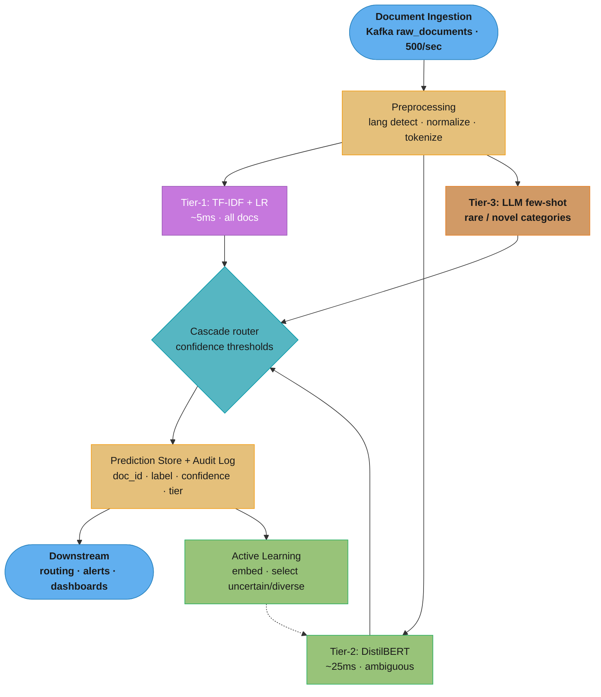
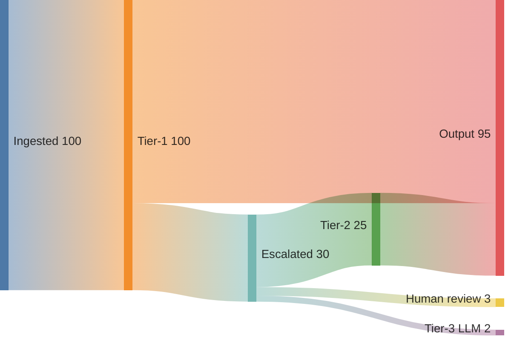
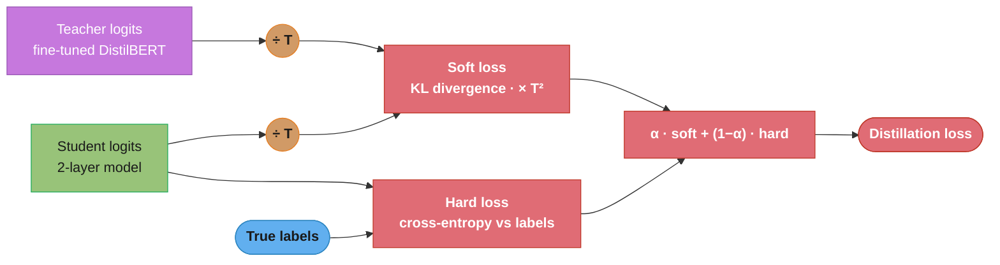
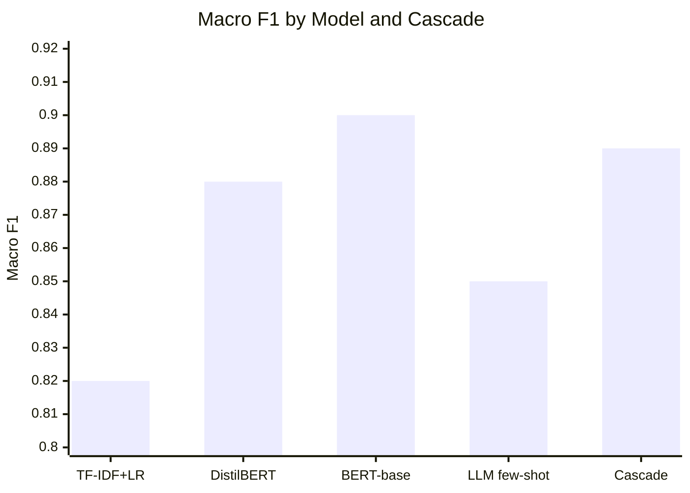
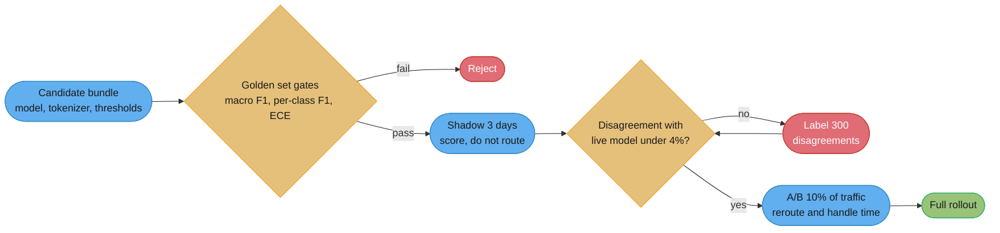

# Design an NLP Text Classification Pipeline at Scale
## Intuition

> "An NLP classification pipeline is like a postal sorting office for language: it reads each document, understands its content, and routes it to the right destination — the challenge is doing this reliably for millions of documents per day with an ever-evolving set of categories."

**Key insight:** Most NLP classification problems do not need BERT. A fine-tuned BERT adds significant infrastructure complexity and serving latency for a 5–15% accuracy improvement over a well-engineered TF-IDF + logistic regression baseline. The engineering question is not "which model achieves the best AUC?" but "which model achieves acceptable accuracy within the latency, cost, and operational budget available?"

Mental model: Think of the classification pipeline as a cascade. A fast, cheap baseline handles the 70% of clear-cut cases. A more expensive BERT model handles the ambiguous 30%. An LLM with few-shot prompting handles the 5% of novel or rare categories that neither model covers well. This cascade architecture delivers near-BERT accuracy at ~20% of BERT's serving cost.

Why this system exists: Content moderation, support ticket routing, document tagging, compliance screening, and product categorization all require classifying text at scale. Using the cost model worked in §11 (8 extra minutes of handle time per misroute, $25/hour agents = $3.33 per mistake), a ticket routing system that goes from 85% to 90% accuracy at a 10,000-ticket/day support center avoids 500 misroutes a day — about $1,700/day, or roughly $600k/year.

**The cascade only works if confidence means something.** Every routing decision in this file is "is this model's probability above a threshold?". An uncalibrated model that says 0.95 when it is right 80% of the time sends wrong answers out of Tier-1 with full authority, and a model that says 0.70 on easy cases floods the human queue (Pitfall 3). §4.5 builds the router on per-class thresholds chosen on a calibration set to hit a target precision, which turns "confidence" into a contract each tier can be held to.

**The ceiling is the labels, not the model.** Moving from DistilBERT to BERT-base buys about 2 F1 points in Decision 1; a label set where 8% of examples are wrong caps every model below that noise, and the errors concentrate in exactly the confusable classes the cascade escalates. §4.6 measures annotator agreement and finds likely mislabels with out-of-fold predictions, and §4.7 shows how weak supervision manufactures labels when there are none.

**What this study is not.** Policy-violation detection with adversarial users and a precision floor per harm type is [Design a Harmful Content Detection System](design_harmful_content_detection.md); extracting spans (names, amounts, dates) instead of assigning a document label is [Design an NER Pipeline](design_ner_pipeline.md); and a support-ticket router where an LLM handles the long tail end to end is [Design an LLM-Hybrid Support Triage System](design_llm_hybrid_support_triage.md). This file owns the general-purpose classifier stack those three specialise.

**Vocabulary used throughout:**

| Term | Meaning |
|---|---|
| Cascade | Cheap model first; escalate only documents it is not confident about |
| Coverage | Share of documents a tier resolves without escalating |
| Calibration | Agreement between predicted probability and observed accuracy (ECE measures the gap) |
| Per-class threshold | A confidence cut-off chosen separately for each label to meet a precision target |
| Cohen's kappa | Agreement between two annotators corrected for chance; 0.7+ is the bar here |
| Out-of-fold prediction | A prediction for an example made by a model that never trained on it |
| Labeling function | A heuristic (keyword rule, existing model, lookup) that votes on a label or abstains |
| Distillation | Training a small student on a large teacher's soft probabilities |

---

## 1. Requirements Clarification

**Functional requirements:**
- Classify text documents (product reviews, support tickets, news articles, user content) into predefined categories.
- Support: multi-class (one label), multi-label (zero or more labels), and hierarchical taxonomies.
- Human-in-the-loop: route low-confidence predictions to human review queue.
- Active learning: prioritize documents for labeling that maximally improve the model.
- Near-real-time scoring: classify new documents within 200ms of ingestion.

**Non-functional requirements:**
- Throughput: 500 documents/sec (43M/day).
- Serving latency: p99 < 200ms for API path; < 50ms p99 for real-time use cases (content moderation).
- Model accuracy: macro F1 > 0.85 on held-out test set.
- Active label cost target: < 1,000 new labeled examples to recover after a taxonomy change.
- Availability: 99.9% for the classification API.

**Out of scope:**
- Named entity recognition or information extraction (separate pipeline).
- LLM-based open-ended text generation or summarization.
- Multilingual classification (covered as a separate extension).

**Clarifying questions that change the design:**

| Question | If the answer is... | Design consequence |
|---|---|---|
| What does one wrong label cost, and is it symmetric? | Misroute costs $3.33; a missed compliance flag is a regulatory event | Per-class thresholds from cost (§5 Decision 7), recall-first thresholds for compliance classes |
| How often does the taxonomy change? | Monthly new categories | Keep the LLM tier and weak supervision (§4.7) as standing capabilities, not one-off projects |
| Is there a human team behind the low-confidence band, and how big? | 10 reviewers | Human threshold is set by reviewer capacity, not by the model |
| Single label, multi-label, or hierarchy? | Tickets often carry two issues | Binary relevance heads and per-label thresholds (§5 Decision 3) |
| Are labels already available, and how were they made? | Agents' historical routing choices | Treat as noisy labels: measure kappa and run the mislabel check (§4.6) before training |

---

## 2. Scale Estimation

**Document volume:** 500 docs/sec = 43M docs/day.

**Model inference cost comparison:**
- TF-IDF + LR: 0.5ms per doc → 500 docs/sec on a single core; easily scales.
- DistilBERT (6 layers, 66M params): ~25ms per doc on CPU; ~3ms on GPU.
  - CPU serving: 500 docs/sec requires 500 × 25ms / 1000ms = 12.5 CPU cores → 2 × c5.2xlarge (8 vCPU each, 16 total).
  - GPU serving (T4): 500 docs/sec via dynamic batching (batch=32, 15ms): 2 × g4dn.xlarge at $0.526/hr each (us-east-1 on-demand).
- BERT-base (12 layers, 110M params): ~80ms per doc on CPU, ~10ms on GPU.

**Storage:**
- Raw text: avg 200 tokens/doc × 4 bytes/token = 800 bytes; 43M × 800 bytes = 34 GB/day.
- Embeddings cache (for active learning): 43M docs × 768 floats × 4 bytes = 132 GB/day — store only recent 7 days.
- Model artifacts: DistilBERT checkpoint = 265 MB; TF-IDF vocabulary + LR = 50 MB.

**Training data:**
- Initial labeled set: 50k examples; grows by ~2k/day via active learning.
- Fine-tuning DistilBERT on 50k examples: ~45 min on 1 × A100 GPU. At the p4d.24xlarge spot rate (~$13.07/hr for 8 GPUs ≈ $1.63/A100-hr) that is $1.22 per run; on-demand ($4.10/A100-hr) it is $3.08.
- TF-IDF + LR: 2 minutes on CPU.

**Infrastructure cost** (us-east-1 on-demand, 730 hr/month):
- Serving (GPU, DistilBERT): 2 × g4dn.xlarge at $0.526/hr = $1.052/hr = $768/month.
- Active learning + labeling queue: 2 × m5.large at $0.096/hr = $140/month.
- Training (weekly fine-tune, A100 spot): $1.22/run × 4 = $4.90/month.
- Total: ~$913/month.

---

## 3. High-Level Architecture



Every document is tokenized once, then a confidence-gated cascade router sends it to the cheapest tier that can classify it confidently — most exit at TF-IDF+LR, ambiguous cases escalate to DistilBERT, novel categories fall through to the LLM — while the active-learning loop feeds fresh labels back into the DistilBERT tier.

**Data flow:** Every document enters Tier-1. 70% exit at Tier-1 with high-confidence prediction. 25% escalate to Tier-2. 3% go to human review. 2% go to LLM Tier-3 for novel categories.



Per 100 documents, 70 resolve at the cheap Tier-1 model and only 30 escalate — 25 to DistilBERT, 3 to human review, 2 to the LLM — which is why the cascade delivers near-BERT accuracy at roughly a fifth of all-BERT serving cost.

---

## 4. Component Deep Dives

### 4.1 Baseline: TF-IDF + Logistic Regression

The TF-IDF + LR baseline is not a throwaway model — it is a production-grade first stage that handles ~70% of volume.

```python
from sklearn.feature_extraction.text import TfidfVectorizer
from sklearn.linear_model import LogisticRegression
from sklearn.pipeline import Pipeline
from sklearn.multiclass import OneVsRestClassifier
from sklearn.calibration import CalibratedClassifierCV
import numpy as np
from typing import Any

def build_tfidf_lr_pipeline(
    max_features: int = 100_000,
    ngram_range: tuple[int, int] = (1, 2),
    C: float = 1.0,
) -> Pipeline:
    """
    Calibrated TF-IDF + Logistic Regression pipeline.
    Calibration is mandatory: raw LR probabilities are overconfident on
    high-dimensional sparse features. See model_calibration_and_thresholding.md.
    """
    vectorizer = TfidfVectorizer(
        max_features=max_features,
        ngram_range=ngram_range,
        sublinear_tf=True,          # apply log(1 + TF) dampening
        strip_accents="unicode",
        analyzer="word",
        token_pattern=r"\w{2,}",   # exclude single chars
        min_df=3,                   # ignore very rare terms
    )
    base_clf = LogisticRegression(
        C=C,
        max_iter=1000,
        solver="saga",              # fast for large sparse matrices
        n_jobs=-1,
    )
    # Every solver except liblinear optimises the full multinomial (softmax)
    # loss whenever n_classes >= 3, so there is nothing to configure for
    # multiclass here — saga just has to converge.
    # Calibration: isotonic regression via 5-fold CV produces well-calibrated probabilities
    calibrated_clf = CalibratedClassifierCV(base_clf, cv=5, method="isotonic")
    return Pipeline([("tfidf", vectorizer), ("clf", calibrated_clf)])


def evaluate_baseline(pipeline: Pipeline, X_test: list[str], y_test: list[int]) -> dict[str, float]:
    from sklearn.metrics import f1_score, accuracy_score
    y_pred = pipeline.predict(X_test)
    probs = pipeline.predict_proba(X_test)
    confidence = probs.max(axis=1)
    return {
        "macro_f1": f1_score(y_test, y_pred, average="macro"),
        "accuracy": accuracy_score(y_test, y_pred),
        "mean_confidence_correct": confidence[y_pred == y_test].mean(),
        "mean_confidence_wrong": confidence[y_pred != y_test].mean(),
        "high_confidence_accuracy": accuracy_score(
            [y for y, c in zip(y_test, confidence) if c > 0.9],
            [p for p, c in zip(y_pred, confidence) if c > 0.9],
        ),
    }
```

### 4.2 DistilBERT Fine-Tuning

**Broken approach — fine-tuning with random train/test split on labeled data with label noise:**

```python
# WRONG: using a random split when labels were annotated in batches
# creates data leakage (annotators improve over time; random split mixes
# early low-quality labels with late high-quality labels in train/test).
# Also, fine-tuning without freezing any layers on small datasets overfits.

from transformers import DistilBertForSequenceClassification, Trainer, TrainingArguments
import random

indices = list(range(len(dataset)))
random.shuffle(indices)  # BUG: mixes annotation batches, inflates metrics
train_indices = indices[:int(0.8 * len(indices))]
test_indices = indices[int(0.8 * len(indices)):]
# result: 5pp AUC inflation on held-out test
```

**Correct approach — chronological split by annotation date, frozen lower layers:**

```python
import torch
from transformers import (
    DistilBertTokenizerFast,
    DistilBertForSequenceClassification,
    TrainingArguments,
    Trainer,
)
from datasets import Dataset
import numpy as np

def fine_tune_distilbert(
    texts: list[str],
    labels: list[int],
    annotation_dates: list[str],  # sort by this for temporal split
    num_labels: int,
    model_name: str = "distilbert-base-uncased",
    output_dir: str = "/tmp/distilbert-classifier",
) -> DistilBertForSequenceClassification:
    """
    Fine-tune DistilBERT with chronological train/val split.
    Freezes the first 3 transformer blocks to prevent catastrophic forgetting
    on small datasets (< 10k examples).
    """
    tokenizer = DistilBertTokenizerFast.from_pretrained(model_name)
    model = DistilBertForSequenceClassification.from_pretrained(
        model_name, num_labels=num_labels
    )

    # Freeze first 3/6 transformer layers — preserve general language understanding
    for i, layer in enumerate(model.distilbert.transformer.layer):
        if i < 3:
            for param in layer.parameters():
                param.requires_grad = False

    # Chronological split: most recent 15% as validation
    sorted_indices = sorted(range(len(texts)), key=lambda i: annotation_dates[i])
    split_point = int(0.85 * len(sorted_indices))
    train_idx = sorted_indices[:split_point]
    val_idx = sorted_indices[split_point:]

    def tokenize(examples: dict) -> dict:
        return tokenizer(
            examples["text"], truncation=True, padding="max_length", max_length=128
        )

    train_dataset = Dataset.from_dict({
        "text": [texts[i] for i in train_idx],
        "labels": [labels[i] for i in train_idx],
    }).map(tokenize, batched=True)

    val_dataset = Dataset.from_dict({
        "text": [texts[i] for i in val_idx],
        "labels": [labels[i] for i in val_idx],
    }).map(tokenize, batched=True)

    training_args = TrainingArguments(
        output_dir=output_dir,
        num_train_epochs=4,
        per_device_train_batch_size=32,
        per_device_eval_batch_size=64,
        warmup_ratio=0.06,
        weight_decay=0.01,
        eval_strategy="epoch",   # renamed from `evaluation_strategy`, which is gone in transformers 5.x
        load_best_model_at_end=True,
        metric_for_best_model="eval_f1",
        fp16=torch.cuda.is_available(),
        learning_rate=2e-5,
    )

    def compute_metrics(pred):
        from sklearn.metrics import f1_score
        predictions = np.argmax(pred.predictions, axis=1)
        return {"f1": f1_score(pred.label_ids, predictions, average="macro")}

    trainer = Trainer(
        model=model,
        args=training_args,
        train_dataset=train_dataset,
        eval_dataset=val_dataset,
        compute_metrics=compute_metrics,
    )
    trainer.train()
    return model
```

### 4.3 Active Learning for Labeling Efficiency

Active learning selects which documents to send to human annotators to maximize model improvement per labeled example. Two strategies: uncertainty sampling (label documents the model is least certain about) and core-set selection (label documents that are maximally diverse in embedding space).

```python
import numpy as np
from sklearn.cluster import MiniBatchKMeans

def uncertainty_sampling(
    unlabeled_texts: list[str],
    model_probs: np.ndarray,  # shape (N, num_classes)
    budget: int = 100,
) -> list[int]:
    """
    Select `budget` documents with lowest maximum predicted probability.
    Lower confidence = higher uncertainty = more valuable to label.
    """
    max_probs = model_probs.max(axis=1)
    uncertain_indices = np.argsort(max_probs)[:budget]  # ascending by confidence
    return uncertain_indices.tolist()


def coreset_sampling(
    embeddings: np.ndarray,   # shape (N, embedding_dim)
    already_labeled_embeddings: np.ndarray,  # shape (M, embedding_dim)
    budget: int = 100,
) -> list[int]:
    """
    Core-set selection: find embeddings maximally distant from already-labeled set.
    Ensures the new batch covers diverse regions of the document space.
    Greedy approximate: iteratively add the point farthest from the current labeled set.
    """
    labeled = list(range(len(already_labeled_embeddings)))
    all_embeddings = np.vstack([already_labeled_embeddings, embeddings])
    unlabeled_offset = len(already_labeled_embeddings)
    selected = []

    for _ in range(budget):
        # Compute minimum distance from each unlabeled to nearest labeled
        unlabeled_idxs = [
            i + unlabeled_offset for i in range(len(embeddings)) if i not in selected
        ]
        min_dists = np.array([
            np.min(np.linalg.norm(all_embeddings[labeled] - all_embeddings[idx], axis=1))
            for idx in unlabeled_idxs
        ])
        # Select the point farthest from all labeled points
        farthest = unlabeled_idxs[np.argmax(min_dists)]
        selected.append(farthest - unlabeled_offset)
        labeled.append(farthest)

    return selected


def hybrid_active_learning(
    unlabeled_texts: list[str],
    embeddings: np.ndarray,
    model_probs: np.ndarray,
    labeled_embeddings: np.ndarray,
    budget: int = 200,
) -> list[int]:
    """
    Blend uncertainty (50%) and coreset (50%): covers model uncertainty
    while ensuring diversity across the label space.
    """
    uncertain = set(uncertainty_sampling(unlabeled_texts, model_probs, budget // 2))
    diverse = set(coreset_sampling(embeddings, labeled_embeddings, budget // 2))
    combined = list(uncertain | diverse)
    return combined[:budget]
```

### 4.4 Knowledge Distillation for Production Serving

After fine-tuning DistilBERT, distill it into a smaller student model for production serving. The 25ms → 8ms p99 target used below is this design's own budget, not a published result. The published anchor for what distillation costs in quality is one step earlier in the chain: Sanh et al. (2019) report DistilBERT — 6 layers against BERT-base's 12 — retaining 97% of BERT's GLUE score at 40% smaller and 60% faster. Going shallower than that buys more latency and gives up more quality, and nobody has published where the curve lands for your task, so measure the retention on your own labels before committing the student.



The student learns from two signals: temperature-softened teacher probabilities via a KL term (scaled by T squared) and the true labels via cross-entropy, blended by alpha=0.7 — the soft targets carry inter-class similarity that hard labels alone cannot convey.

```python
import torch
import torch.nn.functional as F
from torch import nn

class DistillationLoss(nn.Module):
    """
    Combined distillation loss: soft targets (teacher logits) + hard targets (true labels).
    alpha=0.7 means 70% weight on teacher soft labels, 30% on hard labels.
    temperature=4.0 softens the teacher's probability distribution for richer signal.
    """
    def __init__(self, temperature: float = 4.0, alpha: float = 0.7):
        super().__init__()
        self.temperature = temperature
        self.alpha = alpha

    def forward(
        self,
        student_logits: torch.Tensor,
        teacher_logits: torch.Tensor,
        true_labels: torch.Tensor,
    ) -> torch.Tensor:
        # Soft loss: KL divergence between teacher and student soft probabilities
        soft_targets = F.softmax(teacher_logits / self.temperature, dim=-1)
        soft_student = F.log_softmax(student_logits / self.temperature, dim=-1)
        distill_loss = F.kl_div(soft_student, soft_targets, reduction="batchmean")
        distill_loss *= self.temperature ** 2  # scale by T^2 as per Hinton et al.

        # Hard loss: cross-entropy with true labels
        hard_loss = F.cross_entropy(student_logits, true_labels)

        return self.alpha * distill_loss + (1 - self.alpha) * hard_loss
```

### 4.5 The Cascade Router — per-class thresholds, not one global cut-off

**Broken approach — one global confidence threshold.** "Accept Tier-1 if `max(prob) >= 0.90`" treats every class alike. Easy, well-separated classes clear 0.90 almost always and are almost always right; a confusable class (here class 3, "billing dispute", which looks like class 1, "refund request") also clears 0.90 when the model is over-confident, and its accepted predictions are wrong far more often. The aggregate precision looks fine because the easy classes dominate the average.

**Correct approach — choose a threshold per class on a calibration split to hit a precision target, then verify on a separate split.** The simulation below builds an over-confident four-class Tier-1 model in numpy so the router logic can be run without a trained model.

```python
from __future__ import annotations

import numpy as np

rng = np.random.default_rng(0)
N, K = 6_000, 4
true = rng.integers(0, K, N)
margin = np.array([3.0, 2.5, 3.0, 1.2])                 # class 3 is the confusable one
logits = rng.normal(0.0, 1.0, (N, K))
logits[np.arange(N), true] += margin[true]
logits *= 1.8                                            # over-confident softmax
probs = np.exp(logits) / np.exp(logits).sum(axis=1, keepdims=True)
pred, conf = probs.argmax(axis=1), probs.max(axis=1)

cal, test = np.arange(N) < N // 2, np.arange(N) >= N // 2   # threshold on cal, report on test


def per_class_precision(accept: np.ndarray, split: np.ndarray) -> list[float]:
    out = []
    for k in range(K):
        sel = accept & split & (pred == k)
        out.append(round(float((true[sel] == k).mean()), 3) if sel.any() else float("nan"))
    return out


# BROKEN: one global threshold.
accept_global = conf >= 0.90
print("global 0.90 precision by class:", per_class_precision(accept_global, test))


def fit_thresholds(target_precision: float = 0.97, min_accepted: int = 50) -> np.ndarray:
    """FIX: lowest threshold per class whose calibration-split precision meets the target."""
    thresholds = np.full(K, 1.01)                        # > 1.0 means "always escalate"
    for k in range(K):
        for t in np.linspace(0.50, 0.995, 100):
            sel = cal & (pred == k) & (conf >= t)
            if sel.sum() >= min_accepted and (true[sel] == k).mean() >= target_precision:
                thresholds[k] = t
                break
    return thresholds


thresholds = fit_thresholds()
accept_per_class = conf >= thresholds[pred]
print("thresholds:", thresholds.round(3))
print("per-class precision:", per_class_precision(accept_per_class, test))
print("Tier-1 coverage:", round(float(accept_per_class[test].mean()), 3))
```

With the global cut-off, the easy classes come out near-perfect on the test split while class 3's accepted predictions are visibly less precise; nothing in the aggregate number reveals it. The per-class version gives easy classes a *lower* threshold (more coverage at the same precision) and gives class 3 a high one — or `1.01`, which means "always escalate", when no threshold reaches 97% with at least 50 accepted examples. That trade is the whole point of the cascade: coverage is spent where the model is reliable and withheld where it is not.

In production the same routine runs per tier and per class after every retrain, on a calibration split drawn from the *most recent* labelled month, and the thresholds ship inside the model bundle so a model and its thresholds can never be deployed apart. Isotonic calibration (§4.1) makes the probabilities closer to frequencies, but thresholds are still chosen per class, because calibration fixes the average and the router needs the tail. The general method is in [Model Calibration and Thresholding](cross_cutting/model_calibration_and_thresholding.md).

### 4.6 Label Quality — agreement and likely mislabels

Two measurements decide whether a label set is good enough to train on. **Inter-annotator agreement** says whether the guideline is clear; **out-of-fold disagreement** finds individual examples that are probably mislabelled.

```python
import numpy as np


def cohens_kappa(a: np.ndarray, b: np.ndarray, k: int) -> float:
    """Agreement between two annotators, corrected for chance agreement."""
    observed = float((a == b).mean())
    pa, pb = np.bincount(a, minlength=k) / len(a), np.bincount(b, minlength=k) / len(b)
    expected = float((pa * pb).sum())
    return (observed - expected) / (1.0 - expected)


annotator_1 = np.array([0, 0, 1, 1, 2, 2, 0, 1, 2, 0])
annotator_2 = np.array([0, 0, 1, 2, 2, 2, 0, 1, 1, 0])
print("kappa:", round(cohens_kappa(annotator_1, annotator_2, k=3), 3))


def likely_mislabels(oof_probs: np.ndarray, given: np.ndarray) -> np.ndarray:
    """
    Confident-learning style check (Northcutt, Jiang and Chuang, 2021): flag an example
    when an out-of-fold model predicts a DIFFERENT class with at least the average
    confidence the model has on examples that genuinely carry that class's label.
    """
    k = oof_probs.shape[1]
    self_conf = oof_probs[np.arange(len(given)), given]
    per_class = np.array([self_conf[given == c].mean() if (given == c).any() else 1.0 for c in range(k)])
    predicted = oof_probs.argmax(axis=1)
    confident_other = oof_probs[np.arange(len(given)), predicted] >= per_class[predicted]
    return np.flatnonzero((predicted != given) & confident_other)


# Out-of-fold probabilities come from cross-validation, so no example is scored by a model
# that trained on it:
#   from sklearn.model_selection import cross_val_predict
#   oof = cross_val_predict(build_tfidf_lr_pipeline(), texts, labels, cv=5, method="predict_proba")
#   suspects = likely_mislabels(oof, np.asarray(labels))
```

The two annotators agree on 8 of 10 items (0.80), but both label class 0 four times out of ten and classes 1 and 2 three times each, so chance agreement is `0.4^2 + 0.3^2 + 0.3^2 = 0.34` and kappa is `(0.80 - 0.34) / (1 - 0.34) = 0.70` — exactly the bar this pipeline requires before labels are used for fine-tuning (§11). The mislabel check does not relabel anything; it produces a short, ranked list for a senior annotator. On a 50k-example set, a few hundred to a few thousand suspects is typical, and reviewing them is far cheaper than labelling 10,000 new examples.

### 4.7 Weak Supervision — labels from heuristics you already have

When a new category arrives with zero labels, an organisation usually already has signals that partly identify it: keyword rules from the old routing system, an existing model for a related task, a lookup table of product codes. Weak supervision turns each into a **labeling function** that votes or abstains, combines the votes, and trains the real classifier on the result.

```python
import re

import numpy as np

ABSTAIN, BILLING, TECHNICAL, ACCOUNT = -1, 0, 1, 2


def lf_refund(text: str) -> int:
    return BILLING if "refund" in text or "charged twice" in text else ABSTAIN


def lf_invoice(text: str) -> int:
    return BILLING if "invoice" in text else ABSTAIN


def lf_error_code(text: str) -> int:
    return TECHNICAL if re.search(r"\berror\s*\d{3,}\b", text) else ABSTAIN


def lf_locked_out(text: str) -> int:
    return ACCOUNT if "password" in text or "locked out" in text else ABSTAIN


LFS = [lf_refund, lf_invoice, lf_error_code, lf_locked_out]


def label_matrix(texts: list[str]) -> np.ndarray:
    return np.array([[lf(t.lower()) for lf in LFS] for t in texts])


def majority_vote(votes: np.ndarray, k: int = 3) -> np.ndarray:
    out = np.full(len(votes), ABSTAIN)
    for i, row in enumerate(votes):
        cast = row[row != ABSTAIN]
        if cast.size:
            counts = np.bincount(cast, minlength=k)
            if (counts == counts.max()).sum() == 1:      # ties abstain
                out[i] = int(counts.argmax())
    return out


tickets = [
    "I was charged twice, please refund",
    "App shows error 503 when I upload the invoice",
    "Locked out after password reset",
    "How do I change my profile photo?",
]
L = label_matrix(tickets)
print(L)
print("labels:", majority_vote(L))
print("coverage:", float((majority_vote(L) != ABSTAIN).mean()))
```

The second ticket shows the core problem: `lf_invoice` votes BILLING and `lf_error_code` votes TECHNICAL, so majority vote abstains; the fourth ticket matches nothing. Snorkel replaces majority vote with a *label model* that estimates each function's accuracy from their agreements and conflicts, without any ground truth, and weights votes accordingly. The weak labels then train DistilBERT, which generalises beyond the keywords. Google reported, for three classification tasks, classifiers of comparable quality to ones trained on tens of thousands of hand labels (§6). Always keep a small hand-labelled test set: weak supervision makes training labels cheap, never evaluation labels.

---

## 5. Design Decisions & Tradeoffs

**Decision 1: TF-IDF+LR vs DistilBERT vs BERT-base vs LLM**

| Model | Macro F1 | p99 Latency (CPU) | Training cost | Interpretability |
|-------|----------|-------------------|--------------|-----------------|
| TF-IDF + LR | 0.82 | 2ms | 5 min | High (feature weights) |
| DistilBERT (fine-tuned) | 0.88 | 25ms | 45 min (GPU) | Low |
| BERT-base (fine-tuned) | 0.90 | 80ms | 2h (GPU) | Low |
| Frontier LLM (few-shot, 5 examples) | 0.85 | 1,200ms | None (inference cost) | None |

The cascade (TF-IDF+LR → DistilBERT → LLM) achieves 0.89 macro F1 at 8ms average latency and < 25ms p99. This beats any single-model approach on the accuracy × latency Pareto front. See [model_selection_and_algorithm_choice](../model_selection_and_algorithm_choice/model_selection_and_algorithm_choice.md).



The cascade reaches 0.89 macro F1 — within 1pp of BERT-base (0.90) — at 8ms average latency, beating every single model on the accuracy-versus-latency frontier.

**Decision 2: Hard routing thresholds vs soft ensemble**

Hard routing (if confidence > 0.90 use Tier-1 result) is simpler and more interpretable. A soft ensemble (weighted average of Tier-1 and Tier-2 outputs) would be marginally more accurate but requires both models to run for every document, negating the cost benefit of the cascade. Use hard routing with confidence thresholds tuned on a calibration set. Tune thresholds per category (rare categories may need a lower confidence threshold for Tier-1 to avoid false certainty). See [model_calibration_and_thresholding.md](cross_cutting/model_calibration_and_thresholding.md).

**Decision 3: Multi-label vs multi-class vs hierarchical**

Most real-world classification problems are multi-label (a support ticket can be both "billing" and "technical"). Use a binary relevance approach (one LR or one BERT binary classifier per label) for up to 50 labels. For > 50 labels, use a label embedding approach (train a shared encoder, decode to label space via dot product). For hierarchical taxonomies (e.g., "Electronics > Phones > Accessories"), use a top-down cascade: classify at the top level first, then refine using a sub-category model for high-confidence top-level predictions.

**Decision 4: Active learning strategy**

Pure uncertainty sampling (most uncertain documents to label) creates a biased training set over time — the model will have seen many similar hard examples but few representative easy examples. This causes the model to be well-calibrated on hard cases and poorly calibrated on easy cases in production. Hybrid (50% uncertainty, 50% coreset/diversity) produces more robust models in practice, especially when the label taxonomy evolves and new categories emerge.

**Decision 5: Online learning vs periodic retraining**

Online learning (update model after each labeled batch) introduces instability — model performance can degrade temporarily after a small batch with unusual examples. Periodic retraining (weekly or after 2k new labeled examples, whichever comes first) is more stable and allows proper validation before deployment. Reserve a frozen golden test set that is never used for training or validation — only for production monitoring. See [drift_monitoring_and_retraining.md](cross_cutting/drift_monitoring_and_retraining.md).

**Decision 6: Who labels — humans, an LLM, or labeling functions?**

| Source | Cost per 1k labels (illustrative) | Quality | Best use |
|---|---|---|---|
| Trained human annotators | $100-$300 (at ~$0.10-0.30 per short ticket) | Highest when kappa >= 0.7 | Golden test set, calibration split, disputed classes |
| LLM labels (few-shot prompt) | A few dollars of API tokens | Good on clear classes, systematic errors on fine policy distinctions | Bootstrapping a new category; pre-labels for humans to confirm |
| Labeling functions (§4.7) | Engineer time once, then free | Noisy, low coverage, but cheap to iterate | Classes with existing rules or related models |

The rule this design follows: training labels may come from any source, evaluation labels only from humans who pass the agreement bar. An LLM-labelled test set measures how well the classifier imitates the LLM, including its mistakes.

**Decision 7: Where to put the cascade thresholds — precision target vs cost target**

A precision target (§4.5, 97% per class) is easy to explain and audit. A cost target is more honest: accept Tier-1 when `P(wrong) x cost_of_error < cost_of_escalation`. With a misroute costing $3.33 (§Intuition) and a Tier-2 call costing about $0.000002 of GPU time (§2: $1.052/hour for 150 docs/sec is 540,000 documents an hour), almost any doubt justifies escalation to Tier-2, so Tier-1's threshold should be set by Tier-2 *capacity*, not by cost. Escalation to *human* review costs about $0.50 per ticket (2 minutes at $15/hour), so the human threshold is where cost actually binds: accept the model's answer when `P(wrong) < 0.50 / 3.33 = 15%`. Using two different rules for the two boundaries is deliberate.

---

## 6. Real-World Implementations

**Uber (COTA — support ticket handling):** The one well-documented public example of this architecture. Uber's Customer Obsession Ticket Assistant handles "hundreds of thousands of tickets surfacing daily on the platform across 400+ cities worldwide," choosing among "over 1,000 possible solutions." Notably, COTA v1 was *not* a transformer: it used TF-IDF plus latent semantic analysis to extract topic features, cosine-similarity features to collapse thousands of dimensions to a handful, and a random forest in a retrieval-based pointwise ranking setup. Uber reports it "can reduce ticket resolution time by over 10 percent while delivering service with similar or higher levels of customer satisfaction." Later CNN/RNN experiments gave about 10 percent greater accuracy than the random forest, and the simpler CNN was what went to production in COTA v2 — a direct real-world instance of this case study's "start cheap, escalate only where it pays" thesis. See [COTA](https://www.uber.com/blog/cota/) and [COTA v2](https://www.uber.com/blog/cota-v2/).

**Content moderation (pattern):** Large platforms run a binary "safe / needs review" first stage over full traffic, then a fine-grained policy classifier (hate speech, spam, adult content) only on what the first stage flags, with human review reserved for the borderline band. The dominant engineering constraint is not accuracy but turnaround: a policy change has to be reflected in the model within hours, which forces the fine-tuning and eval pipeline to be fully automated. Specific per-platform recall and human-review percentages are not published; do not quote them.

**Marketplace listing / merchant categorization (pattern):** The characteristic difficulty is a single free-text self-description with enormous lexical variance ("I sell handmade jewelry" / "artisan metalwork accessories" / "custom silver rings"). TF-IDF + LR does well on head categories with plenty of examples and collapses on the long tail, which is exactly where zero-shot classification with an NLI entailment model earns its keep — it needs no labeled data for a new category. Treat the head/tail accuracy gap as something to measure on your own taxonomy.

**Compliance and risk screening (pattern):** Screening business descriptions against restricted categories (regulated financial products, adult content, weapons) is a recall-dominated problem: a false negative can be a regulatory event, a false positive costs a few minutes of review. The design consequence is that thresholds are set per category from the cost asymmetry rather than by maximizing F1, deliberately over-flagging by a large multiple so recall stays near the top of its range.

**Google (Snorkel DryBell, SIGMOD 2019):** Bach et al., "Snorkel DryBell: A Case Study in Deploying Weak Supervision at Industrial Scale" (arXiv 1812.00417), describe using "existing knowledge resources from across an organization" — rules, existing models, knowledge graphs — as labeling functions instead of hand labelling. On three classification tasks at Google, the resulting classifiers were of comparable quality to ones trained with tens of thousands of hand-labelled examples; converting non-servable organisational resources into servable models gave an average 52% performance improvement; and the system executed over millions of data points in tens of minutes. The paper frames the gain as bringing development time and cost down by an order of magnitude. This is the industrial evidence behind §4.7 and Decision 6: the labelling budget, not the model, is usually the bottleneck a new category hits first.

**Sources, condensed:**

| Company / paper | What this file borrows | Reference |
|---|---|---|
| Uber COTA | Cheap model first; TF-IDF + LSA + random forest, then a CNN in v2 | Uber Engineering blog (COTA, COTA v2) |
| Google Snorkel DryBell | Labeling functions from organisational knowledge (§4.7) | Bach et al., SIGMOD 2019 |
| Sanh et al. (DistilBERT) | 97% of BERT's GLUE score, 40% smaller, 60% faster (§4.4) | 2019 |
| Sap et al. | Dialect bias in offensive-language classifiers (§11) | ACL 2019 |
| Northcutt, Jiang, Chuang | Confident learning for label errors (§4.6) | JAIR 2021 |

---

## 7. Technologies & Tools

| Tool | Use case | Advantage | Limitation |
|------|----------|-----------|------------|
| HuggingFace Transformers | BERT/DistilBERT fine-tuning | Large model zoo, standardized training loop | Heavy dependency; model updates require re-validation |
| Scikit-learn | TF-IDF + LR baseline, calibration | Stable, fast, SHAP-compatible | Not designed for neural models |
| ONNX Runtime | Optimized BERT serving (CPU+GPU) | 2–3× faster than native PyTorch inference | Requires ONNX export; some operator gaps |
| Triton Inference Server | GPU-optimized BERT serving with dynamic batching | Automatic batching, model versioning, metrics | NVIDIA-specific; DevOps overhead |
| Label Studio | Active learning annotation UI | Open-source, supports multi-label, active learning integration | Self-hosted; scaling requires PostgreSQL backend |
| Ray Serve | Scalable model serving with auto-scaling | Python-native; handles CPU+GPU fleet mixed routing | More ops than managed services |

---

## 8. Operational Playbook

### Eval Pipeline
- **Golden test set (frozen):** 5,000 human-labeled examples never included in training. Run evaluation on this set at every model update. Block deployment if macro F1 < 0.85 or if any single category drops > 3pp F1 from previous version.
- **Confidence calibration check:** For each probability decile, check that actual accuracy matches predicted confidence (ECE < 0.05). See [model_calibration_and_thresholding.md](cross_cutting/model_calibration_and_thresholding.md).
- **Human review agreement:** Sample 500 documents per week from the human review queue. Compare ML prediction to human label. ML-human agreement should be > 90% — lower agreement indicates the model's confidence thresholds are miscalibrated (routing too many borderline cases to human review).

### Observability
- Monitor: daily prediction distribution per category. Category-level volume shift > 20% week-over-week triggers investigation (could be genuine trend or model degradation).
- Track: human review queue size. Sustained increase > 2× baseline indicates model confidence threshold needs recalibration.
- Track: annotation backlog (unlabeled documents waiting for active learning label). Alert if backlog > 50k (labeling pipeline is behind).

### Incident Runbooks
1. **Macro F1 drops > 5pp in production (detected via golden set monitoring):** Symptom: confidence scores drop and human review queue grows. Diagnosis: most likely cause is taxonomy drift (new categories introduced or old categories renamed). Resolution: run active learning cycle to gather 500 new examples for affected categories; emergency fine-tune run within 24 hours.
2. **Latency spike: DistilBERT tier exceeds 200ms p99:** Symptom: API latency alarm. Diagnosis: GPU saturation (batch queue backing up) or CPU fallback triggered (GPU failure). Mitigation: scale up GPU instances or fall back to Tier-1 (TF-IDF+LR) for all traffic. Resolution: restore GPU capacity; monitor queue depth.
3. **Active learning selects only near-duplicate examples:** Symptom: annotators report all sampled documents are very similar. Diagnosis: using pure uncertainty sampling — model is confused about a specific template, and uncertainty sampling floods the queue with near-copies. Fix: switch to hybrid (uncertainty + coreset) sampling.
4. **New category detected by LLM tier but not in taxonomy:** Symptom: LLM tier routes 5%+ of documents to a category that does not exist in the taxonomy. Diagnosis: genuine emerging topic. Response: add new category to taxonomy, seed with 50 LLM-labeled examples, fine-tune DistilBERT within 3 days.
5. **Tier-1 coverage drops from 70% to 45% overnight with no model change:** Symptom: Tier-2 GPU queue grows, human queue grows. Diagnosis: input drift — a new product launch, a new language in the traffic, or an upstream change (HTML now left in ticket bodies) that the TF-IDF vocabulary never saw. Mitigation: raise Tier-2 replicas; Tier-1 escalating more is the cascade working as designed, not failing. Resolution: retrain Tier-1 on the last 2 weeks and re-fit per-class thresholds (§4.5).

### Releasing a New Model Version

A classifier release changes where thousands of documents go every hour, so it follows a fixed path:



*Shadow disagreements are the cheapest labelling budget in the system: every document where old and new model differ is, by construction, a document one of them gets wrong, so labelling 300 of them tells you which model to trust before any customer is affected.*

- **Online success metric:** misroute rate (a ticket reassigned by an agent within 24 hours) and handle time, not model F1. Run the A/B on ticket-level randomisation with the guardrails and sequential-testing rules in [Experimentation and Online Evaluation](cross_cutting/experimentation_and_online_evaluation.md).
- **Metadata features:** if the classifier also reads structured fields (customer plan, channel, prior ticket count), training rows must join those fields as they were at ticket creation, not as they are today — a customer who upgraded to Enterprise after filing a billing complaint should not teach the model that Enterprise customers file billing complaints. Use a point-in-time join from the feature store; see [Feature Store and Point-in-Time Correctness](cross_cutting/feature_store_and_point_in_time_correctness.md).

---

## 9. Common Pitfalls & War Stories

**Pitfall 1: Fine-tuning BERT on the full dataset without layer freezing on small data.** A content startup fine-tuned BERT-base on 3,000 labeled examples (their entire budget). Validation F1 was 0.91. Production F1 was 0.74. Root cause: without freezing lower BERT layers, all 110M parameters were updated from 3k examples, causing catastrophic forgetting of general language representations and severe overfitting to annotation quirks. Fix: freeze bottom 8/12 layers; fine-tune only the top 4 + classification head. This recovered 0.85 production F1 without additional labels.

**Pitfall 2: Annotation date leakage in train/test split.** A company split their labeled dataset randomly 80/20. Validation macro F1 was 0.88. After 6 months in production, F1 was 0.79 and declining. Investigation revealed that annotators had improved their labeling guidelines significantly over time — early annotations (2020) had lower quality than recent ones (2022). The random split mixed these vintages, allowing the model to learn the 2022 annotation style from examples with 2020-era neighbors. Chronological split would have revealed the 0.79 production F1 during evaluation.

**Pitfall 3: Routing too many documents to human review.** A legal tech company set a confidence threshold of 0.95 for auto-accept. This was intended to minimize error, but it routed 45% of documents to human review — far beyond the team's capacity of 10% maximum. The backlog grew to 2M documents over 3 months. Root cause: the model's calibration was poor — it predicted 0.70 confidence for genuinely easy cases. Fix: calibrate the model properly (isotonic regression) and set threshold at 0.80. Human review dropped to 8% with no increase in auto-accept error rate.

**Pitfall 4: Multi-label classifier treating rare co-occurring labels as noise.** An e-commerce company had a multi-label review classifier with 40 categories. 12 categories occurred in < 0.5% of reviews. The model learned to never predict these rare labels. Business impact: important quality signals (mold issues, safety hazards) were systematically missed. Fix: oversample minority labels using augmentation (back-translation: translate to French and back using an MT model, generating new training examples); use class-weighted cross-entropy loss with inverse frequency weighting. Recall on rare labels improved from 0.12 to 0.71.

**Pitfall 5: Not versioning the tokenizer alongside the model.** A team deployed a fine-tuned BERT model and separately updated the HuggingFace library 3 months later. The new library version included a bug fix to the tokenizer that changed special token handling for inputs with unusual Unicode. The model (trained with the old tokenizer behavior) began producing degraded predictions on inputs with special characters — a 6pp F1 drop that affected 8% of documents. Fix: always serialize the tokenizer alongside the model checkpoint and validate that tokenizer version matches at serving time.

**Pitfall 6: A global threshold hiding one bad class.** A telecom's ticket router accepted Tier-1 answers above 0.90 confidence and reported 96% precision on accepted tickets. "Billing dispute" and "refund request" shared most of their vocabulary; the over-confident model accepted 1,800 disputes a day as refunds at about 70% precision. Disputes routed to the refunds queue waited 2 days longer, and the regulator-tracked complaint-resolution time for the month missed its target. Impact (illustrative): 540 misroutes a day (`1,800 x 0.30`) at the $3.33 handle-time cost is ~$1,800 a day, about $650k a year, before counting the compliance finding. Fix: per-class thresholds on a calibration split (§4.5); "billing dispute" ended up always escalating to Tier-2, and the aggregate number never moved enough to show any of it.

**Impact summary (illustrative magnitudes):**

| Pitfall | Offline signal | Production signal | Cost | Guard |
|---|---|---|---|---|
| 1 No layer freezing on 3k examples | Val F1 0.91 | Prod F1 0.74 | 17 F1 points until refit | Freeze lower layers; chronological split |
| 2 Random split across annotation vintages | Val F1 0.88 | Prod F1 0.79 | 6 months of degraded routing | Split by annotation date |
| 3 Threshold 0.95 on an uncalibrated model | None | 45% to human review, 2M backlog | Review capacity exceeded 4.5x | Isotonic calibration, threshold 0.80 |
| 4 Rare labels never predicted | Good macro accuracy | Recall 0.12 on safety labels | Missed safety reports | Class weights, augmentation |
| 5 Tokenizer upgraded separately | None | -6 F1 on 8% of documents | Silent until golden-set run | Tokenizer in the model bundle |
| 6 Global threshold | 96% accepted precision | One class at ~70% | ~$650k/year | Per-class thresholds (§4.5) |

---

## 10. Capacity Planning

**Primary bottleneck:** DistilBERT inference throughput on GPU.

```
Document volume: 500 docs/sec
Documents reaching Tier-2 (DistilBERT): 30% × 500 = 150 docs/sec

DistilBERT with dynamic batching:
  Batch size 32, seq length 128: ~15ms on T4 GPU
  Throughput: 32 / 15ms = 2,133 docs/sec per GPU
  Required GPUs: ceil(150 / 2,133) = 1 GPU (with large headroom)
  Deploy 2 GPUs for HA: 2 × g4dn.xlarge × $0.526/hr × 730 = $768/month

TF-IDF + LR (Tier-1): 500 docs/sec × 0.5ms = negligible
  4 CPU cores sufficient; co-locate on the same instance

With ONNX export + TensorRT optimization:
  DistilBERT latency: 15ms → 6ms (2.5× speedup)
  Single GPU now handles 5,000 docs/sec → further cost reduction possible
```

**Scaling to 5,000 docs/sec (10× growth):**
- Tier-1 CPU: 40 cores needed → 5 × r5.2xlarge.
- Tier-2 GPU: 1,500 docs/sec to DistilBERT → ceil(1,500 / 2,133) = 1 GPU. Scale to 3 for HA + burst.
- Kafka: increase partition count from 12 to 120 to sustain 5,000 msg/sec.

**Cascade vs all-BERT, monthly serving cost at 500 docs/sec:**

```
All documents through DistilBERT on GPU:
  500 docs/sec / 2,133 docs/sec per T4    = 0.23 GPU -> still 2 GPUs for HA = $768/month
All documents through BERT-base on CPU (80 ms/doc):
  500 x 0.080 s = 40 cores -> 5 x c5.2xlarge x $0.34 x 730 = ~$1,241/month
Cascade (this design):
  Tier-1 on 4 cores co-located + Tier-2 on 2 x T4 = $768/month
LLM Tier-3 at 2% of traffic:
  500 x 0.02 x 86,400 = 864,000 calls/day
  At an illustrative 600 input + 20 output tokens and $0.50 per 1M input tokens
  -> 864,000 x 600 / 1e6 x $0.50 = ~$259/day = ~$7,800/month
```

At this volume the GPU tier is cheap and the LLM tier is the most expensive line in the system: 2% of traffic costs about 10x the whole DistilBERT fleet. That inverts the usual intuition, and it is why Tier-3 is reserved for documents Tier-2 also cannot place, why its outputs are cached by normalised text hash, and why each LLM label it produces is fed back as a training example so the next DistilBERT version absorbs that slice. Check the token price against the provider's current price list before using this arithmetic; the structure (calls/day x tokens x price) is the part that transfers.

**Human review capacity:** 3% of 43M documents a day is 1.29M reviews, which no human team handles; the human tier is sized for the *ticket* use case (10k tickets a day, 3% = 300 reviews, about 10 reviewer-hours at 2 minutes each). For the 500 docs/sec document stream, the human tier only samples for quality control (500 a week, §8) and the model's low-confidence band goes to Tier-3 or is labelled "uncategorised" instead.

---

## 11. Interview Discussion Points

**Q: When should you use BERT vs TF-IDF+LR for text classification?**
**Short:** Start with TF-IDF plus logistic regression and move to BERT when meaning depends on context, negation or short text and the baseline stays below about 0.80 macro F1.

Start with TF-IDF+LR. It achieves 85–90% of BERT accuracy for well-defined categories with > 1,000 examples, runs at 2ms per document vs 25ms for DistilBERT, and is trivially interpretable via feature importance. Upgrade to BERT when: semantic meaning matters more than keywords (sarcasm, negation, context-dependent polarity); categories require understanding longer dependencies in text; you have short texts where TF-IDF loses too much context (tweets, titles); or you need cross-lingual generalization. The break-even threshold is roughly when TF-IDF+LR macro F1 < 0.80 on your validation set — that's when BERT's context sensitivity begins to pay off meaningfully.

**Q: Your cascade reports 96% precision on Tier-1 accepted predictions, yet one queue complains that most tickets routed to it are wrong. How?**
**Short:** A single global confidence threshold averages over classes; easy classes hide a confusable one whose accepted predictions are far less precise.

Aggregate precision is dominated by the high-volume, well-separated classes. A confusable pair (billing dispute vs refund request) shares vocabulary, and an over-confident model still clears 0.90 on many wrong answers, so one class can sit at ~70% precision while the average reads 96%. Fit a threshold per class on a recent calibration split to reach a precision target, verify on a separate split, and let a class that cannot reach the target always escalate (§4.5). Ship the thresholds inside the model bundle and report precision per class, never only the aggregate.
**Q: How do you handle class imbalance in text classification?**
**Short:** Combine class-weighted loss, augmentation of minority classes, and per-class decision thresholds; the thresholds usually give the biggest gain at zero training cost.

Three complementary techniques: (1) class-weighted cross-entropy loss — assign weight = (N / (num_classes × class_count)) to each class, forcing the model to treat rare class errors as more costly; (2) oversampling with augmentation — back-translation (English → German → English) generates semantically equivalent but lexically diverse examples for minority classes; (3) threshold calibration — instead of using argmax (predicts the majority class too aggressively), set per-class decision thresholds by maximizing F1 on a calibration set. The most impactful of these in practice is threshold calibration — it has zero training cost and consistently improves minority class recall by 10–20pp. See [model_calibration_and_thresholding.md](cross_cutting/model_calibration_and_thresholding.md).

**Q: How does active learning reduce labeling cost?**
**Short:** It spends the labelling budget on documents the model is unsure about or has not seen the like of, so it reaches a target F1 with far fewer labels than random sampling.

Standard random sampling requires ~10,000 labeled examples to train a BERT model to 0.85 F1 on a 20-class problem. Uncertainty sampling reduces this to ~4,000 examples (60% reduction) because the model focuses labeling budget on ambiguous examples rather than examples it already classifies correctly. Coreset sampling adds diversity, reducing to ~3,000 examples. The diminishing returns kick in after 3–4 active learning rounds — eventually, only rare and inherently ambiguous examples remain uncertain, and additional labeling does not improve performance.

**Q: How do you handle taxonomy changes (new categories added mid-production)?**
**Short:** Cover the new category with zero-shot LLM or entailment labels immediately, gather about 500 labels through active learning, then fine-tune and redeploy.

Three-phase response: (1) immediately classify new-category documents using zero-shot via LLM or entailment model (no fine-tuning needed); (2) run active learning to gather 500 labeled examples for the new category from the LLM-labeled pool; (3) fine-tune the DistilBERT model with the new labeled examples and deploy the updated model. The LLM tier serves as a buffer: it catches documents that belong to the new category before the fine-tuned model is ready, preventing them from being misclassified. Typical time from taxonomy change to fine-tuned model in production: 72 hours.

**Q: How do you measure the business impact of improving macro F1 from 0.85 to 0.88?**
**Short:** Convert errors into money: misroutes per day times the extra handle time per misroute times agent cost, and report the saving rather than the F1 delta.

Translate model accuracy to business metrics: for a support ticket routing system, the cost of a misrouted ticket = average handle time penalty × agent cost. If misrouting adds 8 minutes per ticket and agents cost $25/hour, the per-mistake cost is $3.33. At 100k tickets/day × (1 - 0.85) accuracy = 15,000 mistakes/day × $3.33 = $50k/day in excess handle time. Improving to 0.88 reduces mistakes to 12,000/day, saving $10k/day = $3.65M/year. Frame model improvements in this currency when presenting to stakeholders, not just as AUC or F1 numbers.

**Q: How do you prevent annotation bias from influencing model quality?**
**Short:** Run regular calibration rounds, randomise presentation order, reset the label control per item, and require Cohen's kappa of at least 0.7 before training.

Three common annotation biases: (1) annotator drift — annotators' interpretations of label guidelines change over time; fix by running calibration sessions (monthly) where all annotators label the same 50 documents and compare; (2) presentation order bias — annotators are influenced by consecutive documents; randomize document presentation order; (3) label anchoring — annotators default to the most recently applied label; ensure the annotation UI resets to no label for each new document. Additionally, compute inter-annotator agreement (Cohen's kappa) and set a minimum bar (kappa > 0.7 before using labels for fine-tuning).

**Q: How do you serve BERT models at low latency in production?**
**Short:** Export to ONNX, compile with TensorRT in FP16, batch dynamically, truncate to the real token-length percentile, and distil to a smaller student.

A cascade of optimizations: (1) ONNX export removes the Python overhead and enables hardware-specific optimizations — typically 2× speedup with no accuracy loss; (2) TensorRT conversion (NVIDIA) adds kernel fusion and mixed-precision (FP16) — another 2× speedup; (3) dynamic batching (Triton Inference Server) groups concurrent requests into batches — utilizes GPU parallelism, reducing per-document cost; (4) sequence length reduction — truncate or pad to the actual 95th percentile token count of your data (often 64 tokens for short text, not the default 512) — 4× speedup for short text; (5) model distillation — a shallower student trades quality for speed along a curve whose only well-published point is DistilBERT (Sanh et al., 2019): 6 layers against BERT-base's 12, retaining 97% of BERT's GLUE score while being 40% smaller and 60% faster. A 2-layer student sits further along that curve in both directions; there is no published retention figure for it, so measure your own. Together these can reduce BERT-base from 80ms to 6ms per document.

**Q: How do you ensure fairness in content classification?**
**Short:** Measure precision, recall and false positive rate per demographic or dialect group, because one aggregate accuracy hides disparities that published studies have found.

Content classifiers exhibit demographic disparities that a single aggregate accuracy number hides. Sap, Card, Gabriel, Choi and Smith (ACL 2019, "The Risk of Racial Bias in Hate Speech Detection") found tweets in African American English were up to twice as likely to be labelled offensive by models trained on standard hate-speech corpora; sentiment classifiers can likewise underestimate positive sentiment in some dialects. Audit by: (1) collecting a stratified held-out set with demographic labels (self-reported or proxy features); (2) computing per-group precision and recall; (3) testing whether false positive rate is equal across groups (equal false positive rate criterion). If disparities exceed 5pp, apply group-level threshold calibration or collect additional training data for underperforming groups. See [responsible_ai_fairness_and_explainability.md](cross_cutting/responsible_ai_fairness_and_explainability.md).

**Q: What is knowledge distillation and when should you apply it in NLP?**
**Short:** A small student is trained on a large teacher's softened probabilities; use it when the teacher is accurate but too slow or too large for the serving budget.

Knowledge distillation trains a small "student" model to mimic the output distribution (soft probabilities) of a large "teacher" model, not just its hard predictions. The soft targets carry richer information than hard labels — for example, if the teacher assigns 0.6 to "billing" and 0.3 to "technical" for a ticket, the student learns that these categories are related and often co-occur, which hard labels (just "billing") cannot convey. Apply distillation when: (1) you need < 10ms serving latency but BERT gives you best accuracy; (2) you have a teacher model with > 95% validation performance that you want to compress for edge/mobile deployment; (3) you have limited labeled data but can generate unlimited soft-labeled examples using the teacher. The teacher-student gap is typically < 3pp F1 for a 2× compression ratio.

**Q: How do you find mislabelled examples in a 50,000-example training set without relabelling all of it?**
**Short:** Score every example with an out-of-fold model and flag those where a different class wins with at least that class's typical confidence; review only the flagged list.

A model that never trained on an example has no reason to agree with a wrong label. Using 5-fold `cross_val_predict` probabilities, flag an example when the predicted class differs from the given label and its probability is at least the mean confidence the model shows on examples genuinely labelled with that class (the confident-learning idea, §4.6). Send the ranked list to a senior annotator, fix or drop confirmed errors, and retrain. Track inter-annotator kappa as well: if it is below 0.7, the guideline is ambiguous and relabelling individual examples will not fix it.

**Q: A new category has zero labels and launches next week. How do you get a usable classifier in time?**
**Short:** Write labeling functions from existing rules, models and keyword lists, combine their votes with a label model, train on the weak labels, and evaluate on a small hand-labelled set.

Organisations usually already hold partial signals for a new category: the old routing rules, a related model, product-code tables. Each becomes a labeling function that votes or abstains (§4.7); a label model such as Snorkel's weights them by estimated accuracy from their agreements and conflicts, and the resulting labels train DistilBERT, which generalises past the keywords. Google reported classifiers comparable to ones trained on tens of thousands of hand labels this way. Keep the LLM tier as the fallback during the first week, and hand-label 200-500 examples for evaluation only.

**Q: Why might the LLM tier be the most expensive part of the cascade even though it sees only 2% of traffic?**
**Short:** Per-call LLM token cost is orders of magnitude above a batched GPU classifier, so 2% of a high-volume stream can cost about 10x the entire DistilBERT fleet.

At 500 documents per second, 2% is 864,000 LLM calls a day; at an illustrative 600 input tokens and $0.50 per million input tokens that is about $260 a day, roughly $7,800 a month, against $768 a month for two T4 GPUs running DistilBERT (§10). Cap the LLM tier to documents Tier-2 also cannot place, cache answers by normalised text hash, and feed its labels back as training data so the next DistilBERT version absorbs that slice and the LLM share shrinks over time.
