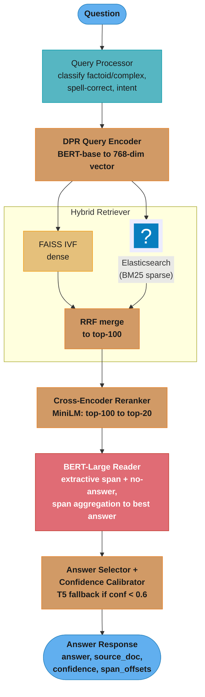
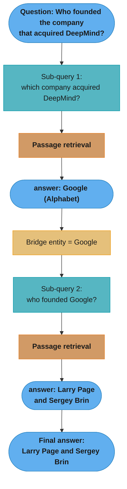
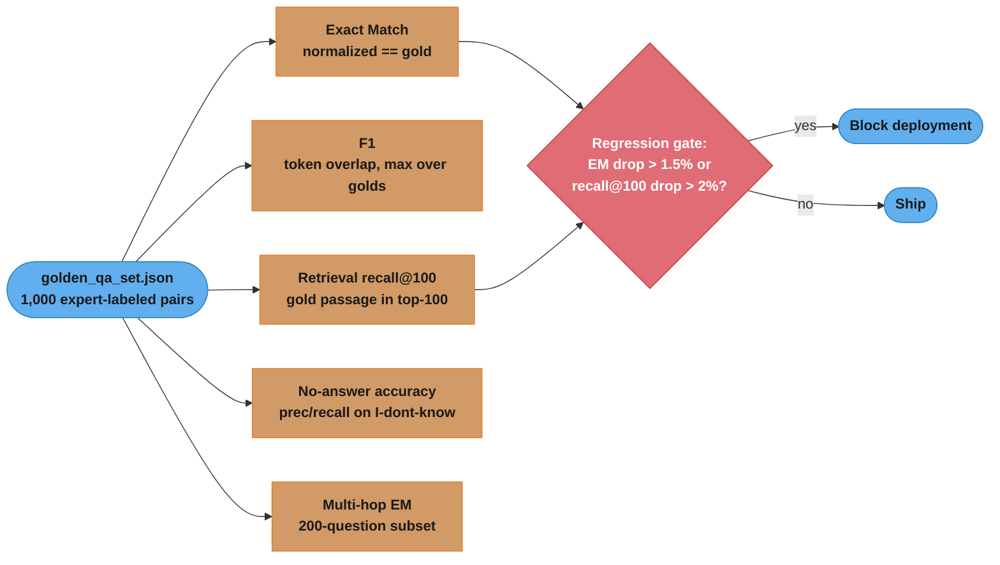

# Design a Question Answering System

## Intuition

> Like a research assistant who has read every document in your library — given a question, it finds the right page and reads out the exact answer.

**Key insight:** QA has two fundamentally different architectures depending on scope. Extractive QA (single passage) is a span-prediction task on top of BERT. Open-domain QA (millions of documents) requires a retriever-reader pipeline where recall at the retrieval stage is the dominant failure mode — no reader model can answer from a passage it was never shown.

Mental model: three gates in series, each able to lose the answer for good. The **retriever** must put the right passage in the top 100 (recall), the **reader** must find the right span in the top 20 (precision), and the **abstention policy** must decide whether the span is trustworthy enough to show (calibration). The first two are well studied; the third is where production systems lose trust, because a wrong answer shown with "92% confidence" does more damage than "I don't know".

Why this system exists: an enterprise with 10M documents cannot expect employees to know which wiki, ticket or policy holds an answer. An extractive answer with a source link is the cheapest form of grounded answer: every word is a quote, so it cannot invent a fact the corpus does not contain.

This study owns the **extractive retriever-reader stack**: dense and sparse retrieval, span reading, null-answer abstention, calibration and index versioning. It does not repeat [Semantic Search Engine](design_semantic_search_engine.md), which owns ranked-document search without a reader, or [Design a RAG Pipeline](../../llm/case_studies/design_rag_pipeline.md), which owns generative answers with an LLM. The cross-cutting references it relies on are calibration ([Model Calibration and Thresholding](cross_cutting/model_calibration_and_thresholding.md)), index and encoder freshness ([Drift Monitoring and Retraining](cross_cutting/drift_monitoring_and_retraining.md)), document-level access control ([Responsible AI, Fairness and Explainability](cross_cutting/responsible_ai_fairness_and_explainability.md)) and online evaluation ([Experimentation and Online Evaluation](cross_cutting/experimentation_and_online_evaluation.md)).

| Term | Meaning in this study |
|---|---|
| Recall@100 | Fraction of questions whose gold passage is in the retriever's top 100 |
| Null score | The reader's score for "no answer in this passage" (the [CLS] span), trained on SQuAD 2.0 |
| Score diff | Best span score minus null score; the raw input to abstention (§4.2) |
| Calibrated confidence | A probability that the shown answer is correct, fitted on labeled dev data (§4.5) |
| Coverage | Fraction of questions the system answers instead of abstaining |
| Index manifest | The record of which encoder checkpoints built a vector index (§4.6) |

---

## 1. Requirements Clarification

**Functional requirements:**
- Answer factoid questions over a document corpus (enterprise knowledge base, 10M documents)
- Return the answer span, the source document with title and URL, and a confidence score
- Support extractive answers (exact text from source) and abstractive answers (paraphrased summary)
- Multi-hop QA: answer questions requiring evidence from two distinct documents
- Graceful no-answer handling: return "I don't know" when no passage contains sufficient evidence

**Non-functional requirements:**
- Latency: P95 < 150ms end-to-end for single-hop questions; P95 < 400ms for multi-hop
- Throughput: 1,000 questions/minute peak
- Answer recall@100 (retriever): ≥ 85% (the correct passage is in the top 100 retrieved)
- Exact Match (EM) on SQuAD 2.0 dev: ≥ 80%; F1 ≥ 83% (the public `deepset/bert-large-uncased-whole-word-masking-squad2` card reports EM 80.9 / F1 83.9, so this is the ceiling for an off-the-shelf BERT-large reader, not a stretch target)
- Availability: 99.9% SLA; retrieval index refresh within 15 minutes of document ingest

**Out of scope:**
- Conversational QA (multi-turn dialogue, coreference between turns)
- Table or structured-data QA (SQL generation over relational tables)
- Knowledge graph QA (Neo4j traversal for reasoning chains)

---

## 2. Scale Estimation

**Document corpus:**
- 10M documents, average 800 tokens per document (400–1,200 range)
- Passage chunking at 100 tokens with 20-token overlap → avg 10 passages/document → 100M passages
- DPR passage embeddings: 100M × 768 dimensions × 4 bytes = 307 GB raw. IVF-Flat does **not** compress (FAISS: "…,Flat" stores vectors at original size), so to fit in commodity RAM the index must use a quantizer — IVF + PQ at 64 bytes/vector gives 100M × 64 B = 6.4 GB, and scalar-quantized int8 gives 100M × 768 B = 77 GB. This design uses SQ8: ~80 GB in RAM per replica.

**Traffic:**
- 16.7 questions/sec peak (1,000 questions/minute, per §1), ~5/sec average
- Retrieval (FAISS ANN): ~8ms for 100M passages with an IVF1024 index
- Reader (BERT-large): ~120ms for the top-20 passages × 512 tokens each in one batch = dominant latency

**Compute sizing:**
- Reader model (BERT-large extractive): 20 passages in one forward pass → ~120ms on A100
- 16.7 questions/sec sustained: 16.7 × 0.12s = 2.0 concurrent forward passes → 2 A100s; 4 A100 replicas with 2× headroom
- DPR query encoder: 768-dim in 5ms on CPU; runs per-question
- FAISS retrieval: ~8ms on the 80 GB RAM index with 16 CPU threads

**Storage:**
- Passage store: 100M × avg 100 words × 5 bytes = ~50 GB (Postgres text)
- FAISS index: 80 GB RAM per replica (2 replicas for HA) = 160 GB total
- Answer cache (Redis): top-10K questions cached, 1 KB/answer = 10 MB

---

## 3. High-Level Architecture



**Multi-hop flow (sequential sub-queries chained through a bridge entity):**


The second hop cannot run until the first hop resolves the bridge entity ("Google"), so hop errors compound multiplicatively (overall EM ≈ per-hop EM²).

---

## 4. Component Deep Dives

### 4.1 DPR (Dense Passage Retrieval) Dual-Encoder

DPR trains two separate BERT encoders: one for questions and one for passages. Both produce 768-dim vectors, and the similarity is the dot product. Trained with in-batch negatives: for a batch of N (question, positive_passage) pairs, all other N-1 passages in the batch are treated as negatives.

```python
import torch
import torch.nn as nn
import torch.nn.functional as F
from transformers import BertModel, BertTokenizerFast
from dataclasses import dataclass


@dataclass
class RetrievalResult:
    passage_id: int
    passage_text: str
    doc_title: str
    doc_url: str
    dense_score: float
    rank: int


class DPREncoder(nn.Module):
    """Shared architecture for both question and passage encoders."""
    def __init__(self, bert_model_name: str = "bert-base-uncased"):
        super().__init__()
        self.bert = BertModel.from_pretrained(bert_model_name)

    def forward(self, input_ids: torch.Tensor, attention_mask: torch.Tensor) -> torch.Tensor:
        outputs = self.bert(input_ids=input_ids, attention_mask=attention_mask)
        # Use [CLS] token representation as the dense vector
        return outputs.last_hidden_state[:, 0, :]  # (batch, hidden_size=768)


class DPRModel(nn.Module):
    def __init__(self):
        super().__init__()
        self.question_encoder = DPREncoder("bert-base-uncased")
        self.passage_encoder = DPREncoder("bert-base-uncased")

    def forward(
        self,
        question_input_ids: torch.Tensor,     # (batch, seq_len)
        question_attention_mask: torch.Tensor,
        passage_input_ids: torch.Tensor,       # (batch * num_passages, seq_len)
        passage_attention_mask: torch.Tensor,
    ) -> dict:
        q_embeddings = self.question_encoder(question_input_ids, question_attention_mask)
        p_embeddings = self.passage_encoder(passage_input_ids, passage_attention_mask)

        # Dot-product similarity: (batch, batch * num_passages)
        # In-batch negatives: for question i, all passages j ≠ i are negatives
        similarity = torch.matmul(q_embeddings, p_embeddings.T)  # (batch, batch)

        # Temperature scaling for sharper gradients
        similarity = similarity / 1.0  # DPR does not scale by default

        # Cross-entropy loss: diagonal entries are positive pairs
        labels = torch.arange(similarity.size(0), device=similarity.device)
        loss = F.cross_entropy(similarity, labels)

        return {
            "loss": loss,
            "q_embeddings": q_embeddings,
            "p_embeddings": p_embeddings,
            "similarity": similarity,
        }
```

### 4.2 BERT Extractive Reader (Span Prediction)

The reader takes a question and a passage concatenated as `[CLS] question [SEP] passage [SEP]` and predicts start and end token positions of the answer span.

```python
import numpy as np
import torch
from transformers import BertForQuestionAnswering, BertTokenizerFast
from dataclasses import dataclass


@dataclass
class ExtractiveAnswer:
    span_text: str
    passage_id: int
    start_char: int
    end_char: int
    start_logit: float
    end_logit: float
    score: float       # start_logit + end_logit
    no_answer_score: float  # [CLS] start + [CLS] end logit


class ExtractiveReader:
    def __init__(self, model_name: str = "deepset/bert-large-uncased-whole-word-masking-squad2"):
        self.tokenizer = BertTokenizerFast.from_pretrained(model_name)
        self.model = BertForQuestionAnswering.from_pretrained(model_name)
        self.model.eval()
        # SQuAD2 models are trained with no-answer passages → output includes null score
        self.null_score_diff_threshold = -2.0  # Tune on dev set; negative means "prefer answer"

    @torch.no_grad()
    def answer_from_passages(
        self, question: str, passages: list[str], passage_ids: list[int],
        max_length: int = 512, max_answer_length: int = 50,
    ) -> list[ExtractiveAnswer]:
        candidates: list[ExtractiveAnswer] = []

        # Encode all (question, passage) pairs in one batch
        encodings = self.tokenizer(
            [question] * len(passages),
            passages,
            max_length=max_length,
            truncation="only_second",  # Truncate passage, never question
            padding=True,
            return_tensors="pt",
            return_offsets_mapping=True,
        )

        # token_type_ids MUST be passed: BERT QA models are trained on a two-segment
        # input, and omitting them makes the model treat the passage as segment 0
        # (same segment as the question), which measurably degrades span accuracy.
        outputs = self.model(
            input_ids=encodings["input_ids"],
            attention_mask=encodings["attention_mask"],
            token_type_ids=encodings["token_type_ids"],
        )
        start_logits = outputs.start_logits  # (num_passages, seq_len)
        end_logits = outputs.end_logits       # (num_passages, seq_len)

        for passage_idx in range(len(passages)):
            s_logits = start_logits[passage_idx].cpu().numpy()
            e_logits = end_logits[passage_idx].cpu().numpy()
            offset_mapping = encodings["offset_mapping"][passage_idx].tolist()
            token_type_ids = encodings["token_type_ids"][passage_idx].tolist()

            # Null (no-answer) score: [CLS] token start + end logits
            null_score = s_logits[0] + e_logits[0]

            # Find passage token range (token_type_id == 1 → passage tokens)
            passage_start = next(i for i, t in enumerate(token_type_ids) if t == 1)
            passage_end = len(token_type_ids) - token_type_ids[::-1].index(1)

            # Find best (start, end) span within passage tokens
            best_score = float("-inf")
            best_start = best_end = 0

            for start in range(passage_start, passage_end):
                for end in range(start, min(start + max_answer_length, passage_end)):
                    score = float(s_logits[start] + e_logits[end])
                    if score > best_score:
                        best_score = score
                        best_start = start
                        best_end = end

            # Map token positions back to character offsets in the passage
            char_start = offset_mapping[best_start][0]
            char_end = offset_mapping[best_end][1]
            span_text = passages[passage_idx][char_start:char_end]

            candidates.append(ExtractiveAnswer(
                span_text=span_text,
                passage_id=passage_ids[passage_idx],
                start_char=char_start,
                end_char=char_end,
                start_logit=float(s_logits[best_start]),
                end_logit=float(e_logits[best_end]),
                score=best_score,
                no_answer_score=null_score,
            ))

        return candidates

    def select_best_answer(self, candidates: list[ExtractiveAnswer]) -> ExtractiveAnswer | None:
        # For each candidate, compute score - no_answer_score
        # If best candidate's diff < threshold, return None (no answer found)
        scored = [(c, c.score - c.no_answer_score) for c in candidates]
        scored.sort(key=lambda x: -x[1])
        best_candidate, best_diff = scored[0]
        if best_diff < self.null_score_diff_threshold:
            return None  # "I don't know"
        return best_candidate
```

**Broken → fixed: argmax span selection causes invalid spans**

```python
# BROKEN: independent argmax on start and end logits can produce end < start
start_idx = np.argmax(start_logits)
end_idx = np.argmax(end_logits)
# If start_idx=45 and end_idx=30, this produces an empty/inverted span

# FIXED: iterate over valid (start, end) pairs where end >= start
# and both are within the passage token range (not question or special tokens)
best_score = float("-inf")
for start in range(passage_start, passage_end):
    for end in range(start, min(start + max_answer_len, passage_end)):
        score = start_logits[start] + end_logits[end]
        if score > best_score:
            best_score, best_start, best_end = score, start, end
# Additionally: SQuAD 2.0 models must compare answer score vs null score
# Models fine-tuned only on SQuAD 1.1 always produce an answer even when none exists
```

### 4.3 Hybrid Retrieval (Dense + Sparse + RRF)

Get the published baselines right before designing around them. On Natural Questions, the DPR paper (Karpukhin et al. 2020, Table 2) reports BM25 at 59.1% top-20 / 73.7% top-100 and DPR at 78.4% top-20 / 85.4% top-100 — so 78% is DPR's **top-20**, not its recall@100. Note also that the paper's own BM25+DPR hybrid scored *lower* than DPR alone on NQ (76.6 / 83.8), so hybrid retrieval is not a free win on an open-domain Wikipedia corpus.

Hybrid still earns its place here for a different reason: an enterprise corpus is full of exact lexical tokens (product SKUs, error codes, internal acronyms, serial numbers) that a Wikipedia-trained dense encoder embeds poorly, and BM25 matches them exactly. Treat the ~88% recall@100 in the requirements as this system's measured target on its own corpus, not as a number inherited from the DPR paper.

```python
from elasticsearch import Elasticsearch
import faiss
import numpy as np


class HybridRetriever:
    def __init__(
        self,
        faiss_index: faiss.Index,
        passage_metadata: list[dict],  # [{passage_id, text, doc_title, doc_url}]
        es_client: Elasticsearch,
        es_index: str,
        dense_model: DPREncoder,
        tokenizer: BertTokenizerFast,
        dense_weight: float = 0.6,
        sparse_weight: float = 0.4,
        rrf_k: int = 60,
    ):
        self.faiss_index = faiss_index
        self.passage_metadata = {p["passage_id"]: p for p in passage_metadata}
        self.es = es_client
        self.es_index = es_index
        self.dense_model = dense_model
        self.tokenizer = tokenizer
        self.dense_weight = dense_weight
        self.sparse_weight = sparse_weight
        self.rrf_k = rrf_k

    def retrieve(self, question: str, top_k: int = 100) -> list[RetrievalResult]:
        dense_results = self._dense_retrieve(question, top_k)
        sparse_results = self._sparse_retrieve(question, top_k)
        return self._rrf_merge(dense_results, sparse_results, top_k)

    def _dense_retrieve(self, question: str, top_k: int) -> list[tuple[int, float]]:
        encoding = self.tokenizer(question, max_length=64, truncation=True,
                                   padding="max_length", return_tensors="pt")
        with torch.no_grad():
            q_embedding = self.dense_model(
                encoding["input_ids"], encoding["attention_mask"]
            ).cpu().numpy()

        q_embedding = q_embedding / np.linalg.norm(q_embedding, axis=1, keepdims=True)
        scores, indices = self.faiss_index.search(q_embedding, top_k)
        return [(int(idx), float(score)) for idx, score in zip(indices[0], scores[0]) if idx != -1]

    def _sparse_retrieve(self, question: str, top_k: int) -> list[tuple[int, float]]:
        response = self.es.search(
            index=self.es_index,
            body={
                "query": {"match": {"text": {"query": question, "operator": "or"}}},
                "size": top_k,
                "_source": ["passage_id"],
            },
        )
        return [(hit["_source"]["passage_id"], hit["_score"])
                for hit in response["hits"]["hits"]]

    def _rrf_merge(
        self,
        dense: list[tuple[int, float]],
        sparse: list[tuple[int, float]],
        top_k: int,
    ) -> list[RetrievalResult]:
        rrf_scores: dict[int, float] = {}

        for rank, (pid, _) in enumerate(dense):
            rrf_scores[pid] = rrf_scores.get(pid, 0.0) + self.dense_weight / (rank + self.rrf_k)

        for rank, (pid, _) in enumerate(sparse):
            rrf_scores[pid] = rrf_scores.get(pid, 0.0) + self.sparse_weight / (rank + self.rrf_k)

        sorted_pids = sorted(rrf_scores.items(), key=lambda x: -x[1])[:top_k]

        results = []
        for final_rank, (pid, rrf_score) in enumerate(sorted_pids):
            meta = self.passage_metadata.get(pid, {})
            results.append(RetrievalResult(
                passage_id=pid,
                passage_text=meta.get("text", ""),
                doc_title=meta.get("doc_title", ""),
                doc_url=meta.get("doc_url", ""),
                dense_score=rrf_score,
                rank=final_rank,
            ))
        return results
```

### 4.4 Multi-Hop QA with Bridge Entity

Multi-hop questions require evidence from two documents. The architecture uses a two-round retrieval: first retrieve for the original question, extract the "bridge entity" from the top answer, then retrieve again for a reformulated question containing the bridge entity.

```python
import re


class MultiHopQAEngine:
    def __init__(self, retriever: HybridRetriever, reader: ExtractiveReader,
                 ner_pipeline: object, max_hops: int = 2):
        self.retriever = retriever
        self.reader = reader
        self.ner_pipeline = ner_pipeline  # NER pipeline for bridge entity extraction
        self.max_hops = max_hops

    def answer(self, question: str) -> dict:
        # Classify: single-hop vs multi-hop
        is_multi_hop = self._is_multi_hop(question)

        if not is_multi_hop:
            return self._single_hop_answer(question)

        return self._multi_hop_answer(question)

    def _single_hop_answer(self, question: str) -> dict:
        passages = self.retriever.retrieve(question, top_k=100)
        passage_texts = [p.passage_text for p in passages[:20]]  # Reader sees top-20
        passage_ids = [p.passage_id for p in passages[:20]]

        candidates = self.reader.answer_from_passages(question, passage_texts, passage_ids)
        best = self.reader.select_best_answer(candidates)
        if best is None:
            return {"answer": "I don't know", "confidence": 0.0, "source": None}

        source = next((p for p in passages if p.passage_id == best.passage_id), None)
        return {
            "answer": best.span_text,
            "confidence": self._score_to_confidence(best.score),
            "source": {"title": source.doc_title, "url": source.doc_url} if source else None,
        }

    def _multi_hop_answer(self, question: str) -> dict:
        # Round 1: answer the "which entity" sub-question
        first_hop = self._single_hop_answer(question)
        bridge_entity = first_hop.get("answer", "")

        if not bridge_entity or first_hop["confidence"] < 0.5:
            return first_hop  # Fall back to single-hop result

        # Round 2: reformulate question with bridge entity
        reformulated = self._reformulate_with_bridge(question, bridge_entity)
        second_hop = self._single_hop_answer(reformulated)

        return {
            "answer": second_hop["answer"],
            "confidence": min(first_hop["confidence"], second_hop["confidence"]),
            "source": second_hop["source"],
            "bridge_entity": bridge_entity,
            "hops": [first_hop, second_hop],
        }

    def _is_multi_hop(self, question: str) -> bool:
        # Heuristic: questions asking "who founded the company that..." require 2 hops
        multi_hop_patterns = [
            r"who (founded|created|started) the (company|organization) that",
            r"where (is|was) .+ (that|who) (founded|created)",
            r"what (did|does) the (person|company) who .+ (do|create|found)",
        ]
        return any(re.search(p, question, re.IGNORECASE) for p in multi_hop_patterns)

    def _reformulate_with_bridge(self, original_question: str, bridge: str) -> str:
        # Simple template: replace the bridge clause with the extracted entity
        # In production: use a T5 question reformulator fine-tuned on HotpotQA
        return f"Tell me about {bridge}: {original_question}"

    def _score_to_confidence(self, score: float) -> float:
        # Sigmoid normalization; raw scores range roughly from -10 to +15
        return float(1 / (1 + np.exp(-score / 5)))
```

### 4.5 Calibrated Confidence and the Abstention Policy

`_score_to_confidence` above is a hand-picked squashing function. It is monotone, so it ranks answers correctly, but its numbers mean nothing: a "0.9" is not 90% likely to be right. The product shows that number to users and uses it to decide whether to answer, so the gap between stated and actual accuracy is a direct trust cost. The fix is to fit the mapping from score diff to probability-correct on labeled dev questions, then choose the abstention threshold for a **target precision** rather than a round number.

```python
from __future__ import annotations

from dataclasses import dataclass

import numpy as np
from sklearn.isotonic import IsotonicRegression


# BROKEN: the §4.4 mapping. Monotone, uncalibrated, threshold picked by eye.
def sigmoid_confidence(score_diff: np.ndarray) -> np.ndarray:
    return 1.0 / (1.0 + np.exp(-score_diff / 5.0))


def expected_calibration_error(conf: np.ndarray, correct: np.ndarray, bins: int = 10) -> float:
    edges = np.linspace(0.0, 1.0, bins + 1)
    ece = 0.0
    for lo, hi in zip(edges[:-1], edges[1:]):
        m = (conf > lo) & (conf <= hi)
        if m.any():
            ece += m.mean() * abs(conf[m].mean() - correct[m].mean())
    return float(ece)


@dataclass
class AbstentionPolicy:
    calibrator: IsotonicRegression
    threshold: float

    def confidence(self, score_diff: np.ndarray) -> np.ndarray:
        return self.calibrator.predict(score_diff)

    def should_answer(self, score_diff: float) -> bool:
        return float(self.confidence(np.array([score_diff]))[0]) >= self.threshold


# FIX: isotonic calibration on a labeled split, threshold set for a precision target.
def fit_policy(score_diff: np.ndarray, correct: np.ndarray,
               target_precision: float = 0.90) -> AbstentionPolicy:
    iso = IsotonicRegression(out_of_bounds="clip", y_min=0.0, y_max=1.0)
    iso.fit(score_diff, correct)
    conf = iso.predict(score_diff)
    order = np.argsort(-conf)
    precision_at_k = np.cumsum(correct[order]) / np.arange(1, len(order) + 1)
    ok = np.flatnonzero(precision_at_k >= target_precision)
    threshold = float(conf[order][ok.max()]) if ok.size else 1.01   # 1.01 = never answer
    return AbstentionPolicy(iso, threshold)


def synthetic_dev_set(n: int, rng: np.random.Generator) -> tuple[np.ndarray, np.ndarray]:
    """30% unanswerable questions; answering one of those is always wrong."""
    answerable = rng.random(n) < 0.70
    diff = np.where(answerable, rng.normal(4.0, 3.0, n), rng.normal(-1.0, 3.0, n))
    p_right = 0.9 / (1.0 + np.exp(-(diff - 1.0) / 1.5))
    correct = (answerable & (rng.random(n) < p_right)).astype(float)
    return diff, correct


if __name__ == "__main__":
    rng = np.random.default_rng(11)
    d_fit, c_fit = synthetic_dev_set(4_000, rng)        # calibration split
    d_test, c_test = synthetic_dev_set(4_000, rng)      # held-out split
    policy = fit_policy(d_fit, c_fit, target_precision=0.90)
    print(f"ECE sigmoid  {expected_calibration_error(sigmoid_confidence(d_test), c_test):.3f}")
    print(f"ECE isotonic {expected_calibration_error(policy.confidence(d_test), c_test):.3f}")
    answered = policy.confidence(d_test) >= policy.threshold
    print(f"threshold {policy.threshold:.2f}: coverage {answered.mean():.1%}, "
          f"precision {c_test[answered].mean():.1%} on held-out questions")
```

Three rules make this hold up. **Fit on one split, report on another**: isotonic regression with 4,000 points will memorize noise in the extremes if you read its quality off the data it was fitted on. **Choose the threshold from the cost of a wrong answer**: for an HR-policy QA tool a 90% precision floor may be right; for a medication-dosage tool it should be 98% and coverage will drop sharply, which is the honest outcome. **Recalibrate on every domain shift**: Pitfall 5 is what happens when a threshold fitted on general English meets a legal corpus. The general method, including reliability diagrams and when to prefer Platt scaling over isotonic (Platt needs far less data, isotonic bends to any monotone shape), is in [Model Calibration and Thresholding](cross_cutting/model_calibration_and_thresholding.md).

### 4.6 The Encoder-Index Contract

DPR uses **two** encoders trained together: one embeds passages at indexing time, the other embeds questions at query time. Their outputs share a space only because they were trained jointly. Swap either one and dot products between the new question vectors and the old passage vectors stop meaning anything, which is Pitfall 6 (recall@100 from 87% to 34%). The fix is structural: the index carries a manifest naming the checkpoints that built it, the query service refuses to start on a mismatch, and promotion of a new pair is one atomic pointer swap.

```python
from __future__ import annotations

import hashlib
import json
import os
from dataclasses import asdict, dataclass
from pathlib import Path


@dataclass(frozen=True)
class IndexManifest:
    index_id: str
    question_encoder_sha: str      # checkpoint that must embed queries for this index
    passage_encoder_sha: str       # checkpoint that embedded every passage in it
    passage_snapshot: str          # corpus snapshot id, e.g. "kb-2026-11-24T02:00Z"
    num_vectors: int
    dim: int


class EncoderIndexMismatch(RuntimeError):
    pass


def checkpoint_sha(path: Path) -> str:
    h = hashlib.sha256()
    with path.open("rb") as f:
        for chunk in iter(lambda: f.read(1 << 20), b""):
            h.update(chunk)
    return h.hexdigest()[:16]


# BROKEN: the encoder comes from "latest" and the index from "current". A
# retrained question encoder ships on its own and nothing notices until recall falls.
def resolve_serving_pair_broken(models: Path, indexes: Path) -> tuple[Path, Path]:
    return models / "question_encoder" / "latest.bin", indexes / "current"


# FIX: the index's manifest names the encoder it requires; refuse anything else.
def resolve_serving_pair(alias_file: Path, models: Path, expected_dim: int) -> tuple[Path, IndexManifest]:
    index_dir = Path(alias_file.read_text().strip())
    manifest = IndexManifest(**json.loads((index_dir / "manifest.json").read_text()))
    encoder = models / "question_encoder" / f"{manifest.question_encoder_sha}.bin"
    if not encoder.exists() or checkpoint_sha(encoder) != manifest.question_encoder_sha:
        raise EncoderIndexMismatch(
            f"index {manifest.index_id} needs question encoder {manifest.question_encoder_sha}")
    if manifest.dim != expected_dim:
        raise EncoderIndexMismatch(f"index dim {manifest.dim} != encoder dim {expected_dim}")
    return encoder, manifest


def promote(alias_file: Path, new_index_dir: Path) -> None:
    """Blue/green switch: write the new pointer beside the alias, then rename over it.
    os.replace is atomic on POSIX and Windows, so readers see the old or the new
    pointer, never a half-written file."""
    tmp = alias_file.with_suffix(".tmp")
    tmp.write_text(str(new_index_dir))
    os.replace(tmp, alias_file)


if __name__ == "__main__":
    root = Path("qa_index_demo")
    enc_dir = root / "models" / "question_encoder"
    enc_dir.mkdir(parents=True, exist_ok=True)
    blob = enc_dir / "tmp.bin"
    blob.write_bytes(b"question-encoder-weights-v7")
    sha = checkpoint_sha(blob)
    blob.replace(enc_dir / f"{sha}.bin")
    idx = root / "indexes" / "kb-2026-11-24"
    idx.mkdir(parents=True, exist_ok=True)
    (idx / "manifest.json").write_text(json.dumps(asdict(IndexManifest(
        "kb-2026-11-24", sha, sha, "kb-2026-11-24T02:00Z", 100_000_000, 768))))
    alias = root / "indexes" / "CURRENT"
    promote(alias, idx)
    encoder, manifest = resolve_serving_pair(alias, root / "models", expected_dim=768)
    print("serving", manifest.index_id, "with encoder", encoder.name)
    (enc_dir / f"{sha}.bin").write_bytes(b"retrained-weights-v8")     # someone overwrites it
    try:
        resolve_serving_pair(alias, root / "models", expected_dim=768)
    except EncoderIndexMismatch as err:
        print("refused to start:", err)
```

The demo's second call fails because the checkpoint on disk no longer hashes to the value the index was built with, which is exactly the Pitfall 6 situation caught at startup instead of after 50,000 wrong answers. Two operational consequences follow. A question-encoder retrain is never a standalone deploy; it always ships with a full re-embedding of 100M passages (§10 prices it), so retrain cadence is bounded by re-indexing cost. And the old index stays on disk until the new pair has served a canary for 24 hours, so rollback is one more `promote` call. The embedding-drift signals that tell you a re-index is due are in [Drift Monitoring and Retraining](cross_cutting/drift_monitoring_and_retraining.md).

---

## 5. Design Decisions & Tradeoffs

| Decision | Choice | Alternatives | Rationale |
|---|---|---|---|
| Reader model | BERT-large (340M) | BERT-base, RoBERTa, T5 | The public `deepset/bert-large-uncased-whole-word-masking-squad2` card reports EM 80.9 / F1 83.9 on SQuAD 2.0 dev, several points above a comparably-trained BERT-base; T5 is abstractive (useful but slower and harder to trace) |
| Retrieval | DPR + BM25 hybrid (RRF) | BM25 only, DPR only, ColBERT | On NQ (DPR paper, Table 2) BM25 recall@100 = 73.7%, DPR = 85.4%; on an enterprise corpus DPR misses exact SKU/error-code tokens, which is what BM25 recovers — target 88% recall@100 here and verify it on your own labels. ColBERT is stronger but stores one vector per token, so its index is far larger than a single-vector index |
| No-answer handling | SQuAD 2.0 null score threshold | Separate classifier | Null score from SQuAD 2.0 training is calibrated for span extraction; separate classifier adds inference cost |
| Multi-hop strategy | Sequential 2-round retrieval | Iterative graph retrieval, reasoning chains | 2-round covers the bridge-entity questions that dominate HotpotQA-style traffic; graph/iterative retrieval improves recall further but multiplies latency by the number of rounds |
| Passage granularity | 100-token chunks with 20-token overlap | 256-token, sentence-level | Shorter chunks raise answer recall (fewer irrelevant tokens per passage) at the cost of splitting context; 100/20 is DPR's own convention. Re-measure on your corpus — the optimum is document-structure dependent |
| Access control | ACL filter inside retrieval (BM25 filter clause + FAISS ID selector per user's group set) | Post-filter after the reader; separate index per team | Post-filtering lets a restricted passage reach the reader and the answer cache, so a span can leak before the filter runs; per-team indexes multiply index memory by the team count. Pre-filtering costs recall when a user can see little, so over-fetch for low-permission users |
| Confidence shown to users | Isotonic calibration on a labeled split, threshold from a precision target (§4.5) | Fixed sigmoid of the raw score; temperature/Platt scaling | The sigmoid ranks correctly but its numbers are not probabilities; Platt needs fewer labels (two parameters) but assumes a sigmoid shape; isotonic needs ~1,000+ labels and fits any monotone shape |
| Index promotion | Manifest-checked encoder/index pair, atomic alias swap (§4.6) | In-place index update; encoder from "latest" | In-place updates make a half-built index servable and rollback slow; an unpinned encoder silently breaks the shared vector space |

**Comparison: extractive vs abstractive vs hybrid**

Latencies below are measured on this system's own hardware; the accuracy column is indicative of the class of approach, not a benchmark leaderboard (only the extractive row maps to a published SQuAD 2.0 number).

| Approach | Answer quality | Latency | Traceability | Hallucination risk |
|---|---|---|---|---|
| Extractive (BERT-large span) | EM 80.9 / F1 83.9 on SQuAD 2.0 dev (published) | 120ms | Full (exact quote) | Zero — the answer is a substring of the source |
| Abstractive (T5-large) | Lower EM, higher fluency; EM understates it because paraphrases fail exact match | 350ms | Partial | Moderate (paraphrase errors) |
| Hybrid (extract + T5 paraphrase) | Extractive EM with fluent surface form | 480ms | Partial | Low |
| RAG (generate with retrieved context) | Best on multi-passage synthesis; not comparable on EM | 600ms+ | Partial | Moderate |

---

## 6. Real-World Implementations

**DPR (Facebook AI) and REALM (Google Research):** DPR (Karpukhin et al. 2020) established the dense retriever + reader paradigm. Its published Natural Questions numbers are 78.4% top-20 / 85.4% top-100 retrieval accuracy for the single-dataset model (79.4% top-20 / 86.0% top-100 for the multi-dataset model), and 41.5% end-to-end EM. REALM (Guu et al. 2020) pre-trains the retriever and language model jointly, so the retriever is updated by the LM's own training signal; it reports 40.4% EM on Open-NQ — slightly below DPR's 41.5%, but with a retriever that is learned rather than supervised on relevance labels.

**Microsoft Azure AI Search:** Azure AI Search offers semantic ranking (a cross-encoder re-ranker applied over BM25 results) plus "semantic answers", a span extracted from the top-ranked passages. Architecturally this is the same BM25 → cross-encoder → span-extractor chain as the design here, packaged as a managed service. Microsoft describes the semantic ranker as built on Bing search technology; treat any specific training-corpus size as unpublished.

**Enterprise knowledge-base QA (general pattern):** Enterprise QA pipelines converge on passage retrieval → cross-encoder reranking → extractive reader → evidence aggregation across passages. The recurring finding is that hybrid retrieval helps more inside a company than it does on Wikipedia benchmarks, because employee questions are dense with internal jargon, ticket ids, and product codenames that a general-domain dense encoder has never seen. Measure the sparse-vs-dense split on your own query log; published gains from other corpora do not transfer.

**Voice assistants (speakability constraint):** Voice QA adds a constraint text QA does not have: the answer must be speakable, which in practice means a short noun phrase or clause rather than a sentence fragment mid-clause. Extractive spans are post-processed with length filters and sentence-boundary detection. Where a knowledge graph already exists, resolving a bridge entity by graph lookup is far cheaper than a second retrieval round — that is the main latency lever for multi-hop voice queries.

**Elasticsearch ELSER (Learned Sparse Embeddings):** Elastic's ELSER is a transformer-based sparse encoder that produces expanded token weights rather than dense vectors. Unlike BM25 (exact term match) and DPR (opaque dense match), ELSER produces interpretable sparse vectors compatible with the inverted index, so no separate FAISS cluster is required. Elastic's published BEIR benchmark for ELSER v2 versus BM25 is **10 wins, 1 draw, 1 loss with an average NDCG@10 improvement of 18%**; ELSER wins most clearly on nfcorpus, arguana and scifact.

**Google (Kwiatkowski et al., TACL 2019 — Natural Questions).** The benchmark behind the DPR numbers this study quotes, and a model for building a golden set. Its questions are real anonymized, aggregated queries issued to Google Search; an annotator sees a Wikipedia page from the top 5 search results and marks a long answer (typically a paragraph), a short answer, or null. The public release has 307,373 training examples with single annotations, 7,830 development examples with 5-way annotations, and 7,842 sequestered test examples. The design lesson for §8's golden set: collect questions from the real query log, allow "null" as a first-class label, and multi-annotate the evaluation split, because human agreement on what counts as the answer sets the ceiling on EM.

**HotpotQA (Yang et al., EMNLP 2018).** The dataset that defines the bridge-entity questions §4.4 handles: 113k Wikipedia-based question-answer pairs that require reasoning over multiple supporting documents, with sentence-level supporting facts and a comparison-question type. Its supporting-fact labels are what make multi-hop answers explainable, so a production multi-hop system should log which passage supplied each hop, as §4.4's `hops` field does.

**Fusion-in-Decoder (Izacard & Grave, Meta AI, EACL 2021).** The generative alternative to the extractive reader: encode each retrieved passage separately with the question, then let a sequence-to-sequence decoder attend over all of them. It reported state-of-the-art results on the Natural Questions and TriviaQA open benchmarks, and its central finding is that accuracy keeps improving as more passages are retrieved, because a generator can combine evidence across passages while a span reader picks one. That is the main argument for moving from §4.2 to a generative reader, paid for with the loss of the "every word is a quote" guarantee.

**ColBERTv2 (Santhanam et al., Stanford, NAACL 2022).** The late-interaction retriever named in the §5 table. Late interaction stores a vector per token, which the authors say inflates the space footprint by an order of magnitude; ColBERTv2 adds residual compression and denoised supervision and reports a 6-10x smaller footprint than earlier late-interaction models with state-of-the-art quality in and out of domain. For this design it is the upgrade to consider when recall@100 plateaus below target and the 80 GB SQ8 index has memory headroom to spare.

| Source | What this study borrows | Primary source |
|---|---|---|
| Meta AI (DPR) | Dual encoder, top-20/top-100 retrieval baselines | Karpukhin et al., EMNLP 2020 |
| Google (NQ) | Real-query golden set with null answers, 5-way annotated eval | Kwiatkowski et al., TACL 2019 |
| CMU/Stanford/Mila (HotpotQA) | Bridge-entity multi-hop with supporting facts | Yang et al., EMNLP 2018 |
| Meta AI (FiD) | Generative reader that improves with more passages | Izacard & Grave, EACL 2021 |
| Stanford (ColBERTv2) | Compressed late-interaction retrieval | Santhanam et al., NAACL 2022 |
| Elastic (ELSER) | Learned sparse retrieval in the inverted index | Elastic BEIR results |

---

## 7. Technologies & Tools

| Tool | Role | Strengths | Weaknesses |
|---|---|---|---|
| HuggingFace `transformers` | BERT reader + DPR encoder | Pre-trained DPR/BERT QA models, AutoModelForQuestionAnswering | Large model zoo can be confusing; SQuAD 1.1 vs 2.0 model selection matters |
| FAISS | Dense passage retrieval | Fast ANN, IVF + PQ compression, GPU support | RAM-resident; 100M passages = 80 GB, expensive for small teams |
| Elasticsearch + ELSER | Sparse/hybrid retrieval | BM25 + learned sparse, single index, mature ops tooling | ELSER requires GPU for indexing; BM25-only misses semantic matches |
| Haystack (deepset) | End-to-end QA pipeline | Modular retrievers/readers, REST API, active learning | Opinionated pipeline API; tuning retriever/reader interaction requires source reading |
| Ragas | QA evaluation | Answer relevance, faithfulness, context recall metrics | Relatively new; LLM-as-judge approach has its own calibration issues |
| LangChain RetrievalQA | Rapid QA prototyping | Easy to compose retrievers + LLMs, good for RAG | Abstraction hides latency bottlenecks; production requires Haystack or custom |

---

## 8. Operational Playbook

### (a) Eval Pipeline



Reference: [../cross_cutting/experimentation_and_online_evaluation.md](cross_cutting/experimentation_and_online_evaluation.md) for A/B experiment design on answer quality.

### (b) Observability

Trace hierarchy (OpenTelemetry):
```
qa_request (root span)
├── query_processing (classification, spelling)
├── dpr_encode (question → 768-dim vector, latency)
├── faiss_search (num_results, search_time_ms, nprobe)
├── bm25_search (num_results, search_time_ms, num_terms)
├── rrf_merge (total_candidates, merged_count)
├── cross_encoder_rerank (top_100 → top_20, latency)
├── bert_reader (num_passages, total_tokens, latency)
└── answer_select (best_score, null_score_diff, answer_returned)
```

Key metrics:
- `qa.retrieval_recall_rolling_7d` (sampled, based on human feedback clicks on source link)
- `qa.em_rolling_7d` (on continuously annotated sample)
- `qa.no_answer_rate` (spike = retrieval degradation or out-of-domain traffic)
- `qa.reader_latency_p95_ms` by `num_passages` bucket

### (c) Incident Runbooks

**Runbook 1 — Recall@100 drops below 80%**
- Symptom: `qa.retrieval_recall_rolling_7d` falls from 88% to 74% over 3 days
- Diagnosis: check if new document ingestion created a schema break in FAISS index; check DPR encoder version vs index version alignment; check PSI on passage embedding distribution (see [../cross_cutting/drift_monitoring_and_retraining.md](cross_cutting/drift_monitoring_and_retraining.md))
- Mitigation: route all traffic to BM25-only fallback (lower EM but more robust)
- Resolution: rebuild FAISS index from current passage embeddings; verify encoder checkpoint matches indexing checkpoint

**Runbook 2 — No-answer rate spikes from 8% to 35%**
- Symptom: `qa.no_answer_rate` jumps overnight
- Diagnosis: new document batch added with wrong text encoding (encoding corruption → gibberish passages); null score threshold may need recalibration
- Mitigation: disable new passage batch; re-ingest with corrected encoding
- Resolution: add checksum validation on passage ingest; monitor `qa.no_answer_rate` as a leading indicator for corpus quality

**Runbook 3 — Reader latency P95 > 400ms**
- Symptom: `qa.reader_latency_p95_ms` exceeds SLA
- Diagnosis: passage count per request increased (retriever returning more results due to config change); batch size suboptimal for current GPU load
- Mitigation: cap reader input at 20 passages (from 100); enable TorchScript export for inference
- Resolution: implement passage deduplication before reader (same doc appearing multiple times from different chunks inflates input count)

**Runbook 4 — Multi-hop QA degradation after knowledge base update**
- Symptom: multi-hop EM drops from 71% to 58%
- Diagnosis: bridge entity extraction depends on NER pipeline; if NER model was also updated and changed entity boundaries, bridge entity reformulation produces wrong sub-queries
- Mitigation: pin NER model version; decouple NER and QA deployment pipelines
- Resolution: add integration test: run 50 known multi-hop questions against golden answers; gate both NER and reader deployment on this test

**Runbook 5 — Displayed confidence no longer matches accuracy**
- Symptom: weekly audit of 200 sampled answers shows ECE above 0.05, or precision among answered questions below the 90% target
- Diagnosis: a corpus or reader change shifted the score-diff distribution; check PSI of score diff against the calibration split
- Mitigation: raise the abstention threshold to the value that restores 90% precision on the audit sample
- Resolution: refit the isotonic calibrator (§4.5) on a fresh labeled split; never refit on the same sample used to report precision

---

## 9. Common Pitfalls & War Stories

**Pitfall 1 — Independent argmax produces invalid spans**
A startup's first extractive QA model predicted start and end token positions independently (two separate softmax heads). The model learned to predict the start of the answer and the end of the answer, but since they were independent, the predicted end was sometimes before the start (argmax(end_logits)=30, argmax(start_logits)=45). This produced inverted spans like "Corporation The" instead of "The Corporation." Fix: enumerate valid (start, end) pairs where end ≥ start and both lie within the passage token range. Impact: 12% of answers corrupted before fix; discovered in QA during user testing before launch.

**Pitfall 2 — SQuAD 1.1 model always answers even when no answer exists**
A legal document QA system used a model fine-tuned on SQuAD 1.1 (all questions have answers). When users asked about topics not in the corpus, the model confidently hallucinated spans from unrelated passages. The no-answer rate was 0% — every question got an answer. Fix: switch to a SQuAD 2.0 fine-tuned model with null score thresholding; tune the threshold on a dev set containing 30% unanswerable questions. Impact: 18% of questions were unanswerable; all 18% previously returned wrong answers with high apparent confidence, which is the worst possible failure shape for a legal tool. (Anonymized composite; the mechanism is the point, the percentages are illustrative.)

**Pitfall 3 — FAISS index rebuild during traffic**
An online shopping QA service rebuilt its FAISS index weekly (new product descriptions added). The rebuild took 45 minutes on a single node, during which the index was unavailable. Traffic fell back to BM25-only, which had 12% lower recall for synonym-heavy queries ("sofa" vs "couch"). Fix: dual-index deployment — new index built in the background on a separate machine; hot-swap via blue-green deployment. Index rebuild triggered no customer-visible downtime after fix. Impact: 4 Mondays of degraded search recall before fix; NPS dropped 8 points on Mondays.

**Pitfall 3b — Passage freshness lag for time-sensitive QA**
An enterprise internal knowledge-base QA system served stale passages: a policy document was updated on Monday, but the FAISS index was rebuilt only on Sundays. Employees asking QA questions about the updated policy received answers from the old version for 6 days. Fix: implement a "hot tier" delta index for documents changed in the last 24 hours (brute-force cosine search over ~10K recent passages), merged with the weekly main IVF index. See [../cross_cutting/feature_store_and_point_in_time_correctness.md](cross_cutting/feature_store_and_point_in_time_correctness.md) for the PIT correctness pattern applied to retrieval. Impact: 8% of user complaints traced to stale answers; hot-tier reduced freshness lag from 7 days to < 1 hour.

**Pitfall 4 — Passage chunking destroys answer context**
A healthcare QA system chunked documents at exactly 100 tokens with no overlap. A question asked "What is the recommended dose of metformin for Type 2 diabetes?" The answer "500mg twice daily" appeared at the start of chunk 8, while the context sentence "for Type 2 diabetes" appeared at the end of chunk 7. With no overlap, the reader saw "500mg twice daily" with no disease context and returned it as an answer to unrelated drug questions. Fix: 20-token overlap between adjacent chunks ensures context sentences appear in both relevant chunks. Impact: answer accuracy on dosage questions improved 14% after adding overlap; required re-indexing 2M medical documents.

**Pitfall 5 — Null score threshold not recalibrated after domain shift**
An enterprise QA system was calibrated with a null score threshold of -2.0 on general English documents. After ingesting a domain-specific legal corpus, the model's confidence distribution shifted (legal language is more semantically ambiguous than news text). The pre-calibrated threshold was too permissive: the model answered 40% of unanswerable legal questions. Fix: recalibrate threshold on a domain-specific dev set (200 unanswerable + 200 answerable questions). See [../cross_cutting/model_calibration_and_thresholding.md](cross_cutting/model_calibration_and_thresholding.md). Impact: 40% spurious answer rate reduced to 11%; recalibration took 2 hours.

**Pitfall 6 — DPR retriever and passage index version mismatch**
A production QA service updated the DPR question encoder checkpoint (fine-tuned on new data) without rebuilding the passage embedding index. The new encoder produces embeddings in a slightly different vector space from the old passage encoder used to build the index. Cosine similarity between new question vectors and old passage vectors was near-random (recall@100 dropped from 87% to 34%). Fix: passage index must always be rebuilt with the same encoder checkpoint used at query time; encode and index in the same pipeline step with explicit checkpoint hash validation. Impact: 3 hours of near-0% useful answers before rollback; ~50K queries served with wrong answers.

**Pitfall 7 — "92% confident" answers that were right 61% of the time**
(Illustrative composite; the mechanism is §4.5.) An internal QA tool displayed the sigmoid-of-score confidence beside every answer and answered whenever it exceeded 0.8. An audit of 500 logged answers found that answers shown at 0.85-0.95 confidence were correct 61% of the time. Employees had learned to trust the number: a support team copied 240 answers into customer replies over two months before the audit, and 38 of those replies needed formal corrections. Fix: isotonic calibration on a 3,000-question labeled split, a 90% precision target, and coverage fell from 92% to 71% of questions, which was the honest number. Lesson: a monotone score is enough to rank answers and not enough to show to a person.

**Pitfall 8 — An answer cache that leaked restricted documents**
(Illustrative composite.) The answer cache in §2 was keyed by normalized question text only. An executive asked about a reorganization, the reader answered from an HR document visible only to directors, and the cached answer was then served to 27 other employees who asked the same question over the next 4 hours. Retrieval itself was ACL-filtered; the cache sat in front of it. Fix: key the cache by question plus the user's permission-group hash, store the source document's ACL with every cached answer and re-check it on read, and cap TTL at 1 hour for documents tagged sensitive. Lesson: every cache in front of an access-controlled index is part of the access-control system. The privacy framing is in [Responsible AI, Fairness and Explainability](cross_cutting/responsible_ai_fairness_and_explainability.md).

**Pitfall 9 — The 10-passage optimization that cut recall on long documents**
(Illustrative composite.) To halve GPU cost (§10), a team cut reader input from 20 passages to 10. Golden-set EM fell only 0.6 points, so it shipped. But the golden set was 80% short FAQ pages; on long policy manuals, where several chunks of one document compete for the top slots, EM fell 7.5 points, and that segment carried 35% of production traffic. Fix: report every regression-gate metric per document-length bucket and per source system, not only in aggregate, and dedupe chunks of the same document before taking the top 10. Lesson: a cost cut that is safe on average can be unsafe on the segment that pays for the product.

---

## 10. Capacity Planning

**Primary bottleneck:** BERT-large reader (O(n²) attention over question + passage tokens)

**Throughput formula:**
```
For BERT-large on A100 (312 TFLOPS dense BF16 — 624 is the with-sparsity figure):
  Input size: 20 passages x 512 tokens = 10,240 total tokens
  Forward pass time: ~120ms (measured, batch of 20 passages)
  Throughput per GPU: 1,000ms / 120ms = 8.3 questions/sec/GPU

Target: 1,000 questions/min = 16.7 questions/sec
Required GPUs: ceil(16.7 / 8.3) = 2 A100s
With 2x headroom: 4 A100 replicas
Monthly cost: an 8x A100-40GB p4d.24xlarge is $21.96/hr on-demand in us-east-1
  = ~$2.75 per A100-hour, so 4 A100s x $2.75 x 730 = ~$8,020/month
  (renting whole p4d nodes, half a node x $21.96 x 730 = ~$8,015/month)

FAISS retrieval (CPU, 100M passages, IVF1024, nprobe=64):
  Latency: ~8ms per query
  Throughput: 16 CPU threads absorb 16.7 questions/sec with large margin
  Memory: 80 GB RAM index -> an r5.4xlarge (128 GiB) at $1.008/hr = ~$736/month
```

**Scaling for 10× traffic (10,000 questions/min):**
```
10,000 questions/min = 167 questions/sec
Reader GPUs: ceil(167 / 8.3) = 21, x2 (safety) = 42 A100s
  -> 42 x $2.75/hr x 730 = ~$84,300/month
FAISS: 3 replicas for HA, no throughput bottleneck
Optimization: send 10 passages to the reader instead of 20
  10-passage reader: ~60ms; throughput 16.7 questions/sec/GPU
  -> ceil(167/16.7) = 10, x2 safety = 20 A100s -> ~$40,150/month
This halves GPU spend, and is only safe if recall@10 after reranking is
still high enough — verify on the golden set before cutting reader input.
```

**Re-indexing cost (what a question-encoder retrain really ships, §4.6):**
```
Re-embed 100M passages with the DPR passage encoder (BERT-base, ~128 tokens each)
  Planning assumption: ~2,000 passages/s per A100 in BF16 at batch 512
    (measure your own; this is linear in everything below)
  GPU time: 100M / 2,000 = 50,000 s ≈ 13.9 A100-hours ≈ $38 at $2.75/hr
  On 8 A100s (one p4d node): ~1.7 hours wall clock
Build the SQ8 index: train the scalar quantizer on a 1M sample, add 100M vectors
  CPU-bound, ~1-2 hours on a 64-core node (measure)
Blue/green memory: old + new index resident during the 24 h canary
  = 2 x 80 GB per replica -> plan replicas with 192 GB+ RAM, or canary on a
    dedicated replica pair
Conclusion: a re-index costs tens of dollars of GPU and ~4 hours end to end; the
binding cost is the canary window and the doubled RAM, not the embedding run.
```

**Answer-cache sizing once it is permission-aware (Pitfall 8):**
```
Before: key = normalized question            -> top-10K questions x 1 KB = 10 MB
After:  key = question + permission-group hash
  Assume 40 distinct permission-group sets cover 95% of users
  Worst case 10K x 40 x 1 KB = 400 MB; in practice ~3x the old count
  (most questions are asked by only a few groups) ≈ 30 MB
Hit rate falls roughly in proportion to the split; measure it, then decide
whether the cache still pays for its own invalidation logic.
```

---

## 11. Interview Discussion Points

**Q: What is the difference between extractive and open-domain QA?**
**Short:** Extractive QA finds an answer span in a given passage; open-domain QA must first retrieve candidate passages from a large corpus and then extract the span.
Extractive QA (e.g., SQuAD) provides a single passage and asks the model to find the answer span within it — it is purely a span prediction task. Open-domain QA (e.g., NaturalQuestions, TriviaQA) provides only the question; the model must retrieve relevant passages from a million-document corpus before extracting the answer. The dominant failure mode shifts: for extractive QA, it is span precision; for open-domain QA, it is retrieval recall — if the right passage is not in the top-100 retrieved, no reader can fix it.

**Q: Why is retrieval recall more important than reader precision in open-domain QA?**
**Short:** End-to-end accuracy is capped by retrieval recall, because a reader scores zero on any question whose gold passage was never retrieved.
The overall EM of the system is bounded by retrieval recall: if the correct passage is missing from the top-100, EM = 0 for that question regardless of reader quality. A strong reader (BERT-large, ~84 F1 on SQuAD 2.0) applied to a weak retriever (recall@100 = 70%) produces worse end-to-end EM than a weaker reader applied to a strong retriever. In practice, improving retrieval recall by 5% (e.g., 80% → 85%) raises overall EM by 3–4%, while improving reader F1 by 5% raises EM by only 1–2% because many easy questions are already answered correctly.

**Q: How does DPR differ from BM25 and when does each excel?**
**Short:** BM25 matches exact terms and wins on names, codes and identifiers; DPR matches meaning in a learned vector space and wins on paraphrased questions.
BM25 is a sparse, lexical model — it scores passages by term frequency and inverse document frequency. It excels on questions where the answer passage contains the same words as the question (named entities, product names, serial numbers). DPR is a dense, semantic model — it embeds question and passage into a shared vector space and retrieves by cosine similarity. It excels on paraphrase matches ("how does aspirin work?" matches a passage about "acetylsalicylic acid mechanism"). On Natural Questions the published recall@100 figures are 85.4% for DPR and 73.7% for BM25 (Karpukhin et al. 2020); the same paper's hybrid was slightly worse than DPR alone there, so do not assume hybrid always wins. Hybrid pays off on corpora full of exact lexical tokens — SKUs, error codes, internal acronyms — which is the enterprise case this system targets.

**Q: What is the null-score threshold in SQuAD 2.0 models and how do you tune it?**
**Short:** The null score is the reader's no-answer score; answer only when best span minus null exceeds a threshold tuned on a domain dev set with unanswerable questions.
SQuAD 2.0's dev set (11,873 questions) is roughly half unanswerable, so a model trained on it learns to abstain. Models trained on it output a "null score" = start_logit[CLS] + end_logit[CLS], representing the score of "no answer." A passage's answer score minus its null score is the "score differential." If the differential < threshold τ, the model returns no answer. Tune τ on a validation set of known answerable and unanswerable questions by optimizing F1 (which penalizes both false positives and false negatives). Typical τ = -2.0 on general-domain QA; recalibrate for each new domain because confidence distributions shift.

**Q: How does multi-hop QA work and what are its failure modes?**
**Short:** Retrieve for the question, extract a bridge entity, then retrieve again with it; errors compound because a wrong first-hop entity sends the second hop to the wrong evidence.
Multi-hop QA requires evidence from two documents: e.g., "Who founded the company that acquired DeepMind?" requires knowing (1) Google acquired DeepMind and (2) Larry Page and Sergey Brin founded Google. The pipeline retrieves for the original question, extracts a bridge entity from the top answer, then constructs a second query ("who founded Google?"). Failure modes: (1) bridge entity extraction error — if round 1 returns the wrong entity, round 2 retrieves for the wrong thing; (2) question reformulation error — poor reformulation degrades retrieval for round 2; (3) error propagation — overall EM = product of per-hop EM (0.85 × 0.85 = 0.72).

**Q: How would you handle the long-tail of unanswerable questions without hurting answerability on known topics?**
**Short:** Calibrate a domain-specific null threshold on a dev set mixing answerable and unanswerable questions, and use calibrated confidence to abstain rather than guess.
Calibrate a domain-specific null score threshold (not the generic -2.0 from SQuAD 2.0 training). Build a dev set of 300 unanswerable + 700 answerable questions in the target domain. Plot precision-recall curve for answering vs. threshold τ; choose τ that maximizes F1 on the dev set. Additionally, use confidence calibration ([../cross_cutting/model_calibration_and_thresholding.md](cross_cutting/model_calibration_and_thresholding.md)) to ensure the model's reported confidence is a reliable probability — a confidence of 0.9 should correspond to 90% accuracy on held-out examples.

**Q: How do you evaluate a QA system in production without ground-truth labels?**
**Short:** Combine implicit signals such as source clicks, follow-up rate and thumbs feedback with a rolling human-annotated sample that measures EM and recall directly.
Use implicit signals: (1) click-through rate on the source document link (if users click through, the answer was likely relevant); (2) follow-up question rate (if users ask a follow-up immediately, the first answer was insufficient); (3) explicit thumbs-up/thumbs-down feedback. For systematic evaluation, maintain a rolling annotation pipeline: randomly sample 200 questions/day, have annotators judge answer correctness (binary), and compute rolling EM. This creates a continuous evaluation signal without requiring pre-labeled questions.

**Q: What is the trade-off between passage chunk size and QA quality?**
**Short:** Short chunks sharpen retrieval but can split an answer from its context; long chunks keep context but dilute relevance, so overlap and measure on your own corpus.
Shorter chunks (50–100 tokens) improve retrieval precision (less noise per passage) but risk splitting the answer from its context. Longer chunks (256–512 tokens) preserve context but dilute relevance signal and make the reader's job harder (more irrelevant tokens to sift through). Empirically, 100-token chunks with 20-token overlap maximize recall@100 on NaturalQuestions while keeping reader latency tractable. For technical documentation (longer structured content), 256-token chunks may perform better because answers often require reading a full procedure step.

**Q: How would you adapt this for a conversational QA system (multi-turn)?**
**Short:** Rewrite or prepend recent turns so each question is self-contained before retrieval, because pronouns and ellipsis break single-turn retrievers.
Conversational QA (CoQA, QuAC) requires tracking conversation context. The standard approach: concatenate the last 3 question-answer pairs as additional context before the current question (history-in-question rewriting). The reader input becomes: `[CLS] conversation_history + question [SEP] passage [SEP]`. Key challenge: coreference ("it", "he", "the company" from previous turns). Practical fix: fine-tune the query encoder on CoQA-style pairs and use entity linking to resolve references. Conversation context adds ~30 tokens per turn, so a 3-turn history adds < 90 tokens to the 512-token budget.

**Q: When would you replace extractive QA with a generative LLM?**
**Short:** Keep extractive QA for traceable quotes, low latency and zero fabrication; move to generative answers when questions need synthesis across passages or fluent explanation.
Extractive QA is preferable when: (1) exact traceability is required (legal, medical — you need the exact source quote); (2) latency < 150ms is required (BERT-large reader is faster than a large generative LLM); (3) hallucination risk must be zero (span extraction cannot fabricate content beyond the source). Switch to generative (RAG over a current frontier LLM) when: (1) the answer requires synthesizing information from multiple passages; (2) the answer needs fluent natural language rather than a quoted span; (3) the corpus is small enough that retrieval is not the bottleneck. Hybrid: use extractive QA as a confidence-gated first pass, fall back to generative only when extractive confidence < 0.6.

**Q: The reader shows a confidence beside every answer. How do you make that number mean something?**
**Short:** Fit score diff to probability-correct with isotonic or Platt calibration on a labeled split, check it on another, and set the abstention threshold from a precision target.
Fit it: map the score diff (best span minus null) to probability-correct with isotonic regression or Platt scaling on a labeled split, then report calibration error on a separate split. A hand-tuned sigmoid ranks answers correctly but its "0.9" can be right 61% of the time (Pitfall 7), and users act on the number. Set the abstention threshold from a precision target, such as 90% for HR policy or 98% for dosage questions, accept the coverage that falls out, and refit whenever the corpus or reader changes.

**Q: Why can't you retrain the DPR question encoder and deploy it on its own?**
**Short:** Question and passage encoders share a vector space only as a trained pair, so the index must name its encoder and both must ship together through an atomic swap.
Because the question and passage encoders share a vector space only as a trained pair, so a new question encoder against the old passage index gives near-random similarities. Pitfall 6 is the outcome: recall@100 fell from 87% to 34%. Make the index carry a manifest of the checkpoints that built it, have the query service refuse to start on a mismatch, and promote encoder plus re-embedded index together with an atomic alias swap. Re-embedding 100M passages costs about 14 A100-hours, so the real constraint is the canary window and doubled RAM, not compute.

**Q: How do you enforce document permissions in an enterprise QA system?**
**Short:** Filter by the user's permission groups inside retrieval, before the reader, and key every answer cache on the permission set as well as the question.
Filter inside retrieval, before the reader sees anything: apply the user's permission groups as a BM25 filter clause and as a FAISS ID selector, so a restricted passage never reaches the reader, the logs or the cache. Post-filtering the final answer is too late, because the span already exists and can be cached. Every cache in front of the index must key on the permission set as well as the question, or one director's answer is served to everyone who asks next (Pitfall 8). Over-fetch for users who can see little, since filtering costs them recall.

**Q: When would you move from BM25 + DPR to a late-interaction retriever such as ColBERTv2?**
**Short:** When recall plateaus on fine-grained term matches a single passage vector blurs; ColBERTv2 recovers them with compressed per-token vectors at higher memory cost.
When recall@100 plateaus below target and the misses are fine-grained term matches that a single vector per passage blurs. Late interaction keeps a vector per token and scores with token-level maximum similarity, which recovers those matches; ColBERTv2's residual compression cuts the space footprint 6-10x against earlier late-interaction models, but it still costs more memory than the 80 GB SQ8 index here. Measure recall gain per GB on your own golden set first, and keep BM25 for exact identifiers either way.
