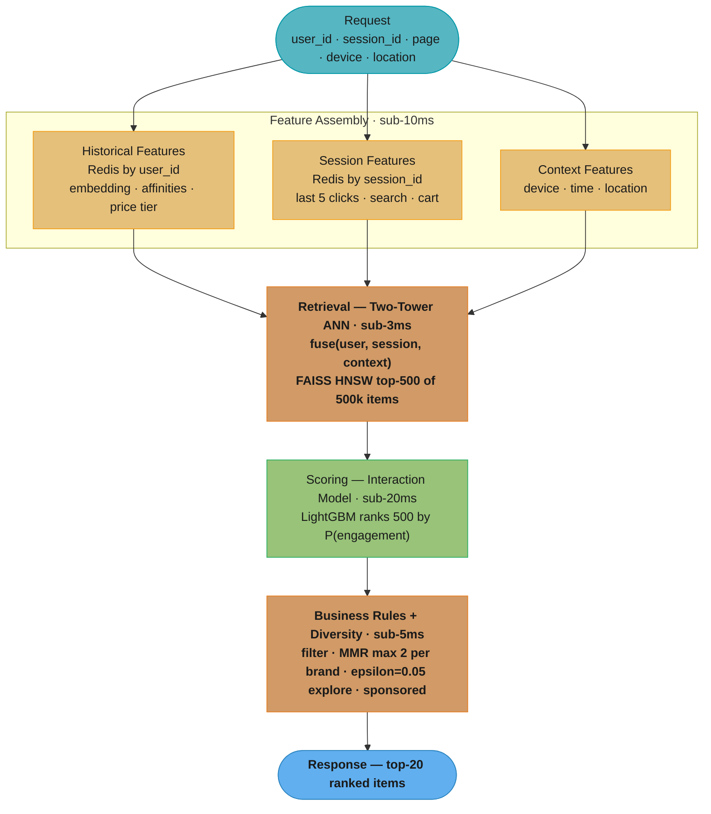
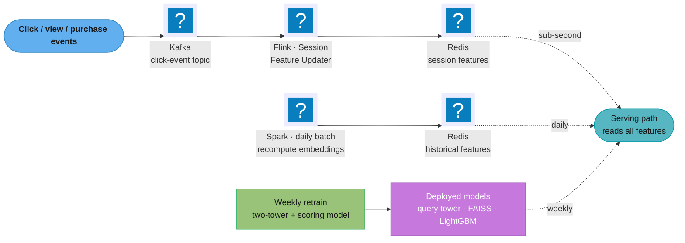

# Design a Real-Time Personalization System

## Intuition

> "Real-time personalization is like a concierge who reads your most recent request and instantly connects it with everything they know about your past visits — without making you wait."

**Key insight:** The core tension in real-time personalization is *freshness vs stability*. Historical features (user's 12-month purchase history) are stable but stale. Session features (what the user clicked in the last 5 minutes) are fresh but noisy. The best systems maintain a two-stream architecture: a slow, stable user representation updated daily, and a fast, session representation updated in milliseconds, with a fusion layer that blends both at serving time.

Mental model: Think of personalization as having two memory systems — long-term memory (who this user is historically) and working memory (what they are doing right now). Historical collaborative filtering captures the long-term; session-based sequence models capture the working memory. Neither alone is sufficient: long-term models miss intent shifts; session models have no prior for new users or new contexts.

Why this system exists: Netflix's own published account (Gomez-Uribe & Hunt, *ACM TMIS* 2015) reports that recommendations influence about 80% of hours streamed, with the remaining 20% coming from search. The widely repeated "35% of Amazon's revenue comes from recommendations" figure is a **McKinsey estimate**, not an Amazon disclosure — cite it as such. At either scale, a 1% lift in click-through on the homepage recommendation row is worth a large absolute revenue number, which is why this system earns dedicated infrastructure.

This study owns the **freshness and serving-path** problems: session state that is seconds old, a 100 ms deadline that every stage must respect, and exploration that is logged well enough to evaluate the next policy offline. It deliberately does not repeat two neighbours: [Video Recommendation](design_video_recommendation.md) owns objective design (watch-time weighting, multitask ranking), and [Recommendation Engine](design_recommendation_engine.md) owns the batch collaborative-filtering pipeline. The cross-cutting references this design leans on are [Feature Store and Point-in-Time Correctness](cross_cutting/feature_store_and_point_in_time_correctness.md) for session features, [Experimentation and Online Evaluation](cross_cutting/experimentation_and_online_evaluation.md) for A/B and off-policy evaluation, [Model Calibration and Thresholding](cross_cutting/model_calibration_and_thresholding.md) for blending scores across candidate sources, and [Drift Monitoring and Retraining](cross_cutting/drift_monitoring_and_retraining.md) for the weekly retrain.

**Vocabulary used throughout:**

| Term | Meaning in this study |
|---|---|
| Session state | The ordered events of the current visit, kept in Redis and updated within 1 s of each action |
| Two-stream fusion | Combining the daily historical embedding with the live session embedding in the query tower (§4.2) |
| Logging policy | The policy that actually chose what was shown, exploration included |
| Propensity | The probability the logging policy assigned to the item it showed; required for off-policy evaluation (§4.6) |
| IPS / SNIPS | Inverse propensity scoring and its self-normalized form: estimate a new policy's value from logged traffic (§4.6) |
| Deadline budget | The time left of the 100 ms p99 when a stage starts; each stage gets `min(stage budget, remaining)` (§4.7) |

---

## 1. Requirements Clarification

**Functional requirements:**
- Personalize recommendations on homepage, product detail pages (related items), search results re-ranking, and email recommendations.
- Support cold-start: new users (no history) and new items (no interaction data).
- Real-time session context: incorporate the user's actions in the current session (clicks, searches, add-to-cart, dwell time) into recommendations without batch delay.
- Contextual signals: device type, time of day, location, active campaign.
- Exploration: expose users to novel items outside their known preferences to avoid filter-bubble effects.

**Non-functional requirements:**
- Homepage recommendations: 100ms p99 total latency from request to response (retrieval + scoring + re-ranking).
- Throughput: 50k recommendation requests/sec (peak).
- Feature freshness: session-level features must reflect actions < 1 second old; daily features must be < 24 hours old.
- Cold-start coverage: 100% of new users must receive recommendations on first visit (no empty state).
- Availability: 99.99% — a recommendation outage degrades the user experience for every active user.

**Out of scope:**
- Push notification personalization (separate delivery system).
- Ad auction personalization (covered by ads CTR case study).
- Conversational / LLM-augmented recommendations (extends this base system).

---

## 2. Scale Estimation

**Traffic:** 50k req/sec peak, 15k req/sec average. Monthly: 50k × 86,400 × 30 = 129.6B requests (peak). Realistic average: 38.9B/month.

**Item catalog:** 10M items total; 500k "active" items (interacted with in last 30 days).

**Users:** 200M registered users; 30M daily active users (DAU).

**Feature store sizing:**
- User historical features: 200M users × 100 features × 4 bytes = 80 GB → Redis cluster.
- Session features: 30M DAU × 10 session features × 4 bytes × average 5 active sessions = 6 GB → Redis.
- Item features: 500k items × 200 features × 4 bytes = 400 MB → fits in single Redis node.

**Retrieval (two-tower ANN search):**
- Item embedding index: 500k items × 128 floats × 4 bytes = 256 MB → fits in FAISS in-memory index per machine.
- ANN retrieval (HNSW, top-100 candidates): ~2ms.

**Scoring:** 500 candidates scored per request; ~5ms per request with vectorized batch inference (scoring them one at a time would be ~500ms and is not viable).

**Infrastructure cost estimate** (AWS on-demand, us-east-1, Linux, 730 hr/month) — see §10 for how the instance counts are derived:
- Serving cluster: 90 × c5.2xlarge at $0.34/hr = ~$22,300/month (retrieval + scoring at 50k req/sec, including 2× headroom).
- Redis cluster (feature store): 3 × r5.4xlarge at $1.008/hr = ~$2,207/month.
- Model training (weekly): 4 hr/week on a p4d.24xlarge (8× A100) at $21.96/hr = ~$88/run × 4.33 = ~$380/month.
- Total: ~$24,900/month.

Note how lopsided this is: training is under 1% of the bill. Real-time personalization is a **serving-cost** problem, and the levers that matter are candidate-set size and per-request CPU, not training efficiency.

---

## 3. High-Level Architecture



Online serving path: three feature streams — stable historical, fresh session, request-time context — fuse into one query vector, then flow retrieval → scoring → business rules inside the 100ms p99 budget.



Async write path: user events stream through Kafka → Flink into sub-second session features, while Spark (daily) and retraining (weekly) refresh the slower stores — the two-stream design that keeps recommendations both fresh and stable.

**Component inventory:**
- Feature assembly: Redis GET pipeline (< 5ms for 3 key lookups).
- Two-tower retrieval: FAISS HNSW index in-process; query embedding computed at serving time.
- Scoring model: LightGBM for p99 stability; optional shallow DNN for accuracy.
- Session feature updater: Flink job consuming Kafka click events, updating Redis within 500ms.
- Historical feature pipeline: Spark job, daily run, writes to Redis.

Feature store management: see [feature_store_and_point_in_time_correctness.md](cross_cutting/feature_store_and_point_in_time_correctness.md).

---

## 4. Component Deep Dives

### 4.1 Session Feature Extraction

```python
from dataclasses import dataclass, field
from datetime import datetime, timezone
import json

# Every timestamp here is timezone-aware UTC. A naive datetime silently
# misbehaves under arithmetic once session state crosses a process or region
# boundary, so build them with datetime.now(timezone.utc) throughout.


def _utc_now() -> datetime:
    return datetime.now(timezone.utc)


@dataclass
class SessionState:
    session_id: str
    user_id: str
    events: list[dict] = field(default_factory=list)
    last_updated: datetime = field(default_factory=_utc_now)

    def add_event(self, event_type: str, item_id: str, dwell_seconds: float = 0.0) -> None:
        self.events.append({
            "type": event_type,  # click | view | add_to_cart | purchase | search
            "item_id": item_id,
            "dwell_seconds": dwell_seconds,
            "timestamp": datetime.now(timezone.utc).isoformat(),
        })
        self.last_updated = datetime.now(timezone.utc)

    def to_features(self) -> dict:
        """Extract session-level features for use in retrieval and scoring."""
        recent_events = self.events[-10:]  # last 10 events
        click_items = [e["item_id"] for e in recent_events if e["type"] == "click"]
        cart_items = [e["item_id"] for e in recent_events if e["type"] == "add_to_cart"]
        avg_dwell = sum(e.get("dwell_seconds", 0) for e in recent_events) / max(len(recent_events), 1)

        return {
            "session_click_count": len(click_items),
            "session_cart_count": len(cart_items),
            "last_clicked_item": click_items[-1] if click_items else None,
            "avg_dwell_seconds": avg_dwell,
            "session_length_minutes": (
                (datetime.now(timezone.utc) - datetime.fromisoformat(self.events[0]["timestamp"])).total_seconds() / 60
                if self.events else 0
            ),
            "is_high_intent": len(cart_items) > 0,
        }
```

### 4.2 Two-Tower Retrieval with Session Context

The query tower fuses the historical user embedding with a session embedding to create a context-aware query for FAISS retrieval.

```python
import torch
import torch.nn as nn
import numpy as np

class SessionEncoder(nn.Module):
    """
    Encode the last K item interactions in the current session using
    a lightweight 2-layer GRU. Runs at < 2ms for K=10 items.
    """
    def __init__(self, item_embedding_dim: int = 128, hidden_dim: int = 64):
        super().__init__()
        self.gru = nn.GRU(
            input_size=item_embedding_dim,
            hidden_size=hidden_dim,
            num_layers=2,
            batch_first=True,
            dropout=0.1,
        )
        self.projection = nn.Linear(hidden_dim, item_embedding_dim)

    def forward(self, session_item_embeddings: torch.Tensor) -> torch.Tensor:
        # session_item_embeddings: (batch, seq_len, item_embedding_dim)
        _, hidden = self.gru(session_item_embeddings)
        return self.projection(hidden[-1])  # (batch, item_embedding_dim)


class QueryTower(nn.Module):
    """
    Fuse historical user embedding + session embedding + context features
    into a single query vector for FAISS retrieval.
    """
    def __init__(self, user_dim: int = 128, context_dim: int = 32, output_dim: int = 128):
        super().__init__()
        self.fusion = nn.Sequential(
            nn.Linear(user_dim + user_dim + context_dim, 256),
            nn.ReLU(),
            nn.Dropout(0.1),
            nn.Linear(256, output_dim),
            nn.LayerNorm(output_dim),
        )

    def forward(
        self,
        user_embedding: torch.Tensor,     # (batch, user_dim) — historical
        session_embedding: torch.Tensor,  # (batch, user_dim) — from SessionEncoder
        context_features: torch.Tensor,   # (batch, context_dim) — device, time, etc.
    ) -> torch.Tensor:
        combined = torch.cat([user_embedding, session_embedding, context_features], dim=-1)
        return self.fusion(combined)  # (batch, output_dim)


class RetrievalEngine:
    """Wrap FAISS index for ANN retrieval at serving time."""

    def __init__(self, item_embeddings: np.ndarray, item_ids: list[str]):
        import faiss
        self.item_ids = item_ids
        dimension = item_embeddings.shape[1]
        self.index = faiss.IndexHNSWFlat(dimension, 32)  # M=32 neighbors per layer
        self.index.hnsw.efConstruction = 200
        self.index.hnsw.efSearch = 64
        self.index.add(item_embeddings.astype(np.float32))

    def retrieve(
        self,
        query_embedding: np.ndarray,   # (1, dimension)
        top_k: int = 500,
        exclude_item_ids: set[str] | None = None,
    ) -> list[str]:
        _, indices = self.index.search(query_embedding, top_k + len(exclude_item_ids or []))
        results = []
        for idx in indices[0]:
            if idx >= 0:
                item_id = self.item_ids[idx]
                if exclude_item_ids and item_id in exclude_item_ids:
                    continue
                results.append(item_id)
                if len(results) == top_k:
                    break
        return results
```

### 4.3 Scoring Model

**Broken approach — using a global popularity score as proxy for personalization:**

```python
# WRONG: popularity-based ranking ignores personalization entirely.
# Users who have diverse or niche interests see the same top-10 popular items
# as everyone else. Illustrative magnitudes from an internal A/B test:
# popularity ranking ~1.2% CTR vs ~3.8% CTR for personalized ranking.
# Treat the ratio, not the absolute rates, as the transferable lesson.

def rank_candidates_naive(candidates: list[str], item_stats: dict) -> list[str]:
    return sorted(candidates, key=lambda i: item_stats[i]["total_views"], reverse=True)
    # Leaves roughly two-thirds of the achievable CTR on the table
```

**Correct approach — interaction scoring with user × item features:**

```python
import lightgbm as lgb
import numpy as np
import pandas as pd
from dataclasses import dataclass

@dataclass
class ScoringFeatures:
    # User features (historical)
    user_category_affinities: list[float]  # affinity scores for top-20 categories
    user_price_tier: float                  # 0=low, 1=mid, 2=high
    user_session_count_30d: int
    user_purchase_count_30d: int

    # Session features
    session_is_high_intent: bool
    session_last_category: str
    session_length_minutes: float

    # Item features
    item_category: str
    item_price: float
    item_avg_ctr_7d: float
    item_avg_conversion_rate_7d: float
    item_days_since_last_interaction: int
    item_novelty_score: float              # 1 - overlap with user's recent history

    # Context features
    device_type: str                       # mobile | desktop | tablet
    hour_of_day: int
    is_weekend: bool


def build_interaction_features(
    user_features: dict,
    session_features: dict,
    item_features: dict,
    context_features: dict,
) -> np.ndarray:
    """Assemble a flat feature vector for LightGBM scoring."""
    return np.array([
        user_features["price_tier"],
        user_features["session_count_30d"],
        user_features["purchase_count_30d"],
        float(session_features["is_high_intent"]),
        session_features["avg_dwell_seconds"],
        session_features["session_length_minutes"],
        item_features["avg_ctr_7d"],
        item_features["avg_conversion_rate_7d"],
        item_features["days_since_last_interaction"],
        item_features["novelty_score"],
        item_features["price"],
        float(context_features["is_weekend"]),
        context_features["hour_of_day"] / 24.0,
        # Category affinity: dot product of user category affinity vector with item category
        user_features["category_affinities"][item_features["category_idx"]],
    ], dtype=np.float32)


def score_candidates_batch(
    model: lgb.Booster,
    user_features: dict,
    session_features: dict,
    candidates: list[dict],  # list of item feature dicts
    context_features: dict,
) -> list[tuple[str, float]]:
    """Vectorized batch scoring of all candidates."""
    feature_matrix = np.array([
        build_interaction_features(user_features, session_features, item, context_features)
        for item in candidates
    ])
    scores = model.predict(feature_matrix)  # (N,) predicted P(engagement)
    item_ids = [item["item_id"] for item in candidates]
    return sorted(zip(item_ids, scores), key=lambda x: x[1], reverse=True)
```

### 4.4 Exploration via Epsilon-Greedy Item Injection

To prevent filter-bubble effects and improve item coverage, inject a small fraction of novel items into every response.

```python
import random
from typing import Optional

class PersonalizationExplorer:
    """
    Injects a fraction (epsilon) of exploration items into ranked results.
    Exploration items are sampled from: (a) recently popular items the user
    hasn't seen, (b) trending items in user's adjacent categories.
    """

    def __init__(
        self,
        epsilon: float = 0.05,    # 5% of slots → 1 exploration item in top-20
        exploration_pool_size: int = 1000,
    ):
        self.epsilon = epsilon
        self.exploration_pool_size = exploration_pool_size

    def inject_exploration(
        self,
        ranked_items: list[str],
        exploration_pool: list[str],
        user_seen_items: set[str],
        n_results: int = 20,
    ) -> list[str]:
        """
        Replace epsilon fraction of ranked items with novel exploration items.
        Exploration items are injected at non-prominent positions (not top-2).
        """
        n_explore = max(1, int(n_results * self.epsilon))
        n_exploit = n_results - n_explore

        # Exploit: top ranked items (exclude top-2 exploration slots)
        exploit_items = [i for i in ranked_items if i not in user_seen_items][:n_exploit]

        # Explore: sample from novel items not in ranked results
        novel_pool = [
            i for i in exploration_pool
            if i not in set(ranked_items) and i not in user_seen_items
        ]
        explore_items = random.sample(novel_pool, min(n_explore, len(novel_pool)))

        # Interleave: inject exploration items at positions 3, 7, 12 (non-prominent)
        result = exploit_items[:2]
        exploration_positions = [2, 6, 11]  # 0-indexed
        exploit_remaining = exploit_items[2:]

        for i in range(n_results - 2):
            if i in [pos - 2 for pos in exploration_positions] and explore_items:
                result.append(explore_items.pop(0))
            elif exploit_remaining:
                result.append(exploit_remaining.pop(0))

        return result[:n_results]
```

### 4.5 Cold Start: New Users and New Items

```python
import numpy as np
from typing import Optional

def get_cold_start_user_embedding(
    context_features: dict,
    segment_embeddings: dict[str, np.ndarray],
) -> np.ndarray:
    """
    For new users (no history), derive an embedding from:
    1. Device + location → market segment embedding
    2. Referral source → intent signal
    3. Time of day / day of week → behavioral prior

    Falls back to the global popularity embedding if no context available.
    """
    # Determine market segment from context
    market_segment = f"{context_features.get('country', 'us')}_{context_features.get('device_type', 'web')}"

    if market_segment in segment_embeddings:
        base_embedding = segment_embeddings[market_segment]
    else:
        base_embedding = segment_embeddings["global_average"]

    # Adjust for time-of-day signal (morning → news/productivity, evening → entertainment)
    hour = context_features.get("hour_of_day", 12)
    time_signal = np.zeros(len(base_embedding))
    if 6 <= hour < 12:       # morning: boost informational categories
        time_signal[0] = 0.1
    elif 18 <= hour < 23:    # evening: boost entertainment categories
        time_signal[1] = 0.1

    return base_embedding + time_signal


def get_cold_start_item_embedding(
    item_metadata: dict,
    category_embeddings: dict[str, np.ndarray],
) -> Optional[np.ndarray]:
    """
    For new items (no interactions), initialize embedding from:
    1. Category embedding (warm start from category centroid)
    2. Title/description embedding (text encoder, pre-computed offline)
    Returns None if no metadata available (item is hidden until indexed).
    """
    category = item_metadata.get("category")
    if category and category in category_embeddings:
        cat_embedding = category_embeddings[category]
        # Add text-based signal if description embedding is available
        if "text_embedding" in item_metadata:
            return 0.7 * cat_embedding + 0.3 * np.array(item_metadata["text_embedding"])
        return cat_embedding
    return None
```

### 4.6 Logged Propensities: Exploration That Can Evaluate the Next Policy

§4.4 spends 5% of slots on exploration. That traffic has a second job that is easy to throw away: it is the only data on which a *different* ranking policy can be evaluated offline, because it shows items the current policy would not have chosen. That works only if every impression records the **propensity**, the probability the logging policy gave to the item it showed. Without it, offline replay is biased toward contexts where the old and new policies already agree, and the team ships or rejects policies on a number that is systematically wrong.

```python
from __future__ import annotations

from dataclasses import dataclass

import numpy as np


@dataclass(frozen=True)
class LoggedImpression:
    context: int        # user segment, e.g. "new-mobile", "returning-web"
    action: int         # item shown in the exploration-eligible slot
    reward: float       # 1.0 if clicked
    propensity: float   # P(logging policy shows this action | context)


def epsilon_greedy_probs(scores: np.ndarray, epsilon: float) -> np.ndarray:
    """Exact action distribution of epsilon-greedy: greedy gets 1 - eps + eps/n."""
    n = len(scores)
    p = np.full(n, epsilon / n)
    p[int(np.argmax(scores))] += 1.0 - epsilon
    return p


def log_traffic(n_events: int, true_ctr: np.ndarray, logging_scores: np.ndarray,
                epsilon: float, rng: np.random.Generator) -> list[LoggedImpression]:
    n_contexts, n_actions = true_ctr.shape
    probs = epsilon_greedy_probs(logging_scores, epsilon)        # popularity policy, same for all
    logs = []
    for _ in range(n_events):
        c = int(rng.integers(n_contexts))
        a = int(rng.choice(n_actions, p=probs))
        r = float(rng.random() < true_ctr[c, a])
        logs.append(LoggedImpression(c, a, r, float(probs[a])))  # FIX: propensity recorded
    return logs


# BROKEN: no propensities in the log, so the team "replays" the new policy by
# averaging rewards where its choice matches what was shown. Matches are far
# more common in contexts where the new policy agrees with the old greedy
# choice, so those contexts dominate the average.
def matched_replay_value(logs: list[LoggedImpression], target: dict[int, int]) -> float:
    r = [e.reward for e in logs if target[e.context] == e.action]
    return float(np.mean(r))


# FIX: inverse propensity scoring re-weights each match by 1 / propensity.
def ips_value(logs: list[LoggedImpression], target: dict[int, int]) -> float:
    w = np.array([(target[e.context] == e.action) / e.propensity for e in logs])
    r = np.array([e.reward for e in logs])
    return float(np.mean(w * r))


def snips_value(logs: list[LoggedImpression], target: dict[int, int]) -> float:
    """Self-normalized IPS: slightly biased, much lower variance with small propensities."""
    w = np.array([(target[e.context] == e.action) / e.propensity for e in logs])
    r = np.array([e.reward for e in logs])
    return float(np.sum(w * r) / np.sum(w))


if __name__ == "__main__":
    rng = np.random.default_rng(42)
    true_ctr = np.array([[0.05, 0.02, 0.08, 0.01],      # segment 0 prefers item 2
                         [0.04, 0.09, 0.03, 0.02],      # segment 1 prefers item 1
                         [0.06, 0.01, 0.02, 0.03]])     # segment 2 prefers item 0
    popularity = np.array([4.0, 3.0, 2.0, 1.0])          # logging policy: item 0 for everyone
    logs = log_traffic(200_000, true_ctr, popularity, epsilon=0.2, rng=rng)
    personalized = {c: int(np.argmax(true_ctr[c])) for c in range(3)}
    truth = float(np.mean([true_ctr[c, personalized[c]] for c in range(3)]))
    print(f"true value of personalized policy  {truth:.4f}")
    print(f"BROKEN matched replay               {matched_replay_value(logs, personalized):.4f}")
    print(f"FIX IPS                             {ips_value(logs, personalized):.4f}")
    print(f"FIX SNIPS                           {snips_value(logs, personalized):.4f}")
```

Work the expectation by hand to see the size of the error. With epsilon = 0.2 over 4 items, the logging policy shows item 0 with probability 0.85 and each other item with 0.05. The personalized policy's true CTR is (0.08 + 0.09 + 0.06) / 3 = 0.0767. Matched replay weights segment 2 (where both policies pick item 0) by 0.85 and segments 0 and 1 by 0.05 each, so it converges to (0.05 x 0.08 + 0.05 x 0.09 + 0.85 x 0.06) / 0.95 = 0.0626, an 18% underestimate. Against the logging policy's own value of 0.0477, matched replay reports a +31% lift where the true lift is +61%; with a smaller true gap it would report a loss. IPS converges to 0.0767. The cost of IPS is variance: each matched event in segments 0 and 1 carries a weight of 20, so the effective sample is far smaller than 200,000. The method is the Yahoo! replay result (§6), and the A/B side of it is in [Experimentation and Online Evaluation](cross_cutting/experimentation_and_online_evaluation.md).

Three engineering rules follow. Log the propensity **at decision time**, inside the ranking service, not reconstructed later from configuration, because epsilon and the candidate set change between deploys. Keep the exploration distribution **stochastic with a known floor** (no item below 0.01 probability) so no propensity is tiny enough to explode the weights. And version the logging policy alongside the model, so an off-policy estimate always knows which policy produced its data.

### 4.7 Deadline Propagation: Keeping p99 Under 100 ms When a Dependency Is Slow

The §2 budget assumes each stage hits its median. The p99 is set by the tail of the *sum*, and with four sequential calls with tails of 1%, 2%, 0.2% and 0.5%, 1 - (0.99 x 0.98 x 0.998 x 0.995) = about 3.7% of requests hit at least one tail. That puts the p99 inside the tail. The fix is to treat the 100 ms as a deadline that each stage reads, run independent fetches concurrently, and give every stage a **fallback that is always ready** so a timeout degrades the answer instead of failing it.

```python
from __future__ import annotations

import asyncio
import time
from collections.abc import Awaitable
from typing import TypeVar

import numpy as np

T = TypeVar("T")


class Deadline:
    def __init__(self, budget_ms: float) -> None:
        self.end = time.perf_counter() + budget_ms / 1000.0

    def remaining_s(self) -> float:
        return max(0.0, self.end - time.perf_counter())


async def with_budget(work: Awaitable[T], deadline: Deadline, stage_ms: float,
                      fallback: T) -> tuple[T, bool]:
    """Run one stage for min(stage budget, time left); return (result, used_fallback)."""
    timeout = min(stage_ms / 1000.0, deadline.remaining_s())
    try:
        return await asyncio.wait_for(work, timeout=timeout), False
    except asyncio.TimeoutError:
        return fallback, True


async def handle(fetch_user, fetch_session, retrieve, score, popular_items: list[str]):
    """Production shape: user and session features in parallel, each with a fallback."""
    deadline = Deadline(budget_ms=70)            # 100 ms p99 minus ~30 ms network + serialization
    (user, _), (session, _) = await asyncio.gather(
        with_budget(fetch_user(), deadline, 15, fallback="cached_profile"),
        with_budget(fetch_session(), deadline, 15, fallback=None))   # no session = history only
    candidates, miss = await with_budget(retrieve(user, session), deadline, 10,
                                         fallback=popular_items)
    ranked, _ = await with_budget(score(user, session, candidates), deadline, 25,
                                  fallback=candidates)                # retrieval order
    return ranked


# Offline simulation of both designs over 100k requests (no sleeping, so it is
# exact on any OS): stage latency = median with jitter, or a tail value.
def simulate(n: int = 100_000, seed: int = 3) -> None:
    rng = np.random.default_rng(seed)

    def stage(median: float, tail_p: float, tail_ms: float) -> np.ndarray:
        base = median * rng.uniform(0.7, 1.3, n)
        return np.where(rng.random(n) < tail_p, tail_ms, base)

    user, sess = stage(10, 0.01, 60), stage(4, 0.02, 50)
    retr, scor = stage(3, 0.002, 30), stage(5, 0.005, 40)
    fixed_overhead = 30.0

    # BROKEN: sequential, no deadline, every tail lands in the response time
    broken = fixed_overhead + user + sess + retr + scor
    # FIX: parallel feature fetch, per-stage caps, fallback on timeout
    feat = np.maximum(np.minimum(user, 15), np.minimum(sess, 15))
    fixed = fixed_overhead + feat + np.minimum(retr, 10) + np.minimum(scor, 25)
    fallback_rate = np.mean((user > 15) | (sess > 15) | (retr > 10) | (scor > 25))
    for name, lat in (("BROKEN", broken), ("FIX", fixed)):
        print(f"{name:6s} p50 {np.percentile(lat, 50):5.1f} ms  p99 {np.percentile(lat, 99):5.1f} ms")
    print(f"requests served with at least one fallback: {fallback_rate:.1%}")


if __name__ == "__main__":
    simulate()
```

The sequential design has a p50 near 52 ms, comfortably inside budget, and a p99 near 100 ms, because about 3.7% of requests carry a 40-60 ms tail from one dependency. The deadline version cannot exceed 30 + 15 + 10 + 25 = 80 ms by construction, and in practice its p99 sits in the mid-50s, paying for it with about 3.7% of responses built from a fallback. That trade has to be visible, so the fallback rate per stage is a first-class metric (§8): a fallback rate that climbs from 3% to 30% is an outage that the latency graph will never show.

---

## 5. Design Decisions & Tradeoffs

**Decision 1: Two-tower retrieval vs matrix factorization vs graph-based retrieval**

| Method | Cold start | Real-time session context | AUC | Retrieval latency |
|--------|-----------|--------------------------|-----|------------------|
| Matrix factorization (ALS) | Poor | No (static embedding) | 0.74 | 2ms |
| Two-tower (static) | Moderate | No | 0.79 | 2ms |
| Two-tower + session encoder | Good | Yes | 0.85 | 4ms |
| Graph-based (PinSage) | Good | Partial | 0.87 | 15ms |

Use two-tower with session encoder. Graph-based methods achieve +2pp AUC but require 4× longer retrieval latency and a graph infrastructure that is operationally expensive. See [model_selection_and_algorithm_choice](../model_selection_and_algorithm_choice/model_selection_and_algorithm_choice.md).

**Decision 2: Feature freshness SLOs — when is "real-time" needed?**

Not all features need sub-second freshness. Tiered freshness reduces infrastructure cost:
- Session-level (sub-second): last 5 clicks, active cart, current search query. Required because user intent can shift within a session. Maintained via Flink → Redis write-through.
- Daily: purchase history, category affinities, price tier. Computed via Spark batch. 24-hour staleness is acceptable — a user's long-term preferences do not change in hours.
- Weekly: user segmentation (new/active/lapsed), item popularity scores, trending items. Acceptable staleness for stable background signals.

See [feature_store_and_point_in_time_correctness.md](cross_cutting/feature_store_and_point_in_time_correctness.md) for PIT correctness during model training.

**Decision 3: Scoring model — LightGBM vs deep neural network**

Take this pair as an illustrative benchmark, not a measured one — nobody publishes AUC-vs-latency for an unspecified feature set, and the 5ms figure is load-bearing for the 250-core scoring estimate in §10, so it is the first thing to replace with your own measurement. LightGBM with 200 trees achieves 0.82 AUC at 5ms p99 per request (batch of 500 candidates). A 2-layer DNN achieves 0.85 AUC at 20ms p99. The stage budget in §3 is ~10ms feature assembly + ~3ms retrieval + ~5ms rules, so the scoring layer can afford roughly 20ms of the 100ms p99 budget once network, serialization, and tail headroom are reserved — which the DNN only just fits and the GBDT fits comfortably. LightGBM is the right choice here, and the DNN becomes viable only if you first reclaim budget elsewhere. The DNN is used as a teacher to distill improved GBDT leaf values (offline, weekly).

**Decision 4: Exploration rate and placement**

5% exploration (1 item in top-20) is the standard starting point. Too much exploration (> 20%) hurts short-term CTR and users notice irrelevant items. Too little (< 1%) creates filter bubbles and reduces long-term engagement (users stop discovering new content). Exploration items are injected at positions 3, 7, and 12 (not 1 or 2, which are the highest CTR positions) to minimize CTR impact while still driving discovery.

**Decision 5: Handling SUTVA in A/B tests for personalization**

Personalization A/B tests face SUTVA violations because users in the control group are affected by users in the treatment group (e.g., if treatment users buy more of an item, that item's popularity score increases, which affects control users too). Use a user-level random split with a dilution correction: compare treatment vs control within the same popularity decile of items. Alternatively, use a holdout group (5% of users receive popularity-based recommendations with no personalization) as a stable long-term control. See [experimentation_and_online_evaluation.md](cross_cutting/experimentation_and_online_evaluation.md).

**Decision 6: Epsilon-greedy vs Thompson sampling vs LinUCB for the exploration slots**

| Policy | Propensity available? | Exploration efficiency | Operational cost |
|---|---|---|---|
| Epsilon-greedy (§4.4) | Yes, exactly (`epsilon/n`, `1 - epsilon + epsilon/n`) | Wastes slots on items known to be bad | Trivial |
| Thompson sampling | Only by Monte Carlo (sample the posterior ~1,000 times per request) | Explores where uncertainty is high | Posterior state per item |
| LinUCB (Li et al. 2010) | No, it is deterministic given state | Strong with good context features | Matrix per arm; propensity 0 or 1 breaks IPS |

Start with epsilon-greedy because its propensities are exact and free, which makes §4.6's offline evaluation work from day one. Move to Thompson sampling when exploration cost matters (§10 prices it), and compute its propensities by sampling. Deterministic UCB policies need a randomized wrapper (a small uniform floor) before their logs can evaluate anything else.

**Decision 7: Hard deadline with fallbacks vs waiting for every dependency**

Waiting for every dependency gives the best answer for 96% of requests and a late answer for the rest; a deadline gives a slightly worse answer for about 4% and an on-time answer for all (§4.7). For a homepage row, a late answer is a blank row, so the deadline wins. For a checkout cross-sell where the page waits on payment anyway, a 150 ms budget with no fallback can be the better trade.

---

## 6. Real-World Implementations

**Netflix (Personalized Recommendation):** Netflix is the reference case for *ranking* personalization rather than large-catalog retrieval — its catalog is on the order of 10,000 titles per country (roughly 13,600 titles worldwide across all licensing regions), not millions. That inverts the usual design: with a catalog this small, exhaustive scoring is affordable and the hard problem moves entirely into ranking, row construction, and artwork selection. Netflix's published account (Gomez-Uribe & Hunt, *ACM TMIS* 2015) describes a portfolio of algorithms per homepage row rather than one model, and attributes ~80% of streamed hours to recommendations. Do not copy the two-stage retrieval architecture in this case study onto a Netflix-sized catalog; it is designed for the 10M+ item regime.

**Pinterest (Homefeed Personalization):** PinSage (Ying et al., KDD 2018) is a graph convolutional network that produces **item embeddings** from both content features and the pin-board co-engagement graph — it is an embedding model, not a session encoder. The graph neighborhood is what disambiguates intent: the same pin sitting in a "wedding decoration" board and a "DIY project" board gets different context from its neighbors, which image features alone cannot supply. Published results: 67% hit-rate versus 46% for the best baseline (150% relative), MRR 0.59 versus 0.56, and in production A/B tests "10-30% improvements in repin rate" on the homefeed, with the abstract citing 30-100% engagement improvements across settings.

**Spotify (Session-Based Recommendations):** "Daily Mix" and "Discover Weekly" illustrate the two-stream split at the product level rather than inside one model: one surface is session-contextual (what are you doing right now), the other is historical (what have you loved that you have not heard recently). The generalizable design lesson is that the right freshness/stability blend is **content-type dependent** — short-form, mood-driven items reward session context far more than long-form serial content, where historical affinity dominates. Validate the split for your own content type; do not assume it.

**Alibaba / Taobao:** Alibaba publishes regularly on e-commerce-scale recommenders; pin any user or item count to the specific paper you are citing rather than carrying it as a standing record, because those figures go stale within a release and no ranking of "largest deployment" is verifiable. The transferable content is the *exposure bias* problem: items placed higher get clicked more because they are more visible, not because they are more relevant. The mitigation is a position-debiased scoring model trained with inverse propensity weighting on observed position CTR — a general unbiased-learning-to-rank technique (Joachims, Swaminathan and Schnabel, "Unbiased Learning-to-Rank with Biased Feedback", WSDM 2017), not an Alibaba invention, and the same one used in the search-ranking case study.

**Marketplace personalization and real-time availability:** For food delivery, travel, and marketplace inventory, item availability changes on a minute timescale (a restaurant closes, an item sells out), which the daily ANN index cannot track. The robust pattern is to keep the index stale-tolerant and enforce availability as a **serving-time filter** downstream of retrieval, reading a live Redis availability flag. Retrieval over-fetches to compensate for the filter's drop rate. This is worth doing purely on cancellation and trust grounds; measure the effect on your own cancellation rate rather than importing a published percentage.

**Airbnb (Grbovic & Cheng, KDD 2018 — "Real-time Personalization using Embeddings for Search Ranking at Airbnb").** The closest published match to this study's two-stream design. Airbnb trained listing embeddings and user embeddings and used them for real-time personalization in Search Ranking and Similar Listing Recommendations, the two channels the paper says drive 99% of conversions. The embeddings capture a guest's short-term (in-session) and long-term interests, the same split as §4.2. The marketplace twist the paper stresses is the constraint this study's e-commerce framing lacks: a user rarely consumes the same item twice, and a listing can accept only one guest for a given set of dates, so availability belongs in the serving-time filter, not the embedding.

**Alibaba (Zhou et al., KDD 2018 — "Deep Interest Network for Click-Through Rate Prediction").** The scoring-side answer to "one fixed user vector cannot hold diverse interests". DIN computes the user representation *per candidate*, with a local activation unit that weights each historical behaviour by its relevance to the ad being scored, and adds mini-batch aware regularization and a data-adaptive activation to train networks with hundreds of millions of parameters. Trained on a production dataset of over 2 billion samples, it was deployed in Alibaba's online display advertising system, serving the main traffic. In this design it is the upgrade path from the LightGBM scorer once the latency budget allows a neural scorer (Decision 3).

**Yahoo! (Li, Chu, Langford, Schapire, WWW 2010; Li, Chu, Langford, Wang, WSDM 2011).** The source for §4.6 and Decision 6. The first paper models news recommendation on the Yahoo! Front Page Today Module as a contextual bandit, proposes LinUCB, and evaluates it offline on more than 33 million events of recorded random traffic, reporting a 12.5% click lift over a context-free bandit. The second paper proves that this **replay** method gives unbiased offline estimates when the logging traffic is uniformly random, and checks the offline numbers against online bucket tests. §4.6's IPS estimator is the generalization to non-uniform logging, which is exactly why the propensity must be logged.

| Company | What this study borrows | Primary source |
|---|---|---|
| Netflix | Ranking-dominated personalization on a small catalog | Gomez-Uribe & Hunt, ACM TMIS 2015 |
| Pinterest | Graph-based item embeddings (PinSage) | Ying et al., KDD 2018 |
| Airbnb | Short-term + long-term embeddings for real-time search personalization | Grbovic & Cheng, KDD 2018 |
| Alibaba | Candidate-aware user interest (DIN) as the neural scorer upgrade | Zhou et al., KDD 2018 |
| Yahoo! | Contextual bandits and unbiased offline replay (§4.6) | Li et al., WWW 2010 and WSDM 2011 |

---

## 7. Technologies & Tools

| Tool | Use case | Advantage | Limitation |
|------|----------|-----------|------------|
| FAISS (Meta) | ANN retrieval (HNSW/IVF) | Industry-standard, in-process, sub-millisecond | Index must fit in RAM; real-time updates require index rebuild |
| ScaNN (Google) | ANN retrieval (anisotropic vector quantization) | Strong recall-vs-latency on public ANN benchmarks at large scale | Benchmark it on your own vectors — relative speed vs FAISS is index- and dataset-dependent; less community tooling |
| Redis | Session features, item availability flags | Sub-millisecond GET; Streams API for Flink integration | Memory cost; no native vector search without RediSearch |
| Apache Flink | Real-time session feature computation | Stateful streaming, event-time semantics, exactly-once | Operational complexity; cluster management overhead |
| LightGBM | Scoring model | SHAP, 5ms inference for 500 candidates, stable | No native sequential feature support |
| PyTorch + HuggingFace | Session encoder (GRU), training | Flexible model architecture; GPU training | Requires ONNX export for low-latency production serving |

---

## 8. Operational Playbook

### Eval Pipeline
- **Offline metric:** AUC on held-out user-item interaction pairs (chronological split — do not use random split). Maintain a golden test set of 100k interactions from 3 months ago.
- **Online metric:** CTR, add-to-cart rate, and purchase rate on recommendation modules. Run A/B test with 5% of traffic before full rollout.
- **Coverage metric:** fraction of users receiving at least 1 "fresh" item (interacted with < 7 days ago) in top-10 recommendations. Should exceed 80%.
- **Exploration metric:** fraction of clicks on exploration items (epsilon-greedy injected). Monitor that this is approximately ε × position_CTR.

### Observability
- Monitor: P50/P99 retrieval latency, scoring latency, and total pipeline latency separately.
- Track: cache hit rate for user and item features in Redis. Drop below 95% indicates Redis OOM or cold start spike.
- Alert on: recommendation diversity collapse (all top-10 items from same brand/category for > 10% of requests).

### Incident Runbooks
1. **FAISS index stale (item index > 48 hours old):** Symptom: newly launched items not appearing in any recommendations despite positive CTR. Diagnosis: FAISS index build job failed silently. Mitigation: fall back to popularity-based candidate generation. Resolution: re-run FAISS index build; monitor job completion in Airflow.
2. **Redis latency spike (> 20ms):** Symptom: total recommendation latency exceeds 100ms p99. Diagnosis: Redis memory pressure causing eviction + rehashing or network partition. Mitigation: pre-empt with Redis connection pooling and a local L1 cache (in-process LRU of 1k most frequent user features). Resolution: scale Redis cluster or reduce TTL on low-value features.
3. **Session feature staleness:** Symptom: users report recommendations don't respond to their in-session actions. Diagnosis: Flink consumer lag on Kafka click-event topic. Resolution: scale Flink parallelism; reduce consumer group lag. Alert trigger: consumer lag > 10,000 messages.
4. **Cold-start user receives empty recommendations:** Symptom: new user's first request returns < 5 items. Diagnosis: context features absent (anonymous user, no market segment match). Resolution: ensure fallback to `global_average` segment embedding is in place; never return fewer than 20 items (expand to top-popularity items if needed).
5. **Fallback rate climbing while latency looks healthy:** Symptom: p99 flat at ~55 ms but the share of responses built from a fallback rises from ~4% to 20%+. Diagnosis: one dependency is now slower than its stage budget (§4.7), so the deadline hides it. Resolution: page on per-stage fallback rate above 10% for 5 minutes, not on latency; fix the dependency rather than raising its budget.
6. **Off-policy estimate disagrees with the A/B result:** Symptom: IPS predicted +8% CTR, the A/B test shows +1%. Diagnosis, in order: propensities reconstructed from config instead of logged at decision time; the candidate set changed between the logging window and the test; effective sample size of the matched events under 1,000. Resolution: recompute with the logged propensities only, report the effective sample size `(sum w)^2 / sum w^2` beside every estimate.

### Release Gates for the Weekly Retrain
- **Feature drift:** PSI per session and historical feature against the trailing 4 weeks; a session feature with PSI above 0.25 blocks promotion, because a client release that renames an event silently zeroes it. Thresholds follow [Drift Monitoring and Retraining](cross_cutting/drift_monitoring_and_retraining.md).
- **Calibration:** the scorer's predicted CTR must sit within 10% of observed CTR per candidate source (two-tower, fresh pool, exploration). Candidates from different sources are merged on predicted CTR, so a source whose scores run high crowds out the others; see [Model Calibration and Thresholding](cross_cutting/model_calibration_and_thresholding.md).
- **Exposure:** share of top-20 slots going to items in the top 1% of popularity must not rise more than 5 points over the champion, and per-seller exposure Gini must not rise; the exposure-fairness framing is in [Responsible AI, Fairness and Explainability](cross_cutting/responsible_ai_fairness_and_explainability.md).
- **Off-policy pre-check:** SNIPS estimate on the last 7 days of exploration logs must not be worse than the champion's by more than its 95% interval; only then does the 5% A/B start.

---

## 9. Common Pitfalls & War Stories

**Pitfall 1: Training the scoring model on biased position data.** An e-commerce company trained their ranking model on historical click data, treating clicks as positive labels. The model quickly learned to favor items that had appeared in position 1 historically — not because they were more relevant, but because position 1 items get 5× more clicks (position bias). The ranking model perpetuated this bias, creating a feedback loop where popular items displaced relevant niche items. Measured business impact: category diversity in top-10 dropped by 40%; users with niche preferences showed 18% lower 30-day retention. Fix: apply inverse propensity weighting (IPW) using the observed position → CTR mapping to debias the training labels.

**Pitfall 2: Session features introducing training-serving skew.** A startup trained their personalization model using session features computed at the end of each session (e.g., total session length, all items clicked in session). At serving time, the session is ongoing — you only have the current partial session. The model was trained on features that included future-session information, inflating AUC from 0.83 to 0.91 in offline evaluation. In production, AUC was 0.79. Fix: always compute session features as of the current event timestamp — use only the N events before the current prediction point, never including events that happen after. See [feature_store_and_point_in_time_correctness.md](cross_cutting/feature_store_and_point_in_time_correctness.md).

**Pitfall 3: Filter bubble causing long-term engagement collapse.** A content platform deployed a personalization system with ε = 0.01 (1% exploration). Short-term metrics were excellent: CTR +15%, session length +8%. At the 6-month mark, MAU declined 12%. Analysis revealed that users were being served the same narrow set of content categories repeatedly and eventually disengaging. Exploration at 1% was insufficient to introduce novel content fast enough to prevent boredom. Fix: increase ε to 0.08 for users whose category diversity score has been declining for > 14 days; add a "discovery module" row to the homepage that operates at 30% exploration.

**Pitfall 4: Item embedding space not updated to reflect new catalog items.** A fashion e-commerce company had a weekly FAISS index rebuild cycle. During a major sale event, 50k new items were added to the catalog. For 7 days (until the next index rebuild), these items had no embeddings and were invisible to the recommendation system. The sale underperformed revenue targets by $1.8M because new sale items were excluded from recommendations. Fix: run incremental FAISS index updates daily for high-velocity item additions; add a "new items" candidate pool that bypasses the FAISS index for items added in the last 24 hours.

**Pitfall 5: Ignoring item-item interaction effects in diversity enforcement.** A news platform's diversity rule stated "at most 2 articles from the same publication." A user who reads mostly political news was served 2 articles from New York Times and 2 from Washington Post — both covering the exact same political event from slightly different angles. The diversity rule was technically satisfied but semantically meaningless. Fix: enforce diversity on semantic topic clusters (computed from article embeddings) rather than publication source. Topic-level diversity rule increased long-session engagement by 9%.

**Pitfall 6: Shipping a worse policy because exploration logs had no propensities.** (Illustrative composite; the mechanism is §4.6.) A team logged exploration impressions with the item and the click, but not the probability. To choose between two new rankers they replayed both on the logs by matching. Ranker A agreed with the incumbent's greedy choice far more often, so its matches came mostly from high-propensity contexts and it scored higher; ranker B, which personalized more aggressively, looked 4% worse. A shipped. A quarter later a proper A/B test of B against A showed B at +6% CTR, so the team had left roughly 6% CTR on the table for 13 weeks. On a surface earning $2M per week from recommendation clicks that is about $1.5M of revenue. Fix: propensity logged at decision time, an exploration floor of 0.01 per item, and IPS/SNIPS with effective sample size reported. Lesson: exploration traffic without propensities buys discovery but not evaluation.

**Pitfall 7: A Redis slowdown amplified by retries.** (Illustrative composite.) The session-feature client retried timed-out reads 3 times with no deadline. When one Redis shard's p99 rose from 2 ms to 40 ms during a resharding job, every slow read became up to 4 reads, tripling load on the slow shard and pushing its p99 past 200 ms. Recommendation p99 reached 380 ms for 22 minutes and the homepage rendered without its recommendation row for about 9% of sessions in that window. Fix: §4.7's deadline, with no retry once the remaining budget is below one median call, and a circuit breaker per shard. Lesson: a retry without a deadline is a load multiplier aimed at the dependency that is already slow.

**Pitfall 8: An app release that renamed an event.** (Illustrative composite.) A mobile release renamed `add_to_cart` to `cart_add`. The Flink job kept running and the session feature `session_cart_count` went to zero for every mobile session, so the `is_high_intent` flag never fired on mobile. Nothing alerted, because a zero is a valid value. Mobile add-to-cart from recommendations fell 7% over 5 days until an analyst noticed the feature's distribution. Fix: PSI release gate and a live distribution monitor per session feature, plus an event-schema contract in the client build. Lesson: real-time features fail by becoming plausible constants, not by throwing errors.

---

## 10. Capacity Planning

**Primary bottleneck:** FAISS retrieval and feature assembly at peak 50k req/sec.

Size everything in **core-seconds per second**, not in "instances", or the latency figure and the throughput figure will silently contradict each other. A stage that takes L seconds of single-core work per request serves exactly 1/L requests/sec/core.

```
Target: 50k req/sec, 100ms p99 total budget

Feature assembly (Redis pipeline):
  3 key lookups (user, session, item stats), pipelined = ~0.6ms per request
  At 50k req/sec: 150,000 Redis ops/sec
  Redis: ~100k ops/sec/node is the conservative planning number for a single
    node serving real GET traffic; pipelining pushes it far higher, but do not
    plan on the pipelined benchmark number
  Required Redis nodes: ceil(150k / 100k) = 2, run 3 for HA

FAISS retrieval:
  2ms of single-core work per query (HNSW efSearch=64, d=128)
  Per-core throughput: 1 / 0.002 = 500 queries/sec/core
  Required cores: 50,000 / 500 = 100 cores
  c5.2xlarge = 8 vCPU -> ceil(100 / 8) = 13 instances

Scoring (LightGBM, 500 candidates/request):
  5ms of single-core work per request batch
  Per-core throughput: 1 / 0.005 = 200 batches/sec/core
  Required cores: 50,000 / 200 = 250 cores
  c5.2xlarge = 8 vCPU -> ceil(250 / 8) = 32 instances

Subtotal at zero headroom: 45 x c5.2xlarge
With 2x headroom for p99 tail and failure domains: ~90 instances

Serving cost: 90 x $0.34/hr x 730 = ~$22,300/month
```

This is the ~90-instance figure quoted in §2. The structural point: scoring consumes roughly 2.5× the cores that retrieval does, so cutting the candidate set from 500 to 250 is the single highest-leverage cost lever available — worth more than any per-instance optimization.

**Scaling to 500k req/sec (10× — Super Bowl-level traffic):**
- Redis: 15-20 nodes at 100k ops/sec each; activate a local L1 cache (process-level LRU) to absorb hot user reads.
- FAISS: 130 × c5.2xlarge at 2ms/query; a partitioned IVF index that cuts per-query work to 0.5ms would cut this to ~33 instances, which is the reason to do it.
- Scoring: 320 × c5.2xlarge, or move scoring to GPU. Do not assume a GPU count without benchmarking — LightGBM does not run on GPU at inference the way a neural scorer does, so this is a model change, not a hardware swap.
- The 130 + 320 = 450 instances above are at zero headroom; with the same 2× headroom applied at 50k req/sec that is ~900 × c5.2xlarge. Estimated peak cost: 900 × $0.34/hr × 730 = ~$223,000/month. A bill this size is the forcing function for the optimizations above (smaller candidate set, cached scores for repeat requests, cheaper index), not something to absorb.

**What exploration costs, and how much of it off-policy evaluation needs:**

```
Exploration cost (assumptions: 20 slots, ~3.8% average slot CTR, 1 exploration slot)
  Clicks per response:             20 x 0.038      = 0.76
  Exploit item at slot 3/7/12:     ~2.0% CTR;  random exploration item: ~0.8% CTR
  Clicks given up per response:    1 x (0.020 - 0.008) = 0.012
  Share of recommendation clicks:  0.012 / 0.76    ≈ 1.6%
  -> the price of exploration is about 1.6% of clicks; it must buy at least that
     much in future CTR, catalog coverage, or evaluation ability to pay for itself

Off-policy evaluation sample size (§4.6), exploration slot picks uniformly from
a pool of 1,000 items, so a deterministic new policy matches with q = 0.001
  Effective sample size:  ESS = n x q
  Detect a 5% relative CTR change at p = 0.05 with 95% confidence:
    required SE = 0.05 x 0.05 / 1.96 ≈ 0.00128
    ESS needed  = p(1 - p) / SE^2 = 0.0475 / 1.63e-6 ≈ 29,000
    n needed    = 29,000 / 0.001 = 2.9e7 exploration impressions
  At 15k req/s average with 1 exploration slot: 2.9e7 / 15,000 ≈ 32 minutes
  Shrink the pool to 100 items (q = 0.01) and it drops to ~3 minutes; the pool
  size is a direct knob on how fast offline evaluation becomes trustworthy
```

**Storage for propensity-logged impressions:** 15k req/s average × 20 slots × ~120 bytes (ids, slot, score, propensity, policy version) ≈ 36 MB/s, about 3.1 TB/day before compression. Keep all exploration-slot rows (5%, ~155 GB/day) for 90 days and sample exploit rows at 10%; the exploration rows are the only ones off-policy evaluation can use.

---

## 11. Interview Discussion Points

**Q: Why does real-time session context matter for personalization?**
**Short:** User intent shifts within a session, so fusing the stable historical embedding with a live session encoding predicts what the user wants now better than either signal alone.
User intent changes within a session. A user who arrived at the site looking for running shoes (clicking on 3 running shoe product pages) has different immediate needs from their historical profile (a casual fashion buyer). Historical features predict long-term preferences; session features predict current intent. Combining both — a session-aware query vector fusing historical embedding and recent-click encoding — achieves significantly higher CTR than either alone. The size of the gain is strongly product-dependent (it is largest where sessions carry a sharp, short-lived intent, as in e-commerce search-adjacent surfaces), so measure it with an A/B test against a history-only control rather than importing a number from another company's blog post.

**Q: How do you train the two-tower model without introducing future information?**
**Short:** Build each training example from session events strictly before the interaction, generating examples in time order so no future click leaks into the session features.
Training data for the two-tower model uses (user, session, item) triples where the session features are computed from events strictly before the interaction event. This is a PIT correctness requirement: if the training example is "user clicked item X at 3pm," the session features must only include actions before 3pm. Random shuffling of training examples and then computing session features from the full session would leak future-session information. Always generate training examples in chronological order and compute session features using only the preceding events.

**Q: How do you handle the cold-start problem for new users?**
**Short:** Fall back through signup preferences, referral item, then a country-by-device segment prior, switch to the personal embedding after a few interactions, and explore more meanwhile.
New users have no history, so their historical embedding is undefined. Use a hierarchy of fallbacks: (1) if signup flow captured preferences (e.g., "select categories you're interested in"), use those to initialize a weighted average of category embeddings; (2) if referral source is available (user clicked a specific product link before signing up), use that product's category embedding as a warm start; (3) if no signals are available, use a segment-based prior (segment by country × device type) derived from historical conversion rates for similar users. After the user's 3rd interaction, transition to their personalized embedding. Cold-start users get 30% more exploration (higher ε) to accelerate preference discovery.

**Q: How do you A/B test a personalization change without SUTVA violations?**
**Short:** User-level splits are valid for most ranking changes; when treatment shifts shared state such as item popularity, debias that input, track it per arm, or randomize by geography.
User-level A/B tests for recommendation systems are valid for most changes (different ranking models, different feature sets). SUTVA violations occur when users in different groups interact with the same items (e.g., treatment-group users buy more of an item, which changes that item's popularity score, which then affects control-group rankings). Mitigation: (1) use a popularity-debiased ranking model so item popularity is not a direct input; (2) track per-group item popularity separately during the experiment window; (3) for changes that affect global state (trending algorithms, inventory), use geo-level A/B tests.

**Q: How do you measure whether your recommendation system is creating a filter bubble?**
**Short:** Track category entropy, novelty and serendipity of recommendations per user, and flag users whose diversity has declined for more than 14 days.
Three metrics: (1) category diversity in top-10 recommendations — compute entropy over category distribution; (2) novelty rate — fraction of recommended items that the user has not seen in the past 30 days; (3) serendipity — fraction of items that are both surprising (outside historical preferences) and eventually clicked. Monitor these at the individual user level: identify users whose category entropy has been declining for > 14 days — these are filter-bubble risk users. Set an organizational target: median user should see items from at least 5 distinct categories in their daily top-20.

**Q: How do you serve FAISS at 50k requests per second reliably?**
**Short:** Load the small HNSW index in-process, cache hot users' query vectors, rebuild the full index offline with a small supplementary index for new items, and coalesce identical queries.
Key techniques: (1) in-process FAISS index (no network hop — load the 256 MB index into each server process at startup); (2) HNSW rather than IVF for < 10M items (lower latency at the cost of slightly more memory); (3) pre-compute and cache frequently-queried user embeddings in Redis L1 — hot users (top 1% by request volume) account for 20% of queries; cache their query vectors for 5 minutes; (4) async index refresh: FAISS index updates are expensive — rebuild the full index weekly and deploy as a binary; for intra-week item additions, maintain a small supplementary ANN index that is merged at query time; (5) request coalescing: if two users have the same session context, batch their FAISS queries (rare but useful for anonymous users on the same page).

**Q: What is the difference between collaborative filtering and content-based filtering, and when do you use each?**
**Short:** Collaborative filtering uses co-engagement and fails on cold items; content-based uses item features and over-narrows; two-tower retrieval blends both in one model.
Collaborative filtering recommends items based on what similar users liked, without using item content features. Content-based filtering recommends items similar to what this user liked, using item features (genre, price, description). Collaborative filtering requires interaction history and suffers from cold start for new users and new items. Content-based filtering works for cold items (only needs item metadata) but creates a "similarity trap" (only recommends items similar to what you've already liked, no serendipity). Production systems use a hybrid: two-tower retrieval uses collaborative signals (user embeddings trained on co-engagement) with item content features incorporated in the item tower. This captures both similarity (content) and "users like you" effects (collaborative).

**Q: How do you prevent the scoring model from memorizing popular items?**
**Short:** Add a seen-item feature, debias training clicks with inverse propensity weighting, clip popularity features, and cap the share of slots that go to the most popular items.
The scoring model receives item features including recent CTR and popularity. Without controls, it learns to uprank popular items because popularity correlates with clicks. Three mitigations: (1) include a "user has previously seen this item" feature so the model can discount already-shown items; (2) apply position debias (IPW): when training on historical clicks, weight each positive example by 1/P(click | position) to remove the position → click correlation; (3) cap popularity features at a percentile value (clip CTR at P95) to prevent extreme popularity from dominating the score. Monitor the fraction of top-10 slots occupied by items in the top-1% popularity — should not exceed 40%.

**Q: How do you evaluate personalization quality offline when user preferences are unobservable?**
**Short:** Use chronological AUC, NDCG@K and catalog coverage as filters, then confirm online, because exploration can lower immediate CTR while improving long-term retention.
Three offline metrics: (1) AUC-ROC on held-out interaction events (did the model rank clicked items higher than non-clicked items?); (2) NDCG@K (normalized discounted cumulative gain) on a test set of user sessions; (3) catalog coverage — what fraction of the active item catalog appears in at least one user's top-20 recommendations? Good personalization should use > 30% of the catalog; poor personalization concentrates on < 5%. Key caveat: offline metrics do not capture long-term engagement effects (a model that improves 7-day retention may show slightly lower immediate CTR because it introduces more exploration). Always run online experiments before concluding from offline metrics alone.

**Q: Why must exploration traffic log a propensity, and what goes wrong if it does not?**
**Short:** Off-policy evaluation reweights by the logging probability; without it, match-based replay over-weights contexts where old and new policies agree and misstates the new policy's value.
Because off-policy evaluation reweights each logged impression by how likely the logging policy was to show it, and without that probability the reweighting is impossible. The common workaround, averaging rewards where the new policy matches the shown item, over-weights contexts where the old and new policies already agree; in §4.6's example it underestimates the new policy by 18% and halves the apparent lift. Log the propensity inside the ranking service at decision time, keep a probability floor per item, and report effective sample size beside every IPS or SNIPS estimate.

**Q: How do you keep p99 under 100 ms when one feature dependency has a slow tail?**
**Short:** Give each stage the smaller of its budget and the time left, fetch features concurrently, use ready fallbacks on timeout, and alert on fallback rate rather than latency.
Treat the budget as a deadline that every stage reads, and give each stage a ready fallback. Fetch user and session features concurrently, give each `min(stage budget, time left)`, and on timeout use the cached profile, drop session context, or fall back to popular candidates (§4.7). With four dependencies whose tails occur 1-2% of the time, about 3.7% of requests hit a tail, so the sequential design's p99 lands near 100 ms while the deadline version is bounded at 80 ms. Alert on per-stage fallback rate, because the latency graph stops showing the problem.

**Q: Epsilon-greedy, Thompson sampling or LinUCB for the exploration slots?**
**Short:** Start with epsilon-greedy for its exact propensities; Thompson sampling explores better but needs sampled propensities; deterministic LinUCB needs a random floor before its logs are reusable.
Start with epsilon-greedy, because its propensities are exact and free, so offline evaluation works from the first day. Thompson sampling explores more efficiently by sampling where uncertainty is high, but its propensities need Monte Carlo estimation per request. LinUCB, from Yahoo!'s news-recommendation work, is deterministic given its state, so its logs have propensities of 0 or 1 and cannot evaluate other policies unless you add a random floor. Move off epsilon-greedy when its roughly 1.6% click cost (§10) is larger than what you learn.

**Q: A mobile release silently zeroed one session feature. How would you have caught it before it cost a week?**
**Short:** Monitor each live feature's distribution with PSI and gate promotions on it, because a renamed event turns a feature into a plausible constant that raises no error.
With a distribution monitor per real-time feature and a release gate on drift, because a renamed event makes a feature a plausible constant, not an error. A PSI check against the trailing 4 weeks, run continuously on live traffic and again before each model promotion, flags a feature whose distribution collapses to zero within an hour. Add an event-schema contract to the client build so the rename fails CI. Pitfall 8 cost 7% of mobile add-to-cart for 5 days because zero was a valid value.

**Q: How much exploration traffic do you need before an offline estimate is trustworthy?**
**Short:** Enough for an effective sample of about 29,000 matched events; with a 1,000-item uniform pool that is 29 million exploration impressions, about 32 minutes at 15k req/s.
Enough to reach an effective sample size of tens of thousands of matched events, and the exploration pool size sets how long that takes. For a deterministic new policy, ESS equals impressions times the probability that logging picked the same item; with a 1,000-item uniform pool that probability is 0.001, so detecting a 5% relative change at a 5% CTR needs about 2.9×10^7 exploration impressions, roughly 32 minutes at 15k req/s (§10). A 100-item pool cuts that tenfold.
